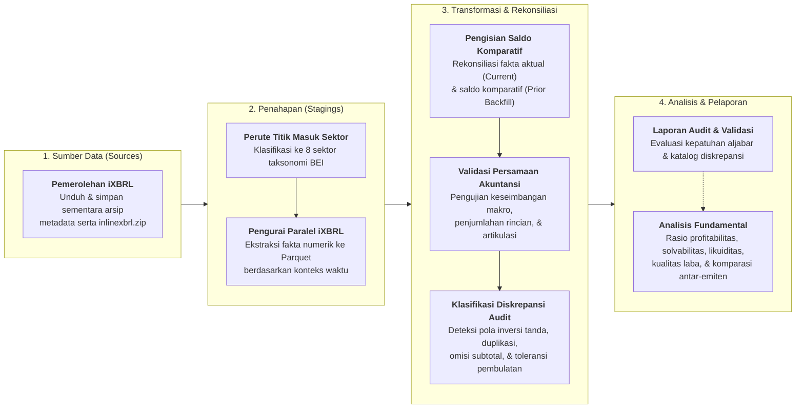
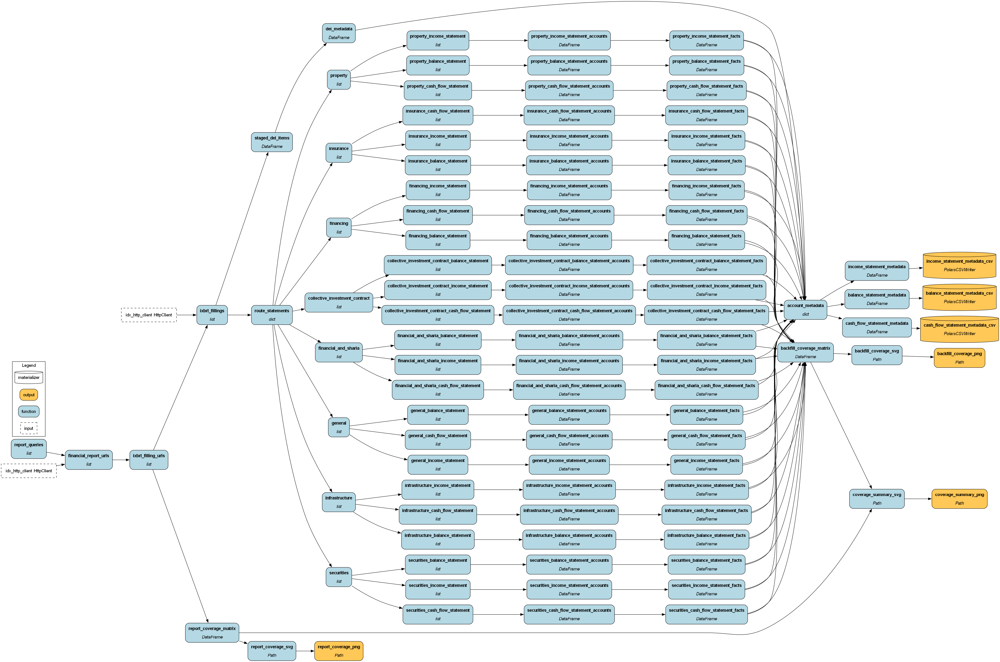
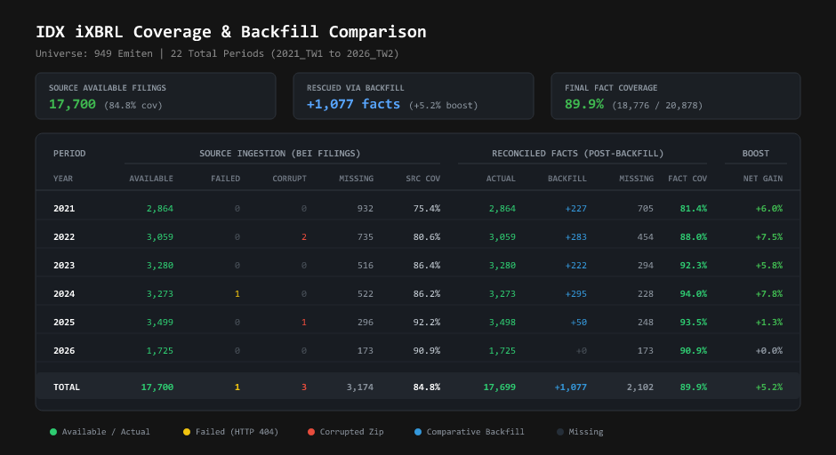

# IDX-Hamilton

Pipeline data dan analisis laporan keuangan emiten Bursa Efek Indonesia (BEI / IDX) berbasis [**Apache Hamilton**](https://hamilton.dagworks.io/) dan [**Polars**](https://pola.rs/) untuk periode **2020–2025** (`TW1`, `TW2`, `TW3`, `Audit`).

Repositori ini merupakan proyek jangka panjang dengan tujuan mengekstrak laporan keuangan berformat **Inline XBRL (`inlinexbrl.zip`)** dari BEI, merekonsiliasi fakta keuangan historis melalui mekanisme pengisian saldo komparatif (*comparative backfill*), memvalidasi integritas matematis laporan keuangan berdasarkan prinsip akuntansi, hingga menyediakan data terstruktur yang siap digunakan untuk analisis fundamental *end-to-end*.

---

## Arsitektur Alur Data (*End-to-End Pipeline*)



---

## Status Perkembangan & Fitur Utama

### 1. Rekonsiliasi & Pengisian Saldo Komparatif (*Comparative Backfill*)
Laporan keuangan emiten menyajikan data periode berjalan (*Current*) dan data komparatif periode sebelumnya (*Prior*). Pipeline ini menerapkan resolusi prioritas:
* **Fakta Aktual (*Actual Facts*)**: Memiliki prioritas utama (prioritas 1) dari pelaporan periode berjalan.
* **Fakta Komparatif (*Comparative Backfill*)**: Berperan sebagai penyelamat data historis (prioritas 2) untuk melengkapi kekosongan pengungkapan pada tahun-tahun terdahulu.
* Hasil rekonsiliasi menghasilkan kesinambungan data deret waktu (*time-series*) yang utuh bagi analisis fundamental multi-tahun.

### 2. Mesin Validasi Persamaan Akuntansi (*Accounting Equation Engine*)
Menguji integritas data secara aljabar menggunakan pendekatan berbasis domain (*Domain-Driven Design*):
* **Cakupan Pengujian**: 308 formula persamaan akuntansi lintas 8 sektor industri BEI.
* **Keseimbangan Makro (Horizontal)**: Menguji kesetaraan fundamental, seperti $\text{Aset} = \text{Liabilitas} + \text{Ekuitas}$.
* **Penjumlahan Rincian Vertikal (*Vertical Aggregation Rollup*)**: Memastikan seluruh pos rincian daun (*leaf accounts*) menjumlahkan secara tepat ke pos akun induk (*parent subtotal*).
* **Artikulasi Saldo Lintas Laporan (*Inter-Statement Articulation*)**: Menguji keterkaitan logis antar-laporan, seperti keselarasan saldo kas akhir pada Laporan Posisi Keuangan terhadap Laporan Arus Kas.

### 3. Klasifikasi Pola Varians Rekonsiliasi (*Reconciliation Pattern Classifier*)
Ketika terdapat perbedaan antara saldo target terlapor dan hasil rekalkulasi komponen, sistem mengidentifikasi pola karakteristik pelaporan secara objektif dan deterministik:
* **Inversi Tanda Aljabar**: Perbedaan konvensi tanda polaritas (+/-) antara formulir taksonomi pelaporan dan komponen penyusun saldo.
* **Omisi Subtotal Perantara**: Penyajian saldo langsung pada pos-pos rincian tanpa mengisi pos subtotal perantara, dengan total penjumlahan rincian yang setara terhadap saldo akun induk.
* **Pencatatan Berulang (*Duplicate Line Item*)**: Keberadaan nilai nominal identik pada pos rincian dan pos referensi terkait dalam taksonomi yang sama.
* **Penyajian Agregat (*Lump-Sum*)**: Pelaporan saldo terkonsolidasi pada akun utama tanpa penguraian lebih lanjut pada pos-pos rincian taksonomi.
* **Toleransi Pembulatan Wajar**: Deviasi minor (&le; 1,0%) yang bersumber dari pembulatan skala penyajian (misalnya penyajian dalam satuan jutaan rupiah) atau translasi mata uang asing.

---

## Dokumentasi Evaluasi & Validasi Saldo

Hasil evaluasi konsistensi matematis laporan keuangan disajikan secara terperinci pada dokumen berikut:

| Dokumen Laporan | Deskripsi |
| :--- | :--- |
| [`equation_validation_report.md`](docs/accounts/equation_validation_report.md) | **Laporan Evaluasi Konsistensi Persamaan Akuntansi**: Menyajikan tingkat keselarasan eksak (0 rupiah), tingkat keselarasan dalam toleransi pembulatan, rasio keandalan per sektor industri, serta ringkasan eksekutif keterhubungan saldo. |
| [`equation_mismatch_reports.md`](docs/accounts/equation_mismatch_reports.md) | **Dokumentasi Varians & Karakteristik Pelaporan**: Rincian karakteristik pengungkapan laporan keuangan yang memiliki varians aljabar, memuat formula pembanding, besaran varians rekonsiliasi, serta analisis pola penyajian. |

---

## Eksekusi DAG (`docs/dag_execution.png`)



Alur kerja DAG diatur melalui modul-modul berikut:
1. **Sources ([`src/idx_hamilton/sources.py`](src/idx_hamilton/sources.py))**: Mengunduh daftar pengumuman laporan keuangan dan mengarsipkan berkas mentah `inlinexbrl.zip` ke `.data/sources/`.
2. **Stagings ([`src/idx_hamilton/stagings/statement.py`](src/idx_hamilton/stagings/statement.py))**: Mengekstrak fakta taksonomi iXBRL secara paralel ke dalam format kolumnar Parquet per kuartal di `.data/stagings/statements/{entry_point}/{statement}/{year}_{period}.parquet`.
3. **Transformations ([`src/idx_hamilton/transformations/`](src/idx_hamilton/transformations/))**:
   - `backfilling.py`: Normalisasi tahun efektif dan rekonsiliasi prioritas fakta aktual versus komparatif.
   - `equations/`: Definisi spesifikasi persamaan akuntansi dan engine evaluasi vektor matematis.
   - `reconciliation/`: Penegakan aturan diagnostik audit untuk mengklasifikasikan varians laporan.
4. **Marts ([`src/idx_hamilton/marts/`](src/idx_hamilton/marts/))**: Pembuatan visualisasi matriks ketersediaan data, metadata pos keuangan, serta laporan analitik.

---

## Ringkasan Cakupan & Rekonsiliasi Data

Perbandingan ketersediaan berkas iXBRL mentah dari BEI (*Source Ingestion*) terhadap fakta keuangan yang berhasil direkonsiliasi dan diisi secara komparatif (*Reconciled Facts*):



---

## Kamus Akun & Skema Kanonik (*Account Dictionaries & Canonical Schema*)

Dokumentasi lengkap seluruh **942 akun laporan keuangan lintas sektor** (mencakup 8 titik masuk taksonomi iXBRL BEI) beserta kode hierarki, penjelasan, serta pemetaannya ke **52 Akun Kanonik Terpadu**:

| Laporan / Skema | Jumlah Akun | Kamus & Referensi (Markdown) | Metadata Cakupan (CSV) |
| :--- | :---: | :--- | :--- |
| **Canonical Accounts** (*Skema Terpadu*) | **52** *(dari 942 akun)* | [`canonical_accounts.md`](docs/accounts/canonical_accounts.md) | — |
| **Balance Statement** (Posisi Keuangan / Neraca) | **461** | [`balance_statement_accounts.md`](docs/accounts/balance_statement_accounts.md) | [`balance_statement_metadata.csv`](docs/accounts/balance_statement_metadata.csv) |
| **Income Statement** (Laba Rugi & Penghasilan Komprehensif Lain) | **189** | [`income_statement_accounts.md`](docs/accounts/income_statement_accounts.md) | [`income_statement_metadata.csv`](docs/accounts/income_statement_metadata.csv) |
| **Cash Flow Statement** (Arus Kas) | **292** | [`cash_flow_statement_accounts.md`](docs/accounts/cash_flow_statement_accounts.md) | [`cash_flow_statement_metadata.csv`](docs/accounts/cash_flow_statement_metadata.csv) |

---

## Panduan Menjalankan

Proyek ini dikelola menggunakan manajer paket [`uv`](https://docs.astral.sh/uv/):

```bash
# 1. Sinkronisasi dependensi lingkungan virtual
uv sync

# 2. Menjalankan pipeline utama Hamilton & pembaruan artefak
uv run idx-hamilton

# 3. Menjalankan audit validasi persamaan akuntansi
uv run python scripts/audit/generate_validation_report.py

# 4. Menjalankan audit rincian diskrepansi pelaporan emiten
uv run python scripts/audit/generate_mismatch_reports.py

# 5. Pengecekan kualitas kode & pemformatan (Ruff)
uv run ruff check src scripts
uv run ruff format src scripts
```

---

## Detail Matriks Cakupan (*Coverage Heatmaps Side-by-Side*)

Perbandingan matriks ketersediaan berkas mentah iXBRL terhadap fakta keuangan yang berhasil direkonsiliasi dan dilengkapi melalui pengisian komparatif (*comparative backfill*):

| 1. Ingestion Coverage (Berkas Mentah iXBRL) | 2. Backfill Coverage (Hasil Backfill) |
| :---: | :---: |
| [](docs/coverage_heatmap.svg)<br><sub>[Lihat format vektor SVG](docs/coverage_heatmap.svg)</sub> | [](docs/backfill_coverage_heatmap.svg)<br><sub>[Lihat format vektor SVG](docs/backfill_coverage_heatmap.svg)</sub> |
| **Legenda:**<br>🟩 Tersedia &amp; Valid<br>🟨 Gagal Unduh (HTTP 404 BEI)<br>🟥 Berkas Arsip Rusak (*Corrupted Zip*)<br>⬛ Belum Melantai di Bursa (*Pre-IPO*) / Kosong | **Legenda:**<br>🟩 Fakta Aktual Periode Berjalan (*Actual Fact*)<br>🟦 Pengisian Saldo Komparatif (*Comparative Backfill*)<br>⬛ Data Tidak Ditemukan (*Missing*) |
