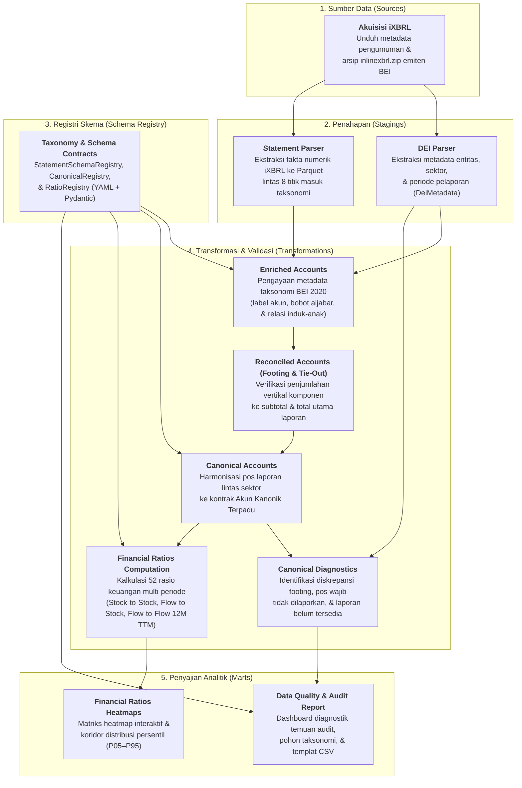

# IDX-Hamilton

Pipeline rekayasa data (*data engineering*) dan analitik laporan keuangan emiten Bursa Efek Indonesia (BEI / IDX) berbasis [**Apache Hamilton**](https://hamilton.dagworks.io/), [**Polars**](https://pola.rs/), dan [**Patito**](https://patito.readthedocs.io/).

Proyek ini mengekstrak laporan keuangan berformat **Inline XBRL (`inlinexbrl.zip`)**, memverifikasi konsistensi penjumlahan vertikal (*footing* / *tie-out*) berdasarkan relasi *XBRL calculation linkbase*, memetakan pos laporan lintas industri ke **Skema Akun Kanonik Terpadu**, serta mengkalkulasi **52 Rasio Keuangan** dan menyajikan **Laporan Audit Kualitas Data** dalam bentuk aplikasi web statis mandiri (*standalone HTML*).

---

## Arsitektur Pipeline (*Hamilton DAG*)

Pipeline dirancang sebagai *Directed Acyclic Graph* (DAG) deklaratif yang memisahkan tahap akuisisi, penahapan (*staging*), validasi hierarki akuntansi, harmonisasi skema lintas sektor, hingga penyajian analitik (*marts*).



Visualisasi penuh graf eksekusi materialisasi Hamilton tersimpan pada [`docs/dag_execution.png`](docs/dag_execution.png).

---

## Kapabilitas Utama & Metodologi

### 1. Ekstraksi Multi-Taksonomi BEI 2020
Taksonomi XBRL BEI 2020 mencakup **8 titik masuk (*entry points*)** sektoral dengan variasi metode penyajian laporan keuangan:
* **Titik Masuk Industri**: `general`, `financial_and_sharia`, `insurance`, `financing`, `securities`, `property`, `infrastructure`, dan `collective_investment_contract`.
* **Varian Penyajian**:
  * *Laporan Posisi Keuangan (Neraca)*: Terklasifikasi (*current & non-current*) dan berbasis likuiditas (*liquidity*).
  * *Laporan Laba Rugi*: Berdasarkan fungsi (*by function*) dan sifat beban (*by nature*), baik sebelum maupun setelah pajak (*before/after tax*).
  * *Laporan Arus Kas*: Metode langsung (*direct method*) dan metode tidak langsung (*indirect method*).

### 2. Verifikasi Penjumlahan Vertikal (*Footing & Tie-Out*)
Setiap laporan keuangan diuji konsistensi aritmatikanya secara deterministik berdasarkan struktur *XBRL calculation linkbase* sebelum digunakan dalam perhitungan hilir:
* **Pengujian Penjumlahan (*Footing*)**: Mengevaluasi apakah rincian pos komponen (`component` / `line_item`) dikalikan bobot aljabar (`weight` $+1.0$ atau $-1.0$) menjumlahkan secara tepat ke nilai pos perantara (`subtotal` / `sub_aggregate`) dan pos total utama (`major_aggregate` / `statement_heading`).
* **Rekomputasi Subtotal (`recomputed_subtotal`)**: Merekonstruksi nilai subtotal dari komponen yang terverifikasi apabila emiten tidak melaporkan nilai subtotal secara eksplisit namun komponen rinciannya lengkap dan konsisten.
* **Status Validasi Baku (`ValidationStatus`)**:
  * `FOOTING_VERIFIED`: Penjumlahan komponen cocok secara eksak dengan nilai subtotal terlapor.
  * `CONFIRMED_BY_MAJOR_AGGREGATE`: Subtotal terkonfirmasi selaras terhadap total utama laporan.
  * `RECOMPUTED_SUBTOTAL`: Subtotal berhasil direkonstruksi melalui rekomputasi komponen.
  * `VERIFIED_COMPONENT`: Pos komponen rincian di bawah subtotal yang telah terverifikasi.
  * `UNRECONCILED_COMPONENT`: Pos komponen di bawah subtotal yang mengalami selisih penjumlahan.
  * `ELIMINATED_DISCLOSURE`: Pos komponen dinolkan karena bertentangan dengan subtotal induk yang terkonfirmasi bernilai nol.
  * `STANDALONE_DISCLOSURE`: Pos pengungkapan mandiri tanpa keterikatan relasi kalkulasi pada taksonomi.
  * `UNRECONCILED_DIFFERENCE`: Pos gagal diverifikasi baik pada tingkat subtotal maupun total utama laporan (`unreconciled_difference`).

### 3. Harmonisasi Akun Kanonik (*Canonical Standardization*)
Perbedaan penamaan elemen XBRL antar-sektor dipetakan ke dalam **Skema Akun Kanonik Terpadu** (`src/idx_hamilton/schema/canonical.yaml`). Setiap akun kanonik divalidasi menggunakan skema `Patito` (`CanonicalAccount`) yang mempertahankan nilai terlapor (`reported_value`), nilai hasil rekonsiliasi (`value`), status validasi (`validation_status`), serta bendera kelayakan pakai (`is_usable`) agar pos yang mengandung `UNRECONCILED_DIFFERENCE` tidak mencemari perhitungan rasio.

### 4. Komputasi 52 Rasio Keuangan Multi-Periode
Mengalkulasi 52 rasio keuangan yang didefinisikan secara deklaratif pada `src/idx_hamilton/schema/ratios.yaml`:
* **Profitabilitas (*Profitability*)**: ROE (Total Equity & Parent Equity), ROA, Pre-Tax ROA, Gross Profit Margin (GPM), Operating Profit Margin (OPM), Net Profit Margin (NPM), EBITDA Margin, ROCE.
* **Likuiditas (*Liquidity*)**: Current Ratio, Quick Ratio, Cash Ratio, Operating Cash Flow to Current Liabilities.
* **Solvabilitas (*Solvency & Leverage*)**: Debt to Assets (DAR), Debt to Equity (DER), Long-Term Debt to Equity, Financial Leverage (Equity Multiplier), Net Debt to EBITDA.
* **Cakupan Beban (*Coverage*)**: Interest Coverage (EBIT & EBITDA basis), Debt Service Coverage Ratio (DSCR), Operating Cash Flow to Total Debt.
* **Efisiensi Aktivitas (*Efficiency & Turnover*)**: Asset Turnover, Fixed Asset Turnover, Receivables Turnover & DSO, Inventory Turnover & DSI, Payables Turnover & DPO, Cash Conversion Cycle (CCC).
* **Kualitas Arus Kas & Laba (*Cash Flow & Earnings Quality*)**: CFO to Net Income, OCF to Revenue, Free Cash Flow (FCF), FCF Margin, Capex to OCF, Capex to Depreciation.
* **Perpajakan (*Tax Analysis*)**: Effective Tax Rate (ETR).
* **Rasio Spesifik Perbankan**: CAR, NPL Gross & Net, LDR, NIM, BOPO, CASA Ratio, Cost to Income Ratio (CIR).
* **Rasio Spesifik Asuransi**: Retention Ratio, Loss Ratio, Expense Ratio, Combined Ratio, Investment Yield, Technical Reserve to Equity, Investment to Technical Reserve.

#### Basis Temporal & Status Integritas Rasio
* **Basis Waktu Evaluasi**:
  * `stock_to_stock`: Rasio posisi neraca pada titik waktu pelaporan (misal: *Current Ratio*, *DER*).
  * `flow_to_stock`: Akumulasi aliran 12 bulan bergulir (*12M Trailing Twelve Months / TTM*) dibagi rata-rata posisi neraca (*Average Balance Sheet*) (misal: *ROA*, *ROE*, *Asset Turnover*).
  * `flow_to_flow`: Perbandingan dua aliran 12M TTM (misal: *NPM*, *ETR*, *Interest Coverage*).
* **Klasifikasi Status Rasio (`RatioStatus`)**:
  * `VALID`: Komponen pembilang dan penyebut lengkap, lolos uji *footing*, dan penyebut memenuhi syarat domain ekonomi.
  * `NOT_MEANINGFUL` (`N/M`): Penyebut bernilai nol atau negatif pada rasio yang mensyaratkan penyebut positif (misal: ekuitas negatif/defisit pada ROE, atau rugi sebelum pajak pada ETR).
  * `INCOMPLETE_HISTORY` (`N/A`): Riwayat laporan kuartalan historis belum mencukupi untuk menyusun aliran 12M TTM secara utuh.
  * `UNRECONCILED_COMPONENT` (`UNREC`): Salah satu akun kanonik penyusun rasio tidak lolos verifikasi *footing* (`is_usable = False`).
  * `NOT_APPLICABLE`: Rasio spesifik industri tidak berlaku bagi titik masuk taksonomi emiten terkait.

### 5. Penyajian Analitik & Audit Kualitas Data (*Marts*)
Pipeline menghasilkan portal dokumentasi dan dua aplikasi analitik interaktif pada direktori [`docs/`](docs/index.html) yang dapat dijalankan langsung melalui server HTTP maupun secara luring (*offline* via protokol `file:///`):
1. **Portal Analitik Utama ([`docs/index.html`](docs/index.html))**: Halaman navigasi utama menuju dashboard analitik serta visualisasi silsilah eksekusi DAG Hamilton.
2. **Dashboard Audit Kualitas Data ([`docs/data_quality/index.html`](docs/data_quality/index.html))**:
   * Menampilkan daftar kerja (*audit worklist*) atas 3 kategori temuan: **Diskrepansi Penjumlahan (*Footing*)** (`INVALID_FOOTING`), **Pengungkapan Wajib Tidak Dilaporkan** (`MISSING_CANONICAL`), dan **Laporan Tidak Tersedia** (`MISSING_FILING`).
   * Menyediakan inspeksi struktur pohon hierarki taksonomi beserta bobot kalkulasi (`+1` / `-1`) dan fitur unduh berkas templat CSV rekonsiliasi per emiten/periode.
3. **Dashboard Heatmap Rasio Keuangan ([`docs/financial_ratios/index.html`](docs/financial_ratios/index.html))**:
   * Matriks *heatmap* lintas emiten dan periode dengan filter bertingkat (Sektor, Subsektor, Kode Saham).
   * Grafik **Koridor Distribusi Persentil (*Quantile Corridor*)** yang memetakan rentang P05–P95, rentang interkuartil P25–P75 (IQR), median P50 sektoral, serta posisi relatif (*peer ranking*) masing-masing emiten.

---

## Milestone & Peta Jalan Proyek (*Project Milestones*)

Pengembangan proyek dibagi ke dalam tahapan terukur berikut:

| Fase | Milestone | Status | Deskripsi & Capaian Teknis |
| :--- | :--- | :---: | :--- |
| **M1** | **Akuisisi & Penahapan Data iXBRL** | ✅ Selesai | Implementasi `IdxHttpClient`, ekstraksi arsip `inlinexbrl.zip`, parser metadata entitas (`dei.py`), dan parser fakta laporan keuangan (`statement.py`) ke penyimpanan terpartisi Parquet. |
| **M2** | **Registri Skema & Verifikasi *Footing* Taksonomi** | ✅ Selesai | Pemodelan kontrak YAML pohon kalkulasi XBRL untuk 8 titik masuk taksonomi BEI 2020 (`StatementSchemaRegistry`) serta verifikasi penjumlahan vertikal (`validation.py`) dengan 8 klasifikasi `ValidationStatus` dan rekomputasi subtotal. |
| **M3** | **Harmonisasi Akun Kanonik & Komputasi 52 Rasio** | ✅ Selesai | Pemetaan lintas sektor ke skema Akun Kanonik Terpadu (`canonical.py`) dan kalkulasi 52 rasio keuangan multi-periode berbasis *12M TTM* & rata-rata neraca (`ratios.py`) beserta status integritas rasio (`RatioStatus`). |
| **M4** | **Portal Analitik & Dashboard Audit Kualitas Data** | ✅ Selesai | Pembuatan dashboard statis *Financial Ratios Heatmaps* (`docs/financial_ratios/`) dan *Data Quality & Audit Report* (`docs/data_quality/`) lengkap dengan ekspor pohon taksonomi dan templat CSV rekonsiliasi. |

---

## Struktur Direktori Proyek

```text
idx-hamilton/
├── docs/                               # Artefak web statis (siap dipublikasikan ke GitHub Pages)
│   ├── index.html                      # Portal navigasi utama & diagram silsilah DAG
│   ├── dag_execution.png               # Visualisasi graf eksekusi materialisasi Hamilton
│   ├── financial_ratios/               # Dashboard matriks rasio keuangan & koridor persentil
│   │   ├── index.html                  # UI shell aplikasi heatmap rasio
│   │   ├── ratios_data.json            # Payload data rasio & distribusi persentil
│   │   └── ratios_data.js              # Pembungkus JS untuk akses luring (file:///)
│   └── data_quality/                   # Dashboard audit kualitas data & rekonsiliasi
│       ├── index.html                  # UI shell tabel diagnostik temuan audit
│       ├── records.json / records.js   # Data temuan footing, pos hilang, & laporan belum tersedia
│       └── statement_trees.json / .js  # Definisi pohon taksonomi & generator templat CSV
├── src/idx_hamilton/
│   ├── __init__.py                     # Entry point pipeline Hamilton, progress hook, & materializer
│   ├── models.py                       # Kelas dasar Patito Model & utilitas validasi skema
│   ├── resources.py                    # Klien HTTP terkelola untuk pengambilan data BEI
│   ├── sources.py                      # Node akuisisi daftar pengumuman & arsip inlinexbrl.zip
│   ├── schema/                         # Registri kontrak skema data & taksonomi XBRL BEI 2020
│   │   ├── base_schema.yaml            # Meta-skema validasi pohon laporan keuangan
│   │   ├── base_canonical_schema.yaml  # Meta-skema validasi pemetaan akun kanonik
│   │   ├── base_ratio_schema.yaml      # Meta-skema validasi spesifikasi rasio keuangan
│   │   ├── canonical.yaml / .py        # Definisi & loader pemetaan ke Akun Kanonik Terpadu
│   │   ├── ratios.yaml / .py           # Definisi & Pydantic model untuk 52 rasio keuangan
│   │   ├── statements.py               # Loader struktur hierarki laporan keuangan
│   │   ├── registry.py / nodes.py      # Registri terpusat & node penyedia skema di DAG Hamilton
│   │   └── <entry_point>/              # Definisi YAML pohon akun & pemetaan untuk 8 entry point
│   ├── stagings/
│   │   ├── dei.py                      # Parser Document & Entity Information (DeiMetadata)
│   │   └── statement.py                # Parser fakta numerik laporan keuangan iXBRL
│   ├── transformations/
│   │   ├── enriched.py                 # Pengayaan metadata taksonomi, label, & bobot kalkulasi
│   │   ├── validation.py               # Verifikasi footing vertikal & rekomputasi subtotal
│   │   ├── canonical.py                # Harmonisasi pos laporan ke Akun Kanonik Terpadu
│   │   └── ratios.py                   # Komputasi 52 rasio keuangan (12M TTM & rata-rata neraca)
│   └── marts/
│       ├── data_quality.py             # Diagnostik kualitas data & generator dashboard audit HTML
│       └── ratios.py                   # Generator dashboard heatmap rasio & koridor persentil HTML
└── tests/
    ├── marts/                          # Pengujian generator laporan kualitas data & rasio
    ├── schema/                         # Pengujian validitas YAML taksonomi & registri skema
    └── transformations/                # Pengujian logika footing, akun kanonik, & formula rasio
```

---

## Panduan Penggunaan

Proyek ini memerlukan **Python $\ge$ 3.14** dan dikelola menggunakan manajer paket [`uv`](https://docs.astral.sh/uv/).

### 1. Instalasi & Sinkronisasi Dependensi
```bash
uv sync
```

### 2. Menjalankan Pipeline *End-to-End*
Mengeksekusi seluruh tahapan DAG Hamilton mulai dari pembacaan sumber iXBRL, penahapan, pengayaan taksonomi, verifikasi *footing*, standarisasi akun kanonik, komputasi rasio, hingga pembuatan artefak Parquet di `.data/transformations/` serta laporan HTML di `docs/`:
```bash
uv run idx-hamilton
```
Atau melalui pemanggilan modul Python:
```bash
uv run python -c "import idx_hamilton; idx_hamilton.main()"
```

### 3. Menjalankan Pengujian (*Test Suite*)
Memverifikasi kontrak skema taksonomi, logika verifikasi *footing*, pemetaan akun kanonik, akurasi kalkulasi rasio, dan pembangkitan laporan HTML:
```bash
uv run pytest
```

### 4. Pemeriksaan Kualitas & Format Kode
```bash
uv run ruff check
uv run ruff format --check
```

---

## Penafian (*Disclaimer*)

1. **Inisiatif Riset Independen**: Proyek ini merupakan inisiatif rekayasa data independen dan **tidak terafiliasi dengan, didukung, atau disponsori oleh PT Bursa Efek Indonesia (BEI / IDX)** maupun Otoritas Jasa Keuangan (OJK).
2. **Tujuan Edukasi & Penelitian**: Perangkat lunak dan artefak data disediakan semata-mata untuk keperluan pengembangan arsitektur rekayasa data keuangan, penelitian metodologi XBRL, dan portofolio teknis non-komersial.
3. **Bukan Opini Audit atau Nasihat Investasi**: Status verifikasi *footing*, diagnostik kelengkapan akun, maupun rasio keuangan yang dihasilkan oleh sistem ini merupakan hasil pemrosesan algoritmik atas data publik dan bukan merupakan opini audit statutori akuntan publik ataupun rekomendasi investasi.
4. **Hak Milik Data**: Seluruh kode saham, nama emiten, dan dokumen laporan keuangan asli merupakan hak milik masing-masing emiten serta pemegang hak ciptanya.
