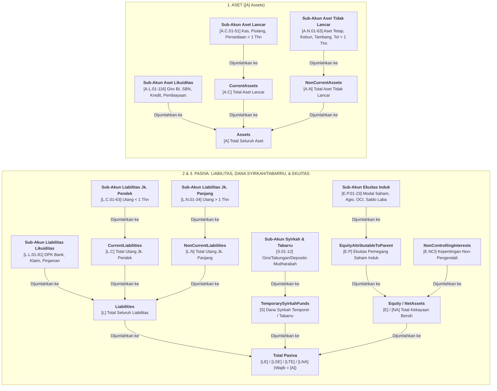

# Kamus Akun Neraca Lintas Sektor (`balance_statement`)

Kamus ini mencakup seluruh **461 akun Laporan Posisi Keuangan (Neraca)** dari seluruh *entry point* taksonomi iXBRL Bursa Efek Indonesia (`general`, `financial_and_sharia`, `financing`, `insurance`, `securities`, `property`, `infrastructure`, dan `collective_investment_contract`).

1. **Aset (`[A]`)**
2. **Liabilitas & Dana Syirkah Temporer (`[L]` & `[S]`)**
3. **Ekuitas & Aset Neto (`[E]`, `[NA]`, `[LE]`, `[LSE]`, `[LTE]`, `[LNA]`)**
4. **Glosarium Istilah & Singkatan Keuangan**

## Kode Sektor & Subsektor (IDX-IC & JASICA)

| Kode Sektor | Nama Sektor | Kode & Nama Subsektor |
| :--- | :--- | :--- |
| `A` | **Energy** | `A1` Oil, Gas & Coal · `A2` Alternative Energy |
| `B` | **Basic Materials** | `B1` Basic Materials |
| `C` | **Industrials** | `C1` Industrial Goods · `C2` Industrial Services · `C3` Multi-sector Holdings |
| `D` | **Consumer Non-Cyclicals** | `D1` Food & Staples Retailing · `D2` Food & Beverage · `D3` Tobacco · `D4` Nondurable Household Products |
| `E` | **Consumer Cyclicals** | `E1` Automobiles & Components · `E2` Household Goods · `E3` Leisure Goods · `E4` Apparel & Luxury Goods · `E5` Consumer Services · `E6` Media & Entertainment · `E7` Retailing |
| `F` | **Healthcare** | `F1` Healthcare Equipment & Providers · `F2` Pharmaceuticals & Health Care Research |
| `G` | **Financials** | `G1` Banks · `G2` Financing Service · `G3` Investment Service · `G4` Insurance · `G5` Holding & Investment Companies |
| `H` | **Properties & Real Estate** | `H1` Properties & Real Estate |
| `I` | **Technology** | `I1` Software & IT Services · `I2` Technology Hardware & Equipment |
| `J` | **Infrastructures** | `J1` Transportation Infrastructure · `J2` Heavy Constructions & Civil Engineering · `J3` Telecommunication · `J4` Utilities |
| `K` | **Transportation & Logistic** | `K1` Transportation · `K2` Logistics & Deliveries |
| `1`, `6`, `9` | **Klasifikasi Lama (JASICA)** | `1` Agriculture (`12` Plantation) · `6` Property, Real Estate & Building Construction (`61` Property & Real Estate) · `9` Trade, Services & Investment (`91` Wholesale, `97` Computer & Services, `98` Investment Company) |

## Struktur Hierarki Neraca Lintas Sektor

---

## 1. Aset (`Assets`)

### 1.1 Akun Utama Aset

<table width="100%">
  <colgroup>
    <col width="34%" />
    <col width="34%" />
    <col width="32%" />
  </colgroup>
  <thead>
    <tr>
      <th align="left" width="34%">Penjelasan / Variants</th>
      <th align="left" width="34%">Saran Analisis / Sectors</th>
      <th align="left" width="32%">Entry Points / Subsectors</th>
    </tr>
  </thead>
  <tbody>
    <tr>
      <td colspan="3"><code>[A]</code> <b><code>Assets</code></b></td>
    </tr>
    <tr>
      <td width="34%" valign="top"><b>Total Aset</b>: Jumlah seluruh harta yang dikuasai perusahaan (<code>[A.C]</code> + <code>[A.N]</code>).</td>
      <td width="34%" valign="top">Gunakan sebagai pembagi utama untuk menghitung <i>Return on Assets</i> (<b>ROA</b>) dan <i>Asset Turnover</i> (efisiensi perputaran aset).</td>
      <td width="32%" valign="top"><b>Entry Points:</b> <code>all_entry_points</code></td>
    </tr>
    <tr>
      <td width="34%" valign="top"><b>Variants:</b> <code>all_variants</code></td>
      <td width="34%" valign="top"><b>Sectors:</b> <code>all_sectors</code></td>
      <td width="32%" valign="top"><b>Subsectors:</b> <code>all_subsectors</code></td>
    </tr>
<tr>
      <td colspan="3">&nbsp;</td>
    </tr>
    <tr>
      <td colspan="3"><code>[A.C]</code> <b><code>CurrentAssets</code></b></td>
    </tr>
    <tr>
      <td width="34%" valign="top"><b>Jumlah Aset Lancar</b>: Subtotal seluruh harta yang dapat dicairkan menjadi uang tunai atau habis dipakai dalam waktu &lt; 12 bulan.</td>
      <td width="34%" valign="top">Bandingkan dengan <code>[L.C]</code> untuk menghitung <b>Current Ratio</b>. Idealnya &gt; 1.2&times; agar aman dari risiko gagal bayar jangka pendek.</td>
      <td width="32%" valign="top"><b>Entry Points:</b> <code>general</code>, <code>infrastructure</code>, <code>property</code></td>
    </tr>
    <tr>
      <td width="34%" valign="top"><b>Variants:</b> <code>current_and_non_current</code></td>
      <td width="34%" valign="top"><b>Sectors:</b> <code>all_sectors</code></td>
      <td width="32%" valign="top"><b>Subsectors:</b> <code>12. Plantation</code>, <code>61. Property And Real Estate</code>, <code>91. Wholesale (Durable & Non-Durable Goods)</code>, <code>97. Computer And Services</code>, <code>98. Investment Company</code>, <code>A1. Oil</code>, <code>Gas & Coal</code>, <code>A2. Alternative Energy</code>, <code>B1. Basic Materials</code>, <code>C1. Industrial Goods</code>, <code>C2. Industrial Services</code>, <code>C3. Multi-sector Holdings</code>, <code>D1. Food & Staples Retailing</code>, <code>D2. Food & Beverage</code>, <code>D3. Tobacco</code>, <code>D4. Nondurable Household Products</code>, <code>E1. Automobiles & Components</code>, <code>E2. Household Goods</code>, <code>E3. Leisure Goods</code>, <code>E4. Apparel & Luxury Goods</code>, <code>E5. Consumer Services</code>, <code>E6. Media & Entertainment</code>, <code>E7. Retailing</code>, <code>F1. Healthcare Equipment & Providers</code>, <code>F2. Pharmaceuticals & Health Care Research</code>, <code>G5. Holding & Investment Companies</code>, <code>H1. Properties & Real Estate</code>, <code>I1. Software & IT Services</code>, <code>I2. Technology Hardware & Equipment</code>, <code>J1. Transportation Infrastructure</code>, <code>J2. Heavy Constructions & Civil Engineering</code>, <code>J3. Telecommunication</code>, <code>J4. Utilities</code>, <code>K1. Transportation</code>, <code>K2. Logistics & Deliveries</code></td>
    </tr>
<tr>
      <td colspan="3">&nbsp;</td>
    </tr>
    <tr>
      <td colspan="3"><code>[A.N]</code> <b><code>NonCurrentAssets</code></b></td>
    </tr>
    <tr>
      <td width="34%" valign="top"><b>Jumlah Aset Tidak Lancar</b>: Subtotal seluruh harta operasional dan investasi jangka panjang yang masa manfaatnya &gt; 12 bulan.</td>
      <td width="34%" valign="top">Porsi yang tinggi terhadap total <code>[A]</code> menandakan bisnis padat modal (<i>capital-intensive</i> / <i>asset-heavy</i>).</td>
      <td width="32%" valign="top"><b>Entry Points:</b> <code>general</code>, <code>infrastructure</code>, <code>property</code></td>
    </tr>
    <tr>
      <td width="34%" valign="top"><b>Variants:</b> <code>current_and_non_current</code></td>
      <td width="34%" valign="top"><b>Sectors:</b> <code>all_sectors</code></td>
      <td width="32%" valign="top"><b>Subsectors:</b> <code>12. Plantation</code>, <code>61. Property And Real Estate</code>, <code>91. Wholesale (Durable & Non-Durable Goods)</code>, <code>97. Computer And Services</code>, <code>98. Investment Company</code>, <code>A1. Oil</code>, <code>Gas & Coal</code>, <code>A2. Alternative Energy</code>, <code>B1. Basic Materials</code>, <code>C1. Industrial Goods</code>, <code>C2. Industrial Services</code>, <code>C3. Multi-sector Holdings</code>, <code>D1. Food & Staples Retailing</code>, <code>D2. Food & Beverage</code>, <code>D3. Tobacco</code>, <code>D4. Nondurable Household Products</code>, <code>E1. Automobiles & Components</code>, <code>E2. Household Goods</code>, <code>E3. Leisure Goods</code>, <code>E4. Apparel & Luxury Goods</code>, <code>E5. Consumer Services</code>, <code>E6. Media & Entertainment</code>, <code>E7. Retailing</code>, <code>F1. Healthcare Equipment & Providers</code>, <code>F2. Pharmaceuticals & Health Care Research</code>, <code>G5. Holding & Investment Companies</code>, <code>H1. Properties & Real Estate</code>, <code>I1. Software & IT Services</code>, <code>I2. Technology Hardware & Equipment</code>, <code>J1. Transportation Infrastructure</code>, <code>J2. Heavy Constructions & Civil Engineering</code>, <code>J3. Telecommunication</code>, <code>J4. Utilities</code>, <code>K1. Transportation</code>, <code>K2. Logistics & Deliveries</code></td>
    </tr>
</tbody>
</table>

### 1.2 Kas, Giro BI, Penempatan Antarbank, Deposito, & Dana Dibatasi Penggunaannya

<table width="100%">
  <colgroup>
    <col width="34%" />
    <col width="34%" />
    <col width="32%" />
  </colgroup>
  <thead>
    <tr>
      <th align="left" width="34%">Penjelasan / Variants</th>
      <th align="left" width="34%">Saran Analisis / Sectors</th>
      <th align="left" width="32%">Entry Points / Subsectors</th>
    </tr>
  </thead>
  <tbody>
    <tr>
      <td colspan="3"><code>[A.C.01]</code> <b><code>CashAndCashEquivalents</code></b></td>
    </tr>
    <tr>
      <td width="34%" valign="top">Uang tunai di brankas, saldo rekening giro bank, dan deposito berjangka &le; 3 bulan yang bebas digunakan kapan saja tanpa penalti.</td>
      <td width="34%" valign="top">Indikator likuiditas paling murni. Gunakan untuk menghitung <b>Cash Ratio</b> dan <b>Net Cash / Net Debt</b> (Kas dikurangi Total Utang Berbunga).</td>
      <td width="32%" valign="top"><b>Entry Points:</b> <code>financing</code>, <code>general</code>, <code>infrastructure</code>, <code>insurance</code>, <code>property</code>, <code>securities</code></td>
    </tr>
    <tr>
      <td width="34%" valign="top"><b>Variants:</b> <code>all_variants</code></td>
      <td width="34%" valign="top"><b>Sectors:</b> <code>all_sectors</code></td>
      <td width="32%" valign="top"><b>Subsectors:</b> <code>12. Plantation</code>, <code>61. Property And Real Estate</code>, <code>91. Wholesale (Durable & Non-Durable Goods)</code>, <code>97. Computer And Services</code>, <code>98. Investment Company</code>, <code>A1. Oil</code>, <code>Gas & Coal</code>, <code>A2. Alternative Energy</code>, <code>B1. Basic Materials</code>, <code>C1. Industrial Goods</code>, <code>C2. Industrial Services</code>, <code>C3. Multi-sector Holdings</code>, <code>D1. Food & Staples Retailing</code>, <code>D2. Food & Beverage</code>, <code>D3. Tobacco</code>, <code>D4. Nondurable Household Products</code>, <code>E1. Automobiles & Components</code>, <code>E2. Household Goods</code>, <code>E3. Leisure Goods</code>, <code>E4. Apparel & Luxury Goods</code>, <code>E5. Consumer Services</code>, <code>E6. Media & Entertainment</code>, <code>E7. Retailing</code>, <code>F1. Healthcare Equipment & Providers</code>, <code>F2. Pharmaceuticals & Health Care Research</code>, <code>G2. Financing Service</code>, <code>G3. Investment Service</code>, <code>G4. Insurance</code>, <code>G5. Holding & Investment Companies</code>, <code>H1. Properties & Real Estate</code>, <code>I1. Software & IT Services</code>, <code>I2. Technology Hardware & Equipment</code>, <code>J1. Transportation Infrastructure</code>, <code>J2. Heavy Constructions & Civil Engineering</code>, <code>J3. Telecommunication</code>, <code>J4. Utilities</code>, <code>K1. Transportation</code>, <code>K2. Logistics & Deliveries</code></td>
    </tr>
<tr>
      <td colspan="3">&nbsp;</td>
    </tr>
    <tr>
      <td colspan="3"><code>[A.C.02]</code> <b><code>CurrentDeposits</code></b></td>
    </tr>
    <tr>
      <td width="34%" valign="top">Penempatan deposito berjangka (&gt; 3 bulan s/d 1 tahun) atau uang jaminan jangka pendek.</td>
      <td width="34%" valign="top">Meski tidak masuk kategori setara kas, akun ini sangat likuid dan bisa ditambahkan sebagai cadangan kas (<i>near-cash</i>).</td>
      <td width="32%" valign="top"><b>Entry Points:</b> <code>general</code>, <code>infrastructure</code>, <code>property</code></td>
    </tr>
    <tr>
      <td width="34%" valign="top"><b>Variants:</b> <code>current_and_non_current</code></td>
      <td width="34%" valign="top"><b>Sectors:</b> <code>6. Property</code>, <code>Real Estate And Building Construction</code>, <code>A. Energy</code>, <code>B. Basic Materials</code>, <code>C. Industrials</code>, <code>D. Consumer Non-Cyclicals</code>, <code>E. Consumer Cyclicals</code>, <code>G. Financials</code>, <code>H. Properties & Real Estate</code>, <code>I. Technology</code>, <code>J. Infrastructures</code>, <code>K. Transportation & Logistic</code></td>
      <td width="32%" valign="top"><b>Subsectors:</b> <code>61. Property And Real Estate</code>, <code>A1. Oil</code>, <code>Gas & Coal</code>, <code>B1. Basic Materials</code>, <code>C1. Industrial Goods</code>, <code>C2. Industrial Services</code>, <code>C3. Multi-sector Holdings</code>, <code>D2. Food & Beverage</code>, <code>E1. Automobiles & Components</code>, <code>E5. Consumer Services</code>, <code>E7. Retailing</code>, <code>G5. Holding & Investment Companies</code>, <code>H1. Properties & Real Estate</code>, <code>I2. Technology Hardware & Equipment</code>, <code>J2. Heavy Constructions & Civil Engineering</code>, <code>J3. Telecommunication</code>, <code>J4. Utilities</code>, <code>K1. Transportation</code>, <code>K2. Logistics & Deliveries</code></td>
    </tr>
<tr>
      <td colspan="3">&nbsp;</td>
    </tr>
    <tr>
      <td colspan="3"><code>[A.C.03]</code> <b><code>CurrentRestrictedFunds</code></b></td>
    </tr>
    <tr>
      <td width="34%" valign="top">Dana kas/bank jangka pendek (&lt; 1 tahun) yang dibekukan/dikunci sebagai jaminan utang atau proyek.</td>
      <td width="34%" valign="top"><b>Jangan dimasukkan ke perhitungan kas bebas</b> karena tidak bisa dipakai membayar operasional atau dividen.</td>
      <td width="32%" valign="top"><b>Entry Points:</b> <code>general</code>, <code>infrastructure</code>, <code>property</code></td>
    </tr>
    <tr>
      <td width="34%" valign="top"><b>Variants:</b> <code>current_and_non_current</code></td>
      <td width="34%" valign="top"><b>Sectors:</b> <code>6. Property</code>, <code>Real Estate And Building Construction</code>, <code>9. Trade</code>, <code>Services & Investment</code>, <code>A. Energy</code>, <code>B. Basic Materials</code>, <code>C. Industrials</code>, <code>D. Consumer Non-Cyclicals</code>, <code>E. Consumer Cyclicals</code>, <code>F. Healthcare</code>, <code>G. Financials</code>, <code>H. Properties & Real Estate</code>, <code>I. Technology</code>, <code>J. Infrastructures</code>, <code>K. Transportation & Logistic</code></td>
      <td width="32%" valign="top"><b>Subsectors:</b> <code>61. Property And Real Estate</code>, <code>97. Computer And Services</code>, <code>A1. Oil</code>, <code>Gas & Coal</code>, <code>B1. Basic Materials</code>, <code>C1. Industrial Goods</code>, <code>C2. Industrial Services</code>, <code>C3. Multi-sector Holdings</code>, <code>D1. Food & Staples Retailing</code>, <code>D2. Food & Beverage</code>, <code>E1. Automobiles & Components</code>, <code>E2. Household Goods</code>, <code>E3. Leisure Goods</code>, <code>E4. Apparel & Luxury Goods</code>, <code>E5. Consumer Services</code>, <code>E6. Media & Entertainment</code>, <code>E7. Retailing</code>, <code>F1. Healthcare Equipment & Providers</code>, <code>F2. Pharmaceuticals & Health Care Research</code>, <code>G5. Holding & Investment Companies</code>, <code>H1. Properties & Real Estate</code>, <code>I1. Software & IT Services</code>, <code>I2. Technology Hardware & Equipment</code>, <code>J1. Transportation Infrastructure</code>, <code>J2. Heavy Constructions & Civil Engineering</code>, <code>J3. Telecommunication</code>, <code>J4. Utilities</code>, <code>K1. Transportation</code>, <code>K2. Logistics & Deliveries</code></td>
    </tr>
<tr>
      <td colspan="3">&nbsp;</td>
    </tr>
    <tr>
      <td colspan="3"><code>[A.N.01]</code> <b><code>NonCurrentDeposits</code></b></td>
    </tr>
    <tr>
      <td width="34%" valign="top">Uang jaminan (<i>security deposit</i>) jangka panjang yang disetorkan ke pihak lain (misal: jaminan sewa gedung, jaminan listrik PLN).</td>
      <td width="34%" valign="top">Tidak bisa dipakai untuk belanja operasional karena tertahan selama kontrak berlangsung.</td>
      <td width="32%" valign="top"><b>Entry Points:</b> <code>general</code>, <code>infrastructure</code>, <code>property</code></td>
    </tr>
    <tr>
      <td width="34%" valign="top"><b>Variants:</b> <code>current_and_non_current</code></td>
      <td width="34%" valign="top"><b>Sectors:</b> <code>6. Property</code>, <code>Real Estate And Building Construction</code>, <code>A. Energy</code>, <code>B. Basic Materials</code>, <code>C. Industrials</code>, <code>D. Consumer Non-Cyclicals</code>, <code>E. Consumer Cyclicals</code>, <code>G. Financials</code>, <code>H. Properties & Real Estate</code>, <code>I. Technology</code>, <code>J. Infrastructures</code>, <code>K. Transportation & Logistic</code></td>
      <td width="32%" valign="top"><b>Subsectors:</b> <code>61. Property And Real Estate</code>, <code>A1. Oil</code>, <code>Gas & Coal</code>, <code>B1. Basic Materials</code>, <code>C1. Industrial Goods</code>, <code>C3. Multi-sector Holdings</code>, <code>D1. Food & Staples Retailing</code>, <code>D2. Food & Beverage</code>, <code>D4. Nondurable Household Products</code>, <code>E2. Household Goods</code>, <code>E5. Consumer Services</code>, <code>E6. Media & Entertainment</code>, <code>E7. Retailing</code>, <code>G5. Holding & Investment Companies</code>, <code>H1. Properties & Real Estate</code>, <code>I1. Software & IT Services</code>, <code>J1. Transportation Infrastructure</code>, <code>J2. Heavy Constructions & Civil Engineering</code>, <code>J4. Utilities</code>, <code>K1. Transportation</code></td>
    </tr>
<tr>
      <td colspan="3">&nbsp;</td>
    </tr>
    <tr>
      <td colspan="3"><code>[A.N.02]</code> <b><code>NonCurrentRestrictedFunds</code></b></td>
    </tr>
    <tr>
      <td width="34%" valign="top">Dana kas/rekening bank yang dikunci lebih dari 1 tahun sebagai jaminan kredit bank, dana cadangan reklamasi, atau <i>escrow account</i>.</td>
      <td width="34%" valign="top">Jika angkanya besar, artinya bank kreditur meminta jaminan tunai ketat atas pinjaman perusahaan.</td>
      <td width="32%" valign="top"><b>Entry Points:</b> <code>general</code>, <code>infrastructure</code>, <code>property</code></td>
    </tr>
    <tr>
      <td width="34%" valign="top"><b>Variants:</b> <code>current_and_non_current</code></td>
      <td width="34%" valign="top"><b>Sectors:</b> <code>9. Trade</code>, <code>Services & Investment</code>, <code>A. Energy</code>, <code>B. Basic Materials</code>, <code>C. Industrials</code>, <code>D. Consumer Non-Cyclicals</code>, <code>E. Consumer Cyclicals</code>, <code>F. Healthcare</code>, <code>G. Financials</code>, <code>H. Properties & Real Estate</code>, <code>I. Technology</code>, <code>J. Infrastructures</code>, <code>K. Transportation & Logistic</code></td>
      <td width="32%" valign="top"><b>Subsectors:</b> <code>97. Computer And Services</code>, <code>A1. Oil</code>, <code>Gas & Coal</code>, <code>A2. Alternative Energy</code>, <code>B1. Basic Materials</code>, <code>C1. Industrial Goods</code>, <code>C2. Industrial Services</code>, <code>C3. Multi-sector Holdings</code>, <code>D1. Food & Staples Retailing</code>, <code>D2. Food & Beverage</code>, <code>D4. Nondurable Household Products</code>, <code>E1. Automobiles & Components</code>, <code>E4. Apparel & Luxury Goods</code>, <code>E5. Consumer Services</code>, <code>E6. Media & Entertainment</code>, <code>E7. Retailing</code>, <code>F1. Healthcare Equipment & Providers</code>, <code>G5. Holding & Investment Companies</code>, <code>H1. Properties & Real Estate</code>, <code>I1. Software & IT Services</code>, <code>I2. Technology Hardware & Equipment</code>, <code>J1. Transportation Infrastructure</code>, <code>J2. Heavy Constructions & Civil Engineering</code>, <code>J3. Telecommunication</code>, <code>J4. Utilities</code>, <code>K1. Transportation</code>, <code>K2. Logistics & Deliveries</code></td>
    </tr>
<tr>
      <td colspan="3">&nbsp;</td>
    </tr>
    <tr>
      <td colspan="3"><code>[A.L.01]</code> <b><code>Deposits</code></b></td>
    </tr>
    <tr>
      <td width="34%" valign="top">Penempatan deposito berjangka atau uang jaminan pada format neraca berbasis likuiditas.</td>
      <td width="34%" valign="top">Periksa di CALK berapa porsi yang berupa deposito cair vs uang jaminan terkunci.</td>
      <td width="32%" valign="top"><b>Entry Points:</b> <code>general</code>, <code>infrastructure</code>, <code>property</code></td>
    </tr>
    <tr>
      <td width="34%" valign="top"><b>Variants:</b> <code>liquidity</code></td>
      <td width="34%" valign="top"><b>Sectors:</b> <code>G. Financials</code>, <code>K. Transportation & Logistic</code></td>
      <td width="32%" valign="top"><b>Subsectors:</b> <code>G5. Holding & Investment Companies</code>, <code>K1. Transportation</code></td>
    </tr>
<tr>
      <td colspan="3">&nbsp;</td>
    </tr>
    <tr>
      <td colspan="3"><code>[A.L.02]</code> <b><code>RestrictedFunds</code></b></td>
    </tr>
    <tr>
      <td width="34%" valign="top">Dana kas/bank yang dibatasi penggunaannya (dijaminkan) pada format neraca berbasis likuiditas.</td>
      <td width="34%" valign="top">Keluarkan dari komponen <i>Cash & Cash Equivalents</i> saat menilai likuiditas riil perusahaan.</td>
      <td width="32%" valign="top"><b>Entry Points:</b> <code>financial_and_sharia</code>, <code>general</code>, <code>infrastructure</code>, <code>property</code>, <code>securities</code></td>
    </tr>
    <tr>
      <td width="34%" valign="top"><b>Variants:</b> <code>liquidity</code></td>
      <td width="34%" valign="top"><b>Sectors:</b> <code>A. Energy</code>, <code>C. Industrials</code>, <code>E. Consumer Cyclicals</code>, <code>G. Financials</code>, <code>K. Transportation & Logistic</code></td>
      <td width="32%" valign="top"><b>Subsectors:</b> <code>A1. Oil</code>, <code>Gas & Coal</code>, <code>C2. Industrial Services</code>, <code>E1. Automobiles & Components</code>, <code>G2. Financing Service</code>, <code>G3. Investment Service</code>, <code>G5. Holding & Investment Companies</code>, <code>K1. Transportation</code></td>
    </tr>
<tr>
      <td colspan="3">&nbsp;</td>
    </tr>
    <tr>
      <td colspan="3"><code>[A.L.20]</code> <b><code>Cash</code></b></td>
    </tr>
    <tr>
      <td width="34%" valign="top"><b>Kas (Uang Tunai &amp; Khazanah)</b>: Uang kartal (kertas dan logam) dalam mata uang Rupiah maupun valuta asing yang berada di brankas kantor cabang dan mesin ATM bank.</td>
      <td width="34%" valign="top">Komponen likuiditas lapis pertama (<i>primary reserve</i>) perbankan untuk melayani penarikan tunai harian nasabah. Tidak menghasilkan pendapatan bunga.</td>
      <td width="32%" valign="top"><b>Entry Points:</b> <code>financial_and_sharia</code></td>
    </tr>
    <tr>
      <td width="34%" valign="top"><b>Variants:</b> <code>liquidity</code></td>
      <td width="34%" valign="top"><b>Sectors:</b> <code>G. Financials</code>, <code>H. Properties & Real Estate</code></td>
      <td width="32%" valign="top"><b>Subsectors:</b> <code>G1. Banks</code>, <code>G2. Financing Service</code>, <code>G4. Insurance</code>, <code>G5. Holding & Investment Companies</code>, <code>H1. Properties & Real Estate</code></td>
    </tr>
<tr>
      <td colspan="3">&nbsp;</td>
    </tr>
    <tr>
      <td colspan="3"><code>[A.L.21]</code> <b><code>Current<wbr>Accounts<wbr>With<wbr>Bank<wbr>Indonesia</code></b></td>
    </tr>
    <tr>
      <td width="34%" valign="top"><b>Giro pada Bank Indonesia</b>: Saldo rekening giro milik bank yang ditempatkan di Bank Indonesia, termasuk pemenuhan kewajiban <b>Giro Wajib Minimum (GWM)</b>.</td>
      <td width="34%" valign="top">Indikator kepatuhan likuiditas regulasi BI. Sebagian besar saldo ini bersifat terkunci sebagai GWM primer/sekunder sesuai porsi Dana Pihak Ketiga (DPK).</td>
      <td width="32%" valign="top"><b>Entry Points:</b> <code>financial_and_sharia</code>, <code>financing</code></td>
    </tr>
    <tr>
      <td width="34%" valign="top"><b>Variants:</b> <code>liquidity</code></td>
      <td width="34%" valign="top"><b>Sectors:</b> <code>G. Financials</code>, <code>H. Properties & Real Estate</code></td>
      <td width="32%" valign="top"><b>Subsectors:</b> <code>G1. Banks</code>, <code>G2. Financing Service</code>, <code>G5. Holding & Investment Companies</code>, <code>H1. Properties & Real Estate</code></td>
    </tr>
<tr>
      <td colspan="3">&nbsp;</td>
    </tr>
    <tr>
      <td colspan="3"><code>[A.L.22]</code> <b><code>Current<wbr>Accounts<wbr>With<wbr>Other<wbr>Banks<wbr>Third<wbr>Parties</code></b></td>
    </tr>
    <tr>
      <td width="34%" valign="top"><b>Giro pada Bank Lain — Pihak Ketiga</b>: Saldo rekening giro milik bank atau lembaga pembiayaan yang ditempatkan pada bank koresponden (non-afiliasi) di dalam maupun luar negeri.</td>
      <td width="34%" valign="top">Digunakan untuk kelancaran transaksi kliring, transfer lintas bank, dan penyelesaian transaksi valas/<i>letter of credit</i> (L/C).</td>
      <td width="32%" valign="top"><b>Entry Points:</b> <code>financial_and_sharia</code>, <code>financing</code></td>
    </tr>
    <tr>
      <td width="34%" valign="top"><b>Variants:</b> <code>liquidity</code></td>
      <td width="34%" valign="top"><b>Sectors:</b> <code>E. Consumer Cyclicals</code>, <code>G. Financials</code>, <code>H. Properties & Real Estate</code>, <code>I. Technology</code></td>
      <td width="32%" valign="top"><b>Subsectors:</b> <code>E6. Media & Entertainment</code>, <code>G1. Banks</code>, <code>G2. Financing Service</code>, <code>G4. Insurance</code>, <code>G5. Holding & Investment Companies</code>, <code>H1. Properties & Real Estate</code>, <code>I2. Technology Hardware & Equipment</code></td>
    </tr>
<tr>
      <td colspan="3">&nbsp;</td>
    </tr>
    <tr>
      <td colspan="3"><code>[A.L.23]</code> <b><code>Current<wbr>Accounts<wbr>With<wbr>Other<wbr>Banks<wbr>Related<wbr>Parties</code></b></td>
    </tr>
    <tr>
      <td width="34%" valign="top"><b>Giro pada Bank Lain — Pihak Berelasi</b>: Saldo rekening giro yang ditempatkan pada bank lain yang masih berada dalam satu grup/entitas sepengendali.</td>
      <td width="34%" valign="top">Perhatikan konsentrasi penempatan dana likuid pada bank afiliasi.</td>
      <td width="32%" valign="top"><b>Entry Points:</b> <code>financial_and_sharia</code>, <code>financing</code></td>
    </tr>
    <tr>
      <td width="34%" valign="top"><b>Variants:</b> <code>liquidity</code></td>
      <td width="34%" valign="top"><b>Sectors:</b> <code>E. Consumer Cyclicals</code>, <code>G. Financials</code>, <code>I. Technology</code></td>
      <td width="32%" valign="top"><b>Subsectors:</b> <code>E6. Media & Entertainment</code>, <code>G1. Banks</code>, <code>G2. Financing Service</code>, <code>I2. Technology Hardware & Equipment</code></td>
    </tr>
<tr>
      <td colspan="3">&nbsp;</td>
    </tr>
    <tr>
      <td colspan="3"><code>[A.L.24]</code> <b><code>Allowance<wbr>For<wbr>Impairment<wbr>Losses<wbr>For<wbr>Current<wbr>Accounts<wbr>With<wbr>Other<wbr>Banks</code></b></td>
    </tr>
    <tr>
      <td width="34%" valign="top"><b>CKPN Giro pada Bank Lain</b>: Cadangan kerugian penurunan nilai (<i>contra-asset</i>) atas penempatan giro pada bank lain untuk mengantisipasi risiko gagal bayar bank koresponden.</td>
      <td width="34%" valign="top">Bersifat mengurangi nilai tercatat Giro pada Bank Lain. Umumnya sangat kecil kecuali ada bank koresponden yang mengalami krisis likuiditas.</td>
      <td width="32%" valign="top"><b>Entry Points:</b> <code>financial_and_sharia</code></td>
    </tr>
    <tr>
      <td width="34%" valign="top"><b>Variants:</b> <code>liquidity</code></td>
      <td width="34%" valign="top"><b>Sectors:</b> <code>G. Financials</code>, <code>H. Properties & Real Estate</code></td>
      <td width="32%" valign="top"><b>Subsectors:</b> <code>G1. Banks</code>, <code>H1. Properties & Real Estate</code></td>
    </tr>
<tr>
      <td colspan="3">&nbsp;</td>
    </tr>
    <tr>
      <td colspan="3"><code>[A.L.25]</code> <b><code>Placements<wbr>With<wbr>Bank<wbr>Indonesia<wbr>And<wbr>Other<wbr>Banks<wbr>Third<wbr>Parties</code></b></td>
    </tr>
    <tr>
      <td width="34%" valign="top"><b>Penempatan pada Bank Indonesia dan Bank Lain — Pihak Ketiga</b>: Penempatan kelebihan likuiditas jangka sangat pendek di BI (<i>Fasbi / Term Deposit BI</i>) atau pasar uang antarbank (<b>PUAB</b> / <i>interbank call money</i>) pihak ketiga.</td>
      <td width="34%" valign="top">Instrumen pengelolaan ekses likuiditas harian perbankan yang sangat cair dan berisiko rendah.</td>
      <td width="32%" valign="top"><b>Entry Points:</b> <code>financial_and_sharia</code>, <code>financing</code></td>
    </tr>
    <tr>
      <td width="34%" valign="top"><b>Variants:</b> <code>liquidity</code></td>
      <td width="34%" valign="top"><b>Sectors:</b> <code>C. Industrials</code>, <code>G. Financials</code>, <code>H. Properties & Real Estate</code></td>
      <td width="32%" valign="top"><b>Subsectors:</b> <code>C1. Industrial Goods</code>, <code>G1. Banks</code>, <code>G2. Financing Service</code>, <code>G5. Holding & Investment Companies</code>, <code>H1. Properties & Real Estate</code></td>
    </tr>
<tr>
      <td colspan="3">&nbsp;</td>
    </tr>
    <tr>
      <td colspan="3"><code>[A.L.26]</code> <b><code>Placements<wbr>With<wbr>Bank<wbr>Indonesia<wbr>And<wbr>Other<wbr>Banks<wbr>Related<wbr>Parties</code></b></td>
    </tr>
    <tr>
      <td width="34%" valign="top"><b>Penempatan pada Bank Indonesia dan Bank Lain — Pihak Berelasi</b>: Penempatan dana pasar uang antarbank (deposito berjangka / <i>call money</i>) pada bank yang berelasi.</td>
      <td width="34%" valign="top">Pastikan tingkat suku bunga penempatan antarbank ke pihak berelasi wajar secara komersial (<i>arm's length</i>).</td>
      <td width="32%" valign="top"><b>Entry Points:</b> <code>financial_and_sharia</code>, <code>financing</code></td>
    </tr>
    <tr>
      <td width="34%" valign="top"><b>Variants:</b> <code>liquidity</code></td>
      <td width="34%" valign="top"><b>Sectors:</b> <code>G. Financials</code></td>
      <td width="32%" valign="top"><b>Subsectors:</b> <code>G1. Banks</code>, <code>G2. Financing Service</code></td>
    </tr>
<tr>
      <td colspan="3">&nbsp;</td>
    </tr>
    <tr>
      <td colspan="3"><code>[A.L.27]</code> <b><code>Allowance<wbr>For<wbr>Impairment<wbr>Losses<wbr>For<wbr>Placements<wbr>With<wbr>Other<wbr>Banks</code></b></td>
    </tr>
    <tr>
      <td width="34%" valign="top"><b>CKPN Penempatan pada Bank Lain</b>: Cadangan kerugian penurunan nilai (<i>contra-asset</i>) atas penempatan dana pasar uang pada bank lain.</td>
      <td width="34%" valign="top">Mengukur ekspektasi kerugian kredit (<i>Expected Credit Loss</i> / PSAK 71) atas eksposur pasar uang antarbank.</td>
      <td width="32%" valign="top"><b>Entry Points:</b> <code>financial_and_sharia</code></td>
    </tr>
    <tr>
      <td width="34%" valign="top"><b>Variants:</b> <code>liquidity</code></td>
      <td width="34%" valign="top"><b>Sectors:</b> <code>G. Financials</code>, <code>H. Properties & Real Estate</code></td>
      <td width="32%" valign="top"><b>Subsectors:</b> <code>G1. Banks</code>, <code>H1. Properties & Real Estate</code></td>
    </tr>
<tr>
      <td colspan="3">&nbsp;</td>
    </tr>
    <tr>
      <td colspan="3"><code>[A.L.28]</code> <b><code>Interbank<wbr>Mudharabah<wbr>Investments</code></b></td>
    </tr>
    <tr>
      <td width="34%" valign="top"><b>Investasi Mudharabah Antarbank (SIMA)</b>: Penempatan dana antarbank berdasarkan prinsip syariah <i>Mudharabah</i> (bagi hasil) pada bank syariah lain.</td>
      <td width="34%" valign="top">Instrumen pengelolaan likuiditas Pasar Uang Antarbank Berdasarkan Prinsip Syariah (<b>PUAS</b>).</td>
      <td width="32%" valign="top"><b>Entry Points:</b> <code>financial_and_sharia</code></td>
    </tr>
    <tr>
      <td width="34%" valign="top"><b>Variants:</b> <code>liquidity</code></td>
      <td width="34%" valign="top"><b>Sectors:</b> <code>G. Financials</code></td>
      <td width="32%" valign="top"><b>Subsectors:</b> <code>G1. Banks</code></td>
    </tr>
<tr>
      <td colspan="3">&nbsp;</td>
    </tr>
    <tr>
      <td colspan="3"><code>[A.L.29]</code> <b><code>Deposits<wbr>To<wbr>Clearing<wbr>And<wbr>Settlement<wbr>Guarantee<wbr>Institution</code></b></td>
    </tr>
    <tr>
      <td width="34%" valign="top"><b>Simpanan/Dana Jaminan pada Lembaga Kliring dan Penjaminan (KPEI)</b>: Dana jaminan wajib yang disetorkan Perusahaan Efek Anggota Bursa kepada KPEI untuk menjamin penyelesaian transaksi bursa.</td>
      <td width="34%" valign="top">Dana terikat regulasi pasar modal yang menjadi syarat mutlak operasional broker saham.</td>
      <td width="32%" valign="top"><b>Entry Points:</b> <code>financial_and_sharia</code>, <code>securities</code></td>
    </tr>
    <tr>
      <td width="34%" valign="top"><b>Variants:</b> <code>liquidity</code></td>
      <td width="34%" valign="top"><b>Sectors:</b> <code>G. Financials</code></td>
      <td width="32%" valign="top"><b>Subsectors:</b> <code>G3. Investment Service</code>, <code>G5. Holding & Investment Companies</code></td>
    </tr>
</tbody>
</table>

### 1.3 Investasi, Surat Berharga (Efek), SBN, Reverse Repo, Derivatif, & Portofolio Asuransi/KIK

<table width="100%">
  <colgroup>
    <col width="34%" />
    <col width="34%" />
    <col width="32%" />
  </colgroup>
  <thead>
    <tr>
      <th align="left" width="34%">Penjelasan / Variants</th>
      <th align="left" width="34%">Saran Analisis / Sectors</th>
      <th align="left" width="32%">Entry Points / Subsectors</th>
    </tr>
  </thead>
  <tbody>
    <tr>
      <td colspan="3"><code>[A.C.04]</code> <b><code>ShortTermInvestments</code></b></td>
    </tr>
    <tr>
      <td width="34%" valign="top">Investasi keuangan jangka pendek (&lt; 1 tahun) seperti deposito &gt; 3 bulan, reksadana, obligasi pasar uang, atau saham.</td>
      <td width="34%" valign="top">Positif jika berupa deposito/obligasi negara; <b>waspada</b> jika isinya saham berisiko tinggi atau reksadana tidak jelas.</td>
      <td width="32%" valign="top"><b>Entry Points:</b> <code>general</code>, <code>infrastructure</code>, <code>property</code></td>
    </tr>
    <tr>
      <td width="34%" valign="top"><b>Variants:</b> <code>all_variants</code></td>
      <td width="34%" valign="top"><b>Sectors:</b> <code>A. Energy</code>, <code>B. Basic Materials</code>, <code>C. Industrials</code>, <code>D. Consumer Non-Cyclicals</code>, <code>E. Consumer Cyclicals</code>, <code>F. Healthcare</code>, <code>G. Financials</code>, <code>H. Properties & Real Estate</code>, <code>I. Technology</code>, <code>J. Infrastructures</code>, <code>K. Transportation & Logistic</code></td>
      <td width="32%" valign="top"><b>Subsectors:</b> <code>A1. Oil</code>, <code>Gas & Coal</code>, <code>B1. Basic Materials</code>, <code>C1. Industrial Goods</code>, <code>C2. Industrial Services</code>, <code>C3. Multi-sector Holdings</code>, <code>D1. Food & Staples Retailing</code>, <code>D2. Food & Beverage</code>, <code>D3. Tobacco</code>, <code>D4. Nondurable Household Products</code>, <code>E1. Automobiles & Components</code>, <code>E2. Household Goods</code>, <code>E3. Leisure Goods</code>, <code>E4. Apparel & Luxury Goods</code>, <code>E5. Consumer Services</code>, <code>E7. Retailing</code>, <code>F1. Healthcare Equipment & Providers</code>, <code>F2. Pharmaceuticals & Health Care Research</code>, <code>G3. Investment Service</code>, <code>G5. Holding & Investment Companies</code>, <code>H1. Properties & Real Estate</code>, <code>I1. Software & IT Services</code>, <code>I2. Technology Hardware & Equipment</code>, <code>J1. Transportation Infrastructure</code>, <code>J2. Heavy Constructions & Civil Engineering</code>, <code>J3. Telecommunication</code>, <code>J4. Utilities</code>, <code>K1. Transportation</code>, <code>K2. Logistics & Deliveries</code></td>
    </tr>
<tr>
      <td colspan="3">&nbsp;</td>
    </tr>
    <tr>
      <td colspan="3"><code>[A.C.05]</code> <b><code>Current<wbr>Financial<wbr>Assets<wbr>At<wbr>Fair<wbr>Value<wbr>Through<wbr>Profit<wbr>Or<wbr>Loss</code></b></td>
    </tr>
    <tr>
      <td width="34%" valign="top">Investasi surat berharga jangka pendek (saham/reksadana trading) yang diukur pada nilai wajar melalui Laba Rugi (<b>FVTPL</b>).</td>
      <td width="34%" valign="top">Naik-turun harga pasarnya langsung membuat Laba Bersih berfluktuasi tajam meski belum dijual (laba/rugi belum terealisasi).</td>
      <td width="32%" valign="top"><b>Entry Points:</b> <code>general</code>, <code>infrastructure</code>, <code>property</code></td>
    </tr>
    <tr>
      <td width="34%" valign="top"><b>Variants:</b> <code>current_and_non_current</code></td>
      <td width="34%" valign="top"><b>Sectors:</b> <code>9. Trade</code>, <code>Services & Investment</code>, <code>A. Energy</code>, <code>B. Basic Materials</code>, <code>C. Industrials</code>, <code>D. Consumer Non-Cyclicals</code>, <code>E. Consumer Cyclicals</code>, <code>G. Financials</code>, <code>H. Properties & Real Estate</code>, <code>I. Technology</code>, <code>J. Infrastructures</code></td>
      <td width="32%" valign="top"><b>Subsectors:</b> <code>98. Investment Company</code>, <code>A1. Oil</code>, <code>Gas & Coal</code>, <code>B1. Basic Materials</code>, <code>C1. Industrial Goods</code>, <code>C2. Industrial Services</code>, <code>C3. Multi-sector Holdings</code>, <code>D1. Food & Staples Retailing</code>, <code>D2. Food & Beverage</code>, <code>E4. Apparel & Luxury Goods</code>, <code>E5. Consumer Services</code>, <code>E6. Media & Entertainment</code>, <code>E7. Retailing</code>, <code>G5. Holding & Investment Companies</code>, <code>H1. Properties & Real Estate</code>, <code>I1. Software & IT Services</code>, <code>J2. Heavy Constructions & Civil Engineering</code>, <code>J3. Telecommunication</code>, <code>J4. Utilities</code></td>
    </tr>
<tr>
      <td colspan="3">&nbsp;</td>
    </tr>
    <tr>
      <td colspan="3"><code>[A.C.06]</code> <b><code>Current<wbr>Financial<wbr>Assets<wbr>Fair<wbr>Value<wbr>Through<wbr>Other<wbr>Comprehensive<wbr>Income</code></b></td>
    </tr>
    <tr>
      <td width="34%" valign="top">Investasi surat berharga jangka pendek yang diukur pada nilai wajar melalui Penghasilan Komprehensif Lain (<b>FVOCI</b>).</td>
      <td width="34%" valign="top">Fluktuasi harga pasarnya tidak mengotori Laba Bersih, melainkan langsung masuk ke cadangan Ekuitas (<b>OCI</b>).</td>
      <td width="32%" valign="top"><b>Entry Points:</b> <code>general</code>, <code>infrastructure</code>, <code>property</code></td>
    </tr>
    <tr>
      <td width="34%" valign="top"><b>Variants:</b> <code>current_and_non_current</code></td>
      <td width="34%" valign="top"><b>Sectors:</b> <code>A. Energy</code>, <code>B. Basic Materials</code>, <code>C. Industrials</code>, <code>D. Consumer Non-Cyclicals</code>, <code>E. Consumer Cyclicals</code>, <code>H. Properties & Real Estate</code>, <code>I. Technology</code>, <code>J. Infrastructures</code>, <code>K. Transportation & Logistic</code></td>
      <td width="32%" valign="top"><b>Subsectors:</b> <code>A1. Oil</code>, <code>Gas & Coal</code>, <code>B1. Basic Materials</code>, <code>C1. Industrial Goods</code>, <code>C3. Multi-sector Holdings</code>, <code>D1. Food & Staples Retailing</code>, <code>E5. Consumer Services</code>, <code>E7. Retailing</code>, <code>H1. Properties & Real Estate</code>, <code>I1. Software & IT Services</code>, <code>J1. Transportation Infrastructure</code>, <code>J2. Heavy Constructions & Civil Engineering</code>, <code>K1. Transportation</code></td>
    </tr>
<tr>
      <td colspan="3">&nbsp;</td>
    </tr>
    <tr>
      <td colspan="3"><code>[A.C.07]</code> <b><code>Current<wbr>Financial<wbr>Assets<wbr>Amortized<wbr>Cost<wbr>Investments</code></b></td>
    </tr>
    <tr>
      <td width="34%" valign="top">Investasi surat utang/obligasi jangka pendek yang dipegang untuk menerima bunga & pokok tetap (<b>Amortized Cost</b>).</td>
      <td width="34%" valign="top">Risikonya bukan fluktuasi harga pasar, melainkan risiko gagal bayar (<i>default</i>) dari penerbit obligasi tersebut.</td>
      <td width="32%" valign="top"><b>Entry Points:</b> <code>general</code>, <code>infrastructure</code>, <code>property</code></td>
    </tr>
    <tr>
      <td width="34%" valign="top"><b>Variants:</b> <code>current_and_non_current</code></td>
      <td width="34%" valign="top"><b>Sectors:</b> <code>A. Energy</code>, <code>B. Basic Materials</code>, <code>C. Industrials</code>, <code>D. Consumer Non-Cyclicals</code>, <code>E. Consumer Cyclicals</code>, <code>I. Technology</code>, <code>J. Infrastructures</code></td>
      <td width="32%" valign="top"><b>Subsectors:</b> <code>A1. Oil</code>, <code>Gas & Coal</code>, <code>B1. Basic Materials</code>, <code>C1. Industrial Goods</code>, <code>D2. Food & Beverage</code>, <code>E5. Consumer Services</code>, <code>I1. Software & IT Services</code>, <code>J2. Heavy Constructions & Civil Engineering</code>, <code>J3. Telecommunication</code></td>
    </tr>
<tr>
      <td colspan="3">&nbsp;</td>
    </tr>
    <tr>
      <td colspan="3"><code>[A.C.08]</code> <b><code>Current<wbr>Financial<wbr>Assets<wbr>Held<wbr>To<wbr>Maturity<wbr>Investments</code></b></td>
    </tr>
    <tr>
      <td width="34%" valign="top">Investasi obligasi jatuh tempo &lt; 1 tahun yang dipegang sampai lunas (<b>HTM</b> — istilah PSAK 55 lama).</td>
      <td width="34%" valign="top">Setara dengan <i>Amortized Cost</i> pada laporan keuangan tahun-tahun lama.</td>
      <td width="32%" valign="top"><b>Entry Points:</b> <code>general</code>, <code>infrastructure</code>, <code>property</code></td>
    </tr>
    <tr>
      <td width="34%" valign="top"><b>Variants:</b> <code>current_and_non_current</code></td>
      <td width="34%" valign="top"><b>Sectors:</b> <code>A. Energy</code>, <code>B. Basic Materials</code>, <code>C. Industrials</code>, <code>D. Consumer Non-Cyclicals</code>, <code>E. Consumer Cyclicals</code>, <code>H. Properties & Real Estate</code>, <code>J. Infrastructures</code></td>
      <td width="32%" valign="top"><b>Subsectors:</b> <code>A1. Oil</code>, <code>Gas & Coal</code>, <code>B1. Basic Materials</code>, <code>C1. Industrial Goods</code>, <code>C2. Industrial Services</code>, <code>D4. Nondurable Household Products</code>, <code>E5. Consumer Services</code>, <code>E6. Media & Entertainment</code>, <code>E7. Retailing</code>, <code>H1. Properties & Real Estate</code>, <code>J2. Heavy Constructions & Civil Engineering</code></td>
    </tr>
<tr>
      <td colspan="3">&nbsp;</td>
    </tr>
    <tr>
      <td colspan="3"><code>[A.C.09]</code> <b><code>Current<wbr>Financial<wbr>Assets<wbr>Available<wbr>For<wbr>Sale</code></b></td>
    </tr>
    <tr>
      <td width="34%" valign="top">Investasi surat berharga jangka pendek yang tersedia untuk dijual sewaktu-waktu (<b>AFS</b> — istilah PSAK 55 lama sebelum diganti FVOCI).</td>
      <td width="34%" valign="top">Setara dengan kategori <b>FVOCI</b> pada standar akuntansi terbaru (PSAK 71).</td>
      <td width="32%" valign="top"><b>Entry Points:</b> <code>general</code>, <code>infrastructure</code>, <code>property</code></td>
    </tr>
    <tr>
      <td width="34%" valign="top"><b>Variants:</b> <code>current_and_non_current</code></td>
      <td width="34%" valign="top"><b>Sectors:</b> <code>A. Energy</code>, <code>B. Basic Materials</code>, <code>C. Industrials</code>, <code>D. Consumer Non-Cyclicals</code>, <code>E. Consumer Cyclicals</code>, <code>F. Healthcare</code>, <code>G. Financials</code>, <code>H. Properties & Real Estate</code>, <code>I. Technology</code>, <code>J. Infrastructures</code>, <code>K. Transportation & Logistic</code></td>
      <td width="32%" valign="top"><b>Subsectors:</b> <code>A1. Oil</code>, <code>Gas & Coal</code>, <code>B1. Basic Materials</code>, <code>C3. Multi-sector Holdings</code>, <code>D1. Food & Staples Retailing</code>, <code>D2. Food & Beverage</code>, <code>D4. Nondurable Household Products</code>, <code>E4. Apparel & Luxury Goods</code>, <code>E5. Consumer Services</code>, <code>E7. Retailing</code>, <code>F1. Healthcare Equipment & Providers</code>, <code>G5. Holding & Investment Companies</code>, <code>H1. Properties & Real Estate</code>, <code>I1. Software & IT Services</code>, <code>J1. Transportation Infrastructure</code>, <code>J2. Heavy Constructions & Civil Engineering</code>, <code>K1. Transportation</code></td>
    </tr>
<tr>
      <td colspan="3">&nbsp;</td>
    </tr>
    <tr>
      <td colspan="3"><code>[A.C.10]</code> <b><code>Current<wbr>Derivative<wbr>Financial<wbr>Assets</code></b></td>
    </tr>
    <tr>
      <td width="34%" valign="top">Nilai keuntungan kontrak lindung nilai (<i>hedging</i> kurs valas, bunga, atau komoditas) yang jatuh tempo &lt; 1 tahun.</td>
      <td width="34%" valign="top">Menandakan manajemen aktif memitigasi risiko kurs/komoditas dan posisi <i>hedging</i>-nya sedang <i>in-the-money</i> (untung).</td>
      <td width="32%" valign="top"><b>Entry Points:</b> <code>general</code>, <code>infrastructure</code>, <code>property</code></td>
    </tr>
    <tr>
      <td width="34%" valign="top"><b>Variants:</b> <code>current_and_non_current</code></td>
      <td width="34%" valign="top"><b>Sectors:</b> <code>A. Energy</code>, <code>B. Basic Materials</code>, <code>C. Industrials</code>, <code>D. Consumer Non-Cyclicals</code>, <code>E. Consumer Cyclicals</code>, <code>H. Properties & Real Estate</code>, <code>J. Infrastructures</code>, <code>K. Transportation & Logistic</code></td>
      <td width="32%" valign="top"><b>Subsectors:</b> <code>A1. Oil</code>, <code>Gas & Coal</code>, <code>B1. Basic Materials</code>, <code>C1. Industrial Goods</code>, <code>C2. Industrial Services</code>, <code>C3. Multi-sector Holdings</code>, <code>D2. Food & Beverage</code>, <code>D3. Tobacco</code>, <code>D4. Nondurable Household Products</code>, <code>E1. Automobiles & Components</code>, <code>E4. Apparel & Luxury Goods</code>, <code>E5. Consumer Services</code>, <code>E7. Retailing</code>, <code>H1. Properties & Real Estate</code>, <code>J1. Transportation Infrastructure</code>, <code>J2. Heavy Constructions & Civil Engineering</code>, <code>J3. Telecommunication</code>, <code>K1. Transportation</code></td>
    </tr>
<tr>
      <td colspan="3">&nbsp;</td>
    </tr>
    <tr>
      <td colspan="3"><code>[A.C.11]</code> <b><code>OtherCurrentFinancialAssets</code></b></td>
    </tr>
    <tr>
      <td width="34%" valign="top">Aset keuangan lancar lainnya di luar kas, deposito, dan piutang usaha utama.</td>
      <td width="34%" valign="top">Jika jumlahnya tiba-tiba membesar, cek di CALK agar bukan tempat menyembunyikan piutang bermasalah.</td>
      <td width="32%" valign="top"><b>Entry Points:</b> <code>general</code>, <code>property</code></td>
    </tr>
    <tr>
      <td width="34%" valign="top"><b>Variants:</b> <code>current_and_non_current</code></td>
      <td width="34%" valign="top"><b>Sectors:</b> <code>A. Energy</code>, <code>B. Basic Materials</code>, <code>C. Industrials</code>, <code>D. Consumer Non-Cyclicals</code>, <code>E. Consumer Cyclicals</code>, <code>F. Healthcare</code>, <code>G. Financials</code>, <code>H. Properties & Real Estate</code>, <code>I. Technology</code>, <code>J. Infrastructures</code>, <code>K. Transportation & Logistic</code></td>
      <td width="32%" valign="top"><b>Subsectors:</b> <code>A1. Oil</code>, <code>Gas & Coal</code>, <code>A2. Alternative Energy</code>, <code>B1. Basic Materials</code>, <code>C1. Industrial Goods</code>, <code>C2. Industrial Services</code>, <code>C3. Multi-sector Holdings</code>, <code>D1. Food & Staples Retailing</code>, <code>D2. Food & Beverage</code>, <code>D3. Tobacco</code>, <code>D4. Nondurable Household Products</code>, <code>E1. Automobiles & Components</code>, <code>E2. Household Goods</code>, <code>E3. Leisure Goods</code>, <code>E4. Apparel & Luxury Goods</code>, <code>E5. Consumer Services</code>, <code>E6. Media & Entertainment</code>, <code>E7. Retailing</code>, <code>F1. Healthcare Equipment & Providers</code>, <code>F2. Pharmaceuticals & Health Care Research</code>, <code>G5. Holding & Investment Companies</code>, <code>H1. Properties & Real Estate</code>, <code>I1. Software & IT Services</code>, <code>I2. Technology Hardware & Equipment</code>, <code>J2. Heavy Constructions & Civil Engineering</code>, <code>J3. Telecommunication</code>, <code>J4. Utilities</code>, <code>K1. Transportation</code>, <code>K2. Logistics & Deliveries</code></td>
    </tr>
<tr>
      <td colspan="3">&nbsp;</td>
    </tr>
    <tr>
      <td colspan="3"><code>[A.C.12]</code> <b><code>Other<wbr>Non<wbr>Current<wbr>Financial<wbr>Assets</code></b></td>
    </tr>
    <tr>
      <td width="34%" valign="top">Aset keuangan tidak lancar lainnya yang jatuh temponya lebih dari 1 tahun.</td>
      <td width="34%" valign="top">Umumnya berisi piutang jangka panjang non-usaha atau dana jaminan keuangan.</td>
      <td width="32%" valign="top"><b>Entry Points:</b> <code>general</code>, <code>property</code></td>
    </tr>
    <tr>
      <td width="34%" valign="top"><b>Variants:</b> <code>current_and_non_current</code></td>
      <td width="34%" valign="top"><b>Sectors:</b> <code>A. Energy</code>, <code>B. Basic Materials</code>, <code>C. Industrials</code>, <code>D. Consumer Non-Cyclicals</code>, <code>E. Consumer Cyclicals</code>, <code>F. Healthcare</code>, <code>G. Financials</code>, <code>H. Properties & Real Estate</code>, <code>I. Technology</code>, <code>J. Infrastructures</code>, <code>K. Transportation & Logistic</code></td>
      <td width="32%" valign="top"><b>Subsectors:</b> <code>A1. Oil</code>, <code>Gas & Coal</code>, <code>B1. Basic Materials</code>, <code>C1. Industrial Goods</code>, <code>C2. Industrial Services</code>, <code>C3. Multi-sector Holdings</code>, <code>D1. Food & Staples Retailing</code>, <code>D2. Food & Beverage</code>, <code>D3. Tobacco</code>, <code>D4. Nondurable Household Products</code>, <code>E1. Automobiles & Components</code>, <code>E2. Household Goods</code>, <code>E4. Apparel & Luxury Goods</code>, <code>E5. Consumer Services</code>, <code>E6. Media & Entertainment</code>, <code>E7. Retailing</code>, <code>F1. Healthcare Equipment & Providers</code>, <code>F2. Pharmaceuticals & Health Care Research</code>, <code>G5. Holding & Investment Companies</code>, <code>H1. Properties & Real Estate</code>, <code>I1. Software & IT Services</code>, <code>I2. Technology Hardware & Equipment</code>, <code>J2. Heavy Constructions & Civil Engineering</code>, <code>J3. Telecommunication</code>, <code>J4. Utilities</code>, <code>K1. Transportation</code>, <code>K2. Logistics & Deliveries</code></td>
    </tr>
<tr>
      <td colspan="3">&nbsp;</td>
    </tr>
    <tr>
      <td colspan="3"><code>[A.N.03]</code> <b><code>Non<wbr>Current<wbr>Financial<wbr>Assets<wbr>At<wbr>Fair<wbr>Value<wbr>Through<wbr>Profit<wbr>Or<wbr>Loss</code></b></td>
    </tr>
    <tr>
      <td width="34%" valign="top">Investasi surat berharga jangka panjang yang dinilai pada harga pasar wajar melalui Laba Rugi (<b>FVTPL</b>).</td>
      <td width="34%" valign="top">Pisahkan keuntungan/kerugian perubahan nilai wajarnya saat menghitung <i>Core Net Profit</i> (laba operasional inti).</td>
      <td width="32%" valign="top"><b>Entry Points:</b> <code>general</code>, <code>infrastructure</code>, <code>property</code></td>
    </tr>
    <tr>
      <td width="34%" valign="top"><b>Variants:</b> <code>current_and_non_current</code></td>
      <td width="34%" valign="top"><b>Sectors:</b> <code>A. Energy</code>, <code>B. Basic Materials</code>, <code>C. Industrials</code>, <code>D. Consumer Non-Cyclicals</code>, <code>E. Consumer Cyclicals</code>, <code>F. Healthcare</code>, <code>G. Financials</code>, <code>H. Properties & Real Estate</code>, <code>I. Technology</code>, <code>J. Infrastructures</code>, <code>K. Transportation & Logistic</code></td>
      <td width="32%" valign="top"><b>Subsectors:</b> <code>A1. Oil</code>, <code>Gas & Coal</code>, <code>B1. Basic Materials</code>, <code>C1. Industrial Goods</code>, <code>C2. Industrial Services</code>, <code>C3. Multi-sector Holdings</code>, <code>D1. Food & Staples Retailing</code>, <code>D2. Food & Beverage</code>, <code>E5. Consumer Services</code>, <code>E7. Retailing</code>, <code>F1. Healthcare Equipment & Providers</code>, <code>G5. Holding & Investment Companies</code>, <code>H1. Properties & Real Estate</code>, <code>I1. Software & IT Services</code>, <code>J1. Transportation Infrastructure</code>, <code>J3. Telecommunication</code>, <code>J4. Utilities</code>, <code>K1. Transportation</code></td>
    </tr>
<tr>
      <td colspan="3">&nbsp;</td>
    </tr>
    <tr>
      <td colspan="3"><code>[A.N.04]</code> <b><code>Non<wbr>Current<wbr>Financial<wbr>Assets<wbr>Fair<wbr>Value<wbr>Through<wbr>Other<wbr>Comprehensive<wbr>Income</code></b></td>
    </tr>
    <tr>
      <td width="34%" valign="top">Investasi saham minoritas strategis atau obligasi jangka panjang yang dinilai melalui Penghasilan Komprehensif Lain (<b>FVOCI</b>).</td>
      <td width="34%" valign="top">Cocok untuk menilai cadangan investasi jangka panjang yang tidak diniatkan untuk <i>trading</i> harian.</td>
      <td width="32%" valign="top"><b>Entry Points:</b> <code>general</code>, <code>infrastructure</code>, <code>property</code></td>
    </tr>
    <tr>
      <td width="34%" valign="top"><b>Variants:</b> <code>current_and_non_current</code></td>
      <td width="34%" valign="top"><b>Sectors:</b> <code>A. Energy</code>, <code>B. Basic Materials</code>, <code>C. Industrials</code>, <code>D. Consumer Non-Cyclicals</code>, <code>E. Consumer Cyclicals</code>, <code>F. Healthcare</code>, <code>H. Properties & Real Estate</code>, <code>I. Technology</code>, <code>J. Infrastructures</code>, <code>K. Transportation & Logistic</code></td>
      <td width="32%" valign="top"><b>Subsectors:</b> <code>A1. Oil</code>, <code>Gas & Coal</code>, <code>B1. Basic Materials</code>, <code>C1. Industrial Goods</code>, <code>C3. Multi-sector Holdings</code>, <code>D1. Food & Staples Retailing</code>, <code>E5. Consumer Services</code>, <code>E7. Retailing</code>, <code>F2. Pharmaceuticals & Health Care Research</code>, <code>H1. Properties & Real Estate</code>, <code>I1. Software & IT Services</code>, <code>I2. Technology Hardware & Equipment</code>, <code>J2. Heavy Constructions & Civil Engineering</code>, <code>J3. Telecommunication</code>, <code>J4. Utilities</code>, <code>K2. Logistics & Deliveries</code></td>
    </tr>
<tr>
      <td colspan="3">&nbsp;</td>
    </tr>
    <tr>
      <td colspan="3"><code>[A.N.05]</code> <b><code>Non<wbr>Current<wbr>Financial<wbr>Assets<wbr>Amortized<wbr>Cost</code></b></td>
    </tr>
    <tr>
      <td width="34%" valign="top">Investasi surat utang/obligasi jangka panjang yang dipegang sampai jatuh tempo pada biaya perolehan diamortisasi.</td>
      <td width="34%" valign="top">Memberikan pendapatan bunga rutin (<i>Finance Income</i>) yang stabil di Laba Rugi.</td>
      <td width="32%" valign="top"><b>Entry Points:</b> <code>general</code>, <code>infrastructure</code>, <code>property</code></td>
    </tr>
    <tr>
      <td width="34%" valign="top"><b>Variants:</b> <code>current_and_non_current</code></td>
      <td width="34%" valign="top"><b>Sectors:</b> <code>A. Energy</code>, <code>B. Basic Materials</code>, <code>C. Industrials</code>, <code>D. Consumer Non-Cyclicals</code>, <code>E. Consumer Cyclicals</code>, <code>H. Properties & Real Estate</code>, <code>I. Technology</code></td>
      <td width="32%" valign="top"><b>Subsectors:</b> <code>A1. Oil</code>, <code>Gas & Coal</code>, <code>B1. Basic Materials</code>, <code>C1. Industrial Goods</code>, <code>C3. Multi-sector Holdings</code>, <code>D1. Food & Staples Retailing</code>, <code>D2. Food & Beverage</code>, <code>D4. Nondurable Household Products</code>, <code>E4. Apparel & Luxury Goods</code>, <code>E6. Media & Entertainment</code>, <code>H1. Properties & Real Estate</code>, <code>I1. Software & IT Services</code></td>
    </tr>
<tr>
      <td colspan="3">&nbsp;</td>
    </tr>
    <tr>
      <td colspan="3"><code>[A.N.06]</code> <b><code>Non<wbr>Current<wbr>Financial<wbr>Assets<wbr>Held<wbr>To<wbr>Maturity</code></b></td>
    </tr>
    <tr>
      <td width="34%" valign="top">Investasi obligasi jangka panjang (&gt; 1 tahun) yang dipegang hingga jatuh tempo (<b>HTM</b>).</td>
      <td width="34%" valign="top">Menghasilkan kupon bunga tetap hingga obligasi lunas.</td>
      <td width="32%" valign="top"><b>Entry Points:</b> <code>general</code>, <code>infrastructure</code>, <code>property</code></td>
    </tr>
    <tr>
      <td width="34%" valign="top"><b>Variants:</b> <code>current_and_non_current</code></td>
      <td width="34%" valign="top"><b>Sectors:</b> <code>A. Energy</code>, <code>B. Basic Materials</code>, <code>C. Industrials</code>, <code>D. Consumer Non-Cyclicals</code>, <code>E. Consumer Cyclicals</code>, <code>G. Financials</code>, <code>H. Properties & Real Estate</code>, <code>I. Technology</code>, <code>J. Infrastructures</code>, <code>K. Transportation & Logistic</code></td>
      <td width="32%" valign="top"><b>Subsectors:</b> <code>A1. Oil</code>, <code>Gas & Coal</code>, <code>B1. Basic Materials</code>, <code>C1. Industrial Goods</code>, <code>C3. Multi-sector Holdings</code>, <code>D2. Food & Beverage</code>, <code>E3. Leisure Goods</code>, <code>E4. Apparel & Luxury Goods</code>, <code>E5. Consumer Services</code>, <code>E7. Retailing</code>, <code>G5. Holding & Investment Companies</code>, <code>H1. Properties & Real Estate</code>, <code>I1. Software & IT Services</code>, <code>J2. Heavy Constructions & Civil Engineering</code>, <code>J3. Telecommunication</code>, <code>K2. Logistics & Deliveries</code></td>
    </tr>
<tr>
      <td colspan="3">&nbsp;</td>
    </tr>
    <tr>
      <td colspan="3"><code>[A.N.07]</code> <b><code>Non<wbr>Current<wbr>Financial<wbr>Assets<wbr>Available<wbr>For<wbr>Sale</code></b></td>
    </tr>
    <tr>
      <td width="34%" valign="top">Investasi saham/obligasi jangka panjang yang diklasifikasikan tersedia untuk dijual (<b>AFS</b>).</td>
      <td width="34%" valign="top">Setara dengan <code>[A.N.04]</code>.</td>
      <td width="32%" valign="top"><b>Entry Points:</b> <code>general</code>, <code>infrastructure</code>, <code>property</code></td>
    </tr>
    <tr>
      <td width="34%" valign="top"><b>Variants:</b> <code>current_and_non_current</code></td>
      <td width="34%" valign="top"><b>Sectors:</b> <code>1. Agriculture</code>, <code>A. Energy</code>, <code>B. Basic Materials</code>, <code>C. Industrials</code>, <code>D. Consumer Non-Cyclicals</code>, <code>E. Consumer Cyclicals</code>, <code>F. Healthcare</code>, <code>G. Financials</code>, <code>H. Properties & Real Estate</code>, <code>J. Infrastructures</code>, <code>K. Transportation & Logistic</code></td>
      <td width="32%" valign="top"><b>Subsectors:</b> <code>12. Plantation</code>, <code>A1. Oil</code>, <code>Gas & Coal</code>, <code>B1. Basic Materials</code>, <code>C1. Industrial Goods</code>, <code>C2. Industrial Services</code>, <code>C3. Multi-sector Holdings</code>, <code>D1. Food & Staples Retailing</code>, <code>D2. Food & Beverage</code>, <code>E6. Media & Entertainment</code>, <code>E7. Retailing</code>, <code>F1. Healthcare Equipment & Providers</code>, <code>F2. Pharmaceuticals & Health Care Research</code>, <code>G5. Holding & Investment Companies</code>, <code>H1. Properties & Real Estate</code>, <code>J2. Heavy Constructions & Civil Engineering</code>, <code>J3. Telecommunication</code>, <code>K1. Transportation</code>, <code>K2. Logistics & Deliveries</code></td>
    </tr>
<tr>
      <td colspan="3">&nbsp;</td>
    </tr>
    <tr>
      <td colspan="3"><code>[A.N.08]</code> <b><code>Non<wbr>Current<wbr>Derivative<wbr>Financial<wbr>Assets</code></b></td>
    </tr>
    <tr>
      <td width="34%" valign="top">Nilai keuntungan kontrak derivatif / <i>hedging</i> jangka panjang (&gt; 1 tahun) seperti <i>cross-currency swap</i> atas utang obligasi USD.</td>
      <td width="34%" valign="top">Mengimbangi kenaikan utang valas perusahaan ketika Rupiah melemah terhadap USD.</td>
      <td width="32%" valign="top"><b>Entry Points:</b> <code>general</code>, <code>infrastructure</code>, <code>property</code></td>
    </tr>
    <tr>
      <td width="34%" valign="top"><b>Variants:</b> <code>current_and_non_current</code></td>
      <td width="34%" valign="top"><b>Sectors:</b> <code>A. Energy</code>, <code>B. Basic Materials</code>, <code>C. Industrials</code>, <code>D. Consumer Non-Cyclicals</code>, <code>E. Consumer Cyclicals</code>, <code>H. Properties & Real Estate</code>, <code>I. Technology</code>, <code>J. Infrastructures</code>, <code>K. Transportation & Logistic</code></td>
      <td width="32%" valign="top"><b>Subsectors:</b> <code>A1. Oil</code>, <code>Gas & Coal</code>, <code>B1. Basic Materials</code>, <code>C1. Industrial Goods</code>, <code>C3. Multi-sector Holdings</code>, <code>D1. Food & Staples Retailing</code>, <code>D2. Food & Beverage</code>, <code>E1. Automobiles & Components</code>, <code>E5. Consumer Services</code>, <code>E7. Retailing</code>, <code>H1. Properties & Real Estate</code>, <code>I1. Software & IT Services</code>, <code>J1. Transportation Infrastructure</code>, <code>J2. Heavy Constructions & Civil Engineering</code>, <code>J3. Telecommunication</code>, <code>J4. Utilities</code>, <code>K1. Transportation</code></td>
    </tr>
<tr>
      <td colspan="3">&nbsp;</td>
    </tr>
    <tr>
      <td colspan="3"><code>[A.L.03]</code> <b><code>Financial<wbr>Assets<wbr>At<wbr>Fair<wbr>Value<wbr>Through<wbr>Profit<wbr>Or<wbr>Loss</code></b></td>
    </tr>
    <tr>
      <td width="34%" valign="top">Aset keuangan yang diukur pada nilai wajar melalui Laba Rugi (<b>FVTPL</b>) pada neraca likuiditas.</td>
      <td width="34%" valign="top">Cek kualitas portofolio investasinya di CALK jika nilainya signifikan terhadap ekuitas.</td>
      <td width="32%" valign="top"><b>Entry Points:</b> <code>financing</code>, <code>general</code>, <code>infrastructure</code>, <code>property</code></td>
    </tr>
    <tr>
      <td width="34%" valign="top"><b>Variants:</b> <code>liquidity</code></td>
      <td width="34%" valign="top"><b>Sectors:</b> <code>G. Financials</code>, <code>J. Infrastructures</code></td>
      <td width="32%" valign="top"><b>Subsectors:</b> <code>G2. Financing Service</code>, <code>G3. Investment Service</code>, <code>G5. Holding & Investment Companies</code>, <code>J2. Heavy Constructions & Civil Engineering</code></td>
    </tr>
<tr>
      <td colspan="3">&nbsp;</td>
    </tr>
    <tr>
      <td colspan="3"><code>[A.L.04]</code> <b><code>Financial<wbr>Assets<wbr>Fair<wbr>Value<wbr>Through<wbr>Other<wbr>Comprehensive<wbr>Income</code></b></td>
    </tr>
    <tr>
      <td width="34%" valign="top">Aset keuangan yang diukur pada nilai wajar melalui Penghasilan Komprehensif Lain (<b>FVOCI</b>) pada neraca likuiditas.</td>
      <td width="34%" valign="top">Pantau akumulasi keuntungan/kerugian belum terealisasinya di bagian Ekuitas.</td>
      <td width="32%" valign="top"><b>Entry Points:</b> <code>financing</code>, <code>general</code>, <code>infrastructure</code>, <code>property</code></td>
    </tr>
    <tr>
      <td width="34%" valign="top"><b>Variants:</b> <code>liquidity</code></td>
      <td width="34%" valign="top"><b>Sectors:</b> <code>G. Financials</code></td>
      <td width="32%" valign="top"><b>Subsectors:</b> <code>G2. Financing Service</code>, <code>G5. Holding & Investment Companies</code></td>
    </tr>
<tr>
      <td colspan="3">&nbsp;</td>
    </tr>
    <tr>
      <td colspan="3"><code>[A.L.05]</code> <b><code>FinancialAssetsAmortizedCost</code></b></td>
    </tr>
    <tr>
      <td width="34%" valign="top">Aset keuangan (surat utang/piutang) yang dicatat pada biaya perolehan diamortisasi pada neraca likuiditas.</td>
      <td width="34%" valign="top">Periksa cadangan kerugian penurunan nilai (<b>CKPN</b>) jika penerbit surat utangnya mengalami masalah keuangan.</td>
      <td width="32%" valign="top"><b>Entry Points:</b> <code>financing</code>, <code>general</code>, <code>infrastructure</code>, <code>property</code></td>
    </tr>
    <tr>
      <td width="34%" valign="top"><b>Variants:</b> <code>liquidity</code></td>
      <td width="34%" valign="top"><b>Sectors:</b> <code>G. Financials</code></td>
      <td width="32%" valign="top"><b>Subsectors:</b> <code>G5. Holding & Investment Companies</code></td>
    </tr>
<tr>
      <td colspan="3">&nbsp;</td>
    </tr>
    <tr>
      <td colspan="3"><code>[A.L.06]</code> <b><code>Financial<wbr>Assets<wbr>Held<wbr>To<wbr>Maturity</code></b></td>
    </tr>
    <tr>
      <td width="34%" valign="top">Investasi surat berharga yang dimiliki hingga jatuh tempo (<b>HTM</b>) pada neraca likuiditas.</td>
      <td width="34%" valign="top">Setara dengan investasi <i>Amortized Cost</i>.</td>
      <td width="32%" valign="top"><b>Entry Points:</b> <code>all_entry_points</code></td>
    </tr>
    <tr>
      <td width="34%" valign="top"><b>Variants:</b> <code>liquidity</code></td>
      <td width="34%" valign="top"><b>Sectors:</b> <code>G. Financials</code></td>
      <td width="32%" valign="top"><b>Subsectors:</b> <code>G5. Holding & Investment Companies</code></td>
    </tr>
<tr>
      <td colspan="3">&nbsp;</td>
    </tr>
    <tr>
      <td colspan="3"><code>[A.L.07]</code> <b><code>Financial<wbr>Assets<wbr>Available<wbr>For<wbr>Sale</code></b></td>
    </tr>
    <tr>
      <td width="34%" valign="top">Aset keuangan yang tersedia untuk dijual (<b>AFS</b>) pada neraca likuiditas.</td>
      <td width="34%" valign="top">Setara dengan kategori <b>FVOCI</b> pada neraca likuiditas.</td>
      <td width="32%" valign="top"><b>Entry Points:</b> <code>all_entry_points</code></td>
    </tr>
    <tr>
      <td width="34%" valign="top"><b>Variants:</b> <code>liquidity</code></td>
      <td width="34%" valign="top"><b>Sectors:</b> <code>G. Financials</code>, <code>H. Properties & Real Estate</code>, <code>J. Infrastructures</code></td>
      <td width="32%" valign="top"><b>Subsectors:</b> <code>G2. Financing Service</code>, <code>G5. Holding & Investment Companies</code>, <code>H1. Properties & Real Estate</code>, <code>J2. Heavy Constructions & Civil Engineering</code></td>
    </tr>
<tr>
      <td colspan="3">&nbsp;</td>
    </tr>
    <tr>
      <td colspan="3"><code>[A.L.08]</code> <b><code>DerivativeFinancialAssets</code></b></td>
    </tr>
    <tr>
      <td width="34%" valign="top">Tagihan keuntungan dari instrumen derivatif / lindung nilai pada neraca likuiditas.</td>
      <td width="34%" valign="top">Bandingkan dengan <code>[L.L.07]</code> untuk melihat posisi bersih (<i>net</i>) derivatif.</td>
      <td width="32%" valign="top"><b>Entry Points:</b> <code>general</code>, <code>infrastructure</code>, <code>property</code>, <code>securities</code></td>
    </tr>
    <tr>
      <td width="34%" valign="top"><b>Variants:</b> <code>liquidity</code></td>
      <td width="34%" valign="top"><b>Sectors:</b> <code>E. Consumer Cyclicals</code></td>
      <td width="32%" valign="top"><b>Subsectors:</b> <code>E5. Consumer Services</code></td>
    </tr>
<tr>
      <td colspan="3">&nbsp;</td>
    </tr>
    <tr>
      <td colspan="3"><code>[A.L.09]</code> <b><code>OtherFinancialAssets</code></b></td>
    </tr>
    <tr>
      <td width="34%" valign="top">Aset keuangan lainnya pada format neraca likuiditas.</td>
      <td width="34%" valign="top">Periksa rinciannya jika nilainya &gt; 5% dari total Aset.</td>
      <td width="32%" valign="top"><b>Entry Points:</b> <code>financial_and_sharia</code>, <code>financing</code>, <code>general</code>, <code>infrastructure</code>, <code>property</code></td>
    </tr>
    <tr>
      <td width="34%" valign="top"><b>Variants:</b> <code>liquidity</code></td>
      <td width="34%" valign="top"><b>Sectors:</b> <code>G. Financials</code>, <code>H. Properties & Real Estate</code>, <code>J. Infrastructures</code></td>
      <td width="32%" valign="top"><b>Subsectors:</b> <code>G1. Banks</code>, <code>G2. Financing Service</code>, <code>G4. Insurance</code>, <code>G5. Holding & Investment Companies</code>, <code>H1. Properties & Real Estate</code>, <code>J2. Heavy Constructions & Civil Engineering</code></td>
    </tr>
<tr>
      <td colspan="3">&nbsp;</td>
    </tr>
    <tr>
      <td colspan="3"><code>[A.C.48]</code> <b><code>CurrentOtherFinancialAssets</code></b></td>
    </tr>
    <tr>
      <td width="34%" valign="top"><b>Aset Keuangan Lancar Lainnya (Infrastruktur)</b>: Tagihan dan aset keuangan jangka pendek (&lt; 1 tahun) di luar kas dan piutang usaha utama pada emiten infrastruktur.</td>
      <td width="34%" valign="top">Periksa rinciannya di CALK apakah berupa bunga berjalan, dana penampungan, atau piutang keuangan jangka pendek.</td>
      <td width="32%" valign="top"><b>Entry Points:</b> <code>infrastructure</code></td>
    </tr>
    <tr>
      <td width="34%" valign="top"><b>Variants:</b> <code>current_and_non_current</code></td>
      <td width="34%" valign="top"><b>Sectors:</b> <code>A. Energy</code>, <code>J. Infrastructures</code>, <code>K. Transportation & Logistic</code></td>
      <td width="32%" valign="top"><b>Subsectors:</b> <code>A1. Oil</code>, <code>Gas & Coal</code>, <code>J1. Transportation Infrastructure</code>, <code>J2. Heavy Constructions & Civil Engineering</code>, <code>J3. Telecommunication</code>, <code>J4. Utilities</code>, <code>K1. Transportation</code>, <code>K2. Logistics & Deliveries</code></td>
    </tr>
<tr>
      <td colspan="3">&nbsp;</td>
    </tr>
    <tr>
      <td colspan="3"><code>[A.N.59]</code> <b><code>Non<wbr>Current<wbr>Other<wbr>Financial<wbr>Assets</code></b></td>
    </tr>
    <tr>
      <td width="34%" valign="top"><b>Aset Keuangan Tidak Lancar Lainnya (Infrastruktur)</b>: Aset keuangan jangka panjang (&gt; 1 tahun) di luar piutang konsesi utama pada emiten infrastruktur.</td>
      <td width="34%" valign="top">Umumnya mencakup dana cadangan keuangan jangka panjang atau piutang proyek non-lancar.</td>
      <td width="32%" valign="top"><b>Entry Points:</b> <code>infrastructure</code></td>
    </tr>
    <tr>
      <td width="34%" valign="top"><b>Variants:</b> <code>current_and_non_current</code></td>
      <td width="34%" valign="top"><b>Sectors:</b> <code>A. Energy</code>, <code>J. Infrastructures</code>, <code>K. Transportation & Logistic</code></td>
      <td width="32%" valign="top"><b>Subsectors:</b> <code>A1. Oil</code>, <code>Gas & Coal</code>, <code>J1. Transportation Infrastructure</code>, <code>J2. Heavy Constructions & Civil Engineering</code>, <code>J3. Telecommunication</code>, <code>J4. Utilities</code>, <code>K1. Transportation</code>, <code>K2. Logistics & Deliveries</code></td>
    </tr>
<tr>
      <td colspan="3">&nbsp;</td>
    </tr>
    <tr>
      <td colspan="3"><code>[A.L.30]</code> <b><code>MarketableSecurities</code></b></td>
    </tr>
    <tr>
      <td width="34%" valign="top"><b>Efek-efek (Surat Berharga)</b>: Portofolio kepemilikan saham, obligasi korporasi/negara, dan reksadana yang diperdagangkan oleh perusahaan sekuritas.</td>
      <td width="34%" valign="top">Merupakan inventori <i>proprietary trading</i> dan <i>market making</i> perusahaan sekuritas; sangat sensitif terhadap pergerakan IHSG dan imbal hasil obligasi.</td>
      <td width="32%" valign="top"><b>Entry Points:</b> <code>securities</code></td>
    </tr>
    <tr>
      <td width="34%" valign="top"><b>Variants:</b> <code>liquidity</code></td>
      <td width="34%" valign="top"><b>Sectors:</b> <code>G. Financials</code></td>
      <td width="32%" valign="top"><b>Subsectors:</b> <code>G3. Investment Service</code></td>
    </tr>
<tr>
      <td colspan="3">&nbsp;</td>
    </tr>
    <tr>
      <td colspan="3"><code>[A.L.31]</code> <b><code>Marketable<wbr>Securities<wbr>Third<wbr>Parties</code></b></td>
    </tr>
    <tr>
      <td width="34%" valign="top"><b>Efek-efek — Pihak Ketiga</b>: Kepemilikan surat berharga pasar uang dan pasar modal (wesel ekspor, obligasi korporasi, SBI/SRBI, sukuk, reksadana) yang diterbitkan pihak ketiga.</td>
      <td width="34%" valign="top">Cadangan likuiditas sekunder (<i>secondary reserve</i>) perbankan yang menghasilkan pendapatan bunga/kupon sekaligus potensi <i>capital gain</i>.</td>
      <td width="32%" valign="top"><b>Entry Points:</b> <code>financial_and_sharia</code></td>
    </tr>
    <tr>
      <td width="34%" valign="top"><b>Variants:</b> <code>liquidity</code></td>
      <td width="34%" valign="top"><b>Sectors:</b> <code>G. Financials</code>, <code>H. Properties & Real Estate</code></td>
      <td width="32%" valign="top"><b>Subsectors:</b> <code>G1. Banks</code>, <code>G4. Insurance</code>, <code>G5. Holding & Investment Companies</code>, <code>H1. Properties & Real Estate</code></td>
    </tr>
<tr>
      <td colspan="3">&nbsp;</td>
    </tr>
    <tr>
      <td colspan="3"><code>[A.L.32]</code> <b><code>Marketable<wbr>Securities<wbr>Related<wbr>Parties</code></b></td>
    </tr>
    <tr>
      <td width="34%" valign="top"><b>Efek-efek — Pihak Berelasi</b>: Kepemilikan surat berharga/obligasi yang diterbitkan oleh entitas satu grup/afiliasi.</td>
      <td width="34%" valign="top">Waspadai jika bank/institusi keuangan membeli surat utang grupnya sendiri dalam jumlah besar (risiko konsentrasi kredit grup).</td>
      <td width="32%" valign="top"><b>Entry Points:</b> <code>financial_and_sharia</code></td>
    </tr>
    <tr>
      <td width="34%" valign="top"><b>Variants:</b> <code>liquidity</code></td>
      <td width="34%" valign="top"><b>Sectors:</b> <code>G. Financials</code></td>
      <td width="32%" valign="top"><b>Subsectors:</b> <code>G1. Banks</code>, <code>G5. Holding & Investment Companies</code></td>
    </tr>
<tr>
      <td colspan="3">&nbsp;</td>
    </tr>
    <tr>
      <td colspan="3"><code>[A.L.33]</code> <b><code>Allowance<wbr>For<wbr>Impairment<wbr>Losses<wbr>For<wbr>Marketable<wbr>Securities</code></b></td>
    </tr>
    <tr>
      <td width="34%" valign="top"><b>CKPN Efek-efek</b>: Cadangan kerugian penurunan nilai (<i>contra-asset</i>) atas portofolio surat berharga untuk mengantisipasi risiko gagal bayar penerbit obligasi/efek.</td>
      <td width="34%" valign="top">Jika CKPN Efek-efek melonjak, artinya ada obligasi korporasi di dalam portofolio bank yang mengalami penurunan peringkat atau gagal bayar.</td>
      <td width="32%" valign="top"><b>Entry Points:</b> <code>financial_and_sharia</code></td>
    </tr>
    <tr>
      <td width="34%" valign="top"><b>Variants:</b> <code>liquidity</code></td>
      <td width="34%" valign="top"><b>Sectors:</b> <code>G. Financials</code></td>
      <td width="32%" valign="top"><b>Subsectors:</b> <code>G1. Banks</code></td>
    </tr>
<tr>
      <td colspan="3">&nbsp;</td>
    </tr>
    <tr>
      <td colspan="3"><code>[A.L.34]</code> <b><code>GovernmentBonds</code></b></td>
    </tr>
    <tr>
      <td width="34%" valign="top"><b>Obligasi Pemerintah (SBN / SUN / SBSN)</b>: Surat berharga negara yang diterbitkan oleh Pemerintah Republik Indonesia yang dipegang oleh bank.</td>
      <td width="34%" valign="top"><b>Aset bebas risiko gagal bayar (<i>risk-free asset</i>, bobot ATMR 0%)</b>. Saat penyaluran kredit lesu, bank biasanya memarkir kelebihan likuiditasnya di SBN untuk memperoleh kupon aman.</td>
      <td width="32%" valign="top"><b>Entry Points:</b> <code>financial_and_sharia</code></td>
    </tr>
    <tr>
      <td width="34%" valign="top"><b>Variants:</b> <code>liquidity</code></td>
      <td width="34%" valign="top"><b>Sectors:</b> <code>G. Financials</code>, <code>H. Properties & Real Estate</code></td>
      <td width="32%" valign="top"><b>Subsectors:</b> <code>G1. Banks</code>, <code>H1. Properties & Real Estate</code></td>
    </tr>
<tr>
      <td colspan="3">&nbsp;</td>
    </tr>
    <tr>
      <td colspan="3"><code>[A.L.35]</code> <b><code>Securities<wbr>Purchased<wbr>Under<wbr>Agreement<wbr>To<wbr>Resale</code></b></td>
    </tr>
    <tr>
      <td width="34%" valign="top"><b>Efek yang Dibeli dengan Janji Dijual Kembali (<i>Reverse Repo</i>)</b>: Penyaluran dana jangka pendek kepada pihak lain dengan jaminan surat berharga yang wajib dibeli kembali oleh pihak tersebut pada tanggal dan harga yang disepakati.</td>
      <td width="34%" valign="top">Secara substansi ekonomi adalah <b>pemberian pinjaman beragunan surat berharga</b> (sangat aman karena dijamin SBN/efek likuid).</td>
      <td width="32%" valign="top"><b>Entry Points:</b> <code>financial_and_sharia</code>, <code>financing</code>, <code>securities</code></td>
    </tr>
    <tr>
      <td width="34%" valign="top"><b>Variants:</b> <code>liquidity</code></td>
      <td width="34%" valign="top"><b>Sectors:</b> <code>G. Financials</code>, <code>H. Properties & Real Estate</code></td>
      <td width="32%" valign="top"><b>Subsectors:</b> <code>G1. Banks</code>, <code>G3. Investment Service</code>, <code>G5. Holding & Investment Companies</code>, <code>H1. Properties & Real Estate</code></td>
    </tr>
<tr>
      <td colspan="3">&nbsp;</td>
    </tr>
    <tr>
      <td colspan="3"><code>[A.L.36]</code> <b><code>DerivativeReceivables</code></b></td>
    </tr>
    <tr>
      <td width="34%" valign="top"><b>Tagihan Derivatif</b>: Nilai wajar positif (keuntungan belum terealisasi) atas kontrak lindung nilai (<i>swap</i> suku bunga/valas, <i>forward</i>) pada perusahaan pembiayaan.</td>
      <td width="34%" valign="top">Melindungi perusahaan multifinance yang meminjam dana valas (USD/JPY) untuk disalurkan menjadi pembiayaan Rupiah.</td>
      <td width="32%" valign="top"><b>Entry Points:</b> <code>financing</code></td>
    </tr>
    <tr>
      <td width="34%" valign="top"><b>Variants:</b> <code>liquidity</code></td>
      <td width="34%" valign="top"><b>Sectors:</b> <code>E. Consumer Cyclicals</code>, <code>G. Financials</code>, <code>I. Technology</code></td>
      <td width="32%" valign="top"><b>Subsectors:</b> <code>E6. Media & Entertainment</code>, <code>G2. Financing Service</code>, <code>I2. Technology Hardware & Equipment</code></td>
    </tr>
<tr>
      <td colspan="3">&nbsp;</td>
    </tr>
    <tr>
      <td colspan="3"><code>[A.L.37]</code> <b><code>Derivative<wbr>Receivables<wbr>Third<wbr>Parties</code></b></td>
    </tr>
    <tr>
      <td width="34%" valign="top"><b>Tagihan Derivatif — Pihak Ketiga</b>: Nilai pasar wajar positif (<i>in-the-money</i>) dari kontrak transaksi derivatif valas/bunga perbankan dengan pihak ketiga.</td>
      <td width="34%" valign="top">Bandingkan dengan <code>DerivativePayablesThirdParties</code> untuk melihat eksposur bersih transaksi tresuri bank.</td>
      <td width="32%" valign="top"><b>Entry Points:</b> <code>financial_and_sharia</code></td>
    </tr>
    <tr>
      <td width="34%" valign="top"><b>Variants:</b> <code>liquidity</code></td>
      <td width="34%" valign="top"><b>Sectors:</b> <code>G. Financials</code>, <code>H. Properties & Real Estate</code></td>
      <td width="32%" valign="top"><b>Subsectors:</b> <code>G1. Banks</code>, <code>H1. Properties & Real Estate</code></td>
    </tr>
<tr>
      <td colspan="3">&nbsp;</td>
    </tr>
    <tr>
      <td colspan="3"><code>[A.L.38]</code> <b><code>Derivative<wbr>Receivables<wbr>Related<wbr>Parties</code></b></td>
    </tr>
    <tr>
      <td width="34%" valign="top"><b>Tagihan Derivatif — Pihak Berelasi</b>: Nilai pasar wajar positif atas kontrak derivatif dengan entitas pihak berelasi.</td>
      <td width="34%" valign="top">Bagian dari aktivitas lindung nilai/tresuri internal grup keuangan.</td>
      <td width="32%" valign="top"><b>Entry Points:</b> <code>financial_and_sharia</code></td>
    </tr>
    <tr>
      <td width="34%" valign="top"><b>Variants:</b> <code>liquidity</code></td>
      <td width="34%" valign="top"><b>Sectors:</b> <code>G. Financials</code></td>
      <td width="32%" valign="top"><b>Subsectors:</b> <code>G1. Banks</code></td>
    </tr>
<tr>
      <td colspan="3">&nbsp;</td>
    </tr>
    <tr>
      <td colspan="3"><code>[A.L.39]</code> <b><code>InvestmentsInTimeDeposits</code></b></td>
    </tr>
    <tr>
      <td width="34%" valign="top"><b>Investasi pada Deposito Berjangka (Asuransi)</b>: Penempatan dana investasi perusahaan asuransi pada deposito berjangka di perbankan.</td>
      <td width="34%" valign="top">Instrumen investasi asuransi yang paling likuid dan stabil untuk menjaga kesiapan dana pembayaran klaim jangka pendek.</td>
      <td width="32%" valign="top"><b>Entry Points:</b> <code>insurance</code></td>
    </tr>
    <tr>
      <td width="34%" valign="top"><b>Variants:</b> <code>liquidity</code></td>
      <td width="34%" valign="top"><b>Sectors:</b> <code>A. Energy</code>, <code>G. Financials</code></td>
      <td width="32%" valign="top"><b>Subsectors:</b> <code>A1. Oil</code>, <code>Gas & Coal</code>, <code>G4. Insurance</code></td>
    </tr>
<tr>
      <td colspan="3">&nbsp;</td>
    </tr>
    <tr>
      <td colspan="3"><code>[A.L.40]</code> <b><code>InvestmentsInShares</code></b></td>
    </tr>
    <tr>
      <td width="34%" valign="top"><b>Investasi pada Saham (Asuransi)</b>: Portofolio penempatan dana perusahaan asuransi pada instrumen saham di bursa efek.</td>
      <td width="34%" valign="top">Memberikan potensi imbal hasil tinggi namun meningkatkan volatilitas hasil investasi asuransi jika porsinya terlalu agresif.</td>
      <td width="32%" valign="top"><b>Entry Points:</b> <code>insurance</code></td>
    </tr>
    <tr>
      <td width="34%" valign="top"><b>Variants:</b> <code>liquidity</code></td>
      <td width="34%" valign="top"><b>Sectors:</b> <code>G. Financials</code></td>
      <td width="32%" valign="top"><b>Subsectors:</b> <code>G4. Insurance</code></td>
    </tr>
<tr>
      <td colspan="3">&nbsp;</td>
    </tr>
    <tr>
      <td colspan="3"><code>[A.L.41]</code> <b><code>Investments<wbr>In<wbr>Shares<wbr>Of<wbr>Indonesia<wbr>Stock<wbr>Exchange</code></b></td>
    </tr>
    <tr>
      <td width="34%" valign="top"><b>Investasi pada Saham Bursa Efek Indonesia (BEI)</b>: Kepemilikan wajib lembar saham PT Bursa Efek Indonesia oleh Perusahaan Efek yang berstatus Anggota Bursa (AB).</td>
      <td width="34%" valign="top">Syarat keanggotaan kursi Anggota Bursa (AB) agar perusahaan sekuritas dapat melakukan perdagangan langsung di sistem JATS BEI.</td>
      <td width="32%" valign="top"><b>Entry Points:</b> <code>securities</code></td>
    </tr>
    <tr>
      <td width="34%" valign="top"><b>Variants:</b> <code>liquidity</code></td>
      <td width="34%" valign="top"><b>Sectors:</b> <code>G. Financials</code></td>
      <td width="32%" valign="top"><b>Subsectors:</b> <code>G3. Investment Service</code></td>
    </tr>
<tr>
      <td colspan="3">&nbsp;</td>
    </tr>
    <tr>
      <td colspan="3"><code>[A.L.42]</code> <b><code>Investments<wbr>On<wbr>Securities<wbr>And<wbr>Mutual<wbr>Funds<wbr>At<wbr>Fair<wbr>Value<wbr>Through<wbr>Profit<wbr>Or<wbr>Loss</code></b></td>
    </tr>
    <tr>
      <td width="34%" valign="top"><b>Investasi pada Efek dan Reksadana (FVTPL — Asuransi)</b>: Portofolio obligasi, saham, dan reksadana milik perusahaan asuransi yang diukur pada nilai wajar melalui Laba Rugi.</td>
      <td width="34%" valign="top">Perubahan nilai pasar portofolio ini langsung mempengaruhi laba bersih perusahaan asuransi pada periode berjalan.</td>
      <td width="32%" valign="top"><b>Entry Points:</b> <code>insurance</code></td>
    </tr>
    <tr>
      <td width="34%" valign="top"><b>Variants:</b> <code>liquidity</code></td>
      <td width="34%" valign="top"><b>Sectors:</b> <code>A. Energy</code>, <code>G. Financials</code></td>
      <td width="32%" valign="top"><b>Subsectors:</b> <code>A1. Oil</code>, <code>Gas & Coal</code>, <code>G4. Insurance</code></td>
    </tr>
<tr>
      <td colspan="3">&nbsp;</td>
    </tr>
    <tr>
      <td colspan="3"><code>[A.L.43]</code> <b><code>Investments<wbr>On<wbr>Fair<wbr>Value<wbr>Through<wbr>Other<wbr>Comprehensive<wbr>Income<wbr>Securities</code></b></td>
    </tr>
    <tr>
      <td width="34%" valign="top"><b>Investasi pada Efek (FVOCI — Asuransi)</b>: Portofolio surat berharga perusahaan asuransi yang diukur pada nilai wajar melalui Penghasilan Komprehensif Lain (PSAK 71).</td>
      <td width="34%" valign="top">Kenaikan/penurunan harga pasar efeknya dicatat di Ekuitas (OCI) sehingga menjaga kestabilan laba bersih asuransi.</td>
      <td width="32%" valign="top"><b>Entry Points:</b> <code>insurance</code></td>
    </tr>
    <tr>
      <td width="34%" valign="top"><b>Variants:</b> <code>liquidity</code></td>
      <td width="34%" valign="top"><b>Sectors:</b> <code>A. Energy</code>, <code>G. Financials</code></td>
      <td width="32%" valign="top"><b>Subsectors:</b> <code>A1. Oil</code>, <code>Gas & Coal</code>, <code>G4. Insurance</code></td>
    </tr>
<tr>
      <td colspan="3">&nbsp;</td>
    </tr>
    <tr>
      <td colspan="3"><code>[A.L.44]</code> <b><code>Investments<wbr>On<wbr>Available<wbr>For<wbr>Sale<wbr>Securities</code></b></td>
    </tr>
    <tr>
      <td width="34%" valign="top"><b>Investasi pada Efek Tersedia untuk Dijual (AFS — Asuransi)</b>: Portofolio surat berharga perusahaan asuransi dalam kategori <i>Available-for-Sale</i> (PSAK 55).</td>
      <td width="34%" valign="top">Setara dengan klasifikasi FVOCI untuk periode pelaporan sebelum penerapan penuh PSAK 71.</td>
      <td width="32%" valign="top"><b>Entry Points:</b> <code>financial_and_sharia</code>, <code>financing</code>, <code>infrastructure</code>, <code>insurance</code>, <code>securities</code></td>
    </tr>
    <tr>
      <td width="34%" valign="top"><b>Variants:</b> <code>liquidity</code></td>
      <td width="34%" valign="top"><b>Sectors:</b> <code>G. Financials</code></td>
      <td width="32%" valign="top"><b>Subsectors:</b> <code>G4. Insurance</code></td>
    </tr>
<tr>
      <td colspan="3">&nbsp;</td>
    </tr>
    <tr>
      <td colspan="3"><code>[A.L.45]</code> <b><code>Investments<wbr>On<wbr>Amortized<wbr>Cost<wbr>Securities</code></b></td>
    </tr>
    <tr>
      <td width="34%" valign="top"><b>Investasi pada Efek Biaya Perolehan Diamortisasi (Asuransi)</b>: Portofolio obligasi jangka panjang perusahaan asuransi yang dipegang untuk memperoleh arus kas kupon dan pokok tetap.</td>
      <td width="34%" valign="top">Cocok untuk mencocokkan profil jatuh tempo kewajiban polis jangka panjang (<i>Asset-Liability Matching</i> / ALM).</td>
      <td width="32%" valign="top"><b>Entry Points:</b> <code>insurance</code></td>
    </tr>
    <tr>
      <td width="34%" valign="top"><b>Variants:</b> <code>liquidity</code></td>
      <td width="34%" valign="top"><b>Sectors:</b> <code>A. Energy</code>, <code>G. Financials</code></td>
      <td width="32%" valign="top"><b>Subsectors:</b> <code>A1. Oil</code>, <code>Gas & Coal</code>, <code>G4. Insurance</code></td>
    </tr>
<tr>
      <td colspan="3">&nbsp;</td>
    </tr>
    <tr>
      <td colspan="3"><code>[A.L.46]</code> <b><code>Investments<wbr>On<wbr>Held<wbr>To<wbr>Maturity<wbr>Securities</code></b></td>
    </tr>
    <tr>
      <td width="34%" valign="top"><b>Investasi pada Efek Dimiliki hingga Jatuh Tempo (HTM — Asuransi)</b>: Portofolio obligasi perusahaan asuransi yang disimpan sampai lunas (PSAK 55).</td>
      <td width="34%" valign="top">Setara dengan kategori <i>Amortized Cost</i>; kebal terhadap fluktuasi harga pasar obligasi harian.</td>
      <td width="32%" valign="top"><b>Entry Points:</b> <code>financial_and_sharia</code>, <code>financing</code>, <code>infrastructure</code>, <code>insurance</code>, <code>securities</code></td>
    </tr>
    <tr>
      <td width="34%" valign="top"><b>Variants:</b> <code>liquidity</code></td>
      <td width="34%" valign="top"><b>Sectors:</b> <code>G. Financials</code></td>
      <td width="32%" valign="top"><b>Subsectors:</b> <code>G4. Insurance</code></td>
    </tr>
<tr>
      <td colspan="3">&nbsp;</td>
    </tr>
    <tr>
      <td colspan="3"><code>[A.L.47]</code> <b><code>Investments<wbr>Of<wbr>Policyholder<wbr>In<wbr>Unit<wbr>Linked<wbr>Contracts</code></b></td>
    </tr>
    <tr>
      <td width="34%" valign="top"><b>Investasi Pemegang Polis pada Kontrak Unit-Linked</b>: Portofolio aset investasi (saham/obligasi/pasar uang) yang dikelola khusus untuk nasabah pemegang polis asuransi jiwa <i>unit-linked</i> (PAYDI).</td>
      <td width="34%" valign="top"><b>Risiko investasinya 100% ditanggung nasabah!</b> Nilainya selalu berpasangan sama persis dengan akun liabilitas <code>LiabilitiesToPolicyholderInUnitLinkedContracts</code>.</td>
      <td width="32%" valign="top"><b>Entry Points:</b> <code>financial_and_sharia</code>, <code>insurance</code></td>
    </tr>
    <tr>
      <td width="34%" valign="top"><b>Variants:</b> <code>liquidity</code></td>
      <td width="34%" valign="top"><b>Sectors:</b> <code>G. Financials</code></td>
      <td width="32%" valign="top"><b>Subsectors:</b> <code>G4. Insurance</code>, <code>G5. Holding & Investment Companies</code></td>
    </tr>
<tr>
      <td colspan="3">&nbsp;</td>
    </tr>
    <tr>
      <td colspan="3"><code>[A.L.48]</code> <b><code>OtherInvestments</code></b></td>
    </tr>
    <tr>
      <td width="34%" valign="top"><b>Investasi Lainnya (Asuransi)</b>: Penempatan investasi perusahaan asuransi pada instrumen selain deposito, saham, dan obligasi standar (misal emas murni, KIK-EBA, atau penyertaan langsung).</td>
      <td width="34%" valign="top">Periksa kualitas, likuiditas, dan kepatuhan batas investasi OJK di CALK jika porsinya signifikan.</td>
      <td width="32%" valign="top"><b>Entry Points:</b> <code>insurance</code></td>
    </tr>
    <tr>
      <td width="34%" valign="top"><b>Variants:</b> <code>liquidity</code></td>
      <td width="34%" valign="top"><b>Sectors:</b> <code>G. Financials</code></td>
      <td width="32%" valign="top"><b>Subsectors:</b> <code>G4. Insurance</code></td>
    </tr>
<tr>
      <td colspan="3">&nbsp;</td>
    </tr>
    <tr>
      <td colspan="3"><code>[A.L.49]</code> <b><code>Securities<wbr>Portfolio<wbr>In<wbr>Equity<wbr>Instruments</code></b></td>
    </tr>
    <tr>
      <td width="34%" valign="top"><b>Portofolio Efek dalam Instrumen Ekuitas (KIK / DIRE)</b>: Nilai wajar portofolio investasi saham/ekuitas entitas anak properti pada Kontrak Investasi Kolektif (DIRE/Reksa Dana).</td>
      <td width="34%" valign="top">Aset penghasil imbal hasil utama pada produk Kontrak Investasi Kolektif (KIK).</td>
      <td width="32%" valign="top"><b>Entry Points:</b> <code>all_entry_points</code></td>
    </tr>
    <tr>
      <td width="34%" valign="top"><b>Variants:</b> <code>all_variants</code></td>
      <td width="34%" valign="top"><b>Sectors:</b> <code>all_sectors</code></td>
      <td width="32%" valign="top"><b>Subsectors:</b> <code>all_subsectors</code></td>
    </tr>
</tbody>
</table>

### 1.4 Piutang Usaha, Kredit Perbankan, Pembiayaan Syariah/Multifinance, Sekuritas, & Asuransi

<table width="100%">
  <colgroup>
    <col width="34%" />
    <col width="34%" />
    <col width="32%" />
  </colgroup>
  <thead>
    <tr>
      <th align="left" width="34%">Penjelasan / Variants</th>
      <th align="left" width="34%">Saran Analisis / Sectors</th>
      <th align="left" width="32%">Entry Points / Subsectors</th>
    </tr>
  </thead>
  <tbody>
    <tr>
      <td colspan="3"><code>[A.C.13]</code> <b><code>TradeReceivablesThirdParties</code></b></td>
    </tr>
    <tr>
      <td width="34%" valign="top">Tagihan dagang ke pelanggan luar (bukan grup) atas penjualan barang/jasa secara kredit/tempo.</td>
      <td width="34%" valign="top">Hitung <b>Days Sales Outstanding (DSO)</b>. Jika tumbuh jauh lebih cepat dari omzet, artinya penagihan macet atau syarat kredit dilonggarkan.</td>
      <td width="32%" valign="top"><b>Entry Points:</b> <code>general</code>, <code>infrastructure</code>, <code>property</code></td>
    </tr>
    <tr>
      <td width="34%" valign="top"><b>Variants:</b> <code>all_variants</code></td>
      <td width="34%" valign="top"><b>Sectors:</b> <code>all_sectors</code></td>
      <td width="32%" valign="top"><b>Subsectors:</b> <code>12. Plantation</code>, <code>61. Property And Real Estate</code>, <code>91. Wholesale (Durable & Non-Durable Goods)</code>, <code>97. Computer And Services</code>, <code>98. Investment Company</code>, <code>A1. Oil</code>, <code>Gas & Coal</code>, <code>A2. Alternative Energy</code>, <code>B1. Basic Materials</code>, <code>C1. Industrial Goods</code>, <code>C2. Industrial Services</code>, <code>C3. Multi-sector Holdings</code>, <code>D1. Food & Staples Retailing</code>, <code>D2. Food & Beverage</code>, <code>D3. Tobacco</code>, <code>D4. Nondurable Household Products</code>, <code>E1. Automobiles & Components</code>, <code>E2. Household Goods</code>, <code>E3. Leisure Goods</code>, <code>E4. Apparel & Luxury Goods</code>, <code>E5. Consumer Services</code>, <code>E6. Media & Entertainment</code>, <code>E7. Retailing</code>, <code>F1. Healthcare Equipment & Providers</code>, <code>F2. Pharmaceuticals & Health Care Research</code>, <code>G3. Investment Service</code>, <code>G5. Holding & Investment Companies</code>, <code>H1. Properties & Real Estate</code>, <code>I1. Software & IT Services</code>, <code>I2. Technology Hardware & Equipment</code>, <code>J1. Transportation Infrastructure</code>, <code>J2. Heavy Constructions & Civil Engineering</code>, <code>J3. Telecommunication</code>, <code>J4. Utilities</code>, <code>K1. Transportation</code>, <code>K2. Logistics & Deliveries</code></td>
    </tr>
<tr>
      <td colspan="3">&nbsp;</td>
    </tr>
    <tr>
      <td colspan="3"><code>[A.C.14]</code> <b><code>Trade<wbr>Receivables<wbr>Related<wbr>Parties</code></b></td>
    </tr>
    <tr>
      <td width="34%" valign="top">Tagihan dagang ke perusahaan afiliasi / satu grup atas penjualan barang/jasa secara tempo.</td>
      <td width="34%" valign="top"><b>Red flag</b> jika porsinya dominan dan umur piutangnya macet &gt; 90 hari (rawan rekayasa pendapatan / <i>channel stuffing</i> ke grup sendiri).</td>
      <td width="32%" valign="top"><b>Entry Points:</b> <code>general</code>, <code>infrastructure</code>, <code>property</code></td>
    </tr>
    <tr>
      <td width="34%" valign="top"><b>Variants:</b> <code>all_variants</code></td>
      <td width="34%" valign="top"><b>Sectors:</b> <code>6. Property</code>, <code>Real Estate And Building Construction</code>, <code>9. Trade</code>, <code>Services & Investment</code>, <code>A. Energy</code>, <code>B. Basic Materials</code>, <code>C. Industrials</code>, <code>D. Consumer Non-Cyclicals</code>, <code>E. Consumer Cyclicals</code>, <code>F. Healthcare</code>, <code>G. Financials</code>, <code>H. Properties & Real Estate</code>, <code>I. Technology</code>, <code>J. Infrastructures</code>, <code>K. Transportation & Logistic</code></td>
      <td width="32%" valign="top"><b>Subsectors:</b> <code>61. Property And Real Estate</code>, <code>97. Computer And Services</code>, <code>98. Investment Company</code>, <code>A1. Oil</code>, <code>Gas & Coal</code>, <code>A2. Alternative Energy</code>, <code>B1. Basic Materials</code>, <code>C1. Industrial Goods</code>, <code>C2. Industrial Services</code>, <code>C3. Multi-sector Holdings</code>, <code>D1. Food & Staples Retailing</code>, <code>D2. Food & Beverage</code>, <code>D3. Tobacco</code>, <code>D4. Nondurable Household Products</code>, <code>E1. Automobiles & Components</code>, <code>E2. Household Goods</code>, <code>E3. Leisure Goods</code>, <code>E4. Apparel & Luxury Goods</code>, <code>E5. Consumer Services</code>, <code>E6. Media & Entertainment</code>, <code>E7. Retailing</code>, <code>F1. Healthcare Equipment & Providers</code>, <code>F2. Pharmaceuticals & Health Care Research</code>, <code>G3. Investment Service</code>, <code>G5. Holding & Investment Companies</code>, <code>H1. Properties & Real Estate</code>, <code>I1. Software & IT Services</code>, <code>I2. Technology Hardware & Equipment</code>, <code>J1. Transportation Infrastructure</code>, <code>J2. Heavy Constructions & Civil Engineering</code>, <code>J3. Telecommunication</code>, <code>J4. Utilities</code>, <code>K1. Transportation</code>, <code>K2. Logistics & Deliveries</code></td>
    </tr>
<tr>
      <td colspan="3">&nbsp;</td>
    </tr>
    <tr>
      <td colspan="3"><code>[A.C.15]</code> <b><code>Unbilled<wbr>Receivables<wbr>Third<wbr>Parties</code></b></td>
    </tr>
    <tr>
      <td width="34%" valign="top">Pekerjaan proyek/jasa ke pelanggan pihak ketiga yang sudah diakui sebagai pendapatan, tetapi faktur tagihannya (<i>invoice</i>) belum diterbitkan.</td>
      <td width="34%" valign="top"><b>Sangat penting di sektor konstruksi/jasa!</b> Jika <i>Unbilled Receivables</i> menumpuk terus tanpa pernah berubah jadi <i>Trade Receivables</i>, proyek tersebut mungkin bermasalah/disengketakan pemberi kerja.</td>
      <td width="32%" valign="top"><b>Entry Points:</b> <code>general</code>, <code>property</code></td>
    </tr>
    <tr>
      <td width="34%" valign="top"><b>Variants:</b> <code>all_variants</code></td>
      <td width="34%" valign="top"><b>Sectors:</b> <code>9. Trade</code>, <code>Services & Investment</code>, <code>A. Energy</code>, <code>B. Basic Materials</code>, <code>C. Industrials</code>, <code>H. Properties & Real Estate</code>, <code>I. Technology</code>, <code>J. Infrastructures</code>, <code>K. Transportation & Logistic</code></td>
      <td width="32%" valign="top"><b>Subsectors:</b> <code>98. Investment Company</code>, <code>A1. Oil</code>, <code>Gas & Coal</code>, <code>B1. Basic Materials</code>, <code>C1. Industrial Goods</code>, <code>C2. Industrial Services</code>, <code>C3. Multi-sector Holdings</code>, <code>H1. Properties & Real Estate</code>, <code>I1. Software & IT Services</code>, <code>I2. Technology Hardware & Equipment</code>, <code>J1. Transportation Infrastructure</code>, <code>J2. Heavy Constructions & Civil Engineering</code>, <code>J3. Telecommunication</code>, <code>K1. Transportation</code>, <code>K2. Logistics & Deliveries</code></td>
    </tr>
<tr>
      <td colspan="3">&nbsp;</td>
    </tr>
    <tr>
      <td colspan="3"><code>[A.C.16]</code> <b><code>Unbilled<wbr>Receivables<wbr>Related<wbr>Parties</code></b></td>
    </tr>
    <tr>
      <td width="34%" valign="top">Pekerjaan proyek/jasa ke perusahaan satu grup yang sudah selesai dikerjakan tetapi <i>invoice</i>-nya belum diterbitkan.</td>
      <td width="34%" valign="top">Rawan dipakai untuk mengakui pendapatan proyek lebih awal di akhir tahun buku.</td>
      <td width="32%" valign="top"><b>Entry Points:</b> <code>general</code>, <code>property</code></td>
    </tr>
    <tr>
      <td width="34%" valign="top"><b>Variants:</b> <code>all_variants</code></td>
      <td width="34%" valign="top"><b>Sectors:</b> <code>A. Energy</code>, <code>B. Basic Materials</code>, <code>C. Industrials</code>, <code>H. Properties & Real Estate</code>, <code>I. Technology</code>, <code>J. Infrastructures</code>, <code>K. Transportation & Logistic</code></td>
      <td width="32%" valign="top"><b>Subsectors:</b> <code>A1. Oil</code>, <code>Gas & Coal</code>, <code>B1. Basic Materials</code>, <code>C1. Industrial Goods</code>, <code>C3. Multi-sector Holdings</code>, <code>H1. Properties & Real Estate</code>, <code>I1. Software & IT Services</code>, <code>J1. Transportation Infrastructure</code>, <code>J2. Heavy Constructions & Civil Engineering</code>, <code>J3. Telecommunication</code>, <code>K1. Transportation</code></td>
    </tr>
<tr>
      <td colspan="3">&nbsp;</td>
    </tr>
    <tr>
      <td colspan="3"><code>[A.C.17]</code> <b><code>Retention<wbr>Receivables<wbr>Third<wbr>Parties</code></b></td>
    </tr>
    <tr>
      <td width="34%" valign="top"><b>Piutang Retensi Pihak Ketiga</b>: Bagian tagihan proyek (biasanya 5%) yang ditahan pemberi kerja sampai masa garansi pemeliharaan gedung/proyek selesai.</td>
      <td width="34%" valign="top">Normal pada emiten kontraktor. Pastikan cair tepat waktu setelah masa pemeliharaan proyek berakhir.</td>
      <td width="32%" valign="top"><b>Entry Points:</b> <code>general</code>, <code>property</code></td>
    </tr>
    <tr>
      <td width="34%" valign="top"><b>Variants:</b> <code>all_variants</code></td>
      <td width="34%" valign="top"><b>Sectors:</b> <code>A. Energy</code>, <code>B. Basic Materials</code>, <code>C. Industrials</code>, <code>D. Consumer Non-Cyclicals</code>, <code>E. Consumer Cyclicals</code>, <code>F. Healthcare</code>, <code>H. Properties & Real Estate</code>, <code>J. Infrastructures</code>, <code>K. Transportation & Logistic</code></td>
      <td width="32%" valign="top"><b>Subsectors:</b> <code>A1. Oil</code>, <code>Gas & Coal</code>, <code>B1. Basic Materials</code>, <code>C1. Industrial Goods</code>, <code>C2. Industrial Services</code>, <code>C3. Multi-sector Holdings</code>, <code>D2. Food & Beverage</code>, <code>E1. Automobiles & Components</code>, <code>E2. Household Goods</code>, <code>E5. Consumer Services</code>, <code>E6. Media & Entertainment</code>, <code>F1. Healthcare Equipment & Providers</code>, <code>H1. Properties & Real Estate</code>, <code>J2. Heavy Constructions & Civil Engineering</code>, <code>K2. Logistics & Deliveries</code></td>
    </tr>
<tr>
      <td colspan="3">&nbsp;</td>
    </tr>
    <tr>
      <td colspan="3"><code>[A.C.18]</code> <b><code>Retention<wbr>Receivables<wbr>Related<wbr>Parties</code></b></td>
    </tr>
    <tr>
      <td width="34%" valign="top">Bagian tagihan proyek konstruksi yang ditahan oleh pemberi kerja dari perusahaan satu grup selama masa garansi.</td>
      <td width="34%" valign="top">Cek apakah retensi proyek grup ini benar-benar dibayar tunai setelah proyek selesai.</td>
      <td width="32%" valign="top"><b>Entry Points:</b> <code>general</code>, <code>property</code></td>
    </tr>
    <tr>
      <td width="34%" valign="top"><b>Variants:</b> <code>all_variants</code></td>
      <td width="34%" valign="top"><b>Sectors:</b> <code>A. Energy</code>, <code>B. Basic Materials</code>, <code>C. Industrials</code>, <code>D. Consumer Non-Cyclicals</code>, <code>E. Consumer Cyclicals</code>, <code>F. Healthcare</code>, <code>H. Properties & Real Estate</code>, <code>J. Infrastructures</code></td>
      <td width="32%" valign="top"><b>Subsectors:</b> <code>A1. Oil</code>, <code>Gas & Coal</code>, <code>B1. Basic Materials</code>, <code>C1. Industrial Goods</code>, <code>C2. Industrial Services</code>, <code>C3. Multi-sector Holdings</code>, <code>D2. Food & Beverage</code>, <code>E5. Consumer Services</code>, <code>E6. Media & Entertainment</code>, <code>F1. Healthcare Equipment & Providers</code>, <code>H1. Properties & Real Estate</code>, <code>J2. Heavy Constructions & Civil Engineering</code></td>
    </tr>
<tr>
      <td colspan="3">&nbsp;</td>
    </tr>
    <tr>
      <td colspan="3"><code>[A.C.19]</code> <b><code>Dividends<wbr>And<wbr>Interest<wbr>Receivables</code></b></td>
    </tr>
    <tr>
      <td width="34%" valign="top">Bunga deposito/obligasi atau dividen dari anak usaha/asosiasi yang sudah menjadi hak perusahaan tapi kasnya belum ditransfer.</td>
      <td width="34%" valign="top">Biasanya cair menjadi uang tunai dalam waktu singkat pada kuartal berikutnya.</td>
      <td width="32%" valign="top"><b>Entry Points:</b> <code>general</code></td>
    </tr>
    <tr>
      <td width="34%" valign="top"><b>Variants:</b> <code>all_variants</code></td>
      <td width="34%" valign="top"><b>Sectors:</b> <code>A. Energy</code>, <code>C. Industrials</code>, <code>D. Consumer Non-Cyclicals</code>, <code>E. Consumer Cyclicals</code>, <code>F. Healthcare</code>, <code>G. Financials</code>, <code>H. Properties & Real Estate</code>, <code>I. Technology</code></td>
      <td width="32%" valign="top"><b>Subsectors:</b> <code>A1. Oil</code>, <code>Gas & Coal</code>, <code>C3. Multi-sector Holdings</code>, <code>D2. Food & Beverage</code>, <code>E1. Automobiles & Components</code>, <code>F1. Healthcare Equipment & Providers</code>, <code>G3. Investment Service</code>, <code>H1. Properties & Real Estate</code>, <code>I1. Software & IT Services</code></td>
    </tr>
<tr>
      <td colspan="3">&nbsp;</td>
    </tr>
    <tr>
      <td colspan="3"><code>[A.C.20]</code> <b><code>MarginReceivables</code></b></td>
    </tr>
    <tr>
      <td width="34%" valign="top">Tagihan fasilitas pembiayaan margin saham kepada nasabah (jika emiten memiliki anak usaha sekuritas).</td>
      <td width="34%" valign="top">Dijamin dengan kolateral saham nasabah; berisiko jika pasar saham anjlok tajam (<i>forced sell</i>).</td>
      <td width="32%" valign="top"><b>Entry Points:</b> <code>general</code>, <code>securities</code></td>
    </tr>
    <tr>
      <td width="34%" valign="top"><b>Variants:</b> <code>all_variants</code></td>
      <td width="34%" valign="top"><b>Sectors:</b> <code>E. Consumer Cyclicals</code>, <code>G. Financials</code></td>
      <td width="32%" valign="top"><b>Subsectors:</b> <code>E4. Apparel & Luxury Goods</code>, <code>G3. Investment Service</code>, <code>G5. Holding & Investment Companies</code></td>
    </tr>
<tr>
      <td colspan="3">&nbsp;</td>
    </tr>
    <tr>
      <td colspan="3"><code>[A.C.21]</code> <b><code>Receivables<wbr>From<wbr>Clearing<wbr>And<wbr>Settlement<wbr>Guarantee<wbr>Institution</code></b></td>
    </tr>
    <tr>
      <td width="34%" valign="top">Tagihan penyelesaian transaksi bursa (T+2) kepada Lembaga Kliring dan Penjaminan (<b>KPEI</b>).</td>
      <td width="34%" valign="top">Sangat aman dan pasti cair dalam 2 hari bursa.</td>
      <td width="32%" valign="top"><b>Entry Points:</b> <code>financial_and_sharia</code>, <code>general</code>, <code>securities</code></td>
    </tr>
    <tr>
      <td width="34%" valign="top"><b>Variants:</b> <code>all_variants</code></td>
      <td width="34%" valign="top"><b>Sectors:</b> <code>C. Industrials</code>, <code>G. Financials</code></td>
      <td width="32%" valign="top"><b>Subsectors:</b> <code>C3. Multi-sector Holdings</code>, <code>G3. Investment Service</code>, <code>G5. Holding & Investment Companies</code></td>
    </tr>
<tr>
      <td colspan="3">&nbsp;</td>
    </tr>
    <tr>
      <td colspan="3"><code>[A.C.22]</code> <b><code>Premium<wbr>And<wbr>Reinsurance<wbr>Receivables</code></b></td>
    </tr>
    <tr>
      <td width="34%" valign="top">Tagihan premi asuransi atau klaim reasuransi (jika konglomerat memiliki anak usaha asuransi).</td>
      <td width="34%" valign="top">Perhatikan umur piutang premi yang lewat jatuh tempo.</td>
      <td width="32%" valign="top"><b>Entry Points:</b> <code>general</code></td>
    </tr>
    <tr>
      <td width="34%" valign="top"><b>Variants:</b> <code>all_variants</code></td>
      <td width="34%" valign="top"><b>Sectors:</b> <code>C. Industrials</code>, <code>E. Consumer Cyclicals</code>, <code>G. Financials</code></td>
      <td width="32%" valign="top"><b>Subsectors:</b> <code>C3. Multi-sector Holdings</code>, <code>E7. Retailing</code>, <code>G5. Holding & Investment Companies</code></td>
    </tr>
<tr>
      <td colspan="3">&nbsp;</td>
    </tr>
    <tr>
      <td colspan="3"><code>[A.C.23]</code> <b><code>ReinsuranceAssets</code></b></td>
    </tr>
    <tr>
      <td width="34%" valign="top">Bagian risiko tanggungan klaim asuransi yang dialihkan ke perusahaan reasuransi.</td>
      <td width="34%" valign="top">Mengurangi beban klaim bersih yang harus ditanggung sendiri oleh lini bisnis asuransi.</td>
      <td width="32%" valign="top"><b>Entry Points:</b> <code>financial_and_sharia</code>, <code>financing</code>, <code>general</code>, <code>insurance</code></td>
    </tr>
    <tr>
      <td width="34%" valign="top"><b>Variants:</b> <code>all_variants</code></td>
      <td width="34%" valign="top"><b>Sectors:</b> <code>A. Energy</code>, <code>C. Industrials</code>, <code>E. Consumer Cyclicals</code>, <code>G. Financials</code></td>
      <td width="32%" valign="top"><b>Subsectors:</b> <code>A1. Oil</code>, <code>Gas & Coal</code>, <code>C3. Multi-sector Holdings</code>, <code>E7. Retailing</code>, <code>G4. Insurance</code>, <code>G5. Holding & Investment Companies</code></td>
    </tr>
<tr>
      <td colspan="3">&nbsp;</td>
    </tr>
    <tr>
      <td colspan="3"><code>[A.C.24]</code> <b><code>OtherReceivablesThirdParties</code></b></td>
    </tr>
    <tr>
      <td width="34%" valign="top">Tagihan non-usaha (di luar jualan produk utama) kepada pihak ketiga, seperti klaim asuransi, pinjaman karyawan, atau penjualan aset bekas.</td>
      <td width="34%" valign="top">Seharusnya bernilai kecil. Jika tiba-tiba besar, wajib cek di CALK transaksi apa yang terjadi.</td>
      <td width="32%" valign="top"><b>Entry Points:</b> <code>financial_and_sharia</code>, <code>general</code>, <code>infrastructure</code>, <code>property</code></td>
    </tr>
    <tr>
      <td width="34%" valign="top"><b>Variants:</b> <code>all_variants</code></td>
      <td width="34%" valign="top"><b>Sectors:</b> <code>all_sectors</code></td>
      <td width="32%" valign="top"><b>Subsectors:</b> <code>12. Plantation</code>, <code>61. Property And Real Estate</code>, <code>91. Wholesale (Durable & Non-Durable Goods)</code>, <code>97. Computer And Services</code>, <code>98. Investment Company</code>, <code>A1. Oil</code>, <code>Gas & Coal</code>, <code>B1. Basic Materials</code>, <code>C1. Industrial Goods</code>, <code>C2. Industrial Services</code>, <code>C3. Multi-sector Holdings</code>, <code>D1. Food & Staples Retailing</code>, <code>D2. Food & Beverage</code>, <code>D3. Tobacco</code>, <code>D4. Nondurable Household Products</code>, <code>E1. Automobiles & Components</code>, <code>E2. Household Goods</code>, <code>E3. Leisure Goods</code>, <code>E4. Apparel & Luxury Goods</code>, <code>E5. Consumer Services</code>, <code>E6. Media & Entertainment</code>, <code>E7. Retailing</code>, <code>F1. Healthcare Equipment & Providers</code>, <code>F2. Pharmaceuticals & Health Care Research</code>, <code>G1. Banks</code>, <code>G2. Financing Service</code>, <code>G3. Investment Service</code>, <code>G4. Insurance</code>, <code>G5. Holding & Investment Companies</code>, <code>H1. Properties & Real Estate</code>, <code>I1. Software & IT Services</code>, <code>I2. Technology Hardware & Equipment</code>, <code>J1. Transportation Infrastructure</code>, <code>J2. Heavy Constructions & Civil Engineering</code>, <code>J3. Telecommunication</code>, <code>J4. Utilities</code>, <code>K1. Transportation</code>, <code>K2. Logistics & Deliveries</code></td>
    </tr>
<tr>
      <td colspan="3">&nbsp;</td>
    </tr>
    <tr>
      <td colspan="3"><code>[A.C.25]</code> <b><code>Other<wbr>Receivables<wbr>Related<wbr>Parties</code></b></td>
    </tr>
    <tr>
      <td width="34%" valign="top">Tagihan non-usaha atau talangan dana kepada perusahaan afiliasi/grup.</td>
      <td width="34%" valign="top">*<i>Red flag klasik </i>tunneling***: uang kas emiten publik sering dipinjamkan ke induk/afiliasi lewat akun ini dengan bunga rendah atau tanpa bunga.</td>
      <td width="32%" valign="top"><b>Entry Points:</b> <code>financial_and_sharia</code>, <code>general</code>, <code>infrastructure</code>, <code>property</code></td>
    </tr>
    <tr>
      <td width="34%" valign="top"><b>Variants:</b> <code>all_variants</code></td>
      <td width="34%" valign="top"><b>Sectors:</b> <code>all_sectors</code></td>
      <td width="32%" valign="top"><b>Subsectors:</b> <code>12. Plantation</code>, <code>61. Property And Real Estate</code>, <code>91. Wholesale (Durable & Non-Durable Goods)</code>, <code>98. Investment Company</code>, <code>A1. Oil</code>, <code>Gas & Coal</code>, <code>A2. Alternative Energy</code>, <code>B1. Basic Materials</code>, <code>C1. Industrial Goods</code>, <code>C2. Industrial Services</code>, <code>C3. Multi-sector Holdings</code>, <code>D1. Food & Staples Retailing</code>, <code>D2. Food & Beverage</code>, <code>D3. Tobacco</code>, <code>D4. Nondurable Household Products</code>, <code>E1. Automobiles & Components</code>, <code>E2. Household Goods</code>, <code>E3. Leisure Goods</code>, <code>E4. Apparel & Luxury Goods</code>, <code>E5. Consumer Services</code>, <code>E6. Media & Entertainment</code>, <code>E7. Retailing</code>, <code>F1. Healthcare Equipment & Providers</code>, <code>F2. Pharmaceuticals & Health Care Research</code>, <code>G1. Banks</code>, <code>G2. Financing Service</code>, <code>G3. Investment Service</code>, <code>G5. Holding & Investment Companies</code>, <code>H1. Properties & Real Estate</code>, <code>I1. Software & IT Services</code>, <code>I2. Technology Hardware & Equipment</code>, <code>J1. Transportation Infrastructure</code>, <code>J2. Heavy Constructions & Civil Engineering</code>, <code>J3. Telecommunication</code>, <code>J4. Utilities</code>, <code>K1. Transportation</code>, <code>K2. Logistics & Deliveries</code></td>
    </tr>
<tr>
      <td colspan="3">&nbsp;</td>
    </tr>
    <tr>
      <td colspan="3"><code>[A.N.09]</code> <b><code>Receivables<wbr>From<wbr>Related<wbr>Parties</code></b></td>
    </tr>
    <tr>
      <td width="34%" valign="top">Pinjaman atau piutang non-usaha kepada pihak berelasi (induk/anak/afiliasi).</td>
      <td width="34%" valign="top">Semakin kecil angkanya semakin bagus tata kelola kas perusahaan.</td>
      <td width="32%" valign="top"><b>Entry Points:</b> <code>financing</code>, <code>general</code>, <code>infrastructure</code>, <code>property</code></td>
    </tr>
    <tr>
      <td width="34%" valign="top"><b>Variants:</b> <code>all_variants</code></td>
      <td width="34%" valign="top"><b>Sectors:</b> <code>6. Property</code>, <code>Real Estate And Building Construction</code>, <code>A. Energy</code>, <code>B. Basic Materials</code>, <code>C. Industrials</code>, <code>D. Consumer Non-Cyclicals</code>, <code>E. Consumer Cyclicals</code>, <code>F. Healthcare</code>, <code>G. Financials</code>, <code>H. Properties & Real Estate</code>, <code>I. Technology</code>, <code>J. Infrastructures</code>, <code>K. Transportation & Logistic</code></td>
      <td width="32%" valign="top"><b>Subsectors:</b> <code>61. Property And Real Estate</code>, <code>A1. Oil</code>, <code>Gas & Coal</code>, <code>A2. Alternative Energy</code>, <code>B1. Basic Materials</code>, <code>C1. Industrial Goods</code>, <code>C2. Industrial Services</code>, <code>D1. Food & Staples Retailing</code>, <code>D2. Food & Beverage</code>, <code>E1. Automobiles & Components</code>, <code>E3. Leisure Goods</code>, <code>E4. Apparel & Luxury Goods</code>, <code>E5. Consumer Services</code>, <code>E6. Media & Entertainment</code>, <code>E7. Retailing</code>, <code>F1. Healthcare Equipment & Providers</code>, <code>F2. Pharmaceuticals & Health Care Research</code>, <code>G2. Financing Service</code>, <code>H1. Properties & Real Estate</code>, <code>I1. Software & IT Services</code>, <code>I2. Technology Hardware & Equipment</code>, <code>J1. Transportation Infrastructure</code>, <code>J2. Heavy Constructions & Civil Engineering</code>, <code>J3. Telecommunication</code>, <code>J4. Utilities</code>, <code>K1. Transportation</code>, <code>K2. Logistics & Deliveries</code></td>
    </tr>
<tr>
      <td colspan="3">&nbsp;</td>
    </tr>
    <tr>
      <td colspan="3"><code>[A.C.26]</code> <b><code>Current<wbr>Customer<wbr>Receivables<wbr>Third<wbr>Parties</code></b></td>
    </tr>
    <tr>
      <td width="34%" valign="top">Tagihan pembiayaan/cicilan pelanggan pihak ketiga yang jatuh tempo &lt; 1 tahun.</td>
      <td width="34%" valign="top">Umum pada emiten distributor/otomotif yang memiliki anak usaha pembiayaan konsumen. Pantau rasio kredit macetnya (<b>NPL</b>).</td>
      <td width="32%" valign="top"><b>Entry Points:</b> <code>general</code></td>
    </tr>
    <tr>
      <td width="34%" valign="top"><b>Variants:</b> <code>current_and_non_current</code></td>
      <td width="34%" valign="top"><b>Sectors:</b> <code>9. Trade</code>, <code>Services & Investment</code>, <code>A. Energy</code>, <code>C. Industrials</code>, <code>E. Consumer Cyclicals</code>, <code>F. Healthcare</code>, <code>G. Financials</code>, <code>I. Technology</code>, <code>J. Infrastructures</code></td>
      <td width="32%" valign="top"><b>Subsectors:</b> <code>98. Investment Company</code>, <code>A1. Oil</code>, <code>Gas & Coal</code>, <code>C1. Industrial Goods</code>, <code>C3. Multi-sector Holdings</code>, <code>E1. Automobiles & Components</code>, <code>E2. Household Goods</code>, <code>E4. Apparel & Luxury Goods</code>, <code>E5. Consumer Services</code>, <code>E7. Retailing</code>, <code>F1. Healthcare Equipment & Providers</code>, <code>G5. Holding & Investment Companies</code>, <code>I1. Software & IT Services</code>, <code>J3. Telecommunication</code></td>
    </tr>
<tr>
      <td colspan="3">&nbsp;</td>
    </tr>
    <tr>
      <td colspan="3"><code>[A.C.27]</code> <b><code>Current<wbr>Customer<wbr>Receivables<wbr>Related<wbr>Parties</code></b></td>
    </tr>
    <tr>
      <td width="34%" valign="top">Tagihan pembiayaan pelanggan ke pihak berelasi (grup) yang jatuh tempo &lt; 1 tahun.</td>
      <td width="34%" valign="top">Pastikan transaksi dilakukan dengan syarat komersial yang wajar (<i>arm's length</i>).</td>
      <td width="32%" valign="top"><b>Entry Points:</b> <code>general</code></td>
    </tr>
    <tr>
      <td width="34%" valign="top"><b>Variants:</b> <code>current_and_non_current</code></td>
      <td width="34%" valign="top"><b>Sectors:</b> <code>B. Basic Materials</code>, <code>C. Industrials</code>, <code>E. Consumer Cyclicals</code>, <code>G. Financials</code></td>
      <td width="32%" valign="top"><b>Subsectors:</b> <code>B1. Basic Materials</code>, <code>C1. Industrial Goods</code>, <code>E1. Automobiles & Components</code>, <code>E5. Consumer Services</code>, <code>G5. Holding & Investment Companies</code></td>
    </tr>
<tr>
      <td colspan="3">&nbsp;</td>
    </tr>
    <tr>
      <td colspan="3"><code>[A.C.28]</code> <b><code>NotesReceivable</code></b></td>
    </tr>
    <tr>
      <td width="34%" valign="top"><b>Wesel Tagih</b>: Tagihan piutang yang diikat dengan surat janji bayar resmi (<i>promissory note</i>) berjangka waktu tertentu.</td>
      <td width="34%" valign="top">Sering muncul ketika pelanggan tidak sanggup bayar piutang dagang tepat waktu lalu minta diperpanjang menjadi <i>Notes Receivable</i>.</td>
      <td width="32%" valign="top"><b>Entry Points:</b> <code>general</code>, <code>property</code></td>
    </tr>
    <tr>
      <td width="34%" valign="top"><b>Variants:</b> <code>all_variants</code></td>
      <td width="34%" valign="top"><b>Sectors:</b> <code>B. Basic Materials</code>, <code>C. Industrials</code>, <code>E. Consumer Cyclicals</code>, <code>H. Properties & Real Estate</code></td>
      <td width="32%" valign="top"><b>Subsectors:</b> <code>B1. Basic Materials</code>, <code>C3. Multi-sector Holdings</code>, <code>E7. Retailing</code>, <code>H1. Properties & Real Estate</code></td>
    </tr>
<tr>
      <td colspan="3">&nbsp;</td>
    </tr>
    <tr>
      <td colspan="3"><code>[A.C.29]</code> <b><code>Current<wbr>Finance<wbr>Lease<wbr>Receivables</code></b></td>
    </tr>
    <tr>
      <td width="34%" valign="top">Tagihan cicilan sewa pembiayaan (<i>finance lease</i>) dari penyewa aset kita yang akan diterima dalam &lt; 1 tahun.</td>
      <td width="34%" valign="top">Mencerminkan arus kas masuk rutin dari penyewaan alat berat/kendaraan/mesin.</td>
      <td width="32%" valign="top"><b>Entry Points:</b> <code>general</code>, <code>infrastructure</code>, <code>property</code></td>
    </tr>
    <tr>
      <td width="34%" valign="top"><b>Variants:</b> <code>current_and_non_current</code></td>
      <td width="34%" valign="top"><b>Sectors:</b> <code>A. Energy</code>, <code>B. Basic Materials</code>, <code>C. Industrials</code>, <code>E. Consumer Cyclicals</code>, <code>G. Financials</code>, <code>I. Technology</code>, <code>J. Infrastructures</code>, <code>K. Transportation & Logistic</code></td>
      <td width="32%" valign="top"><b>Subsectors:</b> <code>A1. Oil</code>, <code>Gas & Coal</code>, <code>B1. Basic Materials</code>, <code>C1. Industrial Goods</code>, <code>C2. Industrial Services</code>, <code>C3. Multi-sector Holdings</code>, <code>E7. Retailing</code>, <code>G5. Holding & Investment Companies</code>, <code>I2. Technology Hardware & Equipment</code>, <code>J1. Transportation Infrastructure</code>, <code>J2. Heavy Constructions & Civil Engineering</code>, <code>J3. Telecommunication</code>, <code>J4. Utilities</code>, <code>K1. Transportation</code></td>
    </tr>
<tr>
      <td colspan="3">&nbsp;</td>
    </tr>
    <tr>
      <td colspan="3"><code>[A.C.30]</code> <b><code>Other<wbr>Non<wbr>Current<wbr>Receivables<wbr>Third<wbr>Parties</code></b></td>
    </tr>
    <tr>
      <td width="34%" valign="top">Piutang lain-lain kepada pihak ketiga yang baru akan tertagih lebih dari 1 tahun ke depan.</td>
      <td width="34%" valign="top">Rawan mengalami penurunan nilai (<i>impairment</i>) jika tidak ada jaminan yang jelas.</td>
      <td width="32%" valign="top"><b>Entry Points:</b> <code>general</code>, <code>infrastructure</code>, <code>property</code></td>
    </tr>
    <tr>
      <td width="34%" valign="top"><b>Variants:</b> <code>current_and_non_current</code></td>
      <td width="34%" valign="top"><b>Sectors:</b> <code>6. Property</code>, <code>Real Estate And Building Construction</code>, <code>A. Energy</code>, <code>B. Basic Materials</code>, <code>C. Industrials</code>, <code>D. Consumer Non-Cyclicals</code>, <code>E. Consumer Cyclicals</code>, <code>F. Healthcare</code>, <code>G. Financials</code>, <code>H. Properties & Real Estate</code>, <code>I. Technology</code>, <code>J. Infrastructures</code>, <code>K. Transportation & Logistic</code></td>
      <td width="32%" valign="top"><b>Subsectors:</b> <code>61. Property And Real Estate</code>, <code>A1. Oil</code>, <code>Gas & Coal</code>, <code>B1. Basic Materials</code>, <code>C1. Industrial Goods</code>, <code>C2. Industrial Services</code>, <code>C3. Multi-sector Holdings</code>, <code>D1. Food & Staples Retailing</code>, <code>D2. Food & Beverage</code>, <code>D4. Nondurable Household Products</code>, <code>E1. Automobiles & Components</code>, <code>E2. Household Goods</code>, <code>E4. Apparel & Luxury Goods</code>, <code>E5. Consumer Services</code>, <code>E6. Media & Entertainment</code>, <code>E7. Retailing</code>, <code>F1. Healthcare Equipment & Providers</code>, <code>F2. Pharmaceuticals & Health Care Research</code>, <code>G5. Holding & Investment Companies</code>, <code>H1. Properties & Real Estate</code>, <code>I1. Software & IT Services</code>, <code>I2. Technology Hardware & Equipment</code>, <code>J1. Transportation Infrastructure</code>, <code>J2. Heavy Constructions & Civil Engineering</code>, <code>J3. Telecommunication</code>, <code>J4. Utilities</code>, <code>K1. Transportation</code>, <code>K2. Logistics & Deliveries</code></td>
    </tr>
<tr>
      <td colspan="3">&nbsp;</td>
    </tr>
    <tr>
      <td colspan="3"><code>[A.C.31]</code> <b><code>Other<wbr>Non<wbr>Current<wbr>Receivables<wbr>Related<wbr>Parties</code></b></td>
    </tr>
    <tr>
      <td width="34%" valign="top">Piutang lain-lain / pinjaman jangka panjang kepada perusahaan satu grup.</td>
      <td width="34%" valign="top"><b>Red flag tata kelola (GCG)</b> jika nilainya besar dan tidak menghasilkan bunga yang sepadan bagi emiten.</td>
      <td width="32%" valign="top"><b>Entry Points:</b> <code>general</code>, <code>infrastructure</code>, <code>property</code></td>
    </tr>
    <tr>
      <td width="34%" valign="top"><b>Variants:</b> <code>current_and_non_current</code></td>
      <td width="34%" valign="top"><b>Sectors:</b> <code>A. Energy</code>, <code>B. Basic Materials</code>, <code>C. Industrials</code>, <code>D. Consumer Non-Cyclicals</code>, <code>E. Consumer Cyclicals</code>, <code>F. Healthcare</code>, <code>H. Properties & Real Estate</code>, <code>I. Technology</code>, <code>J. Infrastructures</code>, <code>K. Transportation & Logistic</code></td>
      <td width="32%" valign="top"><b>Subsectors:</b> <code>A1. Oil</code>, <code>Gas & Coal</code>, <code>B1. Basic Materials</code>, <code>C1. Industrial Goods</code>, <code>C2. Industrial Services</code>, <code>C3. Multi-sector Holdings</code>, <code>D2. Food & Beverage</code>, <code>E1. Automobiles & Components</code>, <code>E2. Household Goods</code>, <code>E4. Apparel & Luxury Goods</code>, <code>E5. Consumer Services</code>, <code>E6. Media & Entertainment</code>, <code>E7. Retailing</code>, <code>F1. Healthcare Equipment & Providers</code>, <code>F2. Pharmaceuticals & Health Care Research</code>, <code>H1. Properties & Real Estate</code>, <code>I1. Software & IT Services</code>, <code>I2. Technology Hardware & Equipment</code>, <code>J1. Transportation Infrastructure</code>, <code>J2. Heavy Constructions & Civil Engineering</code>, <code>J3. Telecommunication</code>, <code>J4. Utilities</code>, <code>K2. Logistics & Deliveries</code></td>
    </tr>
<tr>
      <td colspan="3">&nbsp;</td>
    </tr>
    <tr>
      <td colspan="3"><code>[A.N.10]</code> <b><code>Non<wbr>Current<wbr>Customer<wbr>Receivables<wbr>Third<wbr>Parties</code></b></td>
    </tr>
    <tr>
      <td width="34%" valign="top">Tagihan pembiayaan/cicilan pelanggan pihak ketiga yang jatuh temponya &gt; 1 tahun.</td>
      <td width="34%" valign="top">Menghasilkan pendapatan bunga pembiayaan konsumen, namun membawa risiko gagal bayar jika ekonomi melemah.</td>
      <td width="32%" valign="top"><b>Entry Points:</b> <code>general</code></td>
    </tr>
    <tr>
      <td width="34%" valign="top"><b>Variants:</b> <code>current_and_non_current</code></td>
      <td width="34%" valign="top"><b>Sectors:</b> <code>A. Energy</code>, <code>B. Basic Materials</code>, <code>C. Industrials</code>, <code>D. Consumer Non-Cyclicals</code>, <code>E. Consumer Cyclicals</code>, <code>I. Technology</code>, <code>J. Infrastructures</code></td>
      <td width="32%" valign="top"><b>Subsectors:</b> <code>A1. Oil</code>, <code>Gas & Coal</code>, <code>B1. Basic Materials</code>, <code>C1. Industrial Goods</code>, <code>C2. Industrial Services</code>, <code>D2. Food & Beverage</code>, <code>E4. Apparel & Luxury Goods</code>, <code>E5. Consumer Services</code>, <code>E6. Media & Entertainment</code>, <code>I1. Software & IT Services</code>, <code>J2. Heavy Constructions & Civil Engineering</code></td>
    </tr>
<tr>
      <td colspan="3">&nbsp;</td>
    </tr>
    <tr>
      <td colspan="3"><code>[A.N.11]</code> <b><code>Non<wbr>Current<wbr>Customer<wbr>Receivables<wbr>Related<wbr>Parties</code></b></td>
    </tr>
    <tr>
      <td width="34%" valign="top">Tagihan pembiayaan pelanggan ke pihak berelasi (grup) yang jatuh tempo &gt; 1 tahun.</td>
      <td width="34%" valign="top">Waspadai jika dana perusahaan tersedot untuk membiayai grup dalam jangka panjang.</td>
      <td width="32%" valign="top"><b>Entry Points:</b> <code>general</code></td>
    </tr>
    <tr>
      <td width="34%" valign="top"><b>Variants:</b> <code>current_and_non_current</code></td>
      <td width="34%" valign="top"><b>Sectors:</b> <code>A. Energy</code>, <code>C. Industrials</code>, <code>E. Consumer Cyclicals</code>, <code>J. Infrastructures</code></td>
      <td width="32%" valign="top"><b>Subsectors:</b> <code>A1. Oil</code>, <code>Gas & Coal</code>, <code>C1. Industrial Goods</code>, <code>C2. Industrial Services</code>, <code>C3. Multi-sector Holdings</code>, <code>E5. Consumer Services</code>, <code>J2. Heavy Constructions & Civil Engineering</code></td>
    </tr>
<tr>
      <td colspan="3">&nbsp;</td>
    </tr>
    <tr>
      <td colspan="3"><code>[A.N.12]</code> <b><code>Non<wbr>Current<wbr>Finance<wbr>Lease<wbr>Receivables</code></b></td>
    </tr>
    <tr>
      <td width="34%" valign="top">Tagihan cicilan sewa pembiayaan (<i>finance lease</i>) jangka panjang (&gt; 1 tahun) dari penyewa aset kita.</td>
      <td width="34%" valign="top">Menjamin kepastian arus kas kontrak jangka panjang selama penyewa sehat secara finansial.</td>
      <td width="32%" valign="top"><b>Entry Points:</b> <code>general</code>, <code>infrastructure</code>, <code>property</code></td>
    </tr>
    <tr>
      <td width="34%" valign="top"><b>Variants:</b> <code>current_and_non_current</code></td>
      <td width="34%" valign="top"><b>Sectors:</b> <code>A. Energy</code>, <code>B. Basic Materials</code>, <code>C. Industrials</code>, <code>E. Consumer Cyclicals</code>, <code>H. Properties & Real Estate</code>, <code>I. Technology</code>, <code>J. Infrastructures</code>, <code>K. Transportation & Logistic</code></td>
      <td width="32%" valign="top"><b>Subsectors:</b> <code>A1. Oil</code>, <code>Gas & Coal</code>, <code>B1. Basic Materials</code>, <code>C1. Industrial Goods</code>, <code>C2. Industrial Services</code>, <code>C3. Multi-sector Holdings</code>, <code>E6. Media & Entertainment</code>, <code>E7. Retailing</code>, <code>H1. Properties & Real Estate</code>, <code>I2. Technology Hardware & Equipment</code>, <code>J1. Transportation Infrastructure</code>, <code>J2. Heavy Constructions & Civil Engineering</code>, <code>J3. Telecommunication</code>, <code>J4. Utilities</code>, <code>K1. Transportation</code></td>
    </tr>
<tr>
      <td colspan="3">&nbsp;</td>
    </tr>
    <tr>
      <td colspan="3"><code>[A.N.13]</code> <b><code>ReceivablesFromStockholders</code></b></td>
    </tr>
    <tr>
      <td width="34%" valign="top">Piutang/pinjaman uang perusahaan yang diberikan langsung kepada pemegang sahamnya sendiri.</td>
      <td width="34%" valign="top"><b>Red flag GCG serius</b> jika pemegang saham pengendali memakai kas perusahaan untuk kepentingan pribadi.</td>
      <td width="32%" valign="top"><b>Entry Points:</b> <code>general</code>, <code>infrastructure</code>, <code>property</code></td>
    </tr>
    <tr>
      <td width="34%" valign="top"><b>Variants:</b> <code>all_variants</code></td>
      <td width="34%" valign="top"><b>Sectors:</b> <code>B. Basic Materials</code>, <code>C. Industrials</code>, <code>E. Consumer Cyclicals</code>, <code>F. Healthcare</code>, <code>G. Financials</code>, <code>J. Infrastructures</code></td>
      <td width="32%" valign="top"><b>Subsectors:</b> <code>B1. Basic Materials</code>, <code>C1. Industrial Goods</code>, <code>E1. Automobiles & Components</code>, <code>E4. Apparel & Luxury Goods</code>, <code>F1. Healthcare Equipment & Providers</code>, <code>G5. Holding & Investment Companies</code>, <code>J2. Heavy Constructions & Civil Engineering</code></td>
    </tr>
<tr>
      <td colspan="3">&nbsp;</td>
    </tr>
    <tr>
      <td colspan="3"><code>[A.L.10]</code> <b><code>Customer<wbr>Receivables<wbr>Third<wbr>Parties</code></b></td>
    </tr>
    <tr>
      <td width="34%" valign="top">Tagihan pembiayaan pelanggan pihak ketiga pada neraca likuiditas.</td>
      <td width="34%" valign="top">Gabungan piutang pembiayaan pelanggan jangka pendek dan panjang.</td>
      <td width="32%" valign="top"><b>Entry Points:</b> <code>general</code></td>
    </tr>
    <tr>
      <td width="34%" valign="top"><b>Variants:</b> <code>liquidity</code></td>
      <td width="34%" valign="top"><b>Sectors:</b> <code>G. Financials</code></td>
      <td width="32%" valign="top"><b>Subsectors:</b> <code>G5. Holding & Investment Companies</code></td>
    </tr>
<tr>
      <td colspan="3">&nbsp;</td>
    </tr>
    <tr>
      <td colspan="3"><code>[A.L.11]</code> <b><code>Customer<wbr>Receivables<wbr>Related<wbr>Parties</code></b></td>
    </tr>
    <tr>
      <td width="34%" valign="top">Tagihan pembiayaan pelanggan pihak berelasi pada neraca likuiditas.</td>
      <td width="34%" valign="top">Periksa kolektibilitas dan tingkat bunganya di CALK.</td>
      <td width="32%" valign="top"><b>Entry Points:</b> <code>general</code></td>
    </tr>
    <tr>
      <td width="34%" valign="top"><b>Variants:</b> <code>liquidity</code></td>
      <td width="34%" valign="top"><b>Sectors:</b> <code>G. Financials</code></td>
      <td width="32%" valign="top"><b>Subsectors:</b> <code>G5. Holding & Investment Companies</code></td>
    </tr>
<tr>
      <td colspan="3">&nbsp;</td>
    </tr>
    <tr>
      <td colspan="3"><code>[A.L.12]</code> <b><code>FinanceLeaseReceivables</code></b></td>
    </tr>
    <tr>
      <td width="34%" valign="top">Tagihan sewa pembiayaan (<i>finance lease</i>) pada format neraca likuiditas.</td>
      <td width="34%" valign="top">Periksa kualitas kredit penyewa asetnya.</td>
      <td width="32%" valign="top"><b>Entry Points:</b> <code>general</code>, <code>infrastructure</code>, <code>property</code></td>
    </tr>
    <tr>
      <td width="34%" valign="top"><b>Variants:</b> <code>liquidity</code></td>
      <td width="34%" valign="top"><b>Sectors:</b> <code>G. Financials</code></td>
      <td width="32%" valign="top"><b>Subsectors:</b> <code>G5. Holding & Investment Companies</code></td>
    </tr>
<tr>
      <td colspan="3">&nbsp;</td>
    </tr>
    <tr>
      <td colspan="3"><code>[A.C.49]</code> <b><code>ReceivablesOnSubsidy</code></b></td>
    </tr>
    <tr>
      <td width="34%" valign="top"><b>Piutang Subsidi Pemerintah</b>: Tagihan kompensasi atau subsidi tarif (misal subsidi penugasan infrastruktur/utilitas/PSO) kepada Pemerintah yang belum dicairkan.</td>
      <td width="34%" valign="top">Risiko gagal bayarnya sangat rendah karena dijamin anggaran negara (APBN), namun waktu pencairannya bergantung pada proses verifikasi audit pemerintah.</td>
      <td width="32%" valign="top"><b>Entry Points:</b> <code>general</code>, <code>infrastructure</code></td>
    </tr>
    <tr>
      <td width="34%" valign="top"><b>Variants:</b> <code>all_variants</code></td>
      <td width="34%" valign="top"><b>Sectors:</b> <code>J. Infrastructures</code></td>
      <td width="32%" valign="top"><b>Subsectors:</b> <code>J2. Heavy Constructions & Civil Engineering</code></td>
    </tr>
<tr>
      <td colspan="3">&nbsp;</td>
    </tr>
    <tr>
      <td colspan="3"><code>[A.L.50]</code> <b><code>LoansThirdParties</code></b></td>
    </tr>
    <tr>
      <td width="34%" valign="top"><b>Kredit yang Diberikan — Pihak Ketiga</b>: Total baki debet penyaluran kredit perbankan (Kredit Modal Kerja, Kredit Investasi, dan Kredit Konsumsi/KPR) kepada nasabah pihak ketiga.</td>
      <td width="34%" valign="top"><b>Mesin penghasil pendapatan bunga utama bank!</b> Analisis pertumbuhan kredit (<i>Loan Growth</i>), rasio kredit bermasalah (<b>NPL Gross &amp; Net</b>), serta <i>Loan-to-Deposit Ratio</i> (<b>LDR</b>).</td>
      <td width="32%" valign="top"><b>Entry Points:</b> <code>financial_and_sharia</code>, <code>financing</code></td>
    </tr>
    <tr>
      <td width="34%" valign="top"><b>Variants:</b> <code>liquidity</code></td>
      <td width="34%" valign="top"><b>Sectors:</b> <code>G. Financials</code>, <code>H. Properties & Real Estate</code></td>
      <td width="32%" valign="top"><b>Subsectors:</b> <code>G1. Banks</code>, <code>G2. Financing Service</code>, <code>G5. Holding & Investment Companies</code>, <code>H1. Properties & Real Estate</code></td>
    </tr>
<tr>
      <td colspan="3">&nbsp;</td>
    </tr>
    <tr>
      <td colspan="3"><code>[A.L.51]</code> <b><code>LoansRelatedParties</code></b></td>
    </tr>
    <tr>
      <td width="34%" valign="top"><b>Kredit yang Diberikan — Pihak Berelasi</b>: Penyaluran fasilitas kredit bank kepada perusahaan afiliasi, pengurus, atau pemegang saham grup sendiri.</td>
      <td width="34%" valign="top">Diawasi ketat oleh aturan <b>Batas Maksimum Pemberian Kredit (BMPK)</b> OJK agar bank tidak dijadikan sapi perah oleh grup pemiliknya.</td>
      <td width="32%" valign="top"><b>Entry Points:</b> <code>financial_and_sharia</code>, <code>financing</code></td>
    </tr>
    <tr>
      <td width="34%" valign="top"><b>Variants:</b> <code>liquidity</code></td>
      <td width="34%" valign="top"><b>Sectors:</b> <code>G. Financials</code>, <code>H. Properties & Real Estate</code></td>
      <td width="32%" valign="top"><b>Subsectors:</b> <code>G1. Banks</code>, <code>G5. Holding & Investment Companies</code>, <code>H1. Properties & Real Estate</code></td>
    </tr>
<tr>
      <td colspan="3">&nbsp;</td>
    </tr>
    <tr>
      <td colspan="3"><code>[A.L.52]</code> <b><code>Allowance<wbr>For<wbr>Impairment<wbr>Losses<wbr>For<wbr>Loans</code></b></td>
    </tr>
    <tr>
      <td width="34%" valign="top"><b>CKPN Kredit yang Diberikan</b>: Cadangan kerugian penurunan nilai (<i>contra-asset</i>) yang disisihkan bank untuk menutup potensi gagal bayar atas portofolio kredit yang diberikan.</td>
      <td width="34%" valign="top"><b>Indikator konservatisme bank!</b> Hitung <b>NPL Coverage Ratio</b> (<code>CKPN Kredit</code> &divide; <code>Total NPL</code>); bank yang sehat memiliki <i>NPL Coverage</i> &gt; 150%&ndash;200%.</td>
      <td width="32%" valign="top"><b>Entry Points:</b> <code>financial_and_sharia</code>, <code>financing</code></td>
    </tr>
    <tr>
      <td width="34%" valign="top"><b>Variants:</b> <code>liquidity</code></td>
      <td width="34%" valign="top"><b>Sectors:</b> <code>G. Financials</code>, <code>H. Properties & Real Estate</code></td>
      <td width="32%" valign="top"><b>Subsectors:</b> <code>G1. Banks</code>, <code>G2. Financing Service</code>, <code>G5. Holding & Investment Companies</code>, <code>H1. Properties & Real Estate</code></td>
    </tr>
<tr>
      <td colspan="3">&nbsp;</td>
    </tr>
    <tr>
      <td colspan="3"><code>[A.L.53]</code> <b><code>Consumer<wbr>Financing<wbr>Receivables<wbr>Third<wbr>Parties</code></b></td>
    </tr>
    <tr>
      <td width="34%" valign="top"><b>Piutang Pembiayaan Konsumen — Pihak Ketiga</b>: Tagihan pokok cicilan kredit kendaraan bermotor (mobil/motor), elektronik, atau multiguna kepada konsumen pihak ketiga (setelah dikurangi pendapatan pembiayaan yang belum diakui).</td>
      <td width="34%" valign="top"><b>Aset produktif inti emiten multifinance (leasing)!</b> Pantau rasio pembiayaan bermasalah (<b>NPF</b>) dan kecukupan pencadangan CKPN-nya.</td>
      <td width="32%" valign="top"><b>Entry Points:</b> <code>financial_and_sharia</code>, <code>financing</code></td>
    </tr>
    <tr>
      <td width="34%" valign="top"><b>Variants:</b> <code>liquidity</code></td>
      <td width="34%" valign="top"><b>Sectors:</b> <code>E. Consumer Cyclicals</code>, <code>G. Financials</code>, <code>H. Properties & Real Estate</code>, <code>I. Technology</code></td>
      <td width="32%" valign="top"><b>Subsectors:</b> <code>E6. Media & Entertainment</code>, <code>G1. Banks</code>, <code>G2. Financing Service</code>, <code>G5. Holding & Investment Companies</code>, <code>H1. Properties & Real Estate</code>, <code>I2. Technology Hardware & Equipment</code></td>
    </tr>
<tr>
      <td colspan="3">&nbsp;</td>
    </tr>
    <tr>
      <td colspan="3"><code>[A.L.54]</code> <b><code>Consumer<wbr>Financing<wbr>Receivables<wbr>Related<wbr>Parties</code></b></td>
    </tr>
    <tr>
      <td width="34%" valign="top"><b>Piutang Pembiayaan Konsumen — Pihak Berelasi</b>: Tagihan piutang pembiayaan konsumen kepada pihak yang berelasi.</td>
      <td width="34%" valign="top">Pastikan skema bunga dan tenor pembiayaan ke pihak berelasi sesuai standar komersial.</td>
      <td width="32%" valign="top"><b>Entry Points:</b> <code>financial_and_sharia</code>, <code>financing</code></td>
    </tr>
    <tr>
      <td width="34%" valign="top"><b>Variants:</b> <code>liquidity</code></td>
      <td width="34%" valign="top"><b>Sectors:</b> <code>E. Consumer Cyclicals</code>, <code>G. Financials</code>, <code>I. Technology</code></td>
      <td width="32%" valign="top"><b>Subsectors:</b> <code>E6. Media & Entertainment</code>, <code>G1. Banks</code>, <code>G2. Financing Service</code>, <code>G5. Holding & Investment Companies</code>, <code>I2. Technology Hardware & Equipment</code></td>
    </tr>
<tr>
      <td colspan="3">&nbsp;</td>
    </tr>
    <tr>
      <td colspan="3"><code>[A.L.55]</code> <b><code>Allowance<wbr>For<wbr>Impairment<wbr>Losses<wbr>For<wbr>Consumer<wbr>Financing<wbr>Receivables</code></b></td>
    </tr>
    <tr>
      <td width="34%" valign="top"><b>CKPN Piutang Pembiayaan Konsumen</b>: Cadangan kerugian penurunan nilai (<i>contra-asset</i>) atas piutang pembiayaan konsumen untuk mengantisipasi kredit macet nasabah.</td>
      <td width="34%" valign="top">Bandingkan dengan nilai piutang pembiayaan konsumen untuk mengukur tingkat pencadangan risiko kredit (<i>Cost of Credit</i>).</td>
      <td width="32%" valign="top"><b>Entry Points:</b> <code>financial_and_sharia</code></td>
    </tr>
    <tr>
      <td width="34%" valign="top"><b>Variants:</b> <code>liquidity</code></td>
      <td width="34%" valign="top"><b>Sectors:</b> <code>G. Financials</code>, <code>H. Properties & Real Estate</code></td>
      <td width="32%" valign="top"><b>Subsectors:</b> <code>G1. Banks</code>, <code>G5. Holding & Investment Companies</code>, <code>H1. Properties & Real Estate</code></td>
    </tr>
<tr>
      <td colspan="3">&nbsp;</td>
    </tr>
    <tr>
      <td colspan="3"><code>[A.L.56]</code> <b><code>Murabahah<wbr>Receivables<wbr>Third<wbr>Parties</code></b></td>
    </tr>
    <tr>
      <td width="34%" valign="top"><b>Piutang Murabahah — Pihak Ketiga</b>: Tagihan pembiayaan syariah dengan akad jual-beli (<i>Murabahah</i>: harga pokok barang ditambah margin keuntungan yang disepakati di awal) kepada nasabah pihak ketiga.</td>
      <td width="34%" valign="top"><b>Akad pembiayaan terbesar di perbankan &amp; multifinance syariah!</b> Memberikan kepastian arus kas angsuran tetap hingga jatuh tempo.</td>
      <td width="32%" valign="top"><b>Entry Points:</b> <code>financial_and_sharia</code>, <code>financing</code></td>
    </tr>
    <tr>
      <td width="34%" valign="top"><b>Variants:</b> <code>liquidity</code></td>
      <td width="34%" valign="top"><b>Sectors:</b> <code>E. Consumer Cyclicals</code>, <code>G. Financials</code>, <code>I. Technology</code></td>
      <td width="32%" valign="top"><b>Subsectors:</b> <code>E6. Media & Entertainment</code>, <code>G1. Banks</code>, <code>G2. Financing Service</code>, <code>G5. Holding & Investment Companies</code>, <code>I2. Technology Hardware & Equipment</code></td>
    </tr>
<tr>
      <td colspan="3">&nbsp;</td>
    </tr>
    <tr>
      <td colspan="3"><code>[A.L.57]</code> <b><code>Murabahah<wbr>Receivables<wbr>Related<wbr>Parties</code></b></td>
    </tr>
    <tr>
      <td width="34%" valign="top"><b>Piutang Murabahah — Pihak Berelasi</b>: Tagihan pembiayaan jual-beli syariah (<i>Murabahah</i>) kepada nasabah pihak berelasi.</td>
      <td width="34%" valign="top">Periksa kepatuhan batas maksimum penyaluran dana syariah kepada pihak berelasi.</td>
      <td width="32%" valign="top"><b>Entry Points:</b> <code>financial_and_sharia</code>, <code>financing</code></td>
    </tr>
    <tr>
      <td width="34%" valign="top"><b>Variants:</b> <code>liquidity</code></td>
      <td width="34%" valign="top"><b>Sectors:</b> <code>G. Financials</code></td>
      <td width="32%" valign="top"><b>Subsectors:</b> <code>G1. Banks</code>, <code>G2. Financing Service</code>, <code>G5. Holding & Investment Companies</code></td>
    </tr>
<tr>
      <td colspan="3">&nbsp;</td>
    </tr>
    <tr>
      <td colspan="3"><code>[A.L.58]</code> <b><code>Allowance<wbr>For<wbr>Impairment<wbr>Losses<wbr>For<wbr>Murabahah<wbr>Receivables</code></b></td>
    </tr>
    <tr>
      <td width="34%" valign="top"><b>CKPN Piutang Murabahah</b>: Cadangan kerugian penurunan nilai (<i>contra-asset</i>) atas piutang pembiayaan <i>Murabahah</i> yang berpotensi bermasalah (NPF).</td>
      <td width="34%" valign="top">Mengukur kecukupan cadangan bank syariah dalam menyerap risiko pembiayaan <i>Murabahah</i> macet.</td>
      <td width="32%" valign="top"><b>Entry Points:</b> <code>financial_and_sharia</code></td>
    </tr>
    <tr>
      <td width="34%" valign="top"><b>Variants:</b> <code>liquidity</code></td>
      <td width="34%" valign="top"><b>Sectors:</b> <code>G. Financials</code></td>
      <td width="32%" valign="top"><b>Subsectors:</b> <code>G1. Banks</code>, <code>G5. Holding & Investment Companies</code></td>
    </tr>
<tr>
      <td colspan="3">&nbsp;</td>
    </tr>
    <tr>
      <td colspan="3"><code>[A.L.59]</code> <b><code>Musyarakah<wbr>Financing<wbr>Third<wbr>Parties</code></b></td>
    </tr>
    <tr>
      <td width="34%" valign="top"><b>Pembiayaan Musyarakah — Pihak Ketiga</b>: Penyaluran pembiayaan syariah dengan akad kemitraan modal bersama (<i>Musyarakah</i>) untuk membiayai proyek/usaha nasabah pihak ketiga dengan pembagian hasil sesuai nisbah.</td>
      <td width="34%" valign="top">Umum digunakan bank syariah untuk pembiayaan modal kerja korporasi/komersial dan KPR syariah (<i>Musyarakah Mutanaqishah</i> / MMQ).</td>
      <td width="32%" valign="top"><b>Entry Points:</b> <code>financial_and_sharia</code>, <code>financing</code></td>
    </tr>
    <tr>
      <td width="34%" valign="top"><b>Variants:</b> <code>liquidity</code></td>
      <td width="34%" valign="top"><b>Sectors:</b> <code>E. Consumer Cyclicals</code>, <code>G. Financials</code>, <code>I. Technology</code></td>
      <td width="32%" valign="top"><b>Subsectors:</b> <code>E6. Media & Entertainment</code>, <code>G1. Banks</code>, <code>G2. Financing Service</code>, <code>G5. Holding & Investment Companies</code>, <code>I2. Technology Hardware & Equipment</code></td>
    </tr>
<tr>
      <td colspan="3">&nbsp;</td>
    </tr>
    <tr>
      <td colspan="3"><code>[A.L.60]</code> <b><code>Musyarakah<wbr>Financing<wbr>Related<wbr>Parties</code></b></td>
    </tr>
    <tr>
      <td width="34%" valign="top"><b>Pembiayaan Musyarakah — Pihak Berelasi</b>: Penyaluran pembiayaan kemitraan bagi hasil (<i>Musyarakah</i>) kepada entitas pihak berelasi.</td>
      <td width="34%" valign="top">Evaluasi kelayakan bisnis dan transparansi perhitungan bagi hasil dari pihak berelasi.</td>
      <td width="32%" valign="top"><b>Entry Points:</b> <code>financial_and_sharia</code>, <code>financing</code></td>
    </tr>
    <tr>
      <td width="34%" valign="top"><b>Variants:</b> <code>liquidity</code></td>
      <td width="34%" valign="top"><b>Sectors:</b> <code>G. Financials</code></td>
      <td width="32%" valign="top"><b>Subsectors:</b> <code>G1. Banks</code>, <code>G2. Financing Service</code>, <code>G5. Holding & Investment Companies</code></td>
    </tr>
<tr>
      <td colspan="3">&nbsp;</td>
    </tr>
    <tr>
      <td colspan="3"><code>[A.L.61]</code> <b><code>Allowance<wbr>For<wbr>Impairment<wbr>Losses<wbr>For<wbr>Musyarakah<wbr>Financing</code></b></td>
    </tr>
    <tr>
      <td width="34%" valign="top"><b>CKPN Pembiayaan Musyarakah</b>: Cadangan kerugian penurunan nilai (<i>contra-asset</i>) atas portofolio pembiayaan <i>Musyarakah</i>.</td>
      <td width="34%" valign="top">Penting dipantau karena pembiayaan <i>Musyarakah</i> korporasi memiliki risiko fluktuasi kinerja usaha debitur.</td>
      <td width="32%" valign="top"><b>Entry Points:</b> <code>financial_and_sharia</code></td>
    </tr>
    <tr>
      <td width="34%" valign="top"><b>Variants:</b> <code>liquidity</code></td>
      <td width="34%" valign="top"><b>Sectors:</b> <code>G. Financials</code></td>
      <td width="32%" valign="top"><b>Subsectors:</b> <code>G1. Banks</code>, <code>G5. Holding & Investment Companies</code></td>
    </tr>
<tr>
      <td colspan="3">&nbsp;</td>
    </tr>
    <tr>
      <td colspan="3"><code>[A.L.62]</code> <b><code>Mudharabah<wbr>Financing<wbr>Third<wbr>Parties</code></b></td>
    </tr>
    <tr>
      <td width="34%" valign="top"><b>Pembiayaan Mudharabah — Pihak Ketiga</b>: Penyaluran pembiayaan modal kerja 100% dari bank syariah (<i>shahibul maal</i>) kepada pengelola usaha pihak ketiga (<i>mudharib</i>) dengan skema bagi hasil.</td>
      <td width="34%" valign="top">Sering disalurkan melalui koperasi/lembaga keuangan mikro (<i>channeling/executing</i>) maupun korporasi terpilih.</td>
      <td width="32%" valign="top"><b>Entry Points:</b> <code>financial_and_sharia</code>, <code>financing</code></td>
    </tr>
    <tr>
      <td width="34%" valign="top"><b>Variants:</b> <code>liquidity</code></td>
      <td width="34%" valign="top"><b>Sectors:</b> <code>G. Financials</code></td>
      <td width="32%" valign="top"><b>Subsectors:</b> <code>G1. Banks</code></td>
    </tr>
<tr>
      <td colspan="3">&nbsp;</td>
    </tr>
    <tr>
      <td colspan="3"><code>[A.L.63]</code> <b><code>Mudharabah<wbr>Financing<wbr>Related<wbr>Parties</code></b></td>
    </tr>
    <tr>
      <td width="34%" valign="top"><b>Pembiayaan Mudharabah — Pihak Berelasi</b>: Penyaluran pembiayaan bagi hasil <i>Mudharabah</i> kepada pihak berelasi.</td>
      <td width="34%" valign="top">Pastikan pengawasan ketat karena dalam akad <i>Mudharabah</i> risiko kerugian usaha normal ditanggung pemilik dana.</td>
      <td width="32%" valign="top"><b>Entry Points:</b> <code>financial_and_sharia</code>, <code>financing</code></td>
    </tr>
    <tr>
      <td width="34%" valign="top"><b>Variants:</b> <code>liquidity</code></td>
      <td width="34%" valign="top"><b>Sectors:</b> <code>G. Financials</code></td>
      <td width="32%" valign="top"><b>Subsectors:</b> <code>G1. Banks</code></td>
    </tr>
<tr>
      <td colspan="3">&nbsp;</td>
    </tr>
    <tr>
      <td colspan="3"><code>[A.L.64]</code> <b><code>Allowance<wbr>For<wbr>Impairment<wbr>Losses<wbr>For<wbr>Mudharabah<wbr>Financing</code></b></td>
    </tr>
    <tr>
      <td width="34%" valign="top"><b>CKPN Pembiayaan Mudharabah</b>: Cadangan kerugian penurunan nilai (<i>contra-asset</i>) atas portofolio pembiayaan <i>Mudharabah</i>.</td>
      <td width="34%" valign="top">Mengantisipasi risiko wanprestasi atau penurunan nilai pembiayaan <i>Mudharabah</i>.</td>
      <td width="32%" valign="top"><b>Entry Points:</b> <code>financial_and_sharia</code></td>
    </tr>
    <tr>
      <td width="34%" valign="top"><b>Variants:</b> <code>liquidity</code></td>
      <td width="34%" valign="top"><b>Sectors:</b> <code>G. Financials</code></td>
      <td width="32%" valign="top"><b>Subsectors:</b> <code>G1. Banks</code></td>
    </tr>
<tr>
      <td colspan="3">&nbsp;</td>
    </tr>
    <tr>
      <td colspan="3"><code>[A.L.65]</code> <b><code>QardhFundsThirdParties</code></b></td>
    </tr>
    <tr>
      <td width="34%" valign="top"><b>Pinjaman Qardh — Pihak Ketiga</b>: Penyaluran pinjaman kebajikan/talangan syariah tanpa imbalan margin (<i>Qardh</i>, termasuk dana talangan haji/emas/restrukturisasi) kepada nasabah pihak ketiga.</td>
      <td width="34%" valign="top">Nasabah hanya wajib mengembalikan pokok pinjaman dan biaya administrasi riil.</td>
      <td width="32%" valign="top"><b>Entry Points:</b> <code>financial_and_sharia</code>, <code>financing</code></td>
    </tr>
    <tr>
      <td width="34%" valign="top"><b>Variants:</b> <code>liquidity</code></td>
      <td width="34%" valign="top"><b>Sectors:</b> <code>G. Financials</code></td>
      <td width="32%" valign="top"><b>Subsectors:</b> <code>G1. Banks</code></td>
    </tr>
<tr>
      <td colspan="3">&nbsp;</td>
    </tr>
    <tr>
      <td colspan="3"><code>[A.L.66]</code> <b><code>QardhFundsRelatedParties</code></b></td>
    </tr>
    <tr>
      <td width="34%" valign="top"><b>Pinjaman Qardh — Pihak Berelasi</b>: Penyaluran pinjaman <i>Qardh</i> kepada pihak yang berelasi.</td>
      <td width="34%" valign="top">Biasanya bernilai kecil untuk fasilitas karyawan/pengurus.</td>
      <td width="32%" valign="top"><b>Entry Points:</b> <code>financial_and_sharia</code>, <code>financing</code></td>
    </tr>
    <tr>
      <td width="34%" valign="top"><b>Variants:</b> <code>liquidity</code></td>
      <td width="34%" valign="top"><b>Sectors:</b> <code>G. Financials</code></td>
      <td width="32%" valign="top"><b>Subsectors:</b> <code>G1. Banks</code></td>
    </tr>
<tr>
      <td colspan="3">&nbsp;</td>
    </tr>
    <tr>
      <td colspan="3"><code>[A.L.67]</code> <b><code>Allowance<wbr>For<wbr>Impairment<wbr>Losses<wbr>For<wbr>Qardh<wbr>Funds</code></b></td>
    </tr>
    <tr>
      <td width="34%" valign="top"><b>CKPN Pinjaman Qardh</b>: Cadangan kerugian penurunan nilai (<i>contra-asset</i>) atas eksposur pinjaman <i>Qardh</i>.</td>
      <td width="34%" valign="top">Mengukur potensi gagal bayar atas dana talangan <i>Qardh</i>.</td>
      <td width="32%" valign="top"><b>Entry Points:</b> <code>financial_and_sharia</code></td>
    </tr>
    <tr>
      <td width="34%" valign="top"><b>Variants:</b> <code>liquidity</code></td>
      <td width="34%" valign="top"><b>Sectors:</b> <code>G. Financials</code></td>
      <td width="32%" valign="top"><b>Subsectors:</b> <code>G1. Banks</code></td>
    </tr>
<tr>
      <td colspan="3">&nbsp;</td>
    </tr>
    <tr>
      <td colspan="3"><code>[A.L.68]</code> <b><code>Istishna<wbr>Receivables<wbr>Third<wbr>Parties</code></b></td>
    </tr>
    <tr>
      <td width="34%" valign="top"><b>Piutang Istishna — Pihak Ketiga</b>: Tagihan pembiayaan syariah atas pemesanan pembuatan barang/konstruksi bangunan (<i>Istishna</i>) kepada nasabah pihak ketiga.</td>
      <td width="34%" valign="top">Akad jual-beli pesanan untuk proyek konstruksi/manufaktur dengan pembayaran bertahap sesuai progres.</td>
      <td width="32%" valign="top"><b>Entry Points:</b> <code>financial_and_sharia</code>, <code>financing</code></td>
    </tr>
    <tr>
      <td width="34%" valign="top"><b>Variants:</b> <code>liquidity</code></td>
      <td width="34%" valign="top"><b>Sectors:</b> <code>G. Financials</code></td>
      <td width="32%" valign="top"><b>Subsectors:</b> <code>G1. Banks</code></td>
    </tr>
<tr>
      <td colspan="3">&nbsp;</td>
    </tr>
    <tr>
      <td colspan="3"><code>[A.L.69]</code> <b><code>Istishna<wbr>Receivables<wbr>Related<wbr>Parties</code></b></td>
    </tr>
    <tr>
      <td width="34%" valign="top"><b>Piutang Istishna — Pihak Berelasi</b>: Tagihan pembiayaan pesanan konstruksi/manufaktur syariah (<i>Istishna</i>) kepada pihak berelasi.</td>
      <td width="34%" valign="top">Periksa progres penyelesaian barang/proyek pesanan.</td>
      <td width="32%" valign="top"><b>Entry Points:</b> <code>financial_and_sharia</code>, <code>financing</code></td>
    </tr>
    <tr>
      <td width="34%" valign="top"><b>Variants:</b> <code>liquidity</code></td>
      <td width="34%" valign="top"><b>Sectors:</b> <code>G. Financials</code></td>
      <td width="32%" valign="top"><b>Subsectors:</b> <code>G1. Banks</code></td>
    </tr>
<tr>
      <td colspan="3">&nbsp;</td>
    </tr>
    <tr>
      <td colspan="3"><code>[A.L.70]</code> <b><code>Allowance<wbr>For<wbr>Impairment<wbr>Losses<wbr>For<wbr>Istishna<wbr>Receivables</code></b></td>
    </tr>
    <tr>
      <td width="34%" valign="top"><b>CKPN Piutang Istishna</b>: Cadangan kerugian penurunan nilai (<i>contra-asset</i>) atas piutang <i>Istishna</i>.</td>
      <td width="34%" valign="top">Mengantisipasi risiko gagal serah atau gagal bayar pada pembiayaan proyek <i>Istishna</i>.</td>
      <td width="32%" valign="top"><b>Entry Points:</b> <code>financial_and_sharia</code></td>
    </tr>
    <tr>
      <td width="34%" valign="top"><b>Variants:</b> <code>liquidity</code></td>
      <td width="34%" valign="top"><b>Sectors:</b> <code>G. Financials</code></td>
      <td width="32%" valign="top"><b>Subsectors:</b> <code>G1. Banks</code></td>
    </tr>
<tr>
      <td colspan="3">&nbsp;</td>
    </tr>
    <tr>
      <td colspan="3"><code>[A.L.71]</code> <b><code>Ijarah<wbr>Receivables<wbr>Third<wbr>Parties</code></b></td>
    </tr>
    <tr>
      <td width="34%" valign="top"><b>Piutang Ijarah — Pihak Ketiga</b>: Tagihan pendapatan sewa (<i>ujrah</i>) yang sudah jatuh tempo kepada penyewa pihak ketiga atas transaksi sewa syariah (<i>Ijarah / IMBT</i>).</td>
      <td width="34%" valign="top">Mencerminkan tagihan sewa syariah yang belum dilunasi nasabah.</td>
      <td width="32%" valign="top"><b>Entry Points:</b> <code>financial_and_sharia</code>, <code>financing</code></td>
    </tr>
    <tr>
      <td width="34%" valign="top"><b>Variants:</b> <code>liquidity</code></td>
      <td width="34%" valign="top"><b>Sectors:</b> <code>C. Industrials</code>, <code>G. Financials</code></td>
      <td width="32%" valign="top"><b>Subsectors:</b> <code>C1. Industrial Goods</code>, <code>G1. Banks</code>, <code>G2. Financing Service</code></td>
    </tr>
<tr>
      <td colspan="3">&nbsp;</td>
    </tr>
    <tr>
      <td colspan="3"><code>[A.L.72]</code> <b><code>Ijarah<wbr>Receivables<wbr>Related<wbr>Parties</code></b></td>
    </tr>
    <tr>
      <td width="34%" valign="top"><b>Piutang Ijarah — Pihak Berelasi</b>: Tagihan sewa syariah (<i>ujrah</i>) kepada penyewa dari pihak berelasi.</td>
      <td width="34%" valign="top">Pastikan kelancaran pembayaran sewa dari entitas afiliasi.</td>
      <td width="32%" valign="top"><b>Entry Points:</b> <code>financial_and_sharia</code>, <code>financing</code></td>
    </tr>
    <tr>
      <td width="34%" valign="top"><b>Variants:</b> <code>liquidity</code></td>
      <td width="34%" valign="top"><b>Sectors:</b> <code>C. Industrials</code>, <code>G. Financials</code></td>
      <td width="32%" valign="top"><b>Subsectors:</b> <code>C1. Industrial Goods</code>, <code>G1. Banks</code>, <code>G2. Financing Service</code></td>
    </tr>
<tr>
      <td colspan="3">&nbsp;</td>
    </tr>
    <tr>
      <td colspan="3"><code>[A.L.73]</code> <b><code>Allowance<wbr>For<wbr>Impairment<wbr>Losses<wbr>For<wbr>Ijarah<wbr>Receivables</code></b></td>
    </tr>
    <tr>
      <td width="34%" valign="top"><b>CKPN Piutang Ijarah</b>: Cadangan kerugian penurunan nilai (<i>contra-asset</i>) atas tunggakan piutang sewa <i>Ijarah</i>.</td>
      <td width="34%" valign="top">Menutup risiko gagal bayar atas tagihan sewa syariah.</td>
      <td width="32%" valign="top"><b>Entry Points:</b> <code>financial_and_sharia</code></td>
    </tr>
    <tr>
      <td width="34%" valign="top"><b>Variants:</b> <code>liquidity</code></td>
      <td width="34%" valign="top"><b>Sectors:</b> <code>G. Financials</code></td>
      <td width="32%" valign="top"><b>Subsectors:</b> <code>G1. Banks</code></td>
    </tr>
<tr>
      <td colspan="3">&nbsp;</td>
    </tr>
    <tr>
      <td colspan="3"><code>[A.L.74]</code> <b><code>Lease<wbr>Investment<wbr>In<wbr>Finance<wbr>Leases</code></b></td>
    </tr>
    <tr>
      <td width="34%" valign="top"><b>Investasi Sewa Pembiayaan (<i>Net Finance Lease</i>)</b>: Nilai bersih piutang sewa pembiayaan alat berat, mesin industri, atau armada kendaraan komersial pada perusahaan multifinance.</td>
      <td width="34%" valign="top">Lini bisnis utama multifinance B2B/korporasi (pembiayaan alat berat tambang, konstruksi, dan mesin pabrik).</td>
      <td width="32%" valign="top"><b>Entry Points:</b> <code>financing</code></td>
    </tr>
    <tr>
      <td width="34%" valign="top"><b>Variants:</b> <code>liquidity</code></td>
      <td width="34%" valign="top"><b>Sectors:</b> <code>G. Financials</code></td>
      <td width="32%" valign="top"><b>Subsectors:</b> <code>G2. Financing Service</code>, <code>G5. Holding & Investment Companies</code></td>
    </tr>
<tr>
      <td colspan="3">&nbsp;</td>
    </tr>
    <tr>
      <td colspan="3"><code>[A.L.75]</code> <b><code>LeaseInvestmentsThirdParties</code></b></td>
    </tr>
    <tr>
      <td width="34%" valign="top"><b>Piutang Sewa Pembiayaan — Pihak Ketiga</b>: Tagihan kotor (<i>gross</i>) angsuran sewa pembiayaan (<i>finance lease</i>) atas alat berat/mesin/kendaraan kepada debitur pihak ketiga.</td>
      <td width="34%" valign="top">Sebelum dikurangi pendapatan sewa pembiayaan yang belum diakui dan simpanan jaminan.</td>
      <td width="32%" valign="top"><b>Entry Points:</b> <code>financial_and_sharia</code>, <code>financing</code></td>
    </tr>
    <tr>
      <td width="34%" valign="top"><b>Variants:</b> <code>liquidity</code></td>
      <td width="34%" valign="top"><b>Sectors:</b> <code>C. Industrials</code>, <code>E. Consumer Cyclicals</code>, <code>G. Financials</code>, <code>H. Properties & Real Estate</code>, <code>I. Technology</code></td>
      <td width="32%" valign="top"><b>Subsectors:</b> <code>C1. Industrial Goods</code>, <code>E6. Media & Entertainment</code>, <code>G1. Banks</code>, <code>G2. Financing Service</code>, <code>G5. Holding & Investment Companies</code>, <code>H1. Properties & Real Estate</code>, <code>I2. Technology Hardware & Equipment</code></td>
    </tr>
<tr>
      <td colspan="3">&nbsp;</td>
    </tr>
    <tr>
      <td colspan="3"><code>[A.L.76]</code> <b><code>Lease<wbr>Investments<wbr>Related<wbr>Parties</code></b></td>
    </tr>
    <tr>
      <td width="34%" valign="top"><b>Piutang Sewa Pembiayaan — Pihak Berelasi</b>: Tagihan sewa pembiayaan alat berat/kendaraan kepada perusahaan afiliasi/satu grup.</td>
      <td width="34%" valign="top">Umum pada multifinance milik grup konglomerat yang membiayai armada grupnya sendiri.</td>
      <td width="32%" valign="top"><b>Entry Points:</b> <code>financial_and_sharia</code>, <code>financing</code></td>
    </tr>
    <tr>
      <td width="34%" valign="top"><b>Variants:</b> <code>liquidity</code></td>
      <td width="34%" valign="top"><b>Sectors:</b> <code>C. Industrials</code>, <code>E. Consumer Cyclicals</code>, <code>G. Financials</code>, <code>I. Technology</code></td>
      <td width="32%" valign="top"><b>Subsectors:</b> <code>C1. Industrial Goods</code>, <code>E6. Media & Entertainment</code>, <code>G1. Banks</code>, <code>G2. Financing Service</code>, <code>G5. Holding & Investment Companies</code>, <code>I2. Technology Hardware & Equipment</code></td>
    </tr>
<tr>
      <td colspan="3">&nbsp;</td>
    </tr>
    <tr>
      <td colspan="3"><code>[A.L.77]</code> <b><code>Lease<wbr>Investments<wbr>Guaranteed<wbr>Residual<wbr>Value</code></b></td>
    </tr>
    <tr>
      <td width="34%" valign="top"><b>Nilai Sisa yang Dijamin atas Sewa Pembiayaan</b>: Estimasi nilai jual akhir aset sewaan pada akhir masa kontrak leasing yang dijamin oleh penyewa (<i>lessee</i>).</td>
      <td width="34%" valign="top">Merupakan bagian dari perhitungan nilai investasi bersih sewa pembiayaan.</td>
      <td width="32%" valign="top"><b>Entry Points:</b> <code>financial_and_sharia</code>, <code>financing</code></td>
    </tr>
    <tr>
      <td width="34%" valign="top"><b>Variants:</b> <code>liquidity</code></td>
      <td width="34%" valign="top"><b>Sectors:</b> <code>C. Industrials</code>, <code>E. Consumer Cyclicals</code>, <code>G. Financials</code>, <code>I. Technology</code></td>
      <td width="32%" valign="top"><b>Subsectors:</b> <code>C1. Industrial Goods</code>, <code>E6. Media & Entertainment</code>, <code>G1. Banks</code>, <code>G2. Financing Service</code>, <code>G5. Holding & Investment Companies</code>, <code>I2. Technology Hardware & Equipment</code></td>
    </tr>
<tr>
      <td colspan="3">&nbsp;</td>
    </tr>
    <tr>
      <td colspan="3"><code>[A.L.78]</code> <b><code>Lease<wbr>Investments<wbr>Deferred<wbr>Financing<wbr>Income</code></b></td>
    </tr>
    <tr>
      <td width="34%" valign="top"><b>Pendapatan Pembiayaan Tangguhan atas Sewa Pembiayaan</b>: Komponen bunga/margin sewa pembiayaan masa depan yang belum berjalan (<i>contra-asset</i> pengurang piutang sewa kotor).</td>
      <td width="34%" valign="top">Akan diakui secara bertahap menjadi Pendapatan Sewa Pembiayaan di Laba Rugi seiring pembayaran cicilan bulanan.</td>
      <td width="32%" valign="top"><b>Entry Points:</b> <code>financial_and_sharia</code>, <code>financing</code></td>
    </tr>
    <tr>
      <td width="34%" valign="top"><b>Variants:</b> <code>liquidity</code></td>
      <td width="34%" valign="top"><b>Sectors:</b> <code>C. Industrials</code>, <code>E. Consumer Cyclicals</code>, <code>G. Financials</code>, <code>I. Technology</code></td>
      <td width="32%" valign="top"><b>Subsectors:</b> <code>C1. Industrial Goods</code>, <code>E6. Media & Entertainment</code>, <code>G1. Banks</code>, <code>G2. Financing Service</code>, <code>G5. Holding & Investment Companies</code>, <code>I2. Technology Hardware & Equipment</code></td>
    </tr>
<tr>
      <td colspan="3">&nbsp;</td>
    </tr>
    <tr>
      <td colspan="3"><code>[A.L.79]</code> <b><code>Lease<wbr>Investments<wbr>Guarantee<wbr>Deposits</code></b></td>
    </tr>
    <tr>
      <td width="34%" valign="top"><b>Simpanan Jaminan Sewa Pembiayaan (<i>Security Deposit</i>)</b>: Uang jaminan dari penyewa (<i>lessee</i>) yang ditahan perusahaan leasing dan diperhitungkan di akhir masa kontrak sewa.</td>
      <td width="34%" valign="top">Berfungsi sebagai pengurang eksposur risiko kredit atas kontrak sewa pembiayaan.</td>
      <td width="32%" valign="top"><b>Entry Points:</b> <code>financial_and_sharia</code>, <code>financing</code></td>
    </tr>
    <tr>
      <td width="34%" valign="top"><b>Variants:</b> <code>liquidity</code></td>
      <td width="34%" valign="top"><b>Sectors:</b> <code>C. Industrials</code>, <code>E. Consumer Cyclicals</code>, <code>G. Financials</code>, <code>I. Technology</code></td>
      <td width="32%" valign="top"><b>Subsectors:</b> <code>C1. Industrial Goods</code>, <code>E6. Media & Entertainment</code>, <code>G1. Banks</code>, <code>G2. Financing Service</code>, <code>G5. Holding & Investment Companies</code>, <code>I2. Technology Hardware & Equipment</code></td>
    </tr>
<tr>
      <td colspan="3">&nbsp;</td>
    </tr>
    <tr>
      <td colspan="3"><code>[A.L.80]</code> <b><code>Allowance<wbr>For<wbr>Impairment<wbr>Losses<wbr>For<wbr>Lease<wbr>Investments</code></b></td>
    </tr>
    <tr>
      <td width="34%" valign="top"><b>CKPN Investasi Sewa Pembiayaan</b>: Cadangan kerugian penurunan nilai (<i>contra-asset</i>) atas portofolio piutang sewa pembiayaan (<i>finance lease</i>).</td>
      <td width="34%" valign="top">Sangat sensitif terhadap siklus harga komoditas jika mayoritas debitur leasing berasal dari sektor batu bara/nikel.</td>
      <td width="32%" valign="top"><b>Entry Points:</b> <code>financial_and_sharia</code></td>
    </tr>
    <tr>
      <td width="34%" valign="top"><b>Variants:</b> <code>liquidity</code></td>
      <td width="34%" valign="top"><b>Sectors:</b> <code>G. Financials</code>, <code>H. Properties & Real Estate</code></td>
      <td width="32%" valign="top"><b>Subsectors:</b> <code>G1. Banks</code>, <code>H1. Properties & Real Estate</code></td>
    </tr>
<tr>
      <td colspan="3">&nbsp;</td>
    </tr>
    <tr>
      <td colspan="3"><code>[A.L.81]</code> <b><code>Factoring<wbr>Receivables<wbr>Third<wbr>Parties</code></b></td>
    </tr>
    <tr>
      <td width="34%" valign="top"><b>Piutang Anjak Piutang (<i>Factoring</i>) — Pihak Ketiga</b>: Tagihan fasilitas pembiayaan anjak piutang (pembelian/pengalihan piutang dagang milik klien) kepada pihak ketiga.</td>
      <td width="34%" valign="top">Fasilitas modal kerja jangka pendek untuk korporasi; periksa apakah bersifat <i>with recourse</i> (klien ikut menanggung gagal bayar) atau <i>without recourse</i>.</td>
      <td width="32%" valign="top"><b>Entry Points:</b> <code>financial_and_sharia</code>, <code>financing</code></td>
    </tr>
    <tr>
      <td width="34%" valign="top"><b>Variants:</b> <code>liquidity</code></td>
      <td width="34%" valign="top"><b>Sectors:</b> <code>E. Consumer Cyclicals</code>, <code>G. Financials</code>, <code>I. Technology</code></td>
      <td width="32%" valign="top"><b>Subsectors:</b> <code>E6. Media & Entertainment</code>, <code>G1. Banks</code>, <code>G2. Financing Service</code>, <code>G5. Holding & Investment Companies</code>, <code>I2. Technology Hardware & Equipment</code></td>
    </tr>
<tr>
      <td colspan="3">&nbsp;</td>
    </tr>
    <tr>
      <td colspan="3"><code>[A.L.82]</code> <b><code>Factoring<wbr>Receivables<wbr>Related<wbr>Parties</code></b></td>
    </tr>
    <tr>
      <td width="34%" valign="top"><b>Piutang Anjak Piutang (<i>Factoring</i>) — Pihak Berelasi</b>: Tagihan fasilitas anjak piutang kepada entitas pihak berelasi.</td>
      <td width="34%" valign="top">Periksa kualitas piutang dagang yang dialihkan oleh pihak berelasi tersebut.</td>
      <td width="32%" valign="top"><b>Entry Points:</b> <code>financial_and_sharia</code>, <code>financing</code></td>
    </tr>
    <tr>
      <td width="34%" valign="top"><b>Variants:</b> <code>liquidity</code></td>
      <td width="34%" valign="top"><b>Sectors:</b> <code>C. Industrials</code>, <code>G. Financials</code></td>
      <td width="32%" valign="top"><b>Subsectors:</b> <code>C1. Industrial Goods</code>, <code>G1. Banks</code>, <code>G5. Holding & Investment Companies</code></td>
    </tr>
<tr>
      <td colspan="3">&nbsp;</td>
    </tr>
    <tr>
      <td colspan="3"><code>[A.L.83]</code> <b><code>Factoring<wbr>Receivables<wbr>On<wbr>Deferred<wbr>Factoring<wbr>Income</code></b></td>
    </tr>
    <tr>
      <td width="34%" valign="top"><b>Pendapatan Anjak Piutang yang Belum Diakui</b>: Diskon/bunga anjak piutang yang belum berjalan (<i>contra-asset</i> pengurang piutang <i>factoring</i> kotor).</td>
      <td width="34%" valign="top">Diakui sebagai pendapatan bunga <i>factoring</i> seiring berjalannya umur tagihan.</td>
      <td width="32%" valign="top"><b>Entry Points:</b> <code>financial_and_sharia</code>, <code>financing</code></td>
    </tr>
    <tr>
      <td width="34%" valign="top"><b>Variants:</b> <code>liquidity</code></td>
      <td width="34%" valign="top"><b>Sectors:</b> <code>G. Financials</code></td>
      <td width="32%" valign="top"><b>Subsectors:</b> <code>G2. Financing Service</code></td>
    </tr>
<tr>
      <td colspan="3">&nbsp;</td>
    </tr>
    <tr>
      <td colspan="3"><code>[A.L.84]</code> <b><code>Allowance<wbr>For<wbr>Impairment<wbr>Losses<wbr>For<wbr>Factoring<wbr>Receivables</code></b></td>
    </tr>
    <tr>
      <td width="34%" valign="top"><b>CKPN Piutang Anjak Piutang</b>: Cadangan kerugian penurunan nilai (<i>contra-asset</i>) atas portofolio anjak piutang (<i>factoring</i>).</td>
      <td width="34%" valign="top">Mengantisipasi risiko gagal bayar dari pelanggan yang piutangnya dibeli.</td>
      <td width="32%" valign="top"><b>Entry Points:</b> <code>financial_and_sharia</code></td>
    </tr>
    <tr>
      <td width="34%" valign="top"><b>Variants:</b> <code>liquidity</code></td>
      <td width="34%" valign="top"><b>Sectors:</b> <code>G. Financials</code></td>
      <td width="32%" valign="top"><b>Subsectors:</b> <code>G1. Banks</code></td>
    </tr>
<tr>
      <td colspan="3">&nbsp;</td>
    </tr>
    <tr>
      <td colspan="3"><code>[A.L.85]</code> <b><code>AcceptanceReceivables</code></b></td>
    </tr>
    <tr>
      <td width="34%" valign="top"><b>Tagihan Akseptasi</b>: Tagihan atas wesel berjangka (<i>usance L/C</i> atau SKBDN) yang telah diaksep oleh lembaga keuangan dan wajib dibayar oleh nasabah importir/pembeli saat jatuh tempo.</td>
      <td width="34%" valign="top">Fasilitas pembiayaan perdagangan (<i>trade finance</i>) jangka pendek.</td>
      <td width="32%" valign="top"><b>Entry Points:</b> <code>financing</code></td>
    </tr>
    <tr>
      <td width="34%" valign="top"><b>Variants:</b> <code>liquidity</code></td>
      <td width="34%" valign="top"><b>Sectors:</b> <code>G. Financials</code></td>
      <td width="32%" valign="top"><b>Subsectors:</b> <code>G5. Holding & Investment Companies</code></td>
    </tr>
<tr>
      <td colspan="3">&nbsp;</td>
    </tr>
    <tr>
      <td colspan="3"><code>[A.L.86]</code> <b><code>Acceptance<wbr>Receivables<wbr>Third<wbr>Parties</code></b></td>
    </tr>
    <tr>
      <td width="34%" valign="top"><b>Tagihan Akseptasi — Pihak Ketiga</b>: Tagihan bank kepada nasabah importir/pembeli pihak ketiga atas wesel <i>Letter of Credit</i> (L/C) atau SKBDN yang telah diaksep bank.</td>
      <td width="34%" valign="top">Berpasangan dengan <code>AcceptanceLiabilitiesThirdParties</code> di sisi Liabilitas.</td>
      <td width="32%" valign="top"><b>Entry Points:</b> <code>financial_and_sharia</code></td>
    </tr>
    <tr>
      <td width="34%" valign="top"><b>Variants:</b> <code>liquidity</code></td>
      <td width="34%" valign="top"><b>Sectors:</b> <code>G. Financials</code>, <code>H. Properties & Real Estate</code></td>
      <td width="32%" valign="top"><b>Subsectors:</b> <code>G1. Banks</code>, <code>G5. Holding & Investment Companies</code>, <code>H1. Properties & Real Estate</code></td>
    </tr>
<tr>
      <td colspan="3">&nbsp;</td>
    </tr>
    <tr>
      <td colspan="3"><code>[A.L.87]</code> <b><code>Acceptance<wbr>Receivables<wbr>Related<wbr>Parties</code></b></td>
    </tr>
    <tr>
      <td width="34%" valign="top"><b>Tagihan Akseptasi — Pihak Berelasi</b>: Tagihan akseptasi L/C atau SKBDN kepada perusahaan afiliasi/pihak berelasi.</td>
      <td width="34%" valign="top">Fasilitas <i>trade finance</i> untuk mendukung transaksi perdagangan entitas grup.</td>
      <td width="32%" valign="top"><b>Entry Points:</b> <code>financial_and_sharia</code></td>
    </tr>
    <tr>
      <td width="34%" valign="top"><b>Variants:</b> <code>liquidity</code></td>
      <td width="34%" valign="top"><b>Sectors:</b> <code>G. Financials</code></td>
      <td width="32%" valign="top"><b>Subsectors:</b> <code>G1. Banks</code></td>
    </tr>
<tr>
      <td colspan="3">&nbsp;</td>
    </tr>
    <tr>
      <td colspan="3"><code>[A.L.88]</code> <b><code>Allowance<wbr>For<wbr>Impairment<wbr>Losses<wbr>For<wbr>Acceptance<wbr>Receivables</code></b></td>
    </tr>
    <tr>
      <td width="34%" valign="top"><b>CKPN Tagihan Akseptasi</b>: Cadangan kerugian penurunan nilai (<i>contra-asset</i>) atas risiko gagal bayar nasabah pada fasilitas tagihan akseptasi.</td>
      <td width="34%" valign="top">Menutup potensi kerugian apabila nasabah importir gagal melunasi wesel L/C saat jatuh tempo.</td>
      <td width="32%" valign="top"><b>Entry Points:</b> <code>financial_and_sharia</code></td>
    </tr>
    <tr>
      <td width="34%" valign="top"><b>Variants:</b> <code>liquidity</code></td>
      <td width="34%" valign="top"><b>Sectors:</b> <code>G. Financials</code>, <code>H. Properties & Real Estate</code></td>
      <td width="32%" valign="top"><b>Subsectors:</b> <code>G1. Banks</code>, <code>H1. Properties & Real Estate</code></td>
    </tr>
<tr>
      <td colspan="3">&nbsp;</td>
    </tr>
    <tr>
      <td colspan="3"><code>[A.L.89]</code> <b><code>BillsAndOtherReceivables</code></b></td>
    </tr>
    <tr>
      <td width="34%" valign="top"><b>Tagihan dan Piutang Lainnya</b>: Tagihan wesel dan piutang operasional lainnya pada perusahaan pembiayaan/holding keuangan.</td>
      <td width="34%" valign="top">Cek rincian komponennya di CALK jika nilainya material.</td>
      <td width="32%" valign="top"><b>Entry Points:</b> <code>financing</code></td>
    </tr>
    <tr>
      <td width="34%" valign="top"><b>Variants:</b> <code>liquidity</code></td>
      <td width="34%" valign="top"><b>Sectors:</b> <code>G. Financials</code></td>
      <td width="32%" valign="top"><b>Subsectors:</b> <code>G5. Holding & Investment Companies</code></td>
    </tr>
<tr>
      <td colspan="3">&nbsp;</td>
    </tr>
    <tr>
      <td colspan="3"><code>[A.L.90]</code> <b><code>Bills<wbr>And<wbr>Other<wbr>Receivables<wbr>Third<wbr>Parties</code></b></td>
    </tr>
    <tr>
      <td width="34%" valign="top"><b>Tagihan Wesel Ekspor dan Tagihan Lainnya — Pihak Ketiga</b>: Tagihan bank atas pengambilalihan (negosiasi/diskonto) wesel ekspor berjangka dan tagihan perdagangan lainnya kepada pihak ketiga.</td>
      <td width="34%" valign="top">Fasilitas pembiayaan ekspor-impor (<i>trade finance</i>) perbankan yang umumnya berjangka pendek (&lt; 6 bulan).</td>
      <td width="32%" valign="top"><b>Entry Points:</b> <code>financial_and_sharia</code></td>
    </tr>
    <tr>
      <td width="34%" valign="top"><b>Variants:</b> <code>liquidity</code></td>
      <td width="34%" valign="top"><b>Sectors:</b> <code>G. Financials</code>, <code>H. Properties & Real Estate</code></td>
      <td width="32%" valign="top"><b>Subsectors:</b> <code>G1. Banks</code>, <code>H1. Properties & Real Estate</code></td>
    </tr>
<tr>
      <td colspan="3">&nbsp;</td>
    </tr>
    <tr>
      <td colspan="3"><code>[A.L.91]</code> <b><code>Bills<wbr>And<wbr>Other<wbr>Receivables<wbr>Related<wbr>Parties</code></b></td>
    </tr>
    <tr>
      <td width="34%" valign="top"><b>Tagihan Wesel Ekspor dan Tagihan Lainnya — Pihak Berelasi</b>: Tagihan wesel ekspor/perdagangan kepada pihak berelasi.</td>
      <td width="34%" valign="top">Pastikan transaksi didasari perdagangan fisik yang nyata (<i>underlying transaction</i>).</td>
      <td width="32%" valign="top"><b>Entry Points:</b> <code>financial_and_sharia</code></td>
    </tr>
    <tr>
      <td width="34%" valign="top"><b>Variants:</b> <code>liquidity</code></td>
      <td width="34%" valign="top"><b>Sectors:</b> <code>G. Financials</code></td>
      <td width="32%" valign="top"><b>Subsectors:</b> <code>G1. Banks</code></td>
    </tr>
<tr>
      <td colspan="3">&nbsp;</td>
    </tr>
    <tr>
      <td colspan="3"><code>[A.L.92]</code> <b><code>Allowance<wbr>For<wbr>Impairment<wbr>Losses<wbr>For<wbr>Bills<wbr>And<wbr>Other<wbr>Receivables</code></b></td>
    </tr>
    <tr>
      <td width="34%" valign="top"><b>CKPN Tagihan Wesel dan Tagihan Lainnya</b>: Cadangan kerugian penurunan nilai (<i>contra-asset</i>) atas tagihan wesel ekspor dan tagihan lainnya.</td>
      <td width="34%" valign="top">Mengantisipasi risiko gagal bayar atas tagihan wesel perdagangan.</td>
      <td width="32%" valign="top"><b>Entry Points:</b> <code>financial_and_sharia</code></td>
    </tr>
    <tr>
      <td width="34%" valign="top"><b>Variants:</b> <code>liquidity</code></td>
      <td width="34%" valign="top"><b>Sectors:</b> <code>G. Financials</code>, <code>H. Properties & Real Estate</code></td>
      <td width="32%" valign="top"><b>Subsectors:</b> <code>G1. Banks</code>, <code>H1. Properties & Real Estate</code></td>
    </tr>
<tr>
      <td colspan="3">&nbsp;</td>
    </tr>
    <tr>
      <td colspan="3"><code>[A.L.93]</code> <b><code>ReceivablesFromBrokers</code></b></td>
    </tr>
    <tr>
      <td width="34%" valign="top"><b>Piutang pada Perusahaan Efek (Broker) Lain</b>: Tagihan penyelesaian transaksi efek kepada perusahaan sekuritas/broker mitra.</td>
      <td width="34%" valign="top">Piutang kliring jangka sangat pendek antar-perusahaan sekuritas.</td>
      <td width="32%" valign="top"><b>Entry Points:</b> <code>securities</code></td>
    </tr>
    <tr>
      <td width="34%" valign="top"><b>Variants:</b> <code>liquidity</code></td>
      <td width="34%" valign="top"><b>Sectors:</b> <code>G. Financials</code></td>
      <td width="32%" valign="top"><b>Subsectors:</b> <code>G3. Investment Service</code></td>
    </tr>
<tr>
      <td colspan="3">&nbsp;</td>
    </tr>
    <tr>
      <td colspan="3"><code>[A.L.94]</code> <b><code>Receivables<wbr>From<wbr>Customers<wbr>Third<wbr>Parties</code></b></td>
    </tr>
    <tr>
      <td width="34%" valign="top"><b>Piutang Nasabah — Pihak Ketiga (Sekuritas/Keuangan)</b>: Tagihan perusahaan sekuritas kepada nasabah investor pihak ketiga atas transaksi beli saham reguler (T+2) maupun pembiayaan margin.</td>
      <td width="34%" valign="top">Dijamin dengan portofolio saham di rekening efek nasabah; perhatikan kecukupan nilai jaminan sahamnya.</td>
      <td width="32%" valign="top"><b>Entry Points:</b> <code>financial_and_sharia</code>, <code>securities</code></td>
    </tr>
    <tr>
      <td width="34%" valign="top"><b>Variants:</b> <code>liquidity</code></td>
      <td width="34%" valign="top"><b>Sectors:</b> <code>G. Financials</code>, <code>H. Properties & Real Estate</code></td>
      <td width="32%" valign="top"><b>Subsectors:</b> <code>G1. Banks</code>, <code>G2. Financing Service</code>, <code>G3. Investment Service</code>, <code>G4. Insurance</code>, <code>G5. Holding & Investment Companies</code>, <code>H1. Properties & Real Estate</code></td>
    </tr>
<tr>
      <td colspan="3">&nbsp;</td>
    </tr>
    <tr>
      <td colspan="3"><code>[A.L.95]</code> <b><code>Receivables<wbr>From<wbr>Customers<wbr>Related<wbr>Parties</code></b></td>
    </tr>
    <tr>
      <td width="34%" valign="top"><b>Piutang Nasabah — Pihak Berelasi (Sekuritas/Keuangan)</b>: Tagihan transaksi efek/pembiayaan margin kepada nasabah yang berstatus pihak berelasi.</td>
      <td width="34%" valign="top">Waspadai jika porsi piutang margin sekuritas terkonsentrasi pada pihak berelasi dengan jaminan saham yang kurang likuid.</td>
      <td width="32%" valign="top"><b>Entry Points:</b> <code>financial_and_sharia</code>, <code>securities</code></td>
    </tr>
    <tr>
      <td width="34%" valign="top"><b>Variants:</b> <code>liquidity</code></td>
      <td width="34%" valign="top"><b>Sectors:</b> <code>G. Financials</code></td>
      <td width="32%" valign="top"><b>Subsectors:</b> <code>G1. Banks</code>, <code>G3. Investment Service</code>, <code>G5. Holding & Investment Companies</code></td>
    </tr>
<tr>
      <td colspan="3">&nbsp;</td>
    </tr>
    <tr>
      <td colspan="3"><code>[A.L.96]</code> <b><code>Allowance<wbr>For<wbr>Impairment<wbr>Losses<wbr>For<wbr>Receivables<wbr>From<wbr>Customers</code></b></td>
    </tr>
    <tr>
      <td width="34%" valign="top"><b>CKPN Piutang Nasabah</b>: Cadangan kerugian penurunan nilai (<i>contra-asset</i>) atas piutang nasabah yang mengalami gagal bayar/<i>negative equity</i>.</td>
      <td width="34%" valign="top">Melonjak jika terjadi kejatuhan harga saham jaminan nasabah (<i>forced sell</i> tidak cukup menutup utang margin).</td>
      <td width="32%" valign="top"><b>Entry Points:</b> <code>financial_and_sharia</code></td>
    </tr>
    <tr>
      <td width="34%" valign="top"><b>Variants:</b> <code>liquidity</code></td>
      <td width="34%" valign="top"><b>Sectors:</b> <code>G. Financials</code>, <code>H. Properties & Real Estate</code></td>
      <td width="32%" valign="top"><b>Subsectors:</b> <code>G1. Banks</code>, <code>G2. Financing Service</code>, <code>H1. Properties & Real Estate</code></td>
    </tr>
<tr>
      <td colspan="3">&nbsp;</td>
    </tr>
    <tr>
      <td colspan="3"><code>[A.L.97]</code> <b><code>Receivables<wbr>From<wbr>Investment<wbr>Manager</code></b></td>
    </tr>
    <tr>
      <td width="34%" valign="top"><b>Piutang pada Manajer Investasi</b>: Tagihan imbalan jasa pengelolaan dana, agen penjual reksadana, atau penyelesaian transaksi kepada Manajer Investasi (MI).</td>
      <td width="34%" valign="top">Piutang operasional rutin pada industri pasar modal/sekuritas.</td>
      <td width="32%" valign="top"><b>Entry Points:</b> <code>securities</code></td>
    </tr>
    <tr>
      <td width="34%" valign="top"><b>Variants:</b> <code>liquidity</code></td>
      <td width="34%" valign="top"><b>Sectors:</b> <code>G. Financials</code></td>
      <td width="32%" valign="top"><b>Subsectors:</b> <code>G3. Investment Service</code></td>
    </tr>
<tr>
      <td colspan="3">&nbsp;</td>
    </tr>
    <tr>
      <td colspan="3"><code>[A.L.98]</code> <b><code>Receivables<wbr>From<wbr>Underwriting<wbr>And<wbr>Advisory<wbr>Services</code></b></td>
    </tr>
    <tr>
      <td width="34%" valign="top"><b>Piutang Jasa Penjaminan Emisi dan Penasihat Keuangan</b>: Tagihan imbalan jasa (<i>fee</i>) <i>investment banking</i> atas penjaminan IPO/obligasi (<i>underwriting</i>) dan konsultasi M&amp;A (<i>financial advisory</i>).</td>
      <td width="34%" valign="top">Mencerminkan aktivitas bisnis <i>corporate finance / investment banking</i> perusahaan sekuritas.</td>
      <td width="32%" valign="top"><b>Entry Points:</b> <code>securities</code></td>
    </tr>
    <tr>
      <td width="34%" valign="top"><b>Variants:</b> <code>liquidity</code></td>
      <td width="34%" valign="top"><b>Sectors:</b> <code>G. Financials</code></td>
      <td width="32%" valign="top"><b>Subsectors:</b> <code>G3. Investment Service</code></td>
    </tr>
<tr>
      <td colspan="3">&nbsp;</td>
    </tr>
    <tr>
      <td colspan="3"><code>[A.L.99]</code> <b><code>AccruedIncome</code></b></td>
    </tr>
    <tr>
      <td width="34%" valign="top"><b>Pendapatan yang Masih Harus Diterima (Sekuritas)</b>: Pendapatan bunga, dividen, atau komisi manajer investasi/sekuritas yang sudah menjadi hak perusahaan tetapi belum jatuh tempo penagihan.</td>
      <td width="34%" valign="top">Akan segera diterima menjadi kas pada periode penagihan berikutnya.</td>
      <td width="32%" valign="top"><b>Entry Points:</b> <code>securities</code></td>
    </tr>
    <tr>
      <td width="34%" valign="top"><b>Variants:</b> <code>liquidity</code></td>
      <td width="34%" valign="top"><b>Sectors:</b> <code>G. Financials</code></td>
      <td width="32%" valign="top"><b>Subsectors:</b> <code>G3. Investment Service</code></td>
    </tr>
<tr>
      <td colspan="3">&nbsp;</td>
    </tr>
    <tr>
      <td colspan="3"><code>[A.L.100]</code> <b><code>PremiumReceivables</code></b></td>
    </tr>
    <tr>
      <td width="34%" valign="top"><b>Piutang Premi Asuransi</b>: Tagihan premi polis asuransi yang sudah berlaku namun pembayarannya masih dalam masa tenggang oleh tertanggung/pialang asuransi.</td>
      <td width="34%" valign="top">Sesuai aturan OJK, piutang premi yang menunggak &gt; 60 hari tidak diakui sebagai Aset yang Diperkenankan (AYD) dalam perhitungan <b>RBC</b>.</td>
      <td width="32%" valign="top"><b>Entry Points:</b> <code>insurance</code></td>
    </tr>
    <tr>
      <td width="34%" valign="top"><b>Variants:</b> <code>liquidity</code></td>
      <td width="34%" valign="top"><b>Sectors:</b> <code>A. Energy</code>, <code>G. Financials</code></td>
      <td width="32%" valign="top"><b>Subsectors:</b> <code>A1. Oil</code>, <code>Gas & Coal</code>, <code>G4. Insurance</code></td>
    </tr>
<tr>
      <td colspan="3">&nbsp;</td>
    </tr>
    <tr>
      <td colspan="3"><code>[A.L.101]</code> <b><code>CoinsuranceReceivables</code></b></td>
    </tr>
    <tr>
      <td width="34%" valign="top"><b>Piutang Koasuransi</b>: Tagihan bagian premi atau penggantian klaim kepada perusahaan asuransi mitra dalam penutupan polis bersama (koasuransi).</td>
      <td width="34%" valign="top">Piutang operasional antar-perusahaan asuransi.</td>
      <td width="32%" valign="top"><b>Entry Points:</b> <code>insurance</code></td>
    </tr>
    <tr>
      <td width="34%" valign="top"><b>Variants:</b> <code>liquidity</code></td>
      <td width="34%" valign="top"><b>Sectors:</b> <code>A. Energy</code>, <code>G. Financials</code></td>
      <td width="32%" valign="top"><b>Subsectors:</b> <code>A1. Oil</code>, <code>Gas & Coal</code>, <code>G4. Insurance</code></td>
    </tr>
<tr>
      <td colspan="3">&nbsp;</td>
    </tr>
    <tr>
      <td colspan="3"><code>[A.L.102]</code> <b><code>ReinsuranceReceivables</code></b></td>
    </tr>
    <tr>
      <td width="34%" valign="top"><b>Piutang Reasuransi</b>: Tagihan klaim yang sudah dibayarkan ke nasabah dan menjadi tanggungan perusahaan reasuransi (mitra penanggung ulang).</td>
      <td width="34%" valign="top">Perhatikan reputasi dan peringkat kredit mitra reasuransi agar klaim reasuransi lancar tertagih.</td>
      <td width="32%" valign="top"><b>Entry Points:</b> <code>insurance</code></td>
    </tr>
    <tr>
      <td width="34%" valign="top"><b>Variants:</b> <code>liquidity</code></td>
      <td width="34%" valign="top"><b>Sectors:</b> <code>A. Energy</code>, <code>G. Financials</code></td>
      <td width="32%" valign="top"><b>Subsectors:</b> <code>A1. Oil</code>, <code>Gas & Coal</code>, <code>G4. Insurance</code></td>
    </tr>
<tr>
      <td colspan="3">&nbsp;</td>
    </tr>
    <tr>
      <td colspan="3"><code>[A.L.103]</code> <b><code>RetrocessionReceivables</code></b></td>
    </tr>
    <tr>
      <td width="34%" valign="top"><b>Piutang Retrosesi</b>: Tagihan klaim dari perusahaan reasuransi kepada perusahaan reasuransi lain (retrosesi — reasuransi atas reasuransi).</td>
      <td width="34%" valign="top">Khusus pada emiten yang memiliki lini bisnis reasuransi (seperti MREI).</td>
      <td width="32%" valign="top"><b>Entry Points:</b> <code>insurance</code></td>
    </tr>
    <tr>
      <td width="34%" valign="top"><b>Variants:</b> <code>liquidity</code></td>
      <td width="34%" valign="top"><b>Sectors:</b> <code>G. Financials</code></td>
      <td width="32%" valign="top"><b>Subsectors:</b> <code>G4. Insurance</code></td>
    </tr>
<tr>
      <td colspan="3">&nbsp;</td>
    </tr>
    <tr>
      <td colspan="3"><code>[A.L.104]</code> <b><code>RetrocessionAssets</code></b></td>
    </tr>
    <tr>
      <td width="34%" valign="top"><b>Aset Retrosesi</b>: Bagian cadangan teknis klaim/premi perusahaan reasuransi yang ditanggung oleh mitra retrosesi.</td>
      <td width="34%" valign="top">Mengurangi eksposur risiko bersih perusahaan reasuransi.</td>
      <td width="32%" valign="top"><b>Entry Points:</b> <code>insurance</code></td>
    </tr>
    <tr>
      <td width="34%" valign="top"><b>Variants:</b> <code>liquidity</code></td>
      <td width="34%" valign="top"><b>Sectors:</b> <code>G. Financials</code></td>
      <td width="32%" valign="top"><b>Subsectors:</b> <code>G4. Insurance</code></td>
    </tr>
<tr>
      <td colspan="3">&nbsp;</td>
    </tr>
    <tr>
      <td colspan="3"><code>[A.L.105]</code> <b><code>InvestmentIncomeReceivables</code></b></td>
    </tr>
    <tr>
      <td width="34%" valign="top"><b>Piutang Hasil Investasi (Asuransi)</b>: Bunga deposito, kupon obligasi, atau dividen yang sudah berjalan dan menjadi hak perusahaan asuransi namun belum cair ke rekening kas.</td>
      <td width="34%" valign="top">Komponen aset lancar investasi asuransi yang segera cair sesuai jadwal kupon/bunga.</td>
      <td width="32%" valign="top"><b>Entry Points:</b> <code>insurance</code></td>
    </tr>
    <tr>
      <td width="34%" valign="top"><b>Variants:</b> <code>liquidity</code></td>
      <td width="34%" valign="top"><b>Sectors:</b> <code>A. Energy</code>, <code>G. Financials</code></td>
      <td width="32%" valign="top"><b>Subsectors:</b> <code>A1. Oil</code>, <code>Gas & Coal</code>, <code>G4. Insurance</code></td>
    </tr>
<tr>
      <td colspan="3">&nbsp;</td>
    </tr>
    <tr>
      <td colspan="3"><code>[A.L.106]</code> <b><code>InsuranceReceivables</code></b></td>
    </tr>
    <tr>
      <td width="34%" valign="top"><b>Piutang Asuransi</b>: Tagihan klaim atau komisi asuransi atas aset yang dibiayai perusahaan multifinance.</td>
      <td width="34%" valign="top">Terkait penutupan asuransi kendaraan/alat berat nasabah pembiayaan.</td>
      <td width="32%" valign="top"><b>Entry Points:</b> <code>financing</code></td>
    </tr>
    <tr>
      <td width="34%" valign="top"><b>Variants:</b> <code>liquidity</code></td>
      <td width="34%" valign="top"><b>Sectors:</b> <code>G. Financials</code></td>
      <td width="32%" valign="top"><b>Subsectors:</b> <code>G2. Financing Service</code>, <code>G5. Holding & Investment Companies</code></td>
    </tr>
<tr>
      <td colspan="3">&nbsp;</td>
    </tr>
    <tr>
      <td colspan="3"><code>[A.L.107]</code> <b><code>Insurance<wbr>Receivables<wbr>Third<wbr>Parties</code></b></td>
    </tr>
    <tr>
      <td width="34%" valign="top"><b>Piutang Asuransi — Pihak Ketiga</b>: Tagihan premi/klaim asuransi kepada pihak ketiga pada grup jasa keuangan terintegrasi.</td>
      <td width="34%" valign="top">Berasal dari anak usaha asuransi di dalam konglomerasi keuangan.</td>
      <td width="32%" valign="top"><b>Entry Points:</b> <code>financial_and_sharia</code></td>
    </tr>
    <tr>
      <td width="34%" valign="top"><b>Variants:</b> <code>liquidity</code></td>
      <td width="34%" valign="top"><b>Sectors:</b> <code>G. Financials</code></td>
      <td width="32%" valign="top"><b>Subsectors:</b> <code>G4. Insurance</code>, <code>G5. Holding & Investment Companies</code></td>
    </tr>
<tr>
      <td colspan="3">&nbsp;</td>
    </tr>
    <tr>
      <td colspan="3"><code>[A.L.108]</code> <b><code>Insurance<wbr>Receivables<wbr>Related<wbr>Parties</code></b></td>
    </tr>
    <tr>
      <td width="34%" valign="top"><b>Piutang Asuransi — Pihak Berelasi</b>: Tagihan premi/klaim asuransi kepada entitas pihak berelasi.</td>
      <td width="34%" valign="top">Pastikan transaksi penutupan asuransi grup dilakukan secara wajar.</td>
      <td width="32%" valign="top"><b>Entry Points:</b> <code>financial_and_sharia</code></td>
    </tr>
    <tr>
      <td width="34%" valign="top"><b>Variants:</b> <code>liquidity</code></td>
      <td width="34%" valign="top"><b>Sectors:</b> <code>G. Financials</code></td>
      <td width="32%" valign="top"><b>Subsectors:</b> <code>G5. Holding & Investment Companies</code></td>
    </tr>
<tr>
      <td colspan="3">&nbsp;</td>
    </tr>
    <tr>
      <td colspan="3"><code>[A.L.109]</code> <b><code>Allowance<wbr>For<wbr>Impairment<wbr>Losses<wbr>For<wbr>Insurance<wbr>Receivables</code></b></td>
    </tr>
    <tr>
      <td width="34%" valign="top"><b>CKPN Piutang Asuransi</b>: Cadangan kerugian penurunan nilai (<i>contra-asset</i>) atas piutang asuransi yang menunggak.</td>
      <td width="34%" valign="top">Menutup risiko piutang premi/klaim asuransi yang tidak tertagih.</td>
      <td width="32%" valign="top"><b>Entry Points:</b> <code>financial_and_sharia</code></td>
    </tr>
    <tr>
      <td width="34%" valign="top"><b>Variants:</b> <code>liquidity</code></td>
      <td width="34%" valign="top"><b>Sectors:</b> <code>G. Financials</code></td>
      <td width="32%" valign="top"><b>Subsectors:</b> <code>G5. Holding & Investment Companies</code></td>
    </tr>
<tr>
      <td colspan="3">&nbsp;</td>
    </tr>
    <tr>
      <td colspan="3"><code>[A.L.110]</code> <b><code>OtherReceivables</code></b></td>
    </tr>
    <tr>
      <td width="34%" valign="top"><b>Piutang Lain-lain (Keuangan/Asuransi/Sekuritas/KIK)</b>: Tagihan rupa-rupa di luar piutang pembiayaan/premi/bursa utama.</td>
      <td width="34%" valign="top">Cek rinciannya di CALK apabila nilainya tumbuh tidak wajar.</td>
      <td width="32%" valign="top"><b>Entry Points:</b> <code>financing</code>, <code>insurance</code>, <code>securities</code></td>
    </tr>
    <tr>
      <td width="34%" valign="top"><b>Variants:</b> <code>liquidity</code></td>
      <td width="34%" valign="top"><b>Sectors:</b> <code>A. Energy</code>, <code>B. Basic Materials</code>, <code>C. Industrials</code>, <code>E. Consumer Cyclicals</code>, <code>G. Financials</code>, <code>I. Technology</code>, <code>K. Transportation & Logistic</code></td>
      <td width="32%" valign="top"><b>Subsectors:</b> <code>A1. Oil</code>, <code>Gas & Coal</code>, <code>B1. Basic Materials</code>, <code>C1. Industrial Goods</code>, <code>E6. Media & Entertainment</code>, <code>G2. Financing Service</code>, <code>G3. Investment Service</code>, <code>G4. Insurance</code>, <code>G5. Holding & Investment Companies</code>, <code>I2. Technology Hardware & Equipment</code>, <code>K1. Transportation</code></td>
    </tr>
<tr>
      <td colspan="3">&nbsp;</td>
    </tr>
    <tr>
      <td colspan="3"><code>[A.L.111]</code> <b><code>Allowance<wbr>For<wbr>Impairment<wbr>Losses<wbr>For<wbr>Other<wbr>Receivables</code></b></td>
    </tr>
    <tr>
      <td width="34%" valign="top"><b>CKPN Piutang Lain-lain</b>: Cadangan kerugian penurunan nilai (<i>contra-asset</i>) atas piutang lain-lain.</td>
      <td width="34%" valign="top">Mengukur porsi piutang non-utama yang diragukan kolektibilitasnya.</td>
      <td width="32%" valign="top"><b>Entry Points:</b> <code>financial_and_sharia</code></td>
    </tr>
    <tr>
      <td width="34%" valign="top"><b>Variants:</b> <code>liquidity</code></td>
      <td width="34%" valign="top"><b>Sectors:</b> <code>G. Financials</code></td>
      <td width="32%" valign="top"><b>Subsectors:</b> <code>G1. Banks</code>, <code>G5. Holding & Investment Companies</code></td>
    </tr>
</tbody>
</table>

### 1.5 Persediaan, Aset Biologis, Perkebunan, & Real Estat

<table width="100%">
  <colgroup>
    <col width="34%" />
    <col width="34%" />
    <col width="32%" />
  </colgroup>
  <thead>
    <tr>
      <th align="left" width="34%">Penjelasan / Variants</th>
      <th align="left" width="34%">Saran Analisis / Sectors</th>
      <th align="left" width="32%">Entry Points / Subsectors</th>
    </tr>
  </thead>
  <tbody>
    <tr>
      <td colspan="3"><code>[A.C.32]</code> <b><code>CurrentInventories</code></b></td>
    </tr>
    <tr>
      <td width="34%" valign="top"><b>Persediaan Lancar</b>: Nilai stok barang dagangan, barang jadi, barang setengah jadi (<b>WIP</b>), bahan baku, dan suku cadang di gudang.</td>
      <td width="34%" valign="top">Hitung <b>Days Inventory Outstanding (DIO)</b>. Jika persediaan naik drastis saat omzet turun, barang menumpuk tak terjual dan berisiko dihapusbukukan (<i>write-down</i>).</td>
      <td width="32%" valign="top"><b>Entry Points:</b> <code>all_entry_points</code></td>
    </tr>
    <tr>
      <td width="34%" valign="top"><b>Variants:</b> <code>all_variants</code></td>
      <td width="34%" valign="top"><b>Sectors:</b> <code>all_sectors</code></td>
      <td width="32%" valign="top"><b>Subsectors:</b> <code>12. Plantation</code>, <code>61. Property And Real Estate</code>, <code>91. Wholesale (Durable & Non-Durable Goods)</code>, <code>97. Computer And Services</code>, <code>A1. Oil</code>, <code>Gas & Coal</code>, <code>A2. Alternative Energy</code>, <code>B1. Basic Materials</code>, <code>C1. Industrial Goods</code>, <code>C2. Industrial Services</code>, <code>C3. Multi-sector Holdings</code>, <code>D1. Food & Staples Retailing</code>, <code>D2. Food & Beverage</code>, <code>D3. Tobacco</code>, <code>D4. Nondurable Household Products</code>, <code>E1. Automobiles & Components</code>, <code>E2. Household Goods</code>, <code>E3. Leisure Goods</code>, <code>E4. Apparel & Luxury Goods</code>, <code>E5. Consumer Services</code>, <code>E6. Media & Entertainment</code>, <code>E7. Retailing</code>, <code>F1. Healthcare Equipment & Providers</code>, <code>F2. Pharmaceuticals & Health Care Research</code>, <code>G5. Holding & Investment Companies</code>, <code>H1. Properties & Real Estate</code>, <code>I1. Software & IT Services</code>, <code>I2. Technology Hardware & Equipment</code>, <code>J1. Transportation Infrastructure</code>, <code>J2. Heavy Constructions & Civil Engineering</code>, <code>J3. Telecommunication</code>, <code>J4. Utilities</code>, <code>K1. Transportation</code>, <code>K2. Logistics & Deliveries</code></td>
    </tr>
<tr>
      <td colspan="3">&nbsp;</td>
    </tr>
    <tr>
      <td colspan="3"><code>[A.C.33]</code> <b><code>CurrentLivestockInventories</code></b></td>
    </tr>
    <tr>
      <td width="34%" valign="top">Persediaan ternak siap jual (misal ayam broiler/DOC atau sapi potong siap jual pada emiten <i>poultry</i>/peternakan).</td>
      <td width="34%" valign="top">Siklus perputarannya sangat cepat (hitungan minggu), namun rentan fluktuasi harga <i>livebird</i> di pasar.</td>
      <td width="32%" valign="top"><b>Entry Points:</b> <code>general</code></td>
    </tr>
    <tr>
      <td width="34%" valign="top"><b>Variants:</b> <code>current_and_non_current</code></td>
      <td width="34%" valign="top"><b>Sectors:</b> <code>D. Consumer Non-Cyclicals</code>, <code>E. Consumer Cyclicals</code></td>
      <td width="32%" valign="top"><b>Subsectors:</b> <code>D2. Food & Beverage</code>, <code>E3. Leisure Goods</code>, <code>E5. Consumer Services</code></td>
    </tr>
<tr>
      <td colspan="3">&nbsp;</td>
    </tr>
    <tr>
      <td colspan="3"><code>[A.C.34]</code> <b><code>CurrentBiologicalAssets</code></b></td>
    </tr>
    <tr>
      <td width="34%" valign="top"><b>Aset Biologis Lancar</b>: Nilai hasil pertanian/perkebunan yang menempel di pohon (misal tandan buah segar sawit, tebu, sayur) atau ternak berumur pendek.</td>
      <td width="34%" valign="top">Dinilai pada harga pasar wajar dikurangi biaya panen; kenaikan/penurunan nilainya langsung masuk ke Laba Rugi.</td>
      <td width="32%" valign="top"><b>Entry Points:</b> <code>general</code></td>
    </tr>
    <tr>
      <td width="34%" valign="top"><b>Variants:</b> <code>current_and_non_current</code></td>
      <td width="34%" valign="top"><b>Sectors:</b> <code>A. Energy</code>, <code>B. Basic Materials</code>, <code>D. Consumer Non-Cyclicals</code></td>
      <td width="32%" valign="top"><b>Subsectors:</b> <code>A1. Oil</code>, <code>Gas & Coal</code>, <code>B1. Basic Materials</code>, <code>D2. Food & Beverage</code></td>
    </tr>
<tr>
      <td colspan="3">&nbsp;</td>
    </tr>
    <tr>
      <td colspan="3"><code>[A.C.35]</code> <b><code>CurrentRealEstateAssets</code></b></td>
    </tr>
    <tr>
      <td width="34%" valign="top"><b>Aset Real Estat Lancar</b>: Rumah, ruko, apartemen, atau kavling tanah siap jual / sedang dibangun untuk dijual dalam waktu dekat.</td>
      <td width="34%" valign="top">Merupakan "persediaan barang dagangan" bagi lini bisnis properti. Bandingkan dengan <i>Contract Liabilities</i> (uang DP pembeli).</td>
      <td width="32%" valign="top"><b>Entry Points:</b> <code>all_entry_points</code></td>
    </tr>
    <tr>
      <td width="34%" valign="top"><b>Variants:</b> <code>all_variants</code></td>
      <td width="34%" valign="top"><b>Sectors:</b> <code>6. Property</code>, <code>Real Estate And Building Construction</code>, <code>9. Trade</code>, <code>Services & Investment</code>, <code>A. Energy</code>, <code>B. Basic Materials</code>, <code>C. Industrials</code>, <code>D. Consumer Non-Cyclicals</code>, <code>E. Consumer Cyclicals</code>, <code>H. Properties & Real Estate</code>, <code>J. Infrastructures</code>, <code>K. Transportation & Logistic</code></td>
      <td width="32%" valign="top"><b>Subsectors:</b> <code>61. Property And Real Estate</code>, <code>98. Investment Company</code>, <code>A1. Oil</code>, <code>Gas & Coal</code>, <code>B1. Basic Materials</code>, <code>C1. Industrial Goods</code>, <code>C3. Multi-sector Holdings</code>, <code>D2. Food & Beverage</code>, <code>E3. Leisure Goods</code>, <code>E5. Consumer Services</code>, <code>H1. Properties & Real Estate</code>, <code>J2. Heavy Constructions & Civil Engineering</code>, <code>K1. Transportation</code>, <code>K2. Logistics & Deliveries</code></td>
    </tr>
<tr>
      <td colspan="3">&nbsp;</td>
    </tr>
    <tr>
      <td colspan="3"><code>[A.N.14]</code> <b><code>NonCurrentInventories</code></b></td>
    </tr>
    <tr>
      <td width="34%" valign="top">Persediaan berputar lambat, suku cadang mesin berat, atau stok cadangan strategis yang penggunaannya &gt; 1 tahun.</td>
      <td width="34%" valign="top">Tidak secepat <code>[A.C.32]</code> untuk berubah menjadi uang tunai.</td>
      <td width="32%" valign="top"><b>Entry Points:</b> <code>general</code>, <code>infrastructure</code>, <code>property</code></td>
    </tr>
    <tr>
      <td width="34%" valign="top"><b>Variants:</b> <code>current_and_non_current</code></td>
      <td width="34%" valign="top"><b>Sectors:</b> <code>A. Energy</code>, <code>B. Basic Materials</code>, <code>C. Industrials</code>, <code>D. Consumer Non-Cyclicals</code>, <code>E. Consumer Cyclicals</code>, <code>H. Properties & Real Estate</code>, <code>J. Infrastructures</code></td>
      <td width="32%" valign="top"><b>Subsectors:</b> <code>A1. Oil</code>, <code>Gas & Coal</code>, <code>B1. Basic Materials</code>, <code>C1. Industrial Goods</code>, <code>C2. Industrial Services</code>, <code>C3. Multi-sector Holdings</code>, <code>D2. Food & Beverage</code>, <code>E5. Consumer Services</code>, <code>E6. Media & Entertainment</code>, <code>H1. Properties & Real Estate</code>, <code>J2. Heavy Constructions & Civil Engineering</code>, <code>J4. Utilities</code></td>
    </tr>
<tr>
      <td colspan="3">&nbsp;</td>
    </tr>
    <tr>
      <td colspan="3"><code>[A.N.15]</code> <b><code>LivestockProduction</code></b></td>
    </tr>
    <tr>
      <td width="34%" valign="top">Aset ternak produksi berumur lebih panjang (indukan ayam <i>parent/grandparent stock</i> atau sapi perah) yang dipelihara untuk menghasilkan DOC/susu.</td>
      <td width="34%" valign="top">Diamortisasi selama masa produktif indukan ternak tersebut.</td>
      <td width="32%" valign="top"><b>Entry Points:</b> <code>general</code></td>
    </tr>
    <tr>
      <td width="34%" valign="top"><b>Variants:</b> <code>all_variants</code></td>
      <td width="34%" valign="top"><b>Sectors:</b> <code>D. Consumer Non-Cyclicals</code>, <code>E. Consumer Cyclicals</code></td>
      <td width="32%" valign="top"><b>Subsectors:</b> <code>D2. Food & Beverage</code>, <code>E3. Leisure Goods</code></td>
    </tr>
<tr>
      <td colspan="3">&nbsp;</td>
    </tr>
    <tr>
      <td colspan="3"><code>[A.N.16]</code> <b><code>Non-CurrentBiologicalAssets</code></b></td>
    </tr>
    <tr>
      <td width="34%" valign="top"><b>Aset Biologis Tidak Lancar</b>: Nilai biologis tanaman/hewan ternak yang masa produksinya lebih dari 1 tahun.</td>
      <td width="34%" valign="top">Perhatikan asumsi harga komoditas yang dipakai manajemen dalam menilai aset biologis ini.</td>
      <td width="32%" valign="top"><b>Entry Points:</b> <code>general</code></td>
    </tr>
    <tr>
      <td width="34%" valign="top"><b>Variants:</b> <code>current_and_non_current</code></td>
      <td width="34%" valign="top"><b>Sectors:</b> <code>A. Energy</code>, <code>B. Basic Materials</code>, <code>C. Industrials</code>, <code>D. Consumer Non-Cyclicals</code></td>
      <td width="32%" valign="top"><b>Subsectors:</b> <code>A1. Oil</code>, <code>Gas & Coal</code>, <code>B1. Basic Materials</code>, <code>C2. Industrial Services</code>, <code>D2. Food & Beverage</code></td>
    </tr>
<tr>
      <td colspan="3">&nbsp;</td>
    </tr>
    <tr>
      <td colspan="3"><code>[A.N.17]</code> <b><code>PlantationAssetsMature</code></b></td>
    </tr>
    <tr>
      <td width="34%" valign="top"><b>Tanaman Perkebunan Menghasilkan</b>: Nilai kebun kelapa sawit/karet/teh yang sudah cukup umur (&ge; 4 tahun untuk sawit) dan rutin menghasilkan panen.</td>
      <td width="34%" valign="top">Ini adalah "mesin produksi utama" emiten perkebunan. Perhatikan profil usia rata-rata pohonnya di CALK (usia emas sawit 8 &ndash; 18 tahun).</td>
      <td width="32%" valign="top"><b>Entry Points:</b> <code>general</code></td>
    </tr>
    <tr>
      <td width="34%" valign="top"><b>Variants:</b> <code>all_variants</code></td>
      <td width="34%" valign="top"><b>Sectors:</b> <code>1. Agriculture</code>, <code>A. Energy</code>, <code>B. Basic Materials</code>, <code>C. Industrials</code>, <code>D. Consumer Non-Cyclicals</code></td>
      <td width="32%" valign="top"><b>Subsectors:</b> <code>12. Plantation</code>, <code>A1. Oil</code>, <code>Gas & Coal</code>, <code>B1. Basic Materials</code>, <code>C3. Multi-sector Holdings</code>, <code>D2. Food & Beverage</code></td>
    </tr>
<tr>
      <td colspan="3">&nbsp;</td>
    </tr>
    <tr>
      <td colspan="3"><code>[A.N.18]</code> <b><code>PlantationAssetsImmature</code></b></td>
    </tr>
    <tr>
      <td width="34%" valign="top"><b>Tanaman Perkebunan Belum Menghasilkan</b>: Nilai kebun sawit/karet muda yang masih dirawat dan belum mencapai usia panen komersial.</td>
      <td width="34%" valign="top">Menunjukkan investasi masa depan (<i>replanting</i> / ekspansi kebun baru) yang akan menjadi sumber pertumbuhan panen 3 &ndash; 4 tahun lagi.</td>
      <td width="32%" valign="top"><b>Entry Points:</b> <code>general</code></td>
    </tr>
    <tr>
      <td width="34%" valign="top"><b>Variants:</b> <code>all_variants</code></td>
      <td width="34%" valign="top"><b>Sectors:</b> <code>A. Energy</code>, <code>B. Basic Materials</code>, <code>C. Industrials</code>, <code>D. Consumer Non-Cyclicals</code></td>
      <td width="32%" valign="top"><b>Subsectors:</b> <code>A1. Oil</code>, <code>Gas & Coal</code>, <code>B1. Basic Materials</code>, <code>C3. Multi-sector Holdings</code>, <code>D2. Food & Beverage</code></td>
    </tr>
<tr>
      <td colspan="3">&nbsp;</td>
    </tr>
    <tr>
      <td colspan="3"><code>[A.N.19]</code> <b><code>PlasmaPlantations</code></b></td>
    </tr>
    <tr>
      <td width="34%" valign="top">Biaya pembangunan kebun kelapa sawit plasma (kemitraan petani sekitar) yang ditalangi perusahaan sebelum diserahkan/dilunasi petani plasma.</td>
      <td width="34%" valign="top">Pastikan piutang talangan plasma ini lancar dilunasi melalui pemotongan hasil panen TBS petani plasma.</td>
      <td width="32%" valign="top"><b>Entry Points:</b> <code>general</code></td>
    </tr>
    <tr>
      <td width="34%" valign="top"><b>Variants:</b> <code>all_variants</code></td>
      <td width="34%" valign="top"><b>Sectors:</b> <code>B. Basic Materials</code>, <code>C. Industrials</code>, <code>D. Consumer Non-Cyclicals</code></td>
      <td width="32%" valign="top"><b>Subsectors:</b> <code>B1. Basic Materials</code>, <code>C3. Multi-sector Holdings</code>, <code>D2. Food & Beverage</code></td>
    </tr>
<tr>
      <td colspan="3">&nbsp;</td>
    </tr>
    <tr>
      <td colspan="3"><code>[A.N.20]</code> <b><code>Industrial<wbr>Timber<wbr>Plantations<wbr>Mature</code></b></td>
    </tr>
    <tr>
      <td width="34%" valign="top"><b>Hutan Tanaman Industri (HTI) Siap Panen</b>: Pohon kayu akasia/eukaliptus bahan baku kertas/pulp (misal di INKP/TKIM) yang sudah siap ditebang.</td>
      <td width="34%" valign="top">Menjamin ketersediaan bahan baku kayu mandiri untuk pabrik pulp & kertas.</td>
      <td width="32%" valign="top"><b>Entry Points:</b> <code>general</code></td>
    </tr>
    <tr>
      <td width="34%" valign="top"><b>Variants:</b> <code>all_variants</code></td>
      <td width="34%" valign="top"><b>Sectors:</b> <code>B. Basic Materials</code></td>
      <td width="32%" valign="top"><b>Subsectors:</b> <code>B1. Basic Materials</code></td>
    </tr>
<tr>
      <td colspan="3">&nbsp;</td>
    </tr>
    <tr>
      <td colspan="3"><code>[A.N.21]</code> <b><code>Industrial<wbr>Timber<wbr>Plantations<wbr>Immature</code></b></td>
    </tr>
    <tr>
      <td width="34%" valign="top"><b>Hutan Tanaman Industri (HTI) Belum Siap Panen</b>: Pohon hutan tanaman industri yang masih dalam masa pertumbuhan sebelum siap tebang.</td>
      <td width="34%" valign="top">Menjamin keberlanjutan pasokan kayu untuk siklus panen tahun-tahun berikutnya.</td>
      <td width="32%" valign="top"><b>Entry Points:</b> <code>general</code></td>
    </tr>
    <tr>
      <td width="34%" valign="top"><b>Variants:</b> <code>all_variants</code></td>
      <td width="34%" valign="top"><b>Sectors:</b> <code>B. Basic Materials</code>, <code>D. Consumer Non-Cyclicals</code></td>
      <td width="32%" valign="top"><b>Subsectors:</b> <code>B1. Basic Materials</code>, <code>D2. Food & Beverage</code></td>
    </tr>
<tr>
      <td colspan="3">&nbsp;</td>
    </tr>
    <tr>
      <td colspan="3"><code>[A.N.22]</code> <b><code>Deferred<wbr>Charges<wbr>On<wbr>Cost<wbr>On<wbr>Forest</code></b></td>
    </tr>
    <tr>
      <td width="34%" valign="top">Biaya ditangguhkan atas pengurusan izin dan pengelolaan hak pengusahaan hutan (HPH/HTI).</td>
      <td width="34%" valign="top">Diamortisasi selama masa berlaku izin konsesi kehutanan.</td>
      <td width="32%" valign="top"><b>Entry Points:</b> <code>general</code></td>
    </tr>
    <tr>
      <td width="34%" valign="top"><b>Variants:</b> <code>all_variants</code></td>
      <td width="34%" valign="top"><b>Sectors:</b> <code>B. Basic Materials</code></td>
      <td width="32%" valign="top"><b>Subsectors:</b> <code>B1. Basic Materials</code></td>
    </tr>
<tr>
      <td colspan="3">&nbsp;</td>
    </tr>
    <tr>
      <td colspan="3"><code>[A.N.23]</code> <b><code>NonCurrentRealEstateAssets</code></b></td>
    </tr>
    <tr>
      <td width="34%" valign="top">Tanah mentah atau proyek properti yang pengembangannya masih jangka panjang (&gt; 1 tahun).</td>
      <td width="34%" valign="top">Dicatat sebesar harga perolehan historis (sering kali harga pasar tanahnya sekarang sudah jauh lebih tinggi).</td>
      <td width="32%" valign="top"><b>Entry Points:</b> <code>general</code>, <code>infrastructure</code>, <code>property</code></td>
    </tr>
    <tr>
      <td width="34%" valign="top"><b>Variants:</b> <code>current_and_non_current</code></td>
      <td width="34%" valign="top"><b>Sectors:</b> <code>6. Property</code>, <code>Real Estate And Building Construction</code>, <code>A. Energy</code>, <code>B. Basic Materials</code>, <code>C. Industrials</code>, <code>D. Consumer Non-Cyclicals</code>, <code>E. Consumer Cyclicals</code>, <code>H. Properties & Real Estate</code>, <code>J. Infrastructures</code>, <code>K. Transportation & Logistic</code></td>
      <td width="32%" valign="top"><b>Subsectors:</b> <code>61. Property And Real Estate</code>, <code>A1. Oil</code>, <code>Gas & Coal</code>, <code>B1. Basic Materials</code>, <code>C2. Industrial Services</code>, <code>C3. Multi-sector Holdings</code>, <code>D2. Food & Beverage</code>, <code>E3. Leisure Goods</code>, <code>E5. Consumer Services</code>, <code>H1. Properties & Real Estate</code>, <code>J2. Heavy Constructions & Civil Engineering</code>, <code>K1. Transportation</code></td>
    </tr>
<tr>
      <td colspan="3">&nbsp;</td>
    </tr>
    <tr>
      <td colspan="3"><code>[A.N.24]</code> <b><code>UndevelopedLand</code></b></td>
    </tr>
    <tr>
      <td width="34%" valign="top">*<i>Tanah Belum Dikembangkan (</i>Landbank<i>)</i>*: Cadangan lahan mentah milik perusahaan untuk ekspansi/pengembangan di masa depan.</td>
      <td width="34%" valign="top">Menunjukkan seberapa panjang napas cadangan lahan pengembang tanpa harus membeli tanah baru yang mahal.</td>
      <td width="32%" valign="top"><b>Entry Points:</b> <code>general</code>, <code>property</code></td>
    </tr>
    <tr>
      <td width="34%" valign="top"><b>Variants:</b> <code>all_variants</code></td>
      <td width="34%" valign="top"><b>Sectors:</b> <code>A. Energy</code>, <code>D. Consumer Non-Cyclicals</code>, <code>E. Consumer Cyclicals</code>, <code>H. Properties & Real Estate</code>, <code>I. Technology</code>, <code>J. Infrastructures</code></td>
      <td width="32%" valign="top"><b>Subsectors:</b> <code>A1. Oil</code>, <code>Gas & Coal</code>, <code>D2. Food & Beverage</code>, <code>E5. Consumer Services</code>, <code>E7. Retailing</code>, <code>H1. Properties & Real Estate</code>, <code>I1. Software & IT Services</code>, <code>J2. Heavy Constructions & Civil Engineering</code></td>
    </tr>
<tr>
      <td colspan="3">&nbsp;</td>
    </tr>
    <tr>
      <td colspan="3"><code>[A.L.13]</code> <b><code>Inventories</code></b></td>
    </tr>
    <tr>
      <td width="34%" valign="top">Nilai persediaan barang pada format neraca likuiditas.</td>
      <td width="34%" valign="top">Gunakan untuk menghitung rasio perputaran persediaan (<i>Inventory Turnover</i>).</td>
      <td width="32%" valign="top"><b>Entry Points:</b> <code>general</code>, <code>infrastructure</code>, <code>property</code></td>
    </tr>
    <tr>
      <td width="34%" valign="top"><b>Variants:</b> <code>all_variants</code></td>
      <td width="34%" valign="top"><b>Sectors:</b> <code>A. Energy</code>, <code>C. Industrials</code>, <code>D. Consumer Non-Cyclicals</code>, <code>E. Consumer Cyclicals</code>, <code>G. Financials</code>, <code>H. Properties & Real Estate</code>, <code>J. Infrastructures</code>, <code>K. Transportation & Logistic</code></td>
      <td width="32%" valign="top"><b>Subsectors:</b> <code>A1. Oil</code>, <code>Gas & Coal</code>, <code>C1. Industrial Goods</code>, <code>C2. Industrial Services</code>, <code>D1. Food & Staples Retailing</code>, <code>E1. Automobiles & Components</code>, <code>E5. Consumer Services</code>, <code>E6. Media & Entertainment</code>, <code>G5. Holding & Investment Companies</code>, <code>H1. Properties & Real Estate</code>, <code>J1. Transportation Infrastructure</code>, <code>J2. Heavy Constructions & Civil Engineering</code>, <code>J3. Telecommunication</code>, <code>J4. Utilities</code>, <code>K1. Transportation</code>, <code>K2. Logistics & Deliveries</code></td>
    </tr>
<tr>
      <td colspan="3">&nbsp;</td>
    </tr>
    <tr>
      <td colspan="3"><code>[A.L.112]</code> <b><code>RealEstateAssets</code></b></td>
    </tr>
    <tr>
      <td width="34%" valign="top"><b>Aset Real Estat (Neraca Likuiditas)</b>: Persediaan tanah matang, bangunan rumah/apartemen siap jual, dan konstruksi properti dalam penyelesaian pada emiten properti yang menyusun neraca berbasis likuiditas.</td>
      <td width="34%" valign="top">Merupakan persediaan utama pengembang properti untuk dijual maupun dikembangkan.</td>
      <td width="32%" valign="top"><b>Entry Points:</b> <code>general</code>, <code>property</code></td>
    </tr>
    <tr>
      <td width="34%" valign="top"><b>Variants:</b> <code>liquidity</code></td>
      <td width="34%" valign="top"><b>Sectors:</b> <code>H. Properties & Real Estate</code></td>
      <td width="32%" valign="top"><b>Subsectors:</b> <code>H1. Properties & Real Estate</code></td>
    </tr>
</tbody>
</table>

### 1.6 Biaya Dibayar di Muka, Uang Muka, & Pajak Dibayar di Muka

<table width="100%">
  <colgroup>
    <col width="34%" />
    <col width="34%" />
    <col width="32%" />
  </colgroup>
  <thead>
    <tr>
      <th align="left" width="34%">Penjelasan / Variants</th>
      <th align="left" width="34%">Saran Analisis / Sectors</th>
      <th align="left" width="32%">Entry Points / Subsectors</th>
    </tr>
  </thead>
  <tbody>
    <tr>
      <td colspan="3"><code>[A.N.25]</code> <b><code>Guarantees</code></b></td>
    </tr>
    <tr>
      <td width="34%" valign="top">Uang jaminan yang disetorkan perusahaan kepada pihak ketiga.</td>
      <td width="34%" valign="top">Umum pada perusahaan jasa konstruksi, pelayaran, atau distribusi.</td>
      <td width="32%" valign="top"><b>Entry Points:</b> <code>all_entry_points</code></td>
    </tr>
    <tr>
      <td width="34%" valign="top"><b>Variants:</b> <code>all_variants</code></td>
      <td width="34%" valign="top"><b>Sectors:</b> <code>A. Energy</code>, <code>B. Basic Materials</code>, <code>C. Industrials</code>, <code>D. Consumer Non-Cyclicals</code>, <code>E. Consumer Cyclicals</code>, <code>G. Financials</code>, <code>H. Properties & Real Estate</code>, <code>J. Infrastructures</code>, <code>K. Transportation & Logistic</code></td>
      <td width="32%" valign="top"><b>Subsectors:</b> <code>A1. Oil</code>, <code>Gas & Coal</code>, <code>A2. Alternative Energy</code>, <code>B1. Basic Materials</code>, <code>C1. Industrial Goods</code>, <code>D1. Food & Staples Retailing</code>, <code>D2. Food & Beverage</code>, <code>E4. Apparel & Luxury Goods</code>, <code>E7. Retailing</code>, <code>G1. Banks</code>, <code>G2. Financing Service</code>, <code>G3. Investment Service</code>, <code>G4. Insurance</code>, <code>G5. Holding & Investment Companies</code>, <code>H1. Properties & Real Estate</code>, <code>J2. Heavy Constructions & Civil Engineering</code>, <code>K2. Logistics & Deliveries</code></td>
    </tr>
<tr>
      <td colspan="3">&nbsp;</td>
    </tr>
    <tr>
      <td colspan="3"><code>[A.C.36]</code> <b><code>CurrentPrepaidExpenses</code></b></td>
    </tr>
    <tr>
      <td width="34%" valign="top"><b>Biaya Dibayar di Muka Lancar</b>: Sewa, asuransi, atau langganan yang sudah dibayar lunas di awal untuk masa manfaat &le; 12 bulan ke depan.</td>
      <td width="34%" valign="top">Bukan aset yang bisa dicairkan jadi uang tunai, melainkan penghemat pengeluaran kas operasional ke depan.</td>
      <td width="32%" valign="top"><b>Entry Points:</b> <code>general</code>, <code>infrastructure</code>, <code>property</code></td>
    </tr>
    <tr>
      <td width="34%" valign="top"><b>Variants:</b> <code>current_and_non_current</code></td>
      <td width="34%" valign="top"><b>Sectors:</b> <code>all_sectors</code></td>
      <td width="32%" valign="top"><b>Subsectors:</b> <code>12. Plantation</code>, <code>61. Property And Real Estate</code>, <code>91. Wholesale (Durable & Non-Durable Goods)</code>, <code>97. Computer And Services</code>, <code>98. Investment Company</code>, <code>A1. Oil</code>, <code>Gas & Coal</code>, <code>A2. Alternative Energy</code>, <code>B1. Basic Materials</code>, <code>C1. Industrial Goods</code>, <code>C2. Industrial Services</code>, <code>C3. Multi-sector Holdings</code>, <code>D1. Food & Staples Retailing</code>, <code>D2. Food & Beverage</code>, <code>D3. Tobacco</code>, <code>D4. Nondurable Household Products</code>, <code>E1. Automobiles & Components</code>, <code>E2. Household Goods</code>, <code>E3. Leisure Goods</code>, <code>E4. Apparel & Luxury Goods</code>, <code>E5. Consumer Services</code>, <code>E6. Media & Entertainment</code>, <code>E7. Retailing</code>, <code>F1. Healthcare Equipment & Providers</code>, <code>F2. Pharmaceuticals & Health Care Research</code>, <code>G5. Holding & Investment Companies</code>, <code>H1. Properties & Real Estate</code>, <code>I1. Software & IT Services</code>, <code>I2. Technology Hardware & Equipment</code>, <code>J1. Transportation Infrastructure</code>, <code>J2. Heavy Constructions & Civil Engineering</code>, <code>J3. Telecommunication</code>, <code>J4. Utilities</code>, <code>K1. Transportation</code>, <code>K2. Logistics & Deliveries</code></td>
    </tr>
<tr>
      <td colspan="3">&nbsp;</td>
    </tr>
    <tr>
      <td colspan="3"><code>[A.C.37]</code> <b><code>CurrentAdvancesOnInvestments</code></b></td>
    </tr>
    <tr>
      <td width="34%" valign="top">Uang muka (DP) pembelian saham/akuisisi investasi yang transaksinya akan rampung dalam &lt; 1 tahun.</td>
      <td width="34%" valign="top"><b>Waspada</b> jika uang muka investasi ini menggantung bertahun-tahun atau dibatalkan, terutama jika disetorkan ke pihak berelasi.</td>
      <td width="32%" valign="top"><b>Entry Points:</b> <code>general</code>, <code>property</code></td>
    </tr>
    <tr>
      <td width="34%" valign="top"><b>Variants:</b> <code>current_and_non_current</code></td>
      <td width="34%" valign="top"><b>Sectors:</b> <code>6. Property</code>, <code>Real Estate And Building Construction</code>, <code>A. Energy</code>, <code>B. Basic Materials</code>, <code>C. Industrials</code>, <code>D. Consumer Non-Cyclicals</code>, <code>E. Consumer Cyclicals</code>, <code>F. Healthcare</code>, <code>H. Properties & Real Estate</code>, <code>I. Technology</code>, <code>J. Infrastructures</code>, <code>K. Transportation & Logistic</code></td>
      <td width="32%" valign="top"><b>Subsectors:</b> <code>61. Property And Real Estate</code>, <code>A1. Oil</code>, <code>Gas & Coal</code>, <code>B1. Basic Materials</code>, <code>C1. Industrial Goods</code>, <code>D2. Food & Beverage</code>, <code>E1. Automobiles & Components</code>, <code>E3. Leisure Goods</code>, <code>E5. Consumer Services</code>, <code>E6. Media & Entertainment</code>, <code>E7. Retailing</code>, <code>F1. Healthcare Equipment & Providers</code>, <code>F2. Pharmaceuticals & Health Care Research</code>, <code>H1. Properties & Real Estate</code>, <code>I1. Software & IT Services</code>, <code>I2. Technology Hardware & Equipment</code>, <code>J2. Heavy Constructions & Civil Engineering</code>, <code>K2. Logistics & Deliveries</code></td>
    </tr>
<tr>
      <td colspan="3">&nbsp;</td>
    </tr>
    <tr>
      <td colspan="3"><code>[A.C.38]</code> <b><code>Current<wbr>Advances<wbr>On<wbr>Purchase<wbr>Of<wbr>Property<wbr>Plant<wbr>And<wbr>Equipment</code></b></td>
    </tr>
    <tr>
      <td width="34%" valign="top">Uang muka (DP) yang sudah dibayarkan ke vendor untuk pembelian mesin/alat berat/aset tetap yang segera dikirim.</td>
      <td width="34%" valign="top">Menandakan perusahaan sedang aktif melakukan ekspansi kapasitas (<i>Capex</i>).</td>
      <td width="32%" valign="top"><b>Entry Points:</b> <code>general</code></td>
    </tr>
    <tr>
      <td width="34%" valign="top"><b>Variants:</b> <code>current_and_non_current</code></td>
      <td width="34%" valign="top"><b>Sectors:</b> <code>A. Energy</code>, <code>B. Basic Materials</code>, <code>C. Industrials</code>, <code>D. Consumer Non-Cyclicals</code>, <code>E. Consumer Cyclicals</code>, <code>F. Healthcare</code>, <code>G. Financials</code>, <code>I. Technology</code>, <code>K. Transportation & Logistic</code></td>
      <td width="32%" valign="top"><b>Subsectors:</b> <code>A1. Oil</code>, <code>Gas & Coal</code>, <code>B1. Basic Materials</code>, <code>C1. Industrial Goods</code>, <code>C2. Industrial Services</code>, <code>D2. Food & Beverage</code>, <code>D3. Tobacco</code>, <code>D4. Nondurable Household Products</code>, <code>E1. Automobiles & Components</code>, <code>E2. Household Goods</code>, <code>E3. Leisure Goods</code>, <code>E4. Apparel & Luxury Goods</code>, <code>E5. Consumer Services</code>, <code>E7. Retailing</code>, <code>F1. Healthcare Equipment & Providers</code>, <code>F2. Pharmaceuticals & Health Care Research</code>, <code>G5. Holding & Investment Companies</code>, <code>I1. Software & IT Services</code>, <code>I2. Technology Hardware & Equipment</code>, <code>K1. Transportation</code>, <code>K2. Logistics & Deliveries</code></td>
    </tr>
<tr>
      <td colspan="3">&nbsp;</td>
    </tr>
    <tr>
      <td colspan="3"><code>[A.C.39]</code> <b><code>OtherCurrentAdvances</code></b></td>
    </tr>
    <tr>
      <td width="34%" valign="top">Uang muka operasional jangka pendek lainnya (misal DP pembelian bahan baku ke supplier atau uang muka perjalanan dinas).</td>
      <td width="34%" valign="top">Normal jika nilainya proporsional terhadap beban pokok produksi.</td>
      <td width="32%" valign="top"><b>Entry Points:</b> <code>general</code>, <code>property</code></td>
    </tr>
    <tr>
      <td width="34%" valign="top"><b>Variants:</b> <code>current_and_non_current</code></td>
      <td width="34%" valign="top"><b>Sectors:</b> <code>1. Agriculture</code>, <code>6. Property</code>, <code>Real Estate And Building Construction</code>, <code>A. Energy</code>, <code>B. Basic Materials</code>, <code>C. Industrials</code>, <code>D. Consumer Non-Cyclicals</code>, <code>E. Consumer Cyclicals</code>, <code>F. Healthcare</code>, <code>G. Financials</code>, <code>H. Properties & Real Estate</code>, <code>I. Technology</code>, <code>J. Infrastructures</code>, <code>K. Transportation & Logistic</code></td>
      <td width="32%" valign="top"><b>Subsectors:</b> <code>12. Plantation</code>, <code>61. Property And Real Estate</code>, <code>A1. Oil</code>, <code>Gas & Coal</code>, <code>A2. Alternative Energy</code>, <code>B1. Basic Materials</code>, <code>C1. Industrial Goods</code>, <code>C2. Industrial Services</code>, <code>C3. Multi-sector Holdings</code>, <code>D1. Food & Staples Retailing</code>, <code>D2. Food & Beverage</code>, <code>D3. Tobacco</code>, <code>D4. Nondurable Household Products</code>, <code>E1. Automobiles & Components</code>, <code>E2. Household Goods</code>, <code>E3. Leisure Goods</code>, <code>E4. Apparel & Luxury Goods</code>, <code>E5. Consumer Services</code>, <code>E6. Media & Entertainment</code>, <code>E7. Retailing</code>, <code>F1. Healthcare Equipment & Providers</code>, <code>F2. Pharmaceuticals & Health Care Research</code>, <code>G5. Holding & Investment Companies</code>, <code>H1. Properties & Real Estate</code>, <code>I1. Software & IT Services</code>, <code>I2. Technology Hardware & Equipment</code>, <code>J1. Transportation Infrastructure</code>, <code>J2. Heavy Constructions & Civil Engineering</code>, <code>J3. Telecommunication</code>, <code>J4. Utilities</code>, <code>K1. Transportation</code>, <code>K2. Logistics & Deliveries</code></td>
    </tr>
<tr>
      <td colspan="3">&nbsp;</td>
    </tr>
    <tr>
      <td colspan="3"><code>[A.C.40]</code> <b><code>OtherNonCurrentAdvances</code></b></td>
    </tr>
    <tr>
      <td width="34%" valign="top">Uang muka jangka panjang lainnya di luar pembelian aset tetap dan investasi.</td>
      <td width="34%" valign="top">Periksa rinciannya jika nilainya material terhadap total aset.</td>
      <td width="32%" valign="top"><b>Entry Points:</b> <code>general</code>, <code>property</code></td>
    </tr>
    <tr>
      <td width="34%" valign="top"><b>Variants:</b> <code>current_and_non_current</code></td>
      <td width="34%" valign="top"><b>Sectors:</b> <code>6. Property</code>, <code>Real Estate And Building Construction</code>, <code>A. Energy</code>, <code>B. Basic Materials</code>, <code>C. Industrials</code>, <code>D. Consumer Non-Cyclicals</code>, <code>E. Consumer Cyclicals</code>, <code>F. Healthcare</code>, <code>G. Financials</code>, <code>H. Properties & Real Estate</code>, <code>I. Technology</code>, <code>J. Infrastructures</code>, <code>K. Transportation & Logistic</code></td>
      <td width="32%" valign="top"><b>Subsectors:</b> <code>61. Property And Real Estate</code>, <code>A1. Oil</code>, <code>Gas & Coal</code>, <code>A2. Alternative Energy</code>, <code>B1. Basic Materials</code>, <code>C1. Industrial Goods</code>, <code>C2. Industrial Services</code>, <code>C3. Multi-sector Holdings</code>, <code>D1. Food & Staples Retailing</code>, <code>D2. Food & Beverage</code>, <code>D4. Nondurable Household Products</code>, <code>E1. Automobiles & Components</code>, <code>E2. Household Goods</code>, <code>E4. Apparel & Luxury Goods</code>, <code>E5. Consumer Services</code>, <code>E6. Media & Entertainment</code>, <code>E7. Retailing</code>, <code>F1. Healthcare Equipment & Providers</code>, <code>F2. Pharmaceuticals & Health Care Research</code>, <code>G5. Holding & Investment Companies</code>, <code>H1. Properties & Real Estate</code>, <code>I1. Software & IT Services</code>, <code>I2. Technology Hardware & Equipment</code>, <code>J1. Transportation Infrastructure</code>, <code>J2. Heavy Constructions & Civil Engineering</code>, <code>J3. Telecommunication</code>, <code>K1. Transportation</code>, <code>K2. Logistics & Deliveries</code></td>
    </tr>
<tr>
      <td colspan="3">&nbsp;</td>
    </tr>
    <tr>
      <td colspan="3"><code>[A.C.41]</code> <b><code>CurrentGuarantees</code></b></td>
    </tr>
    <tr>
      <td width="34%" valign="top">Uang jaminan pelaksanaan/tender jangka pendek (&lt; 1 tahun) yang akan dikembalikan setelah kontrak selesai.</td>
      <td width="34%" valign="top">Akan kembali menjadi kas bebas setelah proyek/kontrak diselesaikan.</td>
      <td width="32%" valign="top"><b>Entry Points:</b> <code>general</code>, <code>infrastructure</code>, <code>property</code></td>
    </tr>
    <tr>
      <td width="34%" valign="top"><b>Variants:</b> <code>current_and_non_current</code></td>
      <td width="34%" valign="top"><b>Sectors:</b> <code>A. Energy</code>, <code>B. Basic Materials</code>, <code>C. Industrials</code>, <code>D. Consumer Non-Cyclicals</code>, <code>E. Consumer Cyclicals</code>, <code>F. Healthcare</code>, <code>G. Financials</code>, <code>H. Properties & Real Estate</code>, <code>I. Technology</code>, <code>J. Infrastructures</code>, <code>K. Transportation & Logistic</code></td>
      <td width="32%" valign="top"><b>Subsectors:</b> <code>A1. Oil</code>, <code>Gas & Coal</code>, <code>B1. Basic Materials</code>, <code>C1. Industrial Goods</code>, <code>C2. Industrial Services</code>, <code>D2. Food & Beverage</code>, <code>E2. Household Goods</code>, <code>E4. Apparel & Luxury Goods</code>, <code>E6. Media & Entertainment</code>, <code>E7. Retailing</code>, <code>F1. Healthcare Equipment & Providers</code>, <code>G5. Holding & Investment Companies</code>, <code>H1. Properties & Real Estate</code>, <code>I1. Software & IT Services</code>, <code>I2. Technology Hardware & Equipment</code>, <code>J1. Transportation Infrastructure</code>, <code>J2. Heavy Constructions & Civil Engineering</code>, <code>J3. Telecommunication</code>, <code>K2. Logistics & Deliveries</code></td>
    </tr>
<tr>
      <td colspan="3">&nbsp;</td>
    </tr>
    <tr>
      <td colspan="3"><code>[A.C.42]</code> <b><code>CurrentPrepaidTaxes</code></b></td>
    </tr>
    <tr>
      <td width="34%" valign="top"><b>Pajak Dibayar di Muka Lancar</b>: Kelebihan bayar pajak (PPN masukan, PPh 22/23/25) yang akan dipakai memotong utang pajak dalam &lt; 1 tahun.</td>
      <td width="34%" valign="top">Umum muncul besar pada perusahaan eksportir (misal batu bara/CPO) karena penjualan ekspor PPN-nya 0% sementara belanja di dalam negeri kena PPN masukan.</td>
      <td width="32%" valign="top"><b>Entry Points:</b> <code>general</code>, <code>infrastructure</code>, <code>property</code></td>
    </tr>
    <tr>
      <td width="34%" valign="top"><b>Variants:</b> <code>current_and_non_current</code></td>
      <td width="34%" valign="top"><b>Sectors:</b> <code>all_sectors</code></td>
      <td width="32%" valign="top"><b>Subsectors:</b> <code>12. Plantation</code>, <code>61. Property And Real Estate</code>, <code>91. Wholesale (Durable & Non-Durable Goods)</code>, <code>97. Computer And Services</code>, <code>98. Investment Company</code>, <code>A1. Oil</code>, <code>Gas & Coal</code>, <code>A2. Alternative Energy</code>, <code>B1. Basic Materials</code>, <code>C1. Industrial Goods</code>, <code>C2. Industrial Services</code>, <code>C3. Multi-sector Holdings</code>, <code>D1. Food & Staples Retailing</code>, <code>D2. Food & Beverage</code>, <code>D3. Tobacco</code>, <code>D4. Nondurable Household Products</code>, <code>E1. Automobiles & Components</code>, <code>E2. Household Goods</code>, <code>E3. Leisure Goods</code>, <code>E4. Apparel & Luxury Goods</code>, <code>E5. Consumer Services</code>, <code>E6. Media & Entertainment</code>, <code>E7. Retailing</code>, <code>F1. Healthcare Equipment & Providers</code>, <code>F2. Pharmaceuticals & Health Care Research</code>, <code>G5. Holding & Investment Companies</code>, <code>H1. Properties & Real Estate</code>, <code>I1. Software & IT Services</code>, <code>I2. Technology Hardware & Equipment</code>, <code>J1. Transportation Infrastructure</code>, <code>J2. Heavy Constructions & Civil Engineering</code>, <code>J3. Telecommunication</code>, <code>J4. Utilities</code>, <code>K1. Transportation</code>, <code>K2. Logistics & Deliveries</code></td>
    </tr>
<tr>
      <td colspan="3">&nbsp;</td>
    </tr>
    <tr>
      <td colspan="3"><code>[A.C.43]</code> <b><code>CurrentClaimsForTaxRefund</code></b></td>
    </tr>
    <tr>
      <td width="34%" valign="top"><b>Tagihan Restitusi Pajak Lancar</b>: Klaim pengembalian kelebihan bayar pajak ke DJP yang sudah diperiksa dan diperkirakan cair dalam &lt; 1 tahun.</td>
      <td width="34%" valign="top">Ketika cair, akan langsung menambah kas masuk operasional perusahaan.</td>
      <td width="32%" valign="top"><b>Entry Points:</b> <code>general</code>, <code>infrastructure</code>, <code>property</code></td>
    </tr>
    <tr>
      <td width="34%" valign="top"><b>Variants:</b> <code>current_and_non_current</code></td>
      <td width="34%" valign="top"><b>Sectors:</b> <code>A. Energy</code>, <code>B. Basic Materials</code>, <code>C. Industrials</code>, <code>D. Consumer Non-Cyclicals</code>, <code>E. Consumer Cyclicals</code>, <code>F. Healthcare</code>, <code>G. Financials</code>, <code>I. Technology</code>, <code>J. Infrastructures</code>, <code>K. Transportation & Logistic</code></td>
      <td width="32%" valign="top"><b>Subsectors:</b> <code>A1. Oil</code>, <code>Gas & Coal</code>, <code>B1. Basic Materials</code>, <code>C1. Industrial Goods</code>, <code>C2. Industrial Services</code>, <code>C3. Multi-sector Holdings</code>, <code>D1. Food & Staples Retailing</code>, <code>D2. Food & Beverage</code>, <code>D4. Nondurable Household Products</code>, <code>E1. Automobiles & Components</code>, <code>E2. Household Goods</code>, <code>E3. Leisure Goods</code>, <code>E4. Apparel & Luxury Goods</code>, <code>E7. Retailing</code>, <code>F1. Healthcare Equipment & Providers</code>, <code>G5. Holding & Investment Companies</code>, <code>I1. Software & IT Services</code>, <code>I2. Technology Hardware & Equipment</code>, <code>J3. Telecommunication</code>, <code>J4. Utilities</code>, <code>K1. Transportation</code>, <code>K2. Logistics & Deliveries</code></td>
    </tr>
<tr>
      <td colspan="3">&nbsp;</td>
    </tr>
    <tr>
      <td colspan="3"><code>[A.C.44]</code> <b><code>CurrentTaxAmnestyAssets</code></b></td>
    </tr>
    <tr>
      <td width="34%" valign="top">Aset lancar yang dideklarasikan melalui program Pengampunan Pajak (<i>Tax Amnesty</i>).</td>
      <td width="34%" valign="top">Akun historis dari program pengampunan pajak pemerintah.</td>
      <td width="32%" valign="top"><b>Entry Points:</b> <code>general</code>, <code>infrastructure</code>, <code>property</code></td>
    </tr>
    <tr>
      <td width="34%" valign="top"><b>Variants:</b> <code>current_and_non_current</code></td>
      <td width="34%" valign="top"><b>Sectors:</b> <code>A. Energy</code>, <code>B. Basic Materials</code>, <code>E. Consumer Cyclicals</code>, <code>H. Properties & Real Estate</code>, <code>J. Infrastructures</code></td>
      <td width="32%" valign="top"><b>Subsectors:</b> <code>A1. Oil</code>, <code>Gas & Coal</code>, <code>B1. Basic Materials</code>, <code>E3. Leisure Goods</code>, <code>E5. Consumer Services</code>, <code>H1. Properties & Real Estate</code>, <code>J2. Heavy Constructions & Civil Engineering</code>, <code>J3. Telecommunication</code></td>
    </tr>
<tr>
      <td colspan="3">&nbsp;</td>
    </tr>
    <tr>
      <td colspan="3"><code>[A.N.26]</code> <b><code>NonCurrentPrepaidExpenses</code></b></td>
    </tr>
    <tr>
      <td width="34%" valign="top">Biaya dibayar di muka yang masa manfaatnya lebih dari 1 tahun.</td>
      <td width="34%" valign="top">Akan berubah menjadi beban di Laba Rugi secara bertahap seiring berjalannya waktu.</td>
      <td width="32%" valign="top"><b>Entry Points:</b> <code>general</code>, <code>infrastructure</code>, <code>property</code></td>
    </tr>
    <tr>
      <td width="34%" valign="top"><b>Variants:</b> <code>current_and_non_current</code></td>
      <td width="34%" valign="top"><b>Sectors:</b> <code>A. Energy</code>, <code>B. Basic Materials</code>, <code>C. Industrials</code>, <code>D. Consumer Non-Cyclicals</code>, <code>E. Consumer Cyclicals</code>, <code>F. Healthcare</code>, <code>G. Financials</code>, <code>H. Properties & Real Estate</code>, <code>I. Technology</code>, <code>J. Infrastructures</code>, <code>K. Transportation & Logistic</code></td>
      <td width="32%" valign="top"><b>Subsectors:</b> <code>A1. Oil</code>, <code>Gas & Coal</code>, <code>B1. Basic Materials</code>, <code>C1. Industrial Goods</code>, <code>C2. Industrial Services</code>, <code>C3. Multi-sector Holdings</code>, <code>D1. Food & Staples Retailing</code>, <code>D2. Food & Beverage</code>, <code>D4. Nondurable Household Products</code>, <code>E4. Apparel & Luxury Goods</code>, <code>E5. Consumer Services</code>, <code>E7. Retailing</code>, <code>F1. Healthcare Equipment & Providers</code>, <code>G5. Holding & Investment Companies</code>, <code>H1. Properties & Real Estate</code>, <code>I1. Software & IT Services</code>, <code>I2. Technology Hardware & Equipment</code>, <code>J1. Transportation Infrastructure</code>, <code>J3. Telecommunication</code>, <code>K1. Transportation</code>, <code>K2. Logistics & Deliveries</code></td>
    </tr>
<tr>
      <td colspan="3">&nbsp;</td>
    </tr>
    <tr>
      <td colspan="3"><code>[A.N.27]</code> <b><code>Non<wbr>Current<wbr>Advances<wbr>On<wbr>Investments</code></b></td>
    </tr>
    <tr>
      <td width="34%" valign="top">Uang muka (DP) penyertaan modal atau akuisisi proyek/perusahaan jangka panjang.</td>
      <td width="34%" valign="top">Cek di CALK siapa pihak penerima uang muka ini dan apa target akuisisinya.</td>
      <td width="32%" valign="top"><b>Entry Points:</b> <code>general</code>, <code>property</code></td>
    </tr>
    <tr>
      <td width="34%" valign="top"><b>Variants:</b> <code>current_and_non_current</code></td>
      <td width="34%" valign="top"><b>Sectors:</b> <code>A. Energy</code>, <code>B. Basic Materials</code>, <code>C. Industrials</code>, <code>D. Consumer Non-Cyclicals</code>, <code>E. Consumer Cyclicals</code>, <code>F. Healthcare</code>, <code>G. Financials</code>, <code>H. Properties & Real Estate</code>, <code>I. Technology</code>, <code>J. Infrastructures</code></td>
      <td width="32%" valign="top"><b>Subsectors:</b> <code>A1. Oil</code>, <code>Gas & Coal</code>, <code>A2. Alternative Energy</code>, <code>B1. Basic Materials</code>, <code>C1. Industrial Goods</code>, <code>C3. Multi-sector Holdings</code>, <code>D2. Food & Beverage</code>, <code>D4. Nondurable Household Products</code>, <code>E2. Household Goods</code>, <code>E4. Apparel & Luxury Goods</code>, <code>E5. Consumer Services</code>, <code>E6. Media & Entertainment</code>, <code>E7. Retailing</code>, <code>F1. Healthcare Equipment & Providers</code>, <code>F2. Pharmaceuticals & Health Care Research</code>, <code>G5. Holding & Investment Companies</code>, <code>H1. Properties & Real Estate</code>, <code>I1. Software & IT Services</code>, <code>J2. Heavy Constructions & Civil Engineering</code>, <code>J3. Telecommunication</code></td>
    </tr>
<tr>
      <td colspan="3">&nbsp;</td>
    </tr>
    <tr>
      <td colspan="3"><code>[A.N.28]</code> <b><code>Non<wbr>Current<wbr>Advances<wbr>On<wbr>Purchase<wbr>Of<wbr>Property<wbr>Plant<wbr>And<wbr>Equipment</code></b></td>
    </tr>
    <tr>
      <td width="34%" valign="top">Uang muka (DP) pembelian tanah, pembangunan pabrik, atau pesanan mesin industri jangka panjang.</td>
      <td width="34%" valign="top">Akan direklasifikasi menjadi <code>[A.N.33]</code> begitu mesin/pabrik tiba dan siap beroperasi.</td>
      <td width="32%" valign="top"><b>Entry Points:</b> <code>general</code></td>
    </tr>
    <tr>
      <td width="34%" valign="top"><b>Variants:</b> <code>current_and_non_current</code></td>
      <td width="34%" valign="top"><b>Sectors:</b> <code>A. Energy</code>, <code>B. Basic Materials</code>, <code>C. Industrials</code>, <code>D. Consumer Non-Cyclicals</code>, <code>E. Consumer Cyclicals</code>, <code>F. Healthcare</code>, <code>G. Financials</code>, <code>H. Properties & Real Estate</code>, <code>I. Technology</code>, <code>J. Infrastructures</code>, <code>K. Transportation & Logistic</code></td>
      <td width="32%" valign="top"><b>Subsectors:</b> <code>A1. Oil</code>, <code>Gas & Coal</code>, <code>A2. Alternative Energy</code>, <code>B1. Basic Materials</code>, <code>C1. Industrial Goods</code>, <code>C2. Industrial Services</code>, <code>C3. Multi-sector Holdings</code>, <code>D1. Food & Staples Retailing</code>, <code>D2. Food & Beverage</code>, <code>D3. Tobacco</code>, <code>D4. Nondurable Household Products</code>, <code>E1. Automobiles & Components</code>, <code>E2. Household Goods</code>, <code>E3. Leisure Goods</code>, <code>E4. Apparel & Luxury Goods</code>, <code>E5. Consumer Services</code>, <code>E6. Media & Entertainment</code>, <code>E7. Retailing</code>, <code>F1. Healthcare Equipment & Providers</code>, <code>F2. Pharmaceuticals & Health Care Research</code>, <code>G5. Holding & Investment Companies</code>, <code>H1. Properties & Real Estate</code>, <code>I1. Software & IT Services</code>, <code>I2. Technology Hardware & Equipment</code>, <code>J1. Transportation Infrastructure</code>, <code>J2. Heavy Constructions & Civil Engineering</code>, <code>J4. Utilities</code>, <code>K1. Transportation</code>, <code>K2. Logistics & Deliveries</code></td>
    </tr>
<tr>
      <td colspan="3">&nbsp;</td>
    </tr>
    <tr>
      <td colspan="3"><code>[A.N.29]</code> <b><code>NonCurrentGuarantees</code></b></td>
    </tr>
    <tr>
      <td width="34%" valign="top">Uang jaminan jangka panjang (&gt; 1 tahun) yang ditempatkan pada pihak ketiga.</td>
      <td width="34%" valign="top">Tertahan selama masa kontrak kerja sama berlangsung.</td>
      <td width="32%" valign="top"><b>Entry Points:</b> <code>general</code>, <code>infrastructure</code>, <code>property</code></td>
    </tr>
    <tr>
      <td width="34%" valign="top"><b>Variants:</b> <code>current_and_non_current</code></td>
      <td width="34%" valign="top"><b>Sectors:</b> <code>A. Energy</code>, <code>B. Basic Materials</code>, <code>C. Industrials</code>, <code>D. Consumer Non-Cyclicals</code>, <code>E. Consumer Cyclicals</code>, <code>F. Healthcare</code>, <code>G. Financials</code>, <code>H. Properties & Real Estate</code>, <code>I. Technology</code>, <code>J. Infrastructures</code>, <code>K. Transportation & Logistic</code></td>
      <td width="32%" valign="top"><b>Subsectors:</b> <code>A1. Oil</code>, <code>Gas & Coal</code>, <code>B1. Basic Materials</code>, <code>C1. Industrial Goods</code>, <code>C2. Industrial Services</code>, <code>C3. Multi-sector Holdings</code>, <code>D1. Food & Staples Retailing</code>, <code>D2. Food & Beverage</code>, <code>E1. Automobiles & Components</code>, <code>E2. Household Goods</code>, <code>E4. Apparel & Luxury Goods</code>, <code>E5. Consumer Services</code>, <code>E6. Media & Entertainment</code>, <code>E7. Retailing</code>, <code>F1. Healthcare Equipment & Providers</code>, <code>G5. Holding & Investment Companies</code>, <code>H1. Properties & Real Estate</code>, <code>I1. Software & IT Services</code>, <code>I2. Technology Hardware & Equipment</code>, <code>J3. Telecommunication</code>, <code>K1. Transportation</code>, <code>K2. Logistics & Deliveries</code></td>
    </tr>
<tr>
      <td colspan="3">&nbsp;</td>
    </tr>
    <tr>
      <td colspan="3"><code>[A.N.30]</code> <b><code>NonCurrentPrepaidTaxes</code></b></td>
    </tr>
    <tr>
      <td width="34%" valign="top">Pajak dibayar di muka yang proses penyelesaian/kompensasinya memakan waktu &gt; 1 tahun.</td>
      <td width="34%" valign="top">Mengikat modal kerja karena uangnya tertahan di kantor pajak cukup lama.</td>
      <td width="32%" valign="top"><b>Entry Points:</b> <code>general</code>, <code>infrastructure</code>, <code>property</code></td>
    </tr>
    <tr>
      <td width="34%" valign="top"><b>Variants:</b> <code>current_and_non_current</code></td>
      <td width="34%" valign="top"><b>Sectors:</b> <code>A. Energy</code>, <code>B. Basic Materials</code>, <code>C. Industrials</code>, <code>D. Consumer Non-Cyclicals</code>, <code>E. Consumer Cyclicals</code>, <code>F. Healthcare</code>, <code>G. Financials</code>, <code>H. Properties & Real Estate</code>, <code>I. Technology</code>, <code>J. Infrastructures</code>, <code>K. Transportation & Logistic</code></td>
      <td width="32%" valign="top"><b>Subsectors:</b> <code>A1. Oil</code>, <code>Gas & Coal</code>, <code>B1. Basic Materials</code>, <code>C1. Industrial Goods</code>, <code>C2. Industrial Services</code>, <code>C3. Multi-sector Holdings</code>, <code>D2. Food & Beverage</code>, <code>D3. Tobacco</code>, <code>D4. Nondurable Household Products</code>, <code>E1. Automobiles & Components</code>, <code>E3. Leisure Goods</code>, <code>E4. Apparel & Luxury Goods</code>, <code>E5. Consumer Services</code>, <code>E7. Retailing</code>, <code>F1. Healthcare Equipment & Providers</code>, <code>F2. Pharmaceuticals & Health Care Research</code>, <code>G5. Holding & Investment Companies</code>, <code>H1. Properties & Real Estate</code>, <code>I1. Software & IT Services</code>, <code>I2. Technology Hardware & Equipment</code>, <code>J1. Transportation Infrastructure</code>, <code>J3. Telecommunication</code>, <code>J4. Utilities</code>, <code>K1. Transportation</code>, <code>K2. Logistics & Deliveries</code></td>
    </tr>
<tr>
      <td colspan="3">&nbsp;</td>
    </tr>
    <tr>
      <td colspan="3"><code>[A.N.31]</code> <b><code>NonCurrentClaimsForTaxRefund</code></b></td>
    </tr>
    <tr>
      <td width="34%" valign="top"><b>Tagihan Restitusi Pajak Tidak Lancar</b>: Klaim lebih bayar pajak atau gugatan sengketa di Pengadilan Pajak yang prosesnya &gt; 1 tahun.</td>
      <td width="34%" valign="top">Ada risiko sebagian klaim ditolak oleh kantor pajak/pengadilan pajak dan berubah menjadi beban pajak.</td>
      <td width="32%" valign="top"><b>Entry Points:</b> <code>general</code>, <code>infrastructure</code>, <code>property</code></td>
    </tr>
    <tr>
      <td width="34%" valign="top"><b>Variants:</b> <code>current_and_non_current</code></td>
      <td width="34%" valign="top"><b>Sectors:</b> <code>9. Trade</code>, <code>Services & Investment</code>, <code>A. Energy</code>, <code>B. Basic Materials</code>, <code>C. Industrials</code>, <code>D. Consumer Non-Cyclicals</code>, <code>E. Consumer Cyclicals</code>, <code>F. Healthcare</code>, <code>G. Financials</code>, <code>H. Properties & Real Estate</code>, <code>I. Technology</code>, <code>J. Infrastructures</code>, <code>K. Transportation & Logistic</code></td>
      <td width="32%" valign="top"><b>Subsectors:</b> <code>97. Computer And Services</code>, <code>A1. Oil</code>, <code>Gas & Coal</code>, <code>B1. Basic Materials</code>, <code>C1. Industrial Goods</code>, <code>C2. Industrial Services</code>, <code>C3. Multi-sector Holdings</code>, <code>D1. Food & Staples Retailing</code>, <code>D2. Food & Beverage</code>, <code>D3. Tobacco</code>, <code>D4. Nondurable Household Products</code>, <code>E1. Automobiles & Components</code>, <code>E2. Household Goods</code>, <code>E3. Leisure Goods</code>, <code>E4. Apparel & Luxury Goods</code>, <code>E5. Consumer Services</code>, <code>E6. Media & Entertainment</code>, <code>E7. Retailing</code>, <code>F1. Healthcare Equipment & Providers</code>, <code>F2. Pharmaceuticals & Health Care Research</code>, <code>G5. Holding & Investment Companies</code>, <code>H1. Properties & Real Estate</code>, <code>I1. Software & IT Services</code>, <code>I2. Technology Hardware & Equipment</code>, <code>J1. Transportation Infrastructure</code>, <code>J2. Heavy Constructions & Civil Engineering</code>, <code>J3. Telecommunication</code>, <code>J4. Utilities</code>, <code>K1. Transportation</code>, <code>K2. Logistics & Deliveries</code></td>
    </tr>
<tr>
      <td colspan="3">&nbsp;</td>
    </tr>
    <tr>
      <td colspan="3"><code>[A.N.32]</code> <b><code>NonCurrentTaxAmnestyAssets</code></b></td>
    </tr>
    <tr>
      <td width="34%" valign="top">Aset tidak lancar (tanah/bangunan/investasi) yang diungkapkan melalui program <i>Tax Amnesty</i>.</td>
      <td width="34%" valign="top">Umumnya sudah direklasifikasi ke akun aset tetap/properti terkait di tahun-tahun berikutnya.</td>
      <td width="32%" valign="top"><b>Entry Points:</b> <code>general</code>, <code>infrastructure</code>, <code>property</code></td>
    </tr>
    <tr>
      <td width="34%" valign="top"><b>Variants:</b> <code>current_and_non_current</code></td>
      <td width="34%" valign="top"><b>Sectors:</b> <code>A. Energy</code>, <code>B. Basic Materials</code>, <code>C. Industrials</code>, <code>D. Consumer Non-Cyclicals</code>, <code>E. Consumer Cyclicals</code>, <code>H. Properties & Real Estate</code>, <code>I. Technology</code>, <code>J. Infrastructures</code>, <code>K. Transportation & Logistic</code></td>
      <td width="32%" valign="top"><b>Subsectors:</b> <code>A1. Oil</code>, <code>Gas & Coal</code>, <code>B1. Basic Materials</code>, <code>C1. Industrial Goods</code>, <code>D2. Food & Beverage</code>, <code>D4. Nondurable Household Products</code>, <code>E3. Leisure Goods</code>, <code>E5. Consumer Services</code>, <code>E7. Retailing</code>, <code>H1. Properties & Real Estate</code>, <code>I2. Technology Hardware & Equipment</code>, <code>J1. Transportation Infrastructure</code>, <code>J2. Heavy Constructions & Civil Engineering</code>, <code>J3. Telecommunication</code>, <code>K1. Transportation</code>, <code>K2. Logistics & Deliveries</code></td>
    </tr>
<tr>
      <td colspan="3">&nbsp;</td>
    </tr>
    <tr>
      <td colspan="3"><code>[A.L.14]</code> <b><code>PrepaidExpenses</code></b></td>
    </tr>
    <tr>
      <td width="34%" valign="top">Biaya dibayar di muka pada format neraca likuiditas.</td>
      <td width="34%" valign="top">Keluarkan komponen ini saat menghitung <b>Quick Ratio (Acid-Test Ratio)</b>.</td>
      <td width="32%" valign="top"><b>Entry Points:</b> <code>all_entry_points</code></td>
    </tr>
    <tr>
      <td width="34%" valign="top"><b>Variants:</b> <code>liquidity</code></td>
      <td width="34%" valign="top"><b>Sectors:</b> <code>A. Energy</code>, <code>C. Industrials</code>, <code>E. Consumer Cyclicals</code>, <code>G. Financials</code>, <code>H. Properties & Real Estate</code>, <code>I. Technology</code>, <code>J. Infrastructures</code>, <code>K. Transportation & Logistic</code></td>
      <td width="32%" valign="top"><b>Subsectors:</b> <code>A1. Oil</code>, <code>Gas & Coal</code>, <code>C2. Industrial Services</code>, <code>E1. Automobiles & Components</code>, <code>E5. Consumer Services</code>, <code>E6. Media & Entertainment</code>, <code>G1. Banks</code>, <code>G2. Financing Service</code>, <code>G3. Investment Service</code>, <code>G4. Insurance</code>, <code>G5. Holding & Investment Companies</code>, <code>H1. Properties & Real Estate</code>, <code>I2. Technology Hardware & Equipment</code>, <code>J2. Heavy Constructions & Civil Engineering</code>, <code>K1. Transportation</code></td>
    </tr>
<tr>
      <td colspan="3">&nbsp;</td>
    </tr>
    <tr>
      <td colspan="3"><code>[A.L.15]</code> <b><code>Advances<wbr>On<wbr>Purchase<wbr>Of<wbr>Property<wbr>Plant<wbr>And<wbr>Equipment</code></b></td>
    </tr>
    <tr>
      <td width="34%" valign="top">Uang muka pembelian aset tetap pada format neraca likuiditas.</td>
      <td width="34%" valign="top">Indikator awal belanja modal (<i>Capex</i>) ekspansi perusahaan.</td>
      <td width="32%" valign="top"><b>Entry Points:</b> <code>general</code></td>
    </tr>
    <tr>
      <td width="34%" valign="top"><b>Variants:</b> <code>liquidity</code></td>
      <td width="34%" valign="top"><b>Sectors:</b> <code>E. Consumer Cyclicals</code></td>
      <td width="32%" valign="top"><b>Subsectors:</b> <code>E1. Automobiles & Components</code>, <code>E5. Consumer Services</code>, <code>E6. Media & Entertainment</code></td>
    </tr>
<tr>
      <td colspan="3">&nbsp;</td>
    </tr>
    <tr>
      <td colspan="3"><code>[A.L.16]</code> <b><code>OtherAdvances</code></b></td>
    </tr>
    <tr>
      <td width="34%" valign="top">Uang muka lainnya pada format neraca likuiditas.</td>
      <td width="34%" valign="top">Cek rincian peruntukannya di CALK.</td>
      <td width="32%" valign="top"><b>Entry Points:</b> <code>general</code>, <code>property</code></td>
    </tr>
    <tr>
      <td width="34%" valign="top"><b>Variants:</b> <code>liquidity</code></td>
      <td width="34%" valign="top"><b>Sectors:</b> <code>E. Consumer Cyclicals</code>, <code>J. Infrastructures</code></td>
      <td width="32%" valign="top"><b>Subsectors:</b> <code>E1. Automobiles & Components</code>, <code>E5. Consumer Services</code>, <code>E6. Media & Entertainment</code>, <code>J2. Heavy Constructions & Civil Engineering</code></td>
    </tr>
<tr>
      <td colspan="3">&nbsp;</td>
    </tr>
    <tr>
      <td colspan="3"><code>[A.L.17]</code> <b><code>PrepaidTaxes</code></b></td>
    </tr>
    <tr>
      <td width="34%" valign="top">Pajak dibayar di muka pada format neraca likuiditas.</td>
      <td width="34%" valign="top">Mengurangi kas keluar untuk pembayaran pajak di periode mendatang.</td>
      <td width="32%" valign="top"><b>Entry Points:</b> <code>all_entry_points</code></td>
    </tr>
    <tr>
      <td width="34%" valign="top"><b>Variants:</b> <code>liquidity</code></td>
      <td width="34%" valign="top"><b>Sectors:</b> <code>A. Energy</code>, <code>B. Basic Materials</code>, <code>C. Industrials</code>, <code>E. Consumer Cyclicals</code>, <code>G. Financials</code>, <code>H. Properties & Real Estate</code>, <code>J. Infrastructures</code>, <code>K. Transportation & Logistic</code></td>
      <td width="32%" valign="top"><b>Subsectors:</b> <code>A1. Oil</code>, <code>Gas & Coal</code>, <code>B1. Basic Materials</code>, <code>C2. Industrial Services</code>, <code>E1. Automobiles & Components</code>, <code>E5. Consumer Services</code>, <code>E6. Media & Entertainment</code>, <code>G1. Banks</code>, <code>G2. Financing Service</code>, <code>G3. Investment Service</code>, <code>G4. Insurance</code>, <code>G5. Holding & Investment Companies</code>, <code>H1. Properties & Real Estate</code>, <code>J2. Heavy Constructions & Civil Engineering</code>, <code>K1. Transportation</code></td>
    </tr>
<tr>
      <td colspan="3">&nbsp;</td>
    </tr>
    <tr>
      <td colspan="3"><code>[A.L.18]</code> <b><code>ClaimsForTaxRefund</code></b></td>
    </tr>
    <tr>
      <td width="34%" valign="top">Tagihan restitusi (pengembalian) pajak kepada negara pada neraca likuiditas.</td>
      <td width="34%" valign="top">Cek riwayat keberhasilan pencairan restitusi pajak emiten di tahun-tahun sebelumnya.</td>
      <td width="32%" valign="top"><b>Entry Points:</b> <code>financial_and_sharia</code>, <code>financing</code>, <code>general</code>, <code>infrastructure</code>, <code>property</code>, <code>securities</code></td>
    </tr>
    <tr>
      <td width="34%" valign="top"><b>Variants:</b> <code>liquidity</code></td>
      <td width="34%" valign="top"><b>Sectors:</b> <code>C. Industrials</code>, <code>E. Consumer Cyclicals</code>, <code>G. Financials</code></td>
      <td width="32%" valign="top"><b>Subsectors:</b> <code>C2. Industrial Services</code>, <code>E1. Automobiles & Components</code>, <code>E5. Consumer Services</code>, <code>G1. Banks</code>, <code>G2. Financing Service</code>, <code>G3. Investment Service</code>, <code>G5. Holding & Investment Companies</code></td>
    </tr>
<tr>
      <td colspan="3">&nbsp;</td>
    </tr>
    <tr>
      <td colspan="3"><code>[A.C.50]</code> <b><code>CurrentAdvances</code></b></td>
    </tr>
    <tr>
      <td width="34%" valign="top"><b>Uang Muka Lancar (Infrastruktur)</b>: Pembayaran uang muka (DP) operasional atau proyek kepada kontraktor/pemasok yang akan diselesaikan dalam &lt; 1 tahun.</td>
      <td width="34%" valign="top">Bagian dari modal kerja proyek infrastruktur.</td>
      <td width="32%" valign="top"><b>Entry Points:</b> <code>infrastructure</code></td>
    </tr>
    <tr>
      <td width="34%" valign="top"><b>Variants:</b> <code>current_and_non_current</code></td>
      <td width="34%" valign="top"><b>Sectors:</b> <code>A. Energy</code>, <code>C. Industrials</code>, <code>D. Consumer Non-Cyclicals</code>, <code>J. Infrastructures</code>, <code>K. Transportation & Logistic</code></td>
      <td width="32%" valign="top"><b>Subsectors:</b> <code>A1. Oil</code>, <code>Gas & Coal</code>, <code>C1. Industrial Goods</code>, <code>D2. Food & Beverage</code>, <code>J1. Transportation Infrastructure</code>, <code>J2. Heavy Constructions & Civil Engineering</code>, <code>J3. Telecommunication</code>, <code>J4. Utilities</code>, <code>K1. Transportation</code>, <code>K2. Logistics & Deliveries</code></td>
    </tr>
<tr>
      <td colspan="3">&nbsp;</td>
    </tr>
    <tr>
      <td colspan="3"><code>[A.N.60]</code> <b><code>NonCurrentAdvances</code></b></td>
    </tr>
    <tr>
      <td width="34%" valign="top"><b>Uang Muka Tidak Lancar (Infrastruktur)</b>: Pembayaran uang muka (DP) pengadaan lahan, konstruksi jalan tol/pembangkit, atau investasi yang penyelesaiannya &gt; 1 tahun.</td>
      <td width="34%" valign="top">Indikator ekspansi proyek infrastruktur jangka panjang yang sedang berjalan.</td>
      <td width="32%" valign="top"><b>Entry Points:</b> <code>infrastructure</code></td>
    </tr>
    <tr>
      <td width="34%" valign="top"><b>Variants:</b> <code>current_and_non_current</code></td>
      <td width="34%" valign="top"><b>Sectors:</b> <code>A. Energy</code>, <code>D. Consumer Non-Cyclicals</code>, <code>J. Infrastructures</code>, <code>K. Transportation & Logistic</code></td>
      <td width="32%" valign="top"><b>Subsectors:</b> <code>A1. Oil</code>, <code>Gas & Coal</code>, <code>D2. Food & Beverage</code>, <code>J1. Transportation Infrastructure</code>, <code>J2. Heavy Constructions & Civil Engineering</code>, <code>J3. Telecommunication</code>, <code>J4. Utilities</code>, <code>K1. Transportation</code>, <code>K2. Logistics & Deliveries</code></td>
    </tr>
<tr>
      <td colspan="3">&nbsp;</td>
    </tr>
    <tr>
      <td colspan="3"><code>[A.C.51]</code> <b><code>Current<wbr>Advances<wbr>On<wbr>Purchase<wbr>Of<wbr>Property<wbr>And<wbr>Equipment</code></b></td>
    </tr>
    <tr>
      <td width="34%" valign="top"><b>Uang Muka Pembelian Aset Tetap Lancar (Properti)</b>: Uang muka pembelian peralatan/aset tetap yang akan diserahterimakan dalam &lt; 1 tahun.</td>
      <td width="34%" valign="top">Setara dengan <code>CurrentAdvancesOnPurchaseOfPropertyPlantAndEquipment</code> pada entitas properti.</td>
      <td width="32%" valign="top"><b>Entry Points:</b> <code>property</code></td>
    </tr>
    <tr>
      <td width="34%" valign="top"><b>Variants:</b> <code>current_and_non_current</code></td>
      <td width="34%" valign="top"><b>Sectors:</b> <code>C. Industrials</code>, <code>E. Consumer Cyclicals</code>, <code>H. Properties & Real Estate</code>, <code>J. Infrastructures</code>, <code>K. Transportation & Logistic</code></td>
      <td width="32%" valign="top"><b>Subsectors:</b> <code>C1. Industrial Goods</code>, <code>E5. Consumer Services</code>, <code>H1. Properties & Real Estate</code>, <code>J2. Heavy Constructions & Civil Engineering</code>, <code>K1. Transportation</code></td>
    </tr>
<tr>
      <td colspan="3">&nbsp;</td>
    </tr>
    <tr>
      <td colspan="3"><code>[A.N.61]</code> <b><code>Non<wbr>Current<wbr>Advances<wbr>On<wbr>Purchase<wbr>Of<wbr>Property<wbr>And<wbr>Equipment</code></b></td>
    </tr>
    <tr>
      <td width="34%" valign="top"><b>Uang Muka Pembelian Aset Tetap Tidak Lancar (Properti)</b>: Uang muka pembelian tanah/gedung operasional atau peralatan jangka panjang (&gt; 1 tahun).</td>
      <td width="34%" valign="top">Akan direklasifikasi menjadi Aset Tetap setelah serah terima selesai.</td>
      <td width="32%" valign="top"><b>Entry Points:</b> <code>property</code></td>
    </tr>
    <tr>
      <td width="34%" valign="top"><b>Variants:</b> <code>current_and_non_current</code></td>
      <td width="34%" valign="top"><b>Sectors:</b> <code>E. Consumer Cyclicals</code>, <code>H. Properties & Real Estate</code>, <code>J. Infrastructures</code></td>
      <td width="32%" valign="top"><b>Subsectors:</b> <code>E5. Consumer Services</code>, <code>H1. Properties & Real Estate</code>, <code>J2. Heavy Constructions & Civil Engineering</code></td>
    </tr>
<tr>
      <td colspan="3">&nbsp;</td>
    </tr>
    <tr>
      <td colspan="3"><code>[A.L.113]</code> <b><code>Advances</code></b></td>
    </tr>
    <tr>
      <td width="34%" valign="top"><b>Uang Muka (Neraca Likuiditas)</b>: Pembayaran uang muka operasional/pengadaan pada format neraca likuiditas.</td>
      <td width="34%" valign="top">Bukan aset kas cair; akan berubah menjadi beban atau aset tetap saat barang/jasa diterima.</td>
      <td width="32%" valign="top"><b>Entry Points:</b> <code>financial_and_sharia</code>, <code>infrastructure</code>, <code>securities</code></td>
    </tr>
    <tr>
      <td width="34%" valign="top"><b>Variants:</b> <code>liquidity</code></td>
      <td width="34%" valign="top"><b>Sectors:</b> <code>G. Financials</code>, <code>J. Infrastructures</code>, <code>K. Transportation & Logistic</code></td>
      <td width="32%" valign="top"><b>Subsectors:</b> <code>G1. Banks</code>, <code>G2. Financing Service</code>, <code>G3. Investment Service</code>, <code>G4. Insurance</code>, <code>G5. Holding & Investment Companies</code>, <code>J2. Heavy Constructions & Civil Engineering</code>, <code>K1. Transportation</code></td>
    </tr>
<tr>
      <td colspan="3">&nbsp;</td>
    </tr>
    <tr>
      <td colspan="3"><code>[A.L.114]</code> <b><code>TaxAmnestyAssets</code></b></td>
    </tr>
    <tr>
      <td width="34%" valign="top"><b>Aset Pengampunan Pajak (Neraca Likuiditas)</b>: Harta yang dideklarasikan melalui program <i>Tax Amnesty</i> pada entitas keuangan berformat likuiditas.</td>
      <td width="34%" valign="top">Akun historis pengampunan pajak.</td>
      <td width="32%" valign="top"><b>Entry Points:</b> <code>all_entry_points</code></td>
    </tr>
    <tr>
      <td width="34%" valign="top"><b>Variants:</b> <code>liquidity</code></td>
      <td width="34%" valign="top"><b>Sectors:</b> <code>G. Financials</code></td>
      <td width="32%" valign="top"><b>Subsectors:</b> <code>G1. Banks</code>, <code>G2. Financing Service</code>, <code>G3. Investment Service</code></td>
    </tr>
</tbody>
</table>

### 1.7 Aset Tetap, Sewa, Hak Guna, Tambang, Konsesi, Goodwill, & Aset Lainnya

<table width="100%">
  <colgroup>
    <col width="34%" />
    <col width="34%" />
    <col width="32%" />
  </colgroup>
  <thead>
    <tr>
      <th align="left" width="34%">Penjelasan / Variants</th>
      <th align="left" width="34%">Saran Analisis / Sectors</th>
      <th align="left" width="32%">Entry Points / Subsectors</th>
    </tr>
  </thead>
  <tbody>
    <tr>
      <td colspan="3"><code>[A.N.33]</code> <b><code>PropertyPlantAndEquipment</code></b></td>
    </tr>
    <tr>
      <td width="34%" valign="top"><b>Aset Tetap (Bersih)</b>: Tanah, bangunan pabrik, kantor, mesin, kendaraan, dan peralatan operasional setelah dikurangi akumulasi penyusutan.</td>
      <td width="34%" valign="top">Bandingkan Pendapatan / <code>[A.N.33]</code> (<i>Fixed Asset Turnover</i>) untuk mengukur seberapa produktif pabrik/mesin perusahaan mencetak omzet.</td>
      <td width="32%" valign="top"><b>Entry Points:</b> <code>all_entry_points</code></td>
    </tr>
    <tr>
      <td width="34%" valign="top"><b>Variants:</b> <code>all_variants</code></td>
      <td width="34%" valign="top"><b>Sectors:</b> <code>all_sectors</code></td>
      <td width="32%" valign="top"><b>Subsectors:</b> <code>all_subsectors</code></td>
    </tr>
<tr>
      <td colspan="3">&nbsp;</td>
    </tr>
    <tr>
      <td colspan="3"><code>[A.N.34]</code> <b><code>RightOfUseAssets</code></b></td>
    </tr>
    <tr>
      <td width="34%" valign="top"><b>Aset Hak Guna (PSAK 73)</b>: Nilai hak pemakaian atas aset yang disewa jangka panjang (gedung, gerai ritel, kendaraan, kapal).</td>
      <td width="34%" valign="top">Selalu berpasangan dengan utang sewa (<code>[L.L.05]</code>). Sangat besar pada emiten ritel modern (yang menyewa ribuan toko).</td>
      <td width="32%" valign="top"><b>Entry Points:</b> <code>all_entry_points</code></td>
    </tr>
    <tr>
      <td width="34%" valign="top"><b>Variants:</b> <code>all_variants</code></td>
      <td width="34%" valign="top"><b>Sectors:</b> <code>6. Property</code>, <code>Real Estate And Building Construction</code>, <code>A. Energy</code>, <code>B. Basic Materials</code>, <code>C. Industrials</code>, <code>D. Consumer Non-Cyclicals</code>, <code>E. Consumer Cyclicals</code>, <code>F. Healthcare</code>, <code>G. Financials</code>, <code>H. Properties & Real Estate</code>, <code>I. Technology</code>, <code>J. Infrastructures</code>, <code>K. Transportation & Logistic</code></td>
      <td width="32%" valign="top"><b>Subsectors:</b> <code>61. Property And Real Estate</code>, <code>A1. Oil</code>, <code>Gas & Coal</code>, <code>B1. Basic Materials</code>, <code>C1. Industrial Goods</code>, <code>C2. Industrial Services</code>, <code>C3. Multi-sector Holdings</code>, <code>D1. Food & Staples Retailing</code>, <code>D2. Food & Beverage</code>, <code>D3. Tobacco</code>, <code>D4. Nondurable Household Products</code>, <code>E1. Automobiles & Components</code>, <code>E2. Household Goods</code>, <code>E3. Leisure Goods</code>, <code>E4. Apparel & Luxury Goods</code>, <code>E5. Consumer Services</code>, <code>E6. Media & Entertainment</code>, <code>E7. Retailing</code>, <code>F1. Healthcare Equipment & Providers</code>, <code>F2. Pharmaceuticals & Health Care Research</code>, <code>G1. Banks</code>, <code>G2. Financing Service</code>, <code>G3. Investment Service</code>, <code>G4. Insurance</code>, <code>G5. Holding & Investment Companies</code>, <code>H1. Properties & Real Estate</code>, <code>I1. Software & IT Services</code>, <code>I2. Technology Hardware & Equipment</code>, <code>J1. Transportation Infrastructure</code>, <code>J2. Heavy Constructions & Civil Engineering</code>, <code>J3. Telecommunication</code>, <code>J4. Utilities</code>, <code>K1. Transportation</code>, <code>K2. Logistics & Deliveries</code></td>
    </tr>
<tr>
      <td colspan="3">&nbsp;</td>
    </tr>
    <tr>
      <td colspan="3"><code>[A.N.35]</code> <b><code>InvestmentProperties</code></b></td>
    </tr>
    <tr>
      <td width="34%" valign="top"><b>Properti Investasi</b>: Tanah dan/atau gedung milik perusahaan yang disewakan ke pihak luar atau disimpan untuk kenaikan nilai (<i>capital gain</i>).</td>
      <td width="34%" valign="top">Sering menyimpan <i>hidden value</i> (nilai tersembunyi) jika dicatat menggunakan metode biaya perolehan historis tanah puluhan tahun lalu.</td>
      <td width="32%" valign="top"><b>Entry Points:</b> <code>all_entry_points</code></td>
    </tr>
    <tr>
      <td width="34%" valign="top"><b>Variants:</b> <code>all_variants</code></td>
      <td width="34%" valign="top"><b>Sectors:</b> <code>6. Property</code>, <code>Real Estate And Building Construction</code>, <code>A. Energy</code>, <code>B. Basic Materials</code>, <code>C. Industrials</code>, <code>D. Consumer Non-Cyclicals</code>, <code>E. Consumer Cyclicals</code>, <code>F. Healthcare</code>, <code>G. Financials</code>, <code>H. Properties & Real Estate</code>, <code>I. Technology</code>, <code>J. Infrastructures</code>, <code>K. Transportation & Logistic</code></td>
      <td width="32%" valign="top"><b>Subsectors:</b> <code>61. Property And Real Estate</code>, <code>A1. Oil</code>, <code>Gas & Coal</code>, <code>A2. Alternative Energy</code>, <code>B1. Basic Materials</code>, <code>C1. Industrial Goods</code>, <code>C2. Industrial Services</code>, <code>C3. Multi-sector Holdings</code>, <code>D1. Food & Staples Retailing</code>, <code>D2. Food & Beverage</code>, <code>D3. Tobacco</code>, <code>D4. Nondurable Household Products</code>, <code>E1. Automobiles & Components</code>, <code>E2. Household Goods</code>, <code>E3. Leisure Goods</code>, <code>E4. Apparel & Luxury Goods</code>, <code>E5. Consumer Services</code>, <code>E6. Media & Entertainment</code>, <code>E7. Retailing</code>, <code>F1. Healthcare Equipment & Providers</code>, <code>F2. Pharmaceuticals & Health Care Research</code>, <code>G2. Financing Service</code>, <code>G3. Investment Service</code>, <code>G4. Insurance</code>, <code>G5. Holding & Investment Companies</code>, <code>H1. Properties & Real Estate</code>, <code>I1. Software & IT Services</code>, <code>I2. Technology Hardware & Equipment</code>, <code>J1. Transportation Infrastructure</code>, <code>J2. Heavy Constructions & Civil Engineering</code>, <code>J3. Telecommunication</code>, <code>J4. Utilities</code>, <code>K1. Transportation</code>, <code>K2. Logistics & Deliveries</code></td>
    </tr>
<tr>
      <td colspan="3">&nbsp;</td>
    </tr>
    <tr>
      <td colspan="3"><code>[A.N.36]</code> <b><code>InvestmentsInAssociates</code></b></td>
    </tr>
    <tr>
      <td width="34%" valign="top"><b>Investasi pada Entitas Asosiasi</b>: Kepemilikan saham minoritas signifikan (umumnya 20% &ndash; 50%) di perusahaan lain.</td>
      <td width="34%" valign="top">Perhatikan apakah entitas asosiasi tersebut rutin menyumbang laba dan membagikan dividen tunai ke emiten induk.</td>
      <td width="32%" valign="top"><b>Entry Points:</b> <code>financial_and_sharia</code>, <code>financing</code>, <code>general</code>, <code>infrastructure</code>, <code>property</code>, <code>securities</code></td>
    </tr>
    <tr>
      <td width="34%" valign="top"><b>Variants:</b> <code>all_variants</code></td>
      <td width="34%" valign="top"><b>Sectors:</b> <code>9. Trade</code>, <code>Services & Investment</code>, <code>A. Energy</code>, <code>B. Basic Materials</code>, <code>C. Industrials</code>, <code>D. Consumer Non-Cyclicals</code>, <code>E. Consumer Cyclicals</code>, <code>F. Healthcare</code>, <code>G. Financials</code>, <code>H. Properties & Real Estate</code>, <code>I. Technology</code>, <code>J. Infrastructures</code>, <code>K. Transportation & Logistic</code></td>
      <td width="32%" valign="top"><b>Subsectors:</b> <code>97. Computer And Services</code>, <code>A1. Oil</code>, <code>Gas & Coal</code>, <code>A2. Alternative Energy</code>, <code>B1. Basic Materials</code>, <code>C1. Industrial Goods</code>, <code>C2. Industrial Services</code>, <code>C3. Multi-sector Holdings</code>, <code>D1. Food & Staples Retailing</code>, <code>D2. Food & Beverage</code>, <code>D3. Tobacco</code>, <code>D4. Nondurable Household Products</code>, <code>E1. Automobiles & Components</code>, <code>E2. Household Goods</code>, <code>E3. Leisure Goods</code>, <code>E4. Apparel & Luxury Goods</code>, <code>E5. Consumer Services</code>, <code>E6. Media & Entertainment</code>, <code>E7. Retailing</code>, <code>F1. Healthcare Equipment & Providers</code>, <code>F2. Pharmaceuticals & Health Care Research</code>, <code>G1. Banks</code>, <code>G2. Financing Service</code>, <code>G3. Investment Service</code>, <code>G5. Holding & Investment Companies</code>, <code>H1. Properties & Real Estate</code>, <code>I1. Software & IT Services</code>, <code>I2. Technology Hardware & Equipment</code>, <code>J1. Transportation Infrastructure</code>, <code>J2. Heavy Constructions & Civil Engineering</code>, <code>J3. Telecommunication</code>, <code>J4. Utilities</code>, <code>K1. Transportation</code>, <code>K2. Logistics & Deliveries</code></td>
    </tr>
<tr>
      <td colspan="3">&nbsp;</td>
    </tr>
    <tr>
      <td colspan="3"><code>[A.N.37]</code> <b><code>InvestmentsInJointVentures</code></b></td>
    </tr>
    <tr>
      <td width="34%" valign="top">*<i>Investasi pada Perusahaan Patungan (</i>Joint Venture<i>)</i>*: Kepemilikan saham bersama mitra strategis dengan kendali bersama.</td>
      <td width="34%" valign="top">Sering dipakai emiten besar saat membangun proyek patungan (misal pabrik smelter, pembangkit listrik, atau jalan tol baru).</td>
      <td width="32%" valign="top"><b>Entry Points:</b> <code>financial_and_sharia</code>, <code>financing</code>, <code>general</code>, <code>infrastructure</code>, <code>property</code>, <code>securities</code></td>
    </tr>
    <tr>
      <td width="34%" valign="top"><b>Variants:</b> <code>all_variants</code></td>
      <td width="34%" valign="top"><b>Sectors:</b> <code>A. Energy</code>, <code>B. Basic Materials</code>, <code>C. Industrials</code>, <code>D. Consumer Non-Cyclicals</code>, <code>E. Consumer Cyclicals</code>, <code>F. Healthcare</code>, <code>G. Financials</code>, <code>H. Properties & Real Estate</code>, <code>I. Technology</code>, <code>J. Infrastructures</code>, <code>K. Transportation & Logistic</code></td>
      <td width="32%" valign="top"><b>Subsectors:</b> <code>A1. Oil</code>, <code>Gas & Coal</code>, <code>B1. Basic Materials</code>, <code>C1. Industrial Goods</code>, <code>C2. Industrial Services</code>, <code>C3. Multi-sector Holdings</code>, <code>D2. Food & Beverage</code>, <code>E1. Automobiles & Components</code>, <code>E2. Household Goods</code>, <code>E4. Apparel & Luxury Goods</code>, <code>E5. Consumer Services</code>, <code>E7. Retailing</code>, <code>F1. Healthcare Equipment & Providers</code>, <code>G1. Banks</code>, <code>G5. Holding & Investment Companies</code>, <code>H1. Properties & Real Estate</code>, <code>I1. Software & IT Services</code>, <code>I2. Technology Hardware & Equipment</code>, <code>J2. Heavy Constructions & Civil Engineering</code>, <code>J3. Telecommunication</code>, <code>J4. Utilities</code>, <code>K1. Transportation</code>, <code>K2. Logistics & Deliveries</code></td>
    </tr>
<tr>
      <td colspan="3">&nbsp;</td>
    </tr>
    <tr>
      <td colspan="3"><code>[A.N.38]</code> <b><code>Investments<wbr>Accounted<wbr>For<wbr>Using<wbr>Equity<wbr>Method</code></b></td>
    </tr>
    <tr>
      <td width="34%" valign="top">Gabungan investasi pada entitas asosiasi dan <i>joint venture</i> yang dicatat menggunakan metode ekuitas.</td>
      <td width="34%" valign="top">Nilai bukunya otomatis naik saat perusahaan patungan untung, dan turun saat rugi atau bagi dividen.</td>
      <td width="32%" valign="top"><b>Entry Points:</b> <code>financial_and_sharia</code>, <code>financing</code>, <code>general</code>, <code>infrastructure</code>, <code>property</code>, <code>securities</code></td>
    </tr>
    <tr>
      <td width="34%" valign="top"><b>Variants:</b> <code>all_variants</code></td>
      <td width="34%" valign="top"><b>Sectors:</b> <code>9. Trade</code>, <code>Services & Investment</code>, <code>A. Energy</code>, <code>B. Basic Materials</code>, <code>C. Industrials</code>, <code>D. Consumer Non-Cyclicals</code>, <code>E. Consumer Cyclicals</code>, <code>F. Healthcare</code>, <code>G. Financials</code>, <code>H. Properties & Real Estate</code>, <code>I. Technology</code>, <code>J. Infrastructures</code>, <code>K. Transportation & Logistic</code></td>
      <td width="32%" valign="top"><b>Subsectors:</b> <code>98. Investment Company</code>, <code>A1. Oil</code>, <code>Gas & Coal</code>, <code>B1. Basic Materials</code>, <code>C1. Industrial Goods</code>, <code>C2. Industrial Services</code>, <code>D1. Food & Staples Retailing</code>, <code>D2. Food & Beverage</code>, <code>E2. Household Goods</code>, <code>E3. Leisure Goods</code>, <code>E4. Apparel & Luxury Goods</code>, <code>E5. Consumer Services</code>, <code>E6. Media & Entertainment</code>, <code>E7. Retailing</code>, <code>F1. Healthcare Equipment & Providers</code>, <code>F2. Pharmaceuticals & Health Care Research</code>, <code>G1. Banks</code>, <code>G2. Financing Service</code>, <code>G5. Holding & Investment Companies</code>, <code>H1. Properties & Real Estate</code>, <code>I1. Software & IT Services</code>, <code>J2. Heavy Constructions & Civil Engineering</code>, <code>J3. Telecommunication</code>, <code>K1. Transportation</code>, <code>K2. Logistics & Deliveries</code></td>
    </tr>
<tr>
      <td colspan="3">&nbsp;</td>
    </tr>
    <tr>
      <td colspan="3"><code>[A.N.39]</code> <b><code>Goodwill</code></b></td>
    </tr>
    <tr>
      <td width="34%" valign="top"><b>Goodwill</b>: Selisih harga beli di atas nilai buku aset bersih saat perusahaan mengakuisisi perusahaan lain.</td>
      <td width="34%" valign="top"><b>Aset di atas kertas!</b> Kurangkan <code>[A.N.39]</code> dari <code>[E]</code> untuk menghitung <b>Tangible Book Value</b>. Jika akuisisinya gagal menghasilkan laba, <code>[A.N.39]</code> rawan terkena <i>impairment</i> (penurunan nilai) jumbo.</td>
      <td width="32%" valign="top"><b>Entry Points:</b> <code>all_entry_points</code></td>
    </tr>
    <tr>
      <td width="34%" valign="top"><b>Variants:</b> <code>all_variants</code></td>
      <td width="34%" valign="top"><b>Sectors:</b> <code>9. Trade</code>, <code>Services & Investment</code>, <code>A. Energy</code>, <code>B. Basic Materials</code>, <code>C. Industrials</code>, <code>D. Consumer Non-Cyclicals</code>, <code>E. Consumer Cyclicals</code>, <code>F. Healthcare</code>, <code>G. Financials</code>, <code>H. Properties & Real Estate</code>, <code>I. Technology</code>, <code>J. Infrastructures</code>, <code>K. Transportation & Logistic</code></td>
      <td width="32%" valign="top"><b>Subsectors:</b> <code>98. Investment Company</code>, <code>A1. Oil</code>, <code>Gas & Coal</code>, <code>B1. Basic Materials</code>, <code>C1. Industrial Goods</code>, <code>C2. Industrial Services</code>, <code>C3. Multi-sector Holdings</code>, <code>D1. Food & Staples Retailing</code>, <code>D2. Food & Beverage</code>, <code>D3. Tobacco</code>, <code>D4. Nondurable Household Products</code>, <code>E1. Automobiles & Components</code>, <code>E2. Household Goods</code>, <code>E3. Leisure Goods</code>, <code>E4. Apparel & Luxury Goods</code>, <code>E5. Consumer Services</code>, <code>E6. Media & Entertainment</code>, <code>E7. Retailing</code>, <code>F1. Healthcare Equipment & Providers</code>, <code>F2. Pharmaceuticals & Health Care Research</code>, <code>G1. Banks</code>, <code>G2. Financing Service</code>, <code>G3. Investment Service</code>, <code>G5. Holding & Investment Companies</code>, <code>H1. Properties & Real Estate</code>, <code>I1. Software & IT Services</code>, <code>J1. Transportation Infrastructure</code>, <code>J2. Heavy Constructions & Civil Engineering</code>, <code>J3. Telecommunication</code>, <code>J4. Utilities</code>, <code>K1. Transportation</code>, <code>K2. Logistics & Deliveries</code></td>
    </tr>
<tr>
      <td colspan="3">&nbsp;</td>
    </tr>
    <tr>
      <td colspan="3"><code>[A.N.40]</code> <b><code>Intangible<wbr>Assets<wbr>Other<wbr>Than<wbr>Goodwill</code></b></td>
    </tr>
    <tr>
      <td width="34%" valign="top"><b>Aset Takberwujud (Selain Goodwill)</b>: Lisensi software, merek dagang, hak paten, hak siar, dan hak konsesi non-tol.</td>
      <td width="34%" valign="top">Bernilai tinggi jika berupa merek kuat atau hak eksklusif yang menghasilkan arus kas nyata.</td>
      <td width="32%" valign="top"><b>Entry Points:</b> <code>all_entry_points</code></td>
    </tr>
    <tr>
      <td width="34%" valign="top"><b>Variants:</b> <code>all_variants</code></td>
      <td width="34%" valign="top"><b>Sectors:</b> <code>9. Trade</code>, <code>Services & Investment</code>, <code>A. Energy</code>, <code>B. Basic Materials</code>, <code>C. Industrials</code>, <code>D. Consumer Non-Cyclicals</code>, <code>E. Consumer Cyclicals</code>, <code>F. Healthcare</code>, <code>G. Financials</code>, <code>H. Properties & Real Estate</code>, <code>I. Technology</code>, <code>J. Infrastructures</code>, <code>K. Transportation & Logistic</code></td>
      <td width="32%" valign="top"><b>Subsectors:</b> <code>97. Computer And Services</code>, <code>98. Investment Company</code>, <code>A1. Oil</code>, <code>Gas & Coal</code>, <code>B1. Basic Materials</code>, <code>C1. Industrial Goods</code>, <code>C2. Industrial Services</code>, <code>C3. Multi-sector Holdings</code>, <code>D1. Food & Staples Retailing</code>, <code>D2. Food & Beverage</code>, <code>D3. Tobacco</code>, <code>D4. Nondurable Household Products</code>, <code>E1. Automobiles & Components</code>, <code>E2. Household Goods</code>, <code>E3. Leisure Goods</code>, <code>E4. Apparel & Luxury Goods</code>, <code>E5. Consumer Services</code>, <code>E6. Media & Entertainment</code>, <code>E7. Retailing</code>, <code>F1. Healthcare Equipment & Providers</code>, <code>F2. Pharmaceuticals & Health Care Research</code>, <code>G1. Banks</code>, <code>G2. Financing Service</code>, <code>G3. Investment Service</code>, <code>G4. Insurance</code>, <code>G5. Holding & Investment Companies</code>, <code>H1. Properties & Real Estate</code>, <code>I1. Software & IT Services</code>, <code>I2. Technology Hardware & Equipment</code>, <code>J1. Transportation Infrastructure</code>, <code>J2. Heavy Constructions & Civil Engineering</code>, <code>J3. Telecommunication</code>, <code>J4. Utilities</code>, <code>K1. Transportation</code>, <code>K2. Logistics & Deliveries</code></td>
    </tr>
<tr>
      <td colspan="3">&nbsp;</td>
    </tr>
    <tr>
      <td colspan="3"><code>[A.N.41]</code> <b><code>DeferredTaxAssets</code></b></td>
    </tr>
    <tr>
      <td width="34%" valign="top"><b>Aset Pajak Tangguhan</b>: Hak pengurang beban pajak di masa depan akibat perbedaan waktu akuntansi vs fiskal atau kompensasi rugi pajak.</td>
      <td width="34%" valign="top">Hanya berguna jika perusahaan mampu mencetak laba kena pajak di tahun-tahun mendatang sebelum masa kompensasi habis.</td>
      <td width="32%" valign="top"><b>Entry Points:</b> <code>all_entry_points</code></td>
    </tr>
    <tr>
      <td width="34%" valign="top"><b>Variants:</b> <code>all_variants</code></td>
      <td width="34%" valign="top"><b>Sectors:</b> <code>all_sectors</code></td>
      <td width="32%" valign="top"><b>Subsectors:</b> <code>all_subsectors</code></td>
    </tr>
<tr>
      <td colspan="3">&nbsp;</td>
    </tr>
    <tr>
      <td colspan="3"><code>[A.N.42]</code> <b><code>OtherDeferredCharges</code></b></td>
    </tr>
    <tr>
      <td width="34%" valign="top">Beban ditangguhkan lainnya yang masa manfaatnya dirasakan di periode-periode mendatang.</td>
      <td width="34%" valign="top">Bukan aset fisik yang bisa dijual.</td>
      <td width="32%" valign="top"><b>Entry Points:</b> <code>general</code>, <code>infrastructure</code>, <code>property</code></td>
    </tr>
    <tr>
      <td width="34%" valign="top"><b>Variants:</b> <code>all_variants</code></td>
      <td width="34%" valign="top"><b>Sectors:</b> <code>6. Property</code>, <code>Real Estate And Building Construction</code>, <code>A. Energy</code>, <code>B. Basic Materials</code>, <code>C. Industrials</code>, <code>D. Consumer Non-Cyclicals</code>, <code>E. Consumer Cyclicals</code>, <code>F. Healthcare</code>, <code>G. Financials</code>, <code>H. Properties & Real Estate</code>, <code>I. Technology</code>, <code>J. Infrastructures</code>, <code>K. Transportation & Logistic</code></td>
      <td width="32%" valign="top"><b>Subsectors:</b> <code>61. Property And Real Estate</code>, <code>A1. Oil</code>, <code>Gas & Coal</code>, <code>B1. Basic Materials</code>, <code>C1. Industrial Goods</code>, <code>C2. Industrial Services</code>, <code>C3. Multi-sector Holdings</code>, <code>D1. Food & Staples Retailing</code>, <code>D2. Food & Beverage</code>, <code>D4. Nondurable Household Products</code>, <code>E3. Leisure Goods</code>, <code>E4. Apparel & Luxury Goods</code>, <code>E5. Consumer Services</code>, <code>E6. Media & Entertainment</code>, <code>E7. Retailing</code>, <code>F1. Healthcare Equipment & Providers</code>, <code>G5. Holding & Investment Companies</code>, <code>H1. Properties & Real Estate</code>, <code>I1. Software & IT Services</code>, <code>I2. Technology Hardware & Equipment</code>, <code>J2. Heavy Constructions & Civil Engineering</code>, <code>J4. Utilities</code>, <code>K1. Transportation</code>, <code>K2. Logistics & Deliveries</code></td>
    </tr>
<tr>
      <td colspan="3">&nbsp;</td>
    </tr>
    <tr>
      <td colspan="3"><code>[A.N.43]</code> <b><code>IjarahAssets</code></b></td>
    </tr>
    <tr>
      <td width="34%" valign="top">Aset yang disewakan berdasarkan akad syariah <i>Ijarah</i>.</td>
      <td width="34%" valign="top">Menghasilkan pendapatan sewa (<i>ujrah</i>) syariah.</td>
      <td width="32%" valign="top"><b>Entry Points:</b> <code>financial_and_sharia</code>, <code>financing</code>, <code>general</code></td>
    </tr>
    <tr>
      <td width="34%" valign="top"><b>Variants:</b> <code>all_variants</code></td>
      <td width="34%" valign="top"><b>Sectors:</b> <code>A. Energy</code>, <code>C. Industrials</code>, <code>E. Consumer Cyclicals</code>, <code>G. Financials</code>, <code>J. Infrastructures</code></td>
      <td width="32%" valign="top"><b>Subsectors:</b> <code>A1. Oil</code>, <code>Gas & Coal</code>, <code>C1. Industrial Goods</code>, <code>C3. Multi-sector Holdings</code>, <code>E5. Consumer Services</code>, <code>E7. Retailing</code>, <code>G1. Banks</code>, <code>G2. Financing Service</code>, <code>G5. Holding & Investment Companies</code>, <code>J3. Telecommunication</code></td>
    </tr>
<tr>
      <td colspan="3">&nbsp;</td>
    </tr>
    <tr>
      <td colspan="3"><code>[A.N.44]</code> <b><code>ForeclosedAssets</code></b></td>
    </tr>
    <tr>
      <td width="34%" valign="top"><b>Agunan yang Diambil Alih (AYDA)</b>: Aset jaminan pelanggan macet yang disita perusahaan dan menunggu dijual kembali.</td>
      <td width="34%" valign="top">Jika AYDA meningkat, artinya banyak pelanggan kredit perusahaan yang gagal bayar hingga jaminannya terpaksa disita.</td>
      <td width="32%" valign="top"><b>Entry Points:</b> <code>financial_and_sharia</code>, <code>financing</code>, <code>general</code></td>
    </tr>
    <tr>
      <td width="34%" valign="top"><b>Variants:</b> <code>all_variants</code></td>
      <td width="34%" valign="top"><b>Sectors:</b> <code>A. Energy</code>, <code>C. Industrials</code>, <code>G. Financials</code></td>
      <td width="32%" valign="top"><b>Subsectors:</b> <code>A1. Oil</code>, <code>Gas & Coal</code>, <code>C1. Industrial Goods</code>, <code>G1. Banks</code>, <code>G2. Financing Service</code>, <code>G5. Holding & Investment Companies</code></td>
    </tr>
<tr>
      <td colspan="3">&nbsp;</td>
    </tr>
    <tr>
      <td colspan="3"><code>[A.N.45]</code> <b><code>Non<wbr>Current<wbr>Assets<wbr>Or<wbr>Disposal<wbr>Groups<wbr>Classified<wbr>As<wbr>Held<wbr>For<wbr>Sale</code></b></td>
    </tr>
    <tr>
      <td width="34%" valign="top">Aset jangka panjang atau anak usaha yang sudah diputuskan untuk dijual dalam waktu dekat dan sedang menunggu penyelesaian transaksi.</td>
      <td width="34%" valign="top">Akan segera berubah menjadi kas masuk investasi begitu pelepasan aset (<i>divestasi</i>) tuntas.</td>
      <td width="32%" valign="top"><b>Entry Points:</b> <code>financial_and_sharia</code>, <code>financing</code>, <code>general</code>, <code>infrastructure</code>, <code>insurance</code>, <code>property</code></td>
    </tr>
    <tr>
      <td width="34%" valign="top"><b>Variants:</b> <code>all_variants</code></td>
      <td width="34%" valign="top"><b>Sectors:</b> <code>1. Agriculture</code>, <code>A. Energy</code>, <code>B. Basic Materials</code>, <code>C. Industrials</code>, <code>D. Consumer Non-Cyclicals</code>, <code>E. Consumer Cyclicals</code>, <code>F. Healthcare</code>, <code>G. Financials</code>, <code>H. Properties & Real Estate</code>, <code>I. Technology</code>, <code>J. Infrastructures</code>, <code>K. Transportation & Logistic</code></td>
      <td width="32%" valign="top"><b>Subsectors:</b> <code>12. Plantation</code>, <code>A1. Oil</code>, <code>Gas & Coal</code>, <code>B1. Basic Materials</code>, <code>C1. Industrial Goods</code>, <code>C2. Industrial Services</code>, <code>C3. Multi-sector Holdings</code>, <code>D2. Food & Beverage</code>, <code>D3. Tobacco</code>, <code>D4. Nondurable Household Products</code>, <code>E1. Automobiles & Components</code>, <code>E2. Household Goods</code>, <code>E4. Apparel & Luxury Goods</code>, <code>E5. Consumer Services</code>, <code>E6. Media & Entertainment</code>, <code>E7. Retailing</code>, <code>F2. Pharmaceuticals & Health Care Research</code>, <code>G1. Banks</code>, <code>G4. Insurance</code>, <code>H1. Properties & Real Estate</code>, <code>I1. Software & IT Services</code>, <code>J1. Transportation Infrastructure</code>, <code>J2. Heavy Constructions & Civil Engineering</code>, <code>J3. Telecommunication</code>, <code>J4. Utilities</code>, <code>K1. Transportation</code>, <code>K2. Logistics & Deliveries</code></td>
    </tr>
<tr>
      <td colspan="3">&nbsp;</td>
    </tr>
    <tr>
      <td colspan="3"><code>[A.C.45]</code> <b><code>Current<wbr>Deferred<wbr>Mobilisation<wbr>Costs</code></b></td>
    </tr>
    <tr>
      <td width="34%" valign="top">Biaya memindahkan alat berat/armada kapal ke lokasi proyek yang akan diamortisasi dalam &lt; 1 tahun.</td>
      <td width="34%" valign="top">Beban operasional proyek yang ditangguhkan sesuai durasi kontrak.</td>
      <td width="32%" valign="top"><b>Entry Points:</b> <code>general</code></td>
    </tr>
    <tr>
      <td width="34%" valign="top"><b>Variants:</b> <code>current_and_non_current</code></td>
      <td width="34%" valign="top"><b>Sectors:</b> <code>C. Industrials</code>, <code>D. Consumer Non-Cyclicals</code>, <code>E. Consumer Cyclicals</code></td>
      <td width="32%" valign="top"><b>Subsectors:</b> <code>C1. Industrial Goods</code>, <code>C2. Industrial Services</code>, <code>D2. Food & Beverage</code>, <code>E1. Automobiles & Components</code>, <code>E4. Apparel & Luxury Goods</code>, <code>E5. Consumer Services</code></td>
    </tr>
<tr>
      <td colspan="3">&nbsp;</td>
    </tr>
    <tr>
      <td colspan="3"><code>[A.C.46]</code> <b><code>Other<wbr>Current<wbr>Non<wbr>Financial<wbr>Assets</code></b></td>
    </tr>
    <tr>
      <td width="34%" valign="top">Aset lancar non-keuangan lainnya di luar persediaan dan biaya dibayar di muka standar.</td>
      <td width="34%" valign="top">Biasanya bernilai kecil dan bersifat pelengkap operasional.</td>
      <td width="32%" valign="top"><b>Entry Points:</b> <code>general</code>, <code>infrastructure</code>, <code>property</code></td>
    </tr>
    <tr>
      <td width="34%" valign="top"><b>Variants:</b> <code>current_and_non_current</code></td>
      <td width="34%" valign="top"><b>Sectors:</b> <code>1. Agriculture</code>, <code>6. Property</code>, <code>Real Estate And Building Construction</code>, <code>A. Energy</code>, <code>B. Basic Materials</code>, <code>C. Industrials</code>, <code>D. Consumer Non-Cyclicals</code>, <code>E. Consumer Cyclicals</code>, <code>F. Healthcare</code>, <code>G. Financials</code>, <code>H. Properties & Real Estate</code>, <code>I. Technology</code>, <code>J. Infrastructures</code>, <code>K. Transportation & Logistic</code></td>
      <td width="32%" valign="top"><b>Subsectors:</b> <code>12. Plantation</code>, <code>61. Property And Real Estate</code>, <code>A1. Oil</code>, <code>Gas & Coal</code>, <code>A2. Alternative Energy</code>, <code>B1. Basic Materials</code>, <code>C1. Industrial Goods</code>, <code>C2. Industrial Services</code>, <code>C3. Multi-sector Holdings</code>, <code>D1. Food & Staples Retailing</code>, <code>D2. Food & Beverage</code>, <code>D3. Tobacco</code>, <code>D4. Nondurable Household Products</code>, <code>E1. Automobiles & Components</code>, <code>E2. Household Goods</code>, <code>E3. Leisure Goods</code>, <code>E4. Apparel & Luxury Goods</code>, <code>E5. Consumer Services</code>, <code>E6. Media & Entertainment</code>, <code>E7. Retailing</code>, <code>F1. Healthcare Equipment & Providers</code>, <code>F2. Pharmaceuticals & Health Care Research</code>, <code>G5. Holding & Investment Companies</code>, <code>H1. Properties & Real Estate</code>, <code>I1. Software & IT Services</code>, <code>I2. Technology Hardware & Equipment</code>, <code>J1. Transportation Infrastructure</code>, <code>J2. Heavy Constructions & Civil Engineering</code>, <code>J3. Telecommunication</code>, <code>J4. Utilities</code>, <code>K1. Transportation</code>, <code>K2. Logistics & Deliveries</code></td>
    </tr>
<tr>
      <td colspan="3">&nbsp;</td>
    </tr>
    <tr>
      <td colspan="3"><code>[A.C.47]</code> <b><code>Other<wbr>Non<wbr>Current<wbr>Non<wbr>Financial<wbr>Assets</code></b></td>
    </tr>
    <tr>
      <td width="34%" valign="top">Aset tidak lancar non-keuangan lainnya.</td>
      <td width="34%" valign="top">Cek di CALK jika nilainya melebihi 5% dari total aset.</td>
      <td width="32%" valign="top"><b>Entry Points:</b> <code>general</code>, <code>infrastructure</code>, <code>property</code></td>
    </tr>
    <tr>
      <td width="34%" valign="top"><b>Variants:</b> <code>current_and_non_current</code></td>
      <td width="34%" valign="top"><b>Sectors:</b> <code>all_sectors</code></td>
      <td width="32%" valign="top"><b>Subsectors:</b> <code>12. Plantation</code>, <code>61. Property And Real Estate</code>, <code>91. Wholesale (Durable & Non-Durable Goods)</code>, <code>97. Computer And Services</code>, <code>98. Investment Company</code>, <code>A1. Oil</code>, <code>Gas & Coal</code>, <code>A2. Alternative Energy</code>, <code>B1. Basic Materials</code>, <code>C1. Industrial Goods</code>, <code>C2. Industrial Services</code>, <code>C3. Multi-sector Holdings</code>, <code>D1. Food & Staples Retailing</code>, <code>D2. Food & Beverage</code>, <code>D3. Tobacco</code>, <code>D4. Nondurable Household Products</code>, <code>E1. Automobiles & Components</code>, <code>E2. Household Goods</code>, <code>E3. Leisure Goods</code>, <code>E4. Apparel & Luxury Goods</code>, <code>E5. Consumer Services</code>, <code>E6. Media & Entertainment</code>, <code>E7. Retailing</code>, <code>F1. Healthcare Equipment & Providers</code>, <code>F2. Pharmaceuticals & Health Care Research</code>, <code>G5. Holding & Investment Companies</code>, <code>H1. Properties & Real Estate</code>, <code>I1. Software & IT Services</code>, <code>I2. Technology Hardware & Equipment</code>, <code>J1. Transportation Infrastructure</code>, <code>J2. Heavy Constructions & Civil Engineering</code>, <code>J3. Telecommunication</code>, <code>J4. Utilities</code>, <code>K1. Transportation</code>, <code>K2. Logistics & Deliveries</code></td>
    </tr>
<tr>
      <td colspan="3">&nbsp;</td>
    </tr>
    <tr>
      <td colspan="3"><code>[A.N.46]</code> <b><code>InvestmentsInSubsidiaries</code></b></td>
    </tr>
    <tr>
      <td width="34%" valign="top">Penyertaan saham pada anak perusahaan yang belum dikonsolidasi penuh.</td>
      <td width="34%" valign="top">Pada laporan konsolidasi penuh, akun ini biasanya bernilai nol karena aset anak usaha sudah digabung langsung.</td>
      <td width="32%" valign="top"><b>Entry Points:</b> <code>all_entry_points</code></td>
    </tr>
    <tr>
      <td width="34%" valign="top"><b>Variants:</b> <code>all_variants</code></td>
      <td width="34%" valign="top"><b>Sectors:</b> <code>A. Energy</code>, <code>B. Basic Materials</code>, <code>C. Industrials</code>, <code>E. Consumer Cyclicals</code>, <code>G. Financials</code>, <code>H. Properties & Real Estate</code>, <code>I. Technology</code>, <code>J. Infrastructures</code>, <code>K. Transportation & Logistic</code></td>
      <td width="32%" valign="top"><b>Subsectors:</b> <code>A1. Oil</code>, <code>Gas & Coal</code>, <code>B1. Basic Materials</code>, <code>C1. Industrial Goods</code>, <code>E2. Household Goods</code>, <code>E3. Leisure Goods</code>, <code>E5. Consumer Services</code>, <code>E7. Retailing</code>, <code>G1. Banks</code>, <code>G5. Holding & Investment Companies</code>, <code>H1. Properties & Real Estate</code>, <code>I1. Software & IT Services</code>, <code>J1. Transportation Infrastructure</code>, <code>J2. Heavy Constructions & Civil Engineering</code>, <code>K2. Logistics & Deliveries</code></td>
    </tr>
<tr>
      <td colspan="3">&nbsp;</td>
    </tr>
    <tr>
      <td colspan="3"><code>[A.N.47]</code> <b><code>MiningProperties</code></b></td>
    </tr>
    <tr>
      <td width="34%" valign="top"><b>Properti Pertambangan</b>: Nilai cadangan tambang dan biaya pengembangan lahan tambang yang sudah berproduksi komersial.</td>
      <td width="34%" valign="top">Diamortisasi berdasarkan jumlah tonase batu bara/bijih mineral yang berhasil ditambang setiap tahunnya.</td>
      <td width="32%" valign="top"><b>Entry Points:</b> <code>general</code></td>
    </tr>
    <tr>
      <td width="34%" valign="top"><b>Variants:</b> <code>all_variants</code></td>
      <td width="34%" valign="top"><b>Sectors:</b> <code>A. Energy</code>, <code>B. Basic Materials</code>, <code>C. Industrials</code>, <code>E. Consumer Cyclicals</code></td>
      <td width="32%" valign="top"><b>Subsectors:</b> <code>A1. Oil</code>, <code>Gas & Coal</code>, <code>B1. Basic Materials</code>, <code>C1. Industrial Goods</code>, <code>C3. Multi-sector Holdings</code>, <code>E4. Apparel & Luxury Goods</code></td>
    </tr>
<tr>
      <td colspan="3">&nbsp;</td>
    </tr>
    <tr>
      <td colspan="3"><code>[A.N.48]</code> <b><code>Exploration<wbr>And<wbr>Evaluation<wbr>Assets</code></b></td>
    </tr>
    <tr>
      <td width="34%" valign="top">Biaya survei geologi, pemetaan, dan pengeboran pencarian cadangan tambang/migas baru yang belum masuk tahap produksi.</td>
      <td width="34%" valign="top">Jika pengeboran gagal menemukan cadangan ekonomis (<i>dry hole</i>), aset ini wajib dihapusbukukan menjadi beban kerugian.</td>
      <td width="32%" valign="top"><b>Entry Points:</b> <code>general</code></td>
    </tr>
    <tr>
      <td width="34%" valign="top"><b>Variants:</b> <code>all_variants</code></td>
      <td width="34%" valign="top"><b>Sectors:</b> <code>A. Energy</code>, <code>B. Basic Materials</code>, <code>C. Industrials</code>, <code>E. Consumer Cyclicals</code>, <code>J. Infrastructures</code>, <code>K. Transportation & Logistic</code></td>
      <td width="32%" valign="top"><b>Subsectors:</b> <code>A1. Oil</code>, <code>Gas & Coal</code>, <code>B1. Basic Materials</code>, <code>C1. Industrial Goods</code>, <code>C3. Multi-sector Holdings</code>, <code>E6. Media & Entertainment</code>, <code>J4. Utilities</code>, <code>K2. Logistics & Deliveries</code></td>
    </tr>
<tr>
      <td colspan="3">&nbsp;</td>
    </tr>
    <tr>
      <td colspan="3"><code>[A.N.49]</code> <b><code>OilAndGasAssets</code></b></td>
    </tr>
    <tr>
      <td width="34%" valign="top"><b>Aset Minyak dan Gas Bumi</b>: Sumur produksi migas, pipa fasilitas produksi, dan hak blok migas yang sedang berproduksi.</td>
      <td width="34%" valign="top">Aset inti pada emiten migas; nilainya sangat sensitif terhadap cadangan terbukti (<i>proven reserves</i> / 1P & 2P) dan harga minyak dunia.</td>
      <td width="32%" valign="top"><b>Entry Points:</b> <code>general</code></td>
    </tr>
    <tr>
      <td width="34%" valign="top"><b>Variants:</b> <code>all_variants</code></td>
      <td width="34%" valign="top"><b>Sectors:</b> <code>A. Energy</code></td>
      <td width="32%" valign="top"><b>Subsectors:</b> <code>A1. Oil</code>, <code>Gas & Coal</code></td>
    </tr>
<tr>
      <td colspan="3">&nbsp;</td>
    </tr>
    <tr>
      <td colspan="3"><code>[A.N.50]</code> <b><code>Non<wbr>Current<wbr>Deferred<wbr>Stripping<wbr>Costs</code></b></td>
    </tr>
    <tr>
      <td width="34%" valign="top"><b>Biaya Pengupasan Tanah Tangguhan</b>: Biaya mengupas lapisan batuan penutup (<i>overburden</i>) di tambang terbuka yang memberi akses ke batu bara untuk tahun-tahun ke depan.</td>
      <td width="34%" valign="top">Muncul ketika <i>Stripping Ratio</i> (nisbah kupas) aktual periode ini lebih tinggi dari rata-rata umur tambang.</td>
      <td width="32%" valign="top"><b>Entry Points:</b> <code>general</code></td>
    </tr>
    <tr>
      <td width="34%" valign="top"><b>Variants:</b> <code>current_and_non_current</code></td>
      <td width="34%" valign="top"><b>Sectors:</b> <code>A. Energy</code>, <code>B. Basic Materials</code>, <code>C. Industrials</code></td>
      <td width="32%" valign="top"><b>Subsectors:</b> <code>A1. Oil</code>, <code>Gas & Coal</code>, <code>B1. Basic Materials</code>, <code>C1. Industrial Goods</code>, <code>C2. Industrial Services</code></td>
    </tr>
<tr>
      <td colspan="3">&nbsp;</td>
    </tr>
    <tr>
      <td colspan="3"><code>[A.N.51]</code> <b><code>Deferred<wbr>Charges<wbr>On<wbr>Exploration<wbr>And<wbr>Development<wbr>Expenditures</code></b></td>
    </tr>
    <tr>
      <td width="34%" valign="top">Biaya eksplorasi dan pengembangan lahan tambang/energi yang ditangguhkan dan diamortisasi selama masa produksi.</td>
      <td width="34%" valign="top">Bagian dari investasi pembukaan area tambang baru.</td>
      <td width="32%" valign="top"><b>Entry Points:</b> <code>general</code></td>
    </tr>
    <tr>
      <td width="34%" valign="top"><b>Variants:</b> <code>all_variants</code></td>
      <td width="34%" valign="top"><b>Sectors:</b> <code>A. Energy</code>, <code>B. Basic Materials</code>, <code>C. Industrials</code>, <code>I. Technology</code>, <code>J. Infrastructures</code></td>
      <td width="32%" valign="top"><b>Subsectors:</b> <code>A1. Oil</code>, <code>Gas & Coal</code>, <code>B1. Basic Materials</code>, <code>C1. Industrial Goods</code>, <code>C3. Multi-sector Holdings</code>, <code>I1. Software & IT Services</code>, <code>J3. Telecommunication</code>, <code>J4. Utilities</code></td>
    </tr>
<tr>
      <td colspan="3">&nbsp;</td>
    </tr>
    <tr>
      <td colspan="3"><code>[A.N.52]</code> <b><code>Deferred<wbr>Charges<wbr>On<wbr>Environmental<wbr>And<wbr>Reclamation<wbr>Expenditures</code></b></td>
    </tr>
    <tr>
      <td width="34%" valign="top">Biaya pengelolaan lingkungan dan reklamasi tambang yang ditangguhkan.</td>
      <td width="34%" valign="top">Diamortisasi seiring berjalannya produksi tambang.</td>
      <td width="32%" valign="top"><b>Entry Points:</b> <code>general</code></td>
    </tr>
    <tr>
      <td width="34%" valign="top"><b>Variants:</b> <code>all_variants</code></td>
      <td width="34%" valign="top"><b>Sectors:</b> <code>A. Energy</code></td>
      <td width="32%" valign="top"><b>Subsectors:</b> <code>A1. Oil</code>, <code>Gas & Coal</code></td>
    </tr>
<tr>
      <td colspan="3">&nbsp;</td>
    </tr>
    <tr>
      <td colspan="3"><code>[A.N.53]</code> <b><code>TollRoadConcessionRights</code></b></td>
    </tr>
    <tr>
      <td width="34%" valign="top"><b>Hak Konsesi Jalan Tol</b>: Nilai investasi pembangunan jalan tol yang berhak dioperasikan dan dipungut tarifnya selama masa konsesi (35–50 tahun).</td>
      <td width="34%" valign="top">Aset utama operator jalan tol (seperti JSMR); diamortisasi selama masa konsesi dan kembali ke pemerintah saat konsesi habis.</td>
      <td width="32%" valign="top"><b>Entry Points:</b> <code>general</code>, <code>infrastructure</code></td>
    </tr>
    <tr>
      <td width="34%" valign="top"><b>Variants:</b> <code>all_variants</code></td>
      <td width="34%" valign="top"><b>Sectors:</b> <code>C. Industrials</code>, <code>J. Infrastructures</code></td>
      <td width="32%" valign="top"><b>Subsectors:</b> <code>C3. Multi-sector Holdings</code>, <code>J1. Transportation Infrastructure</code>, <code>J2. Heavy Constructions & Civil Engineering</code></td>
    </tr>
<tr>
      <td colspan="3">&nbsp;</td>
    </tr>
    <tr>
      <td colspan="3"><code>[A.N.54]</code> <b><code>DeferredChargesOnLandrights</code></b></td>
    </tr>
    <tr>
      <td width="34%" valign="top">Biaya pengurusan dan perpanjangan sertifikat hak atas tanah (HGB/HGU/HP) yang ditangguhkan.</td>
      <td width="34%" valign="top">Diamortisasi sepanjang masa berlakunya sertifikat hak tanah tersebut.</td>
      <td width="32%" valign="top"><b>Entry Points:</b> <code>general</code>, <code>infrastructure</code>, <code>property</code></td>
    </tr>
    <tr>
      <td width="34%" valign="top"><b>Variants:</b> <code>all_variants</code></td>
      <td width="34%" valign="top"><b>Sectors:</b> <code>B. Basic Materials</code>, <code>D. Consumer Non-Cyclicals</code>, <code>E. Consumer Cyclicals</code>, <code>H. Properties & Real Estate</code>, <code>I. Technology</code>, <code>J. Infrastructures</code></td>
      <td width="32%" valign="top"><b>Subsectors:</b> <code>B1. Basic Materials</code>, <code>D2. Food & Beverage</code>, <code>D3. Tobacco</code>, <code>E5. Consumer Services</code>, <code>H1. Properties & Real Estate</code>, <code>I2. Technology Hardware & Equipment</code>, <code>J2. Heavy Constructions & Civil Engineering</code></td>
    </tr>
<tr>
      <td colspan="3">&nbsp;</td>
    </tr>
    <tr>
      <td colspan="3"><code>[A.N.55]</code> <b><code>Non<wbr>Current<wbr>Deferred<wbr>Mobilisation<wbr>Costs</code></b></td>
    </tr>
    <tr>
      <td width="34%" valign="top">Biaya mobilisasi alat berat/kapal proyek jangka panjang yang diamortisasi &gt; 1 tahun.</td>
      <td width="34%" valign="top">Umum pada kontraktor tambang atau pelayaran lepas pantai (<i>offshore</i>).</td>
      <td width="32%" valign="top"><b>Entry Points:</b> <code>general</code></td>
    </tr>
    <tr>
      <td width="34%" valign="top"><b>Variants:</b> <code>current_and_non_current</code></td>
      <td width="34%" valign="top"><b>Sectors:</b> <code>E. Consumer Cyclicals</code></td>
      <td width="32%" valign="top"><b>Subsectors:</b> <code>E6. Media & Entertainment</code></td>
    </tr>
<tr>
      <td colspan="3">&nbsp;</td>
    </tr>
    <tr>
      <td colspan="3"><code>[A.N.56]</code> <b><code>Aircraft<wbr>Maintenance<wbr>Reserve<wbr>Funds</code></b></td>
    </tr>
    <tr>
      <td width="34%" valign="top">Dana cadangan wajib pemeliharaan berat mesin/pesawat (<i>heavy maintenance / overhaul</i>) yang disetorkan maskapai kepada <i>lessor</i> pesawat.</td>
      <td width="34%" valign="top">Khusus emiten maskapai penerbangan; dana ini baru bisa diklaim kembali saat pesawat menjalani <i>overhaul</i> mesin.</td>
      <td width="32%" valign="top"><b>Entry Points:</b> <code>general</code>, <code>infrastructure</code></td>
    </tr>
    <tr>
      <td width="34%" valign="top"><b>Variants:</b> <code>all_variants</code></td>
      <td width="34%" valign="top"><b>Sectors:</b> <code>K. Transportation & Logistic</code></td>
      <td width="32%" valign="top"><b>Subsectors:</b> <code>K1. Transportation</code></td>
    </tr>
<tr>
      <td colspan="3">&nbsp;</td>
    </tr>
    <tr>
      <td colspan="3"><code>[A.N.57]</code> <b><code>PostEmploymentBenefitAssets</code></b></td>
    </tr>
    <tr>
      <td width="34%" valign="top">Kelebihan (<i>surplus</i>) dana program pensiun karyawan di atas nilai kewajiban pesangon yang dihitung aktuaris.</td>
      <td width="34%" valign="top">Menandakan dana pensiun karyawan perusahaan dikelola dengan sangat sehat dan <i>overfunded</i>.</td>
      <td width="32%" valign="top"><b>Entry Points:</b> <code>financial_and_sharia</code>, <code>general</code>, <code>infrastructure</code>, <code>insurance</code>, <code>property</code>, <code>securities</code></td>
    </tr>
    <tr>
      <td width="34%" valign="top"><b>Variants:</b> <code>all_variants</code></td>
      <td width="34%" valign="top"><b>Sectors:</b> <code>C. Industrials</code>, <code>D. Consumer Non-Cyclicals</code>, <code>E. Consumer Cyclicals</code>, <code>G. Financials</code>, <code>H. Properties & Real Estate</code>, <code>I. Technology</code>, <code>J. Infrastructures</code>, <code>K. Transportation & Logistic</code></td>
      <td width="32%" valign="top"><b>Subsectors:</b> <code>C2. Industrial Services</code>, <code>D2. Food & Beverage</code>, <code>E1. Automobiles & Components</code>, <code>E2. Household Goods</code>, <code>G1. Banks</code>, <code>G4. Insurance</code>, <code>H1. Properties & Real Estate</code>, <code>I2. Technology Hardware & Equipment</code>, <code>J2. Heavy Constructions & Civil Engineering</code>, <code>J3. Telecommunication</code>, <code>K1. Transportation</code>, <code>K2. Logistics & Deliveries</code></td>
    </tr>
<tr>
      <td colspan="3">&nbsp;</td>
    </tr>
    <tr>
      <td colspan="3"><code>[A.N.58]</code> <b><code>Non<wbr>Current<wbr>Assets<wbr>Or<wbr>Disposal<wbr>Groups<wbr>Classified<wbr>As<wbr>Held<wbr>For<wbr>Distribution<wbr>To<wbr>Owners</code></b></td>
    </tr>
    <tr>
      <td width="34%" valign="top">Aset atau unit bisnis yang disiapkan untuk didistribusikan/di-<i>spin-off</i> langsung kepada pemegang saham.</td>
      <td width="34%" valign="top">Perhatikan dampak pelepasan unit bisnis ini terhadap pendapatan perusahaan ke depan.</td>
      <td width="32%" valign="top"><b>Entry Points:</b> <code>financial_and_sharia</code>, <code>financing</code>, <code>general</code>, <code>infrastructure</code>, <code>insurance</code>, <code>property</code></td>
    </tr>
    <tr>
      <td width="34%" valign="top"><b>Variants:</b> <code>all_variants</code></td>
      <td width="34%" valign="top"><b>Sectors:</b> <code>A. Energy</code>, <code>B. Basic Materials</code>, <code>D. Consumer Non-Cyclicals</code>, <code>F. Healthcare</code>, <code>J. Infrastructures</code></td>
      <td width="32%" valign="top"><b>Subsectors:</b> <code>A1. Oil</code>, <code>Gas & Coal</code>, <code>B1. Basic Materials</code>, <code>D1. Food & Staples Retailing</code>, <code>D4. Nondurable Household Products</code>, <code>F1. Healthcare Equipment & Providers</code>, <code>F2. Pharmaceuticals & Health Care Research</code>, <code>J2. Heavy Constructions & Civil Engineering</code></td>
    </tr>
<tr>
      <td colspan="3">&nbsp;</td>
    </tr>
    <tr>
      <td colspan="3"><code>[A.L.19]</code> <b><code>OtherNonFinancialAssets</code></b></td>
    </tr>
    <tr>
      <td width="34%" valign="top">Aset non-keuangan lainnya pada format neraca likuiditas.</td>
      <td width="34%" valign="top">Komponen pelengkap pada neraca likuiditas.</td>
      <td width="32%" valign="top"><b>Entry Points:</b> <code>general</code>, <code>infrastructure</code>, <code>property</code></td>
    </tr>
    <tr>
      <td width="34%" valign="top"><b>Variants:</b> <code>liquidity</code></td>
      <td width="34%" valign="top"><b>Sectors:</b> <code>A. Energy</code>, <code>C. Industrials</code>, <code>E. Consumer Cyclicals</code>, <code>G. Financials</code>, <code>H. Properties & Real Estate</code>, <code>J. Infrastructures</code>, <code>K. Transportation & Logistic</code></td>
      <td width="32%" valign="top"><b>Subsectors:</b> <code>A1. Oil</code>, <code>Gas & Coal</code>, <code>C2. Industrial Services</code>, <code>E1. Automobiles & Components</code>, <code>E5. Consumer Services</code>, <code>E6. Media & Entertainment</code>, <code>G3. Investment Service</code>, <code>G5. Holding & Investment Companies</code>, <code>H1. Properties & Real Estate</code>, <code>J2. Heavy Constructions & Civil Engineering</code>, <code>K1. Transportation</code></td>
    </tr>
<tr>
      <td colspan="3">&nbsp;</td>
    </tr>
    <tr>
      <td colspan="3"><code>[A.N.62]</code> <b><code>PropertyAndEquipment</code></b></td>
    </tr>
    <tr>
      <td width="34%" valign="top"><b>Aset Tetap dan Peralatan (Keuangan/Properti/Infrastruktur)</b>: Nilai bersih gedung kantor, jaringan cabang/ATM, perangkat server TI, dan kendaraan operasional setelah dikurangi akumulasi penyusutan.</td>
      <td width="34%" valign="top">Padanan langsung dari <code>PropertyPlantAndEquipment</code> untuk sektor non-manufaktur (yang tidak memiliki <i>Plant</i>/pabrik).</td>
      <td width="32%" valign="top"><b>Entry Points:</b> <code>financial_and_sharia</code>, <code>financing</code>, <code>infrastructure</code>, <code>insurance</code>, <code>property</code>, <code>securities</code></td>
    </tr>
    <tr>
      <td width="34%" valign="top"><b>Variants:</b> <code>all_variants</code></td>
      <td width="34%" valign="top"><b>Sectors:</b> <code>6. Property</code>, <code>Real Estate And Building Construction</code>, <code>A. Energy</code>, <code>C. Industrials</code>, <code>D. Consumer Non-Cyclicals</code>, <code>E. Consumer Cyclicals</code>, <code>G. Financials</code>, <code>H. Properties & Real Estate</code>, <code>J. Infrastructures</code>, <code>K. Transportation & Logistic</code></td>
      <td width="32%" valign="top"><b>Subsectors:</b> <code>61. Property And Real Estate</code>, <code>A1. Oil</code>, <code>Gas & Coal</code>, <code>C1. Industrial Goods</code>, <code>D1. Food & Staples Retailing</code>, <code>E5. Consumer Services</code>, <code>G1. Banks</code>, <code>G2. Financing Service</code>, <code>G3. Investment Service</code>, <code>G4. Insurance</code>, <code>G5. Holding & Investment Companies</code>, <code>H1. Properties & Real Estate</code>, <code>J1. Transportation Infrastructure</code>, <code>J2. Heavy Constructions & Civil Engineering</code>, <code>J3. Telecommunication</code>, <code>J4. Utilities</code>, <code>K1. Transportation</code>, <code>K2. Logistics & Deliveries</code></td>
    </tr>
<tr>
      <td colspan="3">&nbsp;</td>
    </tr>
    <tr>
      <td colspan="3"><code>[A.L.115]</code> <b><code>OperatingLeaseAssets</code></b></td>
    </tr>
    <tr>
      <td width="34%" valign="top"><b>Aset Sewa Operasi</b>: Kendaraan atau peralatan milik perusahaan pembiayaan yang disewakan secara sewa operasi (<i>operating lease</i>) kepada pelanggan.</td>
      <td width="34%" valign="top">Menghasilkan pendapatan sewa berulang; di akhir masa sewa aset fisik tetap milik perusahaan dan dapat dijual kembali (<i>used car/equipment</i>).</td>
      <td width="32%" valign="top"><b>Entry Points:</b> <code>financing</code></td>
    </tr>
    <tr>
      <td width="34%" valign="top"><b>Variants:</b> <code>liquidity</code></td>
      <td width="34%" valign="top"><b>Sectors:</b> <code>G. Financials</code></td>
      <td width="32%" valign="top"><b>Subsectors:</b> <code>G2. Financing Service</code></td>
    </tr>
<tr>
      <td colspan="3">&nbsp;</td>
    </tr>
    <tr>
      <td colspan="3"><code>[A.N.63]</code> <b><code>DeferredCharges</code></b></td>
    </tr>
    <tr>
      <td width="34%" valign="top"><b>Beban Ditangguhkan (Infrastruktur)</b>: Biaya pengurusan konsesi, perizinan, atau pengembangan proyek yang ditangguhkan dan diamortisasi selama masa manfaatnya.</td>
      <td width="34%" valign="top">Bukan aset fisik yang dapat dilikuidasi terpisah.</td>
      <td width="32%" valign="top"><b>Entry Points:</b> <code>all_entry_points</code></td>
    </tr>
    <tr>
      <td width="34%" valign="top"><b>Variants:</b> <code>all_variants</code></td>
      <td width="34%" valign="top"><b>Sectors:</b> <code>all_sectors</code></td>
      <td width="32%" valign="top"><b>Subsectors:</b> <code>all_subsectors</code></td>
    </tr>
<tr>
      <td colspan="3">&nbsp;</td>
    </tr>
    <tr>
      <td colspan="3"><code>[A.L.116]</code> <b><code>OtherAssets</code></b></td>
    </tr>
    <tr>
      <td width="34%" valign="top"><b>Aset Lain-lain (Keuangan/Asuransi/Sekuritas)</b>: Kumpulan aset rupa-rupa di luar aset keuangan produktif utama dan aset tetap pada industri jasa keuangan.</td>
      <td width="34%" valign="top">Periksa rinciannya di CALK apabila nilainya melebihi 5% dari total aset.</td>
      <td width="32%" valign="top"><b>Entry Points:</b> <code>financial_and_sharia</code>, <code>financing</code>, <code>insurance</code>, <code>securities</code></td>
    </tr>
    <tr>
      <td width="34%" valign="top"><b>Variants:</b> <code>liquidity</code></td>
      <td width="34%" valign="top"><b>Sectors:</b> <code>A. Energy</code>, <code>C. Industrials</code>, <code>G. Financials</code>, <code>H. Properties & Real Estate</code></td>
      <td width="32%" valign="top"><b>Subsectors:</b> <code>A1. Oil</code>, <code>Gas & Coal</code>, <code>C1. Industrial Goods</code>, <code>G1. Banks</code>, <code>G2. Financing Service</code>, <code>G3. Investment Service</code>, <code>G4. Insurance</code>, <code>G5. Holding & Investment Companies</code>, <code>H1. Properties & Real Estate</code></td>
    </tr>
</tbody>
</table>

---

## 2. Liabilitas & Dana Syirkah Temporer (`Liabilities` & `TemporarySyirkahFunds`)

### 2.1 Akun Utama Liabilitas

<table width="100%">
  <colgroup>
    <col width="34%" />
    <col width="34%" />
    <col width="32%" />
  </colgroup>
  <thead>
    <tr>
      <th align="left" width="34%">Penjelasan / Variants</th>
      <th align="left" width="34%">Saran Analisis / Sectors</th>
      <th align="left" width="32%">Entry Points / Subsectors</th>
    </tr>
  </thead>
  <tbody>
    <tr>
      <td colspan="3"><code>[L]</code> <b><code>Liabilities</code></b></td>
    </tr>
    <tr>
      <td width="34%" valign="top"><b>Total Liabilitas</b>: Jumlah seluruh kewajiban/utang perusahaan kepada pihak luar (<code>[L.C]</code> + <code>[L.N]</code>).</td>
      <td width="34%" valign="top">Mencakup utang berbunga dan utang operasional tanpa bunga. Untuk analisis risiko kebangkrutan, pisahkan antara <b>Utang Berbunga</b> vs <b>Utang Tanpa Bunga</b>.</td>
      <td width="32%" valign="top"><b>Entry Points:</b> <code>all_entry_points</code></td>
    </tr>
    <tr>
      <td width="34%" valign="top"><b>Variants:</b> <code>all_variants</code></td>
      <td width="34%" valign="top"><b>Sectors:</b> <code>all_sectors</code></td>
      <td width="32%" valign="top"><b>Subsectors:</b> <code>all_subsectors</code></td>
    </tr>
<tr>
      <td colspan="3">&nbsp;</td>
    </tr>
    <tr>
      <td colspan="3"><code>[L.C]</code> <b><code>CurrentLiabilities</code></b></td>
    </tr>
    <tr>
      <td width="34%" valign="top"><b>Jumlah Liabilitas Jangka Pendek</b>: Subtotal seluruh utang dan kewajiban yang wajib dilunasi dalam waktu &lt; 12 bulan.</td>
      <td width="34%" valign="top">Jika <code>[L.C]</code> &gt; <code>[A.C]</code> (<i>Working Capital</i> negatif), periksa apakah perusahaan punya arus kas operasional kuat atau fasilitas kredit siaga.</td>
      <td width="32%" valign="top"><b>Entry Points:</b> <code>general</code>, <code>infrastructure</code>, <code>property</code></td>
    </tr>
    <tr>
      <td width="34%" valign="top"><b>Variants:</b> <code>current_and_non_current</code></td>
      <td width="34%" valign="top"><b>Sectors:</b> <code>all_sectors</code></td>
      <td width="32%" valign="top"><b>Subsectors:</b> <code>12. Plantation</code>, <code>61. Property And Real Estate</code>, <code>91. Wholesale (Durable & Non-Durable Goods)</code>, <code>97. Computer And Services</code>, <code>98. Investment Company</code>, <code>A1. Oil</code>, <code>Gas & Coal</code>, <code>A2. Alternative Energy</code>, <code>B1. Basic Materials</code>, <code>C1. Industrial Goods</code>, <code>C2. Industrial Services</code>, <code>C3. Multi-sector Holdings</code>, <code>D1. Food & Staples Retailing</code>, <code>D2. Food & Beverage</code>, <code>D3. Tobacco</code>, <code>D4. Nondurable Household Products</code>, <code>E1. Automobiles & Components</code>, <code>E2. Household Goods</code>, <code>E3. Leisure Goods</code>, <code>E4. Apparel & Luxury Goods</code>, <code>E5. Consumer Services</code>, <code>E6. Media & Entertainment</code>, <code>E7. Retailing</code>, <code>F1. Healthcare Equipment & Providers</code>, <code>F2. Pharmaceuticals & Health Care Research</code>, <code>G5. Holding & Investment Companies</code>, <code>H1. Properties & Real Estate</code>, <code>I1. Software & IT Services</code>, <code>I2. Technology Hardware & Equipment</code>, <code>J1. Transportation Infrastructure</code>, <code>J2. Heavy Constructions & Civil Engineering</code>, <code>J3. Telecommunication</code>, <code>J4. Utilities</code>, <code>K1. Transportation</code>, <code>K2. Logistics & Deliveries</code></td>
    </tr>
<tr>
      <td colspan="3">&nbsp;</td>
    </tr>
    <tr>
      <td colspan="3"><code>[L.N]</code> <b><code>NonCurrentLiabilities</code></b></td>
    </tr>
    <tr>
      <td width="34%" valign="top"><b>Jumlah Liabilitas Jangka Panjang</b>: Subtotal seluruh utang dan kewajiban yang jatuh temponya &gt; 12 bulan.</td>
      <td width="34%" valign="top">Didominasi oleh utang bank jangka panjang, obligasi, dan kewajiban imbalan kerja karyawan.</td>
      <td width="32%" valign="top"><b>Entry Points:</b> <code>general</code>, <code>infrastructure</code>, <code>property</code></td>
    </tr>
    <tr>
      <td width="34%" valign="top"><b>Variants:</b> <code>current_and_non_current</code></td>
      <td width="34%" valign="top"><b>Sectors:</b> <code>all_sectors</code></td>
      <td width="32%" valign="top"><b>Subsectors:</b> <code>12. Plantation</code>, <code>61. Property And Real Estate</code>, <code>91. Wholesale (Durable & Non-Durable Goods)</code>, <code>97. Computer And Services</code>, <code>98. Investment Company</code>, <code>A1. Oil</code>, <code>Gas & Coal</code>, <code>A2. Alternative Energy</code>, <code>B1. Basic Materials</code>, <code>C1. Industrial Goods</code>, <code>C2. Industrial Services</code>, <code>C3. Multi-sector Holdings</code>, <code>D1. Food & Staples Retailing</code>, <code>D2. Food & Beverage</code>, <code>D3. Tobacco</code>, <code>D4. Nondurable Household Products</code>, <code>E1. Automobiles & Components</code>, <code>E2. Household Goods</code>, <code>E3. Leisure Goods</code>, <code>E4. Apparel & Luxury Goods</code>, <code>E5. Consumer Services</code>, <code>E6. Media & Entertainment</code>, <code>E7. Retailing</code>, <code>F1. Healthcare Equipment & Providers</code>, <code>F2. Pharmaceuticals & Health Care Research</code>, <code>G5. Holding & Investment Companies</code>, <code>H1. Properties & Real Estate</code>, <code>I1. Software & IT Services</code>, <code>I2. Technology Hardware & Equipment</code>, <code>J1. Transportation Infrastructure</code>, <code>J2. Heavy Constructions & Civil Engineering</code>, <code>J3. Telecommunication</code>, <code>J4. Utilities</code>, <code>K1. Transportation</code>, <code>K2. Logistics & Deliveries</code></td>
    </tr>
</tbody>
</table>

### 2.2 Simpanan Nasabah (Dana Pihak Ketiga / DPK) & Simpanan Bank Lain

<table width="100%">
  <colgroup>
    <col width="34%" />
    <col width="34%" />
    <col width="32%" />
  </colgroup>
  <thead>
    <tr>
      <th align="left" width="34%">Penjelasan / Variants</th>
      <th align="left" width="34%">Saran Analisis / Sectors</th>
      <th align="left" width="32%">Entry Points / Subsectors</th>
    </tr>
  </thead>
  <tbody>
    <tr>
      <td colspan="3"><code>[L.L.18]</code> <b><code>ObligationsDueImmediately</code></b></td>
    </tr>
    <tr>
      <td width="34%" valign="top"><b>Liabilitas Segera</b>: Kewajiban bank yang telah jatuh tempo atau harus segera dibayarkan sewaktu-waktu atas perintah pemberi amanat (misal kiriman uang/transfer dalam proses, titipan pajak nasabah).</td>
      <td width="34%" valign="top">Kewajiban likuiditas sangat pendek yang akan segera diselesaikan dalam hitungan hari.</td>
      <td width="32%" valign="top"><b>Entry Points:</b> <code>financial_and_sharia</code>, <code>financing</code></td>
    </tr>
    <tr>
      <td width="34%" valign="top"><b>Variants:</b> <code>liquidity</code></td>
      <td width="34%" valign="top"><b>Sectors:</b> <code>G. Financials</code></td>
      <td width="32%" valign="top"><b>Subsectors:</b> <code>G1. Banks</code>, <code>G2. Financing Service</code>, <code>G5. Holding & Investment Companies</code></td>
    </tr>
<tr>
      <td colspan="3">&nbsp;</td>
    </tr>
    <tr>
      <td colspan="3"><code>[L.L.19]</code> <b><code>CurrentAccountsThirdParties</code></b></td>
    </tr>
    <tr>
      <td width="34%" valign="top"><b>Simpanan Giro — Pihak Ketiga</b>: Dana simpanan nasabah pihak ketiga pada rekening giro bank yang penarikannya dapat dilakukan setiap saat menggunakan cek, bilyet giro, atau pemindahbukuan.</td>
      <td width="34%" valign="top"><b>Sumber Dana Murah (CASA) paling berharga bagi bank!</b> Bunga giro sangat rendah (~0%&ndash;2%), sehingga semakin besar porsi Giro, semakin tinggi <b>Net Interest Margin (NIM)</b> bank.</td>
      <td width="32%" valign="top"><b>Entry Points:</b> <code>financial_and_sharia</code></td>
    </tr>
    <tr>
      <td width="34%" valign="top"><b>Variants:</b> <code>liquidity</code></td>
      <td width="34%" valign="top"><b>Sectors:</b> <code>G. Financials</code>, <code>H. Properties & Real Estate</code></td>
      <td width="32%" valign="top"><b>Subsectors:</b> <code>G1. Banks</code>, <code>G5. Holding & Investment Companies</code>, <code>H1. Properties & Real Estate</code></td>
    </tr>
<tr>
      <td colspan="3">&nbsp;</td>
    </tr>
    <tr>
      <td colspan="3"><code>[L.L.20]</code> <b><code>Current<wbr>Accounts<wbr>Related<wbr>Parties</code></b></td>
    </tr>
    <tr>
      <td width="34%" valign="top"><b>Simpanan Giro — Pihak Berelasi</b>: Saldo rekening giro milik perusahaan afiliasi/grup dan pihak berelasi yang disimpan di bank.</td>
      <td width="34%" valign="top">Termasuk komponen <b>CASA</b> dari ekosistem grup sendiri.</td>
      <td width="32%" valign="top"><b>Entry Points:</b> <code>financial_and_sharia</code></td>
    </tr>
    <tr>
      <td width="34%" valign="top"><b>Variants:</b> <code>liquidity</code></td>
      <td width="34%" valign="top"><b>Sectors:</b> <code>G. Financials</code>, <code>H. Properties & Real Estate</code></td>
      <td width="32%" valign="top"><b>Subsectors:</b> <code>G1. Banks</code>, <code>G5. Holding & Investment Companies</code>, <code>H1. Properties & Real Estate</code></td>
    </tr>
<tr>
      <td colspan="3">&nbsp;</td>
    </tr>
    <tr>
      <td colspan="3"><code>[L.L.21]</code> <b><code>SavingsThirdParties</code></b></td>
    </tr>
    <tr>
      <td width="34%" valign="top"><b>Tabungan — Pihak Ketiga</b>: Dana simpanan masyarakat pihak ketiga pada rekening tabungan bank yang dapat ditarik sewaktu-waktu melalui ATM/<i>mobile banking</i>.</td>
      <td width="34%" valign="top"><b>Tulang punggung Dana Murah (CASA) perbankan ritel!</b> Bank dengan ekosistem transaksi digital kuat memiliki saldo Tabungan jumbo dengan biaya dana (<i>Cost of Fund</i>) sangat murah.</td>
      <td width="32%" valign="top"><b>Entry Points:</b> <code>financial_and_sharia</code></td>
    </tr>
    <tr>
      <td width="34%" valign="top"><b>Variants:</b> <code>liquidity</code></td>
      <td width="34%" valign="top"><b>Sectors:</b> <code>G. Financials</code>, <code>H. Properties & Real Estate</code></td>
      <td width="32%" valign="top"><b>Subsectors:</b> <code>G1. Banks</code>, <code>G5. Holding & Investment Companies</code>, <code>H1. Properties & Real Estate</code></td>
    </tr>
<tr>
      <td colspan="3">&nbsp;</td>
    </tr>
    <tr>
      <td colspan="3"><code>[L.L.22]</code> <b><code>SavingsRelatedParties</code></b></td>
    </tr>
    <tr>
      <td width="34%" valign="top"><b>Tabungan — Pihak Berelasi</b>: Saldo rekening tabungan milik pihak berelasi (pengurus/karyawan kunci/entitas grup) di bank.</td>
      <td width="34%" valign="top">Komponen CASA pihak berelasi.</td>
      <td width="32%" valign="top"><b>Entry Points:</b> <code>financial_and_sharia</code></td>
    </tr>
    <tr>
      <td width="34%" valign="top"><b>Variants:</b> <code>liquidity</code></td>
      <td width="34%" valign="top"><b>Sectors:</b> <code>G. Financials</code>, <code>H. Properties & Real Estate</code></td>
      <td width="32%" valign="top"><b>Subsectors:</b> <code>G1. Banks</code>, <code>G5. Holding & Investment Companies</code>, <code>H1. Properties & Real Estate</code></td>
    </tr>
<tr>
      <td colspan="3">&nbsp;</td>
    </tr>
    <tr>
      <td colspan="3"><code>[L.L.23]</code> <b><code>TimeDepositsThirdParties</code></b></td>
    </tr>
    <tr>
      <td width="34%" valign="top"><b>Deposito Berjangka — Pihak Ketiga</b>: Simpanan nasabah pihak ketiga yang penarikannya hanya dapat dilakukan pada waktu tertentu (1, 3, 6, 12 bulan) sesuai perjanjian.</td>
      <td width="34%" valign="top"><b>Dana Mahal (<i>Time Deposit</i>) perbankan!</b> Jika DPK bank didominasi Deposito Berjangka (&gt; 60% dari total DPK), beban bunga bank akan melonjak saat suku bunga BI Rate naik.</td>
      <td width="32%" valign="top"><b>Entry Points:</b> <code>financial_and_sharia</code></td>
    </tr>
    <tr>
      <td width="34%" valign="top"><b>Variants:</b> <code>liquidity</code></td>
      <td width="34%" valign="top"><b>Sectors:</b> <code>G. Financials</code>, <code>H. Properties & Real Estate</code></td>
      <td width="32%" valign="top"><b>Subsectors:</b> <code>G1. Banks</code>, <code>G5. Holding & Investment Companies</code>, <code>H1. Properties & Real Estate</code></td>
    </tr>
<tr>
      <td colspan="3">&nbsp;</td>
    </tr>
    <tr>
      <td colspan="3"><code>[L.L.24]</code> <b><code>TimeDepositsRelatedParties</code></b></td>
    </tr>
    <tr>
      <td width="34%" valign="top"><b>Deposito Berjangka — Pihak Berelasi</b>: Simpanan deposito berjangka milik entitas grup/pihak berelasi yang ditempatkan di bank.</td>
      <td width="34%" valign="top">Perhatikan apakah bank memberikan suku bunga spesial (<i>special rate</i>) yang terlalu mahal kepada deposan pihak berelasi.</td>
      <td width="32%" valign="top"><b>Entry Points:</b> <code>financial_and_sharia</code></td>
    </tr>
    <tr>
      <td width="34%" valign="top"><b>Variants:</b> <code>liquidity</code></td>
      <td width="34%" valign="top"><b>Sectors:</b> <code>G. Financials</code>, <code>H. Properties & Real Estate</code></td>
      <td width="32%" valign="top"><b>Subsectors:</b> <code>G1. Banks</code>, <code>G5. Holding & Investment Companies</code>, <code>H1. Properties & Real Estate</code></td>
    </tr>
<tr>
      <td colspan="3">&nbsp;</td>
    </tr>
    <tr>
      <td colspan="3"><code>[L.L.25]</code> <b><code>Wadiah<wbr>Demand<wbr>Deposits<wbr>Third<wbr>Parties</code></b></td>
    </tr>
    <tr>
      <td width="34%" valign="top"><b>Giro Wadiah — Pihak Ketiga</b>: Simpanan giro pada bank syariah dengan akad titipan murni (<i>Wadiah</i>) dari nasabah pihak ketiga yang dapat ditarik kapan saja.</td>
      <td width="34%" valign="top">Komponen <b>CASA Syariah</b> berbiaya sangat rendah (bank hanya memberikan bonus sukarela yang tidak diperjanjikan di awal).</td>
      <td width="32%" valign="top"><b>Entry Points:</b> <code>financial_and_sharia</code></td>
    </tr>
    <tr>
      <td width="34%" valign="top"><b>Variants:</b> <code>liquidity</code></td>
      <td width="34%" valign="top"><b>Sectors:</b> <code>G. Financials</code></td>
      <td width="32%" valign="top"><b>Subsectors:</b> <code>G1. Banks</code></td>
    </tr>
<tr>
      <td colspan="3">&nbsp;</td>
    </tr>
    <tr>
      <td colspan="3"><code>[L.L.26]</code> <b><code>Wadiah<wbr>Demand<wbr>Deposits<wbr>Related<wbr>Parties</code></b></td>
    </tr>
    <tr>
      <td width="34%" valign="top"><b>Giro Wadiah — Pihak Berelasi</b>: Simpanan giro berakad <i>Wadiah</i> milik pihak berelasi pada bank syariah.</td>
      <td width="34%" valign="top">Komponen CASA syariah dari ekosistem grup.</td>
      <td width="32%" valign="top"><b>Entry Points:</b> <code>financial_and_sharia</code></td>
    </tr>
    <tr>
      <td width="34%" valign="top"><b>Variants:</b> <code>liquidity</code></td>
      <td width="34%" valign="top"><b>Sectors:</b> <code>G. Financials</code></td>
      <td width="32%" valign="top"><b>Subsectors:</b> <code>G1. Banks</code></td>
    </tr>
<tr>
      <td colspan="3">&nbsp;</td>
    </tr>
    <tr>
      <td colspan="3"><code>[L.L.27]</code> <b><code>WadiahSavingsThirdParties</code></b></td>
    </tr>
    <tr>
      <td width="34%" valign="top"><b>Tabungan Wadiah — Pihak Ketiga</b>: Simpanan tabungan pada bank syariah dengan akad titipan (<i>Wadiah</i>) dari nasabah pihak ketiga.</td>
      <td width="34%" valign="top">Sumber dana murah (CASA) utama bagi perbankan syariah.</td>
      <td width="32%" valign="top"><b>Entry Points:</b> <code>financial_and_sharia</code></td>
    </tr>
    <tr>
      <td width="34%" valign="top"><b>Variants:</b> <code>liquidity</code></td>
      <td width="34%" valign="top"><b>Sectors:</b> <code>G. Financials</code></td>
      <td width="32%" valign="top"><b>Subsectors:</b> <code>G1. Banks</code></td>
    </tr>
<tr>
      <td colspan="3">&nbsp;</td>
    </tr>
    <tr>
      <td colspan="3"><code>[L.L.28]</code> <b><code>WadiahSavingsRelatedParties</code></b></td>
    </tr>
    <tr>
      <td width="34%" valign="top"><b>Tabungan Wadiah — Pihak Berelasi</b>: Simpanan tabungan berakad <i>Wadiah</i> milik pihak berelasi pada bank syariah.</td>
      <td width="34%" valign="top">Bagian dari dana pihak ketiga murah bank syariah.</td>
      <td width="32%" valign="top"><b>Entry Points:</b> <code>financial_and_sharia</code></td>
    </tr>
    <tr>
      <td width="34%" valign="top"><b>Variants:</b> <code>liquidity</code></td>
      <td width="34%" valign="top"><b>Sectors:</b> <code>G. Financials</code></td>
      <td width="32%" valign="top"><b>Subsectors:</b> <code>G1. Banks</code></td>
    </tr>
<tr>
      <td colspan="3">&nbsp;</td>
    </tr>
    <tr>
      <td colspan="3"><code>[L.L.29]</code> <b><code>ShariaDeposits</code></b></td>
    </tr>
    <tr>
      <td width="34%" valign="top"><b>Simpanan Syariah</b>: Total dana simpanan nasabah pada Unit Usaha Syariah (UUS) atau produk simpanan berbasis syariah.</td>
      <td width="34%" valign="top">Bagian dari total Dana Pihak Ketiga (DPK) berbasis syariah.</td>
      <td width="32%" valign="top"><b>Entry Points:</b> <code>financial_and_sharia</code></td>
    </tr>
    <tr>
      <td width="34%" valign="top"><b>Variants:</b> <code>liquidity</code></td>
      <td width="34%" valign="top"><b>Sectors:</b> <code>G. Financials</code>, <code>H. Properties & Real Estate</code></td>
      <td width="32%" valign="top"><b>Subsectors:</b> <code>G1. Banks</code>, <code>H1. Properties & Real Estate</code></td>
    </tr>
<tr>
      <td colspan="3">&nbsp;</td>
    </tr>
    <tr>
      <td colspan="3"><code>[L.L.30]</code> <b><code>WakalahDepositsThirdParties</code></b></td>
    </tr>
    <tr>
      <td width="34%" valign="top"><b>Deposito Wakalah — Pihak Ketiga</b>: Simpanan berjangka syariah dengan akad keagenan investasi (<i>Wakalah bil Ujrah</i>) dari nasabah pihak ketiga.</td>
      <td width="34%" valign="top">Alternatif deposito syariah selain deposito <i>Mudharabah</i>.</td>
      <td width="32%" valign="top"><b>Entry Points:</b> <code>financial_and_sharia</code></td>
    </tr>
    <tr>
      <td width="34%" valign="top"><b>Variants:</b> <code>liquidity</code></td>
      <td width="34%" valign="top"><b>Sectors:</b> <code>G. Financials</code></td>
      <td width="32%" valign="top"><b>Subsectors:</b> <code>G1. Banks</code></td>
    </tr>
<tr>
      <td colspan="3">&nbsp;</td>
    </tr>
    <tr>
      <td colspan="3"><code>[L.L.31]</code> <b><code>OtherBanksDeposits</code></b></td>
    </tr>
    <tr>
      <td width="34%" valign="top"><b>Simpanan dari Bank Lain</b>: Total dana milik bank lain (giro, tabungan, deposito antarbank, atau <i>interbank call money</i>) yang ditempatkan pada bank ini.</td>
      <td width="34%" valign="top">Sumber pendanaan pasar uang antarbank (<i>wholesale funding</i>) untuk menjaga likuiditas jangka pendek.</td>
      <td width="32%" valign="top"><b>Entry Points:</b> <code>financial_and_sharia</code>, <code>financing</code>, <code>infrastructure</code>, <code>insurance</code>, <code>securities</code></td>
    </tr>
    <tr>
      <td width="34%" valign="top"><b>Variants:</b> <code>liquidity</code></td>
      <td width="34%" valign="top"><b>Sectors:</b> <code>G. Financials</code></td>
      <td width="32%" valign="top"><b>Subsectors:</b> <code>G1. Banks</code>, <code>G5. Holding & Investment Companies</code></td>
    </tr>
<tr>
      <td colspan="3">&nbsp;</td>
    </tr>
    <tr>
      <td colspan="3"><code>[L.L.32]</code> <b><code>Other<wbr>Banks<wbr>Deposits<wbr>Third<wbr>Parties</code></b></td>
    </tr>
    <tr>
      <td width="34%" valign="top"><b>Simpanan dari Bank Lain — Pihak Ketiga</b>: Dana simpanan/penempatan pasar uang dari bank lain non-afiliasi.</td>
      <td width="34%" valign="top">Jika porsinya terlalu besar, artinya bank bergantung pada pendanaan pasar uang antarbank yang sensitif terhadap gejolak suku bunga.</td>
      <td width="32%" valign="top"><b>Entry Points:</b> <code>financial_and_sharia</code></td>
    </tr>
    <tr>
      <td width="34%" valign="top"><b>Variants:</b> <code>liquidity</code></td>
      <td width="34%" valign="top"><b>Sectors:</b> <code>G. Financials</code>, <code>H. Properties & Real Estate</code></td>
      <td width="32%" valign="top"><b>Subsectors:</b> <code>G1. Banks</code>, <code>G5. Holding & Investment Companies</code>, <code>H1. Properties & Real Estate</code></td>
    </tr>
<tr>
      <td colspan="3">&nbsp;</td>
    </tr>
    <tr>
      <td colspan="3"><code>[L.L.33]</code> <b><code>Other<wbr>Bankds<wbr>Deposits<wbr>Related<wbr>Parties</code></b></td>
    </tr>
    <tr>
      <td width="34%" valign="top"><b>Simpanan dari Bank Lain — Pihak Berelasi</b>: Dana simpanan/penempatan pasar uang dari bank lain yang masih satu grup pengendali (terdapat <i>typo</i> ejaan <code>Bankds</code> pada taksonomi resmi IDX).</td>
      <td width="34%" valign="top">Dukungan likuiditas antarbank di dalam satu konglomerasi keuangan.</td>
      <td width="32%" valign="top"><b>Entry Points:</b> <code>financial_and_sharia</code></td>
    </tr>
    <tr>
      <td width="34%" valign="top"><b>Variants:</b> <code>liquidity</code></td>
      <td width="34%" valign="top"><b>Sectors:</b> <code>G. Financials</code></td>
      <td width="32%" valign="top"><b>Subsectors:</b> <code>G1. Banks</code></td>
    </tr>
</tbody>
</table>

### 2.3 Utang Bank, Pinjaman Diterima, & Fasilitas Kredit (Interest-Bearing Debt)

<table width="100%">
  <colgroup>
    <col width="34%" />
    <col width="34%" />
    <col width="32%" />
  </colgroup>
  <thead>
    <tr>
      <th align="left" width="34%">Penjelasan / Variants</th>
      <th align="left" width="34%">Saran Analisis / Sectors</th>
      <th align="left" width="32%">Entry Points / Subsectors</th>
    </tr>
  </thead>
  <tbody>
    <tr>
      <td colspan="3"><code>[L.C.01]</code> <b><code>ShortTermLoans</code></b></td>
    </tr>
    <tr>
      <td width="34%" valign="top">Pinjaman berbunga jangka pendek (&lt; 1 tahun) secara umum.</td>
      <td width="34%" valign="top"><b>Wajib masuk Total Debt (DER)</b>.</td>
      <td width="32%" valign="top"><b>Entry Points:</b> <code>all_entry_points</code></td>
    </tr>
    <tr>
      <td width="34%" valign="top"><b>Variants:</b> <code>all_variants</code></td>
      <td width="34%" valign="top"><b>Sectors:</b> <code>1. Agriculture</code>, <code>6. Property</code>, <code>Real Estate And Building Construction</code>, <code>A. Energy</code>, <code>B. Basic Materials</code>, <code>C. Industrials</code>, <code>D. Consumer Non-Cyclicals</code>, <code>E. Consumer Cyclicals</code>, <code>F. Healthcare</code>, <code>G. Financials</code>, <code>H. Properties & Real Estate</code>, <code>I. Technology</code>, <code>J. Infrastructures</code>, <code>K. Transportation & Logistic</code></td>
      <td width="32%" valign="top"><b>Subsectors:</b> <code>12. Plantation</code>, <code>61. Property And Real Estate</code>, <code>A1. Oil</code>, <code>Gas & Coal</code>, <code>A2. Alternative Energy</code>, <code>B1. Basic Materials</code>, <code>C1. Industrial Goods</code>, <code>C2. Industrial Services</code>, <code>C3. Multi-sector Holdings</code>, <code>D1. Food & Staples Retailing</code>, <code>D2. Food & Beverage</code>, <code>D3. Tobacco</code>, <code>D4. Nondurable Household Products</code>, <code>E1. Automobiles & Components</code>, <code>E2. Household Goods</code>, <code>E3. Leisure Goods</code>, <code>E4. Apparel & Luxury Goods</code>, <code>E5. Consumer Services</code>, <code>E6. Media & Entertainment</code>, <code>E7. Retailing</code>, <code>F1. Healthcare Equipment & Providers</code>, <code>F2. Pharmaceuticals & Health Care Research</code>, <code>G5. Holding & Investment Companies</code>, <code>H1. Properties & Real Estate</code>, <code>I1. Software & IT Services</code>, <code>I2. Technology Hardware & Equipment</code>, <code>J1. Transportation Infrastructure</code>, <code>J2. Heavy Constructions & Civil Engineering</code>, <code>J3. Telecommunication</code>, <code>J4. Utilities</code>, <code>K1. Transportation</code>, <code>K2. Logistics & Deliveries</code></td>
    </tr>
<tr>
      <td colspan="3">&nbsp;</td>
    </tr>
    <tr>
      <td colspan="3"><code>[L.C.02]</code> <b><code>ShortTermBankLoans</code></b></td>
    </tr>
    <tr>
      <td width="34%" valign="top">Pinjaman modal kerja dari bank yang harus dilunasi dalam waktu &lt; 1 tahun.</td>
      <td width="34%" valign="top"><b>Wajib dimasukkan ke perhitungan Total Debt (DER)</b>. Jika terus membesar sementara kas menipis, beban bunga akan menggerus laba bersih.</td>
      <td width="32%" valign="top"><b>Entry Points:</b> <code>all_entry_points</code></td>
    </tr>
    <tr>
      <td width="34%" valign="top"><b>Variants:</b> <code>all_variants</code></td>
      <td width="34%" valign="top"><b>Sectors:</b> <code>A. Energy</code>, <code>B. Basic Materials</code>, <code>C. Industrials</code>, <code>D. Consumer Non-Cyclicals</code>, <code>E. Consumer Cyclicals</code>, <code>F. Healthcare</code>, <code>G. Financials</code>, <code>H. Properties & Real Estate</code>, <code>I. Technology</code>, <code>J. Infrastructures</code>, <code>K. Transportation & Logistic</code></td>
      <td width="32%" valign="top"><b>Subsectors:</b> <code>A1. Oil</code>, <code>Gas & Coal</code>, <code>A2. Alternative Energy</code>, <code>B1. Basic Materials</code>, <code>C1. Industrial Goods</code>, <code>C2. Industrial Services</code>, <code>C3. Multi-sector Holdings</code>, <code>D1. Food & Staples Retailing</code>, <code>D2. Food & Beverage</code>, <code>D3. Tobacco</code>, <code>D4. Nondurable Household Products</code>, <code>E1. Automobiles & Components</code>, <code>E2. Household Goods</code>, <code>E3. Leisure Goods</code>, <code>E4. Apparel & Luxury Goods</code>, <code>E5. Consumer Services</code>, <code>E6. Media & Entertainment</code>, <code>E7. Retailing</code>, <code>F1. Healthcare Equipment & Providers</code>, <code>F2. Pharmaceuticals & Health Care Research</code>, <code>G2. Financing Service</code>, <code>G5. Holding & Investment Companies</code>, <code>H1. Properties & Real Estate</code>, <code>I1. Software & IT Services</code>, <code>I2. Technology Hardware & Equipment</code>, <code>J1. Transportation Infrastructure</code>, <code>J2. Heavy Constructions & Civil Engineering</code>, <code>J3. Telecommunication</code>, <code>J4. Utilities</code>, <code>K1. Transportation</code>, <code>K2. Logistics & Deliveries</code></td>
    </tr>
<tr>
      <td colspan="3">&nbsp;</td>
    </tr>
    <tr>
      <td colspan="3"><code>[L.C.03]</code> <b><code>CurrentMaturitiesOfBankLoans</code></b></td>
    </tr>
    <tr>
      <td width="34%" valign="top">Bagian dari pokok utang bank jangka panjang yang jatuh tempo dan wajib dibayar dalam 12 bulan ke depan.</td>
      <td width="34%" valign="top"><b>Wajib masuk Total Debt!</b> Bandingkan angka ini dengan <code>[A.C.01]</code> + <i>Operating Cash Flow</i> untuk menilai kemampuan bayar pokok utang tahun ini.</td>
      <td width="32%" valign="top"><b>Entry Points:</b> <code>general</code>, <code>infrastructure</code>, <code>property</code></td>
    </tr>
    <tr>
      <td width="34%" valign="top"><b>Variants:</b> <code>current_and_non_current</code></td>
      <td width="34%" valign="top"><b>Sectors:</b> <code>all_sectors</code></td>
      <td width="32%" valign="top"><b>Subsectors:</b> <code>12. Plantation</code>, <code>61. Property And Real Estate</code>, <code>97. Computer And Services</code>, <code>A1. Oil</code>, <code>Gas & Coal</code>, <code>A2. Alternative Energy</code>, <code>B1. Basic Materials</code>, <code>C1. Industrial Goods</code>, <code>C2. Industrial Services</code>, <code>C3. Multi-sector Holdings</code>, <code>D1. Food & Staples Retailing</code>, <code>D2. Food & Beverage</code>, <code>D3. Tobacco</code>, <code>D4. Nondurable Household Products</code>, <code>E1. Automobiles & Components</code>, <code>E2. Household Goods</code>, <code>E3. Leisure Goods</code>, <code>E4. Apparel & Luxury Goods</code>, <code>E5. Consumer Services</code>, <code>E6. Media & Entertainment</code>, <code>E7. Retailing</code>, <code>F1. Healthcare Equipment & Providers</code>, <code>F2. Pharmaceuticals & Health Care Research</code>, <code>G5. Holding & Investment Companies</code>, <code>H1. Properties & Real Estate</code>, <code>I1. Software & IT Services</code>, <code>I2. Technology Hardware & Equipment</code>, <code>J1. Transportation Infrastructure</code>, <code>J2. Heavy Constructions & Civil Engineering</code>, <code>J3. Telecommunication</code>, <code>J4. Utilities</code>, <code>K1. Transportation</code>, <code>K2. Logistics & Deliveries</code></td>
    </tr>
<tr>
      <td colspan="3">&nbsp;</td>
    </tr>
    <tr>
      <td colspan="3"><code>[L.C.04]</code> <b><code>Current<wbr>Maturities<wbr>Of<wbr>Non-Bank<wbr>Financial<wbr>Institutions<wbr>Loan</code></b></td>
    </tr>
    <tr>
      <td width="34%" valign="top">Bagian pokok pinjaman dari lembaga keuangan non-bank yang jatuh tempo dalam &lt; 1 tahun.</td>
      <td width="34%" valign="top"><b>Wajib masuk Total Debt</b>.</td>
      <td width="32%" valign="top"><b>Entry Points:</b> <code>general</code></td>
    </tr>
    <tr>
      <td width="34%" valign="top"><b>Variants:</b> <code>current_and_non_current</code></td>
      <td width="34%" valign="top"><b>Sectors:</b> <code>A. Energy</code>, <code>B. Basic Materials</code>, <code>C. Industrials</code>, <code>D. Consumer Non-Cyclicals</code>, <code>E. Consumer Cyclicals</code>, <code>F. Healthcare</code>, <code>I. Technology</code>, <code>J. Infrastructures</code>, <code>K. Transportation & Logistic</code></td>
      <td width="32%" valign="top"><b>Subsectors:</b> <code>A1. Oil</code>, <code>Gas & Coal</code>, <code>B1. Basic Materials</code>, <code>C1. Industrial Goods</code>, <code>C2. Industrial Services</code>, <code>D1. Food & Staples Retailing</code>, <code>D2. Food & Beverage</code>, <code>E1. Automobiles & Components</code>, <code>E2. Household Goods</code>, <code>E5. Consumer Services</code>, <code>E6. Media & Entertainment</code>, <code>E7. Retailing</code>, <code>F1. Healthcare Equipment & Providers</code>, <code>I1. Software & IT Services</code>, <code>J2. Heavy Constructions & Civil Engineering</code>, <code>K2. Logistics & Deliveries</code></td>
    </tr>
<tr>
      <td colspan="3">&nbsp;</td>
    </tr>
    <tr>
      <td colspan="3"><code>[L.C.05]</code> <b><code>Current<wbr>Maturities<wbr>Of<wbr>Secured<wbr>Loans</code></b></td>
    </tr>
    <tr>
      <td width="34%" valign="top">Bagian utang pinjaman beragunan (<i>secured loan</i>) yang jatuh tempo dalam 12 bulan ke depan.</td>
      <td width="34%" valign="top"><b>Wajib masuk Total Debt</b>. Karena beragunan, gagal bayar berisiko membuat aset jaminan perusahaan disita kreditur.</td>
      <td width="32%" valign="top"><b>Entry Points:</b> <code>general</code>, <code>infrastructure</code>, <code>property</code></td>
    </tr>
    <tr>
      <td width="34%" valign="top"><b>Variants:</b> <code>current_and_non_current</code></td>
      <td width="34%" valign="top"><b>Sectors:</b> <code>A. Energy</code>, <code>B. Basic Materials</code>, <code>D. Consumer Non-Cyclicals</code>, <code>E. Consumer Cyclicals</code>, <code>F. Healthcare</code>, <code>H. Properties & Real Estate</code>, <code>I. Technology</code>, <code>J. Infrastructures</code>, <code>K. Transportation & Logistic</code></td>
      <td width="32%" valign="top"><b>Subsectors:</b> <code>A1. Oil</code>, <code>Gas & Coal</code>, <code>B1. Basic Materials</code>, <code>D1. Food & Staples Retailing</code>, <code>D2. Food & Beverage</code>, <code>E4. Apparel & Luxury Goods</code>, <code>E5. Consumer Services</code>, <code>F1. Healthcare Equipment & Providers</code>, <code>H1. Properties & Real Estate</code>, <code>I1. Software & IT Services</code>, <code>J1. Transportation Infrastructure</code>, <code>J2. Heavy Constructions & Civil Engineering</code>, <code>J4. Utilities</code>, <code>K1. Transportation</code>, <code>K2. Logistics & Deliveries</code></td>
    </tr>
<tr>
      <td colspan="3">&nbsp;</td>
    </tr>
    <tr>
      <td colspan="3"><code>[L.C.06]</code> <b><code>Current<wbr>Maturities<wbr>Of<wbr>Unsecured<wbr>Loans</code></b></td>
    </tr>
    <tr>
      <td width="34%" valign="top">Bagian pinjaman tanpa agunan (<i>unsecured loan</i>) yang jatuh tempo dalam &lt; 1 tahun.</td>
      <td width="34%" valign="top"><b>Wajib masuk Total Debt</b>.</td>
      <td width="32%" valign="top"><b>Entry Points:</b> <code>general</code>, <code>infrastructure</code>, <code>property</code></td>
    </tr>
    <tr>
      <td width="34%" valign="top"><b>Variants:</b> <code>current_and_non_current</code></td>
      <td width="34%" valign="top"><b>Sectors:</b> <code>A. Energy</code>, <code>D. Consumer Non-Cyclicals</code>, <code>F. Healthcare</code>, <code>H. Properties & Real Estate</code>, <code>K. Transportation & Logistic</code></td>
      <td width="32%" valign="top"><b>Subsectors:</b> <code>A1. Oil</code>, <code>Gas & Coal</code>, <code>D2. Food & Beverage</code>, <code>F1. Healthcare Equipment & Providers</code>, <code>H1. Properties & Real Estate</code>, <code>K2. Logistics & Deliveries</code></td>
    </tr>
<tr>
      <td colspan="3">&nbsp;</td>
    </tr>
    <tr>
      <td colspan="3"><code>[L.C.07]</code> <b><code>CurrentMaturitiesOfStepLoans</code></b></td>
    </tr>
    <tr>
      <td width="34%" valign="top">Bagian <i>Two-Step Loan</i> (pinjaman penerusan dari lembaga internasional lewat pemerintah) yang jatuh tempo &lt; 1 tahun.</td>
      <td width="34%" valign="top"><b>Wajib masuk Total Debt</b>. Umumnya memiliki bunga lunak (rendah) dan dimiliki oleh BUMN/infrastruktur.</td>
      <td width="32%" valign="top"><b>Entry Points:</b> <code>general</code>, <code>infrastructure</code>, <code>property</code></td>
    </tr>
    <tr>
      <td width="34%" valign="top"><b>Variants:</b> <code>current_and_non_current</code></td>
      <td width="34%" valign="top"><b>Sectors:</b> <code>E. Consumer Cyclicals</code>, <code>J. Infrastructures</code></td>
      <td width="32%" valign="top"><b>Subsectors:</b> <code>E4. Apparel & Luxury Goods</code>, <code>J3. Telecommunication</code>, <code>J4. Utilities</code></td>
    </tr>
<tr>
      <td colspan="3">&nbsp;</td>
    </tr>
    <tr>
      <td colspan="3"><code>[L.C.08]</code> <b><code>Current<wbr>Maturities<wbr>Of<wbr>Loans<wbr>From<wbr>Government<wbr>Of<wbr>The<wbr>Republic<wbr>Of<wbr>Indonesia</code></b></td>
    </tr>
    <tr>
      <td width="34%" valign="top">Bagian pinjaman dari Pemerintah RI (umumnya pada BUMN) yang jatuh tempo dalam &lt; 1 tahun.</td>
      <td width="34%" valign="top"><b>Wajib masuk Total Debt</b>.</td>
      <td width="32%" valign="top"><b>Entry Points:</b> <code>general</code>, <code>infrastructure</code></td>
    </tr>
    <tr>
      <td width="34%" valign="top"><b>Variants:</b> <code>current_and_non_current</code></td>
      <td width="34%" valign="top"><b>Sectors:</b> <code>A. Energy</code>, <code>B. Basic Materials</code></td>
      <td width="32%" valign="top"><b>Subsectors:</b> <code>A1. Oil</code>, <code>Gas & Coal</code>, <code>B1. Basic Materials</code></td>
    </tr>
<tr>
      <td colspan="3">&nbsp;</td>
    </tr>
    <tr>
      <td colspan="3"><code>[L.C.09]</code> <b><code>Current<wbr>Maturities<wbr>Of<wbr>Other<wbr>Borrowings</code></b></td>
    </tr>
    <tr>
      <td width="34%" valign="top">Bagian pinjaman berbunga lainnya yang jatuh tempo dalam 12 bulan ke depan.</td>
      <td width="34%" valign="top"><b>Wajib masuk Total Debt</b>.</td>
      <td width="32%" valign="top"><b>Entry Points:</b> <code>general</code>, <code>infrastructure</code>, <code>property</code></td>
    </tr>
    <tr>
      <td width="34%" valign="top"><b>Variants:</b> <code>current_and_non_current</code></td>
      <td width="34%" valign="top"><b>Sectors:</b> <code>A. Energy</code>, <code>B. Basic Materials</code>, <code>C. Industrials</code>, <code>D. Consumer Non-Cyclicals</code>, <code>E. Consumer Cyclicals</code>, <code>F. Healthcare</code>, <code>G. Financials</code>, <code>H. Properties & Real Estate</code>, <code>I. Technology</code>, <code>J. Infrastructures</code>, <code>K. Transportation & Logistic</code></td>
      <td width="32%" valign="top"><b>Subsectors:</b> <code>A1. Oil</code>, <code>Gas & Coal</code>, <code>B1. Basic Materials</code>, <code>C1. Industrial Goods</code>, <code>C2. Industrial Services</code>, <code>C3. Multi-sector Holdings</code>, <code>D1. Food & Staples Retailing</code>, <code>D2. Food & Beverage</code>, <code>D4. Nondurable Household Products</code>, <code>E1. Automobiles & Components</code>, <code>E2. Household Goods</code>, <code>E4. Apparel & Luxury Goods</code>, <code>E5. Consumer Services</code>, <code>E6. Media & Entertainment</code>, <code>E7. Retailing</code>, <code>F1. Healthcare Equipment & Providers</code>, <code>F2. Pharmaceuticals & Health Care Research</code>, <code>G5. Holding & Investment Companies</code>, <code>H1. Properties & Real Estate</code>, <code>I1. Software & IT Services</code>, <code>I2. Technology Hardware & Equipment</code>, <code>J1. Transportation Infrastructure</code>, <code>J2. Heavy Constructions & Civil Engineering</code>, <code>J3. Telecommunication</code>, <code>J4. Utilities</code>, <code>K1. Transportation</code>, <code>K2. Logistics & Deliveries</code></td>
    </tr>
<tr>
      <td colspan="3">&nbsp;</td>
    </tr>
    <tr>
      <td colspan="3"><code>[L.C.10]</code> <b><code>TrustReceiptsPayables</code></b></td>
    </tr>
    <tr>
      <td width="34%" valign="top"><b>Utang Trust Receipt</b>: Fasilitas kredit bank jangka pendek untuk membiayai impor bahan baku/barang dagangan.</td>
      <td width="34%" valign="top"><b>Wajib masuk Total Debt</b> karena merupakan kredit bank berbunga untuk modal kerja impor.</td>
      <td width="32%" valign="top"><b>Entry Points:</b> <code>general</code></td>
    </tr>
    <tr>
      <td width="34%" valign="top"><b>Variants:</b> <code>all_variants</code></td>
      <td width="34%" valign="top"><b>Sectors:</b> <code>A. Energy</code>, <code>B. Basic Materials</code>, <code>C. Industrials</code>, <code>D. Consumer Non-Cyclicals</code>, <code>E. Consumer Cyclicals</code></td>
      <td width="32%" valign="top"><b>Subsectors:</b> <code>A1. Oil</code>, <code>Gas & Coal</code>, <code>B1. Basic Materials</code>, <code>D2. Food & Beverage</code>, <code>D4. Nondurable Household Products</code>, <code>E2. Household Goods</code>, <code>E4. Apparel & Luxury Goods</code></td>
    </tr>
<tr>
      <td colspan="3">&nbsp;</td>
    </tr>
    <tr>
      <td colspan="3"><code>[L.C.11]</code> <b><code>FactoringPayables</code></b></td>
    </tr>
    <tr>
      <td width="34%" valign="top">*<i>Utang Anjak Piutang (</i>Factoring<i>)</i>*: Kewajiban kepada lembaga keuangan atas pencairan lebih awal piutang usaha.</td>
      <td width="34%" valign="top"><b>Wajib masuk Total Debt</b>. Menandakan perusahaan butuh uang tunai cepat sehingga menjual/menjaminkan piutangnya dengan diskon bunga.</td>
      <td width="32%" valign="top"><b>Entry Points:</b> <code>general</code></td>
    </tr>
    <tr>
      <td width="34%" valign="top"><b>Variants:</b> <code>all_variants</code></td>
      <td width="34%" valign="top"><b>Sectors:</b> <code>A. Energy</code>, <code>D. Consumer Non-Cyclicals</code>, <code>F. Healthcare</code>, <code>H. Properties & Real Estate</code>, <code>I. Technology</code>, <code>J. Infrastructures</code>, <code>K. Transportation & Logistic</code></td>
      <td width="32%" valign="top"><b>Subsectors:</b> <code>A1. Oil</code>, <code>Gas & Coal</code>, <code>D2. Food & Beverage</code>, <code>F1. Healthcare Equipment & Providers</code>, <code>H1. Properties & Real Estate</code>, <code>I1. Software & IT Services</code>, <code>J1. Transportation Infrastructure</code>, <code>K1. Transportation</code></td>
    </tr>
<tr>
      <td colspan="3">&nbsp;</td>
    </tr>
    <tr>
      <td colspan="3"><code>[L.N.01]</code> <b><code>LongTermBankLoans</code></b></td>
    </tr>
    <tr>
      <td width="34%" valign="top">Pinjaman/kredit investasi dari bank yang masa pelunasannya &gt; 1 tahun.</td>
      <td width="34%" valign="top"><b>Komponen utama Total Debt (DER)</b>. Sehat jika dipakai membangun pabrik/aset produktif yang menghasilkan <i>return</i> di atas suku bunga kreditnya.</td>
      <td width="32%" valign="top"><b>Entry Points:</b> <code>all_entry_points</code></td>
    </tr>
    <tr>
      <td width="34%" valign="top"><b>Variants:</b> <code>all_variants</code></td>
      <td width="34%" valign="top"><b>Sectors:</b> <code>all_sectors</code></td>
      <td width="32%" valign="top"><b>Subsectors:</b> <code>12. Plantation</code>, <code>61. Property And Real Estate</code>, <code>97. Computer And Services</code>, <code>A1. Oil</code>, <code>Gas & Coal</code>, <code>A2. Alternative Energy</code>, <code>B1. Basic Materials</code>, <code>C1. Industrial Goods</code>, <code>C2. Industrial Services</code>, <code>C3. Multi-sector Holdings</code>, <code>D1. Food & Staples Retailing</code>, <code>D2. Food & Beverage</code>, <code>D3. Tobacco</code>, <code>D4. Nondurable Household Products</code>, <code>E1. Automobiles & Components</code>, <code>E2. Household Goods</code>, <code>E3. Leisure Goods</code>, <code>E4. Apparel & Luxury Goods</code>, <code>E5. Consumer Services</code>, <code>E6. Media & Entertainment</code>, <code>E7. Retailing</code>, <code>F1. Healthcare Equipment & Providers</code>, <code>F2. Pharmaceuticals & Health Care Research</code>, <code>G2. Financing Service</code>, <code>G5. Holding & Investment Companies</code>, <code>H1. Properties & Real Estate</code>, <code>I1. Software & IT Services</code>, <code>I2. Technology Hardware & Equipment</code>, <code>J1. Transportation Infrastructure</code>, <code>J2. Heavy Constructions & Civil Engineering</code>, <code>J3. Telecommunication</code>, <code>J4. Utilities</code>, <code>K1. Transportation</code>, <code>K2. Logistics & Deliveries</code></td>
    </tr>
<tr>
      <td colspan="3">&nbsp;</td>
    </tr>
    <tr>
      <td colspan="3"><code>[L.N.02]</code> <b><code>Long<wbr>Term<wbr>Non-Bank<wbr>Financial<wbr>Institutions<wbr>Loan</code></b></td>
    </tr>
    <tr>
      <td width="34%" valign="top">Pinjaman jangka panjang (&gt; 1 tahun) dari lembaga keuangan non-bank.</td>
      <td width="34%" valign="top"><b>Wajib masuk Total Debt</b>.</td>
      <td width="32%" valign="top"><b>Entry Points:</b> <code>general</code>, <code>infrastructure</code>, <code>property</code></td>
    </tr>
    <tr>
      <td width="34%" valign="top"><b>Variants:</b> <code>current_and_non_current</code></td>
      <td width="34%" valign="top"><b>Sectors:</b> <code>A. Energy</code>, <code>B. Basic Materials</code>, <code>C. Industrials</code>, <code>D. Consumer Non-Cyclicals</code>, <code>E. Consumer Cyclicals</code>, <code>F. Healthcare</code>, <code>G. Financials</code>, <code>H. Properties & Real Estate</code>, <code>I. Technology</code>, <code>J. Infrastructures</code>, <code>K. Transportation & Logistic</code></td>
      <td width="32%" valign="top"><b>Subsectors:</b> <code>A1. Oil</code>, <code>Gas & Coal</code>, <code>B1. Basic Materials</code>, <code>C2. Industrial Services</code>, <code>D1. Food & Staples Retailing</code>, <code>D2. Food & Beverage</code>, <code>E1. Automobiles & Components</code>, <code>E2. Household Goods</code>, <code>E4. Apparel & Luxury Goods</code>, <code>E5. Consumer Services</code>, <code>E7. Retailing</code>, <code>F1. Healthcare Equipment & Providers</code>, <code>G5. Holding & Investment Companies</code>, <code>H1. Properties & Real Estate</code>, <code>I1. Software & IT Services</code>, <code>J1. Transportation Infrastructure</code>, <code>J2. Heavy Constructions & Civil Engineering</code>, <code>J3. Telecommunication</code>, <code>J4. Utilities</code>, <code>K2. Logistics & Deliveries</code></td>
    </tr>
<tr>
      <td colspan="3">&nbsp;</td>
    </tr>
    <tr>
      <td colspan="3"><code>[L.N.03]</code> <b><code>LongTermSecuredLoans</code></b></td>
    </tr>
    <tr>
      <td width="34%" valign="top">Utang pinjaman jangka panjang (&gt; 1 tahun) yang dijamin dengan agunan aset perusahaan.</td>
      <td width="34%" valign="top"><b>Wajib masuk Total Debt</b>.</td>
      <td width="32%" valign="top"><b>Entry Points:</b> <code>general</code>, <code>infrastructure</code>, <code>property</code></td>
    </tr>
    <tr>
      <td width="34%" valign="top"><b>Variants:</b> <code>current_and_non_current</code></td>
      <td width="34%" valign="top"><b>Sectors:</b> <code>6. Property</code>, <code>Real Estate And Building Construction</code>, <code>A. Energy</code>, <code>B. Basic Materials</code>, <code>C. Industrials</code>, <code>D. Consumer Non-Cyclicals</code>, <code>E. Consumer Cyclicals</code>, <code>H. Properties & Real Estate</code>, <code>I. Technology</code>, <code>J. Infrastructures</code>, <code>K. Transportation & Logistic</code></td>
      <td width="32%" valign="top"><b>Subsectors:</b> <code>61. Property And Real Estate</code>, <code>A1. Oil</code>, <code>Gas & Coal</code>, <code>B1. Basic Materials</code>, <code>C1. Industrial Goods</code>, <code>D2. Food & Beverage</code>, <code>E4. Apparel & Luxury Goods</code>, <code>E5. Consumer Services</code>, <code>H1. Properties & Real Estate</code>, <code>I1. Software & IT Services</code>, <code>J1. Transportation Infrastructure</code>, <code>J2. Heavy Constructions & Civil Engineering</code>, <code>J4. Utilities</code>, <code>K1. Transportation</code>, <code>K2. Logistics & Deliveries</code></td>
    </tr>
<tr>
      <td colspan="3">&nbsp;</td>
    </tr>
    <tr>
      <td colspan="3"><code>[L.N.04]</code> <b><code>LongTermUnsecuredLoans</code></b></td>
    </tr>
    <tr>
      <td width="34%" valign="top">Utang pinjaman jangka panjang (&gt; 1 tahun) tanpa agunan aset spesifik.</td>
      <td width="34%" valign="top"><b>Wajib masuk Total Debt</b>. Biasanya hanya diberikan kepada perusahaan <i>blue-chip</i> dengan peringkat kredit sangat tinggi.</td>
      <td width="32%" valign="top"><b>Entry Points:</b> <code>general</code>, <code>infrastructure</code>, <code>property</code></td>
    </tr>
    <tr>
      <td width="34%" valign="top"><b>Variants:</b> <code>current_and_non_current</code></td>
      <td width="34%" valign="top"><b>Sectors:</b> <code>A. Energy</code>, <code>C. Industrials</code>, <code>D. Consumer Non-Cyclicals</code>, <code>F. Healthcare</code>, <code>H. Properties & Real Estate</code>, <code>I. Technology</code>, <code>J. Infrastructures</code>, <code>K. Transportation & Logistic</code></td>
      <td width="32%" valign="top"><b>Subsectors:</b> <code>A1. Oil</code>, <code>Gas & Coal</code>, <code>C2. Industrial Services</code>, <code>D2. Food & Beverage</code>, <code>F1. Healthcare Equipment & Providers</code>, <code>H1. Properties & Real Estate</code>, <code>I1. Software & IT Services</code>, <code>J3. Telecommunication</code>, <code>K2. Logistics & Deliveries</code></td>
    </tr>
<tr>
      <td colspan="3">&nbsp;</td>
    </tr>
    <tr>
      <td colspan="3"><code>[L.N.05]</code> <b><code>LongTermStepLoans</code></b></td>
    </tr>
    <tr>
      <td width="34%" valign="top">Pinjaman penerusan (<i>Two-Step Loan</i>) bagian jangka panjang (&gt; 1 tahun).</td>
      <td width="34%" valign="top"><b>Wajib masuk Total Debt</b>.</td>
      <td width="32%" valign="top"><b>Entry Points:</b> <code>general</code>, <code>infrastructure</code>, <code>property</code></td>
    </tr>
    <tr>
      <td width="34%" valign="top"><b>Variants:</b> <code>current_and_non_current</code></td>
      <td width="34%" valign="top"><b>Sectors:</b> <code>A. Energy</code>, <code>C. Industrials</code>, <code>E. Consumer Cyclicals</code>, <code>J. Infrastructures</code></td>
      <td width="32%" valign="top"><b>Subsectors:</b> <code>A1. Oil</code>, <code>Gas & Coal</code>, <code>C2. Industrial Services</code>, <code>E4. Apparel & Luxury Goods</code>, <code>J3. Telecommunication</code></td>
    </tr>
<tr>
      <td colspan="3">&nbsp;</td>
    </tr>
    <tr>
      <td colspan="3"><code>[L.N.06]</code> <b><code>LongTermSubordinatedLoans</code></b></td>
    </tr>
    <tr>
      <td width="34%" valign="top">Pinjaman subordinasi jangka panjang (biasanya dari pemegang saham pengendali/induk) yang prioritas pelunasannya paling akhir.</td>
      <td width="34%" valign="top">Sering bersifat semi-ekuitas (kadang tanpa bunga atau bunga ditangguhkan) untuk menopang permodalan anak usaha.</td>
      <td width="32%" valign="top"><b>Entry Points:</b> <code>general</code>, <code>infrastructure</code>, <code>property</code></td>
    </tr>
    <tr>
      <td width="34%" valign="top"><b>Variants:</b> <code>current_and_non_current</code></td>
      <td width="34%" valign="top"><b>Sectors:</b> <code>E. Consumer Cyclicals</code>, <code>H. Properties & Real Estate</code></td>
      <td width="32%" valign="top"><b>Subsectors:</b> <code>E4. Apparel & Luxury Goods</code>, <code>H1. Properties & Real Estate</code></td>
    </tr>
<tr>
      <td colspan="3">&nbsp;</td>
    </tr>
    <tr>
      <td colspan="3"><code>[L.N.07]</code> <b><code>LongTermOtherBorrowings</code></b></td>
    </tr>
    <tr>
      <td width="34%" valign="top">Pinjaman berbunga jangka panjang lainnya (&gt; 1 tahun).</td>
      <td width="34%" valign="top"><b>Wajib masuk Total Debt</b>.</td>
      <td width="32%" valign="top"><b>Entry Points:</b> <code>general</code>, <code>infrastructure</code>, <code>property</code></td>
    </tr>
    <tr>
      <td width="34%" valign="top"><b>Variants:</b> <code>current_and_non_current</code></td>
      <td width="34%" valign="top"><b>Sectors:</b> <code>A. Energy</code>, <code>B. Basic Materials</code>, <code>C. Industrials</code>, <code>D. Consumer Non-Cyclicals</code>, <code>E. Consumer Cyclicals</code>, <code>F. Healthcare</code>, <code>G. Financials</code>, <code>H. Properties & Real Estate</code>, <code>I. Technology</code>, <code>J. Infrastructures</code>, <code>K. Transportation & Logistic</code></td>
      <td width="32%" valign="top"><b>Subsectors:</b> <code>A1. Oil</code>, <code>Gas & Coal</code>, <code>B1. Basic Materials</code>, <code>C1. Industrial Goods</code>, <code>C2. Industrial Services</code>, <code>C3. Multi-sector Holdings</code>, <code>D1. Food & Staples Retailing</code>, <code>D2. Food & Beverage</code>, <code>D4. Nondurable Household Products</code>, <code>E1. Automobiles & Components</code>, <code>E2. Household Goods</code>, <code>E4. Apparel & Luxury Goods</code>, <code>E5. Consumer Services</code>, <code>E6. Media & Entertainment</code>, <code>E7. Retailing</code>, <code>F1. Healthcare Equipment & Providers</code>, <code>F2. Pharmaceuticals & Health Care Research</code>, <code>G5. Holding & Investment Companies</code>, <code>H1. Properties & Real Estate</code>, <code>I1. Software & IT Services</code>, <code>I2. Technology Hardware & Equipment</code>, <code>J1. Transportation Infrastructure</code>, <code>J2. Heavy Constructions & Civil Engineering</code>, <code>J3. Telecommunication</code>, <code>J4. Utilities</code>, <code>K1. Transportation</code>, <code>K2. Logistics & Deliveries</code></td>
    </tr>
<tr>
      <td colspan="3">&nbsp;</td>
    </tr>
    <tr>
      <td colspan="3"><code>[L.L.01]</code> <b><code>BankLoans</code></b></td>
    </tr>
    <tr>
      <td width="34%" valign="top">Total pinjaman bank pada format neraca likuiditas.</td>
      <td width="34%" valign="top"><b>Wajib masuk Total Debt (DER)</b> pada emiten yang memakai neraca likuiditas.</td>
      <td width="32%" valign="top"><b>Entry Points:</b> <code>financing</code>, <code>general</code>, <code>infrastructure</code>, <code>property</code>, <code>securities</code></td>
    </tr>
    <tr>
      <td width="34%" valign="top"><b>Variants:</b> <code>liquidity</code></td>
      <td width="34%" valign="top"><b>Sectors:</b> <code>C. Industrials</code>, <code>E. Consumer Cyclicals</code>, <code>G. Financials</code>, <code>H. Properties & Real Estate</code>, <code>J. Infrastructures</code></td>
      <td width="32%" valign="top"><b>Subsectors:</b> <code>C1. Industrial Goods</code>, <code>C2. Industrial Services</code>, <code>E1. Automobiles & Components</code>, <code>E5. Consumer Services</code>, <code>E6. Media & Entertainment</code>, <code>G2. Financing Service</code>, <code>G3. Investment Service</code>, <code>G5. Holding & Investment Companies</code>, <code>H1. Properties & Real Estate</code>, <code>J2. Heavy Constructions & Civil Engineering</code></td>
    </tr>
<tr>
      <td colspan="3">&nbsp;</td>
    </tr>
    <tr>
      <td colspan="3"><code>[L.L.02]</code> <b><code>ShortTermNonBankLoans</code></b></td>
    </tr>
    <tr>
      <td width="34%" valign="top">Pinjaman jangka pendek dari lembaga keuangan non-bank pada neraca likuiditas.</td>
      <td width="34%" valign="top"><b>Wajib masuk Total Debt</b>. Biasanya memiliki suku bunga sedikit lebih tinggi dibanding pinjaman bank komersial.</td>
      <td width="32%" valign="top"><b>Entry Points:</b> <code>general</code>, <code>infrastructure</code>, <code>property</code></td>
    </tr>
    <tr>
      <td width="34%" valign="top"><b>Variants:</b> <code>all_variants</code></td>
      <td width="34%" valign="top"><b>Sectors:</b> <code>E. Consumer Cyclicals</code>, <code>H. Properties & Real Estate</code>, <code>J. Infrastructures</code>, <code>K. Transportation & Logistic</code></td>
      <td width="32%" valign="top"><b>Subsectors:</b> <code>E5. Consumer Services</code>, <code>H1. Properties & Real Estate</code>, <code>J1. Transportation Infrastructure</code>, <code>J2. Heavy Constructions & Civil Engineering</code>, <code>J3. Telecommunication</code>, <code>J4. Utilities</code>, <code>K1. Transportation</code>, <code>K2. Logistics & Deliveries</code></td>
    </tr>
<tr>
      <td colspan="3">&nbsp;</td>
    </tr>
    <tr>
      <td colspan="3"><code>[L.L.03]</code> <b><code>OtherBorrowings</code></b></td>
    </tr>
    <tr>
      <td width="34%" valign="top">Pinjaman berbunga lainnya pada format neraca likuiditas.</td>
      <td width="34%" valign="top"><b>Wajib masuk Total Debt</b>.</td>
      <td width="32%" valign="top"><b>Entry Points:</b> <code>general</code>, <code>infrastructure</code>, <code>property</code></td>
    </tr>
    <tr>
      <td width="34%" valign="top"><b>Variants:</b> <code>liquidity</code></td>
      <td width="34%" valign="top"><b>Sectors:</b> <code>E. Consumer Cyclicals</code>, <code>J. Infrastructures</code></td>
      <td width="32%" valign="top"><b>Subsectors:</b> <code>E1. Automobiles & Components</code>, <code>E5. Consumer Services</code>, <code>J2. Heavy Constructions & Civil Engineering</code></td>
    </tr>
<tr>
      <td colspan="3">&nbsp;</td>
    </tr>
    <tr>
      <td colspan="3"><code>[L.C.61]</code> <b><code>Current<wbr>Maturities<wbr>Of<wbr>Subordinated<wbr>Loans</code></b></td>
    </tr>
    <tr>
      <td width="34%" valign="top"><b>Pinjaman Subordinasi Jatuh Tempo &lt; 1 Tahun</b>: Bagian pinjaman subordinasi yang akan jatuh tempo dan wajib dilunasi dalam 12 bulan ke depan.</td>
      <td width="34%" valign="top"><b>Wajib masuk Total Debt</b>. Perhatikan kesiapan kas untuk melunasi pinjaman subordinasi yang jatuh tempo.</td>
      <td width="32%" valign="top"><b>Entry Points:</b> <code>general</code>, <code>infrastructure</code>, <code>property</code></td>
    </tr>
    <tr>
      <td width="34%" valign="top"><b>Variants:</b> <code>current_and_non_current</code></td>
      <td width="34%" valign="top"><b>Sectors:</b> <code>E. Consumer Cyclicals</code></td>
      <td width="32%" valign="top"><b>Subsectors:</b> <code>E5. Consumer Services</code></td>
    </tr>
<tr>
      <td colspan="3">&nbsp;</td>
    </tr>
    <tr>
      <td colspan="3"><code>[L.C.62]</code> <b><code>Current<wbr>Maturities<wbr>Of<wbr>Land<wbr>Acquisition<wbr>Liabilities</code></b></td>
    </tr>
    <tr>
      <td width="34%" valign="top"><b>Liabilitas Pembebasan Lahan Jatuh Tempo &lt; 1 Tahun</b>: Kewajiban pembayaran ganti rugi/pengadaan tanah jalan tol yang jatuh tempo dalam 12 bulan ke depan.</td>
      <td width="34%" valign="top">Khusus emiten jalan tol/infrastruktur; terkait mekanisme dana talangan tanah (LMAN).</td>
      <td width="32%" valign="top"><b>Entry Points:</b> <code>general</code>, <code>infrastructure</code>, <code>property</code></td>
    </tr>
    <tr>
      <td width="34%" valign="top"><b>Variants:</b> <code>current_and_non_current</code></td>
      <td width="34%" valign="top"><b>Sectors:</b> <code>J. Infrastructures</code></td>
      <td width="32%" valign="top"><b>Subsectors:</b> <code>J1. Transportation Infrastructure</code></td>
    </tr>
<tr>
      <td colspan="3">&nbsp;</td>
    </tr>
    <tr>
      <td colspan="3"><code>[L.N.34]</code> <b><code>Long<wbr>Term<wbr>Land<wbr>Acquisition<wbr>Liabilities</code></b></td>
    </tr>
    <tr>
      <td width="34%" valign="top"><b>Liabilitas Pembebasan Lahan Jangka Panjang (&gt; 1 Tahun)</b>: Kewajiban jangka panjang atas pendanaan pembebasan lahan proyek konsesi jalan tol.</td>
      <td width="34%" valign="top">Periksa di CALK apakah liabilitas lahan ini nantinya diganti oleh pemerintah (LMAN) atau menjadi beban investasi konsesi.</td>
      <td width="32%" valign="top"><b>Entry Points:</b> <code>general</code>, <code>infrastructure</code>, <code>property</code></td>
    </tr>
    <tr>
      <td width="34%" valign="top"><b>Variants:</b> <code>current_and_non_current</code></td>
      <td width="34%" valign="top"><b>Sectors:</b> <code>J. Infrastructures</code></td>
      <td width="32%" valign="top"><b>Subsectors:</b> <code>J1. Transportation Infrastructure</code></td>
    </tr>
<tr>
      <td colspan="3">&nbsp;</td>
    </tr>
    <tr>
      <td colspan="3"><code>[L.L.34]</code> <b><code>Non-Bank<wbr>Financial<wbr>Institutions<wbr>Loan</code></b></td>
    </tr>
    <tr>
      <td width="34%" valign="top"><b>Pinjaman Lembaga Keuangan Non-Bank (Neraca Likuiditas)</b>: Total pinjaman dari lembaga pembiayaan/institusi keuangan non-bank pada neraca likuiditas.</td>
      <td width="34%" valign="top"><b>Wajib masuk Total Debt</b>.</td>
      <td width="32%" valign="top"><b>Entry Points:</b> <code>general</code>, <code>infrastructure</code>, <code>securities</code></td>
    </tr>
    <tr>
      <td width="34%" valign="top"><b>Variants:</b> <code>liquidity</code></td>
      <td width="34%" valign="top"><b>Sectors:</b> <code>J. Infrastructures</code></td>
      <td width="32%" valign="top"><b>Subsectors:</b> <code>J2. Heavy Constructions & Civil Engineering</code></td>
    </tr>
<tr>
      <td colspan="3">&nbsp;</td>
    </tr>
    <tr>
      <td colspan="3"><code>[L.L.35]</code> <b><code>BorrowingsThirdParties</code></b></td>
    </tr>
    <tr>
      <td width="34%" valign="top"><b>Pinjaman yang Diterima — Pihak Ketiga</b>: Fasilitas pinjaman bilateral/sindikasi yang diterima bank atau perusahaan multifinance dari bank/lembaga keuangan pihak ketiga (dalam &amp; luar negeri).</td>
      <td width="34%" valign="top"><b>Sumber pendanaan utama perusahaan multifinance!</b> Bagi bank, ini adalah <i>wholesale funding</i> pelengkap DPK.</td>
      <td width="32%" valign="top"><b>Entry Points:</b> <code>financial_and_sharia</code>, <code>financing</code></td>
    </tr>
    <tr>
      <td width="34%" valign="top"><b>Variants:</b> <code>liquidity</code></td>
      <td width="34%" valign="top"><b>Sectors:</b> <code>E. Consumer Cyclicals</code>, <code>G. Financials</code>, <code>H. Properties & Real Estate</code>, <code>I. Technology</code></td>
      <td width="32%" valign="top"><b>Subsectors:</b> <code>E6. Media & Entertainment</code>, <code>G1. Banks</code>, <code>G2. Financing Service</code>, <code>G4. Insurance</code>, <code>G5. Holding & Investment Companies</code>, <code>H1. Properties & Real Estate</code>, <code>I2. Technology Hardware & Equipment</code></td>
    </tr>
<tr>
      <td colspan="3">&nbsp;</td>
    </tr>
    <tr>
      <td colspan="3"><code>[L.L.36]</code> <b><code>BorrowingsRelatedParties</code></b></td>
    </tr>
    <tr>
      <td width="34%" valign="top"><b>Pinjaman yang Diterima — Pihak Berelasi</b>: Fasilitas pinjaman pendanaan yang diterima dari bank induk atau perusahaan afiliasi satu grup.</td>
      <td width="34%" valign="top">Menunjukkan dukungan pendanaan (<i>funding support</i>) dari bank induk kepada anak usaha multifinance/keuangannya.</td>
      <td width="32%" valign="top"><b>Entry Points:</b> <code>financial_and_sharia</code>, <code>financing</code></td>
    </tr>
    <tr>
      <td width="34%" valign="top"><b>Variants:</b> <code>liquidity</code></td>
      <td width="34%" valign="top"><b>Sectors:</b> <code>E. Consumer Cyclicals</code>, <code>G. Financials</code>, <code>I. Technology</code></td>
      <td width="32%" valign="top"><b>Subsectors:</b> <code>E6. Media & Entertainment</code>, <code>G1. Banks</code>, <code>G2. Financing Service</code>, <code>I2. Technology Hardware & Equipment</code></td>
    </tr>
<tr>
      <td colspan="3">&nbsp;</td>
    </tr>
    <tr>
      <td colspan="3"><code>[L.L.37]</code> <b><code>MidTermLoans</code></b></td>
    </tr>
    <tr>
      <td width="34%" valign="top"><b>Pinjaman Jangka Menengah (<i>Mid-Term Loans</i>)</b>: Fasilitas pinjaman kredit berjangka waktu menengah dari kreditur institusi.</td>
      <td width="34%" valign="top"><b>Wajib masuk Total Debt</b>.</td>
      <td width="32%" valign="top"><b>Entry Points:</b> <code>financial_and_sharia</code>, <code>financing</code>, <code>infrastructure</code>, <code>insurance</code>, <code>securities</code></td>
    </tr>
    <tr>
      <td width="34%" valign="top"><b>Variants:</b> <code>liquidity</code></td>
      <td width="34%" valign="top"><b>Sectors:</b> <code>G. Financials</code></td>
      <td width="32%" valign="top"><b>Subsectors:</b> <code>G1. Banks</code>, <code>G2. Financing Service</code>, <code>G4. Insurance</code>, <code>G5. Holding & Investment Companies</code></td>
    </tr>
<tr>
      <td colspan="3">&nbsp;</td>
    </tr>
    <tr>
      <td colspan="3"><code>[L.L.38]</code> <b><code>SubordinatedLoans</code></b></td>
    </tr>
    <tr>
      <td width="34%" valign="top"><b>Pinjaman Subordinasi</b>: Pinjaman berjangka panjang yang hak klaim pelunasannya berada paling akhir setelah seluruh kreditur senior dilunasi.</td>
      <td width="34%" valign="top">Di industri keuangan/sekuritas, pinjaman subordinasi dapat diperhitungkan sebagai penambah <b>Modal Pelengkap (Tier 2 Capital)</b> atau MKBD.</td>
      <td width="32%" valign="top"><b>Entry Points:</b> <code>financing</code>, <code>general</code>, <code>infrastructure</code>, <code>property</code>, <code>securities</code></td>
    </tr>
    <tr>
      <td width="34%" valign="top"><b>Variants:</b> <code>liquidity</code></td>
      <td width="34%" valign="top"><b>Sectors:</b> <code>G. Financials</code></td>
      <td width="32%" valign="top"><b>Subsectors:</b> <code>G2. Financing Service</code>, <code>G3. Investment Service</code></td>
    </tr>
<tr>
      <td colspan="3">&nbsp;</td>
    </tr>
    <tr>
      <td colspan="3"><code>[L.L.39]</code> <b><code>Subordinated<wbr>Loans<wbr>Third<wbr>Parties</code></b></td>
    </tr>
    <tr>
      <td width="34%" valign="top"><b>Pinjaman Subordinasi — Pihak Ketiga</b>: Pinjaman subordinasi yang diterima bank dari kreditur/investor institusi pihak ketiga.</td>
      <td width="34%" valign="top">Memperkuat rasio kecukupan modal (<b>CAR</b>) bank melalui komponen Modal Tier 2.</td>
      <td width="32%" valign="top"><b>Entry Points:</b> <code>financial_and_sharia</code></td>
    </tr>
    <tr>
      <td width="34%" valign="top"><b>Variants:</b> <code>liquidity</code></td>
      <td width="34%" valign="top"><b>Sectors:</b> <code>G. Financials</code></td>
      <td width="32%" valign="top"><b>Subsectors:</b> <code>G1. Banks</code>, <code>G5. Holding & Investment Companies</code></td>
    </tr>
<tr>
      <td colspan="3">&nbsp;</td>
    </tr>
    <tr>
      <td colspan="3"><code>[L.L.40]</code> <b><code>Subordinated<wbr>Loans<wbr>Related<wbr>Parties</code></b></td>
    </tr>
    <tr>
      <td width="34%" valign="top"><b>Pinjaman Subordinasi — Pihak Berelasi</b>: Pinjaman subordinasi yang disuntikkan oleh pemegang saham pengendali/induk usaha untuk memperkuat permodalan bank.</td>
      <td width="34%" valign="top">Bentuk dukungan modal Tier 2 dari induk usaha tanpa langsung menerbitkan saham baru.</td>
      <td width="32%" valign="top"><b>Entry Points:</b> <code>financial_and_sharia</code></td>
    </tr>
    <tr>
      <td width="34%" valign="top"><b>Variants:</b> <code>liquidity</code></td>
      <td width="34%" valign="top"><b>Sectors:</b> <code>G. Financials</code></td>
      <td width="32%" valign="top"><b>Subsectors:</b> <code>G1. Banks</code></td>
    </tr>
<tr>
      <td colspan="3">&nbsp;</td>
    </tr>
    <tr>
      <td colspan="3"><code>[L.L.41]</code> <b><code>Borrowings<wbr>Payables<wbr>To<wbr>Clearing<wbr>And<wbr>Settlement<wbr>Guarantee<wbr>Institution</code></b></td>
    </tr>
    <tr>
      <td width="34%" valign="top"><b>Pinjaman/Utang pada Lembaga Kliring dan Penjaminan (KPEI)</b>: Kewajiban fasilitas pendanaan atau penyelesaian transaksi kepada KPEI.</td>
      <td width="34%" valign="top">Kewajiban jangka pendek terkait transaksi bursa efek.</td>
      <td width="32%" valign="top"><b>Entry Points:</b> <code>financial_and_sharia</code></td>
    </tr>
    <tr>
      <td width="34%" valign="top"><b>Variants:</b> <code>liquidity</code></td>
      <td width="34%" valign="top"><b>Sectors:</b> <code>G. Financials</code></td>
      <td width="32%" valign="top"><b>Subsectors:</b> <code>G2. Financing Service</code>, <code>G5. Holding & Investment Companies</code></td>
    </tr>
</tbody>
</table>

### 2.4 Obligasi, Sukuk, MTN, Repo, Akseptasi, Sewa, & Derivatif

<table width="100%">
  <colgroup>
    <col width="34%" />
    <col width="34%" />
    <col width="32%" />
  </colgroup>
  <thead>
    <tr>
      <th align="left" width="34%">Penjelasan / Variants</th>
      <th align="left" width="34%">Saran Analisis / Sectors</th>
      <th align="left" width="32%">Entry Points / Subsectors</th>
    </tr>
  </thead>
  <tbody>
    <tr>
      <td colspan="3"><code>[L.N.08]</code> <b><code>ConvertibleBonds</code></b></td>
    </tr>
    <tr>
      <td width="34%" valign="top"><b>Obligasi Konversi</b>: Surat utang obligasi yang dapat ditukar menjadi lembar saham baru perusahaan pada harga tertentu.</td>
      <td width="34%" valign="top"><b>Perhatikan risiko dilusi!</b> Jika dikonversi menjadi saham, jumlah lembar saham beredar akan bertambah dan mendilusi persentase kepemilikan pemegang saham lama.</td>
      <td width="32%" valign="top"><b>Entry Points:</b> <code>general</code>, <code>infrastructure</code></td>
    </tr>
    <tr>
      <td width="34%" valign="top"><b>Variants:</b> <code>all_variants</code></td>
      <td width="34%" valign="top"><b>Sectors:</b> <code>B. Basic Materials</code>, <code>D. Consumer Non-Cyclicals</code>, <code>E. Consumer Cyclicals</code>, <code>F. Healthcare</code>, <code>I. Technology</code>, <code>J. Infrastructures</code>, <code>K. Transportation & Logistic</code></td>
      <td width="32%" valign="top"><b>Subsectors:</b> <code>B1. Basic Materials</code>, <code>D2. Food & Beverage</code>, <code>E6. Media & Entertainment</code>, <code>F1. Healthcare Equipment & Providers</code>, <code>F2. Pharmaceuticals & Health Care Research</code>, <code>I1. Software & IT Services</code>, <code>J2. Heavy Constructions & Civil Engineering</code>, <code>K1. Transportation</code>, <code>K2. Logistics & Deliveries</code></td>
    </tr>
<tr>
      <td colspan="3">&nbsp;</td>
    </tr>
    <tr>
      <td colspan="3"><code>[L.C.12]</code> <b><code>Current<wbr>Maturities<wbr>Of<wbr>Bonds<wbr>Payable</code></b></td>
    </tr>
    <tr>
      <td width="34%" valign="top">Surat utang <b>Obligasi</b> perusahaan yang pokoknya jatuh tempo dan wajib dilunasi penuh dalam &lt; 1 tahun.</td>
      <td width="34%" valign="top"><b>Sangat krusial (masuk Total Debt)!</b> Berbeda dengan utang bank yang dicicil, obligasi harus dilunasi sekaligus (<i>bullet payment</i>) saat jatuh tempo. Pastikan kas cukup atau ada rencana <i>refinancing</i>.</td>
      <td width="32%" valign="top"><b>Entry Points:</b> <code>general</code>, <code>infrastructure</code>, <code>property</code></td>
    </tr>
    <tr>
      <td width="34%" valign="top"><b>Variants:</b> <code>current_and_non_current</code></td>
      <td width="34%" valign="top"><b>Sectors:</b> <code>A. Energy</code>, <code>B. Basic Materials</code>, <code>C. Industrials</code>, <code>D. Consumer Non-Cyclicals</code>, <code>E. Consumer Cyclicals</code>, <code>F. Healthcare</code>, <code>G. Financials</code>, <code>H. Properties & Real Estate</code>, <code>I. Technology</code>, <code>J. Infrastructures</code>, <code>K. Transportation & Logistic</code></td>
      <td width="32%" valign="top"><b>Subsectors:</b> <code>A1. Oil</code>, <code>Gas & Coal</code>, <code>B1. Basic Materials</code>, <code>C1. Industrial Goods</code>, <code>C3. Multi-sector Holdings</code>, <code>D1. Food & Staples Retailing</code>, <code>D2. Food & Beverage</code>, <code>E1. Automobiles & Components</code>, <code>E2. Household Goods</code>, <code>E4. Apparel & Luxury Goods</code>, <code>E5. Consumer Services</code>, <code>E6. Media & Entertainment</code>, <code>E7. Retailing</code>, <code>F1. Healthcare Equipment & Providers</code>, <code>F2. Pharmaceuticals & Health Care Research</code>, <code>G5. Holding & Investment Companies</code>, <code>H1. Properties & Real Estate</code>, <code>I1. Software & IT Services</code>, <code>J1. Transportation Infrastructure</code>, <code>J2. Heavy Constructions & Civil Engineering</code>, <code>J3. Telecommunication</code>, <code>J4. Utilities</code>, <code>K1. Transportation</code></td>
    </tr>
<tr>
      <td colspan="3">&nbsp;</td>
    </tr>
    <tr>
      <td colspan="3"><code>[L.C.13]</code> <b><code>Current<wbr>Maturities<wbr>Of<wbr>Subordinated<wbr>Bonds</code></b></td>
    </tr>
    <tr>
      <td width="34%" valign="top">Obligasi subordinasi yang jatuh tempo dalam 12 bulan ke depan.</td>
      <td width="34%" valign="top"><b>Wajib masuk Total Debt</b>.</td>
      <td width="32%" valign="top"><b>Entry Points:</b> <code>general</code>, <code>infrastructure</code>, <code>property</code></td>
    </tr>
    <tr>
      <td width="34%" valign="top"><b>Variants:</b> <code>current_and_non_current</code></td>
      <td width="34%" valign="top"><b>Sectors:</b> <code>B. Basic Materials</code>, <code>I. Technology</code></td>
      <td width="32%" valign="top"><b>Subsectors:</b> <code>B1. Basic Materials</code>, <code>I1. Software & IT Services</code></td>
    </tr>
<tr>
      <td colspan="3">&nbsp;</td>
    </tr>
    <tr>
      <td colspan="3"><code>[L.C.14]</code> <b><code>CurrentMaturitiesOfSukuk</code></b></td>
    </tr>
    <tr>
      <td width="34%" valign="top">Obligasi syariah (<b>Sukuk</b>) yang jatuh tempo dan wajib dilunasi dalam 12 bulan ke depan.</td>
      <td width="34%" valign="top"><b>Wajib masuk Total Debt</b>.</td>
      <td width="32%" valign="top"><b>Entry Points:</b> <code>general</code>, <code>infrastructure</code>, <code>property</code></td>
    </tr>
    <tr>
      <td width="34%" valign="top"><b>Variants:</b> <code>current_and_non_current</code></td>
      <td width="34%" valign="top"><b>Sectors:</b> <code>A. Energy</code>, <code>B. Basic Materials</code>, <code>C. Industrials</code>, <code>D. Consumer Non-Cyclicals</code>, <code>E. Consumer Cyclicals</code>, <code>H. Properties & Real Estate</code>, <code>I. Technology</code>, <code>J. Infrastructures</code>, <code>K. Transportation & Logistic</code></td>
      <td width="32%" valign="top"><b>Subsectors:</b> <code>A1. Oil</code>, <code>Gas & Coal</code>, <code>B1. Basic Materials</code>, <code>C3. Multi-sector Holdings</code>, <code>D2. Food & Beverage</code>, <code>E2. Household Goods</code>, <code>E5. Consumer Services</code>, <code>E6. Media & Entertainment</code>, <code>H1. Properties & Real Estate</code>, <code>I1. Software & IT Services</code>, <code>J2. Heavy Constructions & Civil Engineering</code>, <code>J3. Telecommunication</code>, <code>K1. Transportation</code>, <code>K2. Logistics & Deliveries</code></td>
    </tr>
<tr>
      <td colspan="3">&nbsp;</td>
    </tr>
    <tr>
      <td colspan="3"><code>[L.C.15]</code> <b><code>Current<wbr>Maturities<wbr>Of<wbr>Medium<wbr>Term<wbr>Notes</code></b></td>
    </tr>
    <tr>
      <td width="34%" valign="top">Surat utang jangka menengah (<b>MTN</b>) yang jatuh tempo dalam &lt; 1 tahun.</td>
      <td width="34%" valign="top"><b>Wajib masuk Total Debt</b>. MTN diterbitkan secara <i>private placement</i> dan sering memiliki bunga lebih tinggi dari obligasi publik.</td>
      <td width="32%" valign="top"><b>Entry Points:</b> <code>general</code>, <code>infrastructure</code>, <code>property</code></td>
    </tr>
    <tr>
      <td width="34%" valign="top"><b>Variants:</b> <code>current_and_non_current</code></td>
      <td width="34%" valign="top"><b>Sectors:</b> <code>B. Basic Materials</code>, <code>D. Consumer Non-Cyclicals</code>, <code>E. Consumer Cyclicals</code>, <code>F. Healthcare</code>, <code>H. Properties & Real Estate</code>, <code>J. Infrastructures</code></td>
      <td width="32%" valign="top"><b>Subsectors:</b> <code>B1. Basic Materials</code>, <code>D2. Food & Beverage</code>, <code>E4. Apparel & Luxury Goods</code>, <code>E7. Retailing</code>, <code>F1. Healthcare Equipment & Providers</code>, <code>F2. Pharmaceuticals & Health Care Research</code>, <code>H1. Properties & Real Estate</code>, <code>J2. Heavy Constructions & Civil Engineering</code>, <code>J3. Telecommunication</code></td>
    </tr>
<tr>
      <td colspan="3">&nbsp;</td>
    </tr>
    <tr>
      <td colspan="3"><code>[L.C.16]</code> <b><code>Current<wbr>Maturities<wbr>Of<wbr>Notes<wbr>Payable</code></b></td>
    </tr>
    <tr>
      <td width="34%" valign="top">*<i>Wesel Bayar (</i>Notes Payable<i>)</i><i> atau surat utang privat (termasuk </i>Senior Notes* USD) yang jatuh tempo dalam &lt; 1 tahun.</td>
      <td width="34%" valign="top"><b>Wajib masuk Total Debt</b>. Waspadai risiko gagal bayar jika kas perusahaan tidak mencukupi.</td>
      <td width="32%" valign="top"><b>Entry Points:</b> <code>general</code>, <code>infrastructure</code>, <code>property</code></td>
    </tr>
    <tr>
      <td width="34%" valign="top"><b>Variants:</b> <code>current_and_non_current</code></td>
      <td width="34%" valign="top"><b>Sectors:</b> <code>A. Energy</code>, <code>B. Basic Materials</code>, <code>D. Consumer Non-Cyclicals</code>, <code>E. Consumer Cyclicals</code>, <code>G. Financials</code>, <code>H. Properties & Real Estate</code>, <code>J. Infrastructures</code></td>
      <td width="32%" valign="top"><b>Subsectors:</b> <code>A1. Oil</code>, <code>Gas & Coal</code>, <code>B1. Basic Materials</code>, <code>D2. Food & Beverage</code>, <code>E4. Apparel & Luxury Goods</code>, <code>E6. Media & Entertainment</code>, <code>G5. Holding & Investment Companies</code>, <code>H1. Properties & Real Estate</code>, <code>J4. Utilities</code></td>
    </tr>
<tr>
      <td colspan="3">&nbsp;</td>
    </tr>
    <tr>
      <td colspan="3"><code>[L.C.17]</code> <b><code>Current<wbr>Maturities<wbr>Of<wbr>Finance<wbr>Lease<wbr>Liabilities</code></b></td>
    </tr>
    <tr>
      <td width="34%" valign="top"><b>Liabilitas Sewa Jangka Pendek</b>: Cicilan sewa aset (gedung/alat berat/kendaraan sesuai PSAK 73) yang jatuh tempo dalam &lt; 1 tahun.</td>
      <td width="34%" valign="top">Termasuk kewajiban finansial berbunga (pasangan dari <code>[A.N.34]</code>).</td>
      <td width="32%" valign="top"><b>Entry Points:</b> <code>general</code>, <code>infrastructure</code>, <code>property</code></td>
    </tr>
    <tr>
      <td width="34%" valign="top"><b>Variants:</b> <code>current_and_non_current</code></td>
      <td width="34%" valign="top"><b>Sectors:</b> <code>1. Agriculture</code>, <code>A. Energy</code>, <code>B. Basic Materials</code>, <code>C. Industrials</code>, <code>D. Consumer Non-Cyclicals</code>, <code>E. Consumer Cyclicals</code>, <code>F. Healthcare</code>, <code>G. Financials</code>, <code>H. Properties & Real Estate</code>, <code>I. Technology</code>, <code>J. Infrastructures</code>, <code>K. Transportation & Logistic</code></td>
      <td width="32%" valign="top"><b>Subsectors:</b> <code>12. Plantation</code>, <code>A1. Oil</code>, <code>Gas & Coal</code>, <code>A2. Alternative Energy</code>, <code>B1. Basic Materials</code>, <code>C1. Industrial Goods</code>, <code>C2. Industrial Services</code>, <code>C3. Multi-sector Holdings</code>, <code>D1. Food & Staples Retailing</code>, <code>D2. Food & Beverage</code>, <code>D3. Tobacco</code>, <code>D4. Nondurable Household Products</code>, <code>E1. Automobiles & Components</code>, <code>E2. Household Goods</code>, <code>E3. Leisure Goods</code>, <code>E4. Apparel & Luxury Goods</code>, <code>E5. Consumer Services</code>, <code>E6. Media & Entertainment</code>, <code>E7. Retailing</code>, <code>F1. Healthcare Equipment & Providers</code>, <code>F2. Pharmaceuticals & Health Care Research</code>, <code>G5. Holding & Investment Companies</code>, <code>H1. Properties & Real Estate</code>, <code>I1. Software & IT Services</code>, <code>I2. Technology Hardware & Equipment</code>, <code>J1. Transportation Infrastructure</code>, <code>J2. Heavy Constructions & Civil Engineering</code>, <code>J3. Telecommunication</code>, <code>J4. Utilities</code>, <code>K1. Transportation</code>, <code>K2. Logistics & Deliveries</code></td>
    </tr>
<tr>
      <td colspan="3">&nbsp;</td>
    </tr>
    <tr>
      <td colspan="3"><code>[L.C.18]</code> <b><code>Current<wbr>Maturities<wbr>Of<wbr>Consumer<wbr>Financing<wbr>Payables</code></b></td>
    </tr>
    <tr>
      <td width="34%" valign="top">Cicilan kredit pembelian kendaraan/alat berat via leasing yang jatuh tempo dalam &lt; 1 tahun.</td>
      <td width="34%" valign="top"><b>Wajib masuk Total Debt</b>.</td>
      <td width="32%" valign="top"><b>Entry Points:</b> <code>general</code></td>
    </tr>
    <tr>
      <td width="34%" valign="top"><b>Variants:</b> <code>current_and_non_current</code></td>
      <td width="34%" valign="top"><b>Sectors:</b> <code>1. Agriculture</code>, <code>A. Energy</code>, <code>B. Basic Materials</code>, <code>C. Industrials</code>, <code>D. Consumer Non-Cyclicals</code>, <code>E. Consumer Cyclicals</code>, <code>F. Healthcare</code>, <code>G. Financials</code>, <code>H. Properties & Real Estate</code>, <code>I. Technology</code>, <code>J. Infrastructures</code>, <code>K. Transportation & Logistic</code></td>
      <td width="32%" valign="top"><b>Subsectors:</b> <code>12. Plantation</code>, <code>A1. Oil</code>, <code>Gas & Coal</code>, <code>A2. Alternative Energy</code>, <code>B1. Basic Materials</code>, <code>C1. Industrial Goods</code>, <code>C2. Industrial Services</code>, <code>C3. Multi-sector Holdings</code>, <code>D1. Food & Staples Retailing</code>, <code>D2. Food & Beverage</code>, <code>D3. Tobacco</code>, <code>D4. Nondurable Household Products</code>, <code>E1. Automobiles & Components</code>, <code>E2. Household Goods</code>, <code>E3. Leisure Goods</code>, <code>E4. Apparel & Luxury Goods</code>, <code>E5. Consumer Services</code>, <code>E6. Media & Entertainment</code>, <code>E7. Retailing</code>, <code>F1. Healthcare Equipment & Providers</code>, <code>F2. Pharmaceuticals & Health Care Research</code>, <code>G5. Holding & Investment Companies</code>, <code>H1. Properties & Real Estate</code>, <code>I1. Software & IT Services</code>, <code>I2. Technology Hardware & Equipment</code>, <code>J2. Heavy Constructions & Civil Engineering</code>, <code>J3. Telecommunication</code>, <code>J4. Utilities</code>, <code>K1. Transportation</code>, <code>K2. Logistics & Deliveries</code></td>
    </tr>
<tr>
      <td colspan="3">&nbsp;</td>
    </tr>
    <tr>
      <td colspan="3"><code>[L.C.19]</code> <b><code>Short<wbr>Term<wbr>Derivative<wbr>Financial<wbr>Liabilities</code></b></td>
    </tr>
    <tr>
      <td width="34%" valign="top">Posisi rugi (kewajiban bayar) atas kontrak <i>hedging</i> / derivatif yang jatuh tempo &lt; 1 tahun.</td>
      <td width="34%" valign="top">Pastikan kontrak derivatif dipakai murni untuk <i>hedging</i> operasional, bukan untuk spekulasi valas/komoditas.</td>
      <td width="32%" valign="top"><b>Entry Points:</b> <code>general</code>, <code>infrastructure</code>, <code>property</code></td>
    </tr>
    <tr>
      <td width="34%" valign="top"><b>Variants:</b> <code>current_and_non_current</code></td>
      <td width="34%" valign="top"><b>Sectors:</b> <code>A. Energy</code>, <code>B. Basic Materials</code>, <code>C. Industrials</code>, <code>D. Consumer Non-Cyclicals</code>, <code>E. Consumer Cyclicals</code>, <code>I. Technology</code>, <code>J. Infrastructures</code>, <code>K. Transportation & Logistic</code></td>
      <td width="32%" valign="top"><b>Subsectors:</b> <code>A1. Oil</code>, <code>Gas & Coal</code>, <code>B1. Basic Materials</code>, <code>C1. Industrial Goods</code>, <code>C2. Industrial Services</code>, <code>C3. Multi-sector Holdings</code>, <code>D2. Food & Beverage</code>, <code>D3. Tobacco</code>, <code>D4. Nondurable Household Products</code>, <code>E1. Automobiles & Components</code>, <code>E4. Apparel & Luxury Goods</code>, <code>E5. Consumer Services</code>, <code>E6. Media & Entertainment</code>, <code>E7. Retailing</code>, <code>I1. Software & IT Services</code>, <code>J3. Telecommunication</code>, <code>K1. Transportation</code></td>
    </tr>
<tr>
      <td colspan="3">&nbsp;</td>
    </tr>
    <tr>
      <td colspan="3"><code>[L.N.09]</code> <b><code>LongTermBondsPayable</code></b></td>
    </tr>
    <tr>
      <td width="34%" valign="top">Surat utang <b>Obligasi</b> jangka panjang (&gt; 1 tahun) yang diterbitkan ke investor pasar modal.</td>
      <td width="34%" valign="top"><b>Wajib masuk Total Debt</b>. Cek di CALK apakah obligasi ini dalam mata uang IDR atau USD (<i>Global Bonds</i> yang berisiko kurs).</td>
      <td width="32%" valign="top"><b>Entry Points:</b> <code>general</code>, <code>infrastructure</code>, <code>property</code></td>
    </tr>
    <tr>
      <td width="34%" valign="top"><b>Variants:</b> <code>current_and_non_current</code></td>
      <td width="34%" valign="top"><b>Sectors:</b> <code>A. Energy</code>, <code>B. Basic Materials</code>, <code>C. Industrials</code>, <code>D. Consumer Non-Cyclicals</code>, <code>E. Consumer Cyclicals</code>, <code>F. Healthcare</code>, <code>H. Properties & Real Estate</code>, <code>I. Technology</code>, <code>J. Infrastructures</code>, <code>K. Transportation & Logistic</code></td>
      <td width="32%" valign="top"><b>Subsectors:</b> <code>A1. Oil</code>, <code>Gas & Coal</code>, <code>B1. Basic Materials</code>, <code>C1. Industrial Goods</code>, <code>C3. Multi-sector Holdings</code>, <code>D2. Food & Beverage</code>, <code>E1. Automobiles & Components</code>, <code>E2. Household Goods</code>, <code>E4. Apparel & Luxury Goods</code>, <code>E5. Consumer Services</code>, <code>E6. Media & Entertainment</code>, <code>E7. Retailing</code>, <code>F1. Healthcare Equipment & Providers</code>, <code>F2. Pharmaceuticals & Health Care Research</code>, <code>H1. Properties & Real Estate</code>, <code>I1. Software & IT Services</code>, <code>J1. Transportation Infrastructure</code>, <code>J2. Heavy Constructions & Civil Engineering</code>, <code>J3. Telecommunication</code>, <code>J4. Utilities</code>, <code>K1. Transportation</code></td>
    </tr>
<tr>
      <td colspan="3">&nbsp;</td>
    </tr>
    <tr>
      <td colspan="3"><code>[L.N.10]</code> <b><code>LongTermSubordinatedBonds</code></b></td>
    </tr>
    <tr>
      <td width="34%" valign="top">Obligasi subordinasi jangka panjang (&gt; 1 tahun) yang hak tagihnya berada di bawah obligasi senior.</td>
      <td width="34%" valign="top"><b>Wajib masuk Total Debt</b>. Biasanya membayar kupon bunga lebih tinggi karena risikonya lebih tinggi bagi kreditur.</td>
      <td width="32%" valign="top"><b>Entry Points:</b> <code>general</code>, <code>infrastructure</code>, <code>property</code></td>
    </tr>
    <tr>
      <td width="34%" valign="top"><b>Variants:</b> <code>current_and_non_current</code></td>
      <td width="34%" valign="top"><b>Sectors:</b> <code>E. Consumer Cyclicals</code>, <code>H. Properties & Real Estate</code></td>
      <td width="32%" valign="top"><b>Subsectors:</b> <code>E7. Retailing</code>, <code>H1. Properties & Real Estate</code></td>
    </tr>
<tr>
      <td colspan="3">&nbsp;</td>
    </tr>
    <tr>
      <td colspan="3"><code>[L.N.11]</code> <b><code>LongTermSukuk</code></b></td>
    </tr>
    <tr>
      <td width="34%" valign="top">Obligasi syariah (<b>Sukuk</b>) jangka panjang (&gt; 1 tahun).</td>
      <td width="34%" valign="top"><b>Wajib masuk Total Debt</b>. Membayar bagi hasil/imbalan rutin setara kupon obligasi.</td>
      <td width="32%" valign="top"><b>Entry Points:</b> <code>general</code>, <code>infrastructure</code>, <code>property</code></td>
    </tr>
    <tr>
      <td width="34%" valign="top"><b>Variants:</b> <code>current_and_non_current</code></td>
      <td width="34%" valign="top"><b>Sectors:</b> <code>A. Energy</code>, <code>B. Basic Materials</code>, <code>D. Consumer Non-Cyclicals</code>, <code>E. Consumer Cyclicals</code>, <code>H. Properties & Real Estate</code>, <code>I. Technology</code>, <code>J. Infrastructures</code>, <code>K. Transportation & Logistic</code></td>
      <td width="32%" valign="top"><b>Subsectors:</b> <code>A1. Oil</code>, <code>Gas & Coal</code>, <code>B1. Basic Materials</code>, <code>D2. Food & Beverage</code>, <code>E2. Household Goods</code>, <code>E4. Apparel & Luxury Goods</code>, <code>E5. Consumer Services</code>, <code>E6. Media & Entertainment</code>, <code>H1. Properties & Real Estate</code>, <code>I1. Software & IT Services</code>, <code>J2. Heavy Constructions & Civil Engineering</code>, <code>J3. Telecommunication</code>, <code>K1. Transportation</code>, <code>K2. Logistics & Deliveries</code></td>
    </tr>
<tr>
      <td colspan="3">&nbsp;</td>
    </tr>
    <tr>
      <td colspan="3"><code>[L.N.12]</code> <b><code>LongTermMediumTermNotes</code></b></td>
    </tr>
    <tr>
      <td width="34%" valign="top">Surat utang jangka menengah (<b>Medium Term Notes / MTN</b>) yang jatuh temponya &gt; 1 tahun.</td>
      <td width="34%" valign="top"><b>Wajib masuk Total Debt</b>.</td>
      <td width="32%" valign="top"><b>Entry Points:</b> <code>general</code>, <code>infrastructure</code>, <code>property</code></td>
    </tr>
    <tr>
      <td width="34%" valign="top"><b>Variants:</b> <code>current_and_non_current</code></td>
      <td width="34%" valign="top"><b>Sectors:</b> <code>A. Energy</code>, <code>B. Basic Materials</code>, <code>D. Consumer Non-Cyclicals</code>, <code>E. Consumer Cyclicals</code>, <code>F. Healthcare</code>, <code>H. Properties & Real Estate</code>, <code>J. Infrastructures</code>, <code>K. Transportation & Logistic</code></td>
      <td width="32%" valign="top"><b>Subsectors:</b> <code>A1. Oil</code>, <code>Gas & Coal</code>, <code>B1. Basic Materials</code>, <code>D2. Food & Beverage</code>, <code>E4. Apparel & Luxury Goods</code>, <code>E7. Retailing</code>, <code>F1. Healthcare Equipment & Providers</code>, <code>H1. Properties & Real Estate</code>, <code>J2. Heavy Constructions & Civil Engineering</code>, <code>K2. Logistics & Deliveries</code></td>
    </tr>
<tr>
      <td colspan="3">&nbsp;</td>
    </tr>
    <tr>
      <td colspan="3"><code>[L.N.13]</code> <b><code>LongTermNotesPayable</code></b></td>
    </tr>
    <tr>
      <td width="34%" valign="top">*<i>Wesel Bayar (</i>Notes Payable<i>)</i>* jangka panjang (&gt; 1 tahun).</td>
      <td width="34%" valign="top"><b>Wajib masuk Total Debt</b>.</td>
      <td width="32%" valign="top"><b>Entry Points:</b> <code>general</code>, <code>infrastructure</code>, <code>property</code></td>
    </tr>
    <tr>
      <td width="34%" valign="top"><b>Variants:</b> <code>current_and_non_current</code></td>
      <td width="34%" valign="top"><b>Sectors:</b> <code>6. Property</code>, <code>Real Estate And Building Construction</code>, <code>A. Energy</code>, <code>B. Basic Materials</code>, <code>E. Consumer Cyclicals</code>, <code>H. Properties & Real Estate</code>, <code>J. Infrastructures</code>, <code>K. Transportation & Logistic</code></td>
      <td width="32%" valign="top"><b>Subsectors:</b> <code>61. Property And Real Estate</code>, <code>A1. Oil</code>, <code>Gas & Coal</code>, <code>B1. Basic Materials</code>, <code>E4. Apparel & Luxury Goods</code>, <code>H1. Properties & Real Estate</code>, <code>J3. Telecommunication</code>, <code>J4. Utilities</code>, <code>K1. Transportation</code></td>
    </tr>
<tr>
      <td colspan="3">&nbsp;</td>
    </tr>
    <tr>
      <td colspan="3"><code>[L.N.14]</code> <b><code>Long<wbr>Term<wbr>Finance<wbr>Lease<wbr>Liabilities</code></b></td>
    </tr>
    <tr>
      <td width="34%" valign="top"><b>Liabilitas Sewa Jangka Panjang</b>: Sisa kewajiban kontrak sewa aset yang jatuh temponya &gt; 1 tahun.</td>
      <td width="34%" valign="top">Masukkan dalam perhitungan <i>Total Debt</i> (atau <i>Adjusted Debt</i>) terutama saat membandingkan emiten yang menyewa aset vs membeli aset dengan utang bank.</td>
      <td width="32%" valign="top"><b>Entry Points:</b> <code>general</code>, <code>infrastructure</code>, <code>property</code></td>
    </tr>
    <tr>
      <td width="34%" valign="top"><b>Variants:</b> <code>current_and_non_current</code></td>
      <td width="34%" valign="top"><b>Sectors:</b> <code>1. Agriculture</code>, <code>9. Trade</code>, <code>Services & Investment</code>, <code>A. Energy</code>, <code>B. Basic Materials</code>, <code>C. Industrials</code>, <code>D. Consumer Non-Cyclicals</code>, <code>E. Consumer Cyclicals</code>, <code>F. Healthcare</code>, <code>G. Financials</code>, <code>H. Properties & Real Estate</code>, <code>I. Technology</code>, <code>J. Infrastructures</code>, <code>K. Transportation & Logistic</code></td>
      <td width="32%" valign="top"><b>Subsectors:</b> <code>12. Plantation</code>, <code>91. Wholesale (Durable & Non-Durable Goods)</code>, <code>A1. Oil</code>, <code>Gas & Coal</code>, <code>B1. Basic Materials</code>, <code>C1. Industrial Goods</code>, <code>C2. Industrial Services</code>, <code>C3. Multi-sector Holdings</code>, <code>D1. Food & Staples Retailing</code>, <code>D2. Food & Beverage</code>, <code>D3. Tobacco</code>, <code>D4. Nondurable Household Products</code>, <code>E1. Automobiles & Components</code>, <code>E2. Household Goods</code>, <code>E3. Leisure Goods</code>, <code>E4. Apparel & Luxury Goods</code>, <code>E5. Consumer Services</code>, <code>E6. Media & Entertainment</code>, <code>E7. Retailing</code>, <code>F1. Healthcare Equipment & Providers</code>, <code>F2. Pharmaceuticals & Health Care Research</code>, <code>G5. Holding & Investment Companies</code>, <code>H1. Properties & Real Estate</code>, <code>I1. Software & IT Services</code>, <code>I2. Technology Hardware & Equipment</code>, <code>J1. Transportation Infrastructure</code>, <code>J2. Heavy Constructions & Civil Engineering</code>, <code>J3. Telecommunication</code>, <code>J4. Utilities</code>, <code>K1. Transportation</code>, <code>K2. Logistics & Deliveries</code></td>
    </tr>
<tr>
      <td colspan="3">&nbsp;</td>
    </tr>
    <tr>
      <td colspan="3"><code>[L.N.15]</code> <b><code>Long<wbr>Term<wbr>Consumer<wbr>Financing<wbr>Payables</code></b></td>
    </tr>
    <tr>
      <td width="34%" valign="top">Sisa cicilan kredit pembelian kendaraan/alat berat via perusahaan pembiayaan untuk masa &gt; 1 tahun.</td>
      <td width="34%" valign="top"><b>Wajib masuk Total Debt</b>.</td>
      <td width="32%" valign="top"><b>Entry Points:</b> <code>general</code></td>
    </tr>
    <tr>
      <td width="34%" valign="top"><b>Variants:</b> <code>current_and_non_current</code></td>
      <td width="34%" valign="top"><b>Sectors:</b> <code>1. Agriculture</code>, <code>A. Energy</code>, <code>B. Basic Materials</code>, <code>C. Industrials</code>, <code>D. Consumer Non-Cyclicals</code>, <code>E. Consumer Cyclicals</code>, <code>F. Healthcare</code>, <code>G. Financials</code>, <code>H. Properties & Real Estate</code>, <code>I. Technology</code>, <code>J. Infrastructures</code>, <code>K. Transportation & Logistic</code></td>
      <td width="32%" valign="top"><b>Subsectors:</b> <code>12. Plantation</code>, <code>A1. Oil</code>, <code>Gas & Coal</code>, <code>A2. Alternative Energy</code>, <code>B1. Basic Materials</code>, <code>C1. Industrial Goods</code>, <code>C2. Industrial Services</code>, <code>C3. Multi-sector Holdings</code>, <code>D1. Food & Staples Retailing</code>, <code>D2. Food & Beverage</code>, <code>D3. Tobacco</code>, <code>D4. Nondurable Household Products</code>, <code>E1. Automobiles & Components</code>, <code>E2. Household Goods</code>, <code>E3. Leisure Goods</code>, <code>E4. Apparel & Luxury Goods</code>, <code>E5. Consumer Services</code>, <code>E6. Media & Entertainment</code>, <code>E7. Retailing</code>, <code>F1. Healthcare Equipment & Providers</code>, <code>F2. Pharmaceuticals & Health Care Research</code>, <code>G5. Holding & Investment Companies</code>, <code>H1. Properties & Real Estate</code>, <code>I1. Software & IT Services</code>, <code>I2. Technology Hardware & Equipment</code>, <code>J2. Heavy Constructions & Civil Engineering</code>, <code>J3. Telecommunication</code>, <code>J4. Utilities</code>, <code>K1. Transportation</code>, <code>K2. Logistics & Deliveries</code></td>
    </tr>
<tr>
      <td colspan="3">&nbsp;</td>
    </tr>
    <tr>
      <td colspan="3"><code>[L.N.16]</code> <b><code>Long<wbr>Term<wbr>Derivative<wbr>Financial<wbr>Liabilities</code></b></td>
    </tr>
    <tr>
      <td width="34%" valign="top">Posisi rugi (kewajiban bayar) atas kontrak <i>hedging</i> / derivatif jangka panjang (&gt; 1 tahun).</td>
      <td width="34%" valign="top">Mencerminkan nilai pasar kontrak <i>swap</i> yang sedang berada di posisi rugi (<i>out-of-the-money</i>).</td>
      <td width="32%" valign="top"><b>Entry Points:</b> <code>general</code>, <code>infrastructure</code>, <code>property</code></td>
    </tr>
    <tr>
      <td width="34%" valign="top"><b>Variants:</b> <code>current_and_non_current</code></td>
      <td width="34%" valign="top"><b>Sectors:</b> <code>6. Property</code>, <code>Real Estate And Building Construction</code>, <code>A. Energy</code>, <code>B. Basic Materials</code>, <code>C. Industrials</code>, <code>D. Consumer Non-Cyclicals</code>, <code>E. Consumer Cyclicals</code>, <code>H. Properties & Real Estate</code>, <code>I. Technology</code>, <code>J. Infrastructures</code>, <code>K. Transportation & Logistic</code></td>
      <td width="32%" valign="top"><b>Subsectors:</b> <code>61. Property And Real Estate</code>, <code>A1. Oil</code>, <code>Gas & Coal</code>, <code>B1. Basic Materials</code>, <code>C2. Industrial Services</code>, <code>C3. Multi-sector Holdings</code>, <code>D1. Food & Staples Retailing</code>, <code>D2. Food & Beverage</code>, <code>E4. Apparel & Luxury Goods</code>, <code>E5. Consumer Services</code>, <code>E6. Media & Entertainment</code>, <code>E7. Retailing</code>, <code>H1. Properties & Real Estate</code>, <code>I1. Software & IT Services</code>, <code>J1. Transportation Infrastructure</code>, <code>J2. Heavy Constructions & Civil Engineering</code>, <code>J3. Telecommunication</code>, <code>J4. Utilities</code>, <code>K1. Transportation</code></td>
    </tr>
<tr>
      <td colspan="3">&nbsp;</td>
    </tr>
    <tr>
      <td colspan="3"><code>[L.L.04]</code> <b><code>BondsPayable</code></b></td>
    </tr>
    <tr>
      <td width="34%" valign="top">Total utang obligasi pada format neraca likuiditas.</td>
      <td width="34%" valign="top"><b>Wajib masuk Total Debt</b>.</td>
      <td width="32%" valign="top"><b>Entry Points:</b> <code>all_entry_points</code></td>
    </tr>
    <tr>
      <td width="34%" valign="top"><b>Variants:</b> <code>all_variants</code></td>
      <td width="34%" valign="top"><b>Sectors:</b> <code>E. Consumer Cyclicals</code>, <code>G. Financials</code>, <code>I. Technology</code>, <code>K. Transportation & Logistic</code></td>
      <td width="32%" valign="top"><b>Subsectors:</b> <code>E6. Media & Entertainment</code>, <code>G1. Banks</code>, <code>G2. Financing Service</code>, <code>G3. Investment Service</code>, <code>G4. Insurance</code>, <code>G5. Holding & Investment Companies</code>, <code>I2. Technology Hardware & Equipment</code>, <code>K1. Transportation</code></td>
    </tr>
<tr>
      <td colspan="3">&nbsp;</td>
    </tr>
    <tr>
      <td colspan="3"><code>[L.L.05]</code> <b><code>FinanceLeaseLiabilities</code></b></td>
    </tr>
    <tr>
      <td width="34%" valign="top">Total kewajiban sewa pembiayaan pada format neraca likuiditas.</td>
      <td width="34%" valign="top">Termasuk komponen kewajiban finansial berbunga.</td>
      <td width="32%" valign="top"><b>Entry Points:</b> <code>all_entry_points</code></td>
    </tr>
    <tr>
      <td width="34%" valign="top"><b>Variants:</b> <code>liquidity</code></td>
      <td width="34%" valign="top"><b>Sectors:</b> <code>A. Energy</code>, <code>C. Industrials</code>, <code>E. Consumer Cyclicals</code>, <code>G. Financials</code>, <code>J. Infrastructures</code></td>
      <td width="32%" valign="top"><b>Subsectors:</b> <code>A1. Oil</code>, <code>Gas & Coal</code>, <code>C2. Industrial Services</code>, <code>E1. Automobiles & Components</code>, <code>E5. Consumer Services</code>, <code>G1. Banks</code>, <code>G2. Financing Service</code>, <code>G3. Investment Service</code>, <code>G4. Insurance</code>, <code>G5. Holding & Investment Companies</code>, <code>J2. Heavy Constructions & Civil Engineering</code></td>
    </tr>
<tr>
      <td colspan="3">&nbsp;</td>
    </tr>
    <tr>
      <td colspan="3"><code>[L.L.06]</code> <b><code>ConsumerFinancingPayables</code></b></td>
    </tr>
    <tr>
      <td width="34%" valign="top">Utang pembiayaan konsumen/leasing pada format neraca likuiditas.</td>
      <td width="34%" valign="top"><b>Wajib masuk Total Debt</b>.</td>
      <td width="32%" valign="top"><b>Entry Points:</b> <code>general</code></td>
    </tr>
    <tr>
      <td width="34%" valign="top"><b>Variants:</b> <code>liquidity</code></td>
      <td width="34%" valign="top"><b>Sectors:</b> <code>C. Industrials</code>, <code>E. Consumer Cyclicals</code>, <code>G. Financials</code></td>
      <td width="32%" valign="top"><b>Subsectors:</b> <code>C2. Industrial Services</code>, <code>E1. Automobiles & Components</code>, <code>G5. Holding & Investment Companies</code></td>
    </tr>
<tr>
      <td colspan="3">&nbsp;</td>
    </tr>
    <tr>
      <td colspan="3"><code>[L.L.07]</code> <b><code>Derivative<wbr>Financial<wbr>Liabilities</code></b></td>
    </tr>
    <tr>
      <td width="34%" valign="top">Kewajiban pembayaran atas instrumen derivatif pada neraca likuiditas.</td>
      <td width="34%" valign="top">Cek rincian kontrak derivatifnya di CALK.</td>
      <td width="32%" valign="top"><b>Entry Points:</b> <code>general</code>, <code>infrastructure</code>, <code>property</code></td>
    </tr>
    <tr>
      <td width="34%" valign="top"><b>Variants:</b> <code>liquidity</code></td>
      <td width="34%" valign="top"><b>Sectors:</b> <code>E. Consumer Cyclicals</code></td>
      <td width="32%" valign="top"><b>Subsectors:</b> <code>E5. Consumer Services</code></td>
    </tr>
<tr>
      <td colspan="3">&nbsp;</td>
    </tr>
    <tr>
      <td colspan="3"><code>[L.C.63]</code> <b><code>Current<wbr>Maturities<wbr>Notes<wbr>Payable</code></b></td>
    </tr>
    <tr>
      <td width="34%" valign="top"><b>Wesel Bayar Jatuh Tempo &lt; 1 Tahun (Infrastruktur)</b>: Surat utang wesel bayar (<i>Notes Payable / Senior Notes</i>) yang jatuh tempo dalam 12 bulan ke depan (varian penamaan tanpa kata <code>Of</code> pada taksonomi <code>infrastructure</code>).</td>
      <td width="34%" valign="top"><b>Wajib masuk Total Debt</b>. Padanan langsung dari <code>CurrentMaturitiesOfNotesPayable</code>.</td>
      <td width="32%" valign="top"><b>Entry Points:</b> <code>all_entry_points</code></td>
    </tr>
    <tr>
      <td width="34%" valign="top"><b>Variants:</b> <code>all_variants</code></td>
      <td width="34%" valign="top"><b>Sectors:</b> <code>all_sectors</code></td>
      <td width="32%" valign="top"><b>Subsectors:</b> <code>all_subsectors</code></td>
    </tr>
<tr>
      <td colspan="3">&nbsp;</td>
    </tr>
    <tr>
      <td colspan="3"><code>[L.L.42]</code> <b><code>Securities<wbr>Sold<wbr>With<wbr>Repurchase<wbr>Agreement</code></b></td>
    </tr>
    <tr>
      <td width="34%" valign="top"><b>Efek yang Dijual dengan Janji Dibeli Kembali (<i>Repo</i>)</b>: Kewajiban atas peminjaman dana jangka pendek dengan menjaminkan surat berharga (SBN/obligasi) milik perusahaan yang wajib ditebus kembali pada harga dan tanggal yang disepakati.</td>
      <td width="34%" valign="top">Secara substansi adalah <b>utang pinjaman jangka pendek beragunan surat berharga</b> untuk memperoleh likuiditas cepat.</td>
      <td width="32%" valign="top"><b>Entry Points:</b> <code>financial_and_sharia</code>, <code>financing</code></td>
    </tr>
    <tr>
      <td width="34%" valign="top"><b>Variants:</b> <code>liquidity</code></td>
      <td width="34%" valign="top"><b>Sectors:</b> <code>G. Financials</code>, <code>H. Properties & Real Estate</code></td>
      <td width="32%" valign="top"><b>Subsectors:</b> <code>G1. Banks</code>, <code>G5. Holding & Investment Companies</code>, <code>H1. Properties & Real Estate</code></td>
    </tr>
<tr>
      <td colspan="3">&nbsp;</td>
    </tr>
    <tr>
      <td colspan="3"><code>[L.L.43]</code> <b><code>Bonds</code></b></td>
    </tr>
    <tr>
      <td width="34%" valign="top"><b>Obligasi yang Diterbitkan (Keuangan/Multifinance)</b>: Surat utang obligasi yang diterbitkan oleh bank atau perusahaan pembiayaan kepada investor pasar modal.</td>
      <td width="34%" valign="top"><b>Komponen pendanaan pasar modal (Total Debt)</b> untuk mendiversifikasi sumber dana jangka menengah-panjang.</td>
      <td width="32%" valign="top"><b>Entry Points:</b> <code>financial_and_sharia</code>, <code>financing</code></td>
    </tr>
    <tr>
      <td width="34%" valign="top"><b>Variants:</b> <code>liquidity</code></td>
      <td width="34%" valign="top"><b>Sectors:</b> <code>G. Financials</code></td>
      <td width="32%" valign="top"><b>Subsectors:</b> <code>G1. Banks</code>, <code>G2. Financing Service</code>, <code>G5. Holding & Investment Companies</code></td>
    </tr>
<tr>
      <td colspan="3">&nbsp;</td>
    </tr>
    <tr>
      <td colspan="3"><code>[L.L.44]</code> <b><code>Sukuk</code></b></td>
    </tr>
    <tr>
      <td width="34%" valign="top"><b>Sukuk yang Diterbitkan</b>: Surat berharga syariah (obligasi syariah) yang diterbitkan oleh bank umum/syariah.</td>
      <td width="34%" valign="top">Sumber pendanaan jangka panjang berbasis syariah.</td>
      <td width="32%" valign="top"><b>Entry Points:</b> <code>all_entry_points</code></td>
    </tr>
    <tr>
      <td width="34%" valign="top"><b>Variants:</b> <code>all_variants</code></td>
      <td width="34%" valign="top"><b>Sectors:</b> <code>G. Financials</code></td>
      <td width="32%" valign="top"><b>Subsectors:</b> <code>G1. Banks</code></td>
    </tr>
<tr>
      <td colspan="3">&nbsp;</td>
    </tr>
    <tr>
      <td colspan="3"><code>[L.L.45]</code> <b><code>MudharabahSukuk</code></b></td>
    </tr>
    <tr>
      <td width="34%" valign="top"><b>Sukuk Mudharabah yang Diterbitkan</b>: Obligasi syariah dengan akad bagi hasil (<i>Mudharabah</i>) yang diterbitkan oleh bank atau perusahaan multifinance.</td>
      <td width="34%" valign="top"><b>Wajib masuk komponen pendanaan berbunga/berimbal hasil</b>.</td>
      <td width="32%" valign="top"><b>Entry Points:</b> <code>financial_and_sharia</code>, <code>financing</code></td>
    </tr>
    <tr>
      <td width="34%" valign="top"><b>Variants:</b> <code>liquidity</code></td>
      <td width="34%" valign="top"><b>Sectors:</b> <code>G. Financials</code></td>
      <td width="32%" valign="top"><b>Subsectors:</b> <code>G1. Banks</code>, <code>G2. Financing Service</code></td>
    </tr>
<tr>
      <td colspan="3">&nbsp;</td>
    </tr>
    <tr>
      <td colspan="3"><code>[L.L.46]</code> <b><code>IjarahSukuk</code></b></td>
    </tr>
    <tr>
      <td width="34%" valign="top"><b>Sukuk Ijarah yang Diterbitkan</b>: Obligasi syariah dengan akad sewa (<i>Ijarah</i>) yang memberikan imbalan sewa tetap (<i>ujrah</i>) kepada pemegang sukuk.</td>
      <td width="34%" valign="top">Sumber pendanaan pasar modal syariah berimbal hasil tetap.</td>
      <td width="32%" valign="top"><b>Entry Points:</b> <code>financial_and_sharia</code>, <code>financing</code></td>
    </tr>
    <tr>
      <td width="34%" valign="top"><b>Variants:</b> <code>liquidity</code></td>
      <td width="34%" valign="top"><b>Sectors:</b> <code>G. Financials</code></td>
      <td width="32%" valign="top"><b>Subsectors:</b> <code>G1. Banks</code></td>
    </tr>
<tr>
      <td colspan="3">&nbsp;</td>
    </tr>
    <tr>
      <td colspan="3"><code>[L.L.47]</code> <b><code>SubordinatedBonds</code></b></td>
    </tr>
    <tr>
      <td width="34%" valign="top"><b>Obligasi Subordinasi (<i>Subdebt</i>)</b>: Surat utang obligasi jangka panjang (minimal 5 tahun) yang diterbitkan bank dengan hak klaim di bawah kreditur umum/deposan.</td>
      <td width="34%" valign="top"><b>Instrumen utama penguat Modal Tier 2 (CAR) perbankan!</b>Sering dilengkapi fitur <i>write-down</i> atau konversi saham sesuai aturan Basel III OJK.</td>
      <td width="32%" valign="top"><b>Entry Points:</b> <code>financial_and_sharia</code>, <code>financing</code>, <code>general</code>, <code>infrastructure</code>, <code>property</code>, <code>securities</code></td>
    </tr>
    <tr>
      <td width="34%" valign="top"><b>Variants:</b> <code>liquidity</code></td>
      <td width="34%" valign="top"><b>Sectors:</b> <code>G. Financials</code></td>
      <td width="32%" valign="top"><b>Subsectors:</b> <code>G1. Banks</code></td>
    </tr>
<tr>
      <td colspan="3">&nbsp;</td>
    </tr>
    <tr>
      <td colspan="3"><code>[L.L.48]</code> <b><code>SubordinatedMudharabahSukuk</code></b></td>
    </tr>
    <tr>
      <td width="34%" valign="top"><b>Sukuk Mudharabah Subordinasi</b>: Sukuk subordinasi berakad <i>Mudharabah</i> yang diterbitkan bank syariah untuk memperkuat Modal Pelengkap (Tier 2).</td>
      <td width="34%" valign="top">Padanan syariah dari <i>Subordinated Bonds</i> untuk meningkatkan rasio <b>CAR</b> bank syariah.</td>
      <td width="32%" valign="top"><b>Entry Points:</b> <code>financial_and_sharia</code></td>
    </tr>
    <tr>
      <td width="34%" valign="top"><b>Variants:</b> <code>liquidity</code></td>
      <td width="34%" valign="top"><b>Sectors:</b> <code>G. Financials</code></td>
      <td width="32%" valign="top"><b>Subsectors:</b> <code>G1. Banks</code></td>
    </tr>
<tr>
      <td colspan="3">&nbsp;</td>
    </tr>
    <tr>
      <td colspan="3"><code>[L.L.49]</code> <b><code>MediumTermNotes</code></b></td>
    </tr>
    <tr>
      <td width="34%" valign="top"><b>Surat Utang Jangka Menengah (MTN — Likuiditas)</b>: Surat utang berjangka 1&ndash;5 tahun yang diterbitkan secara terbatas (<i>private placement</i>) oleh institusi keuangan/sekuritas.</td>
      <td width="34%" valign="top"><b>Wajib masuk Total Debt</b>.</td>
      <td width="32%" valign="top"><b>Entry Points:</b> <code>financial_and_sharia</code>, <code>financing</code>, <code>general</code>, <code>infrastructure</code>, <code>property</code>, <code>securities</code></td>
    </tr>
    <tr>
      <td width="34%" valign="top"><b>Variants:</b> <code>liquidity</code></td>
      <td width="34%" valign="top"><b>Sectors:</b> <code>G. Financials</code></td>
      <td width="32%" valign="top"><b>Subsectors:</b> <code>G3. Investment Service</code>, <code>G4. Insurance</code></td>
    </tr>
<tr>
      <td colspan="3">&nbsp;</td>
    </tr>
    <tr>
      <td colspan="3"><code>[L.L.50]</code> <b><code>OthersSecuritiesIssued</code></b></td>
    </tr>
    <tr>
      <td width="34%" valign="top"><b>Surat Berharga yang Diterbitkan Lainnya</b>: Surat berharga pasar uang/modal lainnya (seperti <i>Negotiable Certificate of Deposit</i> / NCD atau <i>Commercial Paper</i>) yang diterbitkan bank/multifinance.</td>
      <td width="34%" valign="top">Bagian dari pendanaan <i>wholesale</i> yang diterbitkan di pasar uang.</td>
      <td width="32%" valign="top"><b>Entry Points:</b> <code>financial_and_sharia</code>, <code>financing</code></td>
    </tr>
    <tr>
      <td width="34%" valign="top"><b>Variants:</b> <code>liquidity</code></td>
      <td width="34%" valign="top"><b>Sectors:</b> <code>G. Financials</code>, <code>H. Properties & Real Estate</code></td>
      <td width="32%" valign="top"><b>Subsectors:</b> <code>G1. Banks</code>, <code>G2. Financing Service</code>, <code>H1. Properties & Real Estate</code></td>
    </tr>
<tr>
      <td colspan="3">&nbsp;</td>
    </tr>
    <tr>
      <td colspan="3"><code>[L.L.51]</code> <b><code>AcceptancePayables</code></b></td>
    </tr>
    <tr>
      <td width="34%" valign="top"><b>Utang Akseptasi</b>: Kewajiban pembayaran wesel berjangka (L/C atau SKBDN) yang telah diaksep oleh lembaga keuangan.</td>
      <td width="34%" valign="top">Kewajiban pembiayaan perdagangan (<i>trade finance</i>) yang berpasangan dengan <code>AcceptanceReceivables</code>.</td>
      <td width="32%" valign="top"><b>Entry Points:</b> <code>financial_and_sharia</code>, <code>financing</code>, <code>infrastructure</code>, <code>insurance</code>, <code>securities</code></td>
    </tr>
    <tr>
      <td width="34%" valign="top"><b>Variants:</b> <code>liquidity</code></td>
      <td width="34%" valign="top"><b>Sectors:</b> <code>G. Financials</code></td>
      <td width="32%" valign="top"><b>Subsectors:</b> <code>G1. Banks</code>, <code>G5. Holding & Investment Companies</code></td>
    </tr>
<tr>
      <td colspan="3">&nbsp;</td>
    </tr>
    <tr>
      <td colspan="3"><code>[L.L.52]</code> <b><code>Acceptance<wbr>Liabilities<wbr>Third<wbr>Parties</code></b></td>
    </tr>
    <tr>
      <td width="34%" valign="top"><b>Liabilitas Akseptasi — Pihak Ketiga</b>: Kewajiban bank kepada bank eksportir/penjual pihak ketiga untuk membayar wesel L/C atau SKBDN yang telah diaksep saat jatuh tempo.</td>
      <td width="34%" valign="top">Berpasangan langsung dengan <code>AcceptanceReceivablesThirdParties</code> di sisi Aset.</td>
      <td width="32%" valign="top"><b>Entry Points:</b> <code>financial_and_sharia</code></td>
    </tr>
    <tr>
      <td width="34%" valign="top"><b>Variants:</b> <code>liquidity</code></td>
      <td width="34%" valign="top"><b>Sectors:</b> <code>G. Financials</code>, <code>H. Properties & Real Estate</code></td>
      <td width="32%" valign="top"><b>Subsectors:</b> <code>G1. Banks</code>, <code>G5. Holding & Investment Companies</code>, <code>H1. Properties & Real Estate</code></td>
    </tr>
<tr>
      <td colspan="3">&nbsp;</td>
    </tr>
    <tr>
      <td colspan="3"><code>[L.L.53]</code> <b><code>Acceptance<wbr>Liabilities<wbr>Related<wbr>Parties</code></b></td>
    </tr>
    <tr>
      <td width="34%" valign="top"><b>Liabilitas Akseptasi — Pihak Berelasi</b>: Kewajiban akseptasi L/C atau SKBDN kepada pihak yang berelasi.</td>
      <td width="34%" valign="top">Berpasangan dengan <code>AcceptanceReceivablesRelatedParties</code>.</td>
      <td width="32%" valign="top"><b>Entry Points:</b> <code>financial_and_sharia</code></td>
    </tr>
    <tr>
      <td width="34%" valign="top"><b>Variants:</b> <code>liquidity</code></td>
      <td width="34%" valign="top"><b>Sectors:</b> <code>G. Financials</code></td>
      <td width="32%" valign="top"><b>Subsectors:</b> <code>G1. Banks</code>, <code>G5. Holding & Investment Companies</code></td>
    </tr>
<tr>
      <td colspan="3">&nbsp;</td>
    </tr>
    <tr>
      <td colspan="3"><code>[L.L.54]</code> <b><code>DerivativePayables</code></b></td>
    </tr>
    <tr>
      <td width="34%" valign="top"><b>Utang Derivatif</b>: Nilai pasar wajar negatif (posisi rugi belum terealisasi) atas kontrak lindung nilai (<i>swap/forward</i>) pada perusahaan pembiayaan.</td>
      <td width="34%" valign="top">Kewajiban valas/bunga dari posisi kontrak <i>hedging</i>.</td>
      <td width="32%" valign="top"><b>Entry Points:</b> <code>financing</code></td>
    </tr>
    <tr>
      <td width="34%" valign="top"><b>Variants:</b> <code>liquidity</code></td>
      <td width="34%" valign="top"><b>Sectors:</b> <code>E. Consumer Cyclicals</code>, <code>G. Financials</code>, <code>I. Technology</code></td>
      <td width="32%" valign="top"><b>Subsectors:</b> <code>E6. Media & Entertainment</code>, <code>G2. Financing Service</code>, <code>I2. Technology Hardware & Equipment</code></td>
    </tr>
<tr>
      <td colspan="3">&nbsp;</td>
    </tr>
    <tr>
      <td colspan="3"><code>[L.L.55]</code> <b><code>Derivative<wbr>Payables<wbr>Third<wbr>Parties</code></b></td>
    </tr>
    <tr>
      <td width="34%" valign="top"><b>Liabilitas Derivatif — Pihak Ketiga</b>: Nilai pasar wajar negatif (<i>out-of-the-money</i>) atas kontrak derivatif tresuri bank dengan pihak ketiga.</td>
      <td width="34%" valign="top">Bandingkan dengan <code>DerivativeReceivablesThirdParties</code> untuk melihat posisi bersih derivatif bank.</td>
      <td width="32%" valign="top"><b>Entry Points:</b> <code>financial_and_sharia</code></td>
    </tr>
    <tr>
      <td width="34%" valign="top"><b>Variants:</b> <code>liquidity</code></td>
      <td width="34%" valign="top"><b>Sectors:</b> <code>G. Financials</code>, <code>H. Properties & Real Estate</code></td>
      <td width="32%" valign="top"><b>Subsectors:</b> <code>G1. Banks</code>, <code>G5. Holding & Investment Companies</code>, <code>H1. Properties & Real Estate</code></td>
    </tr>
<tr>
      <td colspan="3">&nbsp;</td>
    </tr>
    <tr>
      <td colspan="3"><code>[L.L.56]</code> <b><code>Derivative<wbr>Payables<wbr>Related<wbr>Parties</code></b></td>
    </tr>
    <tr>
      <td width="34%" valign="top"><b>Liabilitas Derivatif — Pihak Berelasi</b>: Nilai pasar wajar negatif atas kontrak derivatif dengan entitas pihak berelasi.</td>
      <td width="34%" valign="top">Kewajiban transaksi derivatif internal grup.</td>
      <td width="32%" valign="top"><b>Entry Points:</b> <code>financial_and_sharia</code></td>
    </tr>
    <tr>
      <td width="34%" valign="top"><b>Variants:</b> <code>liquidity</code></td>
      <td width="34%" valign="top"><b>Sectors:</b> <code>G. Financials</code></td>
      <td width="32%" valign="top"><b>Subsectors:</b> <code>G1. Banks</code></td>
    </tr>
</tbody>
</table>

### 2.5 Utang Usaha, Utang Proyek, Utang Sekuritas/Dealer, Bunga, & Pajak

<table width="100%">
  <colgroup>
    <col width="34%" />
    <col width="34%" />
    <col width="32%" />
  </colgroup>
  <thead>
    <tr>
      <th align="left" width="34%">Penjelasan / Variants</th>
      <th align="left" width="34%">Saran Analisis / Sectors</th>
      <th align="left" width="32%">Entry Points / Subsectors</th>
    </tr>
  </thead>
  <tbody>
    <tr>
      <td colspan="3"><code>[L.C.20]</code> <b><code>TradePayablesThirdParties</code></b></td>
    </tr>
    <tr>
      <td width="34%" valign="top"><b>Utang Usaha Pihak Ketiga</b>: Tagihan belum dibayar kepada supplier luar atas pembelian bahan baku/barang dagangan.</td>
      <td width="34%" valign="top"><b>Bukan utang berbunga (Jangan dimasukkan ke DER!)</b>. Ini adalah modal kerja gratis dari supplier. Semakin lama tempo yang diberikan supplier (selama tidak telat/denda), semakin kuat posisi tawar perusahaan.</td>
      <td width="32%" valign="top"><b>Entry Points:</b> <code>general</code>, <code>infrastructure</code>, <code>property</code></td>
    </tr>
    <tr>
      <td width="34%" valign="top"><b>Variants:</b> <code>all_variants</code></td>
      <td width="34%" valign="top"><b>Sectors:</b> <code>all_sectors</code></td>
      <td width="32%" valign="top"><b>Subsectors:</b> <code>12. Plantation</code>, <code>61. Property And Real Estate</code>, <code>91. Wholesale (Durable & Non-Durable Goods)</code>, <code>97. Computer And Services</code>, <code>98. Investment Company</code>, <code>A1. Oil</code>, <code>Gas & Coal</code>, <code>A2. Alternative Energy</code>, <code>B1. Basic Materials</code>, <code>C1. Industrial Goods</code>, <code>C2. Industrial Services</code>, <code>C3. Multi-sector Holdings</code>, <code>D1. Food & Staples Retailing</code>, <code>D2. Food & Beverage</code>, <code>D3. Tobacco</code>, <code>D4. Nondurable Household Products</code>, <code>E1. Automobiles & Components</code>, <code>E2. Household Goods</code>, <code>E3. Leisure Goods</code>, <code>E4. Apparel & Luxury Goods</code>, <code>E5. Consumer Services</code>, <code>E6. Media & Entertainment</code>, <code>E7. Retailing</code>, <code>F1. Healthcare Equipment & Providers</code>, <code>F2. Pharmaceuticals & Health Care Research</code>, <code>G3. Investment Service</code>, <code>G5. Holding & Investment Companies</code>, <code>H1. Properties & Real Estate</code>, <code>I1. Software & IT Services</code>, <code>I2. Technology Hardware & Equipment</code>, <code>J1. Transportation Infrastructure</code>, <code>J2. Heavy Constructions & Civil Engineering</code>, <code>J3. Telecommunication</code>, <code>J4. Utilities</code>, <code>K1. Transportation</code>, <code>K2. Logistics & Deliveries</code></td>
    </tr>
<tr>
      <td colspan="3">&nbsp;</td>
    </tr>
    <tr>
      <td colspan="3"><code>[L.C.21]</code> <b><code>TradePayablesRelatedParties</code></b></td>
    </tr>
    <tr>
      <td width="34%" valign="top"><b>Utang Usaha Pihak Berelasi</b>: Tagihan pembelian barang/bahan baku kepada perusahaan satu grup/afiliasi.</td>
      <td width="34%" valign="top"><b>Bukan utang berbunga</b>. Menunjukkan ketergantungan rantai pasok perusahaan pada grupnya sendiri.</td>
      <td width="32%" valign="top"><b>Entry Points:</b> <code>general</code>, <code>infrastructure</code>, <code>property</code></td>
    </tr>
    <tr>
      <td width="34%" valign="top"><b>Variants:</b> <code>all_variants</code></td>
      <td width="34%" valign="top"><b>Sectors:</b> <code>6. Property</code>, <code>Real Estate And Building Construction</code>, <code>9. Trade</code>, <code>Services & Investment</code>, <code>A. Energy</code>, <code>B. Basic Materials</code>, <code>C. Industrials</code>, <code>D. Consumer Non-Cyclicals</code>, <code>E. Consumer Cyclicals</code>, <code>F. Healthcare</code>, <code>G. Financials</code>, <code>H. Properties & Real Estate</code>, <code>I. Technology</code>, <code>J. Infrastructures</code>, <code>K. Transportation & Logistic</code></td>
      <td width="32%" valign="top"><b>Subsectors:</b> <code>61. Property And Real Estate</code>, <code>97. Computer And Services</code>, <code>A1. Oil</code>, <code>Gas & Coal</code>, <code>A2. Alternative Energy</code>, <code>B1. Basic Materials</code>, <code>C1. Industrial Goods</code>, <code>C2. Industrial Services</code>, <code>C3. Multi-sector Holdings</code>, <code>D1. Food & Staples Retailing</code>, <code>D2. Food & Beverage</code>, <code>D3. Tobacco</code>, <code>D4. Nondurable Household Products</code>, <code>E1. Automobiles & Components</code>, <code>E2. Household Goods</code>, <code>E3. Leisure Goods</code>, <code>E4. Apparel & Luxury Goods</code>, <code>E5. Consumer Services</code>, <code>E6. Media & Entertainment</code>, <code>E7. Retailing</code>, <code>F1. Healthcare Equipment & Providers</code>, <code>F2. Pharmaceuticals & Health Care Research</code>, <code>G5. Holding & Investment Companies</code>, <code>H1. Properties & Real Estate</code>, <code>I1. Software & IT Services</code>, <code>I2. Technology Hardware & Equipment</code>, <code>J1. Transportation Infrastructure</code>, <code>J2. Heavy Constructions & Civil Engineering</code>, <code>J3. Telecommunication</code>, <code>J4. Utilities</code>, <code>K1. Transportation</code>, <code>K2. Logistics & Deliveries</code></td>
    </tr>
<tr>
      <td colspan="3">&nbsp;</td>
    </tr>
    <tr>
      <td colspan="3"><code>[L.C.22]</code> <b><code>OtherPayablesThirdParties</code></b></td>
    </tr>
    <tr>
      <td width="34%" valign="top"><b>Utang Lain-lain Pihak Ketiga</b>: Utang non-usaha di luar pembelian bahan baku utama (misal utang pembelian peralatan, jasa konsultan).</td>
      <td width="34%" valign="top">Biasanya tidak berbunga, namun cek di CALK jika nilainya melonjak tajam.</td>
      <td width="32%" valign="top"><b>Entry Points:</b> <code>general</code>, <code>infrastructure</code>, <code>property</code></td>
    </tr>
    <tr>
      <td width="34%" valign="top"><b>Variants:</b> <code>all_variants</code></td>
      <td width="34%" valign="top"><b>Sectors:</b> <code>6. Property</code>, <code>Real Estate And Building Construction</code>, <code>9. Trade</code>, <code>Services & Investment</code>, <code>A. Energy</code>, <code>B. Basic Materials</code>, <code>C. Industrials</code>, <code>D. Consumer Non-Cyclicals</code>, <code>E. Consumer Cyclicals</code>, <code>F. Healthcare</code>, <code>G. Financials</code>, <code>H. Properties & Real Estate</code>, <code>I. Technology</code>, <code>J. Infrastructures</code>, <code>K. Transportation & Logistic</code></td>
      <td width="32%" valign="top"><b>Subsectors:</b> <code>61. Property And Real Estate</code>, <code>97. Computer And Services</code>, <code>98. Investment Company</code>, <code>A1. Oil</code>, <code>Gas & Coal</code>, <code>B1. Basic Materials</code>, <code>C1. Industrial Goods</code>, <code>C2. Industrial Services</code>, <code>C3. Multi-sector Holdings</code>, <code>D1. Food & Staples Retailing</code>, <code>D2. Food & Beverage</code>, <code>D3. Tobacco</code>, <code>D4. Nondurable Household Products</code>, <code>E1. Automobiles & Components</code>, <code>E2. Household Goods</code>, <code>E3. Leisure Goods</code>, <code>E4. Apparel & Luxury Goods</code>, <code>E5. Consumer Services</code>, <code>E6. Media & Entertainment</code>, <code>E7. Retailing</code>, <code>F1. Healthcare Equipment & Providers</code>, <code>F2. Pharmaceuticals & Health Care Research</code>, <code>G3. Investment Service</code>, <code>G5. Holding & Investment Companies</code>, <code>H1. Properties & Real Estate</code>, <code>I1. Software & IT Services</code>, <code>I2. Technology Hardware & Equipment</code>, <code>J1. Transportation Infrastructure</code>, <code>J2. Heavy Constructions & Civil Engineering</code>, <code>J3. Telecommunication</code>, <code>J4. Utilities</code>, <code>K1. Transportation</code>, <code>K2. Logistics & Deliveries</code></td>
    </tr>
<tr>
      <td colspan="3">&nbsp;</td>
    </tr>
    <tr>
      <td colspan="3"><code>[L.C.23]</code> <b><code>OtherPayablesRelatedParties</code></b></td>
    </tr>
    <tr>
      <td width="34%" valign="top"><b>Utang Lain-lain Pihak Berelasi</b>: Utang non-usaha kepada perusahaan afiliasi/grup.</td>
      <td width="34%" valign="top">Cek apakah utang ke grup ini dikenakan bunga atau tanpa bunga.</td>
      <td width="32%" valign="top"><b>Entry Points:</b> <code>general</code>, <code>infrastructure</code>, <code>property</code></td>
    </tr>
    <tr>
      <td width="34%" valign="top"><b>Variants:</b> <code>all_variants</code></td>
      <td width="34%" valign="top"><b>Sectors:</b> <code>1. Agriculture</code>, <code>9. Trade</code>, <code>Services & Investment</code>, <code>A. Energy</code>, <code>B. Basic Materials</code>, <code>C. Industrials</code>, <code>D. Consumer Non-Cyclicals</code>, <code>E. Consumer Cyclicals</code>, <code>F. Healthcare</code>, <code>G. Financials</code>, <code>H. Properties & Real Estate</code>, <code>I. Technology</code>, <code>J. Infrastructures</code>, <code>K. Transportation & Logistic</code></td>
      <td width="32%" valign="top"><b>Subsectors:</b> <code>12. Plantation</code>, <code>91. Wholesale (Durable & Non-Durable Goods)</code>, <code>98. Investment Company</code>, <code>A1. Oil</code>, <code>Gas & Coal</code>, <code>A2. Alternative Energy</code>, <code>B1. Basic Materials</code>, <code>C1. Industrial Goods</code>, <code>C2. Industrial Services</code>, <code>C3. Multi-sector Holdings</code>, <code>D1. Food & Staples Retailing</code>, <code>D2. Food & Beverage</code>, <code>D3. Tobacco</code>, <code>D4. Nondurable Household Products</code>, <code>E1. Automobiles & Components</code>, <code>E2. Household Goods</code>, <code>E3. Leisure Goods</code>, <code>E4. Apparel & Luxury Goods</code>, <code>E5. Consumer Services</code>, <code>E6. Media & Entertainment</code>, <code>E7. Retailing</code>, <code>F1. Healthcare Equipment & Providers</code>, <code>F2. Pharmaceuticals & Health Care Research</code>, <code>G3. Investment Service</code>, <code>G5. Holding & Investment Companies</code>, <code>H1. Properties & Real Estate</code>, <code>I1. Software & IT Services</code>, <code>I2. Technology Hardware & Equipment</code>, <code>J1. Transportation Infrastructure</code>, <code>J2. Heavy Constructions & Civil Engineering</code>, <code>J3. Telecommunication</code>, <code>J4. Utilities</code>, <code>K1. Transportation</code>, <code>K2. Logistics & Deliveries</code></td>
    </tr>
<tr>
      <td colspan="3">&nbsp;</td>
    </tr>
    <tr>
      <td colspan="3"><code>[L.C.24]</code> <b><code>DividendsPayable</code></b></td>
    </tr>
    <tr>
      <td width="34%" valign="top"><b>Utang Dividen</b>: Dividen yang sudah resmi disahkan RUPS tetapi uangnya belum ditransfer ke pemegang saham pada tanggal tutup buku.</td>
      <td width="34%" valign="top">Akan langsung lunas dalam waktu &lt; 30 hari setelah pengumuman dividen.</td>
      <td width="32%" valign="top"><b>Entry Points:</b> <code>all_entry_points</code></td>
    </tr>
    <tr>
      <td width="34%" valign="top"><b>Variants:</b> <code>all_variants</code></td>
      <td width="34%" valign="top"><b>Sectors:</b> <code>A. Energy</code>, <code>B. Basic Materials</code>, <code>C. Industrials</code>, <code>D. Consumer Non-Cyclicals</code>, <code>E. Consumer Cyclicals</code>, <code>F. Healthcare</code>, <code>G. Financials</code>, <code>H. Properties & Real Estate</code>, <code>I. Technology</code>, <code>J. Infrastructures</code>, <code>K. Transportation & Logistic</code></td>
      <td width="32%" valign="top"><b>Subsectors:</b> <code>A1. Oil</code>, <code>Gas & Coal</code>, <code>A2. Alternative Energy</code>, <code>B1. Basic Materials</code>, <code>C1. Industrial Goods</code>, <code>C2. Industrial Services</code>, <code>C3. Multi-sector Holdings</code>, <code>D1. Food & Staples Retailing</code>, <code>D2. Food & Beverage</code>, <code>D3. Tobacco</code>, <code>D4. Nondurable Household Products</code>, <code>E1. Automobiles & Components</code>, <code>E3. Leisure Goods</code>, <code>E4. Apparel & Luxury Goods</code>, <code>E5. Consumer Services</code>, <code>E6. Media & Entertainment</code>, <code>E7. Retailing</code>, <code>F1. Healthcare Equipment & Providers</code>, <code>F2. Pharmaceuticals & Health Care Research</code>, <code>G1. Banks</code>, <code>G2. Financing Service</code>, <code>G3. Investment Service</code>, <code>G4. Insurance</code>, <code>G5. Holding & Investment Companies</code>, <code>H1. Properties & Real Estate</code>, <code>I1. Software & IT Services</code>, <code>I2. Technology Hardware & Equipment</code>, <code>J1. Transportation Infrastructure</code>, <code>J2. Heavy Constructions & Civil Engineering</code>, <code>J3. Telecommunication</code>, <code>J4. Utilities</code>, <code>K1. Transportation</code>, <code>K2. Logistics & Deliveries</code></td>
    </tr>
<tr>
      <td colspan="3">&nbsp;</td>
    </tr>
    <tr>
      <td colspan="3"><code>[L.C.25]</code> <b><code>TaxesPayable</code></b></td>
    </tr>
    <tr>
      <td width="34%" valign="top"><b>Utang Pajak</b>: Pajak perusahaan (PPh Badan Pasal 29, PPh 21/23, PPN kurang bayar) yang wajib segera disetorkan ke negara.</td>
      <td width="34%" valign="top">Jika <code>[L.C.25]</code> PPh Badan naik seiring kenaikan laba bersih, itu pertanda laba perusahaan tersebut <b>nyata</b> (bukan laba fiktif akuntansi).</td>
      <td width="32%" valign="top"><b>Entry Points:</b> <code>all_entry_points</code></td>
    </tr>
    <tr>
      <td width="34%" valign="top"><b>Variants:</b> <code>all_variants</code></td>
      <td width="34%" valign="top"><b>Sectors:</b> <code>all_sectors</code></td>
      <td width="32%" valign="top"><b>Subsectors:</b> <code>all_subsectors</code></td>
    </tr>
<tr>
      <td colspan="3">&nbsp;</td>
    </tr>
    <tr>
      <td colspan="3"><code>[L.N.17]</code> <b><code>DeferredTaxLiabilities</code></b></td>
    </tr>
    <tr>
      <td width="34%" valign="top"><b>Liabilitas Pajak Tangguhan</b>: Kewajiban pajak masa depan akibat perbedaan perhitungan depresiasi/akuntansi komersial vs pajak.</td>
      <td width="34%" valign="top"><b>Bukan utang yang harus dibayar tunai sekarang</b>, dan tidak dikenakan bunga.</td>
      <td width="32%" valign="top"><b>Entry Points:</b> <code>all_entry_points</code></td>
    </tr>
    <tr>
      <td width="34%" valign="top"><b>Variants:</b> <code>all_variants</code></td>
      <td width="34%" valign="top"><b>Sectors:</b> <code>A. Energy</code>, <code>B. Basic Materials</code>, <code>C. Industrials</code>, <code>D. Consumer Non-Cyclicals</code>, <code>E. Consumer Cyclicals</code>, <code>F. Healthcare</code>, <code>G. Financials</code>, <code>H. Properties & Real Estate</code>, <code>I. Technology</code>, <code>J. Infrastructures</code>, <code>K. Transportation & Logistic</code></td>
      <td width="32%" valign="top"><b>Subsectors:</b> <code>A1. Oil</code>, <code>Gas & Coal</code>, <code>B1. Basic Materials</code>, <code>C1. Industrial Goods</code>, <code>C2. Industrial Services</code>, <code>C3. Multi-sector Holdings</code>, <code>D1. Food & Staples Retailing</code>, <code>D2. Food & Beverage</code>, <code>D3. Tobacco</code>, <code>D4. Nondurable Household Products</code>, <code>E1. Automobiles & Components</code>, <code>E2. Household Goods</code>, <code>E3. Leisure Goods</code>, <code>E4. Apparel & Luxury Goods</code>, <code>E5. Consumer Services</code>, <code>E6. Media & Entertainment</code>, <code>E7. Retailing</code>, <code>F1. Healthcare Equipment & Providers</code>, <code>F2. Pharmaceuticals & Health Care Research</code>, <code>G1. Banks</code>, <code>G2. Financing Service</code>, <code>G3. Investment Service</code>, <code>G4. Insurance</code>, <code>G5. Holding & Investment Companies</code>, <code>H1. Properties & Real Estate</code>, <code>I1. Software & IT Services</code>, <code>I2. Technology Hardware & Equipment</code>, <code>J1. Transportation Infrastructure</code>, <code>J2. Heavy Constructions & Civil Engineering</code>, <code>J3. Telecommunication</code>, <code>J4. Utilities</code>, <code>K1. Transportation</code>, <code>K2. Logistics & Deliveries</code></td>
    </tr>
<tr>
      <td colspan="3">&nbsp;</td>
    </tr>
    <tr>
      <td colspan="3"><code>[L.C.26]</code> <b><code>ProjectPayables</code></b></td>
    </tr>
    <tr>
      <td width="34%" valign="top">Utang kepada subkontraktor atau vendor atas pekerjaan proyek konstruksi/infrastruktur.</td>
      <td width="34%" valign="top">Utang operasional proyek; pastikan sejalan dengan pencairan piutang proyek dari pemberi kerja.</td>
      <td width="32%" valign="top"><b>Entry Points:</b> <code>general</code>, <code>infrastructure</code>, <code>property</code></td>
    </tr>
    <tr>
      <td width="34%" valign="top"><b>Variants:</b> <code>all_variants</code></td>
      <td width="34%" valign="top"><b>Sectors:</b> <code>A. Energy</code>, <code>D. Consumer Non-Cyclicals</code>, <code>E. Consumer Cyclicals</code>, <code>F. Healthcare</code>, <code>H. Properties & Real Estate</code>, <code>J. Infrastructures</code></td>
      <td width="32%" valign="top"><b>Subsectors:</b> <code>A1. Oil</code>, <code>Gas & Coal</code>, <code>D2. Food & Beverage</code>, <code>E3. Leisure Goods</code>, <code>F1. Healthcare Equipment & Providers</code>, <code>F2. Pharmaceuticals & Health Care Research</code>, <code>H1. Properties & Real Estate</code>, <code>J1. Transportation Infrastructure</code>, <code>J2. Heavy Constructions & Civil Engineering</code>, <code>J3. Telecommunication</code></td>
    </tr>
<tr>
      <td colspan="3">&nbsp;</td>
    </tr>
    <tr>
      <td colspan="3"><code>[L.C.27]</code> <b><code>Current<wbr>Maturities<wbr>Of<wbr>Retention<wbr>Payables</code></b></td>
    </tr>
    <tr>
      <td width="34%" valign="top"><b>Utang Retensi Jangka Pendek</b>: Uang jaminan kualitas proyek (5%) milik subkontraktor yang kita tahan dan harus dibayarkan dalam &lt; 1 tahun.</td>
      <td width="34%" valign="top">Kewajiban operasional normal pada perusahaan konstruksi/properti setelah masa garansi subkontraktor selesai.</td>
      <td width="32%" valign="top"><b>Entry Points:</b> <code>general</code>, <code>property</code></td>
    </tr>
    <tr>
      <td width="34%" valign="top"><b>Variants:</b> <code>current_and_non_current</code></td>
      <td width="34%" valign="top"><b>Sectors:</b> <code>A. Energy</code>, <code>B. Basic Materials</code>, <code>H. Properties & Real Estate</code>, <code>J. Infrastructures</code></td>
      <td width="32%" valign="top"><b>Subsectors:</b> <code>A1. Oil</code>, <code>Gas & Coal</code>, <code>B1. Basic Materials</code>, <code>H1. Properties & Real Estate</code>, <code>J2. Heavy Constructions & Civil Engineering</code></td>
    </tr>
<tr>
      <td colspan="3">&nbsp;</td>
    </tr>
    <tr>
      <td colspan="3"><code>[L.C.28]</code> <b><code>Current<wbr>Maturities<wbr>Of<wbr>Joint<wbr>Operations<wbr>Liabilities</code></b></td>
    </tr>
    <tr>
      <td width="34%" valign="top">Kewajiban bagi hasil atau modal kerja kerjasama operasi (<b>KSO</b>) yang jatuh tempo dalam &lt; 1 tahun.</td>
      <td width="34%" valign="top">Umum pada emiten konstruksi BUMN/swasta yang menggarap proyek besar secara konsorsium.</td>
      <td width="32%" valign="top"><b>Entry Points:</b> <code>general</code>, <code>infrastructure</code></td>
    </tr>
    <tr>
      <td width="34%" valign="top"><b>Variants:</b> <code>current_and_non_current</code></td>
      <td width="34%" valign="top"><b>Sectors:</b> <code>C. Industrials</code>, <code>E. Consumer Cyclicals</code>, <code>K. Transportation & Logistic</code></td>
      <td width="32%" valign="top"><b>Subsectors:</b> <code>C1. Industrial Goods</code>, <code>E5. Consumer Services</code>, <code>K2. Logistics & Deliveries</code></td>
    </tr>
<tr>
      <td colspan="3">&nbsp;</td>
    </tr>
    <tr>
      <td colspan="3"><code>[L.C.29]</code> <b><code>CurrentDueToRelatedParties</code></b></td>
    </tr>
    <tr>
      <td width="34%" valign="top">Pinjaman non-usaha atau talangan dari perusahaan satu grup yang harus dikembalikan dalam &lt; 1 tahun.</td>
      <td width="34%" valign="top">Jika dikenakan bunga oleh grup, masukkan ke dalam komponen utang berbunga.</td>
      <td width="32%" valign="top"><b>Entry Points:</b> <code>general</code>, <code>infrastructure</code>, <code>property</code></td>
    </tr>
    <tr>
      <td width="34%" valign="top"><b>Variants:</b> <code>current_and_non_current</code></td>
      <td width="34%" valign="top"><b>Sectors:</b> <code>A. Energy</code>, <code>B. Basic Materials</code>, <code>C. Industrials</code>, <code>D. Consumer Non-Cyclicals</code>, <code>E. Consumer Cyclicals</code>, <code>F. Healthcare</code>, <code>G. Financials</code>, <code>H. Properties & Real Estate</code>, <code>I. Technology</code>, <code>J. Infrastructures</code>, <code>K. Transportation & Logistic</code></td>
      <td width="32%" valign="top"><b>Subsectors:</b> <code>A1. Oil</code>, <code>Gas & Coal</code>, <code>B1. Basic Materials</code>, <code>C1. Industrial Goods</code>, <code>C2. Industrial Services</code>, <code>C3. Multi-sector Holdings</code>, <code>D2. Food & Beverage</code>, <code>D4. Nondurable Household Products</code>, <code>E1. Automobiles & Components</code>, <code>E2. Household Goods</code>, <code>E4. Apparel & Luxury Goods</code>, <code>E5. Consumer Services</code>, <code>E7. Retailing</code>, <code>F1. Healthcare Equipment & Providers</code>, <code>F2. Pharmaceuticals & Health Care Research</code>, <code>G5. Holding & Investment Companies</code>, <code>H1. Properties & Real Estate</code>, <code>I1. Software & IT Services</code>, <code>I2. Technology Hardware & Equipment</code>, <code>J1. Transportation Infrastructure</code>, <code>J2. Heavy Constructions & Civil Engineering</code>, <code>J3. Telecommunication</code>, <code>J4. Utilities</code>, <code>K1. Transportation</code></td>
    </tr>
<tr>
      <td colspan="3">&nbsp;</td>
    </tr>
    <tr>
      <td colspan="3"><code>[L.C.30]</code> <b><code>CurrentDueToStockholders</code></b></td>
    </tr>
    <tr>
      <td width="34%" valign="top">Utang/pinjaman dari pemegang saham yang jatuh tempo dalam &lt; 1 tahun.</td>
      <td width="34%" valign="top">Perhatikan apakah pinjaman pemegang saham ini membebani kas perusahaan dengan bunga tinggi.</td>
      <td width="32%" valign="top"><b>Entry Points:</b> <code>general</code>, <code>infrastructure</code>, <code>property</code></td>
    </tr>
    <tr>
      <td width="34%" valign="top"><b>Variants:</b> <code>current_and_non_current</code></td>
      <td width="34%" valign="top"><b>Sectors:</b> <code>A. Energy</code>, <code>B. Basic Materials</code>, <code>C. Industrials</code>, <code>D. Consumer Non-Cyclicals</code>, <code>E. Consumer Cyclicals</code>, <code>F. Healthcare</code>, <code>H. Properties & Real Estate</code>, <code>I. Technology</code>, <code>J. Infrastructures</code>, <code>K. Transportation & Logistic</code></td>
      <td width="32%" valign="top"><b>Subsectors:</b> <code>A1. Oil</code>, <code>Gas & Coal</code>, <code>B1. Basic Materials</code>, <code>C1. Industrial Goods</code>, <code>C2. Industrial Services</code>, <code>C3. Multi-sector Holdings</code>, <code>D2. Food & Beverage</code>, <code>E4. Apparel & Luxury Goods</code>, <code>E5. Consumer Services</code>, <code>E7. Retailing</code>, <code>F1. Healthcare Equipment & Providers</code>, <code>F2. Pharmaceuticals & Health Care Research</code>, <code>H1. Properties & Real Estate</code>, <code>I1. Software & IT Services</code>, <code>J3. Telecommunication</code>, <code>K1. Transportation</code>, <code>K2. Logistics & Deliveries</code></td>
    </tr>
<tr>
      <td colspan="3">&nbsp;</td>
    </tr>
    <tr>
      <td colspan="3"><code>[L.C.31]</code> <b><code>CurrentAccruedExpenses</code></b></td>
    </tr>
    <tr>
      <td width="34%" valign="top"><b>Beban Akrual</b>: Biaya operasional yang sudah terpakai (listrik, gaji/THR, bunga berjalan, royalti) tapi belum jatuh tempo bayar.</td>
      <td width="34%" valign="top"><b>Bukan utang pinjaman bank</b>, melainkan kewajiban operasional rutin bulanan/kuartalan.</td>
      <td width="32%" valign="top"><b>Entry Points:</b> <code>general</code>, <code>infrastructure</code>, <code>property</code></td>
    </tr>
    <tr>
      <td width="34%" valign="top"><b>Variants:</b> <code>current_and_non_current</code></td>
      <td width="34%" valign="top"><b>Sectors:</b> <code>all_sectors</code></td>
      <td width="32%" valign="top"><b>Subsectors:</b> <code>12. Plantation</code>, <code>61. Property And Real Estate</code>, <code>91. Wholesale (Durable & Non-Durable Goods)</code>, <code>98. Investment Company</code>, <code>A1. Oil</code>, <code>Gas & Coal</code>, <code>A2. Alternative Energy</code>, <code>B1. Basic Materials</code>, <code>C1. Industrial Goods</code>, <code>C2. Industrial Services</code>, <code>C3. Multi-sector Holdings</code>, <code>D1. Food & Staples Retailing</code>, <code>D2. Food & Beverage</code>, <code>D3. Tobacco</code>, <code>D4. Nondurable Household Products</code>, <code>E1. Automobiles & Components</code>, <code>E2. Household Goods</code>, <code>E3. Leisure Goods</code>, <code>E4. Apparel & Luxury Goods</code>, <code>E5. Consumer Services</code>, <code>E6. Media & Entertainment</code>, <code>E7. Retailing</code>, <code>F1. Healthcare Equipment & Providers</code>, <code>F2. Pharmaceuticals & Health Care Research</code>, <code>G5. Holding & Investment Companies</code>, <code>H1. Properties & Real Estate</code>, <code>I1. Software & IT Services</code>, <code>I2. Technology Hardware & Equipment</code>, <code>J1. Transportation Infrastructure</code>, <code>J2. Heavy Constructions & Civil Engineering</code>, <code>J3. Telecommunication</code>, <code>J4. Utilities</code>, <code>K1. Transportation</code>, <code>K2. Logistics & Deliveries</code></td>
    </tr>
<tr>
      <td colspan="3">&nbsp;</td>
    </tr>
    <tr>
      <td colspan="3"><code>[L.C.32]</code> <b><code>AccruedStrippingCosts</code></b></td>
    </tr>
    <tr>
      <td width="34%" valign="top">Biaya pengupasan tanah tambang (<i>stripping</i>) yang sudah dikerjakan kontraktor tambang namun belum ditagihkan/dibayar.</td>
      <td width="34%" valign="top">Utang operasional khusus emiten batu bara/mineral kepada kontraktor tambangnya.</td>
      <td width="32%" valign="top"><b>Entry Points:</b> <code>general</code></td>
    </tr>
    <tr>
      <td width="34%" valign="top"><b>Variants:</b> <code>all_variants</code></td>
      <td width="34%" valign="top"><b>Sectors:</b> <code>D. Consumer Non-Cyclicals</code></td>
      <td width="32%" valign="top"><b>Subsectors:</b> <code>D2. Food & Beverage</code></td>
    </tr>
<tr>
      <td colspan="3">&nbsp;</td>
    </tr>
    <tr>
      <td colspan="3"><code>[L.C.33]</code> <b><code>ExcisePayable</code></b></td>
    </tr>
    <tr>
      <td width="34%" valign="top"><b>Utang Cukai</b>: Tagihan pembelian pita cukai rokok/minuman berpemanis/alkohol kepada Bea Cukai yang dibayar tempo.</td>
      <td width="34%" valign="top"><b>Khusus emiten rokok (GGRM, HMSP, WIIM)</b>. Bukan utang bank berbunga, melainkan fasilitas penundaan bayar pita cukai resmi dari pemerintah (biasanya tempo 2–3 bulan).</td>
      <td width="32%" valign="top"><b>Entry Points:</b> <code>general</code></td>
    </tr>
    <tr>
      <td width="34%" valign="top"><b>Variants:</b> <code>all_variants</code></td>
      <td width="34%" valign="top"><b>Sectors:</b> <code>A. Energy</code>, <code>D. Consumer Non-Cyclicals</code></td>
      <td width="32%" valign="top"><b>Subsectors:</b> <code>A1. Oil</code>, <code>Gas & Coal</code>, <code>D3. Tobacco</code></td>
    </tr>
<tr>
      <td colspan="3">&nbsp;</td>
    </tr>
    <tr>
      <td colspan="3"><code>[L.C.34]</code> <b><code>CurrentTaxAmnestyLiabilities</code></b></td>
    </tr>
    <tr>
      <td width="34%" valign="top">Kewajiban jangka pendek terkait harta yang diungkapkan dalam program <i>Tax Amnesty</i>.</td>
      <td width="34%" valign="top">Akun historis terkait pengampunan pajak.</td>
      <td width="32%" valign="top"><b>Entry Points:</b> <code>general</code>, <code>infrastructure</code>, <code>property</code></td>
    </tr>
    <tr>
      <td width="34%" valign="top"><b>Variants:</b> <code>current_and_non_current</code></td>
      <td width="34%" valign="top"><b>Sectors:</b> <code>E. Consumer Cyclicals</code></td>
      <td width="32%" valign="top"><b>Subsectors:</b> <code>E5. Consumer Services</code></td>
    </tr>
<tr>
      <td colspan="3">&nbsp;</td>
    </tr>
    <tr>
      <td colspan="3"><code>[L.N.18]</code> <b><code>LongTermRetentionPayables</code></b></td>
    </tr>
    <tr>
      <td width="34%" valign="top"><b>Utang Retensi Jangka Panjang</b>: Uang jaminan proyek subkontraktor yang ditahan lebih dari 1 tahun.</td>
      <td width="34%" valign="top">Bukan utang berbunga.</td>
      <td width="32%" valign="top"><b>Entry Points:</b> <code>general</code>, <code>property</code></td>
    </tr>
    <tr>
      <td width="34%" valign="top"><b>Variants:</b> <code>current_and_non_current</code></td>
      <td width="34%" valign="top"><b>Sectors:</b> <code>A. Energy</code>, <code>J. Infrastructures</code></td>
      <td width="32%" valign="top"><b>Subsectors:</b> <code>A1. Oil</code>, <code>Gas & Coal</code>, <code>J2. Heavy Constructions & Civil Engineering</code></td>
    </tr>
<tr>
      <td colspan="3">&nbsp;</td>
    </tr>
    <tr>
      <td colspan="3"><code>[L.N.19]</code> <b><code>Long<wbr>Term<wbr>Joint<wbr>Operations<wbr>Liabilities</code></b></td>
    </tr>
    <tr>
      <td width="34%" valign="top">Kewajiban kerjasama operasi (<b>KSO</b>) jangka panjang (&gt; 1 tahun).</td>
      <td width="34%" valign="top">Periksa porsi tanggung jawab emiten dalam konsorsium KSO tersebut.</td>
      <td width="32%" valign="top"><b>Entry Points:</b> <code>general</code>, <code>infrastructure</code></td>
    </tr>
    <tr>
      <td width="34%" valign="top"><b>Variants:</b> <code>current_and_non_current</code></td>
      <td width="34%" valign="top"><b>Sectors:</b> <code>C. Industrials</code>, <code>D. Consumer Non-Cyclicals</code>, <code>E. Consumer Cyclicals</code>, <code>J. Infrastructures</code>, <code>K. Transportation & Logistic</code></td>
      <td width="32%" valign="top"><b>Subsectors:</b> <code>C1. Industrial Goods</code>, <code>D2. Food & Beverage</code>, <code>E5. Consumer Services</code>, <code>J2. Heavy Constructions & Civil Engineering</code>, <code>K2. Logistics & Deliveries</code></td>
    </tr>
<tr>
      <td colspan="3">&nbsp;</td>
    </tr>
    <tr>
      <td colspan="3"><code>[L.N.20]</code> <b><code>Long<wbr>Term<wbr>Electricity<wbr>Purchase<wbr>Payables</code></b></td>
    </tr>
    <tr>
      <td width="34%" valign="top">Kewajiban kontrak pembelian listrik jangka panjang.</td>
      <td width="34%" valign="top">Kewajiban kontraktual pasokan energi jangka panjang.</td>
      <td width="32%" valign="top"><b>Entry Points:</b> <code>general</code>, <code>infrastructure</code></td>
    </tr>
    <tr>
      <td width="34%" valign="top"><b>Variants:</b> <code>current_and_non_current</code></td>
      <td width="34%" valign="top"><b>Sectors:</b> <code>I. Technology</code>, <code>J. Infrastructures</code></td>
      <td width="32%" valign="top"><b>Subsectors:</b> <code>I1. Software & IT Services</code>, <code>J4. Utilities</code></td>
    </tr>
<tr>
      <td colspan="3">&nbsp;</td>
    </tr>
    <tr>
      <td colspan="3"><code>[L.N.21]</code> <b><code>Non<wbr>Current<wbr>Due<wbr>To<wbr>Related<wbr>Parties</code></b></td>
    </tr>
    <tr>
      <td width="34%" valign="top">Pinjaman jangka panjang (&gt; 1 tahun) dari perusahaan satu grup/afiliasi.</td>
      <td width="34%" valign="top">Sering dipakai induk usaha untuk menyuntikkan dana ekspansi ke anak usaha sebelum <i>Rights Issue</i>.</td>
      <td width="32%" valign="top"><b>Entry Points:</b> <code>general</code>, <code>infrastructure</code>, <code>property</code></td>
    </tr>
    <tr>
      <td width="34%" valign="top"><b>Variants:</b> <code>current_and_non_current</code></td>
      <td width="34%" valign="top"><b>Sectors:</b> <code>6. Property</code>, <code>Real Estate And Building Construction</code>, <code>A. Energy</code>, <code>B. Basic Materials</code>, <code>C. Industrials</code>, <code>D. Consumer Non-Cyclicals</code>, <code>E. Consumer Cyclicals</code>, <code>F. Healthcare</code>, <code>G. Financials</code>, <code>H. Properties & Real Estate</code>, <code>I. Technology</code>, <code>J. Infrastructures</code>, <code>K. Transportation & Logistic</code></td>
      <td width="32%" valign="top"><b>Subsectors:</b> <code>61. Property And Real Estate</code>, <code>A1. Oil</code>, <code>Gas & Coal</code>, <code>B1. Basic Materials</code>, <code>C1. Industrial Goods</code>, <code>C2. Industrial Services</code>, <code>C3. Multi-sector Holdings</code>, <code>D1. Food & Staples Retailing</code>, <code>D2. Food & Beverage</code>, <code>D4. Nondurable Household Products</code>, <code>E1. Automobiles & Components</code>, <code>E2. Household Goods</code>, <code>E3. Leisure Goods</code>, <code>E4. Apparel & Luxury Goods</code>, <code>E5. Consumer Services</code>, <code>E6. Media & Entertainment</code>, <code>E7. Retailing</code>, <code>F1. Healthcare Equipment & Providers</code>, <code>F2. Pharmaceuticals & Health Care Research</code>, <code>G5. Holding & Investment Companies</code>, <code>H1. Properties & Real Estate</code>, <code>I1. Software & IT Services</code>, <code>I2. Technology Hardware & Equipment</code>, <code>J1. Transportation Infrastructure</code>, <code>J2. Heavy Constructions & Civil Engineering</code>, <code>J3. Telecommunication</code>, <code>J4. Utilities</code>, <code>K1. Transportation</code>, <code>K2. Logistics & Deliveries</code></td>
    </tr>
<tr>
      <td colspan="3">&nbsp;</td>
    </tr>
    <tr>
      <td colspan="3"><code>[L.N.22]</code> <b><code>NonCurrentDueToStockholders</code></b></td>
    </tr>
    <tr>
      <td width="34%" valign="top">Pinjaman jangka panjang (&gt; 1 tahun) dari pemegang saham.</td>
      <td width="34%" valign="top">Sering kali nantinya dikonversi menjadi modal saham (<i>Debt-to-Equity Swap</i>).</td>
      <td width="32%" valign="top"><b>Entry Points:</b> <code>general</code>, <code>infrastructure</code>, <code>property</code></td>
    </tr>
    <tr>
      <td width="34%" valign="top"><b>Variants:</b> <code>current_and_non_current</code></td>
      <td width="34%" valign="top"><b>Sectors:</b> <code>6. Property</code>, <code>Real Estate And Building Construction</code>, <code>A. Energy</code>, <code>B. Basic Materials</code>, <code>C. Industrials</code>, <code>D. Consumer Non-Cyclicals</code>, <code>E. Consumer Cyclicals</code>, <code>F. Healthcare</code>, <code>G. Financials</code>, <code>H. Properties & Real Estate</code>, <code>I. Technology</code>, <code>J. Infrastructures</code>, <code>K. Transportation & Logistic</code></td>
      <td width="32%" valign="top"><b>Subsectors:</b> <code>61. Property And Real Estate</code>, <code>A1. Oil</code>, <code>Gas & Coal</code>, <code>B1. Basic Materials</code>, <code>C1. Industrial Goods</code>, <code>C2. Industrial Services</code>, <code>D2. Food & Beverage</code>, <code>E1. Automobiles & Components</code>, <code>E3. Leisure Goods</code>, <code>E4. Apparel & Luxury Goods</code>, <code>E5. Consumer Services</code>, <code>E7. Retailing</code>, <code>F1. Healthcare Equipment & Providers</code>, <code>F2. Pharmaceuticals & Health Care Research</code>, <code>G5. Holding & Investment Companies</code>, <code>H1. Properties & Real Estate</code>, <code>I1. Software & IT Services</code>, <code>J1. Transportation Infrastructure</code>, <code>J2. Heavy Constructions & Civil Engineering</code>, <code>J3. Telecommunication</code>, <code>K1. Transportation</code>, <code>K2. Logistics & Deliveries</code></td>
    </tr>
<tr>
      <td colspan="3">&nbsp;</td>
    </tr>
    <tr>
      <td colspan="3"><code>[L.N.23]</code> <b><code>Non<wbr>Current<wbr>Tax<wbr>Amnesty<wbr>Liabilities</code></b></td>
    </tr>
    <tr>
      <td width="34%" valign="top">Kewajiban jangka panjang terkait aset <i>Tax Amnesty</i>.</td>
      <td width="34%" valign="top">Akun historis terkait pengampunan pajak.</td>
      <td width="32%" valign="top"><b>Entry Points:</b> <code>general</code>, <code>infrastructure</code>, <code>property</code></td>
    </tr>
    <tr>
      <td width="34%" valign="top"><b>Variants:</b> <code>current_and_non_current</code></td>
      <td width="34%" valign="top"><b>Sectors:</b> <code>A. Energy</code>, <code>D. Consumer Non-Cyclicals</code>, <code>E. Consumer Cyclicals</code>, <code>F. Healthcare</code></td>
      <td width="32%" valign="top"><b>Subsectors:</b> <code>A1. Oil</code>, <code>Gas & Coal</code>, <code>D1. Food & Staples Retailing</code>, <code>D2. Food & Beverage</code>, <code>E4. Apparel & Luxury Goods</code>, <code>E5. Consumer Services</code>, <code>E7. Retailing</code>, <code>F1. Healthcare Equipment & Providers</code></td>
    </tr>
<tr>
      <td colspan="3">&nbsp;</td>
    </tr>
    <tr>
      <td colspan="3"><code>[L.L.08]</code> <b><code>DueToRelatedParties</code></b></td>
    </tr>
    <tr>
      <td width="34%" valign="top">Utang kepada pihak berelasi pada format neraca likuiditas.</td>
      <td width="34%" valign="top">Periksa syarat bunga dan jadwal pelunasannya di CALK.</td>
      <td width="32%" valign="top"><b>Entry Points:</b> <code>financing</code>, <code>general</code>, <code>infrastructure</code>, <code>property</code>, <code>securities</code></td>
    </tr>
    <tr>
      <td width="34%" valign="top"><b>Variants:</b> <code>liquidity</code></td>
      <td width="34%" valign="top"><b>Sectors:</b> <code>C. Industrials</code>, <code>G. Financials</code>, <code>H. Properties & Real Estate</code></td>
      <td width="32%" valign="top"><b>Subsectors:</b> <code>C1. Industrial Goods</code>, <code>C2. Industrial Services</code>, <code>G2. Financing Service</code>, <code>H1. Properties & Real Estate</code></td>
    </tr>
<tr>
      <td colspan="3">&nbsp;</td>
    </tr>
    <tr>
      <td colspan="3"><code>[L.L.09]</code> <b><code>DueToStockholders</code></b></td>
    </tr>
    <tr>
      <td width="34%" valign="top">Utang kepada pemegang saham pada format neraca likuiditas.</td>
      <td width="34%" valign="top">Cek apakah berbunga atau tanpa bunga di CALK.</td>
      <td width="32%" valign="top"><b>Entry Points:</b> <code>financing</code>, <code>general</code>, <code>infrastructure</code>, <code>property</code></td>
    </tr>
    <tr>
      <td width="34%" valign="top"><b>Variants:</b> <code>liquidity</code></td>
      <td width="34%" valign="top"><b>Sectors:</b> <code>J. Infrastructures</code>, <code>K. Transportation & Logistic</code></td>
      <td width="32%" valign="top"><b>Subsectors:</b> <code>J2. Heavy Constructions & Civil Engineering</code>, <code>K1. Transportation</code></td>
    </tr>
<tr>
      <td colspan="3">&nbsp;</td>
    </tr>
    <tr>
      <td colspan="3"><code>[L.L.10]</code> <b><code>AccruedExpenses</code></b></td>
    </tr>
    <tr>
      <td width="34%" valign="top">Beban masih harus dibayar (<i>accrued expenses</i>) pada format neraca likuiditas.</td>
      <td width="34%" valign="top">Kewajiban operasional rutin jangka pendek.</td>
      <td width="32%" valign="top"><b>Entry Points:</b> <code>all_entry_points</code></td>
    </tr>
    <tr>
      <td width="34%" valign="top"><b>Variants:</b> <code>liquidity</code></td>
      <td width="34%" valign="top"><b>Sectors:</b> <code>A. Energy</code>, <code>B. Basic Materials</code>, <code>C. Industrials</code>, <code>E. Consumer Cyclicals</code>, <code>G. Financials</code>, <code>H. Properties & Real Estate</code>, <code>I. Technology</code>, <code>J. Infrastructures</code>, <code>K. Transportation & Logistic</code></td>
      <td width="32%" valign="top"><b>Subsectors:</b> <code>A1. Oil</code>, <code>Gas & Coal</code>, <code>B1. Basic Materials</code>, <code>C2. Industrial Services</code>, <code>E1. Automobiles & Components</code>, <code>E6. Media & Entertainment</code>, <code>G1. Banks</code>, <code>G2. Financing Service</code>, <code>G3. Investment Service</code>, <code>G4. Insurance</code>, <code>G5. Holding & Investment Companies</code>, <code>H1. Properties & Real Estate</code>, <code>I2. Technology Hardware & Equipment</code>, <code>J2. Heavy Constructions & Civil Engineering</code>, <code>K1. Transportation</code></td>
    </tr>
<tr>
      <td colspan="3">&nbsp;</td>
    </tr>
    <tr>
      <td colspan="3"><code>[L.L.57]</code> <b><code>AccountsPayable</code></b></td>
    </tr>
    <tr>
      <td width="34%" valign="top"><b>Utang Usaha (Keuangan / KIK)</b>: Kewajiban operasional yang belum dibayar kepada vendor/pihak ketiga pada entitas pembiayaan atau KIK.</td>
      <td width="34%" valign="top">Kewajiban operasional jangka pendek non-bunga.</td>
      <td width="32%" valign="top"><b>Entry Points:</b> <code>financial_and_sharia</code>, <code>financing</code></td>
    </tr>
    <tr>
      <td width="34%" valign="top"><b>Variants:</b> <code>liquidity</code></td>
      <td width="34%" valign="top"><b>Sectors:</b> <code>B. Basic Materials</code>, <code>C. Industrials</code>, <code>G. Financials</code>, <code>K. Transportation & Logistic</code></td>
      <td width="32%" valign="top"><b>Subsectors:</b> <code>B1. Basic Materials</code>, <code>C1. Industrial Goods</code>, <code>G2. Financing Service</code>, <code>G5. Holding & Investment Companies</code>, <code>K1. Transportation</code></td>
    </tr>
<tr>
      <td colspan="3">&nbsp;</td>
    </tr>
    <tr>
      <td colspan="3"><code>[L.L.58]</code> <b><code>InterestPayables</code></b></td>
    </tr>
    <tr>
      <td width="34%" valign="top"><b>Utang Bunga (Bunga Masih Harus Dibayar)</b>: Beban bunga atas simpanan nasabah, pinjaman bank, atau kupon obligasi yang sudah berjalan tetapi belum jatuh tempo tanggal pembayarannya.</td>
      <td width="34%" valign="top">Kewajiban kas jangka pendek yang pasti keluar pada tanggal pembayaran kupon/bunga berikutnya.</td>
      <td width="32%" valign="top"><b>Entry Points:</b> <code>financial_and_sharia</code>, <code>financing</code></td>
    </tr>
    <tr>
      <td width="34%" valign="top"><b>Variants:</b> <code>liquidity</code></td>
      <td width="34%" valign="top"><b>Sectors:</b> <code>G. Financials</code></td>
      <td width="32%" valign="top"><b>Subsectors:</b> <code>G1. Banks</code>, <code>G2. Financing Service</code></td>
    </tr>
<tr>
      <td colspan="3">&nbsp;</td>
    </tr>
    <tr>
      <td colspan="3"><code>[L.L.59]</code> <b><code>DealerPayables</code></b></td>
    </tr>
    <tr>
      <td width="34%" valign="top"><b>Utang Dealer</b>: Kewajiban perusahaan multifinance/bank kepada dealer kendaraan bermotor atas pencairan kredit mobil/motor nasabah yang unitnya sudah diserahkan ke konsumen.</td>
      <td width="34%" valign="top">Utang operasional inti multifinance yang diselesaikan dalam hitungan hari kerja ke rekening dealer.</td>
      <td width="32%" valign="top"><b>Entry Points:</b> <code>financial_and_sharia</code>, <code>financing</code></td>
    </tr>
    <tr>
      <td width="34%" valign="top"><b>Variants:</b> <code>liquidity</code></td>
      <td width="34%" valign="top"><b>Sectors:</b> <code>E. Consumer Cyclicals</code>, <code>G. Financials</code>, <code>I. Technology</code></td>
      <td width="32%" valign="top"><b>Subsectors:</b> <code>E6. Media & Entertainment</code>, <code>G1. Banks</code>, <code>G2. Financing Service</code>, <code>I2. Technology Hardware & Equipment</code></td>
    </tr>
<tr>
      <td colspan="3">&nbsp;</td>
    </tr>
    <tr>
      <td colspan="3"><code>[L.L.60]</code> <b><code>MarginPayables</code></b></td>
    </tr>
    <tr>
      <td width="34%" valign="top"><b>Utang Pembiayaan Margin (Sekuritas)</b>: Kewajiban perusahaan sekuritas atas fasilitas pendanaan perdagangan margin.</td>
      <td width="34%" valign="top">Kewajiban operasional perdagangan efek margin.</td>
      <td width="32%" valign="top"><b>Entry Points:</b> <code>securities</code></td>
    </tr>
    <tr>
      <td width="34%" valign="top"><b>Variants:</b> <code>liquidity</code></td>
      <td width="34%" valign="top"><b>Sectors:</b> <code>G. Financials</code></td>
      <td width="32%" valign="top"><b>Subsectors:</b> <code>G3. Investment Service</code></td>
    </tr>
<tr>
      <td colspan="3">&nbsp;</td>
    </tr>
    <tr>
      <td colspan="3"><code>[L.L.61]</code> <b><code>PayablesToSecuritiesCompany</code></b></td>
    </tr>
    <tr>
      <td width="34%" valign="top"><b>Utang pada Perusahaan Efek Lain</b>: Kewajiban penyelesaian transaksi efek kepada perusahaan sekuritas/broker mitra.</td>
      <td width="34%" valign="top">Kewajiban kliring jangka pendek antar-perusahaan sekuritas.</td>
      <td width="32%" valign="top"><b>Entry Points:</b> <code>securities</code></td>
    </tr>
    <tr>
      <td width="34%" valign="top"><b>Variants:</b> <code>liquidity</code></td>
      <td width="34%" valign="top"><b>Sectors:</b> <code>G. Financials</code></td>
      <td width="32%" valign="top"><b>Subsectors:</b> <code>G3. Investment Service</code></td>
    </tr>
<tr>
      <td colspan="3">&nbsp;</td>
    </tr>
    <tr>
      <td colspan="3"><code>[L.L.62]</code> <b><code>SecuritiesCompanyPayables</code></b></td>
    </tr>
    <tr>
      <td width="34%" valign="top"><b>Utang Perusahaan Efek (Konglomerasi Keuangan)</b>: Kewajiban penyelesaian transaksi bursa pada lini bisnis sekuritas di dalam grup jasa keuangan.</td>
      <td width="34%" valign="top">Kewajiban operasional pasar modal jangka pendek.</td>
      <td width="32%" valign="top"><b>Entry Points:</b> <code>financial_and_sharia</code></td>
    </tr>
    <tr>
      <td width="34%" valign="top"><b>Variants:</b> <code>liquidity</code></td>
      <td width="34%" valign="top"><b>Sectors:</b> <code>G. Financials</code></td>
      <td width="32%" valign="top"><b>Subsectors:</b> <code>G5. Holding & Investment Companies</code></td>
    </tr>
<tr>
      <td colspan="3">&nbsp;</td>
    </tr>
    <tr>
      <td colspan="3"><code>[L.L.63]</code> <b><code>PayablesToInvestmentManagers</code></b></td>
    </tr>
    <tr>
      <td width="34%" valign="top"><b>Utang pada Manajer Investasi</b>: Kewajiban pembayaran komisi/penyelesaian transaksi reksadana atau pengelolaan dana kepada Manajer Investasi.</td>
      <td width="34%" valign="top">Kewajiban operasional rutin di industri pasar modal.</td>
      <td width="32%" valign="top"><b>Entry Points:</b> <code>securities</code></td>
    </tr>
    <tr>
      <td width="34%" valign="top"><b>Variants:</b> <code>liquidity</code></td>
      <td width="34%" valign="top"><b>Sectors:</b> <code>G. Financials</code></td>
      <td width="32%" valign="top"><b>Subsectors:</b> <code>G3. Investment Service</code></td>
    </tr>
</tbody>
</table>

### 2.6 Cadangan Teknis Asuransi, Uang Muka Pelanggan, Pendapatan Diterima di Muka, Imbalan Kerja, & Provisi

<table width="100%">
  <colgroup>
    <col width="34%" />
    <col width="34%" />
    <col width="32%" />
  </colgroup>
  <thead>
    <tr>
      <th align="left" width="34%">Penjelasan / Variants</th>
      <th align="left" width="34%">Saran Analisis / Sectors</th>
      <th align="left" width="32%">Entry Points / Subsectors</th>
    </tr>
  </thead>
  <tbody>
    <tr>
      <td colspan="3"><code>[L.C.35]</code> <b><code>DueToCustomersThirdParties</code></b></td>
    </tr>
    <tr>
      <td width="34%" valign="top">Kewajiban/dana titipan milik pelanggan pihak ketiga.</td>
      <td width="34%" valign="top">Dana milik nasabah/pelanggan yang dititipkan sementara di perusahaan.</td>
      <td width="32%" valign="top"><b>Entry Points:</b> <code>general</code>, <code>property</code></td>
    </tr>
    <tr>
      <td width="34%" valign="top"><b>Variants:</b> <code>all_variants</code></td>
      <td width="34%" valign="top"><b>Sectors:</b> <code>B. Basic Materials</code>, <code>F. Healthcare</code>, <code>H. Properties & Real Estate</code>, <code>J. Infrastructures</code>, <code>K. Transportation & Logistic</code></td>
      <td width="32%" valign="top"><b>Subsectors:</b> <code>B1. Basic Materials</code>, <code>F1. Healthcare Equipment & Providers</code>, <code>H1. Properties & Real Estate</code>, <code>J1. Transportation Infrastructure</code>, <code>J2. Heavy Constructions & Civil Engineering</code>, <code>K2. Logistics & Deliveries</code></td>
    </tr>
<tr>
      <td colspan="3">&nbsp;</td>
    </tr>
    <tr>
      <td colspan="3"><code>[L.C.36]</code> <b><code>DueToCustomersRelatedParties</code></b></td>
    </tr>
    <tr>
      <td width="34%" valign="top">Kewajiban/dana titipan milik pelanggan pihak berelasi (grup).</td>
      <td width="34%" valign="top">Dana titipan transaksi dari entitas satu grup.</td>
      <td width="32%" valign="top"><b>Entry Points:</b> <code>general</code>, <code>property</code></td>
    </tr>
    <tr>
      <td width="34%" valign="top"><b>Variants:</b> <code>all_variants</code></td>
      <td width="34%" valign="top"><b>Sectors:</b> <code>B. Basic Materials</code>, <code>J. Infrastructures</code></td>
      <td width="32%" valign="top"><b>Subsectors:</b> <code>B1. Basic Materials</code>, <code>J1. Transportation Infrastructure</code>, <code>J2. Heavy Constructions & Civil Engineering</code></td>
    </tr>
<tr>
      <td colspan="3">&nbsp;</td>
    </tr>
    <tr>
      <td colspan="3"><code>[L.C.37]</code> <b><code>Payables<wbr>To<wbr>Customers<wbr>Third<wbr>Parties</code></b></td>
    </tr>
    <tr>
      <td width="34%" valign="top">Utang penyelesaian transaksi kepada nasabah/pelanggan pihak ketiga.</td>
      <td width="34%" valign="top">Umum pada konglomerat yang memiliki anak usaha jasa keuangan/sekuritas.</td>
      <td width="32%" valign="top"><b>Entry Points:</b> <code>general</code>, <code>securities</code></td>
    </tr>
    <tr>
      <td width="34%" valign="top"><b>Variants:</b> <code>all_variants</code></td>
      <td width="34%" valign="top"><b>Sectors:</b> <code>B. Basic Materials</code>, <code>C. Industrials</code>, <code>D. Consumer Non-Cyclicals</code>, <code>E. Consumer Cyclicals</code>, <code>G. Financials</code>, <code>I. Technology</code>, <code>K. Transportation & Logistic</code></td>
      <td width="32%" valign="top"><b>Subsectors:</b> <code>B1. Basic Materials</code>, <code>C3. Multi-sector Holdings</code>, <code>D2. Food & Beverage</code>, <code>E6. Media & Entertainment</code>, <code>G3. Investment Service</code>, <code>G5. Holding & Investment Companies</code>, <code>I1. Software & IT Services</code>, <code>K2. Logistics & Deliveries</code></td>
    </tr>
<tr>
      <td colspan="3">&nbsp;</td>
    </tr>
    <tr>
      <td colspan="3"><code>[L.C.38]</code> <b><code>Payables<wbr>To<wbr>Clearing<wbr>And<wbr>Settlement<wbr>Guarantee<wbr>Institution</code></b></td>
    </tr>
    <tr>
      <td width="34%" valign="top">Utang penyelesaian transaksi efek (T+2) kepada Lembaga Kliring dan Penjaminan (<b>KPEI</b>).</td>
      <td width="34%" valign="top">Kewajiban kliring jangka sangat pendek (2 hari bursa).</td>
      <td width="32%" valign="top"><b>Entry Points:</b> <code>general</code>, <code>securities</code></td>
    </tr>
    <tr>
      <td width="34%" valign="top"><b>Variants:</b> <code>all_variants</code></td>
      <td width="34%" valign="top"><b>Sectors:</b> <code>9. Trade</code>, <code>Services & Investment</code>, <code>C. Industrials</code>, <code>G. Financials</code></td>
      <td width="32%" valign="top"><b>Subsectors:</b> <code>98. Investment Company</code>, <code>C3. Multi-sector Holdings</code>, <code>G3. Investment Service</code>, <code>G5. Holding & Investment Companies</code></td>
    </tr>
<tr>
      <td colspan="3">&nbsp;</td>
    </tr>
    <tr>
      <td colspan="3"><code>[L.C.39]</code> <b><code>LiabilitiesToPolicyholders</code></b></td>
    </tr>
    <tr>
      <td width="34%" valign="top">Kewajiban manfaat polis kepada pemegang polis asuransi (pada konglomerat yang memiliki anak usaha asuransi).</td>
      <td width="34%" valign="top">Kewajiban cadangan klaim/manfaat polis nasabah asuransi.</td>
      <td width="32%" valign="top"><b>Entry Points:</b> <code>general</code></td>
    </tr>
    <tr>
      <td width="34%" valign="top"><b>Variants:</b> <code>all_variants</code></td>
      <td width="34%" valign="top"><b>Sectors:</b> <code>C. Industrials</code>, <code>G. Financials</code></td>
      <td width="32%" valign="top"><b>Subsectors:</b> <code>C3. Multi-sector Holdings</code>, <code>G5. Holding & Investment Companies</code></td>
    </tr>
<tr>
      <td colspan="3">&nbsp;</td>
    </tr>
    <tr>
      <td colspan="3"><code>[L.C.40]</code> <b><code>InsuranceContractLiabilities</code></b></td>
    </tr>
    <tr>
      <td width="34%" valign="top">Cadangan teknis kewajiban kontrak asuransi.</td>
      <td width="34%" valign="top">Diwajibkan oleh OJK untuk menjamin kemampuan bayar klaim asuransi.</td>
      <td width="32%" valign="top"><b>Entry Points:</b> <code>financial_and_sharia</code>, <code>financing</code>, <code>general</code></td>
    </tr>
    <tr>
      <td width="34%" valign="top"><b>Variants:</b> <code>all_variants</code></td>
      <td width="34%" valign="top"><b>Sectors:</b> <code>E. Consumer Cyclicals</code>, <code>G. Financials</code></td>
      <td width="32%" valign="top"><b>Subsectors:</b> <code>E7. Retailing</code>, <code>G1. Banks</code>, <code>G4. Insurance</code>, <code>G5. Holding & Investment Companies</code></td>
    </tr>
<tr>
      <td colspan="3">&nbsp;</td>
    </tr>
    <tr>
      <td colspan="3"><code>[L.C.41]</code> <b><code>CoinsuranceLiabilities</code></b></td>
    </tr>
    <tr>
      <td width="34%" valign="top">Utang pembagian premi/klaim koasuransi kepada perusahaan asuransi mitra.</td>
      <td width="34%" valign="top">Kewajiban operasional lini asuransi.</td>
      <td width="32%" valign="top"><b>Entry Points:</b> <code>financial_and_sharia</code>, <code>general</code>, <code>insurance</code></td>
    </tr>
    <tr>
      <td width="34%" valign="top"><b>Variants:</b> <code>all_variants</code></td>
      <td width="34%" valign="top"><b>Sectors:</b> <code>A. Energy</code>, <code>G. Financials</code></td>
      <td width="32%" valign="top"><b>Subsectors:</b> <code>A1. Oil</code>, <code>Gas & Coal</code>, <code>G4. Insurance</code>, <code>G5. Holding & Investment Companies</code></td>
    </tr>
<tr>
      <td colspan="3">&nbsp;</td>
    </tr>
    <tr>
      <td colspan="3"><code>[L.C.42]</code> <b><code>ReinsurancePayables</code></b></td>
    </tr>
    <tr>
      <td width="34%" valign="top">Utang premi kepada perusahaan reasuransi.</td>
      <td width="34%" valign="top">Kewajiban operasional lini asuransi.</td>
      <td width="32%" valign="top"><b>Entry Points:</b> <code>general</code>, <code>insurance</code></td>
    </tr>
    <tr>
      <td width="34%" valign="top"><b>Variants:</b> <code>all_variants</code></td>
      <td width="34%" valign="top"><b>Sectors:</b> <code>A. Energy</code>, <code>C. Industrials</code>, <code>E. Consumer Cyclicals</code>, <code>G. Financials</code></td>
      <td width="32%" valign="top"><b>Subsectors:</b> <code>A1. Oil</code>, <code>Gas & Coal</code>, <code>C3. Multi-sector Holdings</code>, <code>E7. Retailing</code>, <code>G4. Insurance</code>, <code>G5. Holding & Investment Companies</code></td>
    </tr>
<tr>
      <td colspan="3">&nbsp;</td>
    </tr>
    <tr>
      <td colspan="3"><code>[L.C.43]</code> <b><code>Liabilities<wbr>Directly<wbr>Associated<wbr>With<wbr>Non<wbr>Current<wbr>Assets<wbr>Or<wbr>Disposal<wbr>Groups<wbr>Classified<wbr>As<wbr>Held<wbr>For<wbr>Sale<wbr>Or<wbr>As<wbr>Held<wbr>For<wbr>Distribution<wbr>To<wbr>Owners</code></b></td>
    </tr>
    <tr>
      <td width="34%" valign="top">Utang yang melekat langsung pada unit bisnis/anak usaha yang sedang dalam proses dijual (<i>Held for Sale</i>).</td>
      <td width="34%" valign="top">Utang ini akan ikut berpindah ke pembeli begitu anak usaha/aset tersebut selesai dijual.</td>
      <td width="32%" valign="top"><b>Entry Points:</b> <code>general</code>, <code>infrastructure</code>, <code>insurance</code>, <code>property</code></td>
    </tr>
    <tr>
      <td width="34%" valign="top"><b>Variants:</b> <code>all_variants</code></td>
      <td width="34%" valign="top"><b>Sectors:</b> <code>A. Energy</code>, <code>B. Basic Materials</code>, <code>C. Industrials</code>, <code>D. Consumer Non-Cyclicals</code>, <code>E. Consumer Cyclicals</code>, <code>F. Healthcare</code>, <code>H. Properties & Real Estate</code>, <code>I. Technology</code>, <code>J. Infrastructures</code>, <code>K. Transportation & Logistic</code></td>
      <td width="32%" valign="top"><b>Subsectors:</b> <code>A1. Oil</code>, <code>Gas & Coal</code>, <code>B1. Basic Materials</code>, <code>C2. Industrial Services</code>, <code>D1. Food & Staples Retailing</code>, <code>D2. Food & Beverage</code>, <code>D3. Tobacco</code>, <code>D4. Nondurable Household Products</code>, <code>E2. Household Goods</code>, <code>E5. Consumer Services</code>, <code>F2. Pharmaceuticals & Health Care Research</code>, <code>H1. Properties & Real Estate</code>, <code>I1. Software & IT Services</code>, <code>J1. Transportation Infrastructure</code>, <code>J2. Heavy Constructions & Civil Engineering</code>, <code>J3. Telecommunication</code>, <code>K1. Transportation</code></td>
    </tr>
<tr>
      <td colspan="3">&nbsp;</td>
    </tr>
    <tr>
      <td colspan="3"><code>[L.C.44]</code> <b><code>Current<wbr>Advances<wbr>From<wbr>Customers<wbr>Third<wbr>Parties</code></b></td>
    </tr>
    <tr>
      <td width="34%" valign="top"><b>Uang Muka Pelanggan Pihak Ketiga (&lt; 1 Thn)</b>: DP/uang tunai yang sudah diterima dari pembeli luar atas pesanan barang/jasa.</td>
      <td width="34%" valign="top"><b>Utang paling bagus!</b> Perusahaan sudah pegang uang tunainya di depan tanpa bunga; begitu barang dikirim, utang ini hilang dan berubah menjadi <b>Pendapatan</b>.</td>
      <td width="32%" valign="top"><b>Entry Points:</b> <code>general</code>, <code>infrastructure</code>, <code>property</code></td>
    </tr>
    <tr>
      <td width="34%" valign="top"><b>Variants:</b> <code>current_and_non_current</code></td>
      <td width="34%" valign="top"><b>Sectors:</b> <code>6. Property</code>, <code>Real Estate And Building Construction</code>, <code>9. Trade</code>, <code>Services & Investment</code>, <code>A. Energy</code>, <code>B. Basic Materials</code>, <code>C. Industrials</code>, <code>D. Consumer Non-Cyclicals</code>, <code>E. Consumer Cyclicals</code>, <code>F. Healthcare</code>, <code>G. Financials</code>, <code>H. Properties & Real Estate</code>, <code>I. Technology</code>, <code>J. Infrastructures</code>, <code>K. Transportation & Logistic</code></td>
      <td width="32%" valign="top"><b>Subsectors:</b> <code>61. Property And Real Estate</code>, <code>97. Computer And Services</code>, <code>A1. Oil</code>, <code>Gas & Coal</code>, <code>A2. Alternative Energy</code>, <code>B1. Basic Materials</code>, <code>C1. Industrial Goods</code>, <code>C2. Industrial Services</code>, <code>C3. Multi-sector Holdings</code>, <code>D1. Food & Staples Retailing</code>, <code>D2. Food & Beverage</code>, <code>D3. Tobacco</code>, <code>D4. Nondurable Household Products</code>, <code>E1. Automobiles & Components</code>, <code>E2. Household Goods</code>, <code>E3. Leisure Goods</code>, <code>E4. Apparel & Luxury Goods</code>, <code>E5. Consumer Services</code>, <code>E6. Media & Entertainment</code>, <code>E7. Retailing</code>, <code>F1. Healthcare Equipment & Providers</code>, <code>F2. Pharmaceuticals & Health Care Research</code>, <code>G5. Holding & Investment Companies</code>, <code>H1. Properties & Real Estate</code>, <code>I1. Software & IT Services</code>, <code>I2. Technology Hardware & Equipment</code>, <code>J1. Transportation Infrastructure</code>, <code>J2. Heavy Constructions & Civil Engineering</code>, <code>J3. Telecommunication</code>, <code>K1. Transportation</code>, <code>K2. Logistics & Deliveries</code></td>
    </tr>
<tr>
      <td colspan="3">&nbsp;</td>
    </tr>
    <tr>
      <td colspan="3"><code>[L.C.45]</code> <b><code>Current<wbr>Advances<wbr>From<wbr>Customers<wbr>Related<wbr>Parties</code></b></td>
    </tr>
    <tr>
      <td width="34%" valign="top">Uang muka (DP) pesanan barang/jasa dari perusahaan satu grup (&lt; 1 tahun).</td>
      <td width="34%" valign="top">Akan diakui sebagai pendapatan pihak berelasi saat barang/jasa diserahkan.</td>
      <td width="32%" valign="top"><b>Entry Points:</b> <code>general</code>, <code>infrastructure</code>, <code>property</code></td>
    </tr>
    <tr>
      <td width="34%" valign="top"><b>Variants:</b> <code>current_and_non_current</code></td>
      <td width="34%" valign="top"><b>Sectors:</b> <code>A. Energy</code>, <code>B. Basic Materials</code>, <code>C. Industrials</code>, <code>D. Consumer Non-Cyclicals</code>, <code>E. Consumer Cyclicals</code>, <code>F. Healthcare</code>, <code>G. Financials</code>, <code>H. Properties & Real Estate</code>, <code>I. Technology</code>, <code>J. Infrastructures</code>, <code>K. Transportation & Logistic</code></td>
      <td width="32%" valign="top"><b>Subsectors:</b> <code>A1. Oil</code>, <code>Gas & Coal</code>, <code>B1. Basic Materials</code>, <code>C1. Industrial Goods</code>, <code>C3. Multi-sector Holdings</code>, <code>D1. Food & Staples Retailing</code>, <code>D2. Food & Beverage</code>, <code>D4. Nondurable Household Products</code>, <code>E1. Automobiles & Components</code>, <code>E2. Household Goods</code>, <code>E3. Leisure Goods</code>, <code>E4. Apparel & Luxury Goods</code>, <code>E5. Consumer Services</code>, <code>E6. Media & Entertainment</code>, <code>F2. Pharmaceuticals & Health Care Research</code>, <code>G5. Holding & Investment Companies</code>, <code>H1. Properties & Real Estate</code>, <code>I1. Software & IT Services</code>, <code>J1. Transportation Infrastructure</code>, <code>J2. Heavy Constructions & Civil Engineering</code>, <code>J3. Telecommunication</code>, <code>K1. Transportation</code>, <code>K2. Logistics & Deliveries</code></td>
    </tr>
<tr>
      <td colspan="3">&nbsp;</td>
    </tr>
    <tr>
      <td colspan="3"><code>[L.C.46]</code> <b><code>CurrentUnearnedRevenue</code></b></td>
    </tr>
    <tr>
      <td width="34%" valign="top"><b>Pendapatan Diterima di Muka Lancar</b>: Pembayaran lunas di awal dari pelanggan (misal uang sewa gedung/langganan 1 tahun, pulsa/kuota internet belum terpakai).</td>
      <td width="34%" valign="top"><b>Sangat positif!</b> Uang kasnya sudah masuk di kantong perusahaan, tinggal menunggu waktu berjalan untuk diakui sebagai omzet di Laba Rugi.</td>
      <td width="32%" valign="top"><b>Entry Points:</b> <code>general</code>, <code>infrastructure</code>, <code>property</code></td>
    </tr>
    <tr>
      <td width="34%" valign="top"><b>Variants:</b> <code>current_and_non_current</code></td>
      <td width="34%" valign="top"><b>Sectors:</b> <code>6. Property</code>, <code>Real Estate And Building Construction</code>, <code>9. Trade</code>, <code>Services & Investment</code>, <code>A. Energy</code>, <code>B. Basic Materials</code>, <code>C. Industrials</code>, <code>D. Consumer Non-Cyclicals</code>, <code>E. Consumer Cyclicals</code>, <code>F. Healthcare</code>, <code>G. Financials</code>, <code>H. Properties & Real Estate</code>, <code>I. Technology</code>, <code>J. Infrastructures</code>, <code>K. Transportation & Logistic</code></td>
      <td width="32%" valign="top"><b>Subsectors:</b> <code>61. Property And Real Estate</code>, <code>97. Computer And Services</code>, <code>98. Investment Company</code>, <code>A1. Oil</code>, <code>Gas & Coal</code>, <code>A2. Alternative Energy</code>, <code>B1. Basic Materials</code>, <code>C1. Industrial Goods</code>, <code>C2. Industrial Services</code>, <code>C3. Multi-sector Holdings</code>, <code>D1. Food & Staples Retailing</code>, <code>D2. Food & Beverage</code>, <code>D3. Tobacco</code>, <code>D4. Nondurable Household Products</code>, <code>E1. Automobiles & Components</code>, <code>E2. Household Goods</code>, <code>E3. Leisure Goods</code>, <code>E4. Apparel & Luxury Goods</code>, <code>E5. Consumer Services</code>, <code>E6. Media & Entertainment</code>, <code>E7. Retailing</code>, <code>F1. Healthcare Equipment & Providers</code>, <code>F2. Pharmaceuticals & Health Care Research</code>, <code>G5. Holding & Investment Companies</code>, <code>H1. Properties & Real Estate</code>, <code>I1. Software & IT Services</code>, <code>I2. Technology Hardware & Equipment</code>, <code>J1. Transportation Infrastructure</code>, <code>J2. Heavy Constructions & Civil Engineering</code>, <code>J3. Telecommunication</code>, <code>J4. Utilities</code>, <code>K1. Transportation</code>, <code>K2. Logistics & Deliveries</code></td>
    </tr>
<tr>
      <td colspan="3">&nbsp;</td>
    </tr>
    <tr>
      <td colspan="3"><code>[L.C.47]</code> <b><code>CurrentDeferredRevenue</code></b></td>
    </tr>
    <tr>
      <td width="34%" valign="top">Pendapatan ditangguhkan yang akan diakui menjadi pendapatan dalam &lt; 1 tahun.</td>
      <td width="34%" valign="top">Sama dengan <i>Unearned Revenue</i>; mencerminkan pendapatan masa depan yang sudah pasti.</td>
      <td width="32%" valign="top"><b>Entry Points:</b> <code>general</code>, <code>infrastructure</code>, <code>property</code></td>
    </tr>
    <tr>
      <td width="34%" valign="top"><b>Variants:</b> <code>current_and_non_current</code></td>
      <td width="34%" valign="top"><b>Sectors:</b> <code>9. Trade</code>, <code>Services & Investment</code>, <code>A. Energy</code>, <code>B. Basic Materials</code>, <code>C. Industrials</code>, <code>D. Consumer Non-Cyclicals</code>, <code>E. Consumer Cyclicals</code>, <code>F. Healthcare</code>, <code>H. Properties & Real Estate</code>, <code>I. Technology</code>, <code>J. Infrastructures</code>, <code>K. Transportation & Logistic</code></td>
      <td width="32%" valign="top"><b>Subsectors:</b> <code>98. Investment Company</code>, <code>A1. Oil</code>, <code>Gas & Coal</code>, <code>B1. Basic Materials</code>, <code>C1. Industrial Goods</code>, <code>C2. Industrial Services</code>, <code>C3. Multi-sector Holdings</code>, <code>D2. Food & Beverage</code>, <code>D3. Tobacco</code>, <code>D4. Nondurable Household Products</code>, <code>E1. Automobiles & Components</code>, <code>E5. Consumer Services</code>, <code>E7. Retailing</code>, <code>F1. Healthcare Equipment & Providers</code>, <code>H1. Properties & Real Estate</code>, <code>I1. Software & IT Services</code>, <code>J1. Transportation Infrastructure</code>, <code>J3. Telecommunication</code>, <code>J4. Utilities</code>, <code>K1. Transportation</code>, <code>K2. Logistics & Deliveries</code></td>
    </tr>
<tr>
      <td colspan="3">&nbsp;</td>
    </tr>
    <tr>
      <td colspan="3"><code>[L.C.48]</code> <b><code>CurrentContractLiabilities</code></b></td>
    </tr>
    <tr>
      <td width="34%" valign="top"><b>Liabilitas Kontrak Jangka Pendek (PSAK 72)</b>: Kewajiban menyerahkan barang/proyek dalam &lt; 1 tahun karena pelanggan sudah membayar duluan.</td>
      <td width="34%" valign="top">*<i>Indikator utama </i>Marketing Sales<i> properti/konstruksi!</i>* Jika akun ini naik pesat, artinya penjualan tahun depan bakal melonjak saat serah terima bangunan.</td>
      <td width="32%" valign="top"><b>Entry Points:</b> <code>general</code>, <code>infrastructure</code>, <code>property</code></td>
    </tr>
    <tr>
      <td width="34%" valign="top"><b>Variants:</b> <code>current_and_non_current</code></td>
      <td width="34%" valign="top"><b>Sectors:</b> <code>A. Energy</code>, <code>B. Basic Materials</code>, <code>C. Industrials</code>, <code>D. Consumer Non-Cyclicals</code>, <code>E. Consumer Cyclicals</code>, <code>F. Healthcare</code>, <code>G. Financials</code>, <code>H. Properties & Real Estate</code>, <code>I. Technology</code>, <code>J. Infrastructures</code>, <code>K. Transportation & Logistic</code></td>
      <td width="32%" valign="top"><b>Subsectors:</b> <code>A1. Oil</code>, <code>Gas & Coal</code>, <code>B1. Basic Materials</code>, <code>C2. Industrial Services</code>, <code>D1. Food & Staples Retailing</code>, <code>D2. Food & Beverage</code>, <code>E2. Household Goods</code>, <code>E4. Apparel & Luxury Goods</code>, <code>E5. Consumer Services</code>, <code>E7. Retailing</code>, <code>F1. Healthcare Equipment & Providers</code>, <code>F2. Pharmaceuticals & Health Care Research</code>, <code>G5. Holding & Investment Companies</code>, <code>H1. Properties & Real Estate</code>, <code>I1. Software & IT Services</code>, <code>J2. Heavy Constructions & Civil Engineering</code>, <code>K2. Logistics & Deliveries</code></td>
    </tr>
<tr>
      <td colspan="3">&nbsp;</td>
    </tr>
    <tr>
      <td colspan="3"><code>[L.C.49]</code> <b><code>Payables<wbr>To<wbr>Customers<wbr>Related<wbr>Parties</code></b></td>
    </tr>
    <tr>
      <td width="34%" valign="top">Utang penyelesaian transaksi kepada nasabah/pelanggan pihak berelasi.</td>
      <td width="34%" valign="top">Kewajiban penyelesaian transaksi ke pihak berelasi.</td>
      <td width="32%" valign="top"><b>Entry Points:</b> <code>general</code>, <code>securities</code></td>
    </tr>
    <tr>
      <td width="34%" valign="top"><b>Variants:</b> <code>all_variants</code></td>
      <td width="34%" valign="top"><b>Sectors:</b> <code>G. Financials</code></td>
      <td width="32%" valign="top"><b>Subsectors:</b> <code>G3. Investment Service</code>, <code>G5. Holding & Investment Companies</code></td>
    </tr>
<tr>
      <td colspan="3">&nbsp;</td>
    </tr>
    <tr>
      <td colspan="3"><code>[L.C.50]</code> <b><code>Short<wbr>Term<wbr>Post<wbr>Employment<wbr>Benefit<wbr>Obligations</code></b></td>
    </tr>
    <tr>
      <td width="34%" valign="top"><b>Kewajiban Imbalan Pascakerja Jangka Pendek</b>: Uang pesangon/pensiun karyawan yang jatuh tempo dan dibayarkan dalam 12 bulan ke depan.</td>
      <td width="34%" valign="top">Kewajiban tunai ke karyawan yang pensiun tahun ini.</td>
      <td width="32%" valign="top"><b>Entry Points:</b> <code>general</code>, <code>infrastructure</code>, <code>property</code></td>
    </tr>
    <tr>
      <td width="34%" valign="top"><b>Variants:</b> <code>current_and_non_current</code></td>
      <td width="34%" valign="top"><b>Sectors:</b> <code>A. Energy</code>, <code>B. Basic Materials</code>, <code>C. Industrials</code>, <code>D. Consumer Non-Cyclicals</code>, <code>E. Consumer Cyclicals</code>, <code>F. Healthcare</code>, <code>G. Financials</code>, <code>H. Properties & Real Estate</code>, <code>I. Technology</code>, <code>J. Infrastructures</code>, <code>K. Transportation & Logistic</code></td>
      <td width="32%" valign="top"><b>Subsectors:</b> <code>A1. Oil</code>, <code>Gas & Coal</code>, <code>B1. Basic Materials</code>, <code>C1. Industrial Goods</code>, <code>C2. Industrial Services</code>, <code>C3. Multi-sector Holdings</code>, <code>D1. Food & Staples Retailing</code>, <code>D2. Food & Beverage</code>, <code>D3. Tobacco</code>, <code>D4. Nondurable Household Products</code>, <code>E1. Automobiles & Components</code>, <code>E3. Leisure Goods</code>, <code>E4. Apparel & Luxury Goods</code>, <code>E5. Consumer Services</code>, <code>E6. Media & Entertainment</code>, <code>E7. Retailing</code>, <code>F1. Healthcare Equipment & Providers</code>, <code>F2. Pharmaceuticals & Health Care Research</code>, <code>G5. Holding & Investment Companies</code>, <code>H1. Properties & Real Estate</code>, <code>I1. Software & IT Services</code>, <code>J1. Transportation Infrastructure</code>, <code>J2. Heavy Constructions & Civil Engineering</code>, <code>J3. Telecommunication</code>, <code>J4. Utilities</code>, <code>K1. Transportation</code>, <code>K2. Logistics & Deliveries</code></td>
    </tr>
<tr>
      <td colspan="3">&nbsp;</td>
    </tr>
    <tr>
      <td colspan="3"><code>[L.C.51]</code> <b><code>ShareBasedPaymentLiabilities</code></b></td>
    </tr>
    <tr>
      <td width="34%" valign="top">Kewajiban bonus kompensasi berbasis saham kepada karyawan/manajemen yang diselesaikan secara tunai (<i>cash-settled</i>).</td>
      <td width="34%" valign="top">Nilainya naik-turun mengikuti harga saham perusahaan di bursa.</td>
      <td width="32%" valign="top"><b>Entry Points:</b> <code>general</code></td>
    </tr>
    <tr>
      <td width="34%" valign="top"><b>Variants:</b> <code>all_variants</code></td>
      <td width="34%" valign="top"><b>Sectors:</b> <code>A. Energy</code>, <code>B. Basic Materials</code>, <code>I. Technology</code></td>
      <td width="32%" valign="top"><b>Subsectors:</b> <code>A1. Oil</code>, <code>Gas & Coal</code>, <code>B1. Basic Materials</code>, <code>I1. Software & IT Services</code></td>
    </tr>
<tr>
      <td colspan="3">&nbsp;</td>
    </tr>
    <tr>
      <td colspan="3"><code>[L.C.52]</code> <b><code>CurrentProvisionsForOverlay</code></b></td>
    </tr>
    <tr>
      <td width="34%" valign="top"><b>Provisi Pelapisan Jalan Tol (&lt; 1 Thn)</b>: Cadangan biaya wajib pengaspalan ulang (<i>overlay</i>) jalan tol yang akan dikerjakan tahun ini.</td>
      <td width="34%" valign="top">Khusus operator jalan tol; akan mengurangi kas operasional saat pengaspalan dilakukan tahun ini.</td>
      <td width="32%" valign="top"><b>Entry Points:</b> <code>general</code>, <code>infrastructure</code></td>
    </tr>
    <tr>
      <td width="34%" valign="top"><b>Variants:</b> <code>current_and_non_current</code></td>
      <td width="34%" valign="top"><b>Sectors:</b> <code>C. Industrials</code>, <code>J. Infrastructures</code></td>
      <td width="32%" valign="top"><b>Subsectors:</b> <code>C3. Multi-sector Holdings</code>, <code>J1. Transportation Infrastructure</code></td>
    </tr>
<tr>
      <td colspan="3">&nbsp;</td>
    </tr>
    <tr>
      <td colspan="3"><code>[L.C.53]</code> <b><code>Current<wbr>Provisions<wbr>For<wbr>Restoration<wbr>And<wbr>Rehabilitation</code></b></td>
    </tr>
    <tr>
      <td width="34%" valign="top">Cadangan biaya reklamasi/penghijauan kembali lahan tambang yang akan dikerjakan dalam 12 bulan ke depan.</td>
      <td width="34%" valign="top">Kewajiban lingkungan wajib bagi emiten pertambangan.</td>
      <td width="32%" valign="top"><b>Entry Points:</b> <code>general</code></td>
    </tr>
    <tr>
      <td width="34%" valign="top"><b>Variants:</b> <code>current_and_non_current</code></td>
      <td width="34%" valign="top"><b>Sectors:</b> <code>A. Energy</code>, <code>B. Basic Materials</code>, <code>E. Consumer Cyclicals</code></td>
      <td width="32%" valign="top"><b>Subsectors:</b> <code>A1. Oil</code>, <code>Gas & Coal</code>, <code>B1. Basic Materials</code>, <code>E5. Consumer Services</code></td>
    </tr>
<tr>
      <td colspan="3">&nbsp;</td>
    </tr>
    <tr>
      <td colspan="3"><code>[L.C.54]</code> <b><code>Current<wbr>Provisions<wbr>For<wbr>Asset<wbr>Dismantling<wbr>Costs</code></b></td>
    </tr>
    <tr>
      <td width="34%" valign="top">Cadangan biaya pembongkaran fasilitas/anjungan/menara yang akan dieksekusi dalam &lt; 1 tahun.</td>
      <td width="34%" valign="top">Kewajiban pembongkaran aset di akhir masa sewa/operasi yang jatuh tempo tahun ini.</td>
      <td width="32%" valign="top"><b>Entry Points:</b> <code>general</code></td>
    </tr>
    <tr>
      <td width="34%" valign="top"><b>Variants:</b> <code>current_and_non_current</code></td>
      <td width="34%" valign="top"><b>Sectors:</b> <code>A. Energy</code>, <code>B. Basic Materials</code>, <code>E. Consumer Cyclicals</code>, <code>I. Technology</code></td>
      <td width="32%" valign="top"><b>Subsectors:</b> <code>A1. Oil</code>, <code>Gas & Coal</code>, <code>B1. Basic Materials</code>, <code>E7. Retailing</code>, <code>I1. Software & IT Services</code></td>
    </tr>
<tr>
      <td colspan="3">&nbsp;</td>
    </tr>
    <tr>
      <td colspan="3"><code>[L.C.55]</code> <b><code>OtherCurrentProvisions</code></b></td>
    </tr>
    <tr>
      <td width="34%" valign="top">Cadangan kewajiban estimasi jangka pendek lainnya (misal cadangan klaim garansi produk atau tuntutan hukum).</td>
      <td width="34%" valign="top">Cek di CALK jika nilainya besar (bisa mengindikasikan perusahaan sedang menghadapi denda/tuntutan hukum).</td>
      <td width="32%" valign="top"><b>Entry Points:</b> <code>general</code>, <code>infrastructure</code>, <code>property</code></td>
    </tr>
    <tr>
      <td width="34%" valign="top"><b>Variants:</b> <code>current_and_non_current</code></td>
      <td width="34%" valign="top"><b>Sectors:</b> <code>A. Energy</code>, <code>B. Basic Materials</code>, <code>C. Industrials</code>, <code>D. Consumer Non-Cyclicals</code>, <code>E. Consumer Cyclicals</code>, <code>F. Healthcare</code>, <code>H. Properties & Real Estate</code>, <code>I. Technology</code>, <code>J. Infrastructures</code></td>
      <td width="32%" valign="top"><b>Subsectors:</b> <code>A1. Oil</code>, <code>Gas & Coal</code>, <code>B1. Basic Materials</code>, <code>C3. Multi-sector Holdings</code>, <code>D2. Food & Beverage</code>, <code>E1. Automobiles & Components</code>, <code>E5. Consumer Services</code>, <code>E7. Retailing</code>, <code>F2. Pharmaceuticals & Health Care Research</code>, <code>H1. Properties & Real Estate</code>, <code>I2. Technology Hardware & Equipment</code>, <code>J2. Heavy Constructions & Civil Engineering</code>, <code>J3. Telecommunication</code></td>
    </tr>
<tr>
      <td colspan="3">&nbsp;</td>
    </tr>
    <tr>
      <td colspan="3"><code>[L.C.56]</code> <b><code>OtherNonCurrentProvisions</code></b></td>
    </tr>
    <tr>
      <td width="34%" valign="top">Cadangan kewajiban estimasi jangka panjang lainnya.</td>
      <td width="34%" valign="top">Estimasi kewajiban non-utang bank di masa depan.</td>
      <td width="32%" valign="top"><b>Entry Points:</b> <code>general</code>, <code>infrastructure</code>, <code>property</code></td>
    </tr>
    <tr>
      <td width="34%" valign="top"><b>Variants:</b> <code>current_and_non_current</code></td>
      <td width="34%" valign="top"><b>Sectors:</b> <code>A. Energy</code>, <code>B. Basic Materials</code>, <code>C. Industrials</code>, <code>D. Consumer Non-Cyclicals</code>, <code>E. Consumer Cyclicals</code>, <code>H. Properties & Real Estate</code>, <code>J. Infrastructures</code></td>
      <td width="32%" valign="top"><b>Subsectors:</b> <code>A1. Oil</code>, <code>Gas & Coal</code>, <code>B1. Basic Materials</code>, <code>C1. Industrial Goods</code>, <code>C3. Multi-sector Holdings</code>, <code>D2. Food & Beverage</code>, <code>E1. Automobiles & Components</code>, <code>E5. Consumer Services</code>, <code>E7. Retailing</code>, <code>H1. Properties & Real Estate</code>, <code>J3. Telecommunication</code></td>
    </tr>
<tr>
      <td colspan="3">&nbsp;</td>
    </tr>
    <tr>
      <td colspan="3"><code>[L.C.57]</code> <b><code>Other<wbr>Current<wbr>Financial<wbr>Liabilities</code></b></td>
    </tr>
    <tr>
      <td width="34%" valign="top">Liabilitas keuangan jangka pendek lainnya di luar utang bank dan utang usaha standar.</td>
      <td width="34%" valign="top">Cek di CALK apakah ada komponen bunga di dalamnya.</td>
      <td width="32%" valign="top"><b>Entry Points:</b> <code>general</code>, <code>infrastructure</code>, <code>property</code></td>
    </tr>
    <tr>
      <td width="34%" valign="top"><b>Variants:</b> <code>current_and_non_current</code></td>
      <td width="34%" valign="top"><b>Sectors:</b> <code>6. Property</code>, <code>Real Estate And Building Construction</code>, <code>9. Trade</code>, <code>Services & Investment</code>, <code>A. Energy</code>, <code>B. Basic Materials</code>, <code>C. Industrials</code>, <code>D. Consumer Non-Cyclicals</code>, <code>E. Consumer Cyclicals</code>, <code>F. Healthcare</code>, <code>G. Financials</code>, <code>H. Properties & Real Estate</code>, <code>I. Technology</code>, <code>J. Infrastructures</code>, <code>K. Transportation & Logistic</code></td>
      <td width="32%" valign="top"><b>Subsectors:</b> <code>61. Property And Real Estate</code>, <code>97. Computer And Services</code>, <code>A1. Oil</code>, <code>Gas & Coal</code>, <code>B1. Basic Materials</code>, <code>C1. Industrial Goods</code>, <code>C2. Industrial Services</code>, <code>C3. Multi-sector Holdings</code>, <code>D1. Food & Staples Retailing</code>, <code>D2. Food & Beverage</code>, <code>D3. Tobacco</code>, <code>D4. Nondurable Household Products</code>, <code>E1. Automobiles & Components</code>, <code>E2. Household Goods</code>, <code>E4. Apparel & Luxury Goods</code>, <code>E5. Consumer Services</code>, <code>E6. Media & Entertainment</code>, <code>E7. Retailing</code>, <code>F1. Healthcare Equipment & Providers</code>, <code>F2. Pharmaceuticals & Health Care Research</code>, <code>G5. Holding & Investment Companies</code>, <code>H1. Properties & Real Estate</code>, <code>I1. Software & IT Services</code>, <code>I2. Technology Hardware & Equipment</code>, <code>J1. Transportation Infrastructure</code>, <code>J2. Heavy Constructions & Civil Engineering</code>, <code>J3. Telecommunication</code>, <code>J4. Utilities</code>, <code>K1. Transportation</code>, <code>K2. Logistics & Deliveries</code></td>
    </tr>
<tr>
      <td colspan="3">&nbsp;</td>
    </tr>
    <tr>
      <td colspan="3"><code>[L.C.58]</code> <b><code>Other<wbr>Non<wbr>Current<wbr>Financial<wbr>Liabilities</code></b></td>
    </tr>
    <tr>
      <td width="34%" valign="top">Liabilitas keuangan jangka panjang lainnya.</td>
      <td width="34%" valign="top">Periksa rinciannya di CALK jika nilainya signifikan.</td>
      <td width="32%" valign="top"><b>Entry Points:</b> <code>general</code>, <code>infrastructure</code>, <code>property</code></td>
    </tr>
    <tr>
      <td width="34%" valign="top"><b>Variants:</b> <code>current_and_non_current</code></td>
      <td width="34%" valign="top"><b>Sectors:</b> <code>A. Energy</code>, <code>B. Basic Materials</code>, <code>C. Industrials</code>, <code>D. Consumer Non-Cyclicals</code>, <code>E. Consumer Cyclicals</code>, <code>F. Healthcare</code>, <code>G. Financials</code>, <code>H. Properties & Real Estate</code>, <code>I. Technology</code>, <code>J. Infrastructures</code>, <code>K. Transportation & Logistic</code></td>
      <td width="32%" valign="top"><b>Subsectors:</b> <code>A1. Oil</code>, <code>Gas & Coal</code>, <code>B1. Basic Materials</code>, <code>C1. Industrial Goods</code>, <code>C2. Industrial Services</code>, <code>C3. Multi-sector Holdings</code>, <code>D1. Food & Staples Retailing</code>, <code>D2. Food & Beverage</code>, <code>E1. Automobiles & Components</code>, <code>E2. Household Goods</code>, <code>E3. Leisure Goods</code>, <code>E4. Apparel & Luxury Goods</code>, <code>E5. Consumer Services</code>, <code>E6. Media & Entertainment</code>, <code>E7. Retailing</code>, <code>F1. Healthcare Equipment & Providers</code>, <code>F2. Pharmaceuticals & Health Care Research</code>, <code>G5. Holding & Investment Companies</code>, <code>H1. Properties & Real Estate</code>, <code>I1. Software & IT Services</code>, <code>I2. Technology Hardware & Equipment</code>, <code>J1. Transportation Infrastructure</code>, <code>J2. Heavy Constructions & Civil Engineering</code>, <code>J3. Telecommunication</code>, <code>J4. Utilities</code>, <code>K1. Transportation</code>, <code>K2. Logistics & Deliveries</code></td>
    </tr>
<tr>
      <td colspan="3">&nbsp;</td>
    </tr>
    <tr>
      <td colspan="3"><code>[L.C.59]</code> <b><code>Other<wbr>Current<wbr>Non<wbr>Financial<wbr>Liabilities</code></b></td>
    </tr>
    <tr>
      <td width="34%" valign="top">Kewajiban non-keuangan jangka pendek lainnya.</td>
      <td width="34%" valign="top">Bukan utang berbunga.</td>
      <td width="32%" valign="top"><b>Entry Points:</b> <code>general</code>, <code>infrastructure</code>, <code>property</code></td>
    </tr>
    <tr>
      <td width="34%" valign="top"><b>Variants:</b> <code>current_and_non_current</code></td>
      <td width="34%" valign="top"><b>Sectors:</b> <code>A. Energy</code>, <code>B. Basic Materials</code>, <code>C. Industrials</code>, <code>D. Consumer Non-Cyclicals</code>, <code>E. Consumer Cyclicals</code>, <code>F. Healthcare</code>, <code>G. Financials</code>, <code>H. Properties & Real Estate</code>, <code>I. Technology</code>, <code>J. Infrastructures</code>, <code>K. Transportation & Logistic</code></td>
      <td width="32%" valign="top"><b>Subsectors:</b> <code>A1. Oil</code>, <code>Gas & Coal</code>, <code>B1. Basic Materials</code>, <code>C1. Industrial Goods</code>, <code>C2. Industrial Services</code>, <code>C3. Multi-sector Holdings</code>, <code>D1. Food & Staples Retailing</code>, <code>D2. Food & Beverage</code>, <code>D3. Tobacco</code>, <code>D4. Nondurable Household Products</code>, <code>E1. Automobiles & Components</code>, <code>E2. Household Goods</code>, <code>E3. Leisure Goods</code>, <code>E4. Apparel & Luxury Goods</code>, <code>E5. Consumer Services</code>, <code>E6. Media & Entertainment</code>, <code>E7. Retailing</code>, <code>F1. Healthcare Equipment & Providers</code>, <code>F2. Pharmaceuticals & Health Care Research</code>, <code>G5. Holding & Investment Companies</code>, <code>H1. Properties & Real Estate</code>, <code>I1. Software & IT Services</code>, <code>I2. Technology Hardware & Equipment</code>, <code>J1. Transportation Infrastructure</code>, <code>J2. Heavy Constructions & Civil Engineering</code>, <code>J3. Telecommunication</code>, <code>K1. Transportation</code>, <code>K2. Logistics & Deliveries</code></td>
    </tr>
<tr>
      <td colspan="3">&nbsp;</td>
    </tr>
    <tr>
      <td colspan="3"><code>[L.C.60]</code> <b><code>Other<wbr>Non<wbr>Current<wbr>Non<wbr>Financial<wbr>Liabilities</code></b></td>
    </tr>
    <tr>
      <td width="34%" valign="top">Kewajiban non-keuangan jangka panjang lainnya.</td>
      <td width="34%" valign="top">Bukan utang berbunga.</td>
      <td width="32%" valign="top"><b>Entry Points:</b> <code>general</code>, <code>infrastructure</code>, <code>property</code></td>
    </tr>
    <tr>
      <td width="34%" valign="top"><b>Variants:</b> <code>current_and_non_current</code></td>
      <td width="34%" valign="top"><b>Sectors:</b> <code>6. Property</code>, <code>Real Estate And Building Construction</code>, <code>A. Energy</code>, <code>B. Basic Materials</code>, <code>C. Industrials</code>, <code>D. Consumer Non-Cyclicals</code>, <code>E. Consumer Cyclicals</code>, <code>F. Healthcare</code>, <code>G. Financials</code>, <code>H. Properties & Real Estate</code>, <code>I. Technology</code>, <code>J. Infrastructures</code>, <code>K. Transportation & Logistic</code></td>
      <td width="32%" valign="top"><b>Subsectors:</b> <code>61. Property And Real Estate</code>, <code>A1. Oil</code>, <code>Gas & Coal</code>, <code>B1. Basic Materials</code>, <code>C1. Industrial Goods</code>, <code>C2. Industrial Services</code>, <code>D1. Food & Staples Retailing</code>, <code>D2. Food & Beverage</code>, <code>D3. Tobacco</code>, <code>D4. Nondurable Household Products</code>, <code>E1. Automobiles & Components</code>, <code>E2. Household Goods</code>, <code>E4. Apparel & Luxury Goods</code>, <code>E5. Consumer Services</code>, <code>E6. Media & Entertainment</code>, <code>E7. Retailing</code>, <code>F1. Healthcare Equipment & Providers</code>, <code>F2. Pharmaceuticals & Health Care Research</code>, <code>G5. Holding & Investment Companies</code>, <code>H1. Properties & Real Estate</code>, <code>I1. Software & IT Services</code>, <code>I2. Technology Hardware & Equipment</code>, <code>J1. Transportation Infrastructure</code>, <code>J2. Heavy Constructions & Civil Engineering</code>, <code>J3. Telecommunication</code>, <code>J4. Utilities</code>, <code>K1. Transportation</code>, <code>K2. Logistics & Deliveries</code></td>
    </tr>
<tr>
      <td colspan="3">&nbsp;</td>
    </tr>
    <tr>
      <td colspan="3"><code>[L.N.24]</code> <b><code>Non<wbr>Current<wbr>Advances<wbr>From<wbr>Customers<wbr>Third<wbr>Parties</code></b></td>
    </tr>
    <tr>
      <td width="34%" valign="top">Uang muka (DP) dari pelanggan pihak ketiga untuk pesanan/proyek yang baru akan diserahkan &gt; 1 tahun ke depan.</td>
      <td width="34%" valign="top">Indikator tabungan omzet masa depan (<i>order backlog</i>), sangat umum pada properti dan konstruksi.</td>
      <td width="32%" valign="top"><b>Entry Points:</b> <code>general</code>, <code>property</code></td>
    </tr>
    <tr>
      <td width="34%" valign="top"><b>Variants:</b> <code>current_and_non_current</code></td>
      <td width="34%" valign="top"><b>Sectors:</b> <code>6. Property</code>, <code>Real Estate And Building Construction</code>, <code>A. Energy</code>, <code>B. Basic Materials</code>, <code>C. Industrials</code>, <code>D. Consumer Non-Cyclicals</code>, <code>E. Consumer Cyclicals</code>, <code>F. Healthcare</code>, <code>H. Properties & Real Estate</code>, <code>I. Technology</code>, <code>J. Infrastructures</code>, <code>K. Transportation & Logistic</code></td>
      <td width="32%" valign="top"><b>Subsectors:</b> <code>61. Property And Real Estate</code>, <code>A1. Oil</code>, <code>Gas & Coal</code>, <code>B1. Basic Materials</code>, <code>C1. Industrial Goods</code>, <code>C2. Industrial Services</code>, <code>D2. Food & Beverage</code>, <code>E1. Automobiles & Components</code>, <code>E5. Consumer Services</code>, <code>E6. Media & Entertainment</code>, <code>F1. Healthcare Equipment & Providers</code>, <code>H1. Properties & Real Estate</code>, <code>I1. Software & IT Services</code>, <code>J2. Heavy Constructions & Civil Engineering</code>, <code>J3. Telecommunication</code>, <code>K1. Transportation</code></td>
    </tr>
<tr>
      <td colspan="3">&nbsp;</td>
    </tr>
    <tr>
      <td colspan="3"><code>[L.N.25]</code> <b><code>Non<wbr>Current<wbr>Advances<wbr>From<wbr>Customers<wbr>Related<wbr>Parties</code></b></td>
    </tr>
    <tr>
      <td width="34%" valign="top">Uang muka (DP) pesanan jangka panjang (&gt; 1 tahun) dari perusahaan satu grup.</td>
      <td width="34%" valign="top">Tabungan kontrak pendapatan dari grup sendiri.</td>
      <td width="32%" valign="top"><b>Entry Points:</b> <code>general</code>, <code>property</code></td>
    </tr>
    <tr>
      <td width="34%" valign="top"><b>Variants:</b> <code>current_and_non_current</code></td>
      <td width="34%" valign="top"><b>Sectors:</b> <code>9. Trade</code>, <code>Services & Investment</code>, <code>A. Energy</code>, <code>B. Basic Materials</code>, <code>C. Industrials</code>, <code>D. Consumer Non-Cyclicals</code>, <code>F. Healthcare</code>, <code>H. Properties & Real Estate</code>, <code>J. Infrastructures</code></td>
      <td width="32%" valign="top"><b>Subsectors:</b> <code>98. Investment Company</code>, <code>A1. Oil</code>, <code>Gas & Coal</code>, <code>B1. Basic Materials</code>, <code>C1. Industrial Goods</code>, <code>D2. Food & Beverage</code>, <code>F1. Healthcare Equipment & Providers</code>, <code>H1. Properties & Real Estate</code>, <code>J2. Heavy Constructions & Civil Engineering</code></td>
    </tr>
<tr>
      <td colspan="3">&nbsp;</td>
    </tr>
    <tr>
      <td colspan="3"><code>[L.N.26]</code> <b><code>NonCurrentUnearnedRevenue</code></b></td>
    </tr>
    <tr>
      <td width="34%" valign="top"><b>Pendapatan Diterima di Muka Jangka Panjang</b>: Pembayaran sewa/langganan multi-tahun di muka dari pelanggan.</td>
      <td width="34%" valign="top">Sumber pendanaan kas gratis tanpa bunga dari pelanggan.</td>
      <td width="32%" valign="top"><b>Entry Points:</b> <code>general</code>, <code>infrastructure</code>, <code>property</code></td>
    </tr>
    <tr>
      <td width="34%" valign="top"><b>Variants:</b> <code>current_and_non_current</code></td>
      <td width="34%" valign="top"><b>Sectors:</b> <code>A. Energy</code>, <code>B. Basic Materials</code>, <code>C. Industrials</code>, <code>D. Consumer Non-Cyclicals</code>, <code>E. Consumer Cyclicals</code>, <code>F. Healthcare</code>, <code>G. Financials</code>, <code>H. Properties & Real Estate</code>, <code>I. Technology</code>, <code>J. Infrastructures</code>, <code>K. Transportation & Logistic</code></td>
      <td width="32%" valign="top"><b>Subsectors:</b> <code>A1. Oil</code>, <code>Gas & Coal</code>, <code>B1. Basic Materials</code>, <code>C1. Industrial Goods</code>, <code>C2. Industrial Services</code>, <code>D1. Food & Staples Retailing</code>, <code>D2. Food & Beverage</code>, <code>E2. Household Goods</code>, <code>E5. Consumer Services</code>, <code>E6. Media & Entertainment</code>, <code>E7. Retailing</code>, <code>F1. Healthcare Equipment & Providers</code>, <code>G5. Holding & Investment Companies</code>, <code>H1. Properties & Real Estate</code>, <code>I1. Software & IT Services</code>, <code>I2. Technology Hardware & Equipment</code>, <code>J1. Transportation Infrastructure</code>, <code>J2. Heavy Constructions & Civil Engineering</code>, <code>J3. Telecommunication</code>, <code>K2. Logistics & Deliveries</code></td>
    </tr>
<tr>
      <td colspan="3">&nbsp;</td>
    </tr>
    <tr>
      <td colspan="3"><code>[L.N.27]</code> <b><code>NonCurrentDeferredRevenue</code></b></td>
    </tr>
    <tr>
      <td width="34%" valign="top">Pendapatan ditangguhkan jangka panjang (&gt; 1 tahun).</td>
      <td width="34%" valign="top">Akan diamortisasi menjadi pendapatan seiring penyelesaian masa kontrak.</td>
      <td width="32%" valign="top"><b>Entry Points:</b> <code>general</code>, <code>infrastructure</code>, <code>property</code></td>
    </tr>
    <tr>
      <td width="34%" valign="top"><b>Variants:</b> <code>current_and_non_current</code></td>
      <td width="34%" valign="top"><b>Sectors:</b> <code>1. Agriculture</code>, <code>A. Energy</code>, <code>B. Basic Materials</code>, <code>C. Industrials</code>, <code>D. Consumer Non-Cyclicals</code>, <code>E. Consumer Cyclicals</code>, <code>F. Healthcare</code>, <code>H. Properties & Real Estate</code>, <code>J. Infrastructures</code>, <code>K. Transportation & Logistic</code></td>
      <td width="32%" valign="top"><b>Subsectors:</b> <code>12. Plantation</code>, <code>A1. Oil</code>, <code>Gas & Coal</code>, <code>B1. Basic Materials</code>, <code>C1. Industrial Goods</code>, <code>C2. Industrial Services</code>, <code>C3. Multi-sector Holdings</code>, <code>D1. Food & Staples Retailing</code>, <code>D2. Food & Beverage</code>, <code>D3. Tobacco</code>, <code>D4. Nondurable Household Products</code>, <code>E1. Automobiles & Components</code>, <code>E2. Household Goods</code>, <code>E4. Apparel & Luxury Goods</code>, <code>E5. Consumer Services</code>, <code>E7. Retailing</code>, <code>F2. Pharmaceuticals & Health Care Research</code>, <code>H1. Properties & Real Estate</code>, <code>J1. Transportation Infrastructure</code>, <code>J2. Heavy Constructions & Civil Engineering</code>, <code>J3. Telecommunication</code>, <code>K2. Logistics & Deliveries</code></td>
    </tr>
<tr>
      <td colspan="3">&nbsp;</td>
    </tr>
    <tr>
      <td colspan="3"><code>[L.N.28]</code> <b><code>Non-Current<wbr>Contract<wbr>Liabilities</code></b></td>
    </tr>
    <tr>
      <td width="34%" valign="top"><b>Liabilitas Kontrak Jangka Panjang (PSAK 72)</b>: Kewajiban menyerahkan proyek/apartemen/layanan &gt; 1 tahun atas cicilan DP yang sudah diterima dari pembeli.</td>
      <td width="34%" valign="top">Tabungan pendapatan masa depan yang sangat sehat (tidak perlu bayar bunga).</td>
      <td width="32%" valign="top"><b>Entry Points:</b> <code>general</code>, <code>infrastructure</code>, <code>property</code></td>
    </tr>
    <tr>
      <td width="34%" valign="top"><b>Variants:</b> <code>current_and_non_current</code></td>
      <td width="34%" valign="top"><b>Sectors:</b> <code>A. Energy</code>, <code>B. Basic Materials</code>, <code>C. Industrials</code>, <code>D. Consumer Non-Cyclicals</code>, <code>E. Consumer Cyclicals</code>, <code>H. Properties & Real Estate</code>, <code>I. Technology</code>, <code>J. Infrastructures</code></td>
      <td width="32%" valign="top"><b>Subsectors:</b> <code>A1. Oil</code>, <code>Gas & Coal</code>, <code>B1. Basic Materials</code>, <code>C1. Industrial Goods</code>, <code>C2. Industrial Services</code>, <code>D2. Food & Beverage</code>, <code>E5. Consumer Services</code>, <code>H1. Properties & Real Estate</code>, <code>I1. Software & IT Services</code>, <code>J2. Heavy Constructions & Civil Engineering</code>, <code>J4. Utilities</code></td>
    </tr>
<tr>
      <td colspan="3">&nbsp;</td>
    </tr>
    <tr>
      <td colspan="3"><code>[L.N.29]</code> <b><code>Long<wbr>Term<wbr>Post<wbr>Employment<wbr>Benefit<wbr>Obligations</code></b></td>
    </tr>
    <tr>
      <td width="34%" valign="top"><b>Kewajiban Imbalan Pascakerja Jangka Panjang</b>: Cadangan aktuaria untuk uang pesangon dan pensiun seluruh karyawan di masa depan.</td>
      <td width="34%" valign="top"><b>Bukan utang bank berbunga</b>, melainkan estimasi aktuaris sesuai UU Ketenagakerjaan yang mới keluar kasnya saat karyawan pensiun nanti.</td>
      <td width="32%" valign="top"><b>Entry Points:</b> <code>general</code>, <code>infrastructure</code>, <code>property</code></td>
    </tr>
    <tr>
      <td width="34%" valign="top"><b>Variants:</b> <code>current_and_non_current</code></td>
      <td width="34%" valign="top"><b>Sectors:</b> <code>all_sectors</code></td>
      <td width="32%" valign="top"><b>Subsectors:</b> <code>12. Plantation</code>, <code>61. Property And Real Estate</code>, <code>91. Wholesale (Durable & Non-Durable Goods)</code>, <code>97. Computer And Services</code>, <code>98. Investment Company</code>, <code>A1. Oil</code>, <code>Gas & Coal</code>, <code>A2. Alternative Energy</code>, <code>B1. Basic Materials</code>, <code>C1. Industrial Goods</code>, <code>C2. Industrial Services</code>, <code>C3. Multi-sector Holdings</code>, <code>D1. Food & Staples Retailing</code>, <code>D2. Food & Beverage</code>, <code>D3. Tobacco</code>, <code>D4. Nondurable Household Products</code>, <code>E1. Automobiles & Components</code>, <code>E2. Household Goods</code>, <code>E3. Leisure Goods</code>, <code>E4. Apparel & Luxury Goods</code>, <code>E5. Consumer Services</code>, <code>E6. Media & Entertainment</code>, <code>E7. Retailing</code>, <code>F1. Healthcare Equipment & Providers</code>, <code>F2. Pharmaceuticals & Health Care Research</code>, <code>G5. Holding & Investment Companies</code>, <code>H1. Properties & Real Estate</code>, <code>I1. Software & IT Services</code>, <code>I2. Technology Hardware & Equipment</code>, <code>J1. Transportation Infrastructure</code>, <code>J2. Heavy Constructions & Civil Engineering</code>, <code>J3. Telecommunication</code>, <code>J4. Utilities</code>, <code>K1. Transportation</code>, <code>K2. Logistics & Deliveries</code></td>
    </tr>
<tr>
      <td colspan="3">&nbsp;</td>
    </tr>
    <tr>
      <td colspan="3"><code>[L.N.30]</code> <b><code>Non<wbr>Current<wbr>Provisions<wbr>For<wbr>Overlay</code></b></td>
    </tr>
    <tr>
      <td width="34%" valign="top"><b>Provisi Pelapisan Jalan Tol (&gt; 1 Thn)</b>: Cadangan biaya berkala pengaspalan ulang jalan tol untuk siklus tahun-tahun mendatang.</td>
      <td width="34%" valign="top">Kewajiban pemeliharaan standar konsesi jalan tol.</td>
      <td width="32%" valign="top"><b>Entry Points:</b> <code>general</code>, <code>infrastructure</code></td>
    </tr>
    <tr>
      <td width="34%" valign="top"><b>Variants:</b> <code>current_and_non_current</code></td>
      <td width="34%" valign="top"><b>Sectors:</b> <code>C. Industrials</code>, <code>J. Infrastructures</code></td>
      <td width="32%" valign="top"><b>Subsectors:</b> <code>C3. Multi-sector Holdings</code>, <code>J1. Transportation Infrastructure</code></td>
    </tr>
<tr>
      <td colspan="3">&nbsp;</td>
    </tr>
    <tr>
      <td colspan="3"><code>[L.N.31]</code> <b><code>Non<wbr>Current<wbr>Provisions<wbr>For<wbr>Restoration<wbr>And<wbr>Rehabilitation</code></b></td>
    </tr>
    <tr>
      <td width="34%" valign="top">Cadangan wajib biaya reklamasi dan penutupan lubang tambang setelah masa tambang berakhir nanti.</td>
      <td width="34%" valign="top">Bukan utang bank, melainkan estimasi biaya pemulihan lingkungan jangka panjang.</td>
      <td width="32%" valign="top"><b>Entry Points:</b> <code>general</code></td>
    </tr>
    <tr>
      <td width="34%" valign="top"><b>Variants:</b> <code>current_and_non_current</code></td>
      <td width="34%" valign="top"><b>Sectors:</b> <code>A. Energy</code>, <code>B. Basic Materials</code>, <code>C. Industrials</code>, <code>K. Transportation & Logistic</code></td>
      <td width="32%" valign="top"><b>Subsectors:</b> <code>A1. Oil</code>, <code>Gas & Coal</code>, <code>B1. Basic Materials</code>, <code>C1. Industrial Goods</code>, <code>C3. Multi-sector Holdings</code>, <code>K2. Logistics & Deliveries</code></td>
    </tr>
<tr>
      <td colspan="3">&nbsp;</td>
    </tr>
    <tr>
      <td colspan="3"><code>[L.N.32]</code> <b><code>Non<wbr>Current<wbr>Provisions<wbr>For<wbr>Asset<wbr>Dismantling<wbr>Costs</code></b></td>
    </tr>
    <tr>
      <td width="34%" valign="top">*<i>Provisi Pembongkaran Aset (</i>Decommissioning<i>)</i>*: Cadangan biaya membongkar anjungan migas/pabrik/menara di akhir masa pakai.</td>
      <td width="34%" valign="top">Umum pada emiten migas, tambang, dan menara telekomunikasi.</td>
      <td width="32%" valign="top"><b>Entry Points:</b> <code>general</code></td>
    </tr>
    <tr>
      <td width="34%" valign="top"><b>Variants:</b> <code>current_and_non_current</code></td>
      <td width="34%" valign="top"><b>Sectors:</b> <code>A. Energy</code>, <code>B. Basic Materials</code>, <code>D. Consumer Non-Cyclicals</code>, <code>E. Consumer Cyclicals</code>, <code>I. Technology</code></td>
      <td width="32%" valign="top"><b>Subsectors:</b> <code>A1. Oil</code>, <code>Gas & Coal</code>, <code>B1. Basic Materials</code>, <code>D2. Food & Beverage</code>, <code>E7. Retailing</code>, <code>I1. Software & IT Services</code></td>
    </tr>
<tr>
      <td colspan="3">&nbsp;</td>
    </tr>
    <tr>
      <td colspan="3"><code>[L.N.33]</code> <b><code>Non<wbr>Current<wbr>Provisions<wbr>For<wbr>Infrastructure<wbr>Development<wbr>Public<wbr>And<wbr>Social<wbr>Facilities</code></b></td>
    </tr>
    <tr>
      <td width="34%" valign="top">Kewajiban pengembang properti untuk membangun fasilitas umum dan fasilitas sosial (fasum/fasos) di kawasan perumahan.</td>
      <td width="34%" valign="top">Kewajiban regulasi tata kota bagi emiten pengembang kawasan/properti.</td>
      <td width="32%" valign="top"><b>Entry Points:</b> <code>general</code>, <code>property</code></td>
    </tr>
    <tr>
      <td width="34%" valign="top"><b>Variants:</b> <code>current_and_non_current</code></td>
      <td width="34%" valign="top"><b>Sectors:</b> <code>E. Consumer Cyclicals</code>, <code>H. Properties & Real Estate</code></td>
      <td width="32%" valign="top"><b>Subsectors:</b> <code>E5. Consumer Services</code>, <code>H1. Properties & Real Estate</code></td>
    </tr>
<tr>
      <td colspan="3">&nbsp;</td>
    </tr>
    <tr>
      <td colspan="3"><code>[L.L.11]</code> <b><code>Advances<wbr>From<wbr>Customers<wbr>Third<wbr>Parties</code></b></td>
    </tr>
    <tr>
      <td width="34%" valign="top">Uang muka dari pelanggan pihak ketiga pada neraca likuiditas.</td>
      <td width="34%" valign="top">Menunjukkan tingginya permintaan pelanggan yang rela membayar DP di depan.</td>
      <td width="32%" valign="top"><b>Entry Points:</b> <code>general</code>, <code>infrastructure</code></td>
    </tr>
    <tr>
      <td width="34%" valign="top"><b>Variants:</b> <code>liquidity</code></td>
      <td width="34%" valign="top"><b>Sectors:</b> <code>E. Consumer Cyclicals</code></td>
      <td width="32%" valign="top"><b>Subsectors:</b> <code>E1. Automobiles & Components</code></td>
    </tr>
<tr>
      <td colspan="3">&nbsp;</td>
    </tr>
    <tr>
      <td colspan="3"><code>[L.L.12]</code> <b><code>UnearnedRevenue</code></b></td>
    </tr>
    <tr>
      <td width="34%" valign="top">Pendapatan diterima di muka pada format neraca likuiditas.</td>
      <td width="34%" valign="top">Bukan utang finansial; akan otomatis berubah menjadi pendapatan.</td>
      <td width="32%" valign="top"><b>Entry Points:</b> <code>general</code>, <code>infrastructure</code>, <code>property</code></td>
    </tr>
    <tr>
      <td width="34%" valign="top"><b>Variants:</b> <code>liquidity</code></td>
      <td width="34%" valign="top"><b>Sectors:</b> <code>E. Consumer Cyclicals</code>, <code>G. Financials</code>, <code>J. Infrastructures</code>, <code>K. Transportation & Logistic</code></td>
      <td width="32%" valign="top"><b>Subsectors:</b> <code>E5. Consumer Services</code>, <code>E6. Media & Entertainment</code>, <code>G5. Holding & Investment Companies</code>, <code>J2. Heavy Constructions & Civil Engineering</code>, <code>K1. Transportation</code></td>
    </tr>
<tr>
      <td colspan="3">&nbsp;</td>
    </tr>
    <tr>
      <td colspan="3"><code>[L.L.13]</code> <b><code>DeferredRevenue</code></b></td>
    </tr>
    <tr>
      <td width="34%" valign="top">Pendapatan ditangguhkan pada format neraca likuiditas.</td>
      <td width="34%" valign="top">Indikator pendapatan berulang (<i>recurring revenue</i>) yang sudah dibayar pelanggan.</td>
      <td width="32%" valign="top"><b>Entry Points:</b> <code>general</code>, <code>infrastructure</code>, <code>property</code></td>
    </tr>
    <tr>
      <td width="34%" valign="top"><b>Variants:</b> <code>liquidity</code></td>
      <td width="34%" valign="top"><b>Sectors:</b> <code>C. Industrials</code>, <code>G. Financials</code>, <code>H. Properties & Real Estate</code></td>
      <td width="32%" valign="top"><b>Subsectors:</b> <code>C2. Industrial Services</code>, <code>G5. Holding & Investment Companies</code>, <code>H1. Properties & Real Estate</code></td>
    </tr>
<tr>
      <td colspan="3">&nbsp;</td>
    </tr>
    <tr>
      <td colspan="3"><code>[L.L.14]</code> <b><code>ContractLiabilities</code></b></td>
    </tr>
    <tr>
      <td width="34%" valign="top">Liabilitas kontrak kepada pelanggan pada format neraca likuiditas.</td>
      <td width="34%" valign="top">Semakin besar nilainya, semakin besar kepastian omzet di kuartal-kuartal berikutnya.</td>
      <td width="32%" valign="top"><b>Entry Points:</b> <code>all_entry_points</code></td>
    </tr>
    <tr>
      <td width="34%" valign="top"><b>Variants:</b> <code>liquidity</code></td>
      <td width="34%" valign="top"><b>Sectors:</b> <code>E. Consumer Cyclicals</code>, <code>G. Financials</code></td>
      <td width="32%" valign="top"><b>Subsectors:</b> <code>E1. Automobiles & Components</code>, <code>G3. Investment Service</code>, <code>G4. Insurance</code>, <code>G5. Holding & Investment Companies</code></td>
    </tr>
<tr>
      <td colspan="3">&nbsp;</td>
    </tr>
    <tr>
      <td colspan="3"><code>[L.L.15]</code> <b><code>Post<wbr>Employment<wbr>Benefit<wbr>Obligations</code></b></td>
    </tr>
    <tr>
      <td width="34%" valign="top">Total kewajiban imbalan kerja/pesangon karyawan pada neraca likuiditas.</td>
      <td width="34%" valign="top">Bukan komponen <i>Interest-Bearing Debt</i>.</td>
      <td width="32%" valign="top"><b>Entry Points:</b> <code>all_entry_points</code></td>
    </tr>
    <tr>
      <td width="34%" valign="top"><b>Variants:</b> <code>liquidity</code></td>
      <td width="34%" valign="top"><b>Sectors:</b> <code>A. Energy</code>, <code>C. Industrials</code>, <code>E. Consumer Cyclicals</code>, <code>G. Financials</code>, <code>H. Properties & Real Estate</code>, <code>I. Technology</code>, <code>J. Infrastructures</code>, <code>K. Transportation & Logistic</code></td>
      <td width="32%" valign="top"><b>Subsectors:</b> <code>A1. Oil</code>, <code>Gas & Coal</code>, <code>C1. Industrial Goods</code>, <code>C2. Industrial Services</code>, <code>E1. Automobiles & Components</code>, <code>E5. Consumer Services</code>, <code>E6. Media & Entertainment</code>, <code>G1. Banks</code>, <code>G2. Financing Service</code>, <code>G3. Investment Service</code>, <code>G4. Insurance</code>, <code>G5. Holding & Investment Companies</code>, <code>H1. Properties & Real Estate</code>, <code>I2. Technology Hardware & Equipment</code>, <code>J2. Heavy Constructions & Civil Engineering</code>, <code>K1. Transportation</code></td>
    </tr>
<tr>
      <td colspan="3">&nbsp;</td>
    </tr>
    <tr>
      <td colspan="3"><code>[L.L.16]</code> <b><code>OtherFinancialLiabilities</code></b></td>
    </tr>
    <tr>
      <td width="34%" valign="top">Liabilitas keuangan lainnya pada format neraca likuiditas.</td>
      <td width="34%" valign="top">Komponen pelengkap kewajiban keuangan.</td>
      <td width="32%" valign="top"><b>Entry Points:</b> <code>financing</code>, <code>general</code>, <code>infrastructure</code>, <code>property</code></td>
    </tr>
    <tr>
      <td width="34%" valign="top"><b>Variants:</b> <code>liquidity</code></td>
      <td width="34%" valign="top"><b>Sectors:</b> <code>C. Industrials</code>, <code>E. Consumer Cyclicals</code>, <code>G. Financials</code>, <code>H. Properties & Real Estate</code></td>
      <td width="32%" valign="top"><b>Subsectors:</b> <code>C1. Industrial Goods</code>, <code>E6. Media & Entertainment</code>, <code>G2. Financing Service</code>, <code>G5. Holding & Investment Companies</code>, <code>H1. Properties & Real Estate</code></td>
    </tr>
<tr>
      <td colspan="3">&nbsp;</td>
    </tr>
    <tr>
      <td colspan="3"><code>[L.L.17]</code> <b><code>OtherNonFinancialLiabilities</code></b></td>
    </tr>
    <tr>
      <td width="34%" valign="top">Kewajiban non-keuangan lainnya pada format neraca likuiditas.</td>
      <td width="34%" valign="top">Bukan utang berbunga.</td>
      <td width="32%" valign="top"><b>Entry Points:</b> <code>general</code>, <code>infrastructure</code>, <code>property</code></td>
    </tr>
    <tr>
      <td width="34%" valign="top"><b>Variants:</b> <code>liquidity</code></td>
      <td width="34%" valign="top"><b>Sectors:</b> <code>E. Consumer Cyclicals</code>, <code>G. Financials</code>, <code>J. Infrastructures</code></td>
      <td width="32%" valign="top"><b>Subsectors:</b> <code>E1. Automobiles & Components</code>, <code>E5. Consumer Services</code>, <code>E6. Media & Entertainment</code>, <code>G5. Holding & Investment Companies</code>, <code>J2. Heavy Constructions & Civil Engineering</code></td>
    </tr>
<tr>
      <td colspan="3">&nbsp;</td>
    </tr>
    <tr>
      <td colspan="3"><code>[L.L.64]</code> <b><code>ClaimPayables</code></b></td>
    </tr>
    <tr>
      <td width="34%" valign="top"><b>Utang Klaim Asuransi</b>: Klaim asuransi nasabah yang sudah disetujui nilai penyelesaiannya tetapi uangnya belum ditransfer pada tanggal neraca.</td>
      <td width="34%" valign="top">Kewajiban tunai segera perusahaan asuransi kepada pemegang polis.</td>
      <td width="32%" valign="top"><b>Entry Points:</b> <code>insurance</code></td>
    </tr>
    <tr>
      <td width="34%" valign="top"><b>Variants:</b> <code>liquidity</code></td>
      <td width="34%" valign="top"><b>Sectors:</b> <code>A. Energy</code>, <code>G. Financials</code></td>
      <td width="32%" valign="top"><b>Subsectors:</b> <code>A1. Oil</code>, <code>Gas & Coal</code>, <code>G4. Insurance</code></td>
    </tr>
<tr>
      <td colspan="3">&nbsp;</td>
    </tr>
    <tr>
      <td colspan="3"><code>[L.L.65]</code> <b><code>CommissionPayables</code></b></td>
    </tr>
    <tr>
      <td width="34%" valign="top"><b>Utang Komisi (Asuransi)</b>: Komisi keagenan atau pialang (<i>brokerage fee</i>) atas penjualan polis asuransi yang belum dibayarkan kepada agen/broker.</td>
      <td width="34%" valign="top">Kewajiban operasional akuisisi polis asuransi.</td>
      <td width="32%" valign="top"><b>Entry Points:</b> <code>insurance</code></td>
    </tr>
    <tr>
      <td width="34%" valign="top"><b>Variants:</b> <code>liquidity</code></td>
      <td width="34%" valign="top"><b>Sectors:</b> <code>A. Energy</code>, <code>G. Financials</code></td>
      <td width="32%" valign="top"><b>Subsectors:</b> <code>A1. Oil</code>, <code>Gas & Coal</code>, <code>G4. Insurance</code></td>
    </tr>
<tr>
      <td colspan="3">&nbsp;</td>
    </tr>
    <tr>
      <td colspan="3"><code>[L.L.66]</code> <b><code>RetrocessionPayables</code></b></td>
    </tr>
    <tr>
      <td width="34%" valign="top"><b>Utang Retrosesi</b>: Kewajiban pembayaran premi retrosesi dari perusahaan reasuransi kepada mitra retrosesi.</td>
      <td width="34%" valign="top">Kewajiban operasional lini reasuransi.</td>
      <td width="32%" valign="top"><b>Entry Points:</b> <code>insurance</code></td>
    </tr>
    <tr>
      <td width="34%" valign="top"><b>Variants:</b> <code>liquidity</code></td>
      <td width="34%" valign="top"><b>Sectors:</b> <code>G. Financials</code></td>
      <td width="32%" valign="top"><b>Subsectors:</b> <code>G4. Insurance</code></td>
    </tr>
<tr>
      <td colspan="3">&nbsp;</td>
    </tr>
    <tr>
      <td colspan="3"><code>[L.L.67]</code> <b><code>InsurancePayables</code></b></td>
    </tr>
    <tr>
      <td width="34%" valign="top"><b>Utang Asuransi</b>: Premi asuransi kendaraan/agunan nasabah yang telah dipungut oleh perusahaan multifinance/bank namun belum disetorkan ke perusahaan asuransi rekanan.</td>
      <td width="34%" valign="top">Dana titipan premi asuransi yang akan segera diteruskan ke maskapai asuransi.</td>
      <td width="32%" valign="top"><b>Entry Points:</b> <code>financial_and_sharia</code>, <code>financing</code></td>
    </tr>
    <tr>
      <td width="34%" valign="top"><b>Variants:</b> <code>liquidity</code></td>
      <td width="34%" valign="top"><b>Sectors:</b> <code>G. Financials</code></td>
      <td width="32%" valign="top"><b>Subsectors:</b> <code>G2. Financing Service</code>, <code>G4. Insurance</code>, <code>G5. Holding & Investment Companies</code></td>
    </tr>
<tr>
      <td colspan="3">&nbsp;</td>
    </tr>
    <tr>
      <td colspan="3"><code>[L.L.68]</code> <b><code>PremiumDeposits</code></b></td>
    </tr>
    <tr>
      <td width="34%" valign="top"><b>Titipan Premi (<i>Premium Deposits</i>)</b>: Pembayaran uang premi dari calon nasabah asuransi yang polisnya masih dalam proses verifikasi (<i>underwriting</i>) atau belum terbit.</td>
      <td width="34%" valign="top">Akan diakui sebagai Pendapatan Premi begitu polis asuransi resmi disetujui dan diterbitkan.</td>
      <td width="32%" valign="top"><b>Entry Points:</b> <code>insurance</code></td>
    </tr>
    <tr>
      <td width="34%" valign="top"><b>Variants:</b> <code>liquidity</code></td>
      <td width="34%" valign="top"><b>Sectors:</b> <code>G. Financials</code></td>
      <td width="32%" valign="top"><b>Subsectors:</b> <code>G4. Insurance</code></td>
    </tr>
<tr>
      <td colspan="3">&nbsp;</td>
    </tr>
    <tr>
      <td colspan="3"><code>[L.L.69]</code> <b><code>Liabilities<wbr>To<wbr>Policyholder<wbr>In<wbr>Unit<wbr>Linked<wbr>Contracts</code></b></td>
    </tr>
    <tr>
      <td width="34%" valign="top"><b>Liabilitas kepada Pemegang Polis Unit-Linked</b>: Nilai kewajiban dana investasi milik nasabah pemegang polis asuransi jiwa <i>unit-linked</i> (PAYDI).</td>
      <td width="34%" valign="top">Nilainya selalu bergerak seiring dan sama besar dengan aset <code>InvestmentsOfPolicyholderInUnitLinkedContracts</code>.</td>
      <td width="32%" valign="top"><b>Entry Points:</b> <code>financial_and_sharia</code>, <code>insurance</code></td>
    </tr>
    <tr>
      <td width="34%" valign="top"><b>Variants:</b> <code>liquidity</code></td>
      <td width="34%" valign="top"><b>Sectors:</b> <code>G. Financials</code></td>
      <td width="32%" valign="top"><b>Subsectors:</b> <code>G1. Banks</code>, <code>G4. Insurance</code>, <code>G5. Holding & Investment Companies</code></td>
    </tr>
<tr>
      <td colspan="3">&nbsp;</td>
    </tr>
    <tr>
      <td colspan="3"><code>[L.L.70]</code> <b><code>Insurance<wbr>Liabilities<wbr>On<wbr>Unearned<wbr>Premium</code></b></td>
    </tr>
    <tr>
      <td width="34%" valign="top"><b>Cadangan Premi yang Belum Merupakan Pendapatan (CAPYBMP)</b>: Bagian dari premi asuransi umum yang sudah diterima lunas di awal untuk masa pertanggungan yang belum berjalan.</td>
      <td width="34%" valign="top"><b>Cadangan teknis utama asuransi umum!</b> Akan diakui secara proporsional menjadi Pendapatan Premi seiring berjalannya masa polis.</td>
      <td width="32%" valign="top"><b>Entry Points:</b> <code>general</code>, <code>insurance</code></td>
    </tr>
    <tr>
      <td width="34%" valign="top"><b>Variants:</b> <code>liquidity</code></td>
      <td width="34%" valign="top"><b>Sectors:</b> <code>A. Energy</code>, <code>G. Financials</code></td>
      <td width="32%" valign="top"><b>Subsectors:</b> <code>A1. Oil</code>, <code>Gas & Coal</code>, <code>G4. Insurance</code></td>
    </tr>
<tr>
      <td colspan="3">&nbsp;</td>
    </tr>
    <tr>
      <td colspan="3"><code>[L.L.71]</code> <b><code>Insurance<wbr>Liabilities<wbr>On<wbr>Estimated<wbr>Claims<wbr>Liability</code></b></td>
    </tr>
    <tr>
      <td width="34%" valign="top"><b>Cadangan Klaim (Estimasi Liabilitas Klaim)</b>: Cadangan aktuaria untuk klaim asuransi yang masih dalam proses penyelesaian maupun klaim yang sudah terjadi namun belum dilaporkan nasabah (<b>IBNR</b>).</td>
      <td width="34%" valign="top">Jika cadangan klaim melonjak tajam, artinya rasio klaim (<i>Loss Ratio</i>) perusahaan asuransi sedang membengkak.</td>
      <td width="32%" valign="top"><b>Entry Points:</b> <code>general</code>, <code>insurance</code></td>
    </tr>
    <tr>
      <td width="34%" valign="top"><b>Variants:</b> <code>liquidity</code></td>
      <td width="34%" valign="top"><b>Sectors:</b> <code>A. Energy</code>, <code>G. Financials</code></td>
      <td width="32%" valign="top"><b>Subsectors:</b> <code>A1. Oil</code>, <code>Gas & Coal</code>, <code>G4. Insurance</code></td>
    </tr>
<tr>
      <td colspan="3">&nbsp;</td>
    </tr>
    <tr>
      <td colspan="3"><code>[L.L.72]</code> <b><code>Insurance<wbr>Liabilities<wbr>For<wbr>Future<wbr>Policy<wbr>Benefits</code></b></td>
    </tr>
    <tr>
      <td width="34%" valign="top"><b>Liabilitas Manfaat Polis Masa Depan</b>: Cadangan aktuaria jangka panjang pada asuransi jiwa/dwiguna untuk membayar santunan klaim kematian atau nilai tunai jatuh tempo polis di masa depan.</td>
      <td width="34%" valign="top"><b>Kewajiban terbesar pada perusahaan asuransi jiwa tradisional!</b> Sangat sensitif terhadap asumsi tingkat diskonto bunga aktuaris.</td>
      <td width="32%" valign="top"><b>Entry Points:</b> <code>general</code>, <code>insurance</code></td>
    </tr>
    <tr>
      <td width="34%" valign="top"><b>Variants:</b> <code>liquidity</code></td>
      <td width="34%" valign="top"><b>Sectors:</b> <code>G. Financials</code></td>
      <td width="32%" valign="top"><b>Subsectors:</b> <code>G4. Insurance</code></td>
    </tr>
<tr>
      <td colspan="3">&nbsp;</td>
    </tr>
    <tr>
      <td colspan="3"><code>[L.L.73]</code> <b><code>Insurance<wbr>Liabilities<wbr>On<wbr>Deferred<wbr>Premium<wbr>Income</code></b></td>
    </tr>
    <tr>
      <td width="34%" valign="top"><b>Liabilitas Asuransi atas Pendapatan Premi Ditangguhkan</b>: Pendapatan premi asuransi yang ditangguhkan pengakuannya sesuai masa pertanggungan kontrak.</td>
      <td width="34%" valign="top">Bagian dari cadangan teknis kewajiban kontrak asuransi.</td>
      <td width="32%" valign="top"><b>Entry Points:</b> <code>insurance</code></td>
    </tr>
    <tr>
      <td width="34%" valign="top"><b>Variants:</b> <code>liquidity</code></td>
      <td width="34%" valign="top"><b>Sectors:</b> <code>G. Financials</code></td>
      <td width="32%" valign="top"><b>Subsectors:</b> <code>G4. Insurance</code></td>
    </tr>
<tr>
      <td colspan="3">&nbsp;</td>
    </tr>
    <tr>
      <td colspan="3"><code>[L.L.74]</code> <b><code>Provisions<wbr>For<wbr>Losses<wbr>Arising<wbr>Resulting<wbr>From<wbr>Liability<wbr>Adequacy<wbr>Test</code></b></td>
    </tr>
    <tr>
      <td width="34%" valign="top"><b>Provisi Kekurangan dari Tes Kecukupan Liabilitas (LAT)</b>: Tambahan cadangan wajib apabila hasil uji aktuaria (<i>Liability Adequacy Test</i>) menunjukkan cadangan polis yang ada kurang untuk menutup estimasi klaim masa depan.</td>
      <td width="34%" valign="top"><b>Red flag profitabilitas polis!</b> Jika akun ini muncul besar, artinya tarif premi masa lalu terlalu murah dibanding beban klaim aktualnya.</td>
      <td width="32%" valign="top"><b>Entry Points:</b> <code>general</code>, <code>insurance</code></td>
    </tr>
    <tr>
      <td width="34%" valign="top"><b>Variants:</b> <code>liquidity</code></td>
      <td width="34%" valign="top"><b>Sectors:</b> <code>G. Financials</code></td>
      <td width="32%" valign="top"><b>Subsectors:</b> <code>G4. Insurance</code></td>
    </tr>
<tr>
      <td colspan="3">&nbsp;</td>
    </tr>
    <tr>
      <td colspan="3"><code>[L.L.75]</code> <b><code>AdvancesFromCustomers</code></b></td>
    </tr>
    <tr>
      <td width="34%" valign="top"><b>Uang Muka Pelanggan (Properti — Likuiditas)</b>: Uang tanda jadi (<i>booking fee</i>) dan cicilan uang muka (DP) dari pembeli properti sebelum serah terima unit.</td>
      <td width="34%" valign="top">Indikator kuat penjualan pra-serah terima (<i>marketing sales</i>) pengembang properti.</td>
      <td width="32%" valign="top"><b>Entry Points:</b> <code>property</code></td>
    </tr>
    <tr>
      <td width="34%" valign="top"><b>Variants:</b> <code>liquidity</code></td>
      <td width="34%" valign="top"><b>Sectors:</b> <code>H. Properties & Real Estate</code></td>
      <td width="32%" valign="top"><b>Subsectors:</b> <code>H1. Properties & Real Estate</code></td>
    </tr>
<tr>
      <td colspan="3">&nbsp;</td>
    </tr>
    <tr>
      <td colspan="3"><code>[L.L.76]</code> <b><code>AdvancesAndInstallments</code></b></td>
    </tr>
    <tr>
      <td width="34%" valign="top"><b>Uang Muka dan Angsuran Diterima di Muka</b>: Pembayaran angsuran kredit/pembiayaan dari nasabah yang disetorkan lebih awal sebelum tanggal jatuh tempo tagihan.</td>
      <td width="34%" valign="top">Akan langsung memotong saldo piutang pembiayaan nasabah pada tanggal jatuh tempo bulanan.</td>
      <td width="32%" valign="top"><b>Entry Points:</b> <code>financial_and_sharia</code>, <code>financing</code></td>
    </tr>
    <tr>
      <td width="34%" valign="top"><b>Variants:</b> <code>liquidity</code></td>
      <td width="34%" valign="top"><b>Sectors:</b> <code>C. Industrials</code>, <code>G. Financials</code></td>
      <td width="32%" valign="top"><b>Subsectors:</b> <code>C1. Industrial Goods</code>, <code>G1. Banks</code>, <code>G2. Financing Service</code></td>
    </tr>
<tr>
      <td colspan="3">&nbsp;</td>
    </tr>
    <tr>
      <td colspan="3"><code>[L.L.77]</code> <b><code>DeferredIncome</code></b></td>
    </tr>
    <tr>
      <td width="34%" valign="top"><b>Pendapatan Ditangguhkan (Keuangan/Multifinance)</b>: Pendapatan provisi, administrasi, atau komisi yang diterima di awal dan diamortisasi sepanjang umur fasilitas pembiayaan.</td>
      <td width="34%" valign="top">Sumber pendapatan non-bunga yang akan diakui bertahap ke Laba Rugi.</td>
      <td width="32%" valign="top"><b>Entry Points:</b> <code>financial_and_sharia</code>, <code>financing</code></td>
    </tr>
    <tr>
      <td width="34%" valign="top"><b>Variants:</b> <code>liquidity</code></td>
      <td width="34%" valign="top"><b>Sectors:</b> <code>G. Financials</code></td>
      <td width="32%" valign="top"><b>Subsectors:</b> <code>G1. Banks</code>, <code>G2. Financing Service</code>, <code>G5. Holding & Investment Companies</code></td>
    </tr>
<tr>
      <td colspan="3">&nbsp;</td>
    </tr>
    <tr>
      <td colspan="3"><code>[L.L.78]</code> <b><code>Estimated<wbr>Losses<wbr>On<wbr>Commitments<wbr>And<wbr>Contingencies</code></b></td>
    </tr>
    <tr>
      <td width="34%" valign="top"><b>Estimasi Kerugian Komitmen dan Kontinjensi (CKPN Off-Balance Sheet)</b>: Cadangan kerugian penurunan nilai (PSAK 71) atas fasilitas kredit yang belum ditarik nasabah (<i>undrawn loan commitments</i>), garansi bank (BG), dan L/C yang masih berjalan.</td>
      <td width="34%" valign="top">Kewajiban pencadangan perbankan untuk mengantisipasi risiko kredit atas eksposur rekening administratif (<i>off-balance sheet</i>).</td>
      <td width="32%" valign="top"><b>Entry Points:</b> <code>financial_and_sharia</code></td>
    </tr>
    <tr>
      <td width="34%" valign="top"><b>Variants:</b> <code>liquidity</code></td>
      <td width="34%" valign="top"><b>Sectors:</b> <code>G. Financials</code>, <code>H. Properties & Real Estate</code></td>
      <td width="32%" valign="top"><b>Subsectors:</b> <code>G1. Banks</code>, <code>H1. Properties & Real Estate</code></td>
    </tr>
<tr>
      <td colspan="3">&nbsp;</td>
    </tr>
    <tr>
      <td colspan="3"><code>[L.L.79]</code> <b><code>Provisions</code></b></td>
    </tr>
    <tr>
      <td width="34%" valign="top"><b>Provisi (Cadangan Kewajiban Estimasi)</b>: Cadangan kewajiban diestimasi (litigasi, restrukturisasi, atau kewajiban kontraktual) pada neraca likuiditas.</td>
      <td width="34%" valign="top">Periksa rincian pembentukan provisi di CALK.</td>
      <td width="32%" valign="top"><b>Entry Points:</b> <code>financial_and_sharia</code>, <code>financing</code></td>
    </tr>
    <tr>
      <td width="34%" valign="top"><b>Variants:</b> <code>liquidity</code></td>
      <td width="34%" valign="top"><b>Sectors:</b> <code>G. Financials</code></td>
      <td width="32%" valign="top"><b>Subsectors:</b> <code>G1. Banks</code>, <code>G5. Holding & Investment Companies</code></td>
    </tr>
<tr>
      <td colspan="3">&nbsp;</td>
    </tr>
    <tr>
      <td colspan="3"><code>[L.L.80]</code> <b><code>ZakatInstance</code></b></td>
    </tr>
    <tr>
      <td width="34%" valign="top"><b>Utang Zakat</b>: Kewajiban zakat perusahaan maupun dana zakat yang dihimpun oleh entitas asuransi/keuangan syariah yang belum disalurkan kepada lembaga amil zakat.</td>
      <td width="34%" valign="top">Kewajiban sosial syariah yang segera disalurkan kepada yang berhak (<i>mustahiq</i>).</td>
      <td width="32%" valign="top"><b>Entry Points:</b> <code>financial_and_sharia</code>, <code>financing</code>, <code>infrastructure</code>, <code>insurance</code>, <code>securities</code></td>
    </tr>
    <tr>
      <td width="34%" valign="top"><b>Variants:</b> <code>liquidity</code></td>
      <td width="34%" valign="top"><b>Sectors:</b> <code>G. Financials</code></td>
      <td width="32%" valign="top"><b>Subsectors:</b> <code>G4. Insurance</code></td>
    </tr>
<tr>
      <td colspan="3">&nbsp;</td>
    </tr>
    <tr>
      <td colspan="3"><code>[L.L.81]</code> <b><code>OtherLiabilities</code></b></td>
    </tr>
    <tr>
      <td width="34%" valign="top"><b>Liabilitas Lain-lain (Keuangan/Asuransi/Sekuritas)</b>: Kewajiban rupa-rupa di luar simpanan nasabah, pinjaman diterima, dan cadangan teknis utama.</td>
      <td width="34%" valign="top">Cek rinciannya di CALK jika nilainya melebihi 5% dari total liabilitas.</td>
      <td width="32%" valign="top"><b>Entry Points:</b> <code>financial_and_sharia</code>, <code>financing</code>, <code>insurance</code>, <code>securities</code></td>
    </tr>
    <tr>
      <td width="34%" valign="top"><b>Variants:</b> <code>liquidity</code></td>
      <td width="34%" valign="top"><b>Sectors:</b> <code>A. Energy</code>, <code>C. Industrials</code>, <code>E. Consumer Cyclicals</code>, <code>G. Financials</code>, <code>H. Properties & Real Estate</code>, <code>I. Technology</code></td>
      <td width="32%" valign="top"><b>Subsectors:</b> <code>A1. Oil</code>, <code>Gas & Coal</code>, <code>C1. Industrial Goods</code>, <code>E6. Media & Entertainment</code>, <code>G1. Banks</code>, <code>G2. Financing Service</code>, <code>G3. Investment Service</code>, <code>G4. Insurance</code>, <code>G5. Holding & Investment Companies</code>, <code>H1. Properties & Real Estate</code>, <code>I2. Technology Hardware & Equipment</code></td>
    </tr>
</tbody>
</table>

### 2.7 Dana Syirkah Temporer & Dana Tabarru' (Khusus Perbankan & Asuransi Syariah)

<table width="100%">
  <colgroup>
    <col width="34%" />
    <col width="34%" />
    <col width="32%" />
  </colgroup>
  <thead>
    <tr>
      <th align="left" width="34%">Penjelasan / Variants</th>
      <th align="left" width="34%">Saran Analisis / Sectors</th>
      <th align="left" width="32%">Entry Points / Subsectors</th>
    </tr>
  </thead>
  <tbody>
    <tr>
      <td colspan="3"><code>[S]</code> <b><code>TemporarySyirkahFunds</code></b></td>
    </tr>
    <tr>
      <td width="34%" valign="top"><b>Total Dana Syirkah Temporer (DST)</b>: Total seluruh dana simpanan dan investasi nasabah pada bank/lembaga keuangan syariah yang menggunakan akad bagi hasil (<i>Mudharabah Mutlaqah / Muqayyadah / Musyarakah</i>).</td>
      <td width="34%" valign="top"><b>Pos unik akuntansi syariah (PSAK 101)!</b> Dalam standar syariah Indonesia, DST disajikan terpisah di antara Liabilitas dan Ekuitas karena pemilik dana ikut menanggung risiko bagi hasil. Saat menghitung total <b>DPK Bank Syariah</b>, wajib jumlahkan Simpanan Wadiah (di Liabilitas) + <code>TemporarySyirkahFunds</code>!</td>
      <td width="32%" valign="top"><b>Entry Points:</b> <code>financial_and_sharia</code>, <code>insurance</code></td>
    </tr>
    <tr>
      <td width="34%" valign="top"><b>Variants:</b> <code>liquidity</code></td>
      <td width="34%" valign="top"><b>Sectors:</b> <code>G. Financials</code>, <code>H. Properties & Real Estate</code></td>
      <td width="32%" valign="top"><b>Subsectors:</b> <code>G1. Banks</code>, <code>G4. Insurance</code>, <code>G5. Holding & Investment Companies</code>, <code>H1. Properties & Real Estate</code></td>
    </tr>
<tr>
      <td colspan="3">&nbsp;</td>
    </tr>
    <tr>
      <td colspan="3"><code>[S.01]</code> <b><code>MudharabahCurrentAccount</code></b></td>
    </tr>
    <tr>
      <td width="34%" valign="top"><b>Giro Mudharabah</b>: Simpanan rekening giro syariah dengan akad bagi hasil (<i>Mudharabah</i>) yang dapat ditarik sewaktu-waktu.</td>
      <td width="34%" valign="top">Komponen Dana Murah (CASA) di dalam Dana Syirkah Temporer bank syariah.</td>
      <td width="32%" valign="top"><b>Entry Points:</b> <code>financial_and_sharia</code></td>
    </tr>
    <tr>
      <td width="34%" valign="top"><b>Variants:</b> <code>liquidity</code></td>
      <td width="34%" valign="top"><b>Sectors:</b> <code>G. Financials</code></td>
      <td width="32%" valign="top"><b>Subsectors:</b> <code>G1. Banks</code></td>
    </tr>
<tr>
      <td colspan="3">&nbsp;</td>
    </tr>
    <tr>
      <td colspan="3"><code>[S.02]</code> <b><code>Mudharabah<wbr>Current<wbr>Account<wbr>Third<wbr>Parties</code></b></td>
    </tr>
    <tr>
      <td width="34%" valign="top"><b>Giro Mudharabah — Pihak Ketiga</b>: Simpanan giro berakad bagi hasil (<i>Mudharabah</i>) milik nasabah pihak ketiga pada bank syariah.</td>
      <td width="34%" valign="top">Memberikan nisbah bagi hasil yang lebih rendah dibanding deposito, sehingga menguntungkan margin bank syariah.</td>
      <td width="32%" valign="top"><b>Entry Points:</b> <code>financial_and_sharia</code></td>
    </tr>
    <tr>
      <td width="34%" valign="top"><b>Variants:</b> <code>liquidity</code></td>
      <td width="34%" valign="top"><b>Sectors:</b> <code>G. Financials</code></td>
      <td width="32%" valign="top"><b>Subsectors:</b> <code>G1. Banks</code>, <code>G5. Holding & Investment Companies</code></td>
    </tr>
<tr>
      <td colspan="3">&nbsp;</td>
    </tr>
    <tr>
      <td colspan="3"><code>[S.03]</code> <b><code>Mudharabah<wbr>Current<wbr>Account<wbr>Related<wbr>Parties</code></b></td>
    </tr>
    <tr>
      <td width="34%" valign="top"><b>Giro Mudharabah — Pihak Berelasi</b>: Simpanan giro berakad <i>Mudharabah</i> milik entitas grup/pihak berelasi pada bank syariah.</td>
      <td width="34%" valign="top">Bagian dari CASA syariah pihak berelasi.</td>
      <td width="32%" valign="top"><b>Entry Points:</b> <code>financial_and_sharia</code></td>
    </tr>
    <tr>
      <td width="34%" valign="top"><b>Variants:</b> <code>liquidity</code></td>
      <td width="34%" valign="top"><b>Sectors:</b> <code>G. Financials</code></td>
      <td width="32%" valign="top"><b>Subsectors:</b> <code>G1. Banks</code>, <code>G5. Holding & Investment Companies</code></td>
    </tr>
<tr>
      <td colspan="3">&nbsp;</td>
    </tr>
    <tr>
      <td colspan="3"><code>[S.04]</code> <b><code>Mudharabah<wbr>Saving<wbr>Deposits<wbr>Third<wbr>Parties</code></b></td>
    </tr>
    <tr>
      <td width="34%" valign="top"><b>Tabungan Mudharabah — Pihak Ketiga</b>: Simpanan tabungan masyarakat pihak ketiga pada bank syariah dengan skema bagi hasil (<i>Mudharabah</i>).</td>
      <td width="34%" valign="top">Komponen penting CASA pada perbankan syariah.</td>
      <td width="32%" valign="top"><b>Entry Points:</b> <code>financial_and_sharia</code></td>
    </tr>
    <tr>
      <td width="34%" valign="top"><b>Variants:</b> <code>liquidity</code></td>
      <td width="34%" valign="top"><b>Sectors:</b> <code>G. Financials</code>, <code>H. Properties & Real Estate</code></td>
      <td width="32%" valign="top"><b>Subsectors:</b> <code>G1. Banks</code>, <code>G5. Holding & Investment Companies</code>, <code>H1. Properties & Real Estate</code></td>
    </tr>
<tr>
      <td colspan="3">&nbsp;</td>
    </tr>
    <tr>
      <td colspan="3"><code>[S.05]</code> <b><code>Mudharabah<wbr>Saving<wbr>Deposits<wbr>Related<wbr>Parties</code></b></td>
    </tr>
    <tr>
      <td width="34%" valign="top"><b>Tabungan Mudharabah — Pihak Berelasi</b>: Simpanan tabungan berakad bagi hasil (<i>Mudharabah</i>) milik pihak berelasi.</td>
      <td width="34%" valign="top">Bagian dari tabungan syariah pihak berelasi.</td>
      <td width="32%" valign="top"><b>Entry Points:</b> <code>financial_and_sharia</code></td>
    </tr>
    <tr>
      <td width="34%" valign="top"><b>Variants:</b> <code>liquidity</code></td>
      <td width="34%" valign="top"><b>Sectors:</b> <code>G. Financials</code></td>
      <td width="32%" valign="top"><b>Subsectors:</b> <code>G1. Banks</code>, <code>G5. Holding & Investment Companies</code></td>
    </tr>
<tr>
      <td colspan="3">&nbsp;</td>
    </tr>
    <tr>
      <td colspan="3"><code>[S.06]</code> <b><code>Mudharabah<wbr>Saving<wbr>Deposits<wbr>Ummat</code></b></td>
    </tr>
    <tr>
      <td width="34%" valign="top"><b>Tabungan Mudharabah Ummat / Haji</b>: Simpanan tabungan bagi hasil khusus umat (seperti tabungan haji/umrah dan tabungan terencana syariah).</td>
      <td width="34%" valign="top">Sumber dana ritel jangka menengah yang sangat loyal dan stabil bagi bank syariah.</td>
      <td width="32%" valign="top"><b>Entry Points:</b> <code>financial_and_sharia</code></td>
    </tr>
    <tr>
      <td width="34%" valign="top"><b>Variants:</b> <code>liquidity</code></td>
      <td width="34%" valign="top"><b>Sectors:</b> <code>G. Financials</code></td>
      <td width="32%" valign="top"><b>Subsectors:</b> <code>G1. Banks</code>, <code>G5. Holding & Investment Companies</code></td>
    </tr>
<tr>
      <td colspan="3">&nbsp;</td>
    </tr>
    <tr>
      <td colspan="3"><code>[S.07]</code> <b><code>MudharabahTimeDeposits</code></b></td>
    </tr>
    <tr>
      <td width="34%" valign="top"><b>Deposito Mudharabah</b>: Simpanan berjangka syariah dengan akad bagi hasil (<i>Mudharabah</i>) secara umum.</td>
      <td width="34%" valign="top">Komponen deposito berjangka di dalam Dana Syirkah Temporer.</td>
      <td width="32%" valign="top"><b>Entry Points:</b> <code>financial_and_sharia</code></td>
    </tr>
    <tr>
      <td width="34%" valign="top"><b>Variants:</b> <code>liquidity</code></td>
      <td width="34%" valign="top"><b>Sectors:</b> <code>G. Financials</code></td>
      <td width="32%" valign="top"><b>Subsectors:</b> <code>G1. Banks</code>, <code>G5. Holding & Investment Companies</code></td>
    </tr>
<tr>
      <td colspan="3">&nbsp;</td>
    </tr>
    <tr>
      <td colspan="3"><code>[S.08]</code> <b><code>Mudharabah<wbr>Time<wbr>Deposits<wbr>Third<wbr>Parties</code></b></td>
    </tr>
    <tr>
      <td width="34%" valign="top"><b>Deposito Mudharabah — Pihak Ketiga</b>: Simpanan deposito berjangka (1, 3, 6, 12 bulan) milik nasabah pihak ketiga dengan sistem bagi hasil (<i>Mudharabah</i>).</td>
      <td width="34%" valign="top">Komponen terbesar di dalam Dana Syirkah Temporer; memberikan nisbah bagi hasil yang kompetitif setara deposito konvensional.</td>
      <td width="32%" valign="top"><b>Entry Points:</b> <code>financial_and_sharia</code></td>
    </tr>
    <tr>
      <td width="34%" valign="top"><b>Variants:</b> <code>liquidity</code></td>
      <td width="34%" valign="top"><b>Sectors:</b> <code>G. Financials</code>, <code>H. Properties & Real Estate</code></td>
      <td width="32%" valign="top"><b>Subsectors:</b> <code>G1. Banks</code>, <code>G5. Holding & Investment Companies</code>, <code>H1. Properties & Real Estate</code></td>
    </tr>
<tr>
      <td colspan="3">&nbsp;</td>
    </tr>
    <tr>
      <td colspan="3"><code>[S.09]</code> <b><code>Mudharabah<wbr>Time<wbr>Deposits<wbr>Related<wbr>Parties</code></b></td>
    </tr>
    <tr>
      <td width="34%" valign="top"><b>Deposito Mudharabah — Pihak Berelasi</b>: Simpanan deposito berjangka berakad <i>Mudharabah</i> milik entitas afiliasi/pihak berelasi.</td>
      <td width="34%" valign="top">Pastikan nisbah bagi hasil yang diberikan kepada pihak berelasi wajar.</td>
      <td width="32%" valign="top"><b>Entry Points:</b> <code>financial_and_sharia</code></td>
    </tr>
    <tr>
      <td width="34%" valign="top"><b>Variants:</b> <code>liquidity</code></td>
      <td width="34%" valign="top"><b>Sectors:</b> <code>G. Financials</code></td>
      <td width="32%" valign="top"><b>Subsectors:</b> <code>G1. Banks</code>, <code>G5. Holding & Investment Companies</code></td>
    </tr>
<tr>
      <td colspan="3">&nbsp;</td>
    </tr>
    <tr>
      <td colspan="3"><code>[S.10]</code> <b><code>Mudharabah<wbr>Temporary<wbr>Syirkah<wbr>Funds</code></b></td>
    </tr>
    <tr>
      <td width="34%" valign="top"><b>Dana Syirkah Temporer Mudharabah (Asuransi Syariah)</b>: Dana investasi peserta asuransi syariah yang dikelola dengan akad bagi hasil <i>Mudharabah</i>.</td>
      <td width="34%" valign="top">Bagian dari dana investasi peserta pada lini asuransi syariah.</td>
      <td width="32%" valign="top"><b>Entry Points:</b> <code>insurance</code></td>
    </tr>
    <tr>
      <td width="34%" valign="top"><b>Variants:</b> <code>liquidity</code></td>
      <td width="34%" valign="top"><b>Sectors:</b> <code>G. Financials</code></td>
      <td width="32%" valign="top"><b>Subsectors:</b> <code>G4. Insurance</code></td>
    </tr>
<tr>
      <td colspan="3">&nbsp;</td>
    </tr>
    <tr>
      <td colspan="3"><code>[S.11]</code> <b><code>UndistributedProfitSharing</code></b></td>
    </tr>
    <tr>
      <td width="34%" valign="top"><b>Bagi Hasil yang Belum Dibagikan</b>: Hak bagi hasil milik nasabah penyimpan Dana Syirkah Temporer atas pendapatan bulan berjalan yang belum didistribusikan ke rekening nasabah pada tanggal tutup buku.</td>
      <td width="34%" valign="top">Setara dengan utang bunga berjalan pada bank konvensional; akan langsung dikreditkan ke rekening nasabah di awal bulan berikutnya.</td>
      <td width="32%" valign="top"><b>Entry Points:</b> <code>financial_and_sharia</code></td>
    </tr>
    <tr>
      <td width="34%" valign="top"><b>Variants:</b> <code>liquidity</code></td>
      <td width="34%" valign="top"><b>Sectors:</b> <code>G. Financials</code></td>
      <td width="32%" valign="top"><b>Subsectors:</b> <code>G1. Banks</code></td>
    </tr>
<tr>
      <td colspan="3">&nbsp;</td>
    </tr>
    <tr>
      <td colspan="3"><code>[S.12]</code> <b><code>AccumulatedTabarrusFunds</code></b></td>
    </tr>
    <tr>
      <td width="34%" valign="top"><b>Akumulasi Dana Tabarru'</b>: Kumpulan dana kebajikan/tolong-menolong milik bersama para peserta asuransi syariah yang khusus digunakan untuk membayar santunan klaim musibah peserta.</td>
      <td width="34%" valign="top"><b>Inti dari Asuransi Syariah (PSAK 108)!</b> Dana Tabarru' bukan milik pemegang saham perusahaan asuransi; surplus pengelolaan dana Tabarru' dicadangkan di akun ini untuk memperkuat ketahanan klaim peserta.</td>
      <td width="32%" valign="top"><b>Entry Points:</b> <code>financial_and_sharia</code>, <code>insurance</code></td>
    </tr>
    <tr>
      <td width="34%" valign="top"><b>Variants:</b> <code>liquidity</code></td>
      <td width="34%" valign="top"><b>Sectors:</b> <code>G. Financials</code></td>
      <td width="32%" valign="top"><b>Subsectors:</b> <code>G1. Banks</code>, <code>G4. Insurance</code>, <code>G5. Holding & Investment Companies</code></td>
    </tr>
</tbody>
</table>

---

## 3. Ekuitas & Aset Neto (`Equity` & `NetAssets`)

### 3.1 Akun Utama Ekuitas, Aset Neto KIK, & Total Pasiva

<table width="100%">
  <colgroup>
    <col width="34%" />
    <col width="34%" />
    <col width="32%" />
  </colgroup>
  <thead>
    <tr>
      <th align="left" width="34%">Penjelasan / Variants</th>
      <th align="left" width="34%">Saran Analisis / Sectors</th>
      <th align="left" width="32%">Entry Points / Subsectors</th>
    </tr>
  </thead>
  <tbody>
    <tr>
      <td colspan="3"><code>[E]</code> <b><code>Equity</code></b></td>
    </tr>
    <tr>
      <td width="34%" valign="top"><b>Total Ekuitas</b>: Total kekayaan bersih konsolidasi (<code>[E.P]</code> + <code>[E.NCI]</code>).</td>
      <td width="34%" valign="top">Gunakan saat menghitung <b>DER konsolidasi</b> (Total Debt / <code>[E]</code>), namun untuk valuasi harga saham per lembar gunakan <code>[E.P]</code>.</td>
      <td width="32%" valign="top"><b>Entry Points:</b> <code>all_entry_points</code></td>
    </tr>
    <tr>
      <td width="34%" valign="top"><b>Variants:</b> <code>all_variants</code></td>
      <td width="34%" valign="top"><b>Sectors:</b> <code>all_sectors</code></td>
      <td width="32%" valign="top"><b>Subsectors:</b> <code>all_subsectors</code></td>
    </tr>
<tr>
      <td colspan="3">&nbsp;</td>
    </tr>
    <tr>
      <td colspan="3"><code>[E.P]</code> <b><code>Equity<wbr>Attributable<wbr>To<wbr>Equity<wbr>Owners<wbr>Of<wbr>Parent<wbr>Entity</code></b></td>
    </tr>
    <tr>
      <td width="34%" valign="top"><b>Ekuitas Entitas Induk</b>: Kekayaan bersih yang <b>100% murni menjadi hak pemegang saham emiten ini</b> (tidak termasuk jatah minoritas di anak usaha).</td>
      <td width="34%" valign="top"><b>Akun terpenting di Ekuitas!</b> Gunakan angka ini sebagai penyebut saat menghitung <b>BVPS (Book Value per Share)</b>, <b>PBV</b>, dan <b>ROE</b>.</td>
      <td width="32%" valign="top"><b>Entry Points:</b> <code>all_entry_points</code></td>
    </tr>
    <tr>
      <td width="34%" valign="top"><b>Variants:</b> <code>all_variants</code></td>
      <td width="34%" valign="top"><b>Sectors:</b> <code>all_sectors</code></td>
      <td width="32%" valign="top"><b>Subsectors:</b> <code>all_subsectors</code></td>
    </tr>
<tr>
      <td colspan="3">&nbsp;</td>
    </tr>
    <tr>
      <td colspan="3"><code>[E.NCI]</code> <b><code>NonControllingInterests</code></b></td>
    </tr>
    <tr>
      <td width="34%" valign="top"><b>Kepentingan Non-Pengendali (Minoritas)</b>: Bagian ekuitas pada anak-anak perusahaan yang dimiliki oleh pihak lain di luar emiten induk.</td>
      <td width="34%" valign="top">Jika porsi ini sangat besar terhadap <code>[E]</code>, artinya sebagian besar aset & laba di laporan konsolidasi sebenarnya milik mitra di anak usaha, bukan milik pemegang saham publik emiten induk.</td>
      <td width="32%" valign="top"><b>Entry Points:</b> <code>all_entry_points</code></td>
    </tr>
    <tr>
      <td width="34%" valign="top"><b>Variants:</b> <code>all_variants</code></td>
      <td width="34%" valign="top"><b>Sectors:</b> <code>all_sectors</code></td>
      <td width="32%" valign="top"><b>Subsectors:</b> <code>all_subsectors</code></td>
    </tr>
<tr>
      <td colspan="3">&nbsp;</td>
    </tr>
    <tr>
      <td colspan="3"><code>[LE]</code> <b><code>LiabilitiesAndEquity</code></b></td>
    </tr>
    <tr>
      <td width="34%" valign="top"><b>Total Liabilitas dan Ekuitas</b>: Jumlah <code>[L]</code> + <code>[E]</code>.</td>
      <td width="34%" valign="top">Nilainya wajib <b>100% sama persis dengan <code>[A]</code></b> (gunakan sebagai <i>sanity check</i> validasi keseimbangan neraca).</td>
      <td width="32%" valign="top"><b>Entry Points:</b> <code>financing</code>, <code>general</code>, <code>infrastructure</code>, <code>property</code>, <code>securities</code></td>
    </tr>
    <tr>
      <td width="34%" valign="top"><b>Variants:</b> <code>all_variants</code></td>
      <td width="34%" valign="top"><b>Sectors:</b> <code>all_sectors</code></td>
      <td width="32%" valign="top"><b>Subsectors:</b> <code>12. Plantation</code>, <code>61. Property And Real Estate</code>, <code>91. Wholesale (Durable & Non-Durable Goods)</code>, <code>97. Computer And Services</code>, <code>98. Investment Company</code>, <code>A1. Oil</code>, <code>Gas & Coal</code>, <code>A2. Alternative Energy</code>, <code>B1. Basic Materials</code>, <code>C1. Industrial Goods</code>, <code>C2. Industrial Services</code>, <code>C3. Multi-sector Holdings</code>, <code>D1. Food & Staples Retailing</code>, <code>D2. Food & Beverage</code>, <code>D3. Tobacco</code>, <code>D4. Nondurable Household Products</code>, <code>E1. Automobiles & Components</code>, <code>E2. Household Goods</code>, <code>E3. Leisure Goods</code>, <code>E4. Apparel & Luxury Goods</code>, <code>E5. Consumer Services</code>, <code>E6. Media & Entertainment</code>, <code>E7. Retailing</code>, <code>F1. Healthcare Equipment & Providers</code>, <code>F2. Pharmaceuticals & Health Care Research</code>, <code>G2. Financing Service</code>, <code>G3. Investment Service</code>, <code>G5. Holding & Investment Companies</code>, <code>H1. Properties & Real Estate</code>, <code>I1. Software & IT Services</code>, <code>I2. Technology Hardware & Equipment</code>, <code>J1. Transportation Infrastructure</code>, <code>J2. Heavy Constructions & Civil Engineering</code>, <code>J3. Telecommunication</code>, <code>J4. Utilities</code>, <code>K1. Transportation</code>, <code>K2. Logistics & Deliveries</code></td>
    </tr>
<tr>
      <td colspan="3">&nbsp;</td>
    </tr>
    <tr>
      <td colspan="3"><code>[LSE]</code> <b><code>Liabilities<wbr>Temporary<wbr>Syirkah<wbr>Funds<wbr>And<wbr>Equity</code></b></td>
    </tr>
    <tr>
      <td width="34%" valign="top"><b>Total Liabilitas, Dana Syirkah Temporer, dan Ekuitas</b>: Jumlah seluruh sisi pasiva neraca perbankan/keuangan syariah (<code>[L]</code> + <code>[S]</code> + <code>[E]</code>).</td>
      <td width="34%" valign="top">Pada emiten perbankan (terutama yang memiliki bisnis syariah), angka ini <b>wajib 100% sama persis dengan Total Aset (<code>[A]</code>)</b>.</td>
      <td width="32%" valign="top"><b>Entry Points:</b> <code>financial_and_sharia</code></td>
    </tr>
    <tr>
      <td width="34%" valign="top"><b>Variants:</b> <code>liquidity</code></td>
      <td width="34%" valign="top"><b>Sectors:</b> <code>G. Financials</code>, <code>H. Properties & Real Estate</code></td>
      <td width="32%" valign="top"><b>Subsectors:</b> <code>G1. Banks</code>, <code>G2. Financing Service</code>, <code>G4. Insurance</code>, <code>G5. Holding & Investment Companies</code>, <code>H1. Properties & Real Estate</code></td>
    </tr>
<tr>
      <td colspan="3">&nbsp;</td>
    </tr>
    <tr>
      <td colspan="3"><code>[LTE]</code> <b><code>Liabilities<wbr>Tabarru<wbr>Funds<wbr>And<wbr>Equity</code></b></td>
    </tr>
    <tr>
      <td width="34%" valign="top"><b>Total Liabilitas, Dana Tabarru', dan Ekuitas</b>: Jumlah seluruh sisi pasiva neraca perusahaan asuransi yang memiliki unit syariah (<code>[L]</code> + <code>Dana Tabarru'</code> + <code>[E]</code>).</td>
      <td width="34%" valign="top">Wajib <b>100% sama persis dengan Total Aset (<code>[A]</code>)</b> pada laporan posisi keuangan asuransi.</td>
      <td width="32%" valign="top"><b>Entry Points:</b> <code>insurance</code></td>
    </tr>
    <tr>
      <td width="34%" valign="top"><b>Variants:</b> <code>liquidity</code></td>
      <td width="34%" valign="top"><b>Sectors:</b> <code>A. Energy</code>, <code>G. Financials</code></td>
      <td width="32%" valign="top"><b>Subsectors:</b> <code>A1. Oil</code>, <code>Gas & Coal</code>, <code>G4. Insurance</code></td>
    </tr>
<tr>
      <td colspan="3">&nbsp;</td>
    </tr>
    <tr>
      <td colspan="3"><code>[NA]</code> <b><code>NetAssets</code></b></td>
    </tr>
    <tr>
      <td width="34%" valign="top"><b>Jumlah Aset Neto (KIK / DIRE)</b>: Nilai kekayaan bersih Kontrak Investasi Kolektif (DIRE/Reksa Dana) setelah Total Aset dikurangi Total Liabilitas.</td>
      <td width="34%" valign="top">Setara dengan <b>Total Ekuitas (<code>[E]</code>)</b> pada perusahaan berbentuk Perseroan Terbatas.</td>
      <td width="32%" valign="top"><b>Entry Points:</b> <code>all_entry_points</code></td>
    </tr>
    <tr>
      <td width="34%" valign="top"><b>Variants:</b> <code>all_variants</code></td>
      <td width="34%" valign="top"><b>Sectors:</b> <code>all_sectors</code></td>
      <td width="32%" valign="top"><b>Subsectors:</b> <code>all_subsectors</code></td>
    </tr>
<tr>
      <td colspan="3">&nbsp;</td>
    </tr>
    <tr>
      <td colspan="3"><code>[NA.U]</code> <b><code>Net<wbr>Assets<wbr>Attributable<wbr>To<wbr>Participation<wbr>Unit<wbr>Holders</code></b></td>
    </tr>
    <tr>
      <td width="34%" valign="top"><b>Aset Neto yang Dapat Diatribusikan kepada Pemegang Unit Penyertaan</b>: Nilai kekayaan bersih KIK/DIRE yang menjadi hak milik para investor pemegang Unit Penyertaan.</td>
      <td width="34%" valign="top">Gunakan angka ini untuk memantau pertumbuhan nilai dana kelolaan bersih (<b>NAB / AUM</b>) milik pemegang unit.</td>
      <td width="32%" valign="top"><b>Entry Points:</b> <code>all_entry_points</code></td>
    </tr>
    <tr>
      <td width="34%" valign="top"><b>Variants:</b> <code>all_variants</code></td>
      <td width="34%" valign="top"><b>Sectors:</b> <code>all_sectors</code></td>
      <td width="32%" valign="top"><b>Subsectors:</b> <code>all_subsectors</code></td>
    </tr>
<tr>
      <td colspan="3">&nbsp;</td>
    </tr>
    <tr>
      <td colspan="3"><code>[NA.NAV]</code> <b><code>Net<wbr>Assets<wbr>Attributable<wbr>To<wbr>Unit<wbr>Holders<wbr>Per<wbr>Investment<wbr>Unit</code></b></td>
    </tr>
    <tr>
      <td width="34%" valign="top"><b>Nilai Aset Neto per Unit Penyertaan (NAB/Unit)</b>: Nilai buku kekayaan bersih untuk setiap 1 lembar Unit Penyertaan KIK/DIRE yang beredar.</td>
      <td width="34%" valign="top">Setara dengan <b>BVPS (<i>Book Value per Share</i>)</b> pada emiten saham biasa.</td>
      <td width="32%" valign="top"><b>Entry Points:</b> <code>all_entry_points</code></td>
    </tr>
    <tr>
      <td width="34%" valign="top"><b>Variants:</b> <code>all_variants</code></td>
      <td width="34%" valign="top"><b>Sectors:</b> <code>all_sectors</code></td>
      <td width="32%" valign="top"><b>Subsectors:</b> <code>all_subsectors</code></td>
    </tr>
<tr>
      <td colspan="3">&nbsp;</td>
    </tr>
    <tr>
      <td colspan="3"><code>[NA.SH]</code> <b><code>OutstandingInvestmentUnits</code></b></td>
    </tr>
    <tr>
      <td width="34%" valign="top"><b>Jumlah Unit Penyertaan Beredar</b>: Total lembar Unit Penyertaan Kontrak Investasi Kolektif (KIK/DIRE) yang sedang dipegang oleh investor pada tanggal pelaporan.</td>
      <td width="34%" valign="top">Jika dikalikan dengan <code>[NA.NAV]</code> akan menghasilkan total <code>[NA.U]</code>.</td>
      <td width="32%" valign="top"><b>Entry Points:</b> <code>all_entry_points</code></td>
    </tr>
    <tr>
      <td width="34%" valign="top"><b>Variants:</b> <code>all_variants</code></td>
      <td width="34%" valign="top"><b>Sectors:</b> <code>all_sectors</code></td>
      <td width="32%" valign="top"><b>Subsectors:</b> <code>all_subsectors</code></td>
    </tr>
<tr>
      <td colspan="3">&nbsp;</td>
    </tr>
    <tr>
      <td colspan="3"><code>[LNA]</code> <b><code>LiabilitiesAndNetAssets</code></b></td>
    </tr>
    <tr>
      <td width="34%" valign="top"><b>Jumlah Liabilitas dan Aset Neto (KIK / DIRE)</b>: Penjumlahan Total Liabilitas (<code>[L]</code>) dan Total Aset Neto (<code>[NA]</code>) pada Kontrak Investasi Kolektif.</td>
      <td width="34%" valign="top">Wajib <b>100% sama persis dengan Total Aset (<code>[A]</code>)</b> pada laporan keuangan KIK/DIRE.</td>
      <td width="32%" valign="top"><b>Entry Points:</b> <code>all_entry_points</code></td>
    </tr>
    <tr>
      <td width="34%" valign="top"><b>Variants:</b> <code>all_variants</code></td>
      <td width="34%" valign="top"><b>Sectors:</b> <code>all_sectors</code></td>
      <td width="32%" valign="top"><b>Subsectors:</b> <code>all_subsectors</code></td>
    </tr>
</tbody>
</table>

### 3.2 Komponen Modal Saham, Saldo Laba, & Cadangan Ekuitas

<table width="100%">
  <colgroup>
    <col width="34%" />
    <col width="34%" />
    <col width="32%" />
  </colgroup>
  <thead>
    <tr>
      <th align="left" width="34%">Penjelasan / Variants</th>
      <th align="left" width="34%">Saran Analisis / Sectors</th>
      <th align="left" width="32%">Entry Points / Subsectors</th>
    </tr>
  </thead>
  <tbody>
    <tr>
      <td colspan="3"><code>[E.P.01]</code> <b><code>CommonStocks</code></b></td>
    </tr>
    <tr>
      <td width="34%" valign="top"><b>Modal Saham Biasa</b>: Nilai nominal lembar saham biasa yang ditempatkan dan disetor penuh oleh pemegang saham.</td>
      <td width="34%" valign="top">Dibagi dengan nilai nominal per lembar saham untuk mengetahui jumlah lembar saham beredar.</td>
      <td width="32%" valign="top"><b>Entry Points:</b> <code>all_entry_points</code></td>
    </tr>
    <tr>
      <td width="34%" valign="top"><b>Variants:</b> <code>all_variants</code></td>
      <td width="34%" valign="top"><b>Sectors:</b> <code>all_sectors</code></td>
      <td width="32%" valign="top"><b>Subsectors:</b> <code>all_subsectors</code></td>
    </tr>
<tr>
      <td colspan="3">&nbsp;</td>
    </tr>
    <tr>
      <td colspan="3"><code>[E.P.02]</code> <b><code>AdditionalPaidInCapital</code></b></td>
    </tr>
    <tr>
      <td width="34%" valign="top"><b>Tambahan Modal Disetor (Agio Saham)</b>: Selisih lebih uang yang disetor investor (saat IPO / <i>Rights Issue</i>) di atas nilai nominal saham (<code>[E.P.01]</code>).</td>
      <td width="34%" valign="top"><code>[E.P.01]</code> + <code>[E.P.02]</code> menunjukkan total uang tunai historis yang pernah disuntikkan pemegang saham ke dalam perusahaan.</td>
      <td width="32%" valign="top"><b>Entry Points:</b> <code>all_entry_points</code></td>
    </tr>
    <tr>
      <td width="34%" valign="top"><b>Variants:</b> <code>all_variants</code></td>
      <td width="34%" valign="top"><b>Sectors:</b> <code>all_sectors</code></td>
      <td width="32%" valign="top"><b>Subsectors:</b> <code>all_subsectors</code></td>
    </tr>
<tr>
      <td colspan="3">&nbsp;</td>
    </tr>
    <tr>
      <td colspan="3"><code>[E.P.03]</code> <b><code>AdvancesInCapitalStock</code></b></td>
    </tr>
    <tr>
      <td width="34%" valign="top"><b>Uang Muka Setoran Modal</b>: Dana segar yang sudah disetor pemegang saham untuk tambah modal, namun pengesahan akta saham barunya belum selesai.</td>
      <td width="34%" valign="top">Akan segera berubah menjadi <code>[E.P.01]</code> dan <code>[E.P.02]</code> begitu proses administrasi Kemenkumham/OJK rampung.</td>
      <td width="32%" valign="top"><b>Entry Points:</b> <code>all_entry_points</code></td>
    </tr>
    <tr>
      <td width="34%" valign="top"><b>Variants:</b> <code>all_variants</code></td>
      <td width="34%" valign="top"><b>Sectors:</b> <code>A. Energy</code>, <code>B. Basic Materials</code>, <code>C. Industrials</code>, <code>D. Consumer Non-Cyclicals</code>, <code>E. Consumer Cyclicals</code>, <code>F. Healthcare</code>, <code>G. Financials</code>, <code>H. Properties & Real Estate</code>, <code>I. Technology</code>, <code>J. Infrastructures</code>, <code>K. Transportation & Logistic</code></td>
      <td width="32%" valign="top"><b>Subsectors:</b> <code>A1. Oil</code>, <code>Gas & Coal</code>, <code>B1. Basic Materials</code>, <code>C2. Industrial Services</code>, <code>C3. Multi-sector Holdings</code>, <code>D2. Food & Beverage</code>, <code>E5. Consumer Services</code>, <code>E6. Media & Entertainment</code>, <code>E7. Retailing</code>, <code>F1. Healthcare Equipment & Providers</code>, <code>F2. Pharmaceuticals & Health Care Research</code>, <code>G1. Banks</code>, <code>G5. Holding & Investment Companies</code>, <code>H1. Properties & Real Estate</code>, <code>I1. Software & IT Services</code>, <code>J1. Transportation Infrastructure</code>, <code>J2. Heavy Constructions & Civil Engineering</code>, <code>J3. Telecommunication</code>, <code>K2. Logistics & Deliveries</code></td>
    </tr>
<tr>
      <td colspan="3">&nbsp;</td>
    </tr>
    <tr>
      <td colspan="3"><code>[E.P.04]</code> <b><code>TreasuryStocks</code></b></td>
    </tr>
    <tr>
      <td width="34%" valign="top">*<i>Saham Treasuri (</i>Buyback<i>)</i>*: Saham perusahaan yang telah dibeli kembali dari publik oleh perusahaan sendiri (bersifat mengurangi total Ekuitas).</td>
      <td width="34%" valign="top">Sinyal positif bahwa manajemen menilai harga sahamnya di pasar sedang <i>undervalued</i> dan perusahaan punya kas berlebih.</td>
      <td width="32%" valign="top"><b>Entry Points:</b> <code>all_entry_points</code></td>
    </tr>
    <tr>
      <td width="34%" valign="top"><b>Variants:</b> <code>all_variants</code></td>
      <td width="34%" valign="top"><b>Sectors:</b> <code>A. Energy</code>, <code>B. Basic Materials</code>, <code>C. Industrials</code>, <code>D. Consumer Non-Cyclicals</code>, <code>E. Consumer Cyclicals</code>, <code>F. Healthcare</code>, <code>G. Financials</code>, <code>H. Properties & Real Estate</code>, <code>I. Technology</code>, <code>J. Infrastructures</code>, <code>K. Transportation & Logistic</code></td>
      <td width="32%" valign="top"><b>Subsectors:</b> <code>A1. Oil</code>, <code>Gas & Coal</code>, <code>B1. Basic Materials</code>, <code>C1. Industrial Goods</code>, <code>C2. Industrial Services</code>, <code>C3. Multi-sector Holdings</code>, <code>D1. Food & Staples Retailing</code>, <code>D2. Food & Beverage</code>, <code>D3. Tobacco</code>, <code>D4. Nondurable Household Products</code>, <code>E1. Automobiles & Components</code>, <code>E2. Household Goods</code>, <code>E4. Apparel & Luxury Goods</code>, <code>E5. Consumer Services</code>, <code>E6. Media & Entertainment</code>, <code>E7. Retailing</code>, <code>F1. Healthcare Equipment & Providers</code>, <code>F2. Pharmaceuticals & Health Care Research</code>, <code>G1. Banks</code>, <code>G2. Financing Service</code>, <code>G3. Investment Service</code>, <code>G4. Insurance</code>, <code>G5. Holding & Investment Companies</code>, <code>H1. Properties & Real Estate</code>, <code>I1. Software & IT Services</code>, <code>J1. Transportation Infrastructure</code>, <code>J2. Heavy Constructions & Civil Engineering</code>, <code>J3. Telecommunication</code>, <code>J4. Utilities</code>, <code>K2. Logistics & Deliveries</code></td>
    </tr>
<tr>
      <td colspan="3">&nbsp;</td>
    </tr>
    <tr>
      <td colspan="3"><code>[E.P.05]</code> <b><code>Unappropriated<wbr>Retained<wbr>Earnings</code></b></td>
    </tr>
    <tr>
      <td width="34%" valign="top"><b>Saldo Laba Belum Ditentukan Penggunaannya</b>: Akumulasi laba bersih historis sejak perusahaan berdiri dikurangi dividen yang pernah dibagikan.</td>
      <td width="34%" valign="top"><b>Indikator kualitas fundamental nomor 1 di Ekuitas!</b> Jika positif besar dan terus tumbuh &rarr; perusahaan adalah mesin pencetak uang (<i>compounder</i>). Jika bernilai negatif (<b>Defisit</b>) &rarr; perusahaan secara kumulatif merugi dan dilarang membagikan dividen.</td>
      <td width="32%" valign="top"><b>Entry Points:</b> <code>all_entry_points</code></td>
    </tr>
    <tr>
      <td width="34%" valign="top"><b>Variants:</b> <code>all_variants</code></td>
      <td width="34%" valign="top"><b>Sectors:</b> <code>all_sectors</code></td>
      <td width="32%" valign="top"><b>Subsectors:</b> <code>all_subsectors</code></td>
    </tr>
<tr>
      <td colspan="3">&nbsp;</td>
    </tr>
    <tr>
      <td colspan="3"><code>[E.P.06]</code> <b><code>AppropriatedRetainedEarnings</code></b></td>
    </tr>
    <tr>
      <td width="34%" valign="top"><b>Saldo Laba Ditentukan Penggunaannya</b>: Bagian laba ditahan yang sudah dikunci sebagai dana cadangan wajib menurut UU Perseroan Terbatas.</td>
      <td width="34%" valign="top">Menunjukkan perusahaan sudah patuh menyisihkan cadangan wajib dari laba bersihnya.</td>
      <td width="32%" valign="top"><b>Entry Points:</b> <code>general</code>, <code>infrastructure</code>, <code>insurance</code>, <code>property</code>, <code>securities</code></td>
    </tr>
    <tr>
      <td width="34%" valign="top"><b>Variants:</b> <code>all_variants</code></td>
      <td width="34%" valign="top"><b>Sectors:</b> <code>6. Property</code>, <code>Real Estate And Building Construction</code>, <code>9. Trade</code>, <code>Services & Investment</code>, <code>A. Energy</code>, <code>B. Basic Materials</code>, <code>C. Industrials</code>, <code>D. Consumer Non-Cyclicals</code>, <code>E. Consumer Cyclicals</code>, <code>F. Healthcare</code>, <code>G. Financials</code>, <code>H. Properties & Real Estate</code>, <code>I. Technology</code>, <code>J. Infrastructures</code>, <code>K. Transportation & Logistic</code></td>
      <td width="32%" valign="top"><b>Subsectors:</b> <code>61. Property And Real Estate</code>, <code>98. Investment Company</code>, <code>A1. Oil</code>, <code>Gas & Coal</code>, <code>A2. Alternative Energy</code>, <code>B1. Basic Materials</code>, <code>C1. Industrial Goods</code>, <code>C2. Industrial Services</code>, <code>C3. Multi-sector Holdings</code>, <code>D1. Food & Staples Retailing</code>, <code>D2. Food & Beverage</code>, <code>D3. Tobacco</code>, <code>D4. Nondurable Household Products</code>, <code>E1. Automobiles & Components</code>, <code>E2. Household Goods</code>, <code>E3. Leisure Goods</code>, <code>E4. Apparel & Luxury Goods</code>, <code>E5. Consumer Services</code>, <code>E6. Media & Entertainment</code>, <code>E7. Retailing</code>, <code>F1. Healthcare Equipment & Providers</code>, <code>F2. Pharmaceuticals & Health Care Research</code>, <code>G3. Investment Service</code>, <code>G4. Insurance</code>, <code>G5. Holding & Investment Companies</code>, <code>H1. Properties & Real Estate</code>, <code>I1. Software & IT Services</code>, <code>I2. Technology Hardware & Equipment</code>, <code>J1. Transportation Infrastructure</code>, <code>J2. Heavy Constructions & Civil Engineering</code>, <code>J3. Telecommunication</code>, <code>J4. Utilities</code>, <code>K1. Transportation</code>, <code>K2. Logistics & Deliveries</code></td>
    </tr>
<tr>
      <td colspan="3">&nbsp;</td>
    </tr>
    <tr>
      <td colspan="3"><code>[E.P.07]</code> <b><code>Reserve<wbr>Of<wbr>Exchange<wbr>Differences<wbr>On<wbr>Translation</code></b></td>
    </tr>
    <tr>
      <td width="34%" valign="top"><b>Selisih Kurs Penjabaran Laporan Keuangan</b>: Selisih nilai tukar saat mengonversi laporan keuangan anak usaha valas ke mata uang pelaporan.</td>
      <td width="34%" valign="top">Fluktuatif mengikuti penguatan/pelemahan nilai tukar Rupiah pada tanggal tutup buku.</td>
      <td width="32%" valign="top"><b>Entry Points:</b> <code>all_entry_points</code></td>
    </tr>
    <tr>
      <td width="34%" valign="top"><b>Variants:</b> <code>all_variants</code></td>
      <td width="34%" valign="top"><b>Sectors:</b> <code>9. Trade</code>, <code>Services & Investment</code>, <code>A. Energy</code>, <code>B. Basic Materials</code>, <code>C. Industrials</code>, <code>D. Consumer Non-Cyclicals</code>, <code>E. Consumer Cyclicals</code>, <code>F. Healthcare</code>, <code>G. Financials</code>, <code>H. Properties & Real Estate</code>, <code>I. Technology</code>, <code>J. Infrastructures</code>, <code>K. Transportation & Logistic</code></td>
      <td width="32%" valign="top"><b>Subsectors:</b> <code>97. Computer And Services</code>, <code>A1. Oil</code>, <code>Gas & Coal</code>, <code>B1. Basic Materials</code>, <code>C1. Industrial Goods</code>, <code>C2. Industrial Services</code>, <code>C3. Multi-sector Holdings</code>, <code>D1. Food & Staples Retailing</code>, <code>D2. Food & Beverage</code>, <code>D4. Nondurable Household Products</code>, <code>E1. Automobiles & Components</code>, <code>E2. Household Goods</code>, <code>E4. Apparel & Luxury Goods</code>, <code>E5. Consumer Services</code>, <code>E6. Media & Entertainment</code>, <code>E7. Retailing</code>, <code>F1. Healthcare Equipment & Providers</code>, <code>F2. Pharmaceuticals & Health Care Research</code>, <code>G1. Banks</code>, <code>G2. Financing Service</code>, <code>G4. Insurance</code>, <code>G5. Holding & Investment Companies</code>, <code>H1. Properties & Real Estate</code>, <code>I1. Software & IT Services</code>, <code>I2. Technology Hardware & Equipment</code>, <code>J1. Transportation Infrastructure</code>, <code>J2. Heavy Constructions & Civil Engineering</code>, <code>J3. Telecommunication</code>, <code>J4. Utilities</code>, <code>K1. Transportation</code>, <code>K2. Logistics & Deliveries</code></td>
    </tr>
<tr>
      <td colspan="3">&nbsp;</td>
    </tr>
    <tr>
      <td colspan="3"><code>[E.P.08]</code> <b><code>Reserve<wbr>For<wbr>Changes<wbr>In<wbr>Fair<wbr>Value<wbr>Of<wbr>Fair<wbr>Value<wbr>Through<wbr>Other<wbr>Comprehensive<wbr>Income<wbr>Financial<wbr>Assets</code></b></td>
    </tr>
    <tr>
      <td width="34%" valign="top">Akumulasi keuntungan/kerugian belum terealisasi atas perubahan harga pasar investasi aset keuangan kategori <b>FVOCI</b>.</td>
      <td width="34%" valign="top">Pasangan dari akun aset <code>[A.C.06]</code> / <code>[A.N.04]</code> / <code>[A.L.04]</code>.</td>
      <td width="32%" valign="top"><b>Entry Points:</b> <code>financial_and_sharia</code>, <code>financing</code>, <code>general</code>, <code>infrastructure</code>, <code>insurance</code></td>
    </tr>
    <tr>
      <td width="34%" valign="top"><b>Variants:</b> <code>all_variants</code></td>
      <td width="34%" valign="top"><b>Sectors:</b> <code>A. Energy</code>, <code>B. Basic Materials</code>, <code>C. Industrials</code>, <code>D. Consumer Non-Cyclicals</code>, <code>E. Consumer Cyclicals</code>, <code>F. Healthcare</code>, <code>G. Financials</code>, <code>H. Properties & Real Estate</code>, <code>I. Technology</code>, <code>J. Infrastructures</code>, <code>K. Transportation & Logistic</code></td>
      <td width="32%" valign="top"><b>Subsectors:</b> <code>A1. Oil</code>, <code>Gas & Coal</code>, <code>B1. Basic Materials</code>, <code>C1. Industrial Goods</code>, <code>C2. Industrial Services</code>, <code>C3. Multi-sector Holdings</code>, <code>D1. Food & Staples Retailing</code>, <code>D2. Food & Beverage</code>, <code>D3. Tobacco</code>, <code>D4. Nondurable Household Products</code>, <code>E1. Automobiles & Components</code>, <code>E2. Household Goods</code>, <code>E4. Apparel & Luxury Goods</code>, <code>E5. Consumer Services</code>, <code>E6. Media & Entertainment</code>, <code>E7. Retailing</code>, <code>F1. Healthcare Equipment & Providers</code>, <code>F2. Pharmaceuticals & Health Care Research</code>, <code>G1. Banks</code>, <code>G2. Financing Service</code>, <code>G4. Insurance</code>, <code>G5. Holding & Investment Companies</code>, <code>H1. Properties & Real Estate</code>, <code>I1. Software & IT Services</code>, <code>I2. Technology Hardware & Equipment</code>, <code>J1. Transportation Infrastructure</code>, <code>J2. Heavy Constructions & Civil Engineering</code>, <code>J3. Telecommunication</code>, <code>J4. Utilities</code>, <code>K1. Transportation</code>, <code>K2. Logistics & Deliveries</code></td>
    </tr>
<tr>
      <td colspan="3">&nbsp;</td>
    </tr>
    <tr>
      <td colspan="3"><code>[E.P.09]</code> <b><code>Reserve<wbr>For<wbr>Changes<wbr>In<wbr>Fair<wbr>Value<wbr>Of<wbr>Available<wbr>For<wbr>Sale<wbr>Financial<wbr>Assets</code></b></td>
    </tr>
    <tr>
      <td width="34%" valign="top">Akumulasi keuntungan/kerugian harga pasar atas aset keuangan <i>Available-for-Sale</i> (<b>AFS</b> — istilah PSAK 55 lama).</td>
      <td width="34%" valign="top">Setara dengan cadangan nilai wajar <b>FVOCI</b> pada laporan tahun-tahun lama.</td>
      <td width="32%" valign="top"><b>Entry Points:</b> <code>all_entry_points</code></td>
    </tr>
    <tr>
      <td width="34%" valign="top"><b>Variants:</b> <code>all_variants</code></td>
      <td width="34%" valign="top"><b>Sectors:</b> <code>A. Energy</code>, <code>B. Basic Materials</code>, <code>C. Industrials</code>, <code>D. Consumer Non-Cyclicals</code>, <code>E. Consumer Cyclicals</code>, <code>F. Healthcare</code>, <code>G. Financials</code>, <code>H. Properties & Real Estate</code>, <code>I. Technology</code>, <code>J. Infrastructures</code>, <code>K. Transportation & Logistic</code></td>
      <td width="32%" valign="top"><b>Subsectors:</b> <code>A1. Oil</code>, <code>Gas & Coal</code>, <code>B1. Basic Materials</code>, <code>C1. Industrial Goods</code>, <code>C3. Multi-sector Holdings</code>, <code>D1. Food & Staples Retailing</code>, <code>D2. Food & Beverage</code>, <code>D4. Nondurable Household Products</code>, <code>E2. Household Goods</code>, <code>E4. Apparel & Luxury Goods</code>, <code>E5. Consumer Services</code>, <code>E6. Media & Entertainment</code>, <code>E7. Retailing</code>, <code>F2. Pharmaceuticals & Health Care Research</code>, <code>G1. Banks</code>, <code>G2. Financing Service</code>, <code>G4. Insurance</code>, <code>G5. Holding & Investment Companies</code>, <code>H1. Properties & Real Estate</code>, <code>I1. Software & IT Services</code>, <code>J1. Transportation Infrastructure</code>, <code>J2. Heavy Constructions & Civil Engineering</code>, <code>J3. Telecommunication</code>, <code>J4. Utilities</code>, <code>K1. Transportation</code>, <code>K2. Logistics & Deliveries</code></td>
    </tr>
<tr>
      <td colspan="3">&nbsp;</td>
    </tr>
    <tr>
      <td colspan="3"><code>[E.P.10]</code> <b><code>Reserve<wbr>Of<wbr>Gains<wbr>Losses<wbr>From<wbr>Investments<wbr>In<wbr>Equity<wbr>Instruments</code></b></td>
    </tr>
    <tr>
      <td width="34%" valign="top">Cadangan keuntungan/kerugian perubahan nilai wajar investasi saham minoritas di perusahaan lain.</td>
      <td width="34%" valign="top">Mencerminkan untung/rugi belum terealisasi dari portofolio kepemilikan saham jangka panjang.</td>
      <td width="32%" valign="top"><b>Entry Points:</b> <code>all_entry_points</code></td>
    </tr>
    <tr>
      <td width="34%" valign="top"><b>Variants:</b> <code>all_variants</code></td>
      <td width="34%" valign="top"><b>Sectors:</b> <code>A. Energy</code>, <code>B. Basic Materials</code>, <code>C. Industrials</code>, <code>D. Consumer Non-Cyclicals</code>, <code>E. Consumer Cyclicals</code>, <code>F. Healthcare</code>, <code>G. Financials</code>, <code>H. Properties & Real Estate</code>, <code>I. Technology</code>, <code>J. Infrastructures</code>, <code>K. Transportation & Logistic</code></td>
      <td width="32%" valign="top"><b>Subsectors:</b> <code>A1. Oil</code>, <code>Gas & Coal</code>, <code>B1. Basic Materials</code>, <code>C1. Industrial Goods</code>, <code>C2. Industrial Services</code>, <code>C3. Multi-sector Holdings</code>, <code>D2. Food & Beverage</code>, <code>E4. Apparel & Luxury Goods</code>, <code>E5. Consumer Services</code>, <code>E6. Media & Entertainment</code>, <code>F1. Healthcare Equipment & Providers</code>, <code>F2. Pharmaceuticals & Health Care Research</code>, <code>G1. Banks</code>, <code>G2. Financing Service</code>, <code>G4. Insurance</code>, <code>G5. Holding & Investment Companies</code>, <code>H1. Properties & Real Estate</code>, <code>I1. Software & IT Services</code>, <code>I2. Technology Hardware & Equipment</code>, <code>J1. Transportation Infrastructure</code>, <code>J2. Heavy Constructions & Civil Engineering</code>, <code>J3. Telecommunication</code>, <code>K1. Transportation</code></td>
    </tr>
<tr>
      <td colspan="3">&nbsp;</td>
    </tr>
    <tr>
      <td colspan="3"><code>[E.P.11]</code> <b><code>Reserve<wbr>Of<wbr>Remeasurements<wbr>Of<wbr>Defined<wbr>Benefit<wbr>Plans</code></b></td>
    </tr>
    <tr>
      <td width="34%" valign="top">Akumulasi keuntungan/kerugian aktuaria dari perhitungan ulang kewajiban pesangon/pensiun karyawan.</td>
      <td width="34%" valign="top">Perubahan asumsi bunga/gaji aktuaris langsung masuk ke sini tanpa mengganggu Laba Bersih operasional.</td>
      <td width="32%" valign="top"><b>Entry Points:</b> <code>all_entry_points</code></td>
    </tr>
    <tr>
      <td width="34%" valign="top"><b>Variants:</b> <code>all_variants</code></td>
      <td width="34%" valign="top"><b>Sectors:</b> <code>6. Property</code>, <code>Real Estate And Building Construction</code>, <code>A. Energy</code>, <code>B. Basic Materials</code>, <code>C. Industrials</code>, <code>D. Consumer Non-Cyclicals</code>, <code>E. Consumer Cyclicals</code>, <code>F. Healthcare</code>, <code>G. Financials</code>, <code>H. Properties & Real Estate</code>, <code>I. Technology</code>, <code>J. Infrastructures</code>, <code>K. Transportation & Logistic</code></td>
      <td width="32%" valign="top"><b>Subsectors:</b> <code>61. Property And Real Estate</code>, <code>A1. Oil</code>, <code>Gas & Coal</code>, <code>B1. Basic Materials</code>, <code>C1. Industrial Goods</code>, <code>C2. Industrial Services</code>, <code>C3. Multi-sector Holdings</code>, <code>D1. Food & Staples Retailing</code>, <code>D2. Food & Beverage</code>, <code>D3. Tobacco</code>, <code>D4. Nondurable Household Products</code>, <code>E1. Automobiles & Components</code>, <code>E2. Household Goods</code>, <code>E3. Leisure Goods</code>, <code>E4. Apparel & Luxury Goods</code>, <code>E5. Consumer Services</code>, <code>E6. Media & Entertainment</code>, <code>E7. Retailing</code>, <code>F1. Healthcare Equipment & Providers</code>, <code>F2. Pharmaceuticals & Health Care Research</code>, <code>G1. Banks</code>, <code>G2. Financing Service</code>, <code>G3. Investment Service</code>, <code>G4. Insurance</code>, <code>G5. Holding & Investment Companies</code>, <code>H1. Properties & Real Estate</code>, <code>I1. Software & IT Services</code>, <code>I2. Technology Hardware & Equipment</code>, <code>J1. Transportation Infrastructure</code>, <code>J2. Heavy Constructions & Civil Engineering</code>, <code>J3. Telecommunication</code>, <code>K1. Transportation</code>, <code>K2. Logistics & Deliveries</code></td>
    </tr>
<tr>
      <td colspan="3">&nbsp;</td>
    </tr>
    <tr>
      <td colspan="3"><code>[E.P.12]</code> <b><code>ReserveOfShareBasedPayments</code></b></td>
    </tr>
    <tr>
      <td width="34%" valign="top">Cadangan ekuitas atas kompensasi berbasis saham kepada karyawan/manajemen.</td>
      <td width="34%" valign="top">Setara dengan cadangan program kepemilikan saham karyawan (<b>ESOP/MESOP</b>).</td>
      <td width="32%" valign="top"><b>Entry Points:</b> <code>all_entry_points</code></td>
    </tr>
    <tr>
      <td width="34%" valign="top"><b>Variants:</b> <code>all_variants</code></td>
      <td width="34%" valign="top"><b>Sectors:</b> <code>A. Energy</code>, <code>B. Basic Materials</code>, <code>C. Industrials</code>, <code>D. Consumer Non-Cyclicals</code>, <code>E. Consumer Cyclicals</code>, <code>F. Healthcare</code>, <code>G. Financials</code>, <code>I. Technology</code>, <code>J. Infrastructures</code>, <code>K. Transportation & Logistic</code></td>
      <td width="32%" valign="top"><b>Subsectors:</b> <code>A1. Oil</code>, <code>Gas & Coal</code>, <code>B1. Basic Materials</code>, <code>C3. Multi-sector Holdings</code>, <code>D2. Food & Beverage</code>, <code>E5. Consumer Services</code>, <code>F1. Healthcare Equipment & Providers</code>, <code>G1. Banks</code>, <code>G3. Investment Service</code>, <code>G5. Holding & Investment Companies</code>, <code>I1. Software & IT Services</code>, <code>J2. Heavy Constructions & Civil Engineering</code>, <code>J3. Telecommunication</code>, <code>K2. Logistics & Deliveries</code></td>
    </tr>
<tr>
      <td colspan="3">&nbsp;</td>
    </tr>
    <tr>
      <td colspan="3"><code>[E.P.13]</code> <b><code>OtherReserves</code></b></td>
    </tr>
    <tr>
      <td width="34%" valign="top">Cadangan ekuitas spesifik lainnya.</td>
      <td width="34%" valign="top">Komponen cadangan ekuitas tambahan di luar saldo laba utama.</td>
      <td width="32%" valign="top"><b>Entry Points:</b> <code>all_entry_points</code></td>
    </tr>
    <tr>
      <td width="34%" valign="top"><b>Variants:</b> <code>all_variants</code></td>
      <td width="34%" valign="top"><b>Sectors:</b> <code>A. Energy</code>, <code>B. Basic Materials</code>, <code>C. Industrials</code>, <code>D. Consumer Non-Cyclicals</code>, <code>E. Consumer Cyclicals</code>, <code>F. Healthcare</code>, <code>G. Financials</code>, <code>H. Properties & Real Estate</code>, <code>I. Technology</code>, <code>J. Infrastructures</code>, <code>K. Transportation & Logistic</code></td>
      <td width="32%" valign="top"><b>Subsectors:</b> <code>A1. Oil</code>, <code>Gas & Coal</code>, <code>B1. Basic Materials</code>, <code>C1. Industrial Goods</code>, <code>C2. Industrial Services</code>, <code>C3. Multi-sector Holdings</code>, <code>D1. Food & Staples Retailing</code>, <code>D2. Food & Beverage</code>, <code>E1. Automobiles & Components</code>, <code>E4. Apparel & Luxury Goods</code>, <code>E5. Consumer Services</code>, <code>E6. Media & Entertainment</code>, <code>E7. Retailing</code>, <code>F2. Pharmaceuticals & Health Care Research</code>, <code>G1. Banks</code>, <code>G3. Investment Service</code>, <code>G4. Insurance</code>, <code>G5. Holding & Investment Companies</code>, <code>H1. Properties & Real Estate</code>, <code>I1. Software & IT Services</code>, <code>J2. Heavy Constructions & Civil Engineering</code>, <code>J3. Telecommunication</code>, <code>J4. Utilities</code>, <code>K1. Transportation</code>, <code>K2. Logistics & Deliveries</code></td>
    </tr>
<tr>
      <td colspan="3">&nbsp;</td>
    </tr>
    <tr>
      <td colspan="3"><code>[E.P.14]</code> <b><code>OtherComponentsOfEquity</code></b></td>
    </tr>
    <tr>
      <td width="34%" valign="top">Komponen ekuitas lainnya yang menggabungkan cadangan-cadangan penghasilan komprehensif lain (<b>OCI</b>).</td>
      <td width="34%" valign="top">Periksa rinciannya di Laporan Perubahan Ekuitas jika nilainya signifikan.</td>
      <td width="32%" valign="top"><b>Entry Points:</b> <code>all_entry_points</code></td>
    </tr>
    <tr>
      <td width="34%" valign="top"><b>Variants:</b> <code>all_variants</code></td>
      <td width="34%" valign="top"><b>Sectors:</b> <code>6. Property</code>, <code>Real Estate And Building Construction</code>, <code>9. Trade</code>, <code>Services & Investment</code>, <code>A. Energy</code>, <code>B. Basic Materials</code>, <code>C. Industrials</code>, <code>D. Consumer Non-Cyclicals</code>, <code>E. Consumer Cyclicals</code>, <code>F. Healthcare</code>, <code>G. Financials</code>, <code>H. Properties & Real Estate</code>, <code>I. Technology</code>, <code>J. Infrastructures</code>, <code>K. Transportation & Logistic</code></td>
      <td width="32%" valign="top"><b>Subsectors:</b> <code>61. Property And Real Estate</code>, <code>91. Wholesale (Durable & Non-Durable Goods)</code>, <code>97. Computer And Services</code>, <code>98. Investment Company</code>, <code>A1. Oil</code>, <code>Gas & Coal</code>, <code>A2. Alternative Energy</code>, <code>B1. Basic Materials</code>, <code>C1. Industrial Goods</code>, <code>C2. Industrial Services</code>, <code>C3. Multi-sector Holdings</code>, <code>D1. Food & Staples Retailing</code>, <code>D2. Food & Beverage</code>, <code>D3. Tobacco</code>, <code>D4. Nondurable Household Products</code>, <code>E1. Automobiles & Components</code>, <code>E2. Household Goods</code>, <code>E3. Leisure Goods</code>, <code>E4. Apparel & Luxury Goods</code>, <code>E5. Consumer Services</code>, <code>E6. Media & Entertainment</code>, <code>E7. Retailing</code>, <code>F1. Healthcare Equipment & Providers</code>, <code>F2. Pharmaceuticals & Health Care Research</code>, <code>G1. Banks</code>, <code>G2. Financing Service</code>, <code>G3. Investment Service</code>, <code>G4. Insurance</code>, <code>G5. Holding & Investment Companies</code>, <code>H1. Properties & Real Estate</code>, <code>I1. Software & IT Services</code>, <code>I2. Technology Hardware & Equipment</code>, <code>J1. Transportation Infrastructure</code>, <code>J2. Heavy Constructions & Civil Engineering</code>, <code>J3. Telecommunication</code>, <code>J4. Utilities</code>, <code>K1. Transportation</code>, <code>K2. Logistics & Deliveries</code></td>
    </tr>
<tr>
      <td colspan="3">&nbsp;</td>
    </tr>
    <tr>
      <td colspan="3"><code>[E.P.15]</code> <b><code>PreferredStocks</code></b></td>
    </tr>
    <tr>
      <td width="34%" valign="top"><b>Modal Saham Preferen</b>: Saham khusus yang memiliki hak prioritas pembagian dividen di atas saham biasa.</td>
      <td width="34%" valign="top">Jika ada saham preferen, jatah dividen preferen harus dikurangkan dulu sebelum menghitung laba bersih yang tersedia bagi pemegang saham biasa.</td>
      <td width="32%" valign="top"><b>Entry Points:</b> <code>all_entry_points</code></td>
    </tr>
    <tr>
      <td width="34%" valign="top"><b>Variants:</b> <code>all_variants</code></td>
      <td width="34%" valign="top"><b>Sectors:</b> <code>A. Energy</code>, <code>B. Basic Materials</code>, <code>C. Industrials</code>, <code>E. Consumer Cyclicals</code>, <code>I. Technology</code>, <code>J. Infrastructures</code></td>
      <td width="32%" valign="top"><b>Subsectors:</b> <code>A1. Oil</code>, <code>Gas & Coal</code>, <code>B1. Basic Materials</code>, <code>C1. Industrial Goods</code>, <code>E7. Retailing</code>, <code>I1. Software & IT Services</code>, <code>J3. Telecommunication</code></td>
    </tr>
<tr>
      <td colspan="3">&nbsp;</td>
    </tr>
    <tr>
      <td colspan="3"><code>[E.P.16]</code> <b><code>RevaluationReserves</code></b></td>
    </tr>
    <tr>
      <td width="34%" valign="top"><b>Cadangan Revaluasi Aset</b>: Kenaikan nilai buku ekuitas hasil penilaian ulang (<i>revaluasi</i>) harga pasar tanah/aset tetap perusahaan.</td>
      <td width="34%" valign="top">Ingat bahwa kenaikan ekuitas dari revaluasi adalah kenaikan di atas kertas (bukan uang tunai hasil jualan operasional).</td>
      <td width="32%" valign="top"><b>Entry Points:</b> <code>all_entry_points</code></td>
    </tr>
    <tr>
      <td width="34%" valign="top"><b>Variants:</b> <code>all_variants</code></td>
      <td width="34%" valign="top"><b>Sectors:</b> <code>A. Energy</code>, <code>B. Basic Materials</code>, <code>C. Industrials</code>, <code>D. Consumer Non-Cyclicals</code>, <code>E. Consumer Cyclicals</code>, <code>F. Healthcare</code>, <code>G. Financials</code>, <code>H. Properties & Real Estate</code>, <code>I. Technology</code>, <code>J. Infrastructures</code>, <code>K. Transportation & Logistic</code></td>
      <td width="32%" valign="top"><b>Subsectors:</b> <code>A1. Oil</code>, <code>Gas & Coal</code>, <code>B1. Basic Materials</code>, <code>C1. Industrial Goods</code>, <code>C2. Industrial Services</code>, <code>C3. Multi-sector Holdings</code>, <code>D1. Food & Staples Retailing</code>, <code>D2. Food & Beverage</code>, <code>D3. Tobacco</code>, <code>D4. Nondurable Household Products</code>, <code>E1. Automobiles & Components</code>, <code>E2. Household Goods</code>, <code>E4. Apparel & Luxury Goods</code>, <code>E5. Consumer Services</code>, <code>E6. Media & Entertainment</code>, <code>E7. Retailing</code>, <code>F1. Healthcare Equipment & Providers</code>, <code>F2. Pharmaceuticals & Health Care Research</code>, <code>G1. Banks</code>, <code>G2. Financing Service</code>, <code>G4. Insurance</code>, <code>G5. Holding & Investment Companies</code>, <code>H1. Properties & Real Estate</code>, <code>I1. Software & IT Services</code>, <code>I2. Technology Hardware & Equipment</code>, <code>J1. Transportation Infrastructure</code>, <code>J2. Heavy Constructions & Civil Engineering</code>, <code>J3. Telecommunication</code>, <code>K1. Transportation</code>, <code>K2. Logistics & Deliveries</code></td>
    </tr>
<tr>
      <td colspan="3">&nbsp;</td>
    </tr>
    <tr>
      <td colspan="3"><code>[E.P.17]</code> <b><code>ReserveOfCashFlowHedges</code></b></td>
    </tr>
    <tr>
      <td width="34%" valign="top">Cadangan keuntungan/kerugian efektif dari transaksi lindung nilai (<i>hedging</i>) arus kas.</td>
      <td width="34%" valign="top">Akan direklasifikasi ke Laba Rugi saat transaksi yang dilindung nilai benar-benar terjadi.</td>
      <td width="32%" valign="top"><b>Entry Points:</b> <code>all_entry_points</code></td>
    </tr>
    <tr>
      <td width="34%" valign="top"><b>Variants:</b> <code>all_variants</code></td>
      <td width="34%" valign="top"><b>Sectors:</b> <code>A. Energy</code>, <code>B. Basic Materials</code>, <code>C. Industrials</code>, <code>D. Consumer Non-Cyclicals</code>, <code>E. Consumer Cyclicals</code>, <code>G. Financials</code>, <code>H. Properties & Real Estate</code>, <code>I. Technology</code>, <code>J. Infrastructures</code>, <code>K. Transportation & Logistic</code></td>
      <td width="32%" valign="top"><b>Subsectors:</b> <code>A1. Oil</code>, <code>Gas & Coal</code>, <code>B1. Basic Materials</code>, <code>C1. Industrial Goods</code>, <code>C3. Multi-sector Holdings</code>, <code>D2. Food & Beverage</code>, <code>E4. Apparel & Luxury Goods</code>, <code>E5. Consumer Services</code>, <code>E6. Media & Entertainment</code>, <code>E7. Retailing</code>, <code>G1. Banks</code>, <code>G2. Financing Service</code>, <code>H1. Properties & Real Estate</code>, <code>I1. Software & IT Services</code>, <code>I2. Technology Hardware & Equipment</code>, <code>J1. Transportation Infrastructure</code>, <code>J2. Heavy Constructions & Civil Engineering</code>, <code>J3. Telecommunication</code>, <code>K1. Transportation</code></td>
    </tr>
<tr>
      <td colspan="3">&nbsp;</td>
    </tr>
    <tr>
      <td colspan="3"><code>[E.P.18]</code> <b><code>StockOptions</code></b></td>
    </tr>
    <tr>
      <td width="34%" valign="top">Komponen ekuitas dari program opsi pembelian saham untuk karyawan/manajemen (<b>ESOP/MSOP</b>).</td>
      <td width="34%" valign="top">Memberikan insentif kinerja bagi manajemen, namun berpotensi menambah jumlah saham beredar saat opsi dieksekusi.</td>
      <td width="32%" valign="top"><b>Entry Points:</b> <code>all_entry_points</code></td>
    </tr>
    <tr>
      <td width="34%" valign="top"><b>Variants:</b> <code>all_variants</code></td>
      <td width="34%" valign="top"><b>Sectors:</b> <code>A. Energy</code>, <code>C. Industrials</code>, <code>E. Consumer Cyclicals</code>, <code>F. Healthcare</code>, <code>G. Financials</code>, <code>J. Infrastructures</code>, <code>K. Transportation & Logistic</code></td>
      <td width="32%" valign="top"><b>Subsectors:</b> <code>A1. Oil</code>, <code>Gas & Coal</code>, <code>C1. Industrial Goods</code>, <code>C3. Multi-sector Holdings</code>, <code>E2. Household Goods</code>, <code>E5. Consumer Services</code>, <code>E6. Media & Entertainment</code>, <code>F1. Healthcare Equipment & Providers</code>, <code>G1. Banks</code>, <code>J2. Heavy Constructions & Civil Engineering</code>, <code>J3. Telecommunication</code>, <code>K1. Transportation</code>, <code>K2. Logistics & Deliveries</code></td>
    </tr>
<tr>
      <td colspan="3">&nbsp;</td>
    </tr>
    <tr>
      <td colspan="3"><code>[E.P.19]</code> <b><code>Difference<wbr>Due<wbr>To<wbr>Changes<wbr>Of<wbr>Equity<wbr>In<wbr>Subsidiary<wbr>Associates</code></b></td>
    </tr>
    <tr>
      <td width="34%" valign="top">Selisih nilai transaksi perubahan persentase kepemilikan saham pada anak perusahaan/asosiasi tanpa kehilangan pengendalian.</td>
      <td width="34%" valign="top">Muncul ketika emiten menambah/mengurangi porsi saham di anak usaha di atas/bawah nilai bukunya.</td>
      <td width="32%" valign="top"><b>Entry Points:</b> <code>all_entry_points</code></td>
    </tr>
    <tr>
      <td width="34%" valign="top"><b>Variants:</b> <code>all_variants</code></td>
      <td width="34%" valign="top"><b>Sectors:</b> <code>A. Energy</code>, <code>B. Basic Materials</code>, <code>C. Industrials</code>, <code>D. Consumer Non-Cyclicals</code>, <code>E. Consumer Cyclicals</code>, <code>F. Healthcare</code>, <code>G. Financials</code>, <code>H. Properties & Real Estate</code>, <code>I. Technology</code>, <code>J. Infrastructures</code>, <code>K. Transportation & Logistic</code></td>
      <td width="32%" valign="top"><b>Subsectors:</b> <code>A1. Oil</code>, <code>Gas & Coal</code>, <code>B1. Basic Materials</code>, <code>C1. Industrial Goods</code>, <code>C2. Industrial Services</code>, <code>C3. Multi-sector Holdings</code>, <code>D1. Food & Staples Retailing</code>, <code>D2. Food & Beverage</code>, <code>E1. Automobiles & Components</code>, <code>E4. Apparel & Luxury Goods</code>, <code>E5. Consumer Services</code>, <code>E6. Media & Entertainment</code>, <code>E7. Retailing</code>, <code>F1. Healthcare Equipment & Providers</code>, <code>F2. Pharmaceuticals & Health Care Research</code>, <code>G4. Insurance</code>, <code>H1. Properties & Real Estate</code>, <code>I1. Software & IT Services</code>, <code>J1. Transportation Infrastructure</code>, <code>J2. Heavy Constructions & Civil Engineering</code>, <code>J3. Telecommunication</code>, <code>J4. Utilities</code>, <code>K1. Transportation</code>, <code>K2. Logistics & Deliveries</code></td>
    </tr>
<tr>
      <td colspan="3">&nbsp;</td>
    </tr>
    <tr>
      <td colspan="3"><code>[E.P.20]</code> <b><code>ProformaEquity</code></b></td>
    </tr>
    <tr>
      <td width="34%" valign="top">Ekuitas proforma yang muncul saat restrukturisasi/akuisisi entitas sepengendali (satu grup).</td>
      <td width="34%" valign="top">Hanya muncul sementara saat terjadi transaksi penggabungan bisnis di dalam satu grup pengendali.</td>
      <td width="32%" valign="top"><b>Entry Points:</b> <code>all_entry_points</code></td>
    </tr>
    <tr>
      <td width="34%" valign="top"><b>Variants:</b> <code>all_variants</code></td>
      <td width="34%" valign="top"><b>Sectors:</b> <code>A. Energy</code>, <code>B. Basic Materials</code>, <code>D. Consumer Non-Cyclicals</code>, <code>E. Consumer Cyclicals</code>, <code>F. Healthcare</code>, <code>G. Financials</code>, <code>H. Properties & Real Estate</code>, <code>I. Technology</code>, <code>J. Infrastructures</code></td>
      <td width="32%" valign="top"><b>Subsectors:</b> <code>A1. Oil</code>, <code>Gas & Coal</code>, <code>B1. Basic Materials</code>, <code>D2. Food & Beverage</code>, <code>E2. Household Goods</code>, <code>F1. Healthcare Equipment & Providers</code>, <code>G1. Banks</code>, <code>G5. Holding & Investment Companies</code>, <code>H1. Properties & Real Estate</code>, <code>I1. Software & IT Services</code>, <code>J2. Heavy Constructions & Civil Engineering</code></td>
    </tr>
<tr>
      <td colspan="3">&nbsp;</td>
    </tr>
    <tr>
      <td colspan="3"><code>[E.P.21]</code> <b><code>GeneralAndLegalReserves</code></b></td>
    </tr>
    <tr>
      <td width="34%" valign="top"><b>Cadangan Umum dan Wajib</b>: Penyisihan sebagian laba bersih yang telah ditetapkan RUPS sebagai cadangan umum dan cadangan wajib sesuai UU Perseroan Terbatas.</td>
      <td width="34%" valign="top">Padanan dari <code>AppropriatedRetainedEarnings</code> pada laporan keuangan perbankan dan pembiayaan.</td>
      <td width="32%" valign="top"><b>Entry Points:</b> <code>financial_and_sharia</code>, <code>financing</code></td>
    </tr>
    <tr>
      <td width="34%" valign="top"><b>Variants:</b> <code>liquidity</code></td>
      <td width="34%" valign="top"><b>Sectors:</b> <code>C. Industrials</code>, <code>E. Consumer Cyclicals</code>, <code>G. Financials</code>, <code>H. Properties & Real Estate</code>, <code>I. Technology</code></td>
      <td width="32%" valign="top"><b>Subsectors:</b> <code>C1. Industrial Goods</code>, <code>E6. Media & Entertainment</code>, <code>G1. Banks</code>, <code>G2. Financing Service</code>, <code>G4. Insurance</code>, <code>G5. Holding & Investment Companies</code>, <code>H1. Properties & Real Estate</code>, <code>I2. Technology Hardware & Equipment</code></td>
    </tr>
<tr>
      <td colspan="3">&nbsp;</td>
    </tr>
    <tr>
      <td colspan="3"><code>[E.P.22]</code> <b><code>SpecificReserves</code></b></td>
    </tr>
    <tr>
      <td width="34%" valign="top"><b>Cadangan Tujuan (<i>Specific Reserves</i>)</b>: Penyisihan laba ditahan yang telah dialokasikan secara khusus oleh RUPS untuk tujuan tertentu.</td>
      <td width="34%" valign="top">Merupakan bagian dari saldo laba yang telah ditentukan penggunaannya.</td>
      <td width="32%" valign="top"><b>Entry Points:</b> <code>financial_and_sharia</code>, <code>financing</code></td>
    </tr>
    <tr>
      <td width="34%" valign="top"><b>Variants:</b> <code>liquidity</code></td>
      <td width="34%" valign="top"><b>Sectors:</b> <code>G. Financials</code></td>
      <td width="32%" valign="top"><b>Subsectors:</b> <code>G1. Banks</code>, <code>G2. Financing Service</code></td>
    </tr>
<tr>
      <td colspan="3">&nbsp;</td>
    </tr>
    <tr>
      <td colspan="3"><code>[E.P.23]</code> <b><code>TranslationAdjustment</code></b></td>
    </tr>
    <tr>
      <td width="34%" valign="top"><b>Penyesuaian Penjabaran Laporan Keuangan (Infrastruktur)</b>: Selisih kurs penjabaran laporan keuangan entitas anak/operasi luar negeri pada ekuitas.</td>
      <td width="34%" valign="top">Padanan dari <code>ReserveOfExchangeDifferencesOnTranslation</code> pada taksonomi <code>infrastructure</code>.</td>
      <td width="32%" valign="top"><b>Entry Points:</b> <code>all_entry_points</code></td>
    </tr>
    <tr>
      <td width="34%" valign="top"><b>Variants:</b> <code>all_variants</code></td>
      <td width="34%" valign="top"><b>Sectors:</b> <code>J. Infrastructures</code></td>
      <td width="32%" valign="top"><b>Subsectors:</b> <code>J1. Transportation Infrastructure</code>, <code>J4. Utilities</code></td>
    </tr>
</tbody>
</table>

---

## 4. Glosarium Istilah & Singkatan Keuangan

| Singkatan / Istilah | Kepanjangan / Padanan | Penjelasan Mudah |
| :--- | :--- | :--- |
| **AFS** | *Available-for-Sale* (Tersedia untuk Dijual) | Klasifikasi investasi surat berharga pada standar akuntansi lama (PSAK 55) yang kini telah digantikan oleh **FVOCI**. |
| **Amortized Cost** | Biaya Perolehan Diamortisasi | Metode pencatatan surat utang/piutang yang dipegang untuk menerima cicilan pokok dan bunga tetap (nilainya tidak naik-turun mengikuti harga pasar harian). |
| **AYDA** | Agunan yang Diambil Alih (*Foreclosed Assets*) | Aset jaminan milik pelanggan/debitur macet yang telah disita oleh perusahaan dan menunggu dijual untuk menutup piutang macet. |
| **BVPS** | *Book Value per Share* (Nilai Buku per Saham) | Nilai kekayaan bersih perusahaan untuk setiap 1 lembar saham ($\texttt{[E.P]} \div \text{Jumlah Saham Beredar}$). |
| **Capex** | *Capital Expenditure* (Belanja Modal) | Uang yang dikeluarkan perusahaan untuk membeli atau membangun aset tetap produktif seperti pabrik, mesin, dan alat berat. |
| **CKPN** | Cadangan Kerugian Penurunan Nilai | Pencadangan penyisihan untuk mengantisipasi piutang pelanggan yang berpotensi macet / tidak tertagih. |
| **Current Ratio** | Rasio Lancar | Ukuran kemampuan perusahaan membayar utang jangka pendek menggunakan harta lancarnya ($\texttt{[A.C]} \div \texttt{[L.C]}$). |
| **Decommissioning** | Pembongkaran & Pemulihan Lokasi | Kewajiban hukum perusahaan tambang/migas/menara untuk membongkar fasilitasnya dan memulihkan lingkungan saat masa izin operasi berakhir. |
| **DER** | *Debt-to-Equity Ratio* (Rasio Utang terhadap Ekuitas) | Perbandingan antara **Total Utang Berbunga (*Interest-Bearing Debt*)** terhadap **Total Ekuitas**. Mengukur seberapa agresif perusahaan memakai utang berbunga. |
| **DIO** | *Days Inventory Outstanding* (Rata-rata Hari Persediaan) | Berapa hari rata-rata barang menginap di gudang sebelum terjual ($\frac{\texttt{[A.C.32]}}{\text{HPP}} \times 365$). |
| **DSO** | *Days Sales Outstanding* (Rata-rata Hari Penagihan Piutang) | Berapa hari rata-rata waktu yang dibutuhkan perusahaan untuk menagih piutang pelanggan menjadi uang tunai ($\frac{\texttt{[A.C.13]}}{\text{Pendapatan}} \times 365$). |
| **ESOP / MSOP** | *Employee / Management Stock Option Program* | Program pemberian hak opsi membeli saham perusahaan kepada karyawan atau direksi sebagai bonus kinerja. |
| **FVOCI** | *Fair Value through Other Comprehensive Income* | Investasi surat berharga yang dicatat sesuai harga pasar terkini, tetapi untung/rugi fluktuasi harganya langsung disimpan di **Ekuitas (OCI)** agar tidak mengacaukan Laba Bersih operasional. |
| **FVTPL** | *Fair Value through Profit or Loss* | Investasi surat berharga (seperti saham *trading*) yang dicatat sesuai harga pasar terkini, di mana untung/rugi fluktuasi harganya langsung masuk ke **Laba Rugi** periode berjalan. |
| **GCG** | *Good Corporate Governance* | Tata kelola perusahaan yang baik dan transparan (tidak merugikan pemegang saham publik/minoritas demi menguntungkan grup pengendali). |
| **HTM** | *Held-to-Maturity* (Dimiliki hingga Jatuh Tempo) | Klasifikasi investasi obligasi pada standar lama (PSAK 55) yang diniatkan dipegang sampai lunas (kini masuk kategori **Amortized Cost**). |
| **Interest-Bearing Debt** | Utang Berbunga | Semua jenis pinjaman yang mewajibkan perusahaan membayar beban bunga (Utang Bank, Obligasi, Sukuk, MTN, Wesel Bayar, Leasing). Tidak termasuk Utang Usaha ke supplier atau Pendapatan Diterima di Muka. |
| **KPEI** | Kliring Penjaminan Efek Indonesia | Lembaga resmi di Bursa Efek Indonesia yang menjamin penyelesaian transaksi jual-beli saham ($T+2$). |
| **KSO** | Kerja Sama Operasi (*Joint Operation*) | Kemitraan dua atau lebih perusahaan untuk menggarap suatu proyek bersama tanpa membentuk perusahaan PT baru. |
| **MTN** | *Medium Term Notes* (Surat Utang Jangka Menengah) | Surat utang mirip obligasi berjangka waktu 1–5 tahun yang biasanya diterbitkan secara terbatas (*private placement*) kepada institusi. |
| **Net Cash / Net Debt** | Kas Bersih / Utang Bersih | Selisih antara Kas (`[A.C.01]`) dengan Total Utang Berbunga. Jika Kas $>$ Utang Berbunga disebut **Net Cash** (sangat sehat). |
| **NPL** | *Non-Performing Loan* (Kredit Bermasalah / Macet) | Persentase piutang pembiayaan pelanggan yang menunggak pembayaran lebih dari 90 hari. |
| **OCI** | *Other Comprehensive Income* (Penghasilan Komprehensif Lain) | Keuntungan/kerugian non-operasional (seperti selisih kurs translasi, revaluasi aset, fluktuasi FVOCI, dan aktuaria) yang dicatat langsung menambah/mengurangi cadangan Ekuitas. |
| **Overlay** | Pelapisan Ulang Jalan Tol | Kewajiban berkala operator jalan tol untuk mengaspal ulang permukaan jalan tol agar tetap mulus sesuai standar pelayanan minimal (SPM). |
| **PBV** | *Price-to-Book Value* | Rasio valuasi harga saham dibandingkan dengan nilai buku bersih per sahamnya ($\text{Harga Saham} \div \text{BVPS}$). |
| **PSAK 71 / 72 / 73** | Pernyataan Standar Akuntansi Keuangan (Standar IFRS Baru) | **PSAK 71**: Instrumen Keuangan (mengatur FVTPL, FVOCI, Amortized Cost, CKPN). **PSAK 72**: Pengakuan Pendapatan dari Kontrak Pelanggan (mengatur *Contract Liabilities* & *Unbilled Receivables*). **PSAK 73**: Sewa (mewajibkan sewa jangka panjang dicatat di neraca sebagai `[A.N.34]` dan `[L.L.05]`). |
| **Retensi (*Retention*)** | Dana Jaminan Pemeliharaan Proyek | Potongan sekitar $5\%$ dari nilai tagihan proyek konstruksi yang ditahan pemberi kerja sebagai jaminan bahwa kontraktor akan memperbaiki kerusakan selama masa pemeliharaan. |
| **ROA** | *Return on Assets* | Tingkat keuntungan bersih yang dihasilkan dari total seluruh aset yang dikelola ($\text{Laba Bersih} \div \texttt{[A]}$). |
| **ROE** | *Return on Equity* | Tingkat keuntungan bersih yang dihasilkan atas modal pemegang saham ($\text{Laba Bersih Entitas Induk} \div \texttt{[E.P]}$). |
| **Stripping Cost** | Biaya Pengupasan Lapisan Tanah | Biaya mengupas tanah/batuan penutup (*overburden*) pada tambang terbuka untuk mengambil batu bara atau bijih mineral di bawahnya. |
| **WIP** | *Work-in-Progress* (Barang dalam Proses) | Barang setengah jadi yang sedang berada di lini produksi pabrik dan belum siap dijual. |
| **ATMR** | Aset Tertimbang Menurut Risiko (*Risk-Weighted Assets*) | Total aset bank setelah dikalikan bobot risiko kredit/pasar/operasional sesuai aturan OJK (pembagi dalam rumus **CAR**). |
| **CAR** | *Capital Adequacy Ratio* (Kewajiban Penyediaan Modal Minimum / KPMM) | Rasio kecukupan modal bank untuk menyerap potensi kerugian ($\text{Modal Tier 1 + Tier 2} \div \text{ATMR}$). |
| **CASA** | *Current Account Saving Account* (Dana Murah) | Gabungan **Simpanan Giro** dan **Tabungan** yang berbunga sangat rendah. Semakin tinggi rasio CASA terhadap total DPK, semakin murah biaya dana (*Cost of Fund*) bank. |
| **DPK** | Dana Pihak Ketiga | Total simpanan masyarakat di bank yang terdiri dari Giro (`CurrentAccounts`), Tabungan (`Savings`), dan Deposito Berjangka (`TimeDeposits`), termasuk simpanan *Wadiah* dan *Dana Syirkah Temporer* pada bank syariah. |
| **DST** | Dana Syirkah Temporer (*Temporary Syirkah Funds*) | Dana simpanan masyarakat di bank syariah dengan akad bagi hasil (*Mudharabah* / *Musyarakah*) yang disajikan pada pos khusus di antara Liabilitas dan Ekuitas. |
| **GWM** | Giro Wajib Minimum (*Statutory Reserve Requirement*) | Persentase tertentu dari DPK yang wajib disimpan bank di rekening Giro pada Bank Indonesia (`CurrentAccountsWithBankIndonesia`) dan tidak boleh dipinjamkan. |
| **Ijarah** | Akad Sewa Syariah | Akad pemindahan hak guna (manfaat) atas suatu aset dalam waktu tertentu dengan pembayaran sewa (*ujrah*) tanpa diikuti pemindahan kepemilikan (atau diakhiri hibah/beli melalui *IMBT*). |
| **KIK / DIRE** | Kontrak Investasi Kolektif / Dana Investasi Real Estat | Wadah investasi kolektif (seperti REITs atau Reksa Dana) yang menghimpun dana pemegang Unit Penyertaan untuk diinvestasikan pada aset real estat atau efek. |
| **LDR / FDR** | *Loan-to-Deposit Ratio* / *Financing-to-Deposit Ratio* | Rasio perbandingan total kredit/pembiayaan yang disalurkan bank terhadap total Dana Pihak Ketiga (DPK) yang dihimpun. |
| **Mudharabah** | Akad Kerja Sama Bagi Hasil (Modal 100% dari Satu Pihak) | Akad kemitraan usaha di mana pemilik dana (*shahibul maal*) menyediakan 100% modal dan pengelola (*mudharib*) menjalankan usaha dengan pembagian keuntungan sesuai nisbah. |
| **Murabahah** | Akad Jual-Beli dengan Margin Keuntungan | Akad jual-beli barang pada harga perolehan ditambah margin keuntungan yang disepakati bersama dan dicicil secara tetap hingga lunas. |
| **Musyarakah** | Akad Kemitraan Modal Bersama | Akad kerja sama antara dua pihak atau lebih yang masing-masing menyetorkan modal untuk membiayai suatu usaha/proyek dan membagi hasil sesuai nisbah. |
| **NPF** | *Non-Performing Financing* (Pembiayaan Bermasalah) | Padanan **NPL** pada perbankan syariah dan perusahaan pembiayaan (multifinance). |
| **RBC** | *Risk-Based Capital* (Tingkat Solvabilitas Asuransi) | Rasio kecukupan modal perusahaan asuransi dibandingkan dengan risiko klaim dan investasi yang ditanggung (batas minimum OJK $\ge 120\%$). |
| **Repo / Reverse Repo** | *Repurchase Agreement* / *Reverse Repurchase Agreement* | **Repo**: Meminjam uang tunai jangka pendek dengan menjaminkan surat berharga. **Reverse Repo**: Meminjamkan uang tunai jangka pendek dengan menerima jaminan surat berharga. |
| **Tabarru'** | Dana Kebajikan / Tolong-Menolong Asuransi Syariah | Kumpulan dana kontribusi peserta asuransi syariah yang diniatkan untuk saling menolong apabila ada peserta yang mengalami musibah klaim. |
| **Wadiah** | Akad Titipan Murni Syariah | Akad penitipan dana (Giro/Tabungan Wadiah) di mana bank syariah wajib menjaga dan mengembalikan dana kapan saja ditarik, serta boleh memberikan bonus sukarela. |
