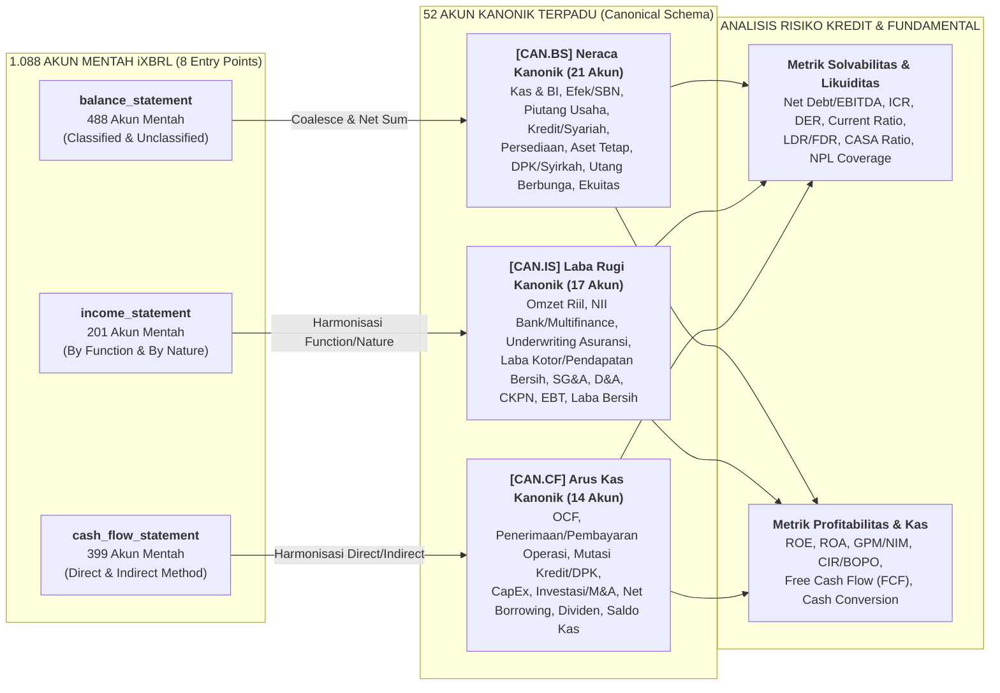

# Skema & Kamus Akun Kanonik Lintas Sektor (`canonical_accounts`)

Dokumen ini memetakan seluruh **1.088 akun mentah hierarki iXBRL Bursa Efek Indonesia** dari ketiga laporan keuangan utama — **[Neraca (`461 akun`)](balance_statement_accounts.md)**, **[Laba Rugi (`189 akun`)](income_statement_accounts.md)**, dan **[Arus Kas (`292 akun`)](cash_flow_statement_accounts.md)** — ke dalam **52 Akun Kanonik Terpadu (`Canonical Schema`)** untuk analisis fundamental dan manajemen risiko kredit lintas sektor.

1. **Skema Kanonik Neraca (`[CAN.BS]` — 21 Akun Kanonik dari 488 Akun Mentah)**
2. **Skema Kanonik Laba Rugi (`[CAN.IS]` — 17 Akun Kanonik dari 201 Akun Mentah)**
3. **Skema Kanonik Arus Kas (`[CAN.CF]` — 14 Akun Kanonik dari 399 Akun Mentah)**
4. **Rumus Rasio Kredit & Fundamental Berbasis Akun Kanonik**

## Kode Sektor & Subsektor (IDX-IC & JASICA)

| Kode Sektor | Nama Sektor | Kode & Nama Subsektor |
| :--- | :--- | :--- |
| `A` | **Energy** | `A1` Oil, Gas & Coal · `A2` Alternative Energy |
| `B` | **Basic Materials** | `B1` Basic Materials |
| `C` | **Industrials** | `C1` Industrial Goods · `C2` Industrial Services · `C3` Multi-sector Holdings |
| `D` | **Consumer Non-Cyclicals** | `D1` Food & Staples Retailing · `D2` Food & Beverage · `D3` Tobacco · `D4` Nondurable Household Products |
| `E` | **Consumer Cyclicals** | `E1` Automobiles & Components · `E2` Household Goods · `E3` Leisure Goods · `E4` Apparel & Luxury Goods · `E5` Consumer Services · `E6` Media & Entertainment · `E7` Retailing |
| `F` | **Healthcare** | `F1` Healthcare Equipment & Providers · `F2` Pharmaceuticals & Health Care Research |
| `G` | **Financials** | `G1` Banks · `G2` Financing Service · `G3` Investment Service · `G4` Insurance · `G5` Holding & Investment Companies |
| `H` | **Properties & Real Estate** | `H1` Properties & Real Estate |
| `I` | **Technology** | `I1` Software & IT Services · `I2` Technology Hardware & Equipment |
| `J` | **Infrastructures** | `J1` Transportation Infrastructure · `J2` Heavy Constructions & Civil Engineering · `J3` Telecommunication · `J4` Utilities |
| `K` | **Transportation & Logistic** | `K1` Transportation · `K2` Logistics & Deliveries |
| `1`, `6`, `9` | **Klasifikasi Lama (JASICA)** | `1` Agriculture (`12` Plantation) · `6` Property, Real Estate & Building Construction (`61` Property & Real Estate) · `9` Trade, Services & Investment (`91` Wholesale, `97` Computer & Services, `98` Investment Company) |

## Arsitektur Pemetaan Akun Kanonik Lintas Sektor

---

## 1. Skema Kanonik Neraca (`balance_statement` — 21 Akun Kanonik dari 488 Akun Mentah)

### 1.1 Aset Kanonik (`[CAN.BS.A]`)

<table width="100%">
  <colgroup>
    <col width="34%" />
    <col width="34%" />
    <col width="32%" />
  </colgroup>
  <thead>
    <tr>
      <th align="left" width="34%">Penjelasan / Akun Mentah Pembentuk</th>
      <th align="left" width="34%">Aturan Agregasi &amp; Saran Analisis</th>
      <th align="left" width="32%">Cakupan Entry Points &amp; Sektor</th>
    </tr>
  </thead>
  <tbody>
    <tr>
      <td colspan="3"><code>[CAN.BS.A]</code> <b><code>total_assets</code></b> &nbsp;<i>(1 akun mentah)</i></td>
    </tr>
    <tr>
      <td width="34%" valign="top"><b>Total Seluruh Aset Konsolidasi</b>: Jangkar utama ukuran neraca perusahaan di seluruh 8 <i>entry point</i>.</td>
      <td width="34%" valign="top"><b>Direct Anchor</b>: Ambil langsung dari <code>[A] Assets</code>. Jika kosong pada neraca terklasifikasi, <code>CurrentAssets + NonCurrentAssets</code>.  <b>Saran Analisis:</b> Pembagi utama untuk menghitung <b>ROA</b> (<code>net_income_parent / total_assets</code>) dan <b>Asset Turnover</b>.</td>
      <td width="32%" valign="top"><b>Entry Points:</b> <code>all_entry_points</code> <b>Variants:</b> <code>all_variants</code></td>
    </tr>
    <tr>
      <td colspan="3" valign="top"><b>Mapped Raw Accounts (1):</b> • <b>All Variants (<code>current_and_non_current</code> &amp; <code>liquidity</code>) (1):</b> &nbsp;&nbsp;<code>[A]</code> <code>Assets</code></td>
    </tr>
    <tr>
      <td colspan="3">&nbsp;</td>
    </tr>
    <tr>
      <td colspan="3"><code>[CAN.BS.A.C]</code> <b><code>total_current_assets</code></b> &nbsp;<i>(1 akun mentah)</i></td>
    </tr>
    <tr>
      <td width="34%" valign="top"><b>Total Aset Lancar (&lt; 12 Bulan)</b>: Total aset jangka pendek pada neraca terklasifikasi (<i>Classified Balance Sheet</i>).</td>
      <td width="34%" valign="top"><b>Direct / Sum</b>: Ambil dari <code>[A.C] CurrentAssets</code>. Pada neraca likuiditas (Bank, Multifinance, Asuransi, Sekuritas), diproksikan dari <code>cash_and_central_bank + marketable_securities_and_investments</code>.  <b>Saran Analisis:</b> Pembilang utama untuk <b>Current Ratio</b> dan <b>Working Capital</b> pada sektor riil.</td>
      <td width="32%" valign="top"><b>Entry Points:</b> <code>general</code>, <code>infrastructure</code>, <code>property</code> <b>Variants:</b> <code>classified</code></td>
    </tr>
    <tr>
      <td colspan="3" valign="top"><b>Mapped Raw Accounts (1):</b> • <b>Variant <code>current_and_non_current</code> — Lancar / Jangka Pendek (<code>&lt; 1 Tahun</code>) (1):</b> &nbsp;&nbsp;<code>[A.C]</code> <code>CurrentAssets</code></td>
    </tr>
    <tr>
      <td colspan="3">&nbsp;</td>
    </tr>
    <tr>
      <td colspan="3"><code>[CAN.BS.A.N]</code> <b><code>total_non_current_assets</code></b> &nbsp;<i>(1 akun mentah)</i></td>
    </tr>
    <tr>
      <td width="34%" valign="top"><b>Total Aset Tidak Lancar (&gt; 12 Bulan)</b>: Total aset jangka panjang pada neraca terklasifikasi.</td>
      <td width="34%" valign="top"><b>Direct / Residual</b>: Ambil dari <code>[A.N] NonCurrentAssets</code>, atau <code>Assets − CurrentAssets</code>.  <b>Saran Analisis:</b> Mengukur intensitas modal tetap (*capital intensity*) perusahaan.</td>
      <td width="32%" valign="top"><b>Entry Points:</b> <code>general</code>, <code>infrastructure</code>, <code>property</code> <b>Variants:</b> <code>classified</code></td>
    </tr>
    <tr>
      <td colspan="3" valign="top"><b>Mapped Raw Accounts (1):</b> • <b>Variant <code>current_and_non_current</code> — Tidak Lancar / Jangka Panjang (<code>&gt; 1 Tahun</code>) (1):</b> &nbsp;&nbsp;<code>[A.N]</code> <code>NonCurrentAssets</code></td>
    </tr>
    <tr>
      <td colspan="3">&nbsp;</td>
    </tr>
    <tr>
      <td colspan="3"><code>[CAN.BS.A.01]</code> <b><code>cash_and_central_bank</code></b> &nbsp;<i>(13 akun mentah)</i></td>
    </tr>
    <tr>
      <td width="34%" valign="top"><b>Kas, Setara Kas, Giro BI, &amp; Penempatan Antarbank</b>: Total likuiditas tunai lapis pertama (uang kas, bank, deposito &le; 3 bulan, Giro pada Bank Indonesia, dan penempatan pasar uang antarbank).</td>
      <td width="34%" valign="top"><b>Sum (Net of CKPN)</b>: Jumlahkan seluruh kas, deposito jangka sangat pendek, Giro BI, Giro pada Bank Lain, dan Penempatan pada BI/Bank Lain dikurangi CKPN terkait (<code>AllowanceForImpairmentLosses...</code>).  <b>Saran Analisis:</b> Digunakan untuk menghitung <b>Net Debt</b> (<code>total_interest_bearing_debt − cash_and_central_bank</code>) dan <b>Cash Ratio</b>.</td>
      <td width="32%" valign="top"><b>Entry Points:</b> <code>all_entry_points</code> <b>Sectors:</b> <code>all_sectors</code></td>
    </tr>
    <tr>
      <td colspan="3" valign="top"><b>Mapped Raw Accounts (13):</b> • <b>All Variants (<code>current_and_non_current</code> &amp; <code>liquidity</code>) (1):</b> &nbsp;&nbsp;<code>[A.C.01]</code> <code>CashAndCashEquivalents</code> • <b>Variant <code>current_and_non_current</code> — Lancar / Jangka Pendek (<code>&lt; 1 Tahun</code>) (1):</b> &nbsp;&nbsp;<code>[A.C.02]</code> <code>CurrentDeposits</code> • <b>Variant <code>current_and_non_current</code> — Tidak Lancar / Jangka Panjang (<code>&gt; 1 Tahun</code>) (1):</b> &nbsp;&nbsp;<code>[A.N.01]</code> <code>NonCurrentDeposits</code> • <b>Variant <code>liquidity</code> (Neraca Berbasis Likuiditas) (10):</b> &nbsp;&nbsp;<code>[A.L.01]</code> <code>Deposits</code> · <code>[A.L.20]</code> <code>Cash</code> · <code>[A.L.21]</code> <code>Current<wbr>Accounts<wbr>With<wbr>Bank<wbr>Indonesia</code> · <code>[A.L.22]</code> <code>Current<wbr>Accounts<wbr>With<wbr>Other<wbr>Banks<wbr>Third<wbr>Parties</code> · <code>[A.L.23]</code> <code>Current<wbr>Accounts<wbr>With<wbr>Other<wbr>Banks<wbr>Related<wbr>Parties</code> · <code>[A.L.24]</code> <code>Allowance<wbr>For<wbr>Impairment<wbr>Losses<wbr>For<wbr>Current<wbr>Accounts<wbr>With<wbr>Other<wbr>Banks</code> <i>(−)</i> · <code>[A.L.25]</code> <code>Placements<wbr>With<wbr>Bank<wbr>Indonesia<wbr>And<wbr>Other<wbr>Banks<wbr>Third<wbr>Parties</code> · <code>[A.L.26]</code> <code>Placements<wbr>With<wbr>Bank<wbr>Indonesia<wbr>And<wbr>Other<wbr>Banks<wbr>Related<wbr>Parties</code> · <code>[A.L.27]</code> <code>Allowance<wbr>For<wbr>Impairment<wbr>Losses<wbr>For<wbr>Placements<wbr>With<wbr>Other<wbr>Banks</code> <i>(−)</i> · <code>[A.L.28]</code> <code>Interbank<wbr>Mudharabah<wbr>Investments</code></td>
    </tr>
    <tr>
      <td colspan="3">&nbsp;</td>
    </tr>
    <tr>
      <td colspan="3"><code>[CAN.BS.A.02]</code> <b><code>restricted_cash_and_clearing_deposits</code></b> &nbsp;<i>(4 akun mentah)</i></td>
    </tr>
    <tr>
      <td width="34%" valign="top"><b>Dana yang Dibatasi Penggunaannya &amp; Jaminan Kliring</b>: Rekening bank yang dikunci sebagai jaminan utang/proyek (<i>escrow</i>) atau dana jaminan kliring di KPEI.</td>
      <td width="34%" valign="top"><b>Sum</b>: Jumlahkan dana dibatasi penggunaannya (lancar, tidak lancar, likuiditas) + simpanan jaminan kliring KPEI.  <b>Saran Analisis:</b> <b>Jangan dimasukkan ke dalam Kas Bebas saat menghitung Net Debt!</b> Dana ini tidak bisa dipakai bebas untuk melunasi utang umum.</td>
      <td width="32%" valign="top"><b>Entry Points:</b> <code>all_entry_points</code> <b>Sectors:</b> <code>all_sectors</code></td>
    </tr>
    <tr>
      <td colspan="3" valign="top"><b>Mapped Raw Accounts (4):</b> • <b>Variant <code>current_and_non_current</code> — Lancar / Jangka Pendek (<code>&lt; 1 Tahun</code>) (1):</b> &nbsp;&nbsp;<code>[A.C.03]</code> <code>CurrentRestrictedFunds</code> • <b>Variant <code>current_and_non_current</code> — Tidak Lancar / Jangka Panjang (<code>&gt; 1 Tahun</code>) (1):</b> &nbsp;&nbsp;<code>[A.N.02]</code> <code>NonCurrentRestrictedFunds</code> • <b>Variant <code>liquidity</code> (Neraca Berbasis Likuiditas) (2):</b> &nbsp;&nbsp;<code>[A.L.02]</code> <code>RestrictedFunds</code> · <code>[A.L.29]</code> <code>Deposits<wbr>To<wbr>Clearing<wbr>And<wbr>Settlement<wbr>Guarantee<wbr>Institution</code></td>
    </tr>
    <tr>
      <td colspan="3">&nbsp;</td>
    </tr>
    <tr>
      <td colspan="3"><code>[CAN.BS.A.03]</code> <b><code>short_term_and_marketable_investments</code></b> &nbsp;<i>(44 akun mentah)</i></td>
    </tr>
    <tr>
      <td width="34%" valign="top"><b>Investasi Jangka Pendek, Surat Berharga (Efek), SBN, Reverse Repo, &amp; Portofolio Asuransi/KIK</b>: Cadangan likuiditas sekunder berupa efek FVTPL/FVOCI/Amortized Cost, Obligasi Pemerintah (SBN), tagihan <i>Reverse Repo</i>, derivatif, dan portofolio investasi asuransi/DIRE.</td>
      <td width="34%" valign="top"><b>Sum (Net of CKPN)</b>: Jumlahkan seluruh instrumen investasi keuangan dan efek surat berharga dikurangi CKPN efek (<code>AllowanceForImpairmentLossesForMarketableSecurities</code>).  <b>Saran Analisis:</b> Tambahkan ke <code>cash_and_central_bank</code> untuk menghitung <b>Total Liquid Assets</b> perbankan, asuransi, dan korporasi.</td>
      <td width="32%" valign="top"><b>Entry Points:</b> <code>all_entry_points</code> <b>Sectors:</b> <code>all_sectors</code></td>
    </tr>
    <tr>
      <td colspan="3" valign="top"><b>Mapped Raw Accounts (44):</b> • <b>All Variants (<code>current_and_non_current</code> &amp; <code>liquidity</code>) (1):</b> &nbsp;&nbsp;<code>[A.C.04]</code> <code>ShortTermInvestments</code> • <b>Variant <code>current_and_non_current</code> — Lancar / Jangka Pendek (<code>&lt; 1 Tahun</code>) (9):</b> &nbsp;&nbsp;<code>[A.C.05]</code> <code>Current<wbr>Financial<wbr>Assets<wbr>At<wbr>Fair<wbr>Value<wbr>Through<wbr>Profit<wbr>Or<wbr>Loss</code> · <code>[A.C.06]</code> <code>Current<wbr>Financial<wbr>Assets<wbr>Fair<wbr>Value<wbr>Through<wbr>Other<wbr>Comprehensive<wbr>Income</code> · <code>[A.C.07]</code> <code>Current<wbr>Financial<wbr>Assets<wbr>Amortized<wbr>Cost<wbr>Investments</code> · <code>[A.C.08]</code> <code>Current<wbr>Financial<wbr>Assets<wbr>Held<wbr>To<wbr>Maturity<wbr>Investments</code> · <code>[A.C.09]</code> <code>Current<wbr>Financial<wbr>Assets<wbr>Available<wbr>For<wbr>Sale</code> · <code>[A.C.10]</code> <code>Current<wbr>Derivative<wbr>Financial<wbr>Assets</code> · <code>[A.C.11]</code> <code>OtherCurrentFinancialAssets</code> · <code>[A.C.12]</code> <code>Other<wbr>Non<wbr>Current<wbr>Financial<wbr>Assets</code> · <code>[A.C.48]</code> <code>CurrentOtherFinancialAssets</code> • <b>Variant <code>current_and_non_current</code> — Tidak Lancar / Jangka Panjang (<code>&gt; 1 Tahun</code>) (7):</b> &nbsp;&nbsp;<code>[A.N.03]</code> <code>Non<wbr>Current<wbr>Financial<wbr>Assets<wbr>At<wbr>Fair<wbr>Value<wbr>Through<wbr>Profit<wbr>Or<wbr>Loss</code> · <code>[A.N.04]</code> <code>Non<wbr>Current<wbr>Financial<wbr>Assets<wbr>Fair<wbr>Value<wbr>Through<wbr>Other<wbr>Comprehensive<wbr>Income</code> · <code>[A.N.05]</code> <code>Non<wbr>Current<wbr>Financial<wbr>Assets<wbr>Amortized<wbr>Cost</code> · <code>[A.N.06]</code> <code>Non<wbr>Current<wbr>Financial<wbr>Assets<wbr>Held<wbr>To<wbr>Maturity</code> · <code>[A.N.07]</code> <code>Non<wbr>Current<wbr>Financial<wbr>Assets<wbr>Available<wbr>For<wbr>Sale</code> · <code>[A.N.08]</code> <code>Non<wbr>Current<wbr>Derivative<wbr>Financial<wbr>Assets</code> · <code>[A.N.59]</code> <code>Non<wbr>Current<wbr>Other<wbr>Financial<wbr>Assets</code> • <b>Variant <code>liquidity</code> (Neraca Berbasis Likuiditas) (27):</b> &nbsp;&nbsp;<code>[A.L.03]</code> <code>Financial<wbr>Assets<wbr>At<wbr>Fair<wbr>Value<wbr>Through<wbr>Profit<wbr>Or<wbr>Loss</code> · <code>[A.L.04]</code> <code>Financial<wbr>Assets<wbr>Fair<wbr>Value<wbr>Through<wbr>Other<wbr>Comprehensive<wbr>Income</code> · <code>[A.L.05]</code> <code>FinancialAssetsAmortizedCost</code> · <code>[A.L.06]</code> <code>Financial<wbr>Assets<wbr>Held<wbr>To<wbr>Maturity</code> · <code>[A.L.07]</code> <code>Financial<wbr>Assets<wbr>Available<wbr>For<wbr>Sale</code> · <code>[A.L.08]</code> <code>DerivativeFinancialAssets</code> · <code>[A.L.09]</code> <code>OtherFinancialAssets</code> · <code>[A.L.30]</code> <code>MarketableSecurities</code> · <code>[A.L.31]</code> <code>Marketable<wbr>Securities<wbr>Third<wbr>Parties</code> · <code>[A.L.32]</code> <code>Marketable<wbr>Securities<wbr>Related<wbr>Parties</code> · <code>[A.L.33]</code> <code>Allowance<wbr>For<wbr>Impairment<wbr>Losses<wbr>For<wbr>Marketable<wbr>Securities</code> <i>(−)</i> · <code>[A.L.34]</code> <code>GovernmentBonds</code> · <code>[A.L.35]</code> <code>Securities<wbr>Purchased<wbr>Under<wbr>Agreement<wbr>To<wbr>Resale</code> · <code>[A.L.36]</code> <code>DerivativeReceivables</code> · <code>[A.L.37]</code> <code>Derivative<wbr>Receivables<wbr>Third<wbr>Parties</code> · <code>[A.L.38]</code> <code>Derivative<wbr>Receivables<wbr>Related<wbr>Parties</code> · <code>[A.L.39]</code> <code>InvestmentsInTimeDeposits</code> · <code>[A.L.40]</code> <code>InvestmentsInShares</code> · <code>[A.L.41]</code> <code>Investments<wbr>In<wbr>Shares<wbr>Of<wbr>Indonesia<wbr>Stock<wbr>Exchange</code> · <code>[A.L.42]</code> <code>Investments<wbr>On<wbr>Securities<wbr>And<wbr>Mutual<wbr>Funds<wbr>At<wbr>Fair<wbr>Value<wbr>Through<wbr>Profit<wbr>Or<wbr>Loss</code> · <code>[A.L.43]</code> <code>Investments<wbr>On<wbr>Fair<wbr>Value<wbr>Through<wbr>Other<wbr>Comprehensive<wbr>Income<wbr>Securities</code> · <code>[A.L.44]</code> <code>Investments<wbr>On<wbr>Available<wbr>For<wbr>Sale<wbr>Securities</code> · <code>[A.L.45]</code> <code>Investments<wbr>On<wbr>Amortized<wbr>Cost<wbr>Securities</code> · <code>[A.L.46]</code> <code>Investments<wbr>On<wbr>Held<wbr>To<wbr>Maturity<wbr>Securities</code> · <code>[A.L.47]</code> <code>Investments<wbr>Of<wbr>Policyholder<wbr>In<wbr>Unit<wbr>Linked<wbr>Contracts</code> · <code>[A.L.48]</code> <code>OtherInvestments</code> · <code>[A.L.49]</code> <code>Securities<wbr>Portfolio<wbr>In<wbr>Equity<wbr>Instruments</code></td>
    </tr>
    <tr>
      <td colspan="3">&nbsp;</td>
    </tr>
    <tr>
      <td colspan="3"><code>[CAN.BS.A.04]</code> <b><code>trade_and_project_receivables</code></b> &nbsp;<i>(17 akun mentah)</i></td>
    </tr>
    <tr>
      <td width="34%" valign="top"><b>Piutang Usaha, Piutang Pelanggan, Piutang Retensi, &amp; Tagihan Proyek Sektor Riil</b>: Tagihan kepada pelanggan atas penjualan barang/jasa, piutang belum ditagih (<i>unbilled</i>), piutang retensi konstruksi, wesel tagih, piutang bunga/dividen, dan piutang subsidi pemerintah.</td>
      <td width="34%" valign="top"><b>Sum</b>: Jumlahkan seluruh piutang usaha &amp; pelanggan (pihak ketiga &amp; berelasi), piutang retensi, piutang belum ditagih (<i>unbilled</i>), wesel tagih, piutang subsidi, dan piutang lain-lain pihak ketiga.  <b>Saran Analisis:</b> Digunakan untuk menghitung <b>Days Sales Outstanding (DSO)</b> (<code>(trade_and_project_receivables / gross_revenue_real_sector) × 365</code>). Jika DSO melonjak, waspadai risiko piutang macet.</td>
      <td width="32%" valign="top"><b>Entry Points:</b> <code>general</code>, <code>infrastructure</code>, <code>property</code> <b>Sectors:</b> Sektor Riil (<code>A</code>–<code>F</code>, <code>H</code>–<code>K</code>)</td>
    </tr>
    <tr>
      <td colspan="3" valign="top"><b>Mapped Raw Accounts (17):</b> • <b>All Variants (<code>current_and_non_current</code> &amp; <code>liquidity</code>) (8):</b> &nbsp;&nbsp;<code>[A.C.13]</code> <code>TradeReceivablesThirdParties</code> · <code>[A.C.14]</code> <code>Trade<wbr>Receivables<wbr>Related<wbr>Parties</code> · <code>[A.C.15]</code> <code>Unbilled<wbr>Receivables<wbr>Third<wbr>Parties</code> · <code>[A.C.16]</code> <code>Unbilled<wbr>Receivables<wbr>Related<wbr>Parties</code> · <code>[A.C.17]</code> <code>Retention<wbr>Receivables<wbr>Third<wbr>Parties</code> · <code>[A.C.18]</code> <code>Retention<wbr>Receivables<wbr>Related<wbr>Parties</code> · <code>[A.C.19]</code> <code>Dividends<wbr>And<wbr>Interest<wbr>Receivables</code> · <code>[A.C.24]</code> <code>OtherReceivablesThirdParties</code> • <b>Variant <code>current_and_non_current</code> — Lancar / Jangka Pendek (<code>&lt; 1 Tahun</code>) (5):</b> &nbsp;&nbsp;<code>[A.C.26]</code> <code>Current<wbr>Customer<wbr>Receivables<wbr>Third<wbr>Parties</code> · <code>[A.C.27]</code> <code>Current<wbr>Customer<wbr>Receivables<wbr>Related<wbr>Parties</code> · <code>[A.C.28]</code> <code>NotesReceivable</code> · <code>[A.C.49]</code> <code>ReceivablesOnSubsidy</code> · <code>[A.C.30]</code> <code>Other<wbr>Non<wbr>Current<wbr>Receivables<wbr>Third<wbr>Parties</code> • <b>Variant <code>current_and_non_current</code> — Tidak Lancar / Jangka Panjang (<code>&gt; 1 Tahun</code>) (2):</b> &nbsp;&nbsp;<code>[A.N.10]</code> <code>Non<wbr>Current<wbr>Customer<wbr>Receivables<wbr>Third<wbr>Parties</code> · <code>[A.N.11]</code> <code>Non<wbr>Current<wbr>Customer<wbr>Receivables<wbr>Related<wbr>Parties</code> • <b>Variant <code>liquidity</code> (Neraca Berbasis Likuiditas) (2):</b> &nbsp;&nbsp;<code>[A.L.10]</code> <code>Customer<wbr>Receivables<wbr>Third<wbr>Parties</code> · <code>[A.L.11]</code> <code>Customer<wbr>Receivables<wbr>Related<wbr>Parties</code></td>
    </tr>
    <tr>
      <td colspan="3">&nbsp;</td>
    </tr>
    <tr>
      <td colspan="3"><code>[CAN.BS.A.05]</code> <b><code>related_party_non_trade_receivables</code></b> &nbsp;<i>(4 akun mentah)</i></td>
    </tr>
    <tr>
      <td width="34%" valign="top"><b>Piutang Non-Usaha Pihak Berelasi &amp; Piutang Pemegang Saham</b>: Pinjaman uang tunai di luar piutang dagang yang diberikan perusahaan kepada perusahaan afiliasi/induk/pemegang saham.</td>
      <td width="34%" valign="top"><b>Sum</b>: Jumlahkan piutang pihak berelasi non-usaha (lancar &amp; tidak lancar) serta piutang pemegang saham.  <b>Saran Analisis:</b> <b>Indikator Tata Kelola (GCG)!</b> Rasio <code>related_party_non_trade_receivables / total_assets</code> yang tinggi (&gt; 5%) menandakan kas emiten tersedot ke grup pemilik.</td>
      <td width="32%" valign="top"><b>Entry Points:</b> <code>general</code>, <code>infrastructure</code>, <code>property</code>, <code>financing</code> <b>Sectors:</b> <code>all_sectors</code></td>
    </tr>
    <tr>
      <td colspan="3" valign="top"><b>Mapped Raw Accounts (4):</b> • <b>All Variants (<code>current_and_non_current</code> &amp; <code>liquidity</code>) (2):</b> &nbsp;&nbsp;<code>[A.C.25]</code> <code>Other<wbr>Receivables<wbr>Related<wbr>Parties</code> · <code>[A.N.09]</code> <code>Receivables<wbr>From<wbr>Related<wbr>Parties</code> • <b>Variant <code>current_and_non_current</code> — Lancar / Jangka Pendek (<code>&lt; 1 Tahun</code>) (1):</b> &nbsp;&nbsp;<code>[A.C.31]</code> <code>Other<wbr>Non<wbr>Current<wbr>Receivables<wbr>Related<wbr>Parties</code> • <b>Variant <code>current_and_non_current</code> — Tidak Lancar / Jangka Panjang (<code>&gt; 1 Tahun</code>) (1):</b> &nbsp;&nbsp;<code>[A.N.13]</code> <code>ReceivablesFromStockholders</code></td>
    </tr>
    <tr>
      <td colspan="3">&nbsp;</td>
    </tr>
    <tr>
      <td colspan="3"><code>[CAN.BS.A.06]</code> <b><code>loans_and_sharia_financing_net</code></b> &nbsp;<i>(46 akun mentah)</i></td>
    </tr>
    <tr>
      <td width="34%" valign="top"><b>Kredit Perbankan, Pembiayaan Syariah, &amp; Piutang Multifinance Bersih (<i>Net Loans &amp; Financing</i>)</b>: Total baki debet kredit konvensional, piutang murabahah/musyarakah/mudharabah/qardh/istishna/ijarah, pembiayaan konsumen, sewa pembiayaan (<i>finance lease</i>), anjak piutang (<i>factoring</i>), akseptasi, dan wesel ekspor setelah dikurangi CKPN &amp; pendapatan pembiayaan tangguhan.</td>
      <td width="34%" valign="top"><b>Sum (Gross − Contra/CKPN)</b>: Jumlahkan seluruh baki debet kredit &amp; pembiayaan bruto dikurangi seluruh akun <code>AllowanceForImpairmentLosses...</code> dan <code>...DeferredFinancingIncome</code>.  <b>Saran Analisis:</b> <b>Aset produktif inti Bank &amp; Multifinance!</b> Gunakan untuk menghitung <b>LDR / FDR</b> (<code>loans_and_sharia_financing_net / customer_deposits_total</code>) dan <b>Loan-to-Assets Ratio</b>.</td>
      <td width="32%" valign="top"><b>Entry Points:</b> <code>financial_and_sharia</code>, <code>financing</code>, <code>general</code> <b>Sectors:</b> <code>G</code> (<code>G1</code> Banks, <code>G2</code> Multifinance, <code>G5</code> Holdings)</td>
    </tr>
    <tr>
      <td colspan="3" valign="top"><b>Mapped Raw Accounts (46):</b> • <b>Variant <code>current_and_non_current</code> — Lancar / Jangka Pendek (<code>&lt; 1 Tahun</code>) (1):</b> &nbsp;&nbsp;<code>[A.C.29]</code> <code>Current<wbr>Finance<wbr>Lease<wbr>Receivables</code> • <b>Variant <code>current_and_non_current</code> — Tidak Lancar / Jangka Panjang (<code>&gt; 1 Tahun</code>) (1):</b> &nbsp;&nbsp;<code>[A.N.12]</code> <code>Non<wbr>Current<wbr>Finance<wbr>Lease<wbr>Receivables</code> • <b>Variant <code>liquidity</code> (Neraca Berbasis Likuiditas) (44):</b> &nbsp;&nbsp;<code>[A.L.12]</code> <code>FinanceLeaseReceivables</code> · <code>[A.L.50]</code> <code>LoansThirdParties</code> · <code>[A.L.51]</code> <code>LoansRelatedParties</code> · <code>[A.L.52]</code> <code>Allowance<wbr>For<wbr>Impairment<wbr>Losses<wbr>For<wbr>Loans</code> <i>(−)</i> · <code>[A.L.53]</code> <code>Consumer<wbr>Financing<wbr>Receivables<wbr>Third<wbr>Parties</code> · <code>[A.L.54]</code> <code>Consumer<wbr>Financing<wbr>Receivables<wbr>Related<wbr>Parties</code> · <code>[A.L.55]</code> <code>Allowance<wbr>For<wbr>Impairment<wbr>Losses<wbr>For<wbr>Consumer<wbr>Financing<wbr>Receivables</code> <i>(−)</i> · <code>[A.L.56]</code> <code>Murabahah<wbr>Receivables<wbr>Third<wbr>Parties</code> · <code>[A.L.57]</code> <code>Murabahah<wbr>Receivables<wbr>Related<wbr>Parties</code> · <code>[A.L.58]</code> <code>Allowance<wbr>For<wbr>Impairment<wbr>Losses<wbr>For<wbr>Murabahah<wbr>Receivables</code> <i>(−)</i> · <code>[A.L.59]</code> <code>Musyarakah<wbr>Financing<wbr>Third<wbr>Parties</code> · <code>[A.L.60]</code> <code>Musyarakah<wbr>Financing<wbr>Related<wbr>Parties</code> · <code>[A.L.61]</code> <code>Allowance<wbr>For<wbr>Impairment<wbr>Losses<wbr>For<wbr>Musyarakah<wbr>Financing</code> <i>(−)</i> · <code>[A.L.62]</code> <code>Mudharabah<wbr>Financing<wbr>Third<wbr>Parties</code> · <code>[A.L.63]</code> <code>Mudharabah<wbr>Financing<wbr>Related<wbr>Parties</code> · <code>[A.L.64]</code> <code>Allowance<wbr>For<wbr>Impairment<wbr>Losses<wbr>For<wbr>Mudharabah<wbr>Financing</code> <i>(−)</i> · <code>[A.L.65]</code> <code>QardhFundsThirdParties</code> · <code>[A.L.66]</code> <code>QardhFundsRelatedParties</code> · <code>[A.L.67]</code> <code>Allowance<wbr>For<wbr>Impairment<wbr>Losses<wbr>For<wbr>Qardh<wbr>Funds</code> <i>(−)</i> · <code>[A.L.68]</code> <code>Istishna<wbr>Receivables<wbr>Third<wbr>Parties</code> · <code>[A.L.69]</code> <code>Istishna<wbr>Receivables<wbr>Related<wbr>Parties</code> · <code>[A.L.70]</code> <code>Allowance<wbr>For<wbr>Impairment<wbr>Losses<wbr>For<wbr>Istishna<wbr>Receivables</code> <i>(−)</i> · <code>[A.L.71]</code> <code>Ijarah<wbr>Receivables<wbr>Third<wbr>Parties</code> · <code>[A.L.72]</code> <code>Ijarah<wbr>Receivables<wbr>Related<wbr>Parties</code> · <code>[A.L.73]</code> <code>Allowance<wbr>For<wbr>Impairment<wbr>Losses<wbr>For<wbr>Ijarah<wbr>Receivables</code> <i>(−)</i> · <code>[A.L.74]</code> <code>Lease<wbr>Investment<wbr>In<wbr>Finance<wbr>Leases</code> · <code>[A.L.75]</code> <code>LeaseInvestmentsThirdParties</code> · <code>[A.L.76]</code> <code>Lease<wbr>Investments<wbr>Related<wbr>Parties</code> · <code>[A.L.77]</code> <code>Lease<wbr>Investments<wbr>Guaranteed<wbr>Residual<wbr>Value</code> · <code>[A.L.78]</code> <code>Lease<wbr>Investments<wbr>Deferred<wbr>Financing<wbr>Income</code> <i>(−)</i> · <code>[A.L.79]</code> <code>Lease<wbr>Investments<wbr>Guarantee<wbr>Deposits</code> <i>(−)</i> · <code>[A.L.80]</code> <code>Allowance<wbr>For<wbr>Impairment<wbr>Losses<wbr>For<wbr>Lease<wbr>Investments</code> <i>(−)</i> · <code>[A.L.81]</code> <code>Factoring<wbr>Receivables<wbr>Third<wbr>Parties</code> · <code>[A.L.82]</code> <code>Factoring<wbr>Receivables<wbr>Related<wbr>Parties</code> · <code>[A.L.83]</code> <code>Factoring<wbr>Receivables<wbr>On<wbr>Deferred<wbr>Factoring<wbr>Income</code> <i>(−)</i> · <code>[A.L.84]</code> <code>Allowance<wbr>For<wbr>Impairment<wbr>Losses<wbr>For<wbr>Factoring<wbr>Receivables</code> <i>(−)</i> · <code>[A.L.85]</code> <code>AcceptanceReceivables</code> · <code>[A.L.86]</code> <code>Acceptance<wbr>Receivables<wbr>Third<wbr>Parties</code> · <code>[A.L.87]</code> <code>Acceptance<wbr>Receivables<wbr>Related<wbr>Parties</code> · <code>[A.L.88]</code> <code>Allowance<wbr>For<wbr>Impairment<wbr>Losses<wbr>For<wbr>Acceptance<wbr>Receivables</code> <i>(−)</i> · <code>[A.L.89]</code> <code>BillsAndOtherReceivables</code> · <code>[A.L.90]</code> <code>Bills<wbr>And<wbr>Other<wbr>Receivables<wbr>Third<wbr>Parties</code> · <code>[A.L.91]</code> <code>Bills<wbr>And<wbr>Other<wbr>Receivables<wbr>Related<wbr>Parties</code> · <code>[A.L.92]</code> <code>Allowance<wbr>For<wbr>Impairment<wbr>Losses<wbr>For<wbr>Bills<wbr>And<wbr>Other<wbr>Receivables</code> <i>(−)</i></td>
    </tr>
    <tr>
      <td colspan="3">&nbsp;</td>
    </tr>
    <tr>
      <td colspan="3"><code>[CAN.BS.A.07]</code> <b><code>securities_and_insurance_receivables_net</code></b> &nbsp;<i>(23 akun mentah)</i></td>
    </tr>
    <tr>
      <td width="34%" valign="top"><b>Piutang Perusahaan Efek (Broker/Nasabah/Margin) &amp; Piutang Premi/Reasuransi Bersih</b>: Tagihan transaksi bursa sekuritas (KPEI, broker, nasabah, MI) serta tagihan premi, koasuransi, reasuransi, aset reasuransi/retrosesi, dan piutang lain-lain keuangan setelah dikurangi CKPN.</td>
      <td width="34%" valign="top"><b>Sum (Net of CKPN)</b>: Jumlahkan seluruh piutang sekuritas, piutang premi/reasuransi, aset reasuransi/retrosesi, dan piutang lain-lain keuangan dikurangi CKPN terkait.  <b>Saran Analisis:</b> Mengukur eksposur modal kerja piutang pada perusahaan sekuritas (risiko kredit margin) dan asuransi (risiko gagal tagih klaim reasuransi).</td>
      <td width="32%" valign="top"><b>Entry Points:</b> <code>securities</code>, <code>insurance</code>, <code>financial_and_sharia</code>, <code>financing</code>, <code>general</code> <b>Sectors:</b> <code>G</code> (<code>G3</code> Securities, <code>G4</code> Insurance, <code>G5</code> Holdings)</td>
    </tr>
    <tr>
      <td colspan="3" valign="top"><b>Mapped Raw Accounts (23):</b> • <b>All Variants (<code>current_and_non_current</code> &amp; <code>liquidity</code>) (4):</b> &nbsp;&nbsp;<code>[A.C.20]</code> <code>MarginReceivables</code> · <code>[A.C.21]</code> <code>Receivables<wbr>From<wbr>Clearing<wbr>And<wbr>Settlement<wbr>Guarantee<wbr>Institution</code> · <code>[A.C.22]</code> <code>Premium<wbr>And<wbr>Reinsurance<wbr>Receivables</code> · <code>[A.C.23]</code> <code>ReinsuranceAssets</code> • <b>Variant <code>liquidity</code> (Neraca Berbasis Likuiditas) (19):</b> &nbsp;&nbsp;<code>[A.L.93]</code> <code>ReceivablesFromBrokers</code> · <code>[A.L.94]</code> <code>Receivables<wbr>From<wbr>Customers<wbr>Third<wbr>Parties</code> · <code>[A.L.95]</code> <code>Receivables<wbr>From<wbr>Customers<wbr>Related<wbr>Parties</code> · <code>[A.L.96]</code> <code>Allowance<wbr>For<wbr>Impairment<wbr>Losses<wbr>For<wbr>Receivables<wbr>From<wbr>Customers</code> <i>(−)</i> · <code>[A.L.97]</code> <code>Receivables<wbr>From<wbr>Investment<wbr>Manager</code> · <code>[A.L.98]</code> <code>Receivables<wbr>From<wbr>Underwriting<wbr>And<wbr>Advisory<wbr>Services</code> · <code>[A.L.99]</code> <code>AccruedIncome</code> · <code>[A.L.100]</code> <code>PremiumReceivables</code> · <code>[A.L.101]</code> <code>CoinsuranceReceivables</code> · <code>[A.L.102]</code> <code>ReinsuranceReceivables</code> · <code>[A.L.103]</code> <code>RetrocessionReceivables</code> · <code>[A.L.104]</code> <code>RetrocessionAssets</code> · <code>[A.L.105]</code> <code>InvestmentIncomeReceivables</code> · <code>[A.L.106]</code> <code>InsuranceReceivables</code> · <code>[A.L.107]</code> <code>Insurance<wbr>Receivables<wbr>Third<wbr>Parties</code> · <code>[A.L.108]</code> <code>Insurance<wbr>Receivables<wbr>Related<wbr>Parties</code> · <code>[A.L.109]</code> <code>Allowance<wbr>For<wbr>Impairment<wbr>Losses<wbr>For<wbr>Insurance<wbr>Receivables</code> <i>(−)</i> · <code>[A.L.110]</code> <code>OtherReceivables</code> · <code>[A.L.111]</code> <code>Allowance<wbr>For<wbr>Impairment<wbr>Losses<wbr>For<wbr>Other<wbr>Receivables</code> <i>(−)</i></td>
    </tr>
    <tr>
      <td colspan="3">&nbsp;</td>
    </tr>
    <tr>
      <td colspan="3"><code>[CAN.BS.A.08]</code> <b><code>inventories_and_biological_assets</code></b> &nbsp;<i>(17 akun mentah)</i></td>
    </tr>
    <tr>
      <td width="34%" valign="top"><b>Persediaan, Aset Biologis, &amp; Persediaan Real Estat Siap Jual</b>: Stok bahan baku, barang setengah jadi, barang jadi, ternak/tanaman biologis, serta tanah/bangunan properti yang sedang dibangun untuk dijual.</td>
      <td width="34%" valign="top"><b>Sum</b>: Jumlahkan <code>CurrentInventories</code>, <code>NonCurrentInventories</code>, <code>OtherInventories</code>, aset biologis/ternak, dan aset real estat lancar/likuiditas.  <b>Saran Analisis:</b> Digunakan untuk menghitung <b>Days Inventory Outstanding (DIO)</b> (<code>(inventories_and_biological_assets / cost_of_revenue) × 365</code>) dan <b>Quick Ratio</b>.</td>
      <td width="32%" valign="top"><b>Entry Points:</b> <code>general</code>, <code>property</code>, <code>infrastructure</code> <b>Sectors:</b> Sektor Riil (<code>A</code>–<code>F</code>, <code>H</code>–<code>K</code>)</td>
    </tr>
    <tr>
      <td colspan="3" valign="top"><b>Mapped Raw Accounts (17):</b> • <b>Variant <code>current_and_non_current</code> — Lancar / Jangka Pendek (<code>&lt; 1 Tahun</code>) (4):</b> &nbsp;&nbsp;<code>[A.C.32]</code> <code>CurrentInventories</code> · <code>[A.C.33]</code> <code>CurrentLivestockInventories</code> · <code>[A.C.34]</code> <code>CurrentBiologicalAssets</code> · <code>[A.C.35]</code> <code>CurrentRealEstateAssets</code> • <b>Variant <code>current_and_non_current</code> — Tidak Lancar / Jangka Panjang (<code>&gt; 1 Tahun</code>) (11):</b> &nbsp;&nbsp;<code>[A.N.14]</code> <code>NonCurrentInventories</code> · <code>[A.N.15]</code> <code>LivestockProduction</code> · <code>[A.N.16]</code> <code>Non-CurrentBiologicalAssets</code> · <code>[A.N.17]</code> <code>PlantationAssetsMature</code> · <code>[A.N.18]</code> <code>PlantationAssetsImmature</code> · <code>[A.N.19]</code> <code>PlasmaPlantations</code> · <code>[A.N.20]</code> <code>Industrial<wbr>Timber<wbr>Plantations<wbr>Mature</code> · <code>[A.N.21]</code> <code>Industrial<wbr>Timber<wbr>Plantations<wbr>Immature</code> · <code>[A.N.22]</code> <code>Deferred<wbr>Charges<wbr>On<wbr>Cost<wbr>On<wbr>Forest</code> · <code>[A.N.23]</code> <code>NonCurrentRealEstateAssets</code> · <code>[A.N.24]</code> <code>UndevelopedLand</code> • <b>All Variants (<code>current_and_non_current</code> &amp; <code>liquidity</code>) (1):</b> &nbsp;&nbsp;<code>[A.L.13]</code> <code>Inventories</code> • <b>Variant <code>liquidity</code> (Neraca Berbasis Likuiditas) (1):</b> &nbsp;&nbsp;<code>[A.L.112]</code> <code>RealEstateAssets</code></td>
    </tr>
    <tr>
      <td colspan="3">&nbsp;</td>
    </tr>
    <tr>
      <td colspan="3"><code>[CAN.BS.A.09]</code> <b><code>prepaid_expenses_advances_and_taxes</code></b> &nbsp;<i>(28 akun mentah)</i></td>
    </tr>
    <tr>
      <td width="34%" valign="top"><b>Biaya Dibayar di Muka, Uang Muka (<i>Advances</i>), &amp; Pajak Dibayar di Muka / Restitusi</b>: Pembayaran di muka operasional, DP pembelian aset/proyek, PPN masukan, dan klaim restitusi pajak.</td>
      <td width="34%" valign="top"><b>Sum</b>: Jumlahkan seluruh biaya dibayar di muka, uang muka lancar/tidak lancar, pajak dibayar di muka, dan klaim restitusi pajak.  <b>Saran Analisis:</b> Aset operasional non-kas yang akan terserap menjadi beban atau aset tetap di periode mendatang.</td>
      <td width="32%" valign="top"><b>Entry Points:</b> <code>all_entry_points</code> <b>Sectors:</b> <code>all_sectors</code></td>
    </tr>
    <tr>
      <td colspan="3" valign="top"><b>Mapped Raw Accounts (28):</b> • <b>All Variants (<code>current_and_non_current</code> &amp; <code>liquidity</code>) (1):</b> &nbsp;&nbsp;<code>[A.N.25]</code> <code>Guarantees</code> • <b>Variant <code>current_and_non_current</code> — Lancar / Jangka Pendek (<code>&lt; 1 Tahun</code>) (11):</b> &nbsp;&nbsp;<code>[A.C.36]</code> <code>CurrentPrepaidExpenses</code> · <code>[A.C.37]</code> <code>CurrentAdvancesOnInvestments</code> · <code>[A.C.38]</code> <code>Current<wbr>Advances<wbr>On<wbr>Purchase<wbr>Of<wbr>Property<wbr>Plant<wbr>And<wbr>Equipment</code> · <code>[A.C.39]</code> <code>OtherCurrentAdvances</code> · <code>[A.C.40]</code> <code>OtherNonCurrentAdvances</code> · <code>[A.C.41]</code> <code>CurrentGuarantees</code> · <code>[A.C.42]</code> <code>CurrentPrepaidTaxes</code> · <code>[A.C.43]</code> <code>CurrentClaimsForTaxRefund</code> · <code>[A.C.44]</code> <code>CurrentTaxAmnestyAssets</code> · <code>[A.C.50]</code> <code>CurrentAdvances</code> · <code>[A.C.51]</code> <code>Current<wbr>Advances<wbr>On<wbr>Purchase<wbr>Of<wbr>Property<wbr>And<wbr>Equipment</code> • <b>Variant <code>current_and_non_current</code> — Tidak Lancar / Jangka Panjang (<code>&gt; 1 Tahun</code>) (9):</b> &nbsp;&nbsp;<code>[A.N.26]</code> <code>NonCurrentPrepaidExpenses</code> · <code>[A.N.27]</code> <code>Non<wbr>Current<wbr>Advances<wbr>On<wbr>Investments</code> · <code>[A.N.28]</code> <code>Non<wbr>Current<wbr>Advances<wbr>On<wbr>Purchase<wbr>Of<wbr>Property<wbr>Plant<wbr>And<wbr>Equipment</code> · <code>[A.N.29]</code> <code>NonCurrentGuarantees</code> · <code>[A.N.30]</code> <code>NonCurrentPrepaidTaxes</code> · <code>[A.N.31]</code> <code>NonCurrentClaimsForTaxRefund</code> · <code>[A.N.32]</code> <code>NonCurrentTaxAmnestyAssets</code> · <code>[A.N.60]</code> <code>NonCurrentAdvances</code> · <code>[A.N.61]</code> <code>Non<wbr>Current<wbr>Advances<wbr>On<wbr>Purchase<wbr>Of<wbr>Property<wbr>And<wbr>Equipment</code> • <b>Variant <code>liquidity</code> (Neraca Berbasis Likuiditas) (7):</b> &nbsp;&nbsp;<code>[A.L.14]</code> <code>PrepaidExpenses</code> · <code>[A.L.15]</code> <code>Advances<wbr>On<wbr>Purchase<wbr>Of<wbr>Property<wbr>Plant<wbr>And<wbr>Equipment</code> · <code>[A.L.16]</code> <code>OtherAdvances</code> · <code>[A.L.17]</code> <code>PrepaidTaxes</code> · <code>[A.L.18]</code> <code>ClaimsForTaxRefund</code> · <code>[A.L.113]</code> <code>Advances</code> · <code>[A.L.114]</code> <code>TaxAmnestyAssets</code></td>
    </tr>
    <tr>
      <td colspan="3">&nbsp;</td>
    </tr>
    <tr>
      <td colspan="3"><code>[CAN.BS.A.10]</code> <b><code>ppe_and_productive_real_assets</code></b> &nbsp;<i>(10 akun mentah)</i></td>
    </tr>
    <tr>
      <td width="34%" valign="top"><b>Aset Tetap, Aset Hak Guna (ROU), Properti Investasi, Tambang, Migas, &amp; Hak Konsesi</b>: Seluruh aset fisik produktif jangka panjang (pabrik, mesin, gedung, kebun, hutan, properti tambang/migas, jalan tol, dan aset sewa operasi/ijarah).</td>
      <td width="34%" valign="top"><b>Sum</b>: Jumlahkan <code>PropertyPlantAndEquipment</code>, <code>PropertyAndEquipment</code>, <code>RightofuseAssets</code>, <code>InvestmentProperties</code>, aset tambang/migas/konsesi tol, dan <code>IjarahAssets</code> / <code>OperatingLeaseAssets</code>.  <b>Saran Analisis:</b> Basis kapasitas produksi fisik perusahaan. Gunakan untuk menghitung <b>Fixed Asset Turnover</b> (<code>total_revenue / ppe_and_productive_real_assets</code>).</td>
      <td width="32%" valign="top"><b>Entry Points:</b> <code>all_entry_points</code> <b>Sectors:</b> <code>all_sectors</code></td>
    </tr>
    <tr>
      <td colspan="3" valign="top"><b>Mapped Raw Accounts (10):</b> • <b>All Variants (<code>current_and_non_current</code> &amp; <code>liquidity</code>) (3):</b> &nbsp;&nbsp;<code>[A.N.33]</code> <code>PropertyPlantAndEquipment</code> · <code>[A.N.43]</code> <code>IjarahAssets</code> · <code>[A.N.62]</code> <code>PropertyAndEquipment</code> • <b>Variant <code>current_and_non_current</code> — Tidak Lancar / Jangka Panjang (<code>&gt; 1 Tahun</code>) (6):</b> &nbsp;&nbsp;<code>[A.N.47]</code> <code>MiningProperties</code> · <code>[A.N.48]</code> <code>Exploration<wbr>And<wbr>Evaluation<wbr>Assets</code> · <code>[A.N.49]</code> <code>OilAndGasAssets</code> · <code>[A.N.50]</code> <code>Non<wbr>Current<wbr>Deferred<wbr>Stripping<wbr>Costs</code> · <code>[A.N.51]</code> <code>Deferred<wbr>Charges<wbr>On<wbr>Exploration<wbr>And<wbr>Development<wbr>Expenditures</code> · <code>[A.N.53]</code> <code>TollRoadConcessionRights</code> • <b>Variant <code>liquidity</code> (Neraca Berbasis Likuiditas) (1):</b> &nbsp;&nbsp;<code>[A.L.115]</code> <code>OperatingLeaseAssets</code></td>
    </tr>
    <tr>
      <td colspan="3">&nbsp;</td>
    </tr>
    <tr>
      <td colspan="3"><code>[CAN.BS.A.11]</code> <b><code>intangible_assets_and_goodwill</code></b> &nbsp;<i>(8 akun mentah)</i></td>
    </tr>
    <tr>
      <td width="34%" valign="top"><b>Goodwill &amp; Aset Takberwujud Lainnya</b>: Selisih lebih harga akuisisi anak usaha (<i>Goodwill</i>) ditambah lisensi software, paten, hak merek, dan beban tangguhan.</td>
      <td width="34%" valign="top"><b>Sum</b>: Jumlahkan <code>Goodwill</code>, <code>IntangibleAssetsOtherThanGoodwill</code>, <code>OtherIntangibleAssets</code>, dan beban tangguhan.  <b>Saran Analisis:</b> <b>Kurangkan dari Ekuitas saat menghitung Tangible Book Value (TBV)!</b> Jika porsi Goodwill terlalu besar terhadap Ekuitas, waspadai risiko <i>impairment</i> mendadak.</td>
      <td width="32%" valign="top"><b>Entry Points:</b> <code>all_entry_points</code> <b>Sectors:</b> <code>all_sectors</code></td>
    </tr>
    <tr>
      <td colspan="3" valign="top"><b>Mapped Raw Accounts (8):</b> • <b>All Variants (<code>current_and_non_current</code> &amp; <code>liquidity</code>) (3):</b> &nbsp;&nbsp;<code>[A.N.39]</code> <code>Goodwill</code> · <code>[A.N.40]</code> <code>Intangible<wbr>Assets<wbr>Other<wbr>Than<wbr>Goodwill</code> · <code>[A.N.42]</code> <code>OtherDeferredCharges</code> • <b>Variant <code>current_and_non_current</code> — Lancar / Jangka Pendek (<code>&lt; 1 Tahun</code>) (1):</b> &nbsp;&nbsp;<code>[A.C.45]</code> <code>Current<wbr>Deferred<wbr>Mobilisation<wbr>Costs</code> • <b>Variant <code>current_and_non_current</code> — Tidak Lancar / Jangka Panjang (<code>&gt; 1 Tahun</code>) (4):</b> &nbsp;&nbsp;<code>[A.N.52]</code> <code>Deferred<wbr>Charges<wbr>On<wbr>Environmental<wbr>And<wbr>Reclamation<wbr>Expenditures</code> · <code>[A.N.54]</code> <code>DeferredChargesOnLandrights</code> · <code>[A.N.55]</code> <code>Non<wbr>Current<wbr>Deferred<wbr>Mobilisation<wbr>Costs</code> · <code>[A.N.63]</code> <code>DeferredCharges</code></td>
    </tr>
    <tr>
      <td colspan="3">&nbsp;</td>
    </tr>
    <tr>
      <td colspan="3"><code>[CAN.BS.A.12]</code> <b><code>long_term_investments_and_other_assets</code></b> &nbsp;<i>(16 akun mentah)</i></td>
    </tr>
    <tr>
      <td width="34%" valign="top"><b>Investasi pada Entitas Asosiasi/JV, Aset Pajak Tangguhan, AYDA, &amp; Aset Lain-lain</b>: Penyertaan saham metode ekuitas (asosiasi/JV), aset pajak tangguhan, agunan kredit diambil alih (AYDA), aset dimiliki untuk dijual, dan aset rupa-rupa.</td>
      <td width="34%" valign="top"><b>Sum</b>: Jumlahkan investasi asosiasi/JV/anak usaha, <code>DeferredTaxAssets</code>, <code>ForeclosedAssets</code>, aset imbalan pascakerja, dan aset lain-lain.  <b>Saran Analisis:</b> Pada perbankan, pantau rasio <code>ForeclosedAssets (AYDA)</code>; kenaikan AYDA menandakan banyak jaminan kredit macet yang disita namun belum laku terjual.</td>
      <td width="32%" valign="top"><b>Entry Points:</b> <code>all_entry_points</code> <b>Sectors:</b> <code>all_sectors</code></td>
    </tr>
    <tr>
      <td colspan="3" valign="top"><b>Mapped Raw Accounts (16):</b> • <b>All Variants (<code>current_and_non_current</code> &amp; <code>liquidity</code>) (11):</b> &nbsp;&nbsp;<code>[A.N.34]</code> <code>RightOfUseAssets</code> · <code>[A.N.35]</code> <code>InvestmentProperties</code> · <code>[A.N.36]</code> <code>InvestmentsInAssociates</code> · <code>[A.N.37]</code> <code>InvestmentsInJointVentures</code> · <code>[A.N.38]</code> <code>Investments<wbr>Accounted<wbr>For<wbr>Using<wbr>Equity<wbr>Method</code> · <code>[A.N.41]</code> <code>DeferredTaxAssets</code> · <code>[A.N.44]</code> <code>ForeclosedAssets</code> · <code>[A.N.45]</code> <code>Non<wbr>Current<wbr>Assets<wbr>Or<wbr>Disposal<wbr>Groups<wbr>Classified<wbr>As<wbr>Held<wbr>For<wbr>Sale</code> · <code>[A.N.46]</code> <code>InvestmentsInSubsidiaries</code> · <code>[A.N.57]</code> <code>PostEmploymentBenefitAssets</code> · <code>[A.N.58]</code> <code>Non<wbr>Current<wbr>Assets<wbr>Or<wbr>Disposal<wbr>Groups<wbr>Classified<wbr>As<wbr>Held<wbr>For<wbr>Distribution<wbr>To<wbr>Owners</code> • <b>Variant <code>current_and_non_current</code> — Lancar / Jangka Pendek (<code>&lt; 1 Tahun</code>) (2):</b> &nbsp;&nbsp;<code>[A.C.46]</code> <code>Other<wbr>Current<wbr>Non<wbr>Financial<wbr>Assets</code> · <code>[A.C.47]</code> <code>Other<wbr>Non<wbr>Current<wbr>Non<wbr>Financial<wbr>Assets</code> • <b>Variant <code>current_and_non_current</code> — Tidak Lancar / Jangka Panjang (<code>&gt; 1 Tahun</code>) (1):</b> &nbsp;&nbsp;<code>[A.N.56]</code> <code>Aircraft<wbr>Maintenance<wbr>Reserve<wbr>Funds</code> • <b>Variant <code>liquidity</code> (Neraca Berbasis Likuiditas) (2):</b> &nbsp;&nbsp;<code>[A.L.19]</code> <code>OtherNonFinancialAssets</code> · <code>[A.L.116]</code> <code>OtherAssets</code></td>
    </tr>
  </tbody>
</table>

### 1.2 Liabilitas & Dana Syirkah Temporer Kanonik (`[CAN.BS.L]` & `[CAN.BS.S]`)

<table width="100%">
  <colgroup>
    <col width="34%" />
    <col width="34%" />
    <col width="32%" />
  </colgroup>
  <thead>
    <tr>
      <th align="left" width="34%">Penjelasan / Akun Mentah Pembentuk</th>
      <th align="left" width="34%">Aturan Agregasi &amp; Saran Analisis</th>
      <th align="left" width="32%">Cakupan Entry Points &amp; Sektor</th>
    </tr>
  </thead>
  <tbody>
    <tr>
      <td colspan="3"><code>[CAN.BS.L]</code> <b><code>total_liabilities</code></b> &nbsp;<i>(1 akun mentah)</i></td>
    </tr>
    <tr>
      <td width="34%" valign="top"><b>Total Liabilitas</b>: Total seluruh kewajiban perusahaan (utang jangka pendek + utang jangka panjang).</td>
      <td width="34%" valign="top"><b>Direct Anchor</b>: Ambil dari <code>[L] Liabilities</code>, atau <code>CurrentLiabilities + NonCurrentLiabilities</code>.  <b>Saran Analisis:</b> Pada bank syariah, tambahkan <code>temporary_syirkah_and_tabarru_funds</code> untuk mendapatkan total kewajiban + dana bagi hasil nasabah.</td>
      <td width="32%" valign="top"><b>Entry Points:</b> <code>all_entry_points</code> <b>Variants:</b> <code>all_variants</code></td>
    </tr>
    <tr>
      <td colspan="3" valign="top"><b>Mapped Raw Accounts (1):</b> • <b>All Variants (<code>current_and_non_current</code> &amp; <code>liquidity</code>) (1):</b> &nbsp;&nbsp;<code>[L]</code> <code>Liabilities</code></td>
    </tr>
    <tr>
      <td colspan="3">&nbsp;</td>
    </tr>
    <tr>
      <td colspan="3"><code>[CAN.BS.L.C]</code> <b><code>total_current_liabilities</code></b> &nbsp;<i>(1 akun mentah)</i></td>
    </tr>
    <tr>
      <td width="34%" valign="top"><b>Total Liabilitas Jangka Pendek (&lt; 12 Bulan)</b>: Seluruh kewajiban yang jatuh tempo dalam 1 tahun pada neraca terklasifikasi.</td>
      <td width="34%" valign="top"><b>Direct</b>: Ambil dari <code>[L.C] CurrentLiabilities</code>.  <b>Saran Analisis:</b> Penyebut utama dalam rasio likuiditas <b>Current Ratio</b>, <b>Quick Ratio</b>, dan <b>Cash Ratio</b>.</td>
      <td width="32%" valign="top"><b>Entry Points:</b> <code>general</code>, <code>infrastructure</code>, <code>property</code> <b>Variants:</b> <code>classified</code></td>
    </tr>
    <tr>
      <td colspan="3" valign="top"><b>Mapped Raw Accounts (1):</b> • <b>Variant <code>current_and_non_current</code> — Lancar / Jangka Pendek (<code>&lt; 1 Tahun</code>) (1):</b> &nbsp;&nbsp;<code>[L.C]</code> <code>CurrentLiabilities</code></td>
    </tr>
    <tr>
      <td colspan="3">&nbsp;</td>
    </tr>
    <tr>
      <td colspan="3"><code>[CAN.BS.L.N]</code> <b><code>total_non_current_liabilities</code></b> &nbsp;<i>(1 akun mentah)</i></td>
    </tr>
    <tr>
      <td width="34%" valign="top"><b>Total Liabilitas Jangka Panjang (&gt; 12 Bulan)</b>: Seluruh kewajiban yang jatuh tempo lebih dari 1 tahun pada neraca terklasifikasi.</td>
      <td width="34%" valign="top"><b>Direct</b>: Ambil dari <code>[L.N] NonCurrentLiabilities</code>.  <b>Saran Analisis:</b> Mengukur beban kewajiban jangka panjang perusahaan.</td>
      <td width="32%" valign="top"><b>Entry Points:</b> <code>general</code>, <code>infrastructure</code>, <code>property</code> <b>Variants:</b> <code>classified</code></td>
    </tr>
    <tr>
      <td colspan="3" valign="top"><b>Mapped Raw Accounts (1):</b> • <b>Variant <code>current_and_non_current</code> — Tidak Lancar / Jangka Panjang (<code>&gt; 1 Tahun</code>) (1):</b> &nbsp;&nbsp;<code>[L.N]</code> <code>NonCurrentLiabilities</code></td>
    </tr>
    <tr>
      <td colspan="3">&nbsp;</td>
    </tr>
    <tr>
      <td colspan="3"><code>[CAN.BS.L.01]</code> <b><code>customer_and_interbank_deposits</code></b> &nbsp;<i>(16 akun mentah)</i></td>
    </tr>
    <tr>
      <td width="34%" valign="top"><b>Simpanan Nasabah (Dana Pihak Ketiga / DPK Konvensional &amp; Wadiah) dan Simpanan Bank Lain</b>: Giro, Tabungan, Deposito Berjangka, Simpanan Wadiah/Wakalah, Liabilitas Segera, serta Simpanan dari Bank Lain.</td>
      <td width="34%" valign="top"><b>Sum</b>: Jumlahkan seluruh akun Giro, Tabungan, Deposito nasabah, simpanan syariah wadiah/wakalah, dan simpanan bank lain.  <b>Saran Analisis:</b> <b>Sumber pendanaan utama Perbankan!</b> Pisahkan porsi <b>CASA</b> (Giro + Tabungan) terhadap total DPK untuk menilai keunggulan biaya dana (<i>Cost of Fund</i>) bank.</td>
      <td width="32%" valign="top"><b>Entry Points:</b> <code>financial_and_sharia</code>, <code>general</code> <b>Sectors:</b> <code>G</code> (<code>G1</code> Banks)</td>
    </tr>
    <tr>
      <td colspan="3" valign="top"><b>Mapped Raw Accounts (16):</b> • <b>Variant <code>liquidity</code> (Neraca Berbasis Likuiditas) (16):</b> &nbsp;&nbsp;<code>[L.L.18]</code> <code>ObligationsDueImmediately</code> · <code>[L.L.19]</code> <code>CurrentAccountsThirdParties</code> · <code>[L.L.20]</code> <code>Current<wbr>Accounts<wbr>Related<wbr>Parties</code> · <code>[L.L.21]</code> <code>SavingsThirdParties</code> · <code>[L.L.22]</code> <code>SavingsRelatedParties</code> · <code>[L.L.23]</code> <code>TimeDepositsThirdParties</code> · <code>[L.L.24]</code> <code>TimeDepositsRelatedParties</code> · <code>[L.L.25]</code> <code>Wadiah<wbr>Demand<wbr>Deposits<wbr>Third<wbr>Parties</code> · <code>[L.L.26]</code> <code>Wadiah<wbr>Demand<wbr>Deposits<wbr>Related<wbr>Parties</code> · <code>[L.L.27]</code> <code>WadiahSavingsThirdParties</code> · <code>[L.L.28]</code> <code>WadiahSavingsRelatedParties</code> · <code>[L.L.29]</code> <code>ShariaDeposits</code> · <code>[L.L.30]</code> <code>WakalahDepositsThirdParties</code> · <code>[L.L.31]</code> <code>OtherBanksDeposits</code> · <code>[L.L.32]</code> <code>Other<wbr>Banks<wbr>Deposits<wbr>Third<wbr>Parties</code> · <code>[L.L.33]</code> <code>Other<wbr>Bankds<wbr>Deposits<wbr>Related<wbr>Parties</code></td>
    </tr>
    <tr>
      <td colspan="3">&nbsp;</td>
    </tr>
    <tr>
      <td colspan="3"><code>[CAN.BS.S]</code> <b><code>temporary_syirkah_and_tabarru_funds</code></b> &nbsp;<i>(13 akun mentah)</i></td>
    </tr>
    <tr>
      <td width="34%" valign="top"><b>Dana Syirkah Temporer (DST) &amp; Akumulasi Dana Tabarru'</b>: Simpanan dan investasi nasabah bank/asuransi syariah dengan akad bagi hasil (<i>Mudharabah / Musyarakah</i>) serta dana kebajikan klaim peserta (<i>Tabarru'</i>).</td>
      <td width="34%" valign="top"><b>Priority / Sum</b>: Ambil dari <code>[S] TemporarySyirkahFunds</code> + <code>AccumulatedTabarrusFunds</code>, atau jumlahkan komponen giro/tabungan/deposito mudharabah jika totalnya kosong.  <b>Saran Analisis:</b> <b>Wajib dijumlahkan dengan <code>customer_and_interbank_deposits</code> saat menghitung Total DPK dan FDR Bank Syariah!</b></td>
      <td width="32%" valign="top"><b>Entry Points:</b> <code>financial_and_sharia</code>, <code>insurance</code> <b>Sectors:</b> <code>G</code> (<code>G1</code> Banks, <code>G4</code> Insurance)</td>
    </tr>
    <tr>
      <td colspan="3" valign="top"><b>Mapped Raw Accounts (13):</b> • <b>Variant <code>liquidity</code> (Neraca Berbasis Likuiditas) (13):</b> &nbsp;&nbsp;<code>[S]</code> <code>TemporarySyirkahFunds</code> · <code>[S.01]</code> <code>MudharabahCurrentAccount</code> · <code>[S.02]</code> <code>Mudharabah<wbr>Current<wbr>Account<wbr>Third<wbr>Parties</code> · <code>[S.03]</code> <code>Mudharabah<wbr>Current<wbr>Account<wbr>Related<wbr>Parties</code> · <code>[S.04]</code> <code>Mudharabah<wbr>Saving<wbr>Deposits<wbr>Third<wbr>Parties</code> · <code>[S.05]</code> <code>Mudharabah<wbr>Saving<wbr>Deposits<wbr>Related<wbr>Parties</code> · <code>[S.06]</code> <code>Mudharabah<wbr>Saving<wbr>Deposits<wbr>Ummat</code> · <code>[S.07]</code> <code>MudharabahTimeDeposits</code> · <code>[S.08]</code> <code>Mudharabah<wbr>Time<wbr>Deposits<wbr>Third<wbr>Parties</code> · <code>[S.09]</code> <code>Mudharabah<wbr>Time<wbr>Deposits<wbr>Related<wbr>Parties</code> · <code>[S.10]</code> <code>Mudharabah<wbr>Temporary<wbr>Syirkah<wbr>Funds</code> · <code>[S.11]</code> <code>UndistributedProfitSharing</code> · <code>[S.12]</code> <code>AccumulatedTabarrusFunds</code></td>
    </tr>
    <tr>
      <td colspan="3">&nbsp;</td>
    </tr>
    <tr>
      <td colspan="3"><code>[CAN.BS.L.02]</code> <b><code>short_term_and_working_capital_debt</code></b> &nbsp;<i>(22 akun mentah)</i></td>
    </tr>
    <tr>
      <td width="34%" valign="top"><b>Utang Bank Jangka Pendek &amp; Bagian Utang Jangka Panjang Jatuh Tempo &lt; 1 Tahun (<i>Short-Term Debt / CPLTD</i>)</b>: Pinjaman modal kerja jangka pendek ditambah porsi pokok pinjaman bank, obligasi, sukuk, MTN, wesel bayar, dan sewa yang jatuh tempo dalam 12 bulan ke depan.</td>
      <td width="34%" valign="top"><b>Sum</b>: Jumlahkan seluruh fasilitas pinjaman jangka pendek (<code>ShortTermBankLoans</code>, dll.) dan seluruh akun <code>CurrentMaturitiesOf...</code> serta <code>CurrentLeaseLiabilities</code>.  <b>Saran Analisis:</b> <b>Indikator risiko gagal bayar jangka pendek (Refinancing Risk)!</b> Bandingkan langsung dengan <code>cash_and_central_bank + operating_cash_flow</code>.</td>
      <td width="32%" valign="top"><b>Entry Points:</b> <code>general</code>, <code>infrastructure</code>, <code>property</code> <b>Sectors:</b> Sektor Riil (<code>A</code>–<code>F</code>, <code>H</code>–<code>K</code>)</td>
    </tr>
    <tr>
      <td colspan="3" valign="top"><b>Mapped Raw Accounts (22):</b> • <b>All Variants (<code>current_and_non_current</code> &amp; <code>liquidity</code>) (3):</b> &nbsp;&nbsp;<code>[L.C.01]</code> <code>ShortTermLoans</code> · <code>[L.C.02]</code> <code>ShortTermBankLoans</code> · <code>[L.L.02]</code> <code>ShortTermNonBankLoans</code> • <b>Variant <code>current_and_non_current</code> — Lancar / Jangka Pendek (<code>&lt; 1 Tahun</code>) (19):</b> &nbsp;&nbsp;<code>[L.C.03]</code> <code>CurrentMaturitiesOfBankLoans</code> · <code>[L.C.04]</code> <code>Current<wbr>Maturities<wbr>Of<wbr>Non-Bank<wbr>Financial<wbr>Institutions<wbr>Loan</code> · <code>[L.C.05]</code> <code>Current<wbr>Maturities<wbr>Of<wbr>Secured<wbr>Loans</code> · <code>[L.C.06]</code> <code>Current<wbr>Maturities<wbr>Of<wbr>Unsecured<wbr>Loans</code> · <code>[L.C.07]</code> <code>CurrentMaturitiesOfStepLoans</code> · <code>[L.C.08]</code> <code>Current<wbr>Maturities<wbr>Of<wbr>Loans<wbr>From<wbr>Government<wbr>Of<wbr>The<wbr>Republic<wbr>Of<wbr>Indonesia</code> · <code>[L.C.09]</code> <code>Current<wbr>Maturities<wbr>Of<wbr>Other<wbr>Borrowings</code> · <code>[L.C.10]</code> <code>TrustReceiptsPayables</code> · <code>[L.C.61]</code> <code>Current<wbr>Maturities<wbr>Of<wbr>Subordinated<wbr>Loans</code> · <code>[L.C.62]</code> <code>Current<wbr>Maturities<wbr>Of<wbr>Land<wbr>Acquisition<wbr>Liabilities</code> · <code>[L.C.12]</code> <code>Current<wbr>Maturities<wbr>Of<wbr>Bonds<wbr>Payable</code> · <code>[L.C.13]</code> <code>Current<wbr>Maturities<wbr>Of<wbr>Subordinated<wbr>Bonds</code> · <code>[L.C.14]</code> <code>CurrentMaturitiesOfSukuk</code> · <code>[L.C.15]</code> <code>Current<wbr>Maturities<wbr>Of<wbr>Medium<wbr>Term<wbr>Notes</code> · <code>[L.C.16]</code> <code>Current<wbr>Maturities<wbr>Of<wbr>Notes<wbr>Payable</code> · <code>[L.C.17]</code> <code>Current<wbr>Maturities<wbr>Of<wbr>Finance<wbr>Lease<wbr>Liabilities</code> · <code>[L.C.18]</code> <code>Current<wbr>Maturities<wbr>Of<wbr>Consumer<wbr>Financing<wbr>Payables</code> · <code>[L.C.19]</code> <code>Short<wbr>Term<wbr>Derivative<wbr>Financial<wbr>Liabilities</code> · <code>[L.C.63]</code> <code>Current<wbr>Maturities<wbr>Notes<wbr>Payable</code></td>
    </tr>
    <tr>
      <td colspan="3">&nbsp;</td>
    </tr>
    <tr>
      <td colspan="3"><code>[CAN.BS.L.03]</code> <b><code>long_term_loans_and_borrowings</code></b> &nbsp;<i>(19 akun mentah)</i></td>
    </tr>
    <tr>
      <td width="34%" valign="top"><b>Pinjaman Bank Jangka Panjang, Pinjaman Diterima (<i>Wholesale Borrowings</i>), &amp; Pinjaman Subordinasi</b>: Fasilitas kredit investasi jangka panjang (&gt; 1 tahun) serta pinjaman bilateral/sindikasi yang diterima oleh bank, multifinance, dan sekuritas.</td>
      <td width="34%" valign="top"><b>Sum</b>: Jumlahkan seluruh akun <code>LongTerm...Loans</code>, <code>Borrowings...</code>, <code>SubordinatedLoans...</code>, dan utang pihak berelasi/pemegang saham jangka panjang.  <b>Saran Analisis:</b> Komponen utama dalam perhitungan <b>Total Interest-Bearing Debt</b> dan <b>Debt-to-Equity Ratio (DER)</b>.</td>
      <td width="32%" valign="top"><b>Entry Points:</b> <code>all_entry_points</code> <b>Sectors:</b> <code>all_sectors</code></td>
    </tr>
    <tr>
      <td colspan="3" valign="top"><b>Mapped Raw Accounts (19):</b> • <b>Variant <code>current_and_non_current</code> — Lancar / Jangka Pendek (<code>&lt; 1 Tahun</code>) (1):</b> &nbsp;&nbsp;<code>[L.C.11]</code> <code>FactoringPayables</code> • <b>All Variants (<code>current_and_non_current</code> &amp; <code>liquidity</code>) (1):</b> &nbsp;&nbsp;<code>[L.N.01]</code> <code>LongTermBankLoans</code> • <b>Variant <code>current_and_non_current</code> — Tidak Lancar / Jangka Panjang (<code>&gt; 1 Tahun</code>) (7):</b> &nbsp;&nbsp;<code>[L.N.02]</code> <code>Long<wbr>Term<wbr>Non-Bank<wbr>Financial<wbr>Institutions<wbr>Loan</code> · <code>[L.N.03]</code> <code>LongTermSecuredLoans</code> · <code>[L.N.04]</code> <code>LongTermUnsecuredLoans</code> · <code>[L.N.05]</code> <code>LongTermStepLoans</code> · <code>[L.N.06]</code> <code>LongTermSubordinatedLoans</code> · <code>[L.N.07]</code> <code>LongTermOtherBorrowings</code> · <code>[L.N.34]</code> <code>Long<wbr>Term<wbr>Land<wbr>Acquisition<wbr>Liabilities</code> • <b>Variant <code>liquidity</code> (Neraca Berbasis Likuiditas) (10):</b> &nbsp;&nbsp;<code>[L.L.01]</code> <code>BankLoans</code> · <code>[L.L.03]</code> <code>OtherBorrowings</code> · <code>[L.L.34]</code> <code>Non-Bank<wbr>Financial<wbr>Institutions<wbr>Loan</code> · <code>[L.L.35]</code> <code>BorrowingsThirdParties</code> · <code>[L.L.36]</code> <code>BorrowingsRelatedParties</code> · <code>[L.L.37]</code> <code>MidTermLoans</code> · <code>[L.L.38]</code> <code>SubordinatedLoans</code> · <code>[L.L.39]</code> <code>Subordinated<wbr>Loans<wbr>Third<wbr>Parties</code> · <code>[L.L.40]</code> <code>Subordinated<wbr>Loans<wbr>Related<wbr>Parties</code> · <code>[L.L.41]</code> <code>Borrowings<wbr>Payables<wbr>To<wbr>Clearing<wbr>And<wbr>Settlement<wbr>Guarantee<wbr>Institution</code></td>
    </tr>
    <tr>
      <td colspan="3">&nbsp;</td>
    </tr>
    <tr>
      <td colspan="3"><code>[CAN.BS.L.04]</code> <b><code>bonds_sukuk_repo_and_lease_liabilities</code></b> &nbsp;<i>(28 akun mentah)</i></td>
    </tr>
    <tr>
      <td width="34%" valign="top"><b>Obligasi, Sukuk, MTN, Wesel Bayar, Liabilitas Repo, Akseptasi, Sewa Jangka Panjang, &amp; Derivatif</b>: Surat utang pasar modal jangka panjang, pendanaan <i>Repo</i>, kewajiban akseptasi L/C, liabilitas sewa pembiayaan (PSAK 73), dan liabilitas derivatif.</td>
      <td width="34%" valign="top"><b>Sum</b>: Jumlahkan seluruh obligasi, sukuk, MTN, wesel bayar jangka panjang, <code>SecuritiesSoldWithRepurchaseAgreement</code>, liabilitas akseptasi, <code>NonCurrentLeaseLiabilities</code>, dan liabilitas derivatif.  <b>Saran Analisis:</b> Jumlahkan <code>short_term_and_working_capital_debt + long_term_loans_and_borrowings + bonds_sukuk_repo_and_lease_liabilities</code> untuk mendapatkan <b>Total Debt</b> konsolidasi.</td>
      <td width="32%" valign="top"><b>Entry Points:</b> <code>all_entry_points</code> <b>Sectors:</b> <code>all_sectors</code></td>
    </tr>
    <tr>
      <td colspan="3" valign="top"><b>Mapped Raw Accounts (28):</b> • <b>All Variants (<code>current_and_non_current</code> &amp; <code>liquidity</code>) (1):</b> &nbsp;&nbsp;<code>[L.N.08]</code> <code>ConvertibleBonds</code> • <b>Variant <code>current_and_non_current</code> — Tidak Lancar / Jangka Panjang (<code>&gt; 1 Tahun</code>) (8):</b> &nbsp;&nbsp;<code>[L.N.09]</code> <code>LongTermBondsPayable</code> · <code>[L.N.10]</code> <code>LongTermSubordinatedBonds</code> · <code>[L.N.11]</code> <code>LongTermSukuk</code> · <code>[L.N.12]</code> <code>LongTermMediumTermNotes</code> · <code>[L.N.13]</code> <code>LongTermNotesPayable</code> · <code>[L.N.14]</code> <code>Long<wbr>Term<wbr>Finance<wbr>Lease<wbr>Liabilities</code> · <code>[L.N.15]</code> <code>Long<wbr>Term<wbr>Consumer<wbr>Financing<wbr>Payables</code> · <code>[L.N.16]</code> <code>Long<wbr>Term<wbr>Derivative<wbr>Financial<wbr>Liabilities</code> • <b>Variant <code>liquidity</code> (Neraca Berbasis Likuiditas) (19):</b> &nbsp;&nbsp;<code>[L.L.04]</code> <code>BondsPayable</code> · <code>[L.L.05]</code> <code>FinanceLeaseLiabilities</code> · <code>[L.L.06]</code> <code>ConsumerFinancingPayables</code> · <code>[L.L.07]</code> <code>Derivative<wbr>Financial<wbr>Liabilities</code> · <code>[L.L.42]</code> <code>Securities<wbr>Sold<wbr>With<wbr>Repurchase<wbr>Agreement</code> · <code>[L.L.43]</code> <code>Bonds</code> · <code>[L.L.44]</code> <code>Sukuk</code> · <code>[L.L.45]</code> <code>MudharabahSukuk</code> · <code>[L.L.46]</code> <code>IjarahSukuk</code> · <code>[L.L.47]</code> <code>SubordinatedBonds</code> · <code>[L.L.48]</code> <code>SubordinatedMudharabahSukuk</code> · <code>[L.L.49]</code> <code>MediumTermNotes</code> · <code>[L.L.50]</code> <code>OthersSecuritiesIssued</code> · <code>[L.L.51]</code> <code>AcceptancePayables</code> · <code>[L.L.52]</code> <code>Acceptance<wbr>Liabilities<wbr>Third<wbr>Parties</code> · <code>[L.L.53]</code> <code>Acceptance<wbr>Liabilities<wbr>Related<wbr>Parties</code> · <code>[L.L.54]</code> <code>DerivativePayables</code> · <code>[L.L.55]</code> <code>Derivative<wbr>Payables<wbr>Third<wbr>Parties</code> · <code>[L.L.56]</code> <code>Derivative<wbr>Payables<wbr>Related<wbr>Parties</code></td>
    </tr>
    <tr>
      <td colspan="3">&nbsp;</td>
    </tr>
    <tr>
      <td colspan="3"><code>[CAN.BS.L.05]</code> <b><code>trade_and_operational_payables</code></b> &nbsp;<i>(32 akun mentah)</i></td>
    </tr>
    <tr>
      <td width="34%" valign="top"><b>Utang Usaha, Utang Proyek/Retensi, Utang Dealer/Sekuritas, Beban Akrual, &amp; Utang Pajak</b>: Kewajiban operasional non-bunga kepada pemasok, kontraktor, dealer kendaraan, perusahaan efek/MI, beban masih harus dibayar, dan utang pajak (termasuk pajak tangguhan).</td>
      <td width="34%" valign="top"><b>Sum</b>: Jumlahkan seluruh utang usaha, utang retensi, utang lain-lain, beban akrual, utang bunga/dividen, utang pajak, liabilitas pajak tangguhan, dan utang dealer/sekuritas.  <b>Saran Analisis:</b> Gunakan porsi utang usaha untuk menghitung <b>Days Payable Outstanding (DPO)</b> (<code>(trade_payables / cost_of_revenue) × 365</code>).</td>
      <td width="32%" valign="top"><b>Entry Points:</b> <code>all_entry_points</code> <b>Sectors:</b> <code>all_sectors</code></td>
    </tr>
    <tr>
      <td colspan="3" valign="top"><b>Mapped Raw Accounts (32):</b> • <b>All Variants (<code>current_and_non_current</code> &amp; <code>liquidity</code>) (7):</b> &nbsp;&nbsp;<code>[L.C.20]</code> <code>TradePayablesThirdParties</code> · <code>[L.C.21]</code> <code>TradePayablesRelatedParties</code> · <code>[L.C.22]</code> <code>OtherPayablesThirdParties</code> · <code>[L.C.23]</code> <code>OtherPayablesRelatedParties</code> · <code>[L.C.24]</code> <code>DividendsPayable</code> · <code>[L.C.25]</code> <code>TaxesPayable</code> · <code>[L.N.17]</code> <code>DeferredTaxLiabilities</code> • <b>Variant <code>current_and_non_current</code> — Lancar / Jangka Pendek (<code>&lt; 1 Tahun</code>) (9):</b> &nbsp;&nbsp;<code>[L.C.26]</code> <code>ProjectPayables</code> · <code>[L.C.27]</code> <code>Current<wbr>Maturities<wbr>Of<wbr>Retention<wbr>Payables</code> · <code>[L.C.28]</code> <code>Current<wbr>Maturities<wbr>Of<wbr>Joint<wbr>Operations<wbr>Liabilities</code> · <code>[L.C.29]</code> <code>CurrentDueToRelatedParties</code> · <code>[L.C.30]</code> <code>CurrentDueToStockholders</code> · <code>[L.C.31]</code> <code>CurrentAccruedExpenses</code> · <code>[L.C.32]</code> <code>AccruedStrippingCosts</code> · <code>[L.C.33]</code> <code>ExcisePayable</code> · <code>[L.C.34]</code> <code>CurrentTaxAmnestyLiabilities</code> • <b>Variant <code>current_and_non_current</code> — Tidak Lancar / Jangka Panjang (<code>&gt; 1 Tahun</code>) (6):</b> &nbsp;&nbsp;<code>[L.N.18]</code> <code>LongTermRetentionPayables</code> · <code>[L.N.19]</code> <code>Long<wbr>Term<wbr>Joint<wbr>Operations<wbr>Liabilities</code> · <code>[L.N.20]</code> <code>Long<wbr>Term<wbr>Electricity<wbr>Purchase<wbr>Payables</code> · <code>[L.N.21]</code> <code>Non<wbr>Current<wbr>Due<wbr>To<wbr>Related<wbr>Parties</code> · <code>[L.N.22]</code> <code>NonCurrentDueToStockholders</code> · <code>[L.N.23]</code> <code>Non<wbr>Current<wbr>Tax<wbr>Amnesty<wbr>Liabilities</code> • <b>Variant <code>liquidity</code> (Neraca Berbasis Likuiditas) (10):</b> &nbsp;&nbsp;<code>[L.L.08]</code> <code>DueToRelatedParties</code> · <code>[L.L.09]</code> <code>DueToStockholders</code> · <code>[L.L.10]</code> <code>AccruedExpenses</code> · <code>[L.L.57]</code> <code>AccountsPayable</code> · <code>[L.L.58]</code> <code>InterestPayables</code> · <code>[L.L.59]</code> <code>DealerPayables</code> · <code>[L.L.60]</code> <code>MarginPayables</code> · <code>[L.L.61]</code> <code>PayablesToSecuritiesCompany</code> · <code>[L.L.62]</code> <code>SecuritiesCompanyPayables</code> · <code>[L.L.63]</code> <code>PayablesToInvestmentManagers</code></td>
    </tr>
    <tr>
      <td colspan="3">&nbsp;</td>
    </tr>
    <tr>
      <td colspan="3"><code>[CAN.BS.L.06]</code> <b><code>insurance_technical_reserves_and_claims</code></b> &nbsp;<i>(15 akun mentah)</i></td>
    </tr>
    <tr>
      <td width="34%" valign="top"><b>Cadangan Teknis Asuransi, Liabilitas Manfaat Polis, Liabilitas Unit-Link, &amp; Utang Klaim/Reasuransi</b>: Kewajiban kontrak asuransi (CAPYBMP, cadangan klaim/IBNR, manfaat polis masa depan), dana investasi pemegang polis <i>unit-linked</i>, serta utang klaim/reasuransi.</td>
      <td width="34%" valign="top"><b>Sum</b>: Jumlahkan seluruh akun liabilitas kontrak asuransi, cadangan premi/klaim, liabilitas <i>unit-linked</i>, utang klaim/komisi/reasuransi/retrosesi, dan titipan premi.  <b>Saran Analisis:</b> <b>Kewajiban inti perusahaan asuransi!</b> Bandingkan dengan aset investasi asuransi untuk menilai kecukupan <i>Asset-Liability Matching</i> dan rasio <b>RBC</b>.</td>
      <td width="32%" valign="top"><b>Entry Points:</b> <code>insurance</code>, <code>financial_and_sharia</code>, <code>general</code> <b>Sectors:</b> <code>G</code> (<code>G4</code> Insurance)</td>
    </tr>
    <tr>
      <td colspan="3" valign="top"><b>Mapped Raw Accounts (15):</b> • <b>All Variants (<code>current_and_non_current</code> &amp; <code>liquidity</code>) (4):</b> &nbsp;&nbsp;<code>[L.C.39]</code> <code>LiabilitiesToPolicyholders</code> · <code>[L.C.40]</code> <code>InsuranceContractLiabilities</code> · <code>[L.C.41]</code> <code>CoinsuranceLiabilities</code> · <code>[L.C.42]</code> <code>ReinsurancePayables</code> • <b>Variant <code>liquidity</code> (Neraca Berbasis Likuiditas) (11):</b> &nbsp;&nbsp;<code>[L.L.64]</code> <code>ClaimPayables</code> · <code>[L.L.65]</code> <code>CommissionPayables</code> · <code>[L.L.66]</code> <code>RetrocessionPayables</code> · <code>[L.L.67]</code> <code>InsurancePayables</code> · <code>[L.L.68]</code> <code>PremiumDeposits</code> · <code>[L.L.69]</code> <code>Liabilities<wbr>To<wbr>Policyholder<wbr>In<wbr>Unit<wbr>Linked<wbr>Contracts</code> · <code>[L.L.70]</code> <code>Insurance<wbr>Liabilities<wbr>On<wbr>Unearned<wbr>Premium</code> · <code>[L.L.71]</code> <code>Insurance<wbr>Liabilities<wbr>On<wbr>Estimated<wbr>Claims<wbr>Liability</code> · <code>[L.L.72]</code> <code>Insurance<wbr>Liabilities<wbr>For<wbr>Future<wbr>Policy<wbr>Benefits</code> · <code>[L.L.73]</code> <code>Insurance<wbr>Liabilities<wbr>On<wbr>Deferred<wbr>Premium<wbr>Income</code> · <code>[L.L.74]</code> <code>Provisions<wbr>For<wbr>Losses<wbr>Arising<wbr>Resulting<wbr>From<wbr>Liability<wbr>Adequacy<wbr>Test</code></td>
    </tr>
    <tr>
      <td colspan="3">&nbsp;</td>
    </tr>
    <tr>
      <td colspan="3"><code>[CAN.BS.L.07]</code> <b><code>unearned_revenue_employee_benefits_and_provisions</code></b> &nbsp;<i>(46 akun mentah)</i></td>
    </tr>
    <tr>
      <td width="34%" valign="top"><b>Uang Muka Pelanggan (<i>Contract Liabilities</i>), Pendapatan Diterima di Muka, Liabilitas Imbalan Kerja, &amp; Provisi</b>: DP pesanan pelanggan/pembeli properti, pendapatan sewa diterima di muka, cadangan pesangon/pensiun karyawan (PSAK 24), provisi bongkar tambang, dan liabilitas lain-lain.</td>
      <td width="34%" valign="top"><b>Sum</b>: Jumlahkan seluruh uang muka pelanggan, pendapatan diterima di muka, liabilitas imbalan pascakerja, provisi, estimasi kerugian komitmen/kontinjensi, dan liabilitas lain-lain.  <b>Saran Analisis:</b> Pada emiten properti dan konstruksi, kenaikan <b>Uang Muka Pelanggan</b> adalah indikator positif tingginya penjualan pra-serah terima (<i>marketing sales</i>).</td>
      <td width="32%" valign="top"><b>Entry Points:</b> <code>all_entry_points</code> <b>Sectors:</b> <code>all_sectors</code></td>
    </tr>
    <tr>
      <td colspan="3" valign="top"><b>Mapped Raw Accounts (46):</b> • <b>All Variants (<code>current_and_non_current</code> &amp; <code>liquidity</code>) (6):</b> &nbsp;&nbsp;<code>[L.C.35]</code> <code>DueToCustomersThirdParties</code> · <code>[L.C.36]</code> <code>DueToCustomersRelatedParties</code> · <code>[L.C.37]</code> <code>Payables<wbr>To<wbr>Customers<wbr>Third<wbr>Parties</code> · <code>[L.C.38]</code> <code>Payables<wbr>To<wbr>Clearing<wbr>And<wbr>Settlement<wbr>Guarantee<wbr>Institution</code> · <code>[L.C.43]</code> <code>Liabilities<wbr>Directly<wbr>Associated<wbr>With<wbr>Non<wbr>Current<wbr>Assets<wbr>Or<wbr>Disposal<wbr>Groups<wbr>Classified<wbr>As<wbr>Held<wbr>For<wbr>Sale<wbr>Or<wbr>As<wbr>Held<wbr>For<wbr>Distribution<wbr>To<wbr>Owners</code> · <code>[L.C.49]</code> <code>Payables<wbr>To<wbr>Customers<wbr>Related<wbr>Parties</code> • <b>Variant <code>current_and_non_current</code> — Lancar / Jangka Pendek (<code>&lt; 1 Tahun</code>) (16):</b> &nbsp;&nbsp;<code>[L.C.44]</code> <code>Current<wbr>Advances<wbr>From<wbr>Customers<wbr>Third<wbr>Parties</code> · <code>[L.C.45]</code> <code>Current<wbr>Advances<wbr>From<wbr>Customers<wbr>Related<wbr>Parties</code> · <code>[L.C.46]</code> <code>CurrentUnearnedRevenue</code> · <code>[L.C.47]</code> <code>CurrentDeferredRevenue</code> · <code>[L.C.48]</code> <code>CurrentContractLiabilities</code> · <code>[L.C.50]</code> <code>Short<wbr>Term<wbr>Post<wbr>Employment<wbr>Benefit<wbr>Obligations</code> · <code>[L.C.51]</code> <code>ShareBasedPaymentLiabilities</code> · <code>[L.C.52]</code> <code>CurrentProvisionsForOverlay</code> · <code>[L.C.53]</code> <code>Current<wbr>Provisions<wbr>For<wbr>Restoration<wbr>And<wbr>Rehabilitation</code> · <code>[L.C.54]</code> <code>Current<wbr>Provisions<wbr>For<wbr>Asset<wbr>Dismantling<wbr>Costs</code> · <code>[L.C.55]</code> <code>OtherCurrentProvisions</code> · <code>[L.C.56]</code> <code>OtherNonCurrentProvisions</code> · <code>[L.C.57]</code> <code>Other<wbr>Current<wbr>Financial<wbr>Liabilities</code> · <code>[L.C.58]</code> <code>Other<wbr>Non<wbr>Current<wbr>Financial<wbr>Liabilities</code> · <code>[L.C.59]</code> <code>Other<wbr>Current<wbr>Non<wbr>Financial<wbr>Liabilities</code> · <code>[L.C.60]</code> <code>Other<wbr>Non<wbr>Current<wbr>Non<wbr>Financial<wbr>Liabilities</code> • <b>Variant <code>current_and_non_current</code> — Tidak Lancar / Jangka Panjang (<code>&gt; 1 Tahun</code>) (10):</b> &nbsp;&nbsp;<code>[L.N.24]</code> <code>Non<wbr>Current<wbr>Advances<wbr>From<wbr>Customers<wbr>Third<wbr>Parties</code> · <code>[L.N.25]</code> <code>Non<wbr>Current<wbr>Advances<wbr>From<wbr>Customers<wbr>Related<wbr>Parties</code> · <code>[L.N.26]</code> <code>NonCurrentUnearnedRevenue</code> · <code>[L.N.27]</code> <code>NonCurrentDeferredRevenue</code> · <code>[L.N.28]</code> <code>Non-Current<wbr>Contract<wbr>Liabilities</code> · <code>[L.N.29]</code> <code>Long<wbr>Term<wbr>Post<wbr>Employment<wbr>Benefit<wbr>Obligations</code> · <code>[L.N.30]</code> <code>Non<wbr>Current<wbr>Provisions<wbr>For<wbr>Overlay</code> · <code>[L.N.31]</code> <code>Non<wbr>Current<wbr>Provisions<wbr>For<wbr>Restoration<wbr>And<wbr>Rehabilitation</code> · <code>[L.N.32]</code> <code>Non<wbr>Current<wbr>Provisions<wbr>For<wbr>Asset<wbr>Dismantling<wbr>Costs</code> · <code>[L.N.33]</code> <code>Non<wbr>Current<wbr>Provisions<wbr>For<wbr>Infrastructure<wbr>Development<wbr>Public<wbr>And<wbr>Social<wbr>Facilities</code> • <b>Variant <code>liquidity</code> (Neraca Berbasis Likuiditas) (14):</b> &nbsp;&nbsp;<code>[L.L.11]</code> <code>Advances<wbr>From<wbr>Customers<wbr>Third<wbr>Parties</code> · <code>[L.L.12]</code> <code>UnearnedRevenue</code> · <code>[L.L.13]</code> <code>DeferredRevenue</code> · <code>[L.L.14]</code> <code>ContractLiabilities</code> · <code>[L.L.15]</code> <code>Post<wbr>Employment<wbr>Benefit<wbr>Obligations</code> · <code>[L.L.16]</code> <code>OtherFinancialLiabilities</code> · <code>[L.L.17]</code> <code>OtherNonFinancialLiabilities</code> · <code>[L.L.75]</code> <code>AdvancesFromCustomers</code> · <code>[L.L.76]</code> <code>AdvancesAndInstallments</code> · <code>[L.L.77]</code> <code>DeferredIncome</code> · <code>[L.L.78]</code> <code>Estimated<wbr>Losses<wbr>On<wbr>Commitments<wbr>And<wbr>Contingencies</code> · <code>[L.L.79]</code> <code>Provisions</code> · <code>[L.L.80]</code> <code>ZakatInstance</code> · <code>[L.L.81]</code> <code>OtherLiabilities</code></td>
    </tr>
  </tbody>
</table>

### 1.3 Ekuitas & Aset Neto Kanonik (`[CAN.BS.E]`)

<table width="100%">
  <colgroup>
    <col width="34%" />
    <col width="34%" />
    <col width="32%" />
  </colgroup>
  <thead>
    <tr>
      <th align="left" width="34%">Penjelasan / Akun Mentah Pembentuk</th>
      <th align="left" width="34%">Aturan Agregasi &amp; Saran Analisis</th>
      <th align="left" width="32%">Cakupan Entry Points &amp; Sektor</th>
    </tr>
  </thead>
  <tbody>
    <tr>
      <td colspan="3"><code>[CAN.BS.E]</code> <b><code>total_equity_or_net_assets</code></b> &nbsp;<i>(5 akun mentah)</i></td>
    </tr>
    <tr>
      <td width="34%" valign="top"><b>Total Ekuitas Konsolidasi / Jumlah Aset Neto KIK</b>: Total kekayaan bersih perusahaan (Ekuitas Pemilik Induk + Kepentingan Nonpengendali, atau Aset Neto pada KIK/DIRE).</td>
      <td width="34%" valign="top"><b>Coalesce Priority</b>: <code>coalesce(Equity, NetAssets, NetAssetsAttributableToParticipationUnitHolders)</code>.  <b>Saran Analisis:</b> Penyebut untuk menghitung <b>Total DER</b> (<code>total_interest_bearing_debt / total_equity_or_net_assets</code>).</td>
      <td width="32%" valign="top"><b>Entry Points:</b> <code>all_entry_points</code> <b>Variants:</b> <code>all_variants</code></td>
    </tr>
    <tr>
      <td colspan="3" valign="top"><b>Mapped Raw Accounts (5):</b> • <b>All Variants (<code>current_and_non_current</code> &amp; <code>liquidity</code>) (1):</b> &nbsp;&nbsp;<code>[E]</code> <code>Equity</code> • <b>Variant <code>liquidity</code> (Neraca Berbasis Likuiditas) (4):</b> &nbsp;&nbsp;<code>[NA]</code> <code>NetAssets</code> · <code>[NA.U]</code> <code>Net<wbr>Assets<wbr>Attributable<wbr>To<wbr>Participation<wbr>Unit<wbr>Holders</code> · <code>[NA.NAV]</code> <code>Net<wbr>Assets<wbr>Attributable<wbr>To<wbr>Unit<wbr>Holders<wbr>Per<wbr>Investment<wbr>Unit</code> · <code>[NA.SH]</code> <code>OutstandingInvestmentUnits</code></td>
    </tr>
    <tr>
      <td colspan="3">&nbsp;</td>
    </tr>
    <tr>
      <td colspan="3"><code>[CAN.BS.E.P]</code> <b><code>equity_attributable_to_parent</code></b> &nbsp;<i>(1 akun mentah)</i></td>
    </tr>
    <tr>
      <td width="34%" valign="top"><b>Ekuitas yang Dapat Diatribusikan kepada Pemilik Entitas Induk</b>: Kekayaan bersih murni milik pemegang saham emiten induk (tidak termasuk hak minoritas anak usaha).</td>
      <td width="34%" valign="top"><b>Coalesce Priority</b>: <code>coalesce(EquityAttributableToEquityOwnersOfParentEntity, Equity − NonControllingInterests, NetAssets)</code>.  <b>Saran Analisis:</b> <b>Angka Ekuitas utama bagi investor saham!</b> Gunakan sebagai penyebut dalam rumus <b>ROE</b> (<code>net_income_parent / equity_attributable_to_parent</code>) dan <b>PBV / BVPS</b>.</td>
      <td width="32%" valign="top"><b>Entry Points:</b> <code>all_entry_points</code> <b>Variants:</b> <code>all_variants</code></td>
    </tr>
    <tr>
      <td colspan="3" valign="top"><b>Mapped Raw Accounts (1):</b> • <b>All Variants (<code>current_and_non_current</code> &amp; <code>liquidity</code>) (1):</b> &nbsp;&nbsp;<code>[E.P]</code> <code>Equity<wbr>Attributable<wbr>To<wbr>Equity<wbr>Owners<wbr>Of<wbr>Parent<wbr>Entity</code></td>
    </tr>
    <tr>
      <td colspan="3">&nbsp;</td>
    </tr>
    <tr>
      <td colspan="3"><code>[CAN.BS.E.NCI]</code> <b><code>non_controlling_interests_equity</code></b> &nbsp;<i>(1 akun mentah)</i></td>
    </tr>
    <tr>
      <td width="34%" valign="top"><b>Kepentingan Nonpengendali (<i>Minority Interest</i>) di Ekuitas</b>: Bagian kekayaan bersih anak-anak perusahaan yang dimiliki oleh pihak ketiga minoritas.</td>
      <td width="34%" valign="top"><b>Direct</b>: Ambil dari <code>[E.NCI] NonControllingInterests</code>.  <b>Saran Analisis:</b> Jika porsinya besar terhadap total ekuitas, perhatikan seberapa banyak kas dan aset konsolidasi yang sebenarnya berada di anak usaha tidak 100%.</td>
      <td width="32%" valign="top"><b>Entry Points:</b> <code>financial_and_sharia</code>, <code>financing</code>, <code>general</code>, <code>infrastructure</code>, <code>insurance</code>, <code>property</code>, <code>securities</code></td>
    </tr>
    <tr>
      <td colspan="3" valign="top"><b>Mapped Raw Accounts (1):</b> • <b>All Variants (<code>current_and_non_current</code> &amp; <code>liquidity</code>) (1):</b> &nbsp;&nbsp;<code>[E.NCI]</code> <code>NonControllingInterests</code></td>
    </tr>
    <tr>
      <td colspan="3">&nbsp;</td>
    </tr>
    <tr>
      <td colspan="3"><code>[CAN.BS.LE]</code> <b><code>total_liabilities_and_equity_check</code></b> &nbsp;<i>(4 akun mentah)</i></td>
    </tr>
    <tr>
      <td width="34%" valign="top"><b>Total Liabilitas, Dana Syirkah/Tabarru', dan Ekuitas (Total Pasiva)</b>: Jumlah akhir sisi pasiva neraca untuk validasi keseimbangan akuntansi.</td>
      <td width="34%" valign="top"><b>Coalesce Priority</b>: <code>coalesce(LiabilitiesAndEquity, LiabilitiesTemporarySyirkahFundsAndEquity, LiabilitiesTabarruFundsAndEquity, LiabilitiesAndNetAssets)</code>.  <b>Saran Analisis:</b> <b>Aturan Validasi Neraca:</b> Wajib bernilai 100% sama dengan <code>total_assets</code> (selisih = 0).</td>
      <td width="32%" valign="top"><b>Entry Points:</b> <code>all_entry_points</code> <b>Variants:</b> <code>all_variants</code></td>
    </tr>
    <tr>
      <td colspan="3" valign="top"><b>Mapped Raw Accounts (4):</b> • <b>All Variants (<code>current_and_non_current</code> &amp; <code>liquidity</code>) (1):</b> &nbsp;&nbsp;<code>[LE]</code> <code>LiabilitiesAndEquity</code> • <b>Variant <code>liquidity</code> (Neraca Berbasis Likuiditas) (3):</b> &nbsp;&nbsp;<code>[LSE]</code> <code>Liabilities<wbr>Temporary<wbr>Syirkah<wbr>Funds<wbr>And<wbr>Equity</code> · <code>[LTE]</code> <code>Liabilities<wbr>Tabarru<wbr>Funds<wbr>And<wbr>Equity</code> · <code>[LNA]</code> <code>LiabilitiesAndNetAssets</code></td>
    </tr>
    <tr>
      <td colspan="3">&nbsp;</td>
    </tr>
    <tr>
      <td colspan="3"><code>[CAN.BS.E.01]</code> <b><code>paid_in_capital_and_treasury_stock</code></b> &nbsp;<i>(8 akun mentah)</i></td>
    </tr>
    <tr>
      <td width="34%" valign="top"><b>Modal Disetor, Tambahan Modal Disetor (Agio Saham), &amp; Saham Treasuri</b>: Total modal saham biasa/preferen, agio saham (<i>additional paid-in capital</i>), uang muka setoran modal, dan opsi saham dikurangi saham treasuri (<i>buyback</i>).</td>
      <td width="34%" valign="top"><b>Sum (Net of Treasury Stock)</b>: Jumlahkan seluruh modal saham, <code>AdditionalPaidInCapital</code>, komponen ekuitas lainnya, dikurangi <code>TreasuryStocks</code>.  <b>Saran Analisis:</b> Menunjukkan total dana segar kumulatif yang disetorkan pemegang saham sejak perusahaan berdiri.</td>
      <td width="32%" valign="top"><b>Entry Points:</b> <code>all_entry_points</code> <b>Sectors:</b> <code>all_sectors</code></td>
    </tr>
    <tr>
      <td colspan="3" valign="top"><b>Mapped Raw Accounts (8):</b> • <b>All Variants (<code>current_and_non_current</code> &amp; <code>liquidity</code>) (7):</b> &nbsp;&nbsp;<code>[E.P.01]</code> <code>CommonStocks</code> · <code>[E.P.02]</code> <code>AdditionalPaidInCapital</code> · <code>[E.P.04]</code> <code>TreasuryStocks</code> <i>(−)</i> · <code>[E.P.14]</code> <code>OtherComponentsOfEquity</code> · <code>[E.P.18]</code> <code>StockOptions</code> · <code>[E.P.19]</code> <code>Difference<wbr>Due<wbr>To<wbr>Changes<wbr>Of<wbr>Equity<wbr>In<wbr>Subsidiary<wbr>Associates</code> · <code>[E.P.20]</code> <code>ProformaEquity</code> • <b>Variant <code>current_and_non_current</code> (1):</b> &nbsp;&nbsp;<code>[E.P.15]</code> <code>PreferredStocks</code></td>
    </tr>
    <tr>
      <td colspan="3">&nbsp;</td>
    </tr>
    <tr>
      <td colspan="3"><code>[CAN.BS.E.02]</code> <b><code>retained_earnings_and_reserves</code></b> &nbsp;<i>(15 akun mentah)</i></td>
    </tr>
    <tr>
      <td width="34%" valign="top"><b>Saldo Laba Ditahan (<i>Retained Earnings</i>) &amp; Cadangan Akumulasi OCI</b>: Akumulasi laba bersih historis yang tidak dibagikan sebagai dividen (ditentukan maupun belum ditentukan penggunaannya) ditambah cadangan selisih kurs translasi, revaluasi aset, dan nilai wajar FVOCI.</td>
      <td width="34%" valign="top"><b>Sum</b>: Jumlahkan <code>AppropriatedRetainedEarnings</code>, <code>UnappropriatedRetainedEarnings</code>, cadangan umum/wajib, dan seluruh akun <code>ReserveOf...</code> / <code>RevaluationReserves</code>.  <b>Saran Analisis:</b> <b>Indikator rekam jejak profitabilitas jangka panjang!</b> Jika bernilai negatif besar (<i>Defisit</i>), perusahaan telah merugi menahun hingga menggerus modal disetor.</td>
      <td width="32%" valign="top"><b>Entry Points:</b> <code>all_entry_points</code> <b>Sectors:</b> <code>all_sectors</code></td>
    </tr>
    <tr>
      <td colspan="3" valign="top"><b>Mapped Raw Accounts (15):</b> • <b>All Variants (<code>current_and_non_current</code> &amp; <code>liquidity</code>) (12):</b> &nbsp;&nbsp;<code>[E.P.03]</code> <code>AdvancesInCapitalStock</code> · <code>[E.P.05]</code> <code>Unappropriated<wbr>Retained<wbr>Earnings</code> · <code>[E.P.06]</code> <code>AppropriatedRetainedEarnings</code> · <code>[E.P.07]</code> <code>Reserve<wbr>Of<wbr>Exchange<wbr>Differences<wbr>On<wbr>Translation</code> · <code>[E.P.08]</code> <code>Reserve<wbr>For<wbr>Changes<wbr>In<wbr>Fair<wbr>Value<wbr>Of<wbr>Fair<wbr>Value<wbr>Through<wbr>Other<wbr>Comprehensive<wbr>Income<wbr>Financial<wbr>Assets</code> · <code>[E.P.09]</code> <code>Reserve<wbr>For<wbr>Changes<wbr>In<wbr>Fair<wbr>Value<wbr>Of<wbr>Available<wbr>For<wbr>Sale<wbr>Financial<wbr>Assets</code> · <code>[E.P.10]</code> <code>Reserve<wbr>Of<wbr>Gains<wbr>Losses<wbr>From<wbr>Investments<wbr>In<wbr>Equity<wbr>Instruments</code> · <code>[E.P.11]</code> <code>Reserve<wbr>Of<wbr>Remeasurements<wbr>Of<wbr>Defined<wbr>Benefit<wbr>Plans</code> · <code>[E.P.12]</code> <code>ReserveOfShareBasedPayments</code> · <code>[E.P.13]</code> <code>OtherReserves</code> · <code>[E.P.16]</code> <code>RevaluationReserves</code> · <code>[E.P.17]</code> <code>ReserveOfCashFlowHedges</code> • <b>Variant <code>liquidity</code> (Neraca Berbasis Likuiditas) (2):</b> &nbsp;&nbsp;<code>[E.P.21]</code> <code>GeneralAndLegalReserves</code> · <code>[E.P.22]</code> <code>SpecificReserves</code> • <b>Variant <code>current_and_non_current</code> (1):</b> &nbsp;&nbsp;<code>[E.P.23]</code> <code>TranslationAdjustment</code></td>
    </tr>
  </tbody>
</table>

---

## 2. Skema Kanonik Laba Rugi (`income_statement` — 17 Akun Kanonik dari 201 Akun Mentah)

### 2.1 Pendapatan, Beban Pokok, & Pendapatan Operasional Bersih (`[CAN.IS.REV]` & `[CAN.IS.GP]`)

<table width="100%">
  <colgroup>
    <col width="34%" />
    <col width="34%" />
    <col width="32%" />
  </colgroup>
  <thead>
    <tr>
      <th align="left" width="34%">Penjelasan / Akun Mentah Pembentuk</th>
      <th align="left" width="34%">Aturan Agregasi &amp; Saran Analisis</th>
      <th align="left" width="32%">Cakupan Entry Points &amp; Sektor</th>
    </tr>
  </thead>
  <tbody>
    <tr>
      <td colspan="3"><code>[CAN.IS.REV.01]</code> <b><code>gross_revenue_real_sector</code></b> &nbsp;<i>(1 akun mentah)</i></td>
    </tr>
    <tr>
      <td width="34%" valign="top"><b>Pendapatan Usaha &amp; Penjualan Bruto Sektor Riil</b>: Total omzet penjualan barang, pendapatan jasa, pendapatan konstruksi/konsesi jalan tol, serta pendapatan penjualan &amp; sewa properti/hotel.</td>
      <td width="34%" valign="top"><b>Direct Anchor</b>: Ambil langsung dari <code>[PL.C.EBT.GP.01] SalesAndRevenue</code>.  <b>Saran Analisis:</b> Baris paling atas (<i>Top Line</i>) untuk mengukur pertumbuhan skala bisnis (<b>Revenue Growth YoY</b>) pada emiten sektor riil.</td>
      <td width="32%" valign="top"><b>Entry Points:</b> <code>general</code>, <code>property</code>, <code>infrastructure</code> <b>Sectors:</b> Sektor Riil (<code>A</code>–<code>F</code>, <code>H</code>–<code>K</code>)</td>
    </tr>
    <tr>
      <td colspan="3" valign="top"><b>Mapped Raw Accounts (1):</b> • <b>All Variants (<code>by_function_*</code> &amp; <code>by_nature_*</code>) (1):</b> &nbsp;&nbsp;<code>[PL.C.EBT.GP.01]</code> <code>SalesAndRevenue</code></td>
    </tr>
    <tr>
      <td colspan="3">&nbsp;</td>
    </tr>
    <tr>
      <td colspan="3"><code>[CAN.IS.REV.02]</code> <b><code>cost_of_revenue_real_sector</code></b> &nbsp;<i>(3 akun mentah)</i></td>
    </tr>
    <tr>
      <td width="34%" valign="top"><b>Harga Pokok Penjualan (HPP / <i>Cost of Goods Sold</i>) &amp; Beban Pokok Properti/Konstruksi</b>: Biaya produksi/pengadaan langsung atas barang dan jasa yang terjual, termasuk beban pokok tanah properti dan beban rekayasa/konstruksi.</td>
      <td width="34%" valign="top"><b>Coalesce / Sum</b>: Ambil dari <code>CostOfSalesAndRevenue</code> (pada varian <i>By Function</i>) ditambah <code>CostOfLand</code> dan <code>ConstructionEngineeringAndProcurementExpenses</code> jika disajikan terpisah.  <b>Saran Analisis:</b> Pada emiten <i>By Nature</i> yang tidak melaporkan baris <code>CostOfSalesAndRevenue</code>, komponen HPP melebur di dalam rincian beban sifat (<code>[CAN.IS.OPEX.02]</code>).</td>
      <td width="32%" valign="top"><b>Entry Points:</b> <code>general</code>, <code>property</code>, <code>infrastructure</code> <b>Variants:</b> <code>by_function_*</code></td>
    </tr>
    <tr>
      <td colspan="3" valign="top"><b>Mapped Raw Accounts (3):</b> • <b>Variants <code>by_function_*</code> (<code>by_function_after_tax</code>, <code>by_function_before_tax</code>) (1):</b> &nbsp;&nbsp;<code>[PL.C.EBT.GP.02]</code> <code>CostOfSalesAndRevenue</code> <i>(−)</i> • <b>Variants <code>by_nature_*</code> (<code>by_nature_after_tax</code>, <code>by_nature_before_tax</code>) (1):</b> &nbsp;&nbsp;<code>[PL.C.EBT.GP.38]</code> <code>CostOfLand</code> <i>(−)</i> • <b>Variants <code>by_nature_*</code> (<code>by_nature_before_tax</code>) (1):</b> &nbsp;&nbsp;<code>[PL.C.EBT.GP.39]</code> <code>Construction<wbr>Engineering<wbr>And<wbr>Procurement<wbr>Expenses</code> <i>(−)</i></td>
    </tr>
    <tr>
      <td colspan="3">&nbsp;</td>
    </tr>
    <tr>
      <td colspan="3"><code>[CAN.IS.REV.03]</code> <b><code>banking_and_multifinance_operating_revenue</code></b> &nbsp;<i>(16 akun mentah)</i></td>
    </tr>
    <tr>
      <td width="34%" valign="top"><b>Pendapatan Bunga, Bagi Hasil Syariah, Provisi, &amp; Pembiayaan Multifinance</b>: Pendapatan bunga kredit/SBN, pendapatan pengelolaan dana mudharib, komisi/provisi non-kredit, serta pendapatan pembiayaan konsumen, sewa pembiayaan (<i>finance/operating lease</i>), <i>factoring</i>, murabahah, ijarah, dan administrasi dikurangi bagi hasil dana syirkah temporer.</td>
      <td width="34%" valign="top"><b>Sum (Net of Syirkah Return)</b>: Jumlahkan seluruh pendapatan bunga, syariah, dan pembiayaan multifinance dikurangi <code>ThirdPartiesShareOnReturnOfTemporarySyirkahFunds</code>.  <b>Saran Analisis:</b> <b>Mesin pendapatan utama Perbankan &amp; Multifinance!</b> Kurangkan dengan beban bunga/bagi hasil di <code>[CAN.IS.FIN]</code> untuk menghitung <b>Net Interest Income (NII)</b> dan <b>NIM</b>.</td>
      <td width="32%" valign="top"><b>Entry Points:</b> <code>financial_and_sharia</code>, <code>financing</code> <b>Sectors:</b> <code>G</code> (<code>G1</code> Banks, <code>G2</code> Multifinance)</td>
    </tr>
    <tr>
      <td colspan="3" valign="top"><b>Mapped Raw Accounts (16):</b> • <b>Variants <code>by_nature_*</code> (<code>by_nature_after_tax</code>, <code>by_nature_before_tax</code>) (11):</b> &nbsp;&nbsp;<code>[PL.C.EBT.GP.03]</code> <code>InterestAndFinanceIncome</code> · <code>[PL.C.EBT.GP.04]</code> <code>Revenue<wbr>From<wbr>Fund<wbr>Management<wbr>As<wbr>Mudharib</code> · <code>[PL.C.EBT.GP.05]</code> <code>Third<wbr>Parties<wbr>Share<wbr>On<wbr>Return<wbr>Of<wbr>Temporary<wbr>Syirkah<wbr>Funds</code> <i>(−)</i> · <code>[PL.C.EBT.GP.06]</code> <code>Provisions<wbr>And<wbr>Commissions<wbr>Income<wbr>From<wbr>Transactions<wbr>Other<wbr>Than<wbr>Loan</code> · <code>[PL.C.EBT.GP.07]</code> <code>IncomeFromConsumerFinancing</code> · <code>[PL.C.EBT.GP.09]</code> <code>IncomeFromFinanceLease</code> · <code>[PL.C.EBT.GP.11]</code> <code>IncomeFromOperatingLease</code> · <code>[PL.C.EBT.GP.12]</code> <code>IncomeFromFactoring</code> · <code>[PL.C.EBT.GP.13]</code> <code>Income<wbr>From<wbr>Murabahah<wbr>And<wbr>Istishna</code> · <code>[PL.C.EBT.GP.14]</code> <code>IncomeFromIjarah</code> · <code>[PL.C.EBT.GP.17]</code> <code>AdministrationIncome</code> • <b>Variants <code>by_nature_*</code> (<code>by_nature_after_tax</code>) (4):</b> &nbsp;&nbsp;<code>[PL.C.EBT.GP.08]</code> <code>RevenueFromConsumerFinancing</code> · <code>[PL.C.EBT.GP.10]</code> <code>RevenueFromFinanceLease</code> · <code>[PL.C.EBT.GP.15]</code> <code>IncomeFromRevenueSharing</code> · <code>[PL.C.EBT.GP.16]</code> <code>Income<wbr>From<wbr>Provisions<wbr>And<wbr>Commissions</code> • <b>Variants <code>by_nature_*</code> (<code>by_nature_before_tax</code>) (1):</b> &nbsp;&nbsp;<code>[PL.C.EBT.GP.18]</code> <code>IncomeFromGuarantee</code></td>
    </tr>
    <tr>
      <td colspan="3">&nbsp;</td>
    </tr>
    <tr>
      <td colspan="3"><code>[CAN.IS.REV.04]</code> <b><code>securities_brokerage_and_ib_revenue</code></b> &nbsp;<i>(8 akun mentah)</i></td>
    </tr>
    <tr>
      <td width="34%" valign="top"><b>Pendapatan Usaha Perusahaan Efek (Brokerage, Underwriting, &amp; Manajer Investasi)</b>: Komisi perantara pedagang efek, jasa penjaminan emisi IPO/obligasi, jasa penasihat keuangan, imbalan manajer investasi, pembiayaan margin, dan administrasi efek.</td>
      <td width="34%" valign="top"><b>Sum</b>: Jumlahkan seluruh akun pendapatan operasional pada *entry point* <code>securities</code>.  <b>Saran Analisis:</b> Pisahkan antara pendapatan berulang (<i>Investment Management Fee</i> &amp; komisi broker) vs pendapatan <i>underwriting</i> yang bergantung siklus IPO.</td>
      <td width="32%" valign="top"><b>Entry Points:</b> <code>securities</code>, <code>financing</code> <b>Sectors:</b> <code>G</code> (<code>G3</code> Investment Service)</td>
    </tr>
    <tr>
      <td colspan="3" valign="top"><b>Mapped Raw Accounts (8):</b> • <b>Variants <code>by_function_*</code> (<code>by_function_after_tax</code>, <code>by_function_before_tax</code>) (2):</b> &nbsp;&nbsp;<code>[PL.C.EBT.GP.19]</code> <code>IncomeFromBrokerageActivity</code> · <code>[PL.C.EBT.GP.20]</code> <code>Income<wbr>From<wbr>Underwriting<wbr>Activities<wbr>And<wbr>Selling<wbr>Fees</code> • <b>Variants <code>by_nature_*</code> (<code>by_nature_after_tax</code>) (2):</b> &nbsp;&nbsp;<code>[PL.C.EBT.GP.21]</code> <code>Revenue<wbr>From<wbr>Underwriting<wbr>Activities<wbr>And<wbr>Selling<wbr>Fees</code> · <code>[PL.C.EBT.GP.23]</code> <code>Revenue<wbr>From<wbr>Investment<wbr>Management<wbr>Services</code> • <b>Variants <code>by_function_*</code> (<code>by_function_after_tax</code>) (4):</b> &nbsp;&nbsp;<code>[PL.C.EBT.GP.22]</code> <code>Income<wbr>From<wbr>Investment<wbr>Management<wbr>Services</code> · <code>[PL.C.EBT.GP.24]</code> <code>Income<wbr>From<wbr>Financial<wbr>Advisory<wbr>Services</code> · <code>[PL.C.EBT.GP.25]</code> <code>Income<wbr>From<wbr>Financing<wbr>Transactions</code> · <code>[PL.C.EBT.GP.26]</code> <code>Income<wbr>From<wbr>Securities<wbr>Administration<wbr>Services</code></td>
    </tr>
    <tr>
      <td colspan="3">&nbsp;</td>
    </tr>
    <tr>
      <td colspan="3"><code>[CAN.IS.REV.05]</code> <b><code>insurance_underwriting_result_net</code></b> &nbsp;<i>(25 akun mentah)</i></td>
    </tr>
    <tr>
      <td width="34%" valign="top"><b>Hasil Underwriting Bersih Asuransi (<i>Net Underwriting Income</i>)</b>: Pendapatan premi asuransi bruto, komisi reasuransi, dan ujrah diterima dikurangi premi reasuransi/retrosesi, perubahan cadangan premi (CAPYBMP), beban klaim bersih, perubahan cadangan klaim/manfaat polis masa depan, dan beban komisi/akuisisi polis.</td>
      <td width="34%" valign="top"><b>Net Underwriting Sum</b>: Jumlahkan seluruh pendapatan premi &amp; underwriting (<code>[PL.C.EBT.GP.27-37]</code>) dikurangi seluruh beban klaim &amp; underwriting asuransi (<code>[PL.C.EBT.ON.20-33]</code>).  <b>Saran Analisis:</b> <b>Ukuran profitabilitas teknis inti bisnis asuransi!</b> Hitung <b>Loss Ratio</b> dan <b>Combined Ratio</b>; pastikan bisnis asuransi mencetak surplus teknis sebelum bergantung pada hasil investasi.</td>
      <td width="32%" valign="top"><b>Entry Points:</b> <code>insurance</code>, <code>financial_and_sharia</code> <b>Sectors:</b> <code>G</code> (<code>G4</code> Insurance)</td>
    </tr>
    <tr>
      <td colspan="3" valign="top"><b>Mapped Raw Accounts (25):</b> • <b>Variants <code>by_nature_*</code> (<code>by_nature_after_tax</code>, <code>by_nature_before_tax</code>) (10):</b> &nbsp;&nbsp;<code>[PL.C.EBT.GP.27]</code> <code>RevenueFromInsurancePremiums</code> · <code>[PL.C.EBT.GP.28]</code> <code>IncomeFromInsurancePremiums</code> · <code>[PL.C.EBT.ON.15]</code> <code>ClaimExpenses</code> <i>(−)</i> · <code>[PL.C.EBT.ON.16]</code> <code>ReinsuranceClaims</code> <i>(−)</i> · <code>[PL.C.EBT.ON.19]</code> <code>Increase<wbr>Decrease<wbr>In<wbr>Liability<wbr>For<wbr>Future<wbr>Policy<wbr>Benefit</code> <i>(−)</i> · <code>[PL.C.EBT.ON.20]</code> <code>Increase<wbr>Decrease<wbr>In<wbr>Liabilities<wbr>To<wbr>Policyholder<wbr>In<wbr>Unit<wbr>Linked<wbr>Contracts</code> <i>(−)</i> · <code>[PL.C.EBT.ON.24]</code> <code>InsuranceCommissionExpenses</code> <i>(−)</i> · <code>[PL.C.EBT.ON.25]</code> <code>Acquisition<wbr>Costs<wbr>Of<wbr>Insurance<wbr>Contracts</code> <i>(−)</i> · <code>[PL.C.EBT.ON.27]</code> <code>OtherUnderwritingExpenses</code> <i>(−)</i> · <code>[PL.C.EBT.ON.28]</code> <code>OtherInsuranceExpenses</code> <i>(−)</i> • <b>Variants <code>by_nature_*</code> (<code>by_nature_after_tax</code>) (15):</b> &nbsp;&nbsp;<code>[PL.C.EBT.GP.29]</code> <code>ReinsurancePremiums</code> <i>(−)</i> · <code>[PL.C.EBT.GP.30]</code> <code>RetrocessionPremiums</code> <i>(−)</i> · <code>[PL.C.EBT.GP.31]</code> <code>Decrease<wbr>Increase<wbr>In<wbr>Unearned<wbr>Premiums</code> <i>(−)</i> · <code>[PL.C.EBT.GP.32]</code> <code>Decrease<wbr>Increase<wbr>In<wbr>Premium<wbr>Income<wbr>Ceded<wbr>To<wbr>Reinsurancer</code> <i>(−)</i> · <code>[PL.C.EBT.GP.33]</code> <code>CommissionIncome</code> · <code>[PL.C.EBT.GP.34]</code> <code>InsuranceCommissionIncome</code> · <code>[PL.C.EBT.GP.35]</code> <code>UjrahReceived</code> · <code>[PL.C.EBT.GP.36]</code> <code>OtherUnderwritingIncome</code> · <code>[PL.C.EBT.GP.37]</code> <code>OtherInsuranceIncome</code> · <code>[PL.C.EBT.ON.17]</code> <code>RetrocessionClaims</code> <i>(−)</i> · <code>[PL.C.EBT.ON.18]</code> <code>Increase<wbr>Decrease<wbr>In<wbr>Estimated<wbr>Claims<wbr>Liability</code> <i>(−)</i> · <code>[PL.C.EBT.ON.21]</code> <code>Increase<wbr>Decrease<wbr>In<wbr>Provision<wbr>For<wbr>Losses<wbr>Arising<wbr>From<wbr>Liability<wbr>Adequacy<wbr>Test</code> <i>(−)</i> · <code>[PL.C.EBT.ON.22]</code> <code>Increase<wbr>Decrease<wbr>In<wbr>Insurance<wbr>Liabilities<wbr>Ceded<wbr>To<wbr>Reinsurers</code> <i>(−)</i> · <code>[PL.C.EBT.ON.23]</code> <code>CommissionExpenses</code> <i>(−)</i> · <code>[PL.C.EBT.ON.26]</code> <code>UjrahPaid</code> <i>(−)</i></td>
    </tr>
    <tr>
      <td colspan="3">&nbsp;</td>
    </tr>
    <tr>
      <td colspan="3"><code>[CAN.IS.GP]</code> <b><code>gross_profit_or_net_operating_revenue</code></b> &nbsp;<i>(2 akun mentah)</i></td>
    </tr>
    <tr>
      <td width="34%" valign="top"><b>Laba Kotor (Sektor Riil) / Pendapatan Operasional Bersih (Keuangan)</b>: Laba kotor setelah dikurangi HPP pada sektor riil, atau laba operasional sebelum pajak pada sektor keuangan.</td>
      <td width="34%" valign="top"><b>Coalesce / Unified Top-Line Profit</b>: <code>coalesce(GrossProfit, ProfitFromOperation, gross_revenue_real_sector − cost_of_revenue_real_sector)</code>.  <b>Saran Analisis:</b> Jangkar lintas sektor untuk membandingkan daya cetak margin kotor/pendapatan operasional sebelum beban overhead dan non-operasional.</td>
      <td width="32%" valign="top"><b>Entry Points:</b> <code>all_entry_points</code> <b>Variants:</b> <code>all_variants</code></td>
    </tr>
    <tr>
      <td colspan="3" valign="top"><b>Mapped Raw Accounts (2):</b> • <b>Variants <code>by_function_*</code> (<code>by_function_after_tax</code>, <code>by_function_before_tax</code>) (1):</b> &nbsp;&nbsp;<code>[PL.C.EBT.GP]</code> <code>GrossProfit</code> • <b>Variants <code>by_nature_*</code> (<code>by_nature_after_tax</code>, <code>by_nature_before_tax</code>) (1):</b> &nbsp;&nbsp;<code>[PL.C.EBIT]</code> <code>ProfitFromOperation</code></td>
    </tr>
  </tbody>
</table>

### 2.2 Beban Usaha Berdasarkan Fungsi, Sifat, & Pencadangan Kredit (`[CAN.IS.OPEX]`)

<table width="100%">
  <colgroup>
    <col width="34%" />
    <col width="34%" />
    <col width="32%" />
  </colgroup>
  <thead>
    <tr>
      <th align="left" width="34%">Penjelasan / Akun Mentah Pembentuk</th>
      <th align="left" width="34%">Aturan Agregasi &amp; Saran Analisis</th>
      <th align="left" width="32%">Cakupan Entry Points &amp; Sektor</th>
    </tr>
  </thead>
  <tbody>
    <tr>
      <td colspan="3"><code>[CAN.IS.OPEX.01]</code> <b><code>selling_and_general_admin_expenses</code></b> &nbsp;<i>(13 akun mentah)</i></td>
    </tr>
    <tr>
      <td width="34%" valign="top"><b>Beban Penjualan, Pemasaran, Umum, Administrasi (SG&amp;A), &amp; Gaji Karyawan</b>: Beban penjualan/distribusi, beban umum &amp; administrasi kantor pusat, gaji dan tunjangan SDM, sewa, pemeliharaan, utilitas, keamanan, interkoneksi, serta beban manajer investasi/kustodian.</td>
      <td width="34%" valign="top"><b>Sum</b>: Jumlahkan <code>SellingExpenses + GeneralAndAdministrativeExpenses</code> (varian <i>By Function</i>) serta rincian beban gaji, sewa, utilitas, dan operasional kantor (varian <i>By Nature</i> &amp; sektor keuangan).  <b>Saran Analisis:</b> Bandingkan terhadap <code>gross_profit_or_net_operating_revenue</code> untuk menghitung efisiensi operasional (<b>CIR / BOPO</b>).</td>
      <td width="32%" valign="top"><b>Entry Points:</b> <code>all_entry_points</code> <b>Variants:</b> <code>all_variants</code></td>
    </tr>
    <tr>
      <td colspan="3" valign="top"><b>Mapped Raw Accounts (13):</b> • <b>All Variants (<code>by_function_*</code> &amp; <code>by_nature_*</code>) (2):</b> &nbsp;&nbsp;<code>[PL.C.EBT.OF.01]</code> <code>SellingExpenses</code> <i>(−)</i> · <code>[PL.C.EBT.OF.02]</code> <code>General<wbr>And<wbr>Administrative<wbr>Expenses</code> <i>(−)</i> • <b>Variants <code>by_nature_*</code> (<code>by_nature_after_tax</code>, <code>by_nature_before_tax</code>) (8):</b> &nbsp;&nbsp;<code>[PL.C.EBT.ON.29]</code> <code>Salary<wbr>And<wbr>Employee<wbr>Benefit<wbr>Expenses</code> · <code>[PL.C.EBT.ON.31]</code> <code>Rent<wbr>Maintenance<wbr>And<wbr>Improvement<wbr>Expenses</code> · <code>[PL.C.EBT.ON.32]</code> <code>RentalExpenses</code> · <code>[PL.C.EBT.ON.33]</code> <code>Repairs<wbr>And<wbr>Maintenance<wbr>Expenses</code> · <code>[PL.C.EBT.ON.34]</code> <code>UtilityExpenses</code> · <code>[PL.C.EBT.ON.35]</code> <code>SecurityExpenses</code> · <code>[PL.C.EBT.ON.36]</code> <code>HotelExpenses</code> · <code>[PL.C.EBT.ON.40]</code> <code>Other<wbr>Fees<wbr>And<wbr>Commissions<wbr>Expenses</code> • <b>Shared Across Function &amp; Nature (<code>by_function_after_tax</code>, <code>by_nature_after_tax</code>, <code>by_nature_before_tax</code>) (1):</b> &nbsp;&nbsp;<code>[PL.C.EBT.ON.37]</code> <code>InterconnectionExpenses</code> • <b>Variants <code>by_nature_*</code> (<code>by_nature_before_tax</code>) (2):</b> &nbsp;&nbsp;<code>[PL.C.EBT.ON.38]</code> <code>InvestmentManagementExpenses</code> · <code>[PL.C.EBT.ON.39]</code> <code>CustodianExpenses</code></td>
    </tr>
    <tr>
      <td colspan="3">&nbsp;</td>
    </tr>
    <tr>
      <td colspan="3"><code>[CAN.IS.OPEX.02]</code> <b><code>cost_of_production_by_nature_and_da</code></b> &nbsp;<i>(15 akun mentah)</i></td>
    </tr>
    <tr>
      <td width="34%" valign="top"><b>Beban Produksi Berdasarkan Sifat (<i>By Nature</i>) &amp; Beban Penyusutan/Amortisasi</b>: Rincian pemakaian bahan baku, barang dagangan, perubahan persediaan barang jadi, biaya kontraktor/pabrikasi, transportasi, pemeliharaan jalan tol, serta beban penyusutan &amp; amortisasi.</td>
      <td width="34%" valign="top"><b>Sum</b>: Jumlahkan seluruh akun biaya produksi langsung sifat dan <code>DepreciationAndAmortisationExpenses</code> / <code>DepreciationOfInvestmentPropertyLeaseAssets...</code>.  <b>Saran Analisis:</b> <b>Penting untuk perhitungan EBITDA!</b> Ambil komponen penyusutan &amp; amortisasi dari kelompok ini untuk ditambahkan kembali ke <code>EBIT</code>.</td>
      <td width="32%" valign="top"><b>Entry Points:</b> <code>general</code>, <code>infrastructure</code>, <code>property</code>, <code>financial_and_sharia</code> <b>Variants:</b> <code>by_nature_*</code></td>
    </tr>
    <tr>
      <td colspan="3" valign="top"><b>Mapped Raw Accounts (15):</b> • <b>Variants <code>by_nature_*</code> (<code>by_nature_after_tax</code>, <code>by_nature_before_tax</code>) (12):</b> &nbsp;&nbsp;<code>[PL.C.EBT.ON.01]</code> <code>Program<wbr>And<wbr>Broadcasting<wbr>Expenses</code> · <code>[PL.C.EBT.ON.02]</code> <code>ConstructionExpenses</code> · <code>[PL.C.EBT.ON.03]</code> <code>Increase<wbr>Decrease<wbr>In<wbr>Inventories<wbr>Of<wbr>Finished<wbr>Goods<wbr>And<wbr>Work<wbr>In<wbr>Progress</code> · <code>[PL.C.EBT.ON.04]</code> <code>EmployeeBenefitsExpenses</code> · <code>[PL.C.EBT.ON.05]</code> <code>HotelOperationExpenses</code> · <code>[PL.C.EBT.ON.07]</code> <code>Ticketing<wbr>Sales<wbr>And<wbr>Promotion<wbr>Expenses</code> · <code>[PL.C.EBT.ON.08]</code> <code>Addition<wbr>Reversal<wbr>Of<wbr>Impairment<wbr>Loss<wbr>Recognised<wbr>In<wbr>Profit<wbr>Or<wbr>Loss</code> · <code>[PL.C.EBT.ON.10]</code> <code>Transportation<wbr>Operation<wbr>Expenses</code> · <code>[PL.C.EBT.ON.11]</code> <code>Raw<wbr>Materials<wbr>And<wbr>Consumables<wbr>Used</code> · <code>[PL.C.EBT.ON.13]</code> <code>Depreciation<wbr>And<wbr>Amortisation<wbr>Expenses</code> · <code>[PL.C.EBT.ON.14]</code> <code>Maintenance<wbr>And<wbr>Overhaul<wbr>Expenses</code> · <code>[PL.C.EBT.ON.30]</code> <code>Depreciation<wbr>Of<wbr>Investment<wbr>Property<wbr>Lease<wbr>Assets<wbr>Property<wbr>And<wbr>Equipment<wbr>Foreclosed<wbr>Assets<wbr>And<wbr>Ijarah<wbr>Assets</code> • <b>Variants <code>by_nature_*</code> (<code>by_nature_after_tax</code>) (3):</b> &nbsp;&nbsp;<code>[PL.C.EBT.ON.06]</code> <code>NetworkOperationExpenses</code> · <code>[PL.C.EBT.ON.09]</code> <code>JointOperationsExpenses</code> · <code>[PL.C.EBT.ON.12]</code> <code>ExplorationExpenses</code></td>
    </tr>
    <tr>
      <td colspan="3">&nbsp;</td>
    </tr>
    <tr>
      <td colspan="3"><code>[CAN.IS.OPEX.03]</code> <b><code>credit_impairment_provision_net</code></b> &nbsp;<i>(13 akun mentah)</i></td>
    </tr>
    <tr>
      <td width="34%" valign="top"><b>Beban Penyisihan Kerugian Penurunan Nilai (CKPN / <i>Provision for Impairment Losses</i>) &amp; Pemulihan Kredit Hapus Buku Bersih</b>: Beban pembentukan cadangan kredit/piutang macet (PSAK 71) atas aset produktif, non-produktif, dan komitmen/kontinjensi dikurangi pemulihan CKPN (<i>recovery</i>) dan penerimaan kembali kredit hapus buku (<i>written-off assets recovery</i>).</td>
      <td width="34%" valign="top"><b>Net Provision (Impairment Expense − Recovery)</b>: Jumlahkan beban pembentukan CKPN dikurangi seluruh akun <code>RecoveryOf...</code> dan <code>RevenueFromRecoveryOfWrittenOffAssets</code>.  <b>Saran Analisis:</b> <b>Indikator kualitas aset dan Cost of Credit (CoC)!</b> Rasio <code>credit_impairment_provision_net / loans_and_sharia_financing_net</code> mengukur berapa persen portofolio kredit yang tergerus kredit macet.</td>
      <td width="32%" valign="top"><b>Entry Points:</b> <code>financial_and_sharia</code>, <code>financing</code>, <code>securities</code>, <code>insurance</code> <b>Sectors:</b> <code>G</code> (<code>G1</code> Banks, <code>G2</code> Multifinance)</td>
    </tr>
    <tr>
      <td colspan="3" valign="top"><b>Mapped Raw Accounts (13):</b> • <b>Variants <code>by_nature_*</code> (<code>by_nature_after_tax</code>, <code>by_nature_before_tax</code>) (10):</b> &nbsp;&nbsp;<code>[PL.C.EBT.ON.41]</code> <code>Allowances<wbr>For<wbr>Impairment<wbr>Losses<wbr>On<wbr>Earnings<wbr>Assets</code> · <code>[PL.C.EBT.ON.42]</code> <code>Allowances<wbr>For<wbr>Impairment<wbr>Losses<wbr>On<wbr>Non<wbr>Earnings<wbr>Assets</code> · <code>[PL.C.EBT.ON.43]</code> <code>Reversal<wbr>Expense<wbr>Of<wbr>Estimated<wbr>Losses<wbr>On<wbr>Commitments<wbr>And<wbr>Contingencies</code> · <code>[PL.C.EBT.ON.44]</code> <code>ProvisionForImpairmentLosses</code> · <code>[PL.C.EBT.ON.46]</code> <code>Recovery<wbr>Of<wbr>Impairment<wbr>Losses<wbr>Of<wbr>Financial<wbr>Assets</code> · <code>[PL.C.EBT.ON.49]</code> <code>Recovery<wbr>Of<wbr>Impairment<wbr>Losses<wbr>Of<wbr>Nonfinancial<wbr>Assets</code> · <code>[PL.C.EBT.ON.50]</code> <code>Recovery<wbr>Of<wbr>Impairment<wbr>Losses<wbr>Of<wbr>Nonfinancial<wbr>Assets<wbr>Repossessed<wbr>Collaterals</code> · <code>[PL.C.EBT.ON.51]</code> <code>Recovery<wbr>Of<wbr>Estimated<wbr>Losses<wbr>Of<wbr>Commitments<wbr>And<wbr>Contingency</code> · <code>[PL.C.EBT.ON.52]</code> <code>Revenue<wbr>From<wbr>Recovery<wbr>Of<wbr>Written<wbr>Off<wbr>Assets</code> · <code>[PL.C.EBT.ON.53]</code> <code>Income<wbr>From<wbr>Recovery<wbr>Of<wbr>Written<wbr>Off<wbr>Assets</code> • <b>Variants <code>by_nature_*</code> (<code>by_nature_after_tax</code>) (3):</b> &nbsp;&nbsp;<code>[PL.C.EBT.ON.45]</code> <code>RecoveryOfImpairmentLosses</code> · <code>[PL.C.EBT.ON.47]</code> <code>Recovery<wbr>Of<wbr>Impairment<wbr>Losses<wbr>Of<wbr>Financial<wbr>Assets<wbr>Consumer<wbr>Financing<wbr>Receivables</code> · <code>[PL.C.EBT.ON.48]</code> <code>Recovery<wbr>Of<wbr>Impairment<wbr>Losses<wbr>Of<wbr>Financial<wbr>Assets<wbr>Finance<wbr>Lease</code></td>
    </tr>
  </tbody>
</table>

### 2.3 Pendapatan/Beban Keuangan, Bagian Laba Asosiasi, Pajak, & Laba Bersih (`[CAN.IS.EBT]` – `[CAN.IS.NI]`)

<table width="100%">
  <colgroup>
    <col width="34%" />
    <col width="34%" />
    <col width="32%" />
  </colgroup>
  <thead>
    <tr>
      <th align="left" width="34%">Penjelasan / Akun Mentah Pembentuk</th>
      <th align="left" width="34%">Aturan Agregasi &amp; Saran Analisis</th>
      <th align="left" width="32%">Cakupan Entry Points &amp; Sektor</th>
    </tr>
  </thead>
  <tbody>
    <tr>
      <td colspan="3"><code>[CAN.IS.FIN]</code> <b><code>net_finance_and_investment_income</code></b> &nbsp;<i>(25 akun mentah)</i></td>
    </tr>
    <tr>
      <td width="34%" valign="top"><b>Pendapatan &amp; Beban Keuangan, Beban Bunga Bank/Multifinance, Hasil Investasi Asuransi/KIK, Trading Efek, &amp; Selisih Kurs</b>: Pendapatan bunga/dividen, hasil investasi asuransi/KIK, keuntungan terealisasi/belum terealisasi perdagangan efek &amp; derivatif, serta selisih kurs dikurangi beban bunga pinjaman/DPK (<code>FinanceCosts</code>, <code>InterestExpenses</code>, <code>RevenueSharingExpenses</code>).</td>
      <td width="34%" valign="top"><b>Sum (Income − Interest/Finance Expense)</b>: Jumlahkan seluruh pendapatan investasi, bunga, trading efek, dan kurs dikurangi <code>FinanceCosts</code>, <code>InterestExpenses</code>, dan <code>RevenueSharingExpenses</code>.  <b>Saran Analisis:</b> Gunakan <code>FinanceCosts + InterestExpenses</code> untuk menghitung <b>Interest Coverage Ratio (ICR)</b> pada korporasi dan <b>Net Interest Income (NII)</b> pada perbankan/multifinance.</td>
      <td width="32%" valign="top"><b>Entry Points:</b> <code>all_entry_points</code> <b>Sectors:</b> <code>all_sectors</code></td>
    </tr>
    <tr>
      <td colspan="3" valign="top"><b>Mapped Raw Accounts (25):</b> • <b>All Variants (<code>by_function_*</code> &amp; <code>by_nature_*</code>) (9):</b> &nbsp;&nbsp;<code>[PL.C.EBT.FIN.01]</code> <code>InterestAndFinanceCosts</code> · <code>[PL.C.EBT.FIN.02]</code> <code>FinalTaxExpenses</code> · <code>[PL.C.EBT.FIN.03]</code> <code>FinanceIncome</code> · <code>[PL.C.EBT.FIN.04]</code> <code>FinanceCosts</code> <i>(−)</i> · <code>[PL.C.EBT.FIN.05]</code> <code>InterestIncome</code> · <code>[PL.C.EBT.FIN.06]</code> <code>Gains<wbr>Losses<wbr>On<wbr>Changes<wbr>In<wbr>Foreign<wbr>Exchange<wbr>Rates</code> · <code>[PL.C.EBT.FIN.07]</code> <code>DividendsIncome</code> · <code>[PL.C.EBT.FIN.08]</code> <code>Realised<wbr>Gains<wbr>Losses<wbr>On<wbr>Trading<wbr>Of<wbr>Marketable<wbr>Securities</code> · <code>[PL.C.EBT.FIN.11]</code> <code>Gains<wbr>Losses<wbr>On<wbr>Changes<wbr>In<wbr>Fair<wbr>Value<wbr>Of<wbr>Marketable<wbr>Securities</code> • <b>Variants <code>by_function_*</code> (<code>by_function_after_tax</code>, <code>by_function_before_tax</code>) (1):</b> &nbsp;&nbsp;<code>[PL.C.EBT.FIN.09]</code> <code>Gains<wbr>Losses<wbr>On<wbr>Derivative<wbr>Financial<wbr>Instruments</code> • <b>Shared Across Function &amp; Nature (<code>by_function_after_tax</code>, <code>by_function_before_tax</code>, <code>by_nature_after_tax</code>) (1):</b> &nbsp;&nbsp;<code>[PL.C.EBT.FIN.10]</code> <code>InvestmentIncome</code> • <b>Variants <code>by_nature_*</code> (<code>by_nature_after_tax</code>, <code>by_nature_before_tax</code>) (6):</b> &nbsp;&nbsp;<code>[PL.C.EBT.FIN.12]</code> <code>InterestExpenses</code> <i>(−)</i> · <code>[PL.C.EBT.FIN.13]</code> <code>RevenueSharingExpenses</code> <i>(−)</i> · <code>[PL.C.EBT.FIN.14]</code> <code>InvestmentsIncome</code> · <code>[PL.C.EBT.FIN.16]</code> <code>Revenue<wbr>From<wbr>Trading<wbr>Transactions</code> · <code>[PL.C.EBT.FIN.19]</code> <code>Unrealised<wbr>Gains<wbr>Losses<wbr>On<wbr>Trading<wbr>Of<wbr>Financial<wbr>Assets</code> · <code>[PL.C.EBT.FIN.24]</code> <code>Realised<wbr>Gains<wbr>Losses<wbr>From<wbr>Derivative<wbr>Instruments</code> • <b>Variants <code>by_nature_*</code> (<code>by_nature_after_tax</code>) (5):</b> &nbsp;&nbsp;<code>[PL.C.EBT.FIN.15]</code> <code>NetInvestmentIncome</code> · <code>[PL.C.EBT.FIN.20]</code> <code>Gains<wbr>Losses<wbr>On<wbr>Sale<wbr>Of<wbr>Shares<wbr>Of<wbr>Stock</code> · <code>[PL.C.EBT.FIN.21]</code> <code>Gains<wbr>Losses<wbr>On<wbr>Sale<wbr>Of<wbr>Available<wbr>For<wbr>Sale<wbr>Securities</code> · <code>[PL.C.EBT.FIN.22]</code> <code>Gains<wbr>Losses<wbr>On<wbr>Sale<wbr>Of<wbr>Securities<wbr>And<wbr>Mutual<wbr>Funds<wbr>At<wbr>Fair<wbr>Value<wbr>Through<wbr>Profit<wbr>Or<wbr>Loss</code> · <code>[PL.C.EBT.FIN.23]</code> <code>Unrealised<wbr>Fair<wbr>Value<wbr>Gains<wbr>Losses<wbr>On<wbr>Securities<wbr>And<wbr>Mutual<wbr>Funds<wbr>At<wbr>Fair<wbr>Value<wbr>Through<wbr>Profit<wbr>Or<wbr>Loss</code> • <b>Variants <code>by_nature_*</code> (<code>by_nature_before_tax</code>) (2):</b> &nbsp;&nbsp;<code>[PL.C.EBT.FIN.17]</code> <code>Gains<wbr>Losses<wbr>From<wbr>Securities<wbr>Portfolio</code> · <code>[PL.C.EBT.FIN.18]</code> <code>Realised<wbr>Gains<wbr>Losses<wbr>On<wbr>Trading<wbr>Of<wbr>Financial<wbr>Assets</code> • <b>Variants <code>by_function_*</code> (<code>by_function_after_tax</code>) (1):</b> &nbsp;&nbsp;<code>[PL.C.EBT.FIN.25]</code> <code>Gains<wbr>Losses<wbr>On<wbr>Foreign<wbr>Exchange<wbr>Transactions</code></td>
    </tr>
    <tr>
      <td colspan="3">&nbsp;</td>
    </tr>
    <tr>
      <td colspan="3"><code>[CAN.IS.EQ]</code> <b><code>share_of_profit_loss_associates_and_jv</code></b> &nbsp;<i>(2 akun mentah)</i></td>
    </tr>
    <tr>
      <td width="34%" valign="top"><b>Bagian Laba (Rugi) Bersih dari Entitas Asosiasi &amp; Ventura Bersama (Metode Ekuitas)</b>: Porsi laba/rugi bersih dari perusahaan asosiasi (kepemilikan 20%–50%) dan <i>joint venture</i>.</td>
      <td width="34%" valign="top"><b>Sum</b>: Jumlahkan seluruh akun <code>[PL.C.EBT.EQ.01-03]</code>.  <b>Saran Analisis:</b> Merupakan laba akuntansi non-kas sampai perusahaan asosiasi tersebut benar-benar membagikan dividen tunai (cek di Arus Kas <code>[CAN.CF.CFI.03]</code>).</td>
      <td width="32%" valign="top"><b>Entry Points:</b> <code>all_entry_points</code> <b>Sectors:</b> <code>all_sectors</code></td>
    </tr>
    <tr>
      <td colspan="3" valign="top"><b>Mapped Raw Accounts (2):</b> • <b>Shared Across Function &amp; Nature (<code>by_function_after_tax</code>, <code>by_function_before_tax</code>, <code>by_nature_after_tax</code>) (1):</b> &nbsp;&nbsp;<code>[PL.C.EBT.EQ.01]</code> <code>Share<wbr>Of<wbr>Profit<wbr>Loss<wbr>Of<wbr>Joint<wbr>Ventures<wbr>Accounted<wbr>For<wbr>Using<wbr>Equity<wbr>Method</code> • <b>All Variants (<code>by_function_*</code> &amp; <code>by_nature_*</code>) (1):</b> &nbsp;&nbsp;<code>[PL.C.EBT.EQ.02]</code> <code>Share<wbr>Of<wbr>Profit<wbr>Loss<wbr>Of<wbr>Associates<wbr>Accounted<wbr>For<wbr>Using<wbr>Equity<wbr>Method</code></td>
    </tr>
    <tr>
      <td colspan="3">&nbsp;</td>
    </tr>
    <tr>
      <td colspan="3"><code>[CAN.IS.OTH]</code> <b><code>other_non_operating_gains_losses</code></b> &nbsp;<i>(11 akun mentah)</i></td>
    </tr>
    <tr>
      <td width="34%" valign="top"><b>Keuntungan (Kerugian) Non-Operasional &amp; Pos Satu Kali (<i>One-Off Items</i>)</b>: Keuntungan/kerugian pelepasan aset tetap/AYDA, perubahan nilai wajar properti investasi, pendapatan/beban operasional &amp; non-operasional lainnya, dan pajak final.</td>
      <td width="34%" valign="top"><b>Sum</b>: Jumlahkan seluruh akun <code>[PL.C.EBT.OTH.01-11]</code>.  <b>Saran Analisis:</b> <b>Keluarkan pos ini saat menghitung Core Profit (Laba Inti)!</b> Laba dari jual aset tetap atau pos insidental tidak mencerminkan kinerja operasional berulang.</td>
      <td width="32%" valign="top"><b>Entry Points:</b> <code>all_entry_points</code> <b>Sectors:</b> <code>all_sectors</code></td>
    </tr>
    <tr>
      <td colspan="3" valign="top"><b>Mapped Raw Accounts (11):</b> • <b>All Variants (<code>by_function_*</code> &amp; <code>by_nature_*</code>) (3):</b> &nbsp;&nbsp;<code>[PL.C.EBT.OTH.01]</code> <code>OtherGainsLosses</code> · <code>[PL.C.EBT.OTH.02]</code> <code>OtherIncome</code> · <code>[PL.C.EBT.OTH.03]</code> <code>OtherExpenses</code> • <b>Variants <code>by_nature_*</code> (<code>by_nature_after_tax</code>, <code>by_nature_before_tax</code>) (6):</b> &nbsp;&nbsp;<code>[PL.C.EBT.OTH.04]</code> <code>Gains<wbr>Losses<wbr>On<wbr>Disposal<wbr>Of<wbr>Property<wbr>And<wbr>Equipment</code> · <code>[PL.C.EBT.OTH.05]</code> <code>Gains<wbr>Losses<wbr>On<wbr>Disposal<wbr>Of<wbr>Foreclosed<wbr>Assets</code> · <code>[PL.C.EBT.OTH.06]</code> <code>OtherOperatingIncome</code> · <code>[PL.C.EBT.OTH.07]</code> <code>OtherOperatingExpenses</code> <i>(−)</i> · <code>[PL.C.EBT.OTH.08]</code> <code>NonOperatingIncome</code> · <code>[PL.C.EBT.OTH.09]</code> <code>NonOperatingExpenses</code> <i>(−)</i> • <b>Variants <code>by_nature_*</code> (<code>by_nature_after_tax</code>) (2):</b> &nbsp;&nbsp;<code>[PL.C.EBT.OTH.10]</code> <code>OtherGains</code> · <code>[PL.C.EBT.OTH.11]</code> <code>OtherLosses</code> <i>(−)</i></td>
    </tr>
    <tr>
      <td colspan="3">&nbsp;</td>
    </tr>
    <tr>
      <td colspan="3"><code>[CAN.IS.EBT]</code> <b><code>profit_loss_before_tax</code></b> &nbsp;<i>(1 akun mentah)</i></td>
    </tr>
    <tr>
      <td width="34%" valign="top"><b>Laba (Rugi) Sebelum Pajak Penghasilan (<i>Earnings Before Tax / EBT</i>)</b>: Keuntungan perusahaan setelah seluruh pendapatan dan beban operasional maupun non-operasional diperhitungkan, sebelum dipotong PPh Badan.</td>
      <td width="34%" valign="top"><b>Direct Anchor</b>: Ambil langsung dari <code>[PL.C.EBT] ProfitLossBeforeIncomeTax</code>.  <b>Saran Analisis:</b> Metrik terbaik untuk membandingkan profitabilitas murni antar-emiten sebelum distorsi perbedaan tarif pajak efektif.</td>
      <td width="32%" valign="top"><b>Entry Points:</b> <code>all_entry_points</code> <b>Variants:</b> <code>all_variants</code></td>
    </tr>
    <tr>
      <td colspan="3" valign="top"><b>Mapped Raw Accounts (1):</b> • <b>All Variants (<code>by_function_*</code> &amp; <code>by_nature_*</code>) (1):</b> &nbsp;&nbsp;<code>[PL.C.EBT]</code> <code>ProfitLossBeforeIncomeTax</code></td>
    </tr>
    <tr>
      <td colspan="3">&nbsp;</td>
    </tr>
    <tr>
      <td colspan="3"><code>[CAN.IS.TAX]</code> <b><code>income_tax_expense_benefit</code></b> &nbsp;<i>(1 akun mentah)</i></td>
    </tr>
    <tr>
      <td width="34%" valign="top"><b>Beban (Manfaat) Pajak Penghasilan Badan</b>: Total pajak penghasilan kini dan pajak tangguhan atas laba periode berjalan.</td>
      <td width="34%" valign="top"><b>Direct</b>: Ambil dari <code>[PL.C.TAX] TaxBenefitExpenses</code>.  <b>Saran Analisis:</b> Hitung <b>Effective Tax Rate</b> (<code>income_tax_expense_benefit / profit_loss_before_tax</code>); tarif normal PPh Badan di Indonesia adalah 22% (atau 19% bagi emiten publik dengan <i>free float</i> &ge; 40%).</td>
      <td width="32%" valign="top"><b>Entry Points:</b> <code>all_entry_points</code> <b>Variants:</b> <code>all_variants</code></td>
    </tr>
    <tr>
      <td colspan="3" valign="top"><b>Mapped Raw Accounts (1):</b> • <b>All Variants (<code>by_function_*</code> &amp; <code>by_nature_*</code>) (1):</b> &nbsp;&nbsp;<code>[PL.C.TAX]</code> <code>TaxBenefitExpenses</code></td>
    </tr>
    <tr>
      <td colspan="3">&nbsp;</td>
    </tr>
    <tr>
      <td colspan="3"><code>[CAN.IS.CONT]</code> <b><code>profit_loss_continuing_and_discontinued</code></b> &nbsp;<i>(2 akun mentah)</i></td>
    </tr>
    <tr>
      <td width="34%" valign="top"><b>Laba (Rugi) dari Operasi yang Dilanjutkan &amp; Operasi yang Dihentikan</b>: Pemisahan antara laba bersih dari bisnis aktif yang terus berjalan vs laba/rugi dari divisi/anak usaha yang telah ditutup atau dijual.</td>
      <td width="34%" valign="top"><b>Direct</b>: <code>ProfitLossFromContinuingOperations</code> (bisnis aktif) dan <code>ProfitLossFromDiscontinuedOperations</code> (bisnis dihentikan).  <b>Saran Analisis:</b> Gunakan <code>ProfitLossFromContinuingOperations</code> untuk memproyeksikan laba masa depan perusahaan.</td>
      <td width="32%" valign="top"><b>Entry Points:</b> <code>all_entry_points</code> <b>Variants:</b> <code>all_variants</code></td>
    </tr>
    <tr>
      <td colspan="3" valign="top"><b>Mapped Raw Accounts (2):</b> • <b>All Variants (<code>by_function_*</code> &amp; <code>by_nature_*</code>) (1):</b> &nbsp;&nbsp;<code>[PL.C]</code> <code>Profit<wbr>Loss<wbr>From<wbr>Continuing<wbr>Operations</code> • <b>Shared Across Function &amp; Nature (<code>by_function_after_tax</code>, <code>by_function_before_tax</code>, <code>by_nature_after_tax</code>) (1):</b> &nbsp;&nbsp;<code>[PL.D]</code> <code>Profit<wbr>Loss<wbr>From<wbr>Discontinued<wbr>Operations</code></td>
    </tr>
    <tr>
      <td colspan="3">&nbsp;</td>
    </tr>
    <tr>
      <td colspan="3"><code>[CAN.IS.NI]</code> <b><code>net_income_consolidated</code></b> &nbsp;<i>(1 akun mentah)</i></td>
    </tr>
    <tr>
      <td width="34%" valign="top"><b>Laba (Rugi) Bersih Konsolidasi Periode Berjalan</b>: Total laba bersih setelah pajak dari seluruh operasi sebelum dipisahkan antara pemilik induk dan minoritas.</td>
      <td width="34%" valign="top"><b>Direct Anchor</b>: Ambil langsung dari <code>[PL] ProfitLoss</code>.  <b>Saran Analisis:</b> Titik awal rekonsiliasi Arus Kas Operasi Metode Tidak Langsung.</td>
      <td width="32%" valign="top"><b>Entry Points:</b> <code>all_entry_points</code> <b>Variants:</b> <code>all_variants</code></td>
    </tr>
    <tr>
      <td colspan="3" valign="top"><b>Mapped Raw Accounts (1):</b> • <b>All Variants (<code>by_function_*</code> &amp; <code>by_nature_*</code>) (1):</b> &nbsp;&nbsp;<code>[PL]</code> <code>ProfitLoss</code></td>
    </tr>
    <tr>
      <td colspan="3">&nbsp;</td>
    </tr>
    <tr>
      <td colspan="3"><code>[CAN.IS.NI.P]</code> <b><code>net_income_attributable_to_parent</code></b> &nbsp;<i>(2 akun mentah)</i></td>
    </tr>
    <tr>
      <td width="34%" valign="top"><b>Laba (Rugi) Bersih yang Dapat Diatribusikan ke Pemilik Entitas Induk &amp; Nonpengendali</b>: Laba bersih murni yang menjadi hak pemegang saham emiten induk (<code>[PL.P]</code>) vs bagian minoritas anak usaha (<code>[PL.NCI]</code>).</td>
      <td width="34%" valign="top"><b>Coalesce Priority</b>: <code>coalesce(ProfitLossAttributableToParentEntity, ProfitLoss − ProfitLossAttributableToNonControllingInterests, ProfitLoss)</code>.  <b>Saran Analisis:</b> <b>Bottom Line paling utama!</b> Wajib digunakan sebagai pembilang untuk menghitung <b>ROE</b>, <b>ROA</b>, <b>Net Profit Margin (NPM)</b>, dan <b>PER</b>.</td>
      <td width="32%" valign="top"><b>Entry Points:</b> <code>all_entry_points</code> <b>Variants:</b> <code>all_variants</code></td>
    </tr>
    <tr>
      <td colspan="3" valign="top"><b>Mapped Raw Accounts (2):</b> • <b>All Variants (<code>by_function_*</code> &amp; <code>by_nature_*</code>) (2):</b> &nbsp;&nbsp;<code>[PL.P]</code> <code>Profit<wbr>Loss<wbr>Attributable<wbr>To<wbr>Parent<wbr>Entity</code> · <code>[PL.NCI]</code> <code>Profit<wbr>Loss<wbr>Attributable<wbr>To<wbr>Non<wbr>Controlling<wbr>Interests</code></td>
    </tr>
  </tbody>
</table>

### 2.4 Penghasilan Komprehensif Lain (`[CAN.IS.OCI]`), Total Komprehensif (`[CAN.IS.CI]`), & EPS (`[CAN.IS.EPS]`)

<table width="100%">
  <colgroup>
    <col width="34%" />
    <col width="34%" />
    <col width="32%" />
  </colgroup>
  <thead>
    <tr>
      <th align="left" width="34%">Penjelasan / Akun Mentah Pembentuk</th>
      <th align="left" width="34%">Aturan Agregasi &amp; Saran Analisis</th>
      <th align="left" width="32%">Cakupan Entry Points &amp; Sektor</th>
    </tr>
  </thead>
  <tbody>
    <tr>
      <td colspan="3"><code>[CAN.IS.OCI]</code> <b><code>other_comprehensive_income_after_tax</code></b> &nbsp;<i>(41 akun mentah)</i></td>
    </tr>
    <tr>
      <td width="34%" valign="top"><b>Total Penghasilan Komprehensif Lain Setelah Pajak (OCI)</b>: Keuntungan/kerugian belum terealisasi dari revaluasi aset tetap, pengukuran kembali aktuaria pensiun, selisih kurs penjabaran laporan keuangan, lindung nilai arus kas, dan perubahan nilai wajar efek FVOCI (baik varian sebelum maupun setelah pajak).</td>
      <td width="34%" valign="top"><b>Priority / Sum</b>: Ambil langsung dari <code>[OCI] OtherComprehensiveIncomeAfterTax</code>, atau <code>OtherComprehensiveIncomeBeforeTax − TaxOnOtherComprehensiveIncome</code>.  <b>Saran Analisis:</b> Jika OCI negatif sangat besar (misal akibat jatuhnya harga obligasi FVOCI atau rugi kurs translasi), nilai buku Ekuitas akan tergerus meskipun Laba Bersih terlihat tinggi.</td>
      <td width="32%" valign="top"><b>Entry Points:</b> <code>all_entry_points</code> <b>Variants:</b> <code>all_variants</code></td>
    </tr>
    <tr>
      <td colspan="3" valign="top"><b>Mapped Raw Accounts (41):</b> • <b>All Variants (<code>by_function_*</code> &amp; <code>by_nature_*</code>) (1):</b> &nbsp;&nbsp;<code>[OCI]</code> <code>Other<wbr>Comprehensive<wbr>Income<wbr>After<wbr>Tax</code> • <b>Variants <code>*_before_tax</code> (OCI Disajikan Sebelum Pajak) (21):</b> &nbsp;&nbsp;<code>[OCI.BT]</code> <code>Other<wbr>Comprehensive<wbr>Income<wbr>Before<wbr>Tax</code> · <code>[OCI.TAX]</code> <code>Tax<wbr>On<wbr>Other<wbr>Comprehensive<wbr>Income</code> · <code>[OCI.NR.BT]</code> <code>Other<wbr>Comprehensive<wbr>Income<wbr>That<wbr>Will<wbr>Not<wbr>Be<wbr>Reclassified<wbr>To<wbr>Profit<wbr>Or<wbr>Loss<wbr>Before<wbr>Tax</code> · <code>[OCI.RC.BT]</code> <code>Other<wbr>Comprehensive<wbr>Income<wbr>That<wbr>May<wbr>Be<wbr>Reclassified<wbr>To<wbr>Profit<wbr>Or<wbr>Loss<wbr>Before<wbr>Tax</code> · <code>[OCI.NR.BT.01]</code> <code>Other<wbr>Comprehensive<wbr>Income<wbr>For<wbr>Remeasurement<wbr>Of<wbr>Defined<wbr>Benefit<wbr>Obligation<wbr>Before<wbr>Tax</code> · <code>[OCI.NR.BT.02]</code> <code>Other<wbr>Adjustments<wbr>To<wbr>Other<wbr>Comprehensive<wbr>Income<wbr>That<wbr>Will<wbr>Not<wbr>Be<wbr>Reclassified<wbr>To<wbr>Profit<wbr>Or<wbr>Loss<wbr>Before<wbr>Tax</code> · <code>[OCI.NR.BT.03]</code> <code>Other<wbr>Comprehensive<wbr>Income<wbr>For<wbr>Gains<wbr>Losses<wbr>On<wbr>Revaluation<wbr>Of<wbr>Property<wbr>Plant<wbr>And<wbr>Equipment<wbr>Before<wbr>Tax</code> · <code>[OCI.NR.BT.04]</code> <code>Other<wbr>Comprehensive<wbr>Income<wbr>For<wbr>Gains<wbr>Losses<wbr>On<wbr>Revaluation<wbr>Of<wbr>Property<wbr>And<wbr>Equipment<wbr>Before<wbr>Tax</code> · <code>[OCI.RC.BT.01]</code> <code>Unrealised<wbr>Gains<wbr>Losses<wbr>On<wbr>Changes<wbr>In<wbr>Fair<wbr>Value<wbr>Through<wbr>Other<wbr>Comprehensive<wbr>Income<wbr>Financial<wbr>Assets<wbr>Before<wbr>Tax</code> · <code>[OCI.RC.BT.02]</code> <code>Carrying<wbr>Amount<wbr>Of<wbr>Non<wbr>Financial<wbr>Asset<wbr>Liability<wbr>Whose<wbr>Acquisition<wbr>Or<wbr>Incurrence<wbr>Was<wbr>Hedged<wbr>On<wbr>Highly<wbr>Probable<wbr>Forecast<wbr>Transaction<wbr>Adjusted<wbr>From<wbr>Equity<wbr>Before<wbr>Tax</code> · <code>[OCI.RC.BT.03]</code> <code>Reclassification<wbr>Adjustments<wbr>On<wbr>Fair<wbr>Value<wbr>Through<wbr>Other<wbr>Comprehensive<wbr>Income<wbr>Financial<wbr>Assets<wbr>Before<wbr>Tax</code> · <code>[OCI.RC.BT.04]</code> <code>Unrealised<wbr>Gains<wbr>Losses<wbr>On<wbr>Changes<wbr>In<wbr>Fair<wbr>Value<wbr>Of<wbr>Available<wbr>For<wbr>Sale<wbr>Financial<wbr>Assets<wbr>Before<wbr>Tax</code> · <code>[OCI.RC.BT.05]</code> <code>Share<wbr>Of<wbr>Other<wbr>Comprehensive<wbr>Income<wbr>Of<wbr>Joint<wbr>Ventures<wbr>Accounted<wbr>For<wbr>Using<wbr>Equity<wbr>Method<wbr>Before<wbr>Tax</code> · <code>[OCI.RC.BT.06]</code> <code>Gains<wbr>Losses<wbr>On<wbr>Hedges<wbr>Of<wbr>Net<wbr>Investments<wbr>In<wbr>Foreign<wbr>Operations<wbr>Before<wbr>Tax</code> · <code>[OCI.RC.BT.07]</code> <code>Share<wbr>Of<wbr>Other<wbr>Comprehensive<wbr>Income<wbr>Of<wbr>Associates<wbr>Accounted<wbr>For<wbr>Using<wbr>Equity<wbr>Method<wbr>Before<wbr>Tax</code> · <code>[OCI.RC.BT.08]</code> <code>Other<wbr>Adjustments<wbr>To<wbr>Other<wbr>Comprehensive<wbr>Income<wbr>That<wbr>May<wbr>Be<wbr>Reclassified<wbr>To<wbr>Profit<wbr>Or<wbr>Loss<wbr>Before<wbr>Tax</code> · <code>[OCI.RC.BT.09]</code> <code>Reclassification<wbr>Adjustments<wbr>On<wbr>Exchange<wbr>Differences<wbr>On<wbr>Translation<wbr>Before<wbr>Tax</code> · <code>[OCI.RC.BT.10]</code> <code>Reclassification<wbr>Adjustments<wbr>On<wbr>Available<wbr>For<wbr>Sale<wbr>Financial<wbr>Assets<wbr>Before<wbr>Tax</code> · <code>[OCI.RC.BT.11]</code> <code>Gains<wbr>Losses<wbr>On<wbr>Cash<wbr>Flow<wbr>Hedges<wbr>Before<wbr>Tax</code> · <code>[OCI.RC.BT.12]</code> <code>Reclassification<wbr>Adjustments<wbr>On<wbr>Cash<wbr>Flow<wbr>Hedges<wbr>Before<wbr>Tax</code> · <code>[OCI.RC.BT.13]</code> <code>Gains<wbr>Losses<wbr>On<wbr>Exchange<wbr>Differences<wbr>On<wbr>Translation<wbr>Before<wbr>Tax</code> • <b>Variants <code>*_after_tax</code> (OCI Disajikan Setelah Pajak) (19):</b> &nbsp;&nbsp;<code>[OCI.NR.AT]</code> <code>Other<wbr>Comprehensive<wbr>Income<wbr>That<wbr>Will<wbr>Not<wbr>Be<wbr>Reclassified<wbr>To<wbr>Profit<wbr>Or<wbr>Loss<wbr>After<wbr>Tax</code> · <code>[OCI.RC.AT]</code> <code>Other<wbr>Comprehensive<wbr>Income<wbr>That<wbr>May<wbr>Be<wbr>Reclassified<wbr>To<wbr>Profit<wbr>Or<wbr>Loss<wbr>After<wbr>Tax</code> · <code>[OCI.NR.AT.01]</code> <code>Other<wbr>Comprehensive<wbr>Income<wbr>For<wbr>Gains<wbr>Losses<wbr>On<wbr>Revaluation<wbr>Of<wbr>Property<wbr>Plant<wbr>And<wbr>Equipment<wbr>After<wbr>Tax</code> · <code>[OCI.NR.AT.02]</code> <code>Other<wbr>Comprehensive<wbr>Income<wbr>For<wbr>Remeasurement<wbr>Of<wbr>Defined<wbr>Benefit<wbr>Obligation<wbr>After<wbr>Tax</code> · <code>[OCI.NR.AT.03]</code> <code>Other<wbr>Adjustments<wbr>To<wbr>Other<wbr>Comprehensive<wbr>Income<wbr>That<wbr>Will<wbr>Not<wbr>Be<wbr>Reclassified<wbr>To<wbr>Profit<wbr>Or<wbr>Loss<wbr>After<wbr>Tax</code> · <code>[OCI.NR.AT.04]</code> <code>Other<wbr>Comprehensive<wbr>Income<wbr>For<wbr>Gains<wbr>Losses<wbr>On<wbr>Revaluation<wbr>Of<wbr>Property<wbr>And<wbr>Equipment<wbr>After<wbr>Tax</code> · <code>[OCI.RC.AT.01]</code> <code>Share<wbr>Of<wbr>Other<wbr>Comprehensive<wbr>Income<wbr>Of<wbr>Associates<wbr>Accounted<wbr>For<wbr>Using<wbr>Equity<wbr>Method<wbr>After<wbr>Tax</code> · <code>[OCI.RC.AT.02]</code> <code>Unrealised<wbr>Gains<wbr>Losses<wbr>On<wbr>Changes<wbr>In<wbr>Fair<wbr>Value<wbr>Of<wbr>Available<wbr>For<wbr>Sale<wbr>Financial<wbr>Assets<wbr>After<wbr>Tax</code> · <code>[OCI.RC.AT.03]</code> <code>Unrealised<wbr>Gains<wbr>Losses<wbr>On<wbr>Changes<wbr>In<wbr>Fair<wbr>Value<wbr>Through<wbr>Other<wbr>Comprehensive<wbr>Income<wbr>Financial<wbr>Assets<wbr>After<wbr>Tax</code> · <code>[OCI.RC.AT.04]</code> <code>Gains<wbr>Losses<wbr>On<wbr>Exchange<wbr>Differences<wbr>On<wbr>Translation<wbr>After<wbr>Tax</code> · <code>[OCI.RC.AT.05]</code> <code>Reclassification<wbr>Adjustments<wbr>On<wbr>Cash<wbr>Flow<wbr>Hedges<wbr>After<wbr>Tax</code> · <code>[OCI.RC.AT.06]</code> <code>Share<wbr>Of<wbr>Other<wbr>Comprehensive<wbr>Income<wbr>Of<wbr>Joint<wbr>Ventures<wbr>Accounted<wbr>For<wbr>Using<wbr>Equity<wbr>Method<wbr>After<wbr>Tax</code> · <code>[OCI.RC.AT.07]</code> <code>Reclassification<wbr>Adjustments<wbr>On<wbr>Fair<wbr>Value<wbr>Through<wbr>Other<wbr>Comprehensive<wbr>Income<wbr>Financial<wbr>Assets<wbr>After<wbr>Tax</code> · <code>[OCI.RC.AT.08]</code> <code>Reclassification<wbr>Adjustments<wbr>On<wbr>Exchange<wbr>Differences<wbr>On<wbr>Translation<wbr>After<wbr>Tax</code> · <code>[OCI.RC.AT.09]</code> <code>Gains<wbr>Losses<wbr>On<wbr>Hedges<wbr>Of<wbr>Net<wbr>Investments<wbr>In<wbr>Foreign<wbr>Operations<wbr>After<wbr>Tax</code> · <code>[OCI.RC.AT.10]</code> <code>Reclassification<wbr>Adjustments<wbr>On<wbr>Available<wbr>For<wbr>Sale<wbr>Financial<wbr>Assets<wbr>After<wbr>Tax</code> · <code>[OCI.RC.AT.11]</code> <code>Carrying<wbr>Amount<wbr>Of<wbr>Non<wbr>Financial<wbr>Asset<wbr>Liability<wbr>Whose<wbr>Acquisition<wbr>Or<wbr>Incurrence<wbr>Was<wbr>Hedged<wbr>On<wbr>Highly<wbr>Probable<wbr>Forecast<wbr>Transaction<wbr>Adjusted<wbr>From<wbr>Equity<wbr>After<wbr>Tax</code> · <code>[OCI.RC.AT.12]</code> <code>Other<wbr>Adjustments<wbr>To<wbr>Other<wbr>Comprehensive<wbr>Income<wbr>That<wbr>May<wbr>Be<wbr>Reclassified<wbr>To<wbr>Profit<wbr>Or<wbr>Loss<wbr>After<wbr>Tax</code> · <code>[OCI.RC.AT.13]</code> <code>Gains<wbr>Losses<wbr>On<wbr>Cash<wbr>Flow<wbr>Hedges<wbr>After<wbr>Tax</code></td>
    </tr>
    <tr>
      <td colspan="3">&nbsp;</td>
    </tr>
    <tr>
      <td colspan="3"><code>[CAN.IS.CI]</code> <b><code>total_comprehensive_income</code></b> &nbsp;<i>(3 akun mentah)</i></td>
    </tr>
    <tr>
      <td width="34%" valign="top"><b>Total Laba (Rugi) Komprehensif Periode Berjalan (Konsolidasi, Induk, &amp; NCI)</b>: Gabungan Laba Bersih (<code>[PL]</code>) ditambah Penghasilan Komprehensif Lain (<code>[OCI]</code>).</td>
      <td width="34%" valign="top"><b>Direct</b>: Ambil dari <code>[CI] ComprehensiveIncome</code> dan alokasinya ke induk (<code>[CI.P]</code>) serta nonpengendali (<code>[CI.NCI]</code>).  <b>Saran Analisis:</b> Mencerminkan pertambahan kekayaan bersih total perusahaan sebelum pembagian dividen atau penerbitan saham baru.</td>
      <td width="32%" valign="top"><b>Entry Points:</b> <code>all_entry_points</code> <b>Variants:</b> <code>all_variants</code></td>
    </tr>
    <tr>
      <td colspan="3" valign="top"><b>Mapped Raw Accounts (3):</b> • <b>All Variants (<code>by_function_*</code> &amp; <code>by_nature_*</code>) (3):</b> &nbsp;&nbsp;<code>[CI]</code> <code>ComprehensiveIncome</code> · <code>[CI.P]</code> <code>Comprehensive<wbr>Income<wbr>Attributable<wbr>To<wbr>Parent<wbr>Entity</code> · <code>[CI.NCI]</code> <code>Comprehensive<wbr>Income<wbr>Attributable<wbr>To<wbr>Non<wbr>Controlling<wbr>Interests</code></td>
    </tr>
    <tr>
      <td colspan="3">&nbsp;</td>
    </tr>
    <tr>
      <td colspan="3"><code>[CAN.IS.EPS]</code> <b><code>earnings_per_share_basic_and_diluted</code></b> &nbsp;<i>(4 akun mentah)</i></td>
    </tr>
    <tr>
      <td width="34%" valign="top"><b>Laba (Rugi) Bersih per Saham Dasar &amp; Dilusian (<i>Basic &amp; Diluted EPS</i>)</b>: Laba bersih pemilik induk untuk setiap 1 lembar saham beredar (dari operasi dilanjutkan maupun dihentikan).</td>
      <td width="34%" valign="top"><b>Direct</b>: Ambil dari <code>[EPS.B.C] BasicEarningsLossPerShareFromContinuingOperations</code> dan <code>[EPS.D.C] DilutedEarningsLossPerShareFromContinuingOperations</code>.  <b>Saran Analisis:</b> Gunakan untuk menghitung valuasi <b>PER (Price-to-Earnings Ratio)</b>.</td>
      <td width="32%" valign="top"><b>Entry Points:</b> <code>all_entry_points</code> <b>Variants:</b> <code>all_variants</code></td>
    </tr>
    <tr>
      <td colspan="3" valign="top"><b>Mapped Raw Accounts (4):</b> • <b>All Variants (<code>current_and_non_current</code> &amp; <code>liquidity</code>) (2):</b> &nbsp;&nbsp;<code>[EPS.B.C]</code> <code>Basic<wbr>Earnings<wbr>Loss<wbr>Per<wbr>Share<wbr>From<wbr>Continuing<wbr>Operations</code> · <code>[EPS.D.C]</code> <code>Diluted<wbr>Earnings<wbr>Loss<wbr>Per<wbr>Share<wbr>From<wbr>Continuing<wbr>Operations</code> • <b>Shared Across Function &amp; Nature (<code>by_function_after_tax</code>, <code>by_function_before_tax</code>, <code>by_nature_after_tax</code>) (2):</b> &nbsp;&nbsp;<code>[EPS.B.D]</code> <code>Basic<wbr>Earnings<wbr>Loss<wbr>Per<wbr>Share<wbr>From<wbr>Discontinued<wbr>Operations</code> · <code>[EPS.D.D]</code> <code>Diluted<wbr>Earnings<wbr>Loss<wbr>Per<wbr>Share<wbr>From<wbr>Discontinued<wbr>Operations</code></td>
    </tr>
  </tbody>
</table>

---

## 3. Skema Kanonik Arus Kas (`cash_flow_statement` — 14 Akun Kanonik dari 399 Akun Mentah)

### 3.1 Arus Kas dari Aktivitas Operasi Kanonik (`[CAN.CF.CFO]`)

<table width="100%">
  <colgroup>
    <col width="34%" />
    <col width="34%" />
    <col width="32%" />
  </colgroup>
  <thead>
    <tr>
      <th align="left" width="34%">Penjelasan / Akun Mentah Pembentuk</th>
      <th align="left" width="34%">Aturan Agregasi &amp; Saran Analisis</th>
      <th align="left" width="32%">Cakupan Entry Points &amp; Sektor</th>
    </tr>
  </thead>
  <tbody>
    <tr>
      <td colspan="3"><code>[CAN.CF.CFO]</code> <b><code>operating_cash_flow</code></b> &nbsp;<i>(3 akun mentah)</i></td>
    </tr>
    <tr>
      <td width="34%" valign="top"><b>Arus Kas Bersih dari Aktivitas Operasi (<i>Operating Cash Flow / OCF</i>)</b>: Total uang tunai bersih yang dihasilkan atau digunakan oleh kegiatan bisnis utama perusahaan sepanjang periode berjalan.</td>
      <td width="34%" valign="top"><b>Direct Anchor</b>: Ambil langsung dari <code>[CFO] NetCashFlowsReceivedFromUsedInOperatingActivities</code>, beserta subtotal <code>[CFO.BCA]</code> dan <code>[CFO.BCA.OPS]</code>.  <b>Saran Analisis:</b> <b>Metrik validasi kualitas laba paling utama!</b> Hitung <b>Cash Conversion Ratio</b> (<code>operating_cash_flow / net_income_consolidated</code>). Pada sektor riil wajib &ge; 1.0x; pada bank/multifinance yang sedang ekspansi kredit cepat, OCF bisa negatif karena pencairan kredit baru dicatat di arus kas operasi.</td>
      <td width="32%" valign="top"><b>Entry Points:</b> <code>all_entry_points</code> <b>Variants:</b> <code>all_variants</code></td>
    </tr>
    <tr>
      <td colspan="3" valign="top"><b>Mapped Raw Accounts (3):</b> • <b>All Variants (<code>direct_method</code> &amp; <code>indirect_method</code>) (1):</b> &nbsp;&nbsp;<code>[CFO]</code> <code>Net<wbr>Cash<wbr>Flows<wbr>Received<wbr>From<wbr>Used<wbr>In<wbr>Operating<wbr>Activities</code> • <b>Variant <code>direct_method</code> (Metode Langsung) (2):</b> &nbsp;&nbsp;<code>[CFO.BCA]</code> <code>Net<wbr>Cash<wbr>Flows<wbr>Received<wbr>From<wbr>Used<wbr>In<wbr>Operating<wbr>Activities<wbr>Before<wbr>Changes<wbr>In<wbr>Assets<wbr>And<wbr>Liabilities</code> · <code>[CFO.BCA.OPS]</code> <code>Cash<wbr>Generated<wbr>From<wbr>Used<wbr>In<wbr>Operations</code></td>
    </tr>
    <tr>
      <td colspan="3">&nbsp;</td>
    </tr>
    <tr>
      <td colspan="3"><code>[CAN.CF.CFO.01]</code> <b><code>cash_receipts_from_customers_and_operations</code></b> &nbsp;<i>(35 akun mentah)</i></td>
    </tr>
    <tr>
      <td width="34%" valign="top"><b>Penerimaan Kas dari Pelanggan &amp; Pendapatan Operasional Lintas Sektor</b>: Uang tunai masuk dari tagihan pelanggan, royalti, subsidi, bunga/bagi hasil bank, angsuran debitur multifinance, premi &amp; klaim reasuransi, komisi sekuritas, dan penjualan efek operasional.</td>
      <td width="34%" valign="top"><b>Sum</b>: Jumlahkan seluruh akun penerimaan kas operasional <code>[CFO.BCA.OPS.IN.01-35]</code>.  <b>Saran Analisis:</b> Bandingkan <code>ReceiptsFromCustomers</code> terhadap <code>gross_revenue_real_sector</code>; rasio &lt; 90% menandakan penjualan banyak tertahan di piutang.</td>
      <td width="32%" valign="top"><b>Entry Points:</b> <code>all_entry_points</code> <b>Variants:</b> <code>direct_method</code></td>
    </tr>
    <tr>
      <td colspan="3" valign="top"><b>Mapped Raw Accounts (35):</b> • <b>Variant <code>direct_method</code> (Metode Langsung) (35):</b> &nbsp;&nbsp;<code>[CFO.BCA.OPS.IN.01]</code> <code>ReceiptsFromCustomers</code> · <code>[CFO.BCA.OPS.IN.02]</code> <code>Receipts<wbr>From<wbr>Royalties<wbr>Fees<wbr>Commissions<wbr>And<wbr>Other<wbr>Revenues</code> · <code>[CFO.BCA.OPS.IN.03]</code> <code>ReceiptsOfSubsidy</code> · <code>[CFO.BCA.OPS.IN.04]</code> <code>ReceiptsFromInvestments</code> · <code>[CFO.BCA.OPS.IN.05]</code> <code>Receipts<wbr>From<wbr>Contracts<wbr>Held<wbr>For<wbr>Dealing<wbr>Or<wbr>Trading<wbr>Purposes</code> · <code>[CFO.BCA.OPS.IN.06]</code> <code>ReceiptFromSecuritiesCompany</code> · <code>[CFO.BCA.OPS.IN.07]</code> <code>Other<wbr>Cash<wbr>Receipts<wbr>From<wbr>Operating<wbr>Activities</code> · <code>[CFO.BCA.OPS.IN.08]</code> <code>Receipts<wbr>From<wbr>Payments<wbr>To<wbr>Customers</code> · <code>[CFO.BCA.OPS.IN.09]</code> <code>ReceiptsFromDrivers</code> · <code>[CFO.BCA.OPS.IN.10]</code> <code>Interest<wbr>From<wbr>Banks<wbr>And<wbr>Time<wbr>Deposits</code> · <code>[CFO.BCA.OPS.IN.11]</code> <code>Revenue<wbr>Receipts<wbr>From<wbr>Fund<wbr>Management<wbr>As<wbr>Mudharib</code> · <code>[CFO.BCA.OPS.IN.12]</code> <code>ReceiptsPaymentsOfCommission</code> · <code>[CFO.BCA.OPS.IN.13]</code> <code>RecoveriesOfWrittenOffAssets</code> · <code>[CFO.BCA.OPS.IN.14]</code> <code>ForeignCurrencyGainsLosses</code> · <code>[CFO.BCA.OPS.IN.15]</code> <code>Income<wbr>From<wbr>Other<wbr>Operating<wbr>Transactions</code> · <code>[CFO.BCA.OPS.IN.16]</code> <code>Receipts<wbr>From<wbr>Non<wbr>Operating<wbr>Income</code> · <code>[CFO.BCA.OPS.IN.17]</code> <code>Receipts<wbr>From<wbr>Consumer<wbr>Financing</code> · <code>[CFO.BCA.OPS.IN.18]</code> <code>ReceiptsFromFinanceLeases</code> · <code>[CFO.BCA.OPS.IN.19]</code> <code>ReceiptsFromFactoring</code> · <code>[CFO.BCA.OPS.IN.20]</code> <code>Receipts<wbr>From<wbr>Loan<wbr>Channeling<wbr>And<wbr>Joint<wbr>Financing<wbr>Cooperation</code> · <code>[CFO.BCA.OPS.IN.21]</code> <code>Receipts<wbr>Of<wbr>Interest<wbr>From<wbr>Loan<wbr>Receivable</code> · <code>[CFO.BCA.OPS.IN.22]</code> <code>Receipts<wbr>From<wbr>Insurance<wbr>Premiums</code> · <code>[CFO.BCA.OPS.IN.23]</code> <code>Receipts<wbr>From<wbr>Reinsurance<wbr>Claims</code> · <code>[CFO.BCA.OPS.IN.24]</code> <code>Receipts<wbr>From<wbr>Retrocession<wbr>Claims</code> · <code>[CFO.BCA.OPS.IN.25]</code> <code>ReceiptsFromCommission</code> · <code>[CFO.BCA.OPS.IN.26]</code> <code>ReceiptsOfInvestmentIncome</code> · <code>[CFO.BCA.OPS.IN.27]</code> <code>Receipts<wbr>From<wbr>Payments<wbr>For<wbr>Policy<wbr>Loans</code> · <code>[CFO.BCA.OPS.IN.28]</code> <code>Receipts<wbr>From<wbr>Brokerage<wbr>Commissions</code> · <code>[CFO.BCA.OPS.IN.29]</code> <code>Receipts<wbr>From<wbr>Investment<wbr>Management<wbr>Fees</code> · <code>[CFO.BCA.OPS.IN.30]</code> <code>Receipts<wbr>From<wbr>Financial<wbr>Advisory<wbr>Fees</code> · <code>[CFO.BCA.OPS.IN.31]</code> <code>Receipts<wbr>From<wbr>Clearing<wbr>And<wbr>Guarantee<wbr>Institution</code> · <code>[CFO.BCA.OPS.IN.32]</code> <code>Receipts<wbr>From<wbr>Payments<wbr>To<wbr>Clearing<wbr>And<wbr>Guarantee<wbr>Institution</code> · <code>[CFO.BCA.OPS.IN.33]</code> <code>Proceeds<wbr>On<wbr>Sale<wbr>Of<wbr>Marketable<wbr>Securities</code> · <code>[CFO.BCA.OPS.IN.34]</code> <code>Proceeds<wbr>On<wbr>Sale<wbr>Of<wbr>Securities<wbr>Purchased<wbr>Under<wbr>Agreement<wbr>To<wbr>Resale</code> · <code>[CFO.BCA.OPS.IN.35]</code> <code>Proceeds<wbr>From<wbr>Sales<wbr>Of<wbr>Equityinstrument<wbr>Portfolios</code></td>
    </tr>
    <tr>
      <td colspan="3">&nbsp;</td>
    </tr>
    <tr>
      <td colspan="3"><code>[CAN.CF.CFO.02]</code> <b><code>cash_payments_to_suppliers_employees_and_operations</code></b> &nbsp;<i>(31 akun mentah)</i></td>
    </tr>
    <tr>
      <td width="34%" valign="top"><b>Pembayaran Kas kepada Pemasok, Kontraktor, Karyawan, &amp; Operasional Lintas Sektor</b>: Uang tunai keluar untuk membayar bahan baku/pemasok, gaji karyawan, kontraktor tambang/konstruksi, beban bunga/bagi hasil bank, penyaluran kredit multifinance baru, pembayaran klaim asuransi, dan transaksi kliring sekuritas.</td>
      <td width="34%" valign="top"><b>Sum</b>: Jumlahkan seluruh akun pengeluaran kas operasional <code>[CFO.BCA.OPS.OUT.01-31]</code>.  <b>Saran Analisis:</b> Komponen pengeluaran kas operasional rutin perusahaan pada metode langsung.</td>
      <td width="32%" valign="top"><b>Entry Points:</b> <code>all_entry_points</code> <b>Variants:</b> <code>direct_method</code></td>
    </tr>
    <tr>
      <td colspan="3" valign="top"><b>Mapped Raw Accounts (31):</b> • <b>Variant <code>direct_method</code> (Metode Langsung) (31):</b> &nbsp;&nbsp;<code>[CFO.BCA.OPS.OUT.01]</code> <code>Payments<wbr>To<wbr>Suppliers<wbr>For<wbr>Goods<wbr>And<wbr>Services</code> · <code>[CFO.BCA.OPS.OUT.02]</code> <code>Payments<wbr>For<wbr>Salaries<wbr>And<wbr>Allowances</code> · <code>[CFO.BCA.OPS.OUT.03]</code> <code>Payments<wbr>For<wbr>General<wbr>And<wbr>Administrative<wbr>Expense</code> · <code>[CFO.BCA.OPS.OUT.04]</code> <code>PaymentsToContractors</code> · <code>[CFO.BCA.OPS.OUT.05]</code> <code>Payments<wbr>For<wbr>Royalties<wbr>And<wbr>Exploitation<wbr>Fees</code> · <code>[CFO.BCA.OPS.OUT.06]</code> <code>PaymentsForManagementFees</code> · <code>[CFO.BCA.OPS.OUT.07]</code> <code>Payments<wbr>From<wbr>Contracts<wbr>Held<wbr>For<wbr>Dealing<wbr>Or<wbr>Trading<wbr>Purposes</code> · <code>[CFO.BCA.OPS.OUT.08]</code> <code>Other<wbr>Cash<wbr>Payments<wbr>For<wbr>Operating<wbr>Activities</code> · <code>[CFO.BCA.OPS.OUT.09]</code> <code>PaymentsForRoyalties</code> · <code>[CFO.BCA.OPS.OUT.10]</code> <code>Payments<wbr>Of<wbr>Finance<wbr>Costs<wbr>And<wbr>Bank<wbr>Administration<wbr>Charges</code> · <code>[CFO.BCA.OPS.OUT.11]</code> <code>Payments<wbr>Of<wbr>Interests<wbr>From<wbr>Borrowings</code> · <code>[CFO.BCA.OPS.OUT.12]</code> <code>Payments<wbr>Of<wbr>Temporary<wbr>Syirkah<wbr>Funds</code> · <code>[CFO.BCA.OPS.OUT.13]</code> <code>Payments<wbr>For<wbr>Other<wbr>Operating<wbr>Expenses</code> · <code>[CFO.BCA.OPS.OUT.14]</code> <code>PaymentsForConsumerFinancing</code> · <code>[CFO.BCA.OPS.OUT.15]</code> <code>PaymentsForFinanceLeases</code> · <code>[CFO.BCA.OPS.OUT.16]</code> <code>PaymentsForFactoring</code> · <code>[CFO.BCA.OPS.OUT.17]</code> <code>Payments<wbr>For<wbr>Loan<wbr>Channeling<wbr>And<wbr>Joint<wbr>Financing<wbr>Cooperation</code> · <code>[CFO.BCA.OPS.OUT.18]</code> <code>Payments<wbr>For<wbr>Insurance<wbr>Claims<wbr>And<wbr>Benefits</code> · <code>[CFO.BCA.OPS.OUT.19]</code> <code>Payments<wbr>For<wbr>Reinsurance<wbr>Premiums</code> · <code>[CFO.BCA.OPS.OUT.20]</code> <code>Payments<wbr>For<wbr>Retrocession<wbr>Premiums</code> · <code>[CFO.BCA.OPS.OUT.21]</code> <code>PaymentsOfCommission</code> · <code>[CFO.BCA.OPS.OUT.22]</code> <code>Payments<wbr>For<wbr>Other<wbr>Underwriting<wbr>Expenses</code> · <code>[CFO.BCA.OPS.OUT.23]</code> <code>PaymentsForMarketingExpenses</code> · <code>[CFO.BCA.OPS.OUT.24]</code> <code>Payments<wbr>For<wbr>General<wbr>And<wbr>Administrative<wbr>Expenses</code> · <code>[CFO.BCA.OPS.OUT.25]</code> <code>Payments<wbr>To<wbr>Clearing<wbr>And<wbr>Guarantee<wbr>Institution</code> · <code>[CFO.BCA.OPS.OUT.26]</code> <code>PaymentsToCustomers</code> · <code>[CFO.BCA.OPS.OUT.27]</code> <code>PaymentsToSecuritiesCompany</code> · <code>[CFO.BCA.OPS.OUT.28]</code> <code>Payments<wbr>For<wbr>Purchase<wbr>Of<wbr>Marketable<wbr>Securities</code> · <code>[CFO.BCA.OPS.OUT.29]</code> <code>Payments<wbr>For<wbr>Purchase<wbr>Of<wbr>Securities<wbr>Purchased<wbr>Under<wbr>Agreement<wbr>To<wbr>Resale</code> · <code>[CFO.BCA.OPS.OUT.30]</code> <code>Purchase<wbr>Of<wbr>Equity<wbr>Instrument<wbr>Portfolios</code> · <code>[CFO.BCA.OPS.OUT.31]</code> <code>Payments<wbr>For<wbr>Investment<wbr>Expenses</code></td>
    </tr>
    <tr>
      <td colspan="3">&nbsp;</td>
    </tr>
    <tr>
      <td colspan="3"><code>[CAN.CF.CFO.03]</code> <b><code>operating_taxes_interest_and_dividends_cf</code></b> &nbsp;<i>(19 akun mentah)</i></td>
    </tr>
    <tr>
      <td width="34%" valign="top"><b>Pembayaran Pajak Penghasilan, Pita Cukai, Bunga, &amp; Dividen Operasional</b>: Setoran tunai PPh Badan, restitusi pajak, pembayaran pita cukai rokok, serta penerimaan/pembayaran bunga, dividen, dan investasi operasional sebelum perubahan modal kerja.</td>
      <td width="34%" valign="top"><b>Sum</b>: Jumlahkan seluruh akun pajak, cukai, bunga, dan dividen pada aktivitas operasi <code>[CFO.BCA.TAX.01-19]</code>.  <b>Saran Analisis:</b> Perhatikan <code>PaymentsForCorporateIncomeTax</code> untuk memvalidasi pembayaran pajak tunai atas laba perusahaan.</td>
      <td width="32%" valign="top"><b>Entry Points:</b> <code>all_entry_points</code> <b>Variants:</b> <code>direct_method</code></td>
    </tr>
    <tr>
      <td colspan="3" valign="top"><b>Mapped Raw Accounts (19):</b> • <b>Variant <code>direct_method</code> (Metode Langsung) (19):</b> &nbsp;&nbsp;<code>[CFO.BCA.TAX.01]</code> <code>Payments<wbr>For<wbr>Corporate<wbr>Income<wbr>Tax</code> · <code>[CFO.BCA.TAX.02]</code> <code>Income<wbr>Taxes<wbr>Refunded<wbr>Paid<wbr>From<wbr>Operating<wbr>Activities</code> · <code>[CFO.BCA.TAX.03]</code> <code>PaymentsForExcisePayable</code> · <code>[CFO.BCA.TAX.04]</code> <code>Interests<wbr>Received<wbr>From<wbr>Operating<wbr>Activities</code> · <code>[CFO.BCA.TAX.05]</code> <code>Interests<wbr>Paid<wbr>From<wbr>Operating<wbr>Activities</code> · <code>[CFO.BCA.TAX.06]</code> <code>Dividends<wbr>Received<wbr>From<wbr>Operating<wbr>Activities</code> · <code>[CFO.BCA.TAX.07]</code> <code>Dividends<wbr>Paid<wbr>From<wbr>Operating<wbr>Activities</code> · <code>[CFO.BCA.TAX.08]</code> <code>Interest<wbr>Investment<wbr>Income<wbr>Fees<wbr>And<wbr>Commissions<wbr>Received</code> · <code>[CFO.BCA.TAX.09]</code> <code>Payments<wbr>Of<wbr>Interest<wbr>And<wbr>Bonus<wbr>Fees<wbr>And<wbr>Commissions</code> · <code>[CFO.BCA.TAX.10]</code> <code>Proceeds<wbr>From<wbr>Equity<wbr>Investments<wbr>Classified<wbr>As<wbr>Amortized<wbr>Cost<wbr>And<wbr>Fair<wbr>Value<wbr>Through<wbr>Other<wbr>Comprehensive<wbr>Income</code> · <code>[CFO.BCA.TAX.11]</code> <code>Proceeds<wbr>From<wbr>Sales<wbr>Of<wbr>Investment<wbr>In<wbr>Securities</code> · <code>[CFO.BCA.TAX.12]</code> <code>Purchases<wbr>Of<wbr>Investment<wbr>In<wbr>Securities</code> · <code>[CFO.BCA.TAX.13]</code> <code>Repayment<wbr>Placement<wbr>Of<wbr>Refundable<wbr>Deposits</code> · <code>[CFO.BCA.TAX.14]</code> <code>Other<wbr>Cash<wbr>Inflows<wbr>Outflows<wbr>From<wbr>Operating<wbr>Activities</code> · <code>[CFO.BCA.TAX.15]</code> <code>RefundsPaymentsOfIncomeTax</code> · <code>[CFO.BCA.TAX.16]</code> <code>Proceeds<wbr>From<wbr>Equity<wbr>Investments<wbr>Classified<wbr>As<wbr>Held<wbr>For<wbr>Maturity<wbr>And<wbr>Available<wbr>For<wbr>Sale</code> · <code>[CFO.BCA.TAX.17]</code> <code>Proceeds<wbr>From<wbr>Sales<wbr>Of<wbr>Investments</code> · <code>[CFO.BCA.TAX.18]</code> <code>Payments<wbr>For<wbr>Deferred<wbr>Acquisition<wbr>Costs</code> · <code>[CFO.BCA.TAX.19]</code> <code>Withdrawal<wbr>Placement<wbr>Of<wbr>Deposits<wbr>To<wbr>Clearing<wbr>And<wbr>Guarantee<wbr>Institution</code></td>
    </tr>
    <tr>
      <td colspan="3">&nbsp;</td>
    </tr>
    <tr>
      <td colspan="3"><code>[CAN.CF.CFO.04]</code> <b><code>working_capital_and_banking_book_changes_cf</code></b> &nbsp;<i>(49 akun mentah)</i></td>
    </tr>
    <tr>
      <td width="34%" valign="top"><b>Perubahan Modal Kerja Operasional, Penyaluran Kredit/Pembiayaan, Penghimpunan DPK, &amp; Rekonsiliasi Metode Tidak Langsung</b>: Mutasi bersih kredit/pembiayaan syariah yang disalurkan, perubahan simpanan Giro/Tabungan/Deposito/Dana Syirkah nasabah bank, serta penyesuaian laba bersih dan modal kerja pada <i>Indirect Method</i>.</td>
      <td width="34%" valign="top"><b>Sum</b>: Jumlahkan seluruh akun perubahan aset &amp; liabilitas operasi <code>[CFO.WC.01-41]</code> dan penyesuaian <code>[CFO.IND.01-08]</code>.  <b>Saran Analisis:</b> Pada perbankan, bandingkan arus kas ekspansi kredit (<code>DecreaseIncreaseInLoans</code>) dengan arus kas penghimpunan dana murah (<code>IncreaseDecreaseInCustomersCurrentAccountsAndSavings</code>).</td>
      <td width="32%" valign="top"><b>Entry Points:</b> <code>all_entry_points</code> <b>Variants:</b> <code>direct_method</code>, <code>indirect_method</code></td>
    </tr>
    <tr>
      <td colspan="3" valign="top"><b>Mapped Raw Accounts (49):</b> • <b>Variant <code>direct_method</code> (Metode Langsung) (41):</b> &nbsp;&nbsp;<code>[CFO.WC.01]</code> <code>Decrease<wbr>Increase<wbr>From<wbr>Securities</code> · <code>[CFO.WC.02]</code> <code>DecreaseIncreaseFromCredit</code> · <code>[CFO.WC.03]</code> <code>Decrease<wbr>Increase<wbr>From<wbr>Other<wbr>Assets</code> · <code>[CFO.WC.04]</code> <code>Increase<wbr>Decrease<wbr>From<wbr>Deposits<wbr>And<wbr>Deposits<wbr>From<wbr>Other<wbr>Banks</code> · <code>[CFO.WC.05]</code> <code>Increase<wbr>Decrease<wbr>From<wbr>Other<wbr>Liabilities</code> · <code>[CFO.WC.06]</code> <code>Decrease<wbr>Increase<wbr>In<wbr>Placements<wbr>With<wbr>Other<wbr>Banks<wbr>And<wbr>Bank<wbr>Indonesia</code> · <code>[CFO.WC.07]</code> <code>Decrease<wbr>Increase<wbr>In<wbr>Marketable<wbr>Securities</code> · <code>[CFO.WC.08]</code> <code>Decrease<wbr>Increase<wbr>In<wbr>Securities<wbr>Purchased<wbr>Under<wbr>Resale<wbr>Agreements</code> · <code>[CFO.WC.09]</code> <code>Decrease<wbr>Increase<wbr>In<wbr>Derivative<wbr>Receivables</code> · <code>[CFO.WC.10]</code> <code>DecreaseIncreaseInLoans</code> · <code>[CFO.WC.11]</code> <code>Decrease<wbr>Increase<wbr>In<wbr>Consumer<wbr>Financing<wbr>Receivables</code> · <code>[CFO.WC.12]</code> <code>Decrease<wbr>Increase<wbr>In<wbr>Lease<wbr>Investments</code> · <code>[CFO.WC.13]</code> <code>DecreaseIncreaseInFactoring</code> · <code>[CFO.WC.14]</code> <code>Decrease<wbr>Increase<wbr>In<wbr>Acceptance<wbr>Receivables</code> · <code>[CFO.WC.15]</code> <code>Decrease<wbr>Increase<wbr>In<wbr>Bills<wbr>And<wbr>Other<wbr>Receivables</code> · <code>[CFO.WC.16]</code> <code>Decrease<wbr>Increase<wbr>In<wbr>Murabahah<wbr>Receivables</code> · <code>[CFO.WC.17]</code> <code>Decrease<wbr>Increase<wbr>In<wbr>Istishna<wbr>Receivables</code> · <code>[CFO.WC.18]</code> <code>Decrease<wbr>Increase<wbr>In<wbr>Ijarah<wbr>Receivables</code> · <code>[CFO.WC.19]</code> <code>Decrease<wbr>Increase<wbr>In<wbr>Ijarah<wbr>Assets</code> · <code>[CFO.WC.20]</code> <code>DecreaseIncreaseInQardhFunds</code> · <code>[CFO.WC.21]</code> <code>Decrease<wbr>Increase<wbr>In<wbr>Mudharabah<wbr>Financing</code> · <code>[CFO.WC.22]</code> <code>Decrease<wbr>Increase<wbr>In<wbr>Musyarakah<wbr>Financing</code> · <code>[CFO.WC.23]</code> <code>Decrease<wbr>Increase<wbr>In<wbr>Foreclosed<wbr>Assets</code> · <code>[CFO.WC.24]</code> <code>Decrease<wbr>Increase<wbr>In<wbr>Other<wbr>Receivables</code> · <code>[CFO.WC.25]</code> <code>Decrease<wbr>Increase<wbr>In<wbr>Other<wbr>Assets</code> · <code>[CFO.WC.26]</code> <code>Increase<wbr>Decrease<wbr>In<wbr>Obligations<wbr>Due<wbr>Immediately</code> · <code>[CFO.WC.27]</code> <code>Increase<wbr>Decrease<wbr>In<wbr>Customers<wbr>Current<wbr>Accounts<wbr>And<wbr>Savings</code> · <code>[CFO.WC.28]</code> <code>Increase<wbr>Decrease<wbr>In<wbr>Customers<wbr>Time<wbr>Deposits</code> · <code>[CFO.WC.29]</code> <code>Increase<wbr>Decrease<wbr>In<wbr>Other<wbr>Banks<wbr>Saving<wbr>Deposits</code> · <code>[CFO.WC.30]</code> <code>Increase<wbr>Decrease<wbr>In<wbr>Securities<wbr>Sold<wbr>Under<wbr>Repurchase<wbr>Agreement</code> · <code>[CFO.WC.31]</code> <code>Increase<wbr>Decrease<wbr>In<wbr>Derivative<wbr>Payables</code> · <code>[CFO.WC.32]</code> <code>Increase<wbr>Decrease<wbr>In<wbr>Acceptance<wbr>Payables</code> · <code>[CFO.WC.33]</code> <code>Increase<wbr>Decrease<wbr>In<wbr>Securities<wbr>Issued</code> · <code>[CFO.WC.34]</code> <code>Increase<wbr>Decrease<wbr>In<wbr>Liabilities<wbr>To<wbr>Policyholder<wbr>On<wbr>Unit<wbr>Linked<wbr>Contracts</code> · <code>[CFO.WC.35]</code> <code>Increase<wbr>Decrease<wbr>In<wbr>Other<wbr>Liabilities</code> · <code>[CFO.WC.36]</code> <code>Increase<wbr>Decrease<wbr>In<wbr>Customers<wbr>Wadiah<wbr>Demand<wbr>Deposits</code> · <code>[CFO.WC.37]</code> <code>Increase<wbr>Decrease<wbr>In<wbr>Customers<wbr>Wadiah<wbr>Saving<wbr>Deposits</code> · <code>[CFO.WC.38]</code> <code>Increase<wbr>Decrease<wbr>In<wbr>Customers<wbr>Wakalah<wbr>Deposits</code> · <code>[CFO.WC.39]</code> <code>Increase<wbr>Decrease<wbr>In<wbr>Mudharabah<wbr>Current<wbr>Account</code> · <code>[CFO.WC.40]</code> <code>Increase<wbr>Decrease<wbr>In<wbr>Mudharabah<wbr>Savings<wbr>Deposits</code> · <code>[CFO.WC.41]</code> <code>Increase<wbr>Decrease<wbr>In<wbr>Temporary<wbr>Syirkah<wbr>Funds</code> • <b>Variant <code>indirect_method</code> (Metode Tidak Langsung) (8):</b> &nbsp;&nbsp;<code>[CFO.IND.01]</code> <code>ProfitLoss</code> · <code>[CFO.IND.02]</code> <code>Depreciation<wbr>And<wbr>Amortisation<wbr>Expenses</code> · <code>[CFO.IND.03]</code> <code>Decrease<wbr>Increase<wbr>From<wbr>Trade<wbr>Receivables<wbr>Third<wbr>Parties</code> · <code>[CFO.IND.04]</code> <code>Decrease<wbr>Increase<wbr>From<wbr>Inventories</code> · <code>[CFO.IND.05]</code> <code>Decrease<wbr>Increase<wbr>From<wbr>Other<wbr>Current<wbr>Financial<wbr>Assets</code> · <code>[CFO.IND.06]</code> <code>Increase<wbr>Decrease<wbr>From<wbr>Trade<wbr>Payables<wbr>Third<wbr>Parties</code> · <code>[CFO.IND.07]</code> <code>Increase<wbr>Decrease<wbr>From<wbr>Other<wbr>Payables<wbr>Third<wbr>Parties</code> · <code>[CFO.IND.08]</code> <code>Increase<wbr>Decrease<wbr>From<wbr>Other<wbr>Payables<wbr>Related<wbr>Parties</code></td>
    </tr>
  </tbody>
</table>

### 3.2 Arus Kas dari Aktivitas Investasi Kanonik (`[CAN.CF.CFI]`)

<table width="100%">
  <colgroup>
    <col width="34%" />
    <col width="34%" />
    <col width="32%" />
  </colgroup>
  <thead>
    <tr>
      <th align="left" width="34%">Penjelasan / Akun Mentah Pembentuk</th>
      <th align="left" width="34%">Aturan Agregasi &amp; Saran Analisis</th>
      <th align="left" width="32%">Cakupan Entry Points &amp; Sektor</th>
    </tr>
  </thead>
  <tbody>
    <tr>
      <td colspan="3"><code>[CAN.CF.CFI]</code> <b><code>investing_cash_flow</code></b> &nbsp;<i>(1 akun mentah)</i></td>
    </tr>
    <tr>
      <td width="34%" valign="top"><b>Arus Kas Bersih dari Aktivitas Investasi (<i>Investing Cash Flow / CFI</i>)</b>: Total kas masuk/keluar bersih dari belanja modal (<i>CapEx</i>), penempatan/pencairan investasi keuangan, serta akuisisi/pelepasan anak usaha.</td>
      <td width="34%" valign="top"><b>Direct Anchor</b>: Ambil langsung dari <code>[CFI] NetCashFlowsReceivedFromUsedInInvestingActivities</code>.  <b>Saran Analisis:</b> Perusahaan sehat yang sedang berekspansi umumnya memiliki <code>investing_cash_flow</code> bernilai negatif karena aktif menambah kapasitas produksi.</td>
      <td width="32%" valign="top"><b>Entry Points:</b> <code>all_entry_points</code> <b>Variants:</b> <code>all_variants</code></td>
    </tr>
    <tr>
      <td colspan="3" valign="top"><b>Mapped Raw Accounts (1):</b> • <b>All Variants (<code>direct_method</code> &amp; <code>indirect_method</code>) (1):</b> &nbsp;&nbsp;<code>[CFI]</code> <code>Net<wbr>Cash<wbr>Flows<wbr>Received<wbr>From<wbr>Used<wbr>In<wbr>Investing<wbr>Activities</code></td>
    </tr>
    <tr>
      <td colspan="3">&nbsp;</td>
    </tr>
    <tr>
      <td colspan="3"><code>[CAN.CF.CFI.01]</code> <b><code>capital_expenditures_and_real_asset_disposals</code></b> &nbsp;<i>(34 akun mentah)</i></td>
    </tr>
    <tr>
      <td width="34%" valign="top"><b>Belanja Modal (<i>Capital Expenditure / CapEx</i>) &amp; Hasil Pelepasan Aset Riil</b>: Pembelian/pembangunan pabrik, mesin, gedung, perangkat TI, kebun sawit, HTI, ternak indukan, properti tambang, sumur migas, pengupasan tanah tangguhan, dan jalan tol, serta kas masuk dari penjualannya.</td>
      <td width="34%" valign="top"><b>CapEx Outflow / Net</b>: Jumlahkan seluruh akun pembayaran perolehan aset tetap &amp; sektoral <code>PaymentsForAcquisitionOf...</code> sebagai <b>Total CapEx</b>, dan akun <code>ProceedsFromDisposalOf...</code> sebagai hasil pelepasan aset.  <b>Saran Analisis:</b> <b>Komponen utama Free Cash Flow (FCF)!</b> Hitung <code>FCF = operating_cash_flow − total_capex</code>.</td>
      <td width="32%" valign="top"><b>Entry Points:</b> <code>all_entry_points</code> <b>Sectors:</b> <code>all_sectors</code></td>
    </tr>
    <tr>
      <td colspan="3" valign="top"><b>Mapped Raw Accounts (34):</b> • <b>All Variants (<code>direct_method</code> &amp; <code>indirect_method</code>) (2):</b> &nbsp;&nbsp;<code>[CFI.CAPEX.01]</code> <code>Payments<wbr>For<wbr>Acquisition<wbr>Of<wbr>Property<wbr>Plant<wbr>And<wbr>Equipment</code> · <code>[CFI.CAPEX.03]</code> <code>Payments<wbr>For<wbr>Advances<wbr>For<wbr>Purchase<wbr>Of<wbr>Property<wbr>Plant<wbr>And<wbr>Equipment</code> • <b>Variant <code>direct_method</code> (Metode Langsung) (32):</b> &nbsp;&nbsp;<code>[CFI.CAPEX.02]</code> <code>Proceeds<wbr>From<wbr>Disposal<wbr>Of<wbr>Property<wbr>Plant<wbr>And<wbr>Equipment</code> · <code>[CFI.CAPEX.04]</code> <code>Payments<wbr>For<wbr>Acquisition<wbr>Of<wbr>Intangible<wbr>Assets</code> · <code>[CFI.CAPEX.05]</code> <code>Proceeds<wbr>From<wbr>Disposal<wbr>Of<wbr>Intangible<wbr>Assets</code> · <code>[CFI.CAPEX.06]</code> <code>Payments<wbr>For<wbr>Acquisition<wbr>Of<wbr>Investment<wbr>Properties</code> · <code>[CFI.CAPEX.07]</code> <code>Proceeds<wbr>From<wbr>Disposal<wbr>Of<wbr>Investment<wbr>Properties</code> · <code>[CFI.CAPEX.08]</code> <code>Payments<wbr>For<wbr>Acquisition<wbr>Of<wbr>Land<wbr>For<wbr>Development</code> · <code>[CFI.CAPEX.09]</code> <code>Proceeds<wbr>From<wbr>Disposal<wbr>Of<wbr>Land<wbr>For<wbr>Development</code> · <code>[CFI.CAPEX.10]</code> <code>Payments<wbr>For<wbr>Acquisition<wbr>Of<wbr>Plantation<wbr>Assets</code> · <code>[CFI.CAPEX.11]</code> <code>Proceeds<wbr>From<wbr>Disposal<wbr>Of<wbr>Plantation<wbr>Assets</code> · <code>[CFI.CAPEX.12]</code> <code>Payments<wbr>For<wbr>Acquisition<wbr>Of<wbr>Plasma<wbr>Plantations</code> · <code>[CFI.CAPEX.13]</code> <code>Proceeds<wbr>From<wbr>Disposal<wbr>Of<wbr>Plasma<wbr>Plantations</code> · <code>[CFI.CAPEX.14]</code> <code>Payments<wbr>For<wbr>Acquisition<wbr>Of<wbr>Industrial<wbr>Timber<wbr>Plantations</code> · <code>[CFI.CAPEX.15]</code> <code>Proceeds<wbr>From<wbr>Disposal<wbr>Of<wbr>Industrial<wbr>Timber<wbr>Plantations</code> · <code>[CFI.CAPEX.16]</code> <code>Payments<wbr>For<wbr>Acquisition<wbr>Of<wbr>Livestock<wbr>Production</code> · <code>[CFI.CAPEX.17]</code> <code>Proceeds<wbr>From<wbr>Disposal<wbr>Of<wbr>Livestock<wbr>Production</code> · <code>[CFI.CAPEX.18]</code> <code>Payments<wbr>For<wbr>Acquisition<wbr>Of<wbr>Mining<wbr>Properties</code> · <code>[CFI.CAPEX.19]</code> <code>Proceeds<wbr>From<wbr>Disposal<wbr>Of<wbr>Mining<wbr>Properties</code> · <code>[CFI.CAPEX.20]</code> <code>Payments<wbr>For<wbr>Acquisition<wbr>Of<wbr>Exploration<wbr>And<wbr>Evaluation<wbr>Assets</code> · <code>[CFI.CAPEX.21]</code> <code>Proceeds<wbr>From<wbr>Disposal<wbr>Of<wbr>Exploration<wbr>And<wbr>Evaluation<wbr>Assets</code> · <code>[CFI.CAPEX.22]</code> <code>Payments<wbr>For<wbr>Acquisition<wbr>Of<wbr>Oil<wbr>And<wbr>Gas<wbr>Assets</code> · <code>[CFI.CAPEX.23]</code> <code>Payments<wbr>For<wbr>Deferred<wbr>Stripping<wbr>Costs</code> · <code>[CFI.CAPEX.24]</code> <code>Payments<wbr>For<wbr>Acquisition<wbr>Of<wbr>Toll<wbr>Road<wbr>Concession<wbr>Rights</code> · <code>[CFI.CAPEX.25]</code> <code>Payments<wbr>For<wbr>Acquisition<wbr>Of<wbr>Other<wbr>Non<wbr>Financial<wbr>Assets</code> · <code>[CFI.CAPEX.26]</code> <code>Proceeds<wbr>From<wbr>Disposal<wbr>Of<wbr>Other<wbr>Non<wbr>Financial<wbr>Assets</code> · <code>[CFI.CAPEX.27]</code> <code>Proceeds<wbr>From<wbr>Disposal<wbr>Of<wbr>Foreclosed<wbr>Assets</code> · <code>[CFI.CAPEX.28]</code> <code>Payments<wbr>For<wbr>Acquisition<wbr>Of<wbr>Property<wbr>And<wbr>Equipment</code> · <code>[CFI.CAPEX.29]</code> <code>Proceeds<wbr>From<wbr>Disposal<wbr>Of<wbr>Property<wbr>And<wbr>Equipment</code> · <code>[CFI.CAPEX.30]</code> <code>Payments<wbr>For<wbr>Advances<wbr>For<wbr>Purchase<wbr>Of<wbr>Property<wbr>And<wbr>Equipment</code> · <code>[CFI.CAPEX.31]</code> <code>Proceeds<wbr>From<wbr>Disposal<wbr>Acquisition<wbr>Of<wbr>Property<wbr>And<wbr>Equipment</code> · <code>[CFI.CAPEX.32]</code> <code>Proceeds<wbr>From<wbr>Disposal<wbr>Acquisition<wbr>Of<wbr>Investment<wbr>Properties</code> · <code>[CFI.CAPEX.33]</code> <code>Proceeds<wbr>From<wbr>Disposal<wbr>Acquisition<wbr>Of<wbr>Intangible<wbr>Assets<wbr>Other<wbr>Than<wbr>Goodwill</code> · <code>[CFI.CAPEX.34]</code> <code>Proceeds<wbr>From<wbr>Disposal<wbr>Of<wbr>Toll<wbr>Road<wbr>Concession<wbr>Rights</code></td>
    </tr>
    <tr>
      <td colspan="3">&nbsp;</td>
    </tr>
    <tr>
      <td colspan="3"><code>[CAN.CF.CFI.02]</code> <b><code>financial_investments_and_related_party_loans_cf</code></b> &nbsp;<i>(26 akun mentah)</i></td>
    </tr>
    <tr>
      <td width="34%" valign="top"><b>Penempatan/Pencairan Investasi Keuangan &amp; Pemberian/Pelunasan Pinjaman Pihak Berelasi</b>: Mutasi deposito &gt; 3 bulan, jual-beli surat berharga/obligasi investasi, dana dibatasi penggunaannya, serta arus kas pinjaman kepada pihak berelasi/pemegang saham.</td>
      <td width="34%" valign="top"><b>Sum</b>: Jumlahkan seluruh akun <code>[CFI.FIN.01-26]</code>.  <b>Saran Analisis:</b> Waspadai arus kas keluar besar pada <code>PaymentsOfReceivablesFromRelatedParties</code> atau <code>PaymentsOfReceivablesFromStockholders</code> (indikasi uang kas emiten dipinjamkan ke grup pemilik).</td>
      <td width="32%" valign="top"><b>Entry Points:</b> <code>all_entry_points</code> <b>Sectors:</b> <code>all_sectors</code></td>
    </tr>
    <tr>
      <td colspan="3" valign="top"><b>Mapped Raw Accounts (26):</b> • <b>Variant <code>direct_method</code> (Metode Langsung) (26):</b> &nbsp;&nbsp;<code>[CFI.FIN.01]</code> <code>PaymentsForDeferredCharges</code> · <code>[CFI.FIN.02]</code> <code>Payments<wbr>For<wbr>Deferred<wbr>Mobilisation<wbr>Costs</code> · <code>[CFI.FIN.03]</code> <code>Receipts<wbr>From<wbr>Payments<wbr>For<wbr>Aircraft<wbr>Maintenance<wbr>Funds</code> · <code>[CFI.FIN.04]</code> <code>Withdrawal<wbr>Placement<wbr>Of<wbr>Short<wbr>Term<wbr>Investments</code> · <code>[CFI.FIN.05]</code> <code>Withdrawal<wbr>Placement<wbr>Of<wbr>Financial<wbr>Assets<wbr>At<wbr>Fair<wbr>Value<wbr>Through<wbr>Profit<wbr>Or<wbr>Loss</code> · <code>[CFI.FIN.06]</code> <code>Withdrawal<wbr>Placement<wbr>Of<wbr>Financial<wbr>Assets<wbr>Fair<wbr>Value<wbr>Through<wbr>Other<wbr>Comprehensive<wbr>Income</code> · <code>[CFI.FIN.07]</code> <code>Withdrawal<wbr>Placement<wbr>Of<wbr>Financial<wbr>Assets<wbr>Available<wbr>For<wbr>Sale</code> · <code>[CFI.FIN.08]</code> <code>Placement<wbr>Of<wbr>Financial<wbr>Assets<wbr>Amortized<wbr>Cost<wbr>Investments</code> · <code>[CFI.FIN.09]</code> <code>Withdrawal<wbr>Of<wbr>Financial<wbr>Assets<wbr>Amortized<wbr>Cost<wbr>Investments</code> · <code>[CFI.FIN.10]</code> <code>Placement<wbr>Of<wbr>Financial<wbr>Assets<wbr>Held<wbr>To<wbr>Maturity<wbr>Investments</code> · <code>[CFI.FIN.11]</code> <code>Withdrawal<wbr>Of<wbr>Financial<wbr>Assets<wbr>Held<wbr>To<wbr>Maturity<wbr>Investments</code> · <code>[CFI.FIN.12]</code> <code>Withdrawal<wbr>Placement<wbr>Of<wbr>Bonds<wbr>And<wbr>Or<wbr>Sukuk</code> · <code>[CFI.FIN.13]</code> <code>Payments<wbr>To<wbr>Acquire<wbr>Financial<wbr>Assets</code> · <code>[CFI.FIN.14]</code> <code>Proceeds<wbr>On<wbr>Sale<wbr>Of<wbr>Financial<wbr>Assets</code> · <code>[CFI.FIN.15]</code> <code>Withdrawal<wbr>Placement<wbr>Of<wbr>Restricted<wbr>Funds<wbr>From<wbr>Investing<wbr>Activities</code> · <code>[CFI.FIN.16]</code> <code>Receipts<wbr>From<wbr>Future<wbr>Contracts<wbr>Forward<wbr>Contracts<wbr>Option<wbr>Contracts<wbr>And<wbr>Swap<wbr>Contracts</code> · <code>[CFI.FIN.17]</code> <code>Payments<wbr>For<wbr>Future<wbr>Contracts<wbr>Forward<wbr>Contracts<wbr>Option<wbr>Contracts<wbr>And<wbr>Swap<wbr>Contracts</code> · <code>[CFI.FIN.18]</code> <code>Payments<wbr>Of<wbr>Receivables<wbr>From<wbr>Related<wbr>Parties</code> · <code>[CFI.FIN.19]</code> <code>Receipts<wbr>From<wbr>Receivables<wbr>From<wbr>Related<wbr>Parties</code> · <code>[CFI.FIN.20]</code> <code>Payments<wbr>Of<wbr>Receivables<wbr>From<wbr>Stockholders</code> · <code>[CFI.FIN.21]</code> <code>Receipts<wbr>From<wbr>Receivables<wbr>From<wbr>Stockholders</code> · <code>[CFI.FIN.22]</code> <code>Cash<wbr>Advances<wbr>And<wbr>Loans<wbr>Made<wbr>To<wbr>Other<wbr>Parties<wbr>Other<wbr>Than<wbr>Financing<wbr>Institutions</code> · <code>[CFI.FIN.23]</code> <code>Cash<wbr>Receipts<wbr>From<wbr>The<wbr>Repayment<wbr>Of<wbr>Advances<wbr>And<wbr>Loans<wbr>Made<wbr>To<wbr>Other<wbr>Parties<wbr>Other<wbr>Than<wbr>Financing</code> · <code>[CFI.FIN.24]</code> <code>Receipts<wbr>Payments<wbr>For<wbr>Aircraft<wbr>Maintenance<wbr>Funds</code> · <code>[CFI.FIN.25]</code> <code>Withdrawal<wbr>Placement<wbr>Of<wbr>Marketable<wbr>Securities</code> · <code>[CFI.FIN.26]</code> <code>Placement<wbr>Of<wbr>Certificate<wbr>Of<wbr>Mudharabah<wbr>Investments</code></td>
    </tr>
    <tr>
      <td colspan="3">&nbsp;</td>
    </tr>
    <tr>
      <td colspan="3"><code>[CAN.CF.CFI.03]</code> <b><code>mergers_acquisitions_and_investing_returns_cf</code></b> &nbsp;<i>(16 akun mentah)</i></td>
    </tr>
    <tr>
      <td width="34%" valign="top"><b>Akuisisi/Divestasi Anak Usaha, Asosiasi, JV, &amp; Penerimaan Dividen/Bunga Investasi</b>: Kas keluar untuk membeli perusahaan baru (M&amp;A), kas masuk dari menjual anak usaha/asosiasi, serta dividen dan bunga tunai yang diterima dari portofolio investasi.</td>
      <td width="34%" valign="top"><b>Sum</b>: Jumlahkan seluruh akun <code>[CFI.MA.01-11]</code> dan <code>[CFI.OTH.01-05]</code>.  <b>Saran Analisis:</b> Bandingkan <code>DividendsReceivedFromInvestingActivities</code> dengan laba metode ekuitas <code>[CAN.IS.EQ]</code> untuk menilai seberapa nyata setoran dividen tunai dari perusahaan asosiasi.</td>
      <td width="32%" valign="top"><b>Entry Points:</b> <code>all_entry_points</code> <b>Sectors:</b> <code>all_sectors</code></td>
    </tr>
    <tr>
      <td colspan="3" valign="top"><b>Mapped Raw Accounts (16):</b> • <b>Variant <code>direct_method</code> (Metode Langsung) (16):</b> &nbsp;&nbsp;<code>[CFI.MA.01]</code> <code>Payments<wbr>For<wbr>Advances<wbr>On<wbr>Investments</code> · <code>[CFI.MA.02]</code> <code>Payments<wbr>For<wbr>Acquisition<wbr>Of<wbr>Subsidiaries</code> · <code>[CFI.MA.03]</code> <code>Proceeds<wbr>From<wbr>Disposal<wbr>Of<wbr>Subsidiaries</code> · <code>[CFI.MA.04]</code> <code>Payments<wbr>For<wbr>Acquisition<wbr>Of<wbr>Additional<wbr>Interests<wbr>In<wbr>Subsidiaries</code> · <code>[CFI.MA.05]</code> <code>Proceeds<wbr>From<wbr>Sales<wbr>Of<wbr>Interests<wbr>In<wbr>Subsidiaries<wbr>Without<wbr>Loss<wbr>Of<wbr>Control<wbr>From<wbr>Investing<wbr>Activities</code> · <code>[CFI.MA.06]</code> <code>Payments<wbr>For<wbr>Acquisition<wbr>Of<wbr>Interests<wbr>In<wbr>Associates</code> · <code>[CFI.MA.07]</code> <code>Proceeds<wbr>From<wbr>Sales<wbr>Of<wbr>Interests<wbr>In<wbr>Associates</code> · <code>[CFI.MA.08]</code> <code>Payments<wbr>For<wbr>Acquisition<wbr>Of<wbr>Interests<wbr>In<wbr>Joint<wbr>Ventures</code> · <code>[CFI.MA.09]</code> <code>Proceeds<wbr>From<wbr>Sales<wbr>Of<wbr>Interests<wbr>In<wbr>Joint<wbr>Ventures</code> · <code>[CFI.MA.10]</code> <code>Proceeds<wbr>From<wbr>Disposal<wbr>Of<wbr>Non<wbr>Current<wbr>Assets<wbr>Or<wbr>Disposal<wbr>Groups<wbr>Classified<wbr>As<wbr>Held<wbr>For<wbr>Sale<wbr>And<wbr>Discontinued<wbr>Operations</code> · <code>[CFI.MA.11]</code> <code>Proceeds<wbr>From<wbr>Sales<wbr>Of<wbr>Subsidiaries</code> · <code>[CFI.OTH.01]</code> <code>Dividends<wbr>Received<wbr>From<wbr>Investing<wbr>Activities</code> · <code>[CFI.OTH.02]</code> <code>Interests<wbr>Received<wbr>From<wbr>Investing<wbr>Activities</code> · <code>[CFI.OTH.03]</code> <code>Interests<wbr>Paid<wbr>From<wbr>Investing<wbr>Activities</code> · <code>[CFI.OTH.04]</code> <code>Income<wbr>Taxes<wbr>Refunded<wbr>Paid<wbr>From<wbr>Investing<wbr>Activities</code> · <code>[CFI.OTH.05]</code> <code>Other<wbr>Cash<wbr>Inflows<wbr>Outflows<wbr>From<wbr>Investing<wbr>Activities</code></td>
    </tr>
  </tbody>
</table>

### 3.3 Arus Kas dari Aktivitas Pendanaan (`[CAN.CF.CFF]`) & Rekonsiliasi Kas (`[CAN.CF.CFS]`)

<table width="100%">
  <colgroup>
    <col width="34%" />
    <col width="34%" />
    <col width="32%" />
  </colgroup>
  <thead>
    <tr>
      <th align="left" width="34%">Penjelasan / Akun Mentah Pembentuk</th>
      <th align="left" width="34%">Aturan Agregasi &amp; Saran Analisis</th>
      <th align="left" width="32%">Cakupan Entry Points &amp; Sektor</th>
    </tr>
  </thead>
  <tbody>
    <tr>
      <td colspan="3"><code>[CAN.CF.CFF]</code> <b><code>financing_cash_flow</code></b> &nbsp;<i>(1 akun mentah)</i></td>
    </tr>
    <tr>
      <td width="34%" valign="top"><b>Arus Kas Bersih dari Aktivitas Pendanaan (<i>Financing Cash Flow / CFF</i>)</b>: Total kas masuk/keluar bersih dari penarikan/pelunasan pinjaman dan surat utang, penerbitan saham/unit KIK, <i>buyback</i> saham, dan pembayaran dividen.</td>
      <td width="34%" valign="top"><b>Direct Anchor</b>: Ambil langsung dari <code>[CFF] NetCashFlowsReceivedFromUsedInFinancingActivities</code>.  <b>Saran Analisis:</b> Nilai negatif pada perusahaan mapan yang mencetak <i>Free Cash Flow</i> positif menandakan manajemen aktif melunasi utang (<i>deleveraging</i>) dan rutin membagikan dividen.</td>
      <td width="32%" valign="top"><b>Entry Points:</b> <code>all_entry_points</code> <b>Variants:</b> <code>all_variants</code></td>
    </tr>
    <tr>
      <td colspan="3" valign="top"><b>Mapped Raw Accounts (1):</b> • <b>All Variants (<code>direct_method</code> &amp; <code>indirect_method</code>) (1):</b> &nbsp;&nbsp;<code>[CFF]</code> <code>Net<wbr>Cash<wbr>Flows<wbr>Received<wbr>From<wbr>Used<wbr>In<wbr>Financing<wbr>Activities</code></td>
    </tr>
    <tr>
      <td colspan="3">&nbsp;</td>
    </tr>
    <tr>
      <td colspan="3"><code>[CAN.CF.CFF.01]</code> <b><code>debt_issuance_and_repayments_cf</code></b> &nbsp;<i>(51 akun mentah)</i></td>
    </tr>
    <tr>
      <td width="34%" valign="top"><b>Pencairan (<i>Proceeds</i>) &amp; Pelunasan (<i>Payments</i>) Utang Berbunga Lintas Sektor</b>: Kas masuk dari penarikan pinjaman bank, penerbitan obligasi, sukuk, MTN, wesel bayar, dan pinjaman subordinasi dikurangi kas keluar untuk pelunasan pokok utang, cicilan sewa pembiayaan (PSAK 73), dan biaya emisi surat utang.</td>
      <td width="34%" valign="top"><b>Net Borrowing (Proceeds − Payments)</b>: Jumlahkan seluruh akun pencairan utang <code>ProceedsFrom... / IssuanceOf...</code> dan kurangkan dengan <code>PaymentsOf... / PaymentsForBorrowings</code>.  <b>Saran Analisis:</b> Hitung <b>Net Borrowing</b>; serta sertakan <code>PaymentsOfFinanceLeaseLiabilities</code> saat menghitung kemampuan pembayaran kewajiban tetap (<i>Fixed Charge Coverage</i>).</td>
      <td width="32%" valign="top"><b>Entry Points:</b> <code>all_entry_points</code> <b>Sectors:</b> <code>all_sectors</code></td>
    </tr>
    <tr>
      <td colspan="3" valign="top"><b>Mapped Raw Accounts (51):</b> • <b>Variant <code>direct_method</code> (Metode Langsung) (48):</b> &nbsp;&nbsp;<code>[CFF.DEBT.01]</code> <code>ProceedsFromBankLoans</code> · <code>[CFF.DEBT.02]</code> <code>PaymentsOfBankLoans</code> · <code>[CFF.DEBT.03]</code> <code>ProceedsFromBondsPayable</code> · <code>[CFF.DEBT.04]</code> <code>PaymentsOfBondsPayable</code> · <code>[CFF.DEBT.05]</code> <code>ProceedsFromSukuk</code> · <code>[CFF.DEBT.06]</code> <code>PaymentsOfSukuk</code> · <code>[CFF.DEBT.07]</code> <code>ProceedsFromMediumTermNotes</code> · <code>[CFF.DEBT.08]</code> <code>PaymentsOfMediumTermNotes</code> · <code>[CFF.DEBT.09]</code> <code>ProceedsFromNotesPayable</code> · <code>[CFF.DEBT.10]</code> <code>PaymentsOfNotesPayable</code> · <code>[CFF.DEBT.11]</code> <code>Proceeds<wbr>From<wbr>Convertible<wbr>Bonds<wbr>Issuance</code> · <code>[CFF.DEBT.12]</code> <code>PaymentsOfConvertibleBonds</code> · <code>[CFF.DEBT.13]</code> <code>SubordinatedBondsIssued</code> · <code>[CFF.DEBT.14]</code> <code>PaymentsOfBondsIssuanceCosts</code> · <code>[CFF.DEBT.15]</code> <code>Proceeds<wbr>From<wbr>Finance<wbr>Lease<wbr>Liabilities</code> · <code>[CFF.DEBT.16]</code> <code>Payments<wbr>Of<wbr>Finance<wbr>Lease<wbr>Liabilities</code> · <code>[CFF.DEBT.20]</code> <code>Payments<wbr>Of<wbr>Non-Bank<wbr>Financial<wbr>Institution<wbr>Loan</code> · <code>[CFF.DEBT.21]</code> <code>ProceedsFromSecuredLoans</code> · <code>[CFF.DEBT.22]</code> <code>PaymentsOfSecuredLoans</code> · <code>[CFF.DEBT.23]</code> <code>ProceedsFromUnsecuredLoans</code> · <code>[CFF.DEBT.24]</code> <code>PaymentsOfUnsecuredLoans</code> · <code>[CFF.DEBT.25]</code> <code>ProceedsFromStepLoans</code> · <code>[CFF.DEBT.26]</code> <code>PaymentsOfStepLoans</code> · <code>[CFF.DEBT.27]</code> <code>Proceeds<wbr>From<wbr>Subordinated<wbr>Loans</code> · <code>[CFF.DEBT.28]</code> <code>PaymentsOfSubordinatedLoans</code> · <code>[CFF.DEBT.29]</code> <code>ProceedsFromOtherBorrowings</code> · <code>[CFF.DEBT.30]</code> <code>PaymentsOfOtherBorrowings</code> · <code>[CFF.DEBT.31]</code> <code>Proceeds<wbr>From<wbr>Due<wbr>To<wbr>Related<wbr>Parties</code> · <code>[CFF.DEBT.32]</code> <code>Payments<wbr>Of<wbr>Due<wbr>To<wbr>Related<wbr>Parties</code> · <code>[CFF.DEBT.33]</code> <code>Proceeds<wbr>From<wbr>Due<wbr>To<wbr>Stockholders</code> · <code>[CFF.DEBT.34]</code> <code>PaymentsOfDueToStockholders</code> · <code>[CFF.DEBT.35]</code> <code>Proceeds<wbr>From<wbr>Joint<wbr>Operation<wbr>Liabilities</code> · <code>[CFF.DEBT.36]</code> <code>Payments<wbr>Of<wbr>Joint<wbr>Operation<wbr>Liabilities</code> · <code>[CFF.DEBT.37]</code> <code>Proceeds<wbr>From<wbr>Retention<wbr>Payables</code> · <code>[CFF.DEBT.38]</code> <code>PaymentsOfRetentionPayables</code> · <code>[CFF.DEBT.39]</code> <code>Proceeds<wbr>From<wbr>Electricity<wbr>Purchase<wbr>Payables</code> · <code>[CFF.DEBT.40]</code> <code>ProceedsFromBorrowings</code> · <code>[CFF.DEBT.41]</code> <code>PaymentsForBorrowings</code> · <code>[CFF.DEBT.42]</code> <code>ProceedsFromBondsIssuance</code> · <code>[CFF.DEBT.43]</code> <code>PaymentsOfSubordinatedBonds</code> · <code>[CFF.DEBT.44]</code> <code>Subordinated<wbr>Bonds<wbr>Issuance<wbr>Costs</code> · <code>[CFF.DEBT.45]</code> <code>IssuanceOfMudharabahSukuk</code> · <code>[CFF.DEBT.46]</code> <code>PaymentsOfMudharabahSukuk</code> · <code>[CFF.DEBT.47]</code> <code>Issuance<wbr>Cost<wbr>Of<wbr>Mudharabah<wbr>Sukuk</code> · <code>[CFF.DEBT.48]</code> <code>ProceedsFromDebtSecurities</code> · <code>[CFF.DEBT.49]</code> <code>PaymentsOfDebtSecurities</code> · <code>[CFF.DEBT.50]</code> <code>Payments<wbr>Of<wbr>Debt<wbr>Securities<wbr>Issuance<wbr>Costs</code> · <code>[CFF.DEBT.51]</code> <code>Payments<wbr>Of<wbr>Loan<wbr>From<wbr>Government<wbr>Of<wbr>The<wbr>Republic<wbr>Of<wbr>Indonesia</code> • <b>All Variants (<code>direct_method</code> &amp; <code>indirect_method</code>) (3):</b> &nbsp;&nbsp;<code>[CFF.DEBT.17]</code> <code>Proceeds<wbr>From<wbr>Consumer<wbr>Financing<wbr>Payables</code> · <code>[CFF.DEBT.18]</code> <code>Payments<wbr>Of<wbr>Consumer<wbr>Financing<wbr>Payables</code> · <code>[CFF.DEBT.19]</code> <code>Proceeds<wbr>From<wbr>Non-Bank<wbr>Financial<wbr>Institution<wbr>Loan</code></td>
    </tr>
    <tr>
      <td colspan="3">&nbsp;</td>
    </tr>
    <tr>
      <td colspan="3"><code>[CAN.CF.CFF.02]</code> <b><code>equity_issuance_buyback_and_kik_units_cf</code></b> &nbsp;<i>(15 akun mentah)</i></td>
    </tr>
    <tr>
      <td width="34%" valign="top"><b>Penerbitan Saham (IPO / Rights Issue), Pembelian Kembali Saham (<i>Share Buyback</i>), &amp; Transaksi Unit Penyertaan KIK</b>: Dana segar dari penerbitan saham baru, setoran modal, ESOP, transaksi saham anak usaha tanpa kehilangan kendali, <i>buyback</i> saham treasuri, serta <i>subscription/redemption</i> unit KIK.</td>
      <td width="34%" valign="top"><b>Sum</b>: Jumlahkan seluruh akun transaksi modal ekuitas <code>[CFF.EQ.01-15]</code>.  <b>Saran Analisis:</b> Arus kas keluar untuk <i>Share Buyback</i> (<code>ProceedsFromSalesPurchasesOfTreasuryStocks</code>) adalah sinyal kepercayaan diri manajemen terhadap valuasi sahamnya.</td>
      <td width="32%" valign="top"><b>Entry Points:</b> <code>all_entry_points</code> <b>Sectors:</b> <code>all_sectors</code></td>
    </tr>
    <tr>
      <td colspan="3" valign="top"><b>Mapped Raw Accounts (15):</b> • <b>All Variants (<code>direct_method</code> &amp; <code>indirect_method</code>) (1):</b> &nbsp;&nbsp;<code>[CFF.EQ.01]</code> <code>Proceeds<wbr>From<wbr>Issuance<wbr>Of<wbr>Common<wbr>Stocks</code> • <b>Variant <code>direct_method</code> (Metode Langsung) (14):</b> &nbsp;&nbsp;<code>[CFF.EQ.02]</code> <code>Proceeds<wbr>From<wbr>Issuance<wbr>Of<wbr>Preferred<wbr>Stocks</code> · <code>[CFF.EQ.03]</code> <code>Proceeds<wbr>From<wbr>Issuing<wbr>Other<wbr>Equity<wbr>Instruments</code> · <code>[CFF.EQ.04]</code> <code>PaymentsOfStockIssuanceCosts</code> · <code>[CFF.EQ.05]</code> <code>Proceeds<wbr>From<wbr>Sales<wbr>Purchases<wbr>Of<wbr>Treasury<wbr>Stocks</code> · <code>[CFF.EQ.06]</code> <code>Proceeds<wbr>From<wbr>Employee<wbr>Stock<wbr>Options<wbr>Program</code> · <code>[CFF.EQ.07]</code> <code>Proceed<wbr>From<wbr>Increase<wbr>Of<wbr>Non<wbr>Controlling<wbr>Interest</code> · <code>[CFF.EQ.08]</code> <code>Payments<wbr>For<wbr>Acquisition<wbr>Of<wbr>Noncontrolling<wbr>Interests<wbr>In<wbr>Subsidiaries</code> · <code>[CFF.EQ.09]</code> <code>Proceeds<wbr>From<wbr>Sales<wbr>Of<wbr>Interests<wbr>In<wbr>Subsidiaries<wbr>Without<wbr>Loss<wbr>Of<wbr>Control<wbr>From<wbr>Financing<wbr>Activities</code> · <code>[CFF.EQ.10]</code> <code>Settlement<wbr>Placement<wbr>Of<wbr>Derivative<wbr>Transactions</code> · <code>[CFF.EQ.11]</code> <code>Proceeds<wbr>From<wbr>Issuance<wbr>Of<wbr>New<wbr>Stocks</code> · <code>[CFF.EQ.12]</code> <code>Proceeds<wbr>From<wbr>Capital<wbr>Contributions</code> · <code>[CFF.EQ.13]</code> <code>Sales<wbr>Purchase<wbr>Of<wbr>Treasury<wbr>Stocks</code> · <code>[CFF.EQ.14]</code> <code>Proceeds<wbr>From<wbr>Sales<wbr>Of<wbr>Participation<wbr>Unit</code> · <code>[CFF.EQ.15]</code> <code>Payments<wbr>For<wbr>Acquisition<wbr>Of<wbr>Participation<wbr>Unit</code></td>
    </tr>
    <tr>
      <td colspan="3">&nbsp;</td>
    </tr>
    <tr>
      <td colspan="3"><code>[CAN.CF.CFF.03]</code> <b><code>dividends_and_financing_interest_paid_cf</code></b> &nbsp;<i>(6 akun mentah)</i></td>
    </tr>
    <tr>
      <td width="34%" valign="top"><b>Pembayaran Dividen Tunai &amp; Bunga Pendanaan</b>: Uang tunai yang dibayarkan kepada pemegang saham sebagai dividen serta pembayaran bunga atas fasilitas pendanaan.</td>
      <td width="34%" valign="top"><b>Sum</b>: Jumlahkan seluruh akun dividen dan bunga pendanaan <code>[CFF.DIV.01-06]</code>.  <b>Saran Analisis:</b> Bandingkan total kas dividen (<code>DividendsPaidFromFinancingActivities</code> + <code>DividendsPaidFromOperatingActivities</code>) terhadap <code>Free Cash Flow</code> untuk menguji keberlanjutan dividen.</td>
      <td width="32%" valign="top"><b>Entry Points:</b> <code>all_entry_points</code> <b>Sectors:</b> <code>all_sectors</code></td>
    </tr>
    <tr>
      <td colspan="3" valign="top"><b>Mapped Raw Accounts (6):</b> • <b>All Variants (<code>direct_method</code> &amp; <code>indirect_method</code>) (2):</b> &nbsp;&nbsp;<code>[CFF.DIV.01]</code> <code>Dividends<wbr>Paid<wbr>From<wbr>Financing<wbr>Activities</code> · <code>[CFF.DIV.04]</code> <code>Withdrawal<wbr>Placement<wbr>Of<wbr>Restricted<wbr>Funds<wbr>From<wbr>Financing<wbr>Activities</code> • <b>Variant <code>direct_method</code> (Metode Langsung) (4):</b> &nbsp;&nbsp;<code>[CFF.DIV.02]</code> <code>Interests<wbr>Paid<wbr>From<wbr>Financing<wbr>Activities</code> · <code>[CFF.DIV.03]</code> <code>Interests<wbr>Received<wbr>From<wbr>Financing<wbr>Activities</code> · <code>[CFF.DIV.05]</code> <code>Income<wbr>Taxes<wbr>Refunded<wbr>Paid<wbr>From<wbr>Financing<wbr>Activities</code> · <code>[CFF.DIV.06]</code> <code>Other<wbr>Cash<wbr>Inflows<wbr>Outflows<wbr>From<wbr>Financing<wbr>Activities</code></td>
    </tr>
    <tr>
      <td colspan="3">&nbsp;</td>
    </tr>
    <tr>
      <td colspan="3"><code>[CAN.CF.CFS]</code> <b><code>net_change_and_ending_cash_reconciliation</code></b> &nbsp;<i>(5 akun mentah)</i></td>
    </tr>
    <tr>
      <td width="34%" valign="top"><b>Perubahan Bersih Kas, Efek Selisih Kurs Kas, &amp; Saldo Akhir Kas pada Laporan Arus Kas</b>: Rekonsiliasi dari kenaikan/penurunan bersih kas (<code>[CFO] + [CFI] + [CFF]</code>), penyesuaian selisih kurs valas, dan dekonsolidasi anak usaha menuju saldo akhir kas.</td>
      <td width="34%" valign="top"><b>Reconciliation</b>: <code>Beginning Cash + NetIncreaseDecreaseInCashAndCashEquivalents + EffectOfExchangeRateChangesOnCashAndCashEquivalents + OtherAdjustments = CashAndCashEquivalentsCashFlows (Ending)</code>.  <b>Saran Analisis:</b> <b>Validasi Lintas Laporan:</b> Saldo akhir <code>CashAndCashEquivalentsCashFlows</code> wajib cocok dengan kas di Neraca.</td>
      <td width="32%" valign="top"><b>Entry Points:</b> <code>all_entry_points</code> <b>Variants:</b> <code>all_variants</code></td>
    </tr>
    <tr>
      <td colspan="3" valign="top"><b>Mapped Raw Accounts (5):</b> • <b>All Variants (<code>direct_method</code> &amp; <code>indirect_method</code>) (2):</b> &nbsp;&nbsp;<code>[CFS.NET]</code> <code>Net<wbr>Increase<wbr>Decrease<wbr>In<wbr>Cash<wbr>And<wbr>Cash<wbr>Equivalents</code> · <code>[CFS]</code> <code>Cash<wbr>And<wbr>Cash<wbr>Equivalents<wbr>Cash<wbr>Flows</code> • <b>Variant <code>direct_method</code> (Metode Langsung) (3):</b> &nbsp;&nbsp;<code>[CFS.FX]</code> <code>Effect<wbr>Of<wbr>Exchange<wbr>Rate<wbr>Changes<wbr>On<wbr>Cash<wbr>And<wbr>Cash<wbr>Equivalents</code> · <code>[CFS.DEC]</code> <code>Cash<wbr>And<wbr>Cash<wbr>Equivalent<wbr>Of<wbr>Deconsolidated<wbr>Subsidiaries</code> · <code>[CFS.OTH]</code> <code>Other<wbr>Increase<wbr>Decrease<wbr>In<wbr>Cash<wbr>And<wbr>Cash<wbr>Equivalents</code></td>
    </tr>
  </tbody>
</table>

---

## 4. Rumus Metrik Turunan & Rasio Berbasis Akun Kanonik

| Metrik / Rasio Kanonik | Rumus Berbasis Kode Kanonik | Kegunaan Analisis Risiko Kredit & Fundamental |
| :--- | :--- | :--- |
| **Total Interest-Bearing Debt** | `[CAN.BS.L.02]` + `[CAN.BS.L.03]` + `[CAN.BS.L.04]` | Total seluruh pinjaman berbunga (utang bank jangka pendek/panjang, obligasi, sukuk, MTN, wesel bayar, repo, dan liabilitas sewa). |
| **Net Debt** | `Total Interest-Bearing Debt` − `[CAN.BS.A.01]` − `[CAN.BS.A.03]` | Beban utang bersih setelah dikurangi kas bebas dan surat berharga likuid (tidak termasuk dana yang dibatasi penggunaannya `[CAN.BS.A.02]`). |
| **Total DPK (Perbankan Konvensional & Syariah)** | `[CAN.BS.L.01]` + `[CAN.BS.S]` | Total Dana Pihak Ketiga perbankan yang menggabungkan Giro, Tabungan, Deposito konvensional/wadiah dengan Dana Syirkah Temporer mudharabah. |
| **Tangible Book Value (TBV)** | `[CAN.BS.E.P]` − `[CAN.BS.A.11]` | Nilai kekayaan bersih berwujud milik pemegang saham induk setelah dikurangi *Goodwill* dan aset takberwujud. |
| **EBIT (Operating Profit)** | `[CAN.IS.EBT]` − `[CAN.IS.FIN]` − `[CAN.IS.EQ]` − `[CAN.IS.OTH]` | Laba usaha operasional inti sebelum pendapatan/beban bunga keuangan, bagian laba asosiasi, dan pos non-operasional satu kali. |
| **EBITDA** | `EBIT` + `D&A (dari [CAN.IS.OPEX.02] / [CAN.CF.CFO.04])` | Proksi arus kas operasional sebelum bunga, pajak, penyusutan, dan amortisasi. Penyebut utama dalam rasio **Net Debt / EBITDA**. |
| **Core Net Income** | `[CAN.IS.NI.P]` − `[CAN.IS.OTH]` (setelah penyesuaian pajak) | Laba bersih inti yang berkelanjutan setelah mengeluarkan keuntungan/kerugian satu kali (*one-off gains/losses*). |
| **Free Cash Flow (FCF)** | `[CAN.CF.CFO]` − `CapEx (dari [CAN.CF.CFI.01])` − `PaymentsOfFinanceLeaseLiabilities` | Uang tunai bebas yang siap digunakan untuk membayar pokok utang, membagikan dividen (`[CAN.CF.CFF.03]`), atau *buyback* saham (`[CAN.CF.CFF.02]`). |
| **Net Debt to EBITDA** | `Net Debt` $\div$ `EBITDA` | Indikator kapasitas pelunasan utang utama dalam analisis kredit korporasi. Sehat jika $< 3.0\times$; berisiko tinggi jika $> 4.5\times$. |
| **Interest Coverage Ratio (ICR)** | `EBIT` $\div$ `FinanceCosts (dari [CAN.IS.FIN])` | Mengukur berapa kali laba operasional mampu menutup beban bunga utang. Sehat jika $> 3.0\times$; lampu merah jika $< 1.5\times$. |
| **Loan-to-Deposit Ratio (LDR / FDR)** | `[CAN.BS.A.06]` $\div$ (`[CAN.BS.L.01]` + `[CAN.BS.S]`) | Rasio likuiditas intermediasi perbankan (rentang ideal BI antara $78\%$–$92\%$). |
| **Cost of Credit (CoC)** | `[CAN.IS.OPEX.03]` $\div$ `[CAN.BS.A.06]` | Persentase beban pencadangan kredit macet (CKPN) terhadap total kredit/pembiayaan yang disalurkan pada bank dan multifinance. |
| **Cash Conversion Ratio** | `[CAN.CF.CFO]` $\div$ `[CAN.IS.NI]` | Menguji kualitas laba bersih: jika $< 0.8\times$ secara konsisten pada sektor riil, waspadai laba akuntansi yang macet di piutang (`[CAN.BS.A.04]`) atau persediaan (`[CAN.BS.A.08]`). |
| **Return on Equity (ROE)** | `[CAN.IS.NI.P]` $\div$ `[CAN.BS.E.P]` | Tingkat pengembalian laba bersih bagi pemegang saham induk. |
| **Return on Assets (ROA)** | `[CAN.IS.NI.P]` $\div$ `[CAN.BS.A]` | Efisiensi total aset dalam menghasilkan laba bersih. |
