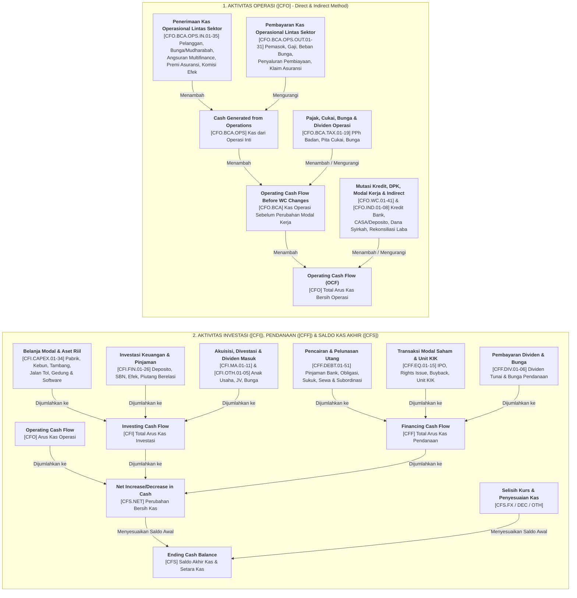

# Kamus Akun Arus Kas Lintas Sektor (`cash_flow_statement`)

Kamus ini mencakup seluruh **292 akun Laporan Arus Kas** dari seluruh *entry point* taksonomi iXBRL Bursa Efek Indonesia (`general`, `financial_and_sharia`, `financing`, `insurance`, `securities`, `property`, `infrastructure`, dan `collective_investment_contract`), baik untuk **Metode Langsung (*Direct Method*)** maupun **Metode Tidak Langsung (*Indirect Method*)**.

1. **Arus Kas dari Aktivitas Operasi (`[CFO]`)**
2. **Arus Kas dari Aktivitas Investasi (`[CFI]`)**
3. **Arus Kas dari Aktivitas Pendanaan (`[CFF]`)**
4. **Rekonsiliasi & Saldo Kas Akhir (`[CFS]`)**
5. **Glosarium Istilah & Rasio Arus Kas**

## Kode Sektor & Subsektor (IDX-IC & JASICA)

| Kode Sektor | Nama Sektor | Kode & Nama Subsektor |
| :--- | :--- | :--- |
| `A` | **Energy** | `A1` Oil, Gas & Coal · `A2` Alternative Energy |
| `B` | **Basic Materials** | `B1` Basic Materials |
| `C` | **Industrials** | `C1` Industrial Goods · `C2` Industrial Services · `C3` Multi-sector Holdings |
| `D` | **Consumer Non-Cyclicals** | `D1` Food & Staples Retailing · `D2` Food & Beverage · `D3` Tobacco · `D4` Nondurable Household Products |
| `E` | **Consumer Cyclicals** | `E1` Automobiles & Components · `E2` Household Goods · `E3` Leisure Goods · `E4` Apparel & Luxury Goods · `E5` Consumer Services · `E6` Media & Entertainment · `E7` Retailing |
| `F` | **Healthcare** | `F1` Healthcare Equipment & Providers · `F2` Pharmaceuticals & Health Care Research |
| `G` | **Financials** | `G1` Banks · `G2` Financing Service · `G3` Investment Service · `G4` Insurance · `G5` Holding & Investment Companies |
| `H` | **Properties & Real Estate** | `H1` Properties & Real Estate |
| `I` | **Technology** | `I1` Software & IT Services · `I2` Technology Hardware & Equipment |
| `J` | **Infrastructures** | `J1` Transportation Infrastructure · `J2` Heavy Constructions & Civil Engineering · `J3` Telecommunication · `J4` Utilities |
| `K` | **Transportation & Logistic** | `K1` Transportation · `K2` Logistics & Deliveries |
| `1`, `6`, `9` | **Klasifikasi Lama (JASICA)** | `1` Agriculture (`12` Plantation) · `6` Property, Real Estate & Building Construction (`61` Property & Real Estate) · `9` Trade, Services & Investment (`91` Wholesale, `97` Computer & Services, `98` Investment Company) |

## Struktur Hierarki Arus Kas Lintas Sektor

---

## 1. Arus Kas dari Aktivitas Operasi (`OperatingActivities`)

### 1.1 Akun Utama & Subtotal Arus Kas Operasi (`[CFO]`)

<table width="100%">
  <colgroup>
    <col width="34%" />
    <col width="34%" />
    <col width="32%" />
  </colgroup>
  <thead>
    <tr>
      <th align="left" width="34%">Penjelasan / Variants</th>
      <th align="left" width="34%">Saran Analisis / Sectors</th>
      <th align="left" width="32%">Entry Points / Subsectors</th>
    </tr>
  </thead>
  <tbody>
    <tr>
      <td colspan="3"><code>[CFO]</code> <b><code>Net<wbr>Cash<wbr>Flows<wbr>Received<wbr>From<wbr>Used<wbr>In<wbr>Operating<wbr>Activities</code></b></td>
    </tr>
    <tr>
      <td width="34%" valign="top"><b>Arus Kas Bersih yang Diperoleh dari (Digunakan untuk) Aktivitas Operasi</b>: Total uang tunai bersih yang dihasilkan mesin bisnis utama perusahaan setelah membayar pemasok, gaji karyawan, bunga operasional, dan pajak penghasilan (<code>[CFO.BCA]</code> ditambah/dikurangi perubahan modal kerja <code>[CFO.WC.01-05]</code>).</td>
      <td width="34%" valign="top"><b>Indikator kesehatan fundamental paling penting (Operating Cash Flow / OCF)!</b> Perusahaan yang sehat wajib memiliki <code>[CFO]</code> positif dan idealnya lebih besar atau sejalan dengan Laba Bersih (<code>[PL]</code>). Jika Laba Bersih tinggi tetapi <code>[CFO]</code> minus terus-menerus, laba tersebut hanya di atas kertas (macet di piutang/persediaan).</td>
      <td width="32%" valign="top"><b>Entry Points:</b> <code>all_entry_points</code></td>
    </tr>
    <tr>
      <td width="34%" valign="top"><b>Variants:</b> <code>all_variants</code></td>
      <td width="34%" valign="top"><b>Sectors:</b> <code>all_sectors</code></td>
      <td width="32%" valign="top"><b>Subsectors:</b> <code>all_subsectors</code></td>
    </tr>
<tr>
      <td colspan="3">&nbsp;</td>
    </tr>
    <tr>
      <td colspan="3"><code>[CFO.BCA]</code> <b><code>Net<wbr>Cash<wbr>Flows<wbr>Received<wbr>From<wbr>Used<wbr>In<wbr>Operating<wbr>Activities<wbr>Before<wbr>Changes<wbr>In<wbr>Assets<wbr>And<wbr>Liabilities</code></b></td>
    </tr>
    <tr>
      <td width="34%" valign="top"><b>Arus Kas Operasi Sebelum Perubahan Aset dan Liabilitas</b>: Subtotal kas operasional setelah memperhitungkan penerimaan/pembayaran bunga, dividen, cukai, dan pajak penghasilan (<code>[CFO.BCA.OPS]</code> &plusmn; <code>[CFO.BCA.TAX.01-14]</code>), sebelum perubahan aset/liabilitas operasi lainnya.</td>
      <td width="34%" valign="top">Menunjukkan kemampuan kas operasional sebelum dipengaruhi fluktuasi penempatan/penarikan aset dan liabilitas operasional.</td>
      <td width="32%" valign="top"><b>Entry Points:</b> <code>all_entry_points</code></td>
    </tr>
    <tr>
      <td width="34%" valign="top"><b>Variants:</b> <code>all_variants</code></td>
      <td width="34%" valign="top"><b>Sectors:</b> <code>all_sectors</code></td>
      <td width="32%" valign="top"><b>Subsectors:</b> <code>all_subsectors</code></td>
    </tr>
<tr>
      <td colspan="3">&nbsp;</td>
    </tr>
    <tr>
      <td colspan="3"><code>[CFO.BCA.OPS]</code> <b><code>Cash<wbr>Generated<wbr>From<wbr>Used<wbr>In<wbr>Operations</code></b></td>
    </tr>
    <tr>
      <td width="34%" valign="top"><b>Kas yang Dihasilkan dari (Digunakan untuk) Operasi</b>: Selisih murni antara uang tunai yang diterima dari pelanggan (<code>[CFO.BCA.OPS.IN.01-07]</code>) dikurangi uang tunai yang dibayarkan kepada pemasok, kontraktor, dan karyawan (<code>[CFO.BCA.OPS.OUT.01-08]</code>).</td>
      <td width="34%" valign="top">Cerminan laba operasional tunai paling murni sebelum dipotong pembayaran bunga bank dan pajak penghasilan badan.</td>
      <td width="32%" valign="top"><b>Entry Points:</b> <code>financing</code>, <code>general</code>, <code>infrastructure</code>, <code>property</code></td>
    </tr>
    <tr>
      <td width="34%" valign="top"><b>Variants:</b> <code>direct_method</code></td>
      <td width="34%" valign="top"><b>Sectors:</b> <code>all_sectors</code></td>
      <td width="32%" valign="top"><b>Subsectors:</b> <code>12. Plantation</code>, <code>61. Property And Real Estate</code>, <code>91. Wholesale (Durable & Non-Durable Goods)</code>, <code>97. Computer And Services</code>, <code>A1. Oil</code>, <code>Gas & Coal</code>, <code>A2. Alternative Energy</code>, <code>B1. Basic Materials</code>, <code>C1. Industrial Goods</code>, <code>C2. Industrial Services</code>, <code>C3. Multi-sector Holdings</code>, <code>D1. Food & Staples Retailing</code>, <code>D2. Food & Beverage</code>, <code>D3. Tobacco</code>, <code>D4. Nondurable Household Products</code>, <code>E1. Automobiles & Components</code>, <code>E2. Household Goods</code>, <code>E3. Leisure Goods</code>, <code>E4. Apparel & Luxury Goods</code>, <code>E5. Consumer Services</code>, <code>E6. Media & Entertainment</code>, <code>E7. Retailing</code>, <code>F1. Healthcare Equipment & Providers</code>, <code>F2. Pharmaceuticals & Health Care Research</code>, <code>G2. Financing Service</code>, <code>G3. Investment Service</code>, <code>G5. Holding & Investment Companies</code>, <code>H1. Properties & Real Estate</code>, <code>I1. Software & IT Services</code>, <code>I2. Technology Hardware & Equipment</code>, <code>J1. Transportation Infrastructure</code>, <code>J2. Heavy Constructions & Civil Engineering</code>, <code>J3. Telecommunication</code>, <code>J4. Utilities</code>, <code>K1. Transportation</code>, <code>K2. Logistics & Deliveries</code></td>
    </tr>
</tbody>
</table>

### 1.2 Penerimaan Kas dari Pelanggan & Operasional Lintas Sektor (`[CFO.BCA.OPS.IN]`)

<table width="100%">
  <colgroup>
    <col width="34%" />
    <col width="34%" />
    <col width="32%" />
  </colgroup>
  <thead>
    <tr>
      <th align="left" width="34%">Penjelasan / Variants</th>
      <th align="left" width="34%">Saran Analisis / Sectors</th>
      <th align="left" width="32%">Entry Points / Subsectors</th>
    </tr>
  </thead>
  <tbody>
    <tr>
      <td colspan="3"><code>[CFO.BCA.OPS.IN.01]</code> <b><code>ReceiptsFromCustomers</code></b></td>
    </tr>
    <tr>
      <td width="34%" valign="top"><b>Penerimaan Kas dari Pelanggan</b>: Uang tunai nyata yang masuk ke rekening perusahaan dari hasil penjualan barang/jasa kepada pelanggan.</td>
      <td width="34%" valign="top"><b>Bandingkan langsung dengan <code>SalesAndRevenue</code> di Laba Rugi!</b> Rasio <code>[CFO.BCA.OPS.IN.01] / SalesAndRevenue</code> yang sehat berada di kisaran &ge; 95%. Jika jauh di bawah omzet, berarti penjualan banyak yang belum dibayar pelanggan (menumpuk di piutang).</td>
      <td width="32%" valign="top"><b>Entry Points:</b> <code>general</code>, <code>infrastructure</code>, <code>property</code>, <code>securities</code></td>
    </tr>
    <tr>
      <td width="34%" valign="top"><b>Variants:</b> <code>direct_method</code></td>
      <td width="34%" valign="top"><b>Sectors:</b> <code>all_sectors</code></td>
      <td width="32%" valign="top"><b>Subsectors:</b> <code>12. Plantation</code>, <code>61. Property And Real Estate</code>, <code>91. Wholesale (Durable & Non-Durable Goods)</code>, <code>97. Computer And Services</code>, <code>98. Investment Company</code>, <code>A1. Oil</code>, <code>Gas & Coal</code>, <code>A2. Alternative Energy</code>, <code>B1. Basic Materials</code>, <code>C1. Industrial Goods</code>, <code>C2. Industrial Services</code>, <code>C3. Multi-sector Holdings</code>, <code>D1. Food & Staples Retailing</code>, <code>D2. Food & Beverage</code>, <code>D3. Tobacco</code>, <code>D4. Nondurable Household Products</code>, <code>E1. Automobiles & Components</code>, <code>E2. Household Goods</code>, <code>E3. Leisure Goods</code>, <code>E4. Apparel & Luxury Goods</code>, <code>E5. Consumer Services</code>, <code>E6. Media & Entertainment</code>, <code>E7. Retailing</code>, <code>F1. Healthcare Equipment & Providers</code>, <code>F2. Pharmaceuticals & Health Care Research</code>, <code>G3. Investment Service</code>, <code>G5. Holding & Investment Companies</code>, <code>H1. Properties & Real Estate</code>, <code>I1. Software & IT Services</code>, <code>I2. Technology Hardware & Equipment</code>, <code>J1. Transportation Infrastructure</code>, <code>J2. Heavy Constructions & Civil Engineering</code>, <code>J3. Telecommunication</code>, <code>J4. Utilities</code>, <code>K1. Transportation</code>, <code>K2. Logistics & Deliveries</code></td>
    </tr>
<tr>
      <td colspan="3">&nbsp;</td>
    </tr>
    <tr>
      <td colspan="3"><code>[CFO.BCA.OPS.IN.02]</code> <b><code>Receipts<wbr>From<wbr>Royalties<wbr>Fees<wbr>Commissions<wbr>And<wbr>Other<wbr>Revenues</code></b></td>
    </tr>
    <tr>
      <td width="34%" valign="top"><b>Penerimaan dari Royalti, Fee, Komisi, dan Pendapatan Lainnya</b>: Kas masuk operasional dari royalti lisensi, komisi keagenan, atau pendapatan jasa pendukung.</td>
      <td width="34%" valign="top">Komponen penerimaan kas operasional utama bagi bisnis berbasis jasa, waralaba, atau manajemen.</td>
      <td width="32%" valign="top"><b>Entry Points:</b> <code>general</code>, <code>infrastructure</code>, <code>property</code></td>
    </tr>
    <tr>
      <td width="34%" valign="top"><b>Variants:</b> <code>direct_method</code></td>
      <td width="34%" valign="top"><b>Sectors:</b> <code>6. Property</code>, <code>Real Estate And Building Construction</code>, <code>9. Trade</code>, <code>Services & Investment</code>, <code>A. Energy</code>, <code>B. Basic Materials</code>, <code>C. Industrials</code>, <code>D. Consumer Non-Cyclicals</code>, <code>E. Consumer Cyclicals</code>, <code>F. Healthcare</code>, <code>G. Financials</code>, <code>H. Properties & Real Estate</code>, <code>I. Technology</code>, <code>J. Infrastructures</code>, <code>K. Transportation & Logistic</code></td>
      <td width="32%" valign="top"><b>Subsectors:</b> <code>61. Property And Real Estate</code>, <code>98. Investment Company</code>, <code>A1. Oil</code>, <code>Gas & Coal</code>, <code>B1. Basic Materials</code>, <code>C1. Industrial Goods</code>, <code>C2. Industrial Services</code>, <code>D1. Food & Staples Retailing</code>, <code>D2. Food & Beverage</code>, <code>D4. Nondurable Household Products</code>, <code>E1. Automobiles & Components</code>, <code>E2. Household Goods</code>, <code>E4. Apparel & Luxury Goods</code>, <code>E5. Consumer Services</code>, <code>E6. Media & Entertainment</code>, <code>E7. Retailing</code>, <code>F1. Healthcare Equipment & Providers</code>, <code>G5. Holding & Investment Companies</code>, <code>H1. Properties & Real Estate</code>, <code>I1. Software & IT Services</code>, <code>I2. Technology Hardware & Equipment</code>, <code>J1. Transportation Infrastructure</code>, <code>J2. Heavy Constructions & Civil Engineering</code>, <code>J3. Telecommunication</code>, <code>J4. Utilities</code>, <code>K1. Transportation</code>, <code>K2. Logistics & Deliveries</code></td>
    </tr>
<tr>
      <td colspan="3">&nbsp;</td>
    </tr>
    <tr>
      <td colspan="3"><code>[CFO.BCA.OPS.IN.03]</code> <b><code>ReceiptsOfSubsidy</code></b></td>
    </tr>
    <tr>
      <td width="34%" valign="top"><b>Penerimaan Subsidi Pemerintah</b>: Pencairan uang tunai atas subsidi pemerintah (seperti subsidi pupuk, BBM/energi, atau PSO transportasi).</td>
      <td width="34%" valign="top">Pantau kecepatan pencairan subsidi dari pemerintah; keterlambatan pencairan subsidi sering membuat arus kas operasi BUMN tertekan sementara.</td>
      <td width="32%" valign="top"><b>Entry Points:</b> <code>general</code>, <code>infrastructure</code></td>
    </tr>
    <tr>
      <td width="34%" valign="top"><b>Variants:</b> <code>direct_method</code></td>
      <td width="34%" valign="top"><b>Sectors:</b> <code>D. Consumer Non-Cyclicals</code>, <code>G. Financials</code>, <code>H. Properties & Real Estate</code>, <code>J. Infrastructures</code></td>
      <td width="32%" valign="top"><b>Subsectors:</b> <code>D2. Food & Beverage</code>, <code>G5. Holding & Investment Companies</code>, <code>H1. Properties & Real Estate</code>, <code>J1. Transportation Infrastructure</code>, <code>J4. Utilities</code></td>
    </tr>
<tr>
      <td colspan="3">&nbsp;</td>
    </tr>
    <tr>
      <td colspan="3"><code>[CFO.BCA.OPS.IN.04]</code> <b><code>ReceiptsFromInvestments</code></b></td>
    </tr>
    <tr>
      <td width="34%" valign="top"><b>Penerimaan dari Investasi (Operasional)</b>: Kas masuk dari hasil portofolio investasi bagi perusahaan yang kegiatan utamanya mencakup pengelolaan investasi.</td>
      <td width="34%" valign="top">Merupakan kas masuk rutin pada emiten <i>holding</i> investasi.</td>
      <td width="32%" valign="top"><b>Entry Points:</b> <code>general</code></td>
    </tr>
    <tr>
      <td width="34%" valign="top"><b>Variants:</b> <code>direct_method</code></td>
      <td width="34%" valign="top"><b>Sectors:</b> <code>C. Industrials</code>, <code>E. Consumer Cyclicals</code>, <code>G. Financials</code>, <code>H. Properties & Real Estate</code>, <code>I. Technology</code></td>
      <td width="32%" valign="top"><b>Subsectors:</b> <code>C1. Industrial Goods</code>, <code>E4. Apparel & Luxury Goods</code>, <code>E7. Retailing</code>, <code>G5. Holding & Investment Companies</code>, <code>H1. Properties & Real Estate</code>, <code>I2. Technology Hardware & Equipment</code></td>
    </tr>
<tr>
      <td colspan="3">&nbsp;</td>
    </tr>
    <tr>
      <td colspan="3"><code>[CFO.BCA.OPS.IN.05]</code> <b><code>Receipts<wbr>From<wbr>Contracts<wbr>Held<wbr>For<wbr>Dealing<wbr>Or<wbr>Trading<wbr>Purposes</code></b></td>
    </tr>
    <tr>
      <td width="34%" valign="top"><b>Penerimaan dari Kontrak untuk Tujuan Diperdagangkan (<i>Dealing/Trading</i>)</b>: Kas masuk dari pencairan kontrak perdagangan efek/komoditas jangka pendek.</td>
      <td width="34%" valign="top">Bandingkan secara bersih (*net*) dengan pembayaran kontrak <i>trading</i> (<code>[CFO.BCA.OPS.OUT.07]</code>).</td>
      <td width="32%" valign="top"><b>Entry Points:</b> <code>general</code>, <code>infrastructure</code>, <code>property</code></td>
    </tr>
    <tr>
      <td width="34%" valign="top"><b>Variants:</b> <code>direct_method</code></td>
      <td width="34%" valign="top"><b>Sectors:</b> <code>6. Property</code>, <code>Real Estate And Building Construction</code>, <code>9. Trade</code>, <code>Services & Investment</code>, <code>A. Energy</code>, <code>E. Consumer Cyclicals</code>, <code>G. Financials</code>, <code>H. Properties & Real Estate</code>, <code>J. Infrastructures</code></td>
      <td width="32%" valign="top"><b>Subsectors:</b> <code>61. Property And Real Estate</code>, <code>98. Investment Company</code>, <code>A1. Oil</code>, <code>Gas & Coal</code>, <code>E6. Media & Entertainment</code>, <code>G5. Holding & Investment Companies</code>, <code>H1. Properties & Real Estate</code>, <code>J3. Telecommunication</code>, <code>J4. Utilities</code></td>
    </tr>
<tr>
      <td colspan="3">&nbsp;</td>
    </tr>
    <tr>
      <td colspan="3"><code>[CFO.BCA.OPS.IN.06]</code> <b><code>ReceiptFromSecuritiesCompany</code></b></td>
    </tr>
    <tr>
      <td width="34%" valign="top"><b>Penerimaan dari Perusahaan Efek</b>: Kas masuk dari penyelesaian transaksi melalui broker/perusahaan sekuritas.</td>
      <td width="34%" valign="top">Bagian dari aktivitas likuiditas/perdagangan efek operasional.</td>
      <td width="32%" valign="top"><b>Entry Points:</b> <code>securities</code></td>
    </tr>
    <tr>
      <td width="34%" valign="top"><b>Variants:</b> <code>direct_method</code></td>
      <td width="34%" valign="top"><b>Sectors:</b> <code>G. Financials</code></td>
      <td width="32%" valign="top"><b>Subsectors:</b> <code>G3. Investment Service</code>, <code>G5. Holding & Investment Companies</code></td>
    </tr>
<tr>
      <td colspan="3">&nbsp;</td>
    </tr>
    <tr>
      <td colspan="3"><code>[CFO.BCA.OPS.IN.07]</code> <b><code>Other<wbr>Cash<wbr>Receipts<wbr>From<wbr>Operating<wbr>Activities</code></b></td>
    </tr>
    <tr>
      <td width="34%" valign="top"><b>Penerimaan Kas Lainnya dari Aktivitas Operasi</b>: Kas masuk operasional di luar tagihan pelanggan utama (misal: klaim asuransi operasional, penjualan scrap).</td>
      <td width="34%" valign="top">Periksa di CALK jika nilainya melonjak signifikan.</td>
      <td width="32%" valign="top"><b>Entry Points:</b> <code>general</code>, <code>infrastructure</code>, <code>property</code></td>
    </tr>
    <tr>
      <td width="34%" valign="top"><b>Variants:</b> <code>direct_method</code></td>
      <td width="34%" valign="top"><b>Sectors:</b> <code>6. Property</code>, <code>Real Estate And Building Construction</code>, <code>9. Trade</code>, <code>Services & Investment</code>, <code>A. Energy</code>, <code>B. Basic Materials</code>, <code>C. Industrials</code>, <code>D. Consumer Non-Cyclicals</code>, <code>E. Consumer Cyclicals</code>, <code>F. Healthcare</code>, <code>G. Financials</code>, <code>H. Properties & Real Estate</code>, <code>I. Technology</code>, <code>J. Infrastructures</code>, <code>K. Transportation & Logistic</code></td>
      <td width="32%" valign="top"><b>Subsectors:</b> <code>61. Property And Real Estate</code>, <code>91. Wholesale (Durable & Non-Durable Goods)</code>, <code>98. Investment Company</code>, <code>A1. Oil</code>, <code>Gas & Coal</code>, <code>A2. Alternative Energy</code>, <code>B1. Basic Materials</code>, <code>C1. Industrial Goods</code>, <code>C2. Industrial Services</code>, <code>C3. Multi-sector Holdings</code>, <code>D1. Food & Staples Retailing</code>, <code>D2. Food & Beverage</code>, <code>D3. Tobacco</code>, <code>D4. Nondurable Household Products</code>, <code>E1. Automobiles & Components</code>, <code>E2. Household Goods</code>, <code>E3. Leisure Goods</code>, <code>E4. Apparel & Luxury Goods</code>, <code>E5. Consumer Services</code>, <code>E6. Media & Entertainment</code>, <code>E7. Retailing</code>, <code>F1. Healthcare Equipment & Providers</code>, <code>F2. Pharmaceuticals & Health Care Research</code>, <code>G5. Holding & Investment Companies</code>, <code>H1. Properties & Real Estate</code>, <code>I1. Software & IT Services</code>, <code>I2. Technology Hardware & Equipment</code>, <code>J1. Transportation Infrastructure</code>, <code>J2. Heavy Constructions & Civil Engineering</code>, <code>J3. Telecommunication</code>, <code>J4. Utilities</code>, <code>K1. Transportation</code>, <code>K2. Logistics & Deliveries</code></td>
    </tr>
<tr>
      <td colspan="3">&nbsp;</td>
    </tr>
    <tr>
      <td colspan="3"><code>[CFO.BCA.OPS.IN.08]</code> <b><code>Receipts<wbr>From<wbr>Payments<wbr>To<wbr>Customers</code></b></td>
    </tr>
    <tr>
      <td width="34%" valign="top"><b>Penerimaan dari (Pembayaran kepada) Pelanggan / Nasabah</b>: Arus kas masuk/keluar bersih dari penyelesaian transaksi nasabah pada lembaga keuangan.</td>
      <td width="34%" valign="top">Pantau arah arus kas bersih transaksi nasabah operasional.</td>
      <td width="32%" valign="top"><b>Entry Points:</b> <code>financial_and_sharia</code></td>
    </tr>
    <tr>
      <td width="34%" valign="top"><b>Variants:</b> <code>direct_method</code></td>
      <td width="34%" valign="top"><b>Sectors:</b> <code>G. Financials</code></td>
      <td width="32%" valign="top"><b>Subsectors:</b> <code>G1. Banks</code>, <code>G4. Insurance</code>, <code>G5. Holding & Investment Companies</code></td>
    </tr>
<tr>
      <td colspan="3">&nbsp;</td>
    </tr>
    <tr>
      <td colspan="3"><code>[CFO.BCA.OPS.IN.09]</code> <b><code>ReceiptsFromDrivers</code></b></td>
    </tr>
    <tr>
      <td width="34%" valign="top"><b>Penerimaan Setoran dari Pengemudi (<i>Receipts from Drivers</i>)</b>: Kas masuk operasional dari setoran mitra pengemudi taksi/transportasi (khusus emiten transportasi seperti BIRD, TAXI).</td>
      <td width="34%" valign="top">Indikator perputaran kas harian dan tingkat utilisasi armada taksi/transportasi darat.</td>
      <td width="32%" valign="top"><b>Entry Points:</b> <code>infrastructure</code></td>
    </tr>
    <tr>
      <td width="34%" valign="top"><b>Variants:</b> <code>direct_method</code></td>
      <td width="34%" valign="top"><b>Sectors:</b> <code>K. Transportation & Logistic</code></td>
      <td width="32%" valign="top"><b>Subsectors:</b> <code>K1. Transportation</code></td>
    </tr>
<tr>
      <td colspan="3">&nbsp;</td>
    </tr>
    <tr>
      <td colspan="3"><code>[CFO.BCA.OPS.IN.10]</code> <b><code>Interest<wbr>From<wbr>Banks<wbr>And<wbr>Time<wbr>Deposits</code></b></td>
    </tr>
    <tr>
      <td width="34%" valign="top"><b>Penerimaan Bunga/Bagi Hasil dari Bank dan Deposito Berjangka</b>: Kas masuk operasional perbankan dari bunga penempatan pada BI dan bank lain.</td>
      <td width="34%" valign="top">Bagian dari penerimaan bunga tunai operasional perbankan.</td>
      <td width="32%" valign="top"><b>Entry Points:</b> <code>financial_and_sharia</code></td>
    </tr>
    <tr>
      <td width="34%" valign="top"><b>Variants:</b> <code>direct_method</code></td>
      <td width="34%" valign="top"><b>Sectors:</b> <code>G. Financials</code></td>
      <td width="32%" valign="top"><b>Subsectors:</b> <code>G5. Holding & Investment Companies</code></td>
    </tr>
<tr>
      <td colspan="3">&nbsp;</td>
    </tr>
    <tr>
      <td colspan="3"><code>[CFO.BCA.OPS.IN.11]</code> <b><code>Revenue<wbr>Receipts<wbr>From<wbr>Fund<wbr>Management<wbr>As<wbr>Mudharib</code></b></td>
    </tr>
    <tr>
      <td width="34%" valign="top"><b>Penerimaan Pendapatan Pengelolaan Dana sebagai Mudharib</b>: Kas masuk yang diterima bank syariah dari hasil penyaluran pembiayaan syariah.</td>
      <td width="34%" valign="top">Kas masuk operasional utama pada perbankan syariah sebelum distribusi bagi hasil.</td>
      <td width="32%" valign="top"><b>Entry Points:</b> <code>financial_and_sharia</code></td>
    </tr>
    <tr>
      <td width="34%" valign="top"><b>Variants:</b> <code>direct_method</code></td>
      <td width="34%" valign="top"><b>Sectors:</b> <code>G. Financials</code></td>
      <td width="32%" valign="top"><b>Subsectors:</b> <code>G1. Banks</code></td>
    </tr>
<tr>
      <td colspan="3">&nbsp;</td>
    </tr>
    <tr>
      <td colspan="3"><code>[CFO.BCA.OPS.IN.12]</code> <b><code>ReceiptsPaymentsOfCommission</code></b></td>
    </tr>
    <tr>
      <td width="34%" valign="top"><b>Penerimaan (Pembayaran) Provisi dan Komisi Bersih</b>: Kas masuk/keluar bersih dari <i>fee-based income</i> dan komisi transaksi perbankan.</td>
      <td width="34%" valign="top">Mencerminkan realisasi tunai atas pendapatan komisi dan provisi bank.</td>
      <td width="32%" valign="top"><b>Entry Points:</b> <code>financial_and_sharia</code></td>
    </tr>
    <tr>
      <td width="34%" valign="top"><b>Variants:</b> <code>direct_method</code></td>
      <td width="34%" valign="top"><b>Sectors:</b> <code>G. Financials</code></td>
      <td width="32%" valign="top"><b>Subsectors:</b> <code>G1. Banks</code>, <code>G5. Holding & Investment Companies</code></td>
    </tr>
<tr>
      <td colspan="3">&nbsp;</td>
    </tr>
    <tr>
      <td colspan="3"><code>[CFO.BCA.OPS.IN.13]</code> <b><code>RecoveriesOfWrittenOffAssets</code></b></td>
    </tr>
    <tr>
      <td width="34%" valign="top"><b>Penerimaan kembali Aset yang Telah Dihapusbukukan (<i>Recovery Write-Off</i>)</b>: Uang tunai nyata yang berhasil ditagih kembali dari debitur macet yang sebelumnya sudah dihapus buku.</td>
      <td width="34%" valign="top">Sumber kas masuk murni yang langsung memperkuat likuiditas bank tanpa biaya dana tambahan.</td>
      <td width="32%" valign="top"><b>Entry Points:</b> <code>financial_and_sharia</code></td>
    </tr>
    <tr>
      <td width="34%" valign="top"><b>Variants:</b> <code>direct_method</code></td>
      <td width="34%" valign="top"><b>Sectors:</b> <code>G. Financials</code></td>
      <td width="32%" valign="top"><b>Subsectors:</b> <code>G1. Banks</code>, <code>G5. Holding & Investment Companies</code></td>
    </tr>
<tr>
      <td colspan="3">&nbsp;</td>
    </tr>
    <tr>
      <td colspan="3"><code>[CFO.BCA.OPS.IN.14]</code> <b><code>ForeignCurrencyGainsLosses</code></b></td>
    </tr>
    <tr>
      <td width="34%" valign="top"><b>Penerimaan (Pembayaran) Keuntungan/Kerugian Transaksi Valuta Asing</b>: Arus kas bersih dari realisasi transaksi <i>treasury</i> valas operasional perbankan.</td>
      <td width="34%" valign="top">Realisasi kas dari aktivitas perdagangan mata uang asing.</td>
      <td width="32%" valign="top"><b>Entry Points:</b> <code>financial_and_sharia</code></td>
    </tr>
    <tr>
      <td width="34%" valign="top"><b>Variants:</b> <code>direct_method</code></td>
      <td width="34%" valign="top"><b>Sectors:</b> <code>G. Financials</code>, <code>H. Properties & Real Estate</code></td>
      <td width="32%" valign="top"><b>Subsectors:</b> <code>G1. Banks</code>, <code>H1. Properties & Real Estate</code></td>
    </tr>
<tr>
      <td colspan="3">&nbsp;</td>
    </tr>
    <tr>
      <td colspan="3"><code>[CFO.BCA.OPS.IN.15]</code> <b><code>Income<wbr>From<wbr>Other<wbr>Operating<wbr>Transactions</code></b></td>
    </tr>
    <tr>
      <td width="34%" valign="top"><b>Penerimaan Pendapatan Transaksi Operasional Lainnya</b>: Kas masuk dari transaksi operasional perbankan lainnya.</td>
      <td width="34%" valign="top">Komponen pelengkap penerimaan kas operasional bank.</td>
      <td width="32%" valign="top"><b>Entry Points:</b> <code>financial_and_sharia</code></td>
    </tr>
    <tr>
      <td width="34%" valign="top"><b>Variants:</b> <code>direct_method</code></td>
      <td width="34%" valign="top"><b>Sectors:</b> <code>G. Financials</code>, <code>H. Properties & Real Estate</code></td>
      <td width="32%" valign="top"><b>Subsectors:</b> <code>G1. Banks</code>, <code>G5. Holding & Investment Companies</code>, <code>H1. Properties & Real Estate</code></td>
    </tr>
<tr>
      <td colspan="3">&nbsp;</td>
    </tr>
    <tr>
      <td colspan="3"><code>[CFO.BCA.OPS.IN.16]</code> <b><code>Receipts<wbr>From<wbr>Non<wbr>Operating<wbr>Income</code></b></td>
    </tr>
    <tr>
      <td width="34%" valign="top"><b>Penerimaan dari Pendapatan Non-Operasional (Pembayaran Beban Non-Operasional)</b>: Kas masuk/keluar bersih dari pos non-operasional perbankan.</td>
      <td width="34%" valign="top">Cek di CALK jika nilainya signifikan terhadap kas operasi.</td>
      <td width="32%" valign="top"><b>Entry Points:</b> <code>financial_and_sharia</code></td>
    </tr>
    <tr>
      <td width="34%" valign="top"><b>Variants:</b> <code>direct_method</code></td>
      <td width="34%" valign="top"><b>Sectors:</b> <code>G. Financials</code></td>
      <td width="32%" valign="top"><b>Subsectors:</b> <code>G1. Banks</code>, <code>G2. Financing Service</code>, <code>G4. Insurance</code></td>
    </tr>
<tr>
      <td colspan="3">&nbsp;</td>
    </tr>
    <tr>
      <td colspan="3"><code>[CFO.BCA.OPS.IN.17]</code> <b><code>Receipts<wbr>From<wbr>Consumer<wbr>Financing</code></b></td>
    </tr>
    <tr>
      <td width="34%" valign="top"><b>Penerimaan Kas dari Pembiayaan Konsumen</b>: Uang tunai angsuran (pokok dan bunga) yang diterima perusahaan <i>multifinance</i> dari debitur kredit kendaraan/multiguna.</td>
      <td width="34%" valign="top"><b>Mesin kas masuk utama multifinance!</b> Bandingkan dengan <code>PaymentsForConsumerFinancing</code> (<code>[CFO.BCA.OPS.OUT.11]</code>) untuk melihat apakah perusahaan sedang ekspansi penyaluran baru atau sedang panen angsuran.</td>
      <td width="32%" valign="top"><b>Entry Points:</b> <code>financing</code></td>
    </tr>
    <tr>
      <td width="34%" valign="top"><b>Variants:</b> <code>direct_method</code></td>
      <td width="34%" valign="top"><b>Sectors:</b> <code>E. Consumer Cyclicals</code>, <code>G. Financials</code>, <code>I. Technology</code></td>
      <td width="32%" valign="top"><b>Subsectors:</b> <code>E6. Media & Entertainment</code>, <code>G2. Financing Service</code>, <code>G5. Holding & Investment Companies</code>, <code>I2. Technology Hardware & Equipment</code></td>
    </tr>
<tr>
      <td colspan="3">&nbsp;</td>
    </tr>
    <tr>
      <td colspan="3"><code>[CFO.BCA.OPS.IN.18]</code> <b><code>ReceiptsFromFinanceLeases</code></b></td>
    </tr>
    <tr>
      <td width="34%" valign="top"><b>Penerimaan Kas dari Sewa Pembiayaan (<i>Finance Lease</i>)</b>: Uang tunai angsuran sewa pembiayaan alat berat/mesin yang diterima dari pelanggan.</td>
      <td width="34%" valign="top">Bandingkan dengan kas keluar penyaluran baru <code>PaymentsForFinanceLeases</code> (<code>[CFO.BCA.OPS.OUT.12]</code>).</td>
      <td width="32%" valign="top"><b>Entry Points:</b> <code>financing</code></td>
    </tr>
    <tr>
      <td width="34%" valign="top"><b>Variants:</b> <code>direct_method</code></td>
      <td width="34%" valign="top"><b>Sectors:</b> <code>C. Industrials</code>, <code>E. Consumer Cyclicals</code>, <code>G. Financials</code>, <code>I. Technology</code></td>
      <td width="32%" valign="top"><b>Subsectors:</b> <code>C1. Industrial Goods</code>, <code>E6. Media & Entertainment</code>, <code>G2. Financing Service</code>, <code>G5. Holding & Investment Companies</code>, <code>I2. Technology Hardware & Equipment</code></td>
    </tr>
<tr>
      <td colspan="3">&nbsp;</td>
    </tr>
    <tr>
      <td colspan="3"><code>[CFO.BCA.OPS.IN.19]</code> <b><code>ReceiptsFromFactoring</code></b></td>
    </tr>
    <tr>
      <td width="34%" valign="top"><b>Penerimaan Kas dari Anjak Piutang (<i>Factoring</i>)</b>: Kas masuk dari pelunasan tagihan anjak piutang oleh nasabah.</td>
      <td width="34%" valign="top">Pasangan penerimaan dari <code>PaymentsForFactoring</code> (<code>[CFO.BCA.OPS.OUT.13]</code>).</td>
      <td width="32%" valign="top"><b>Entry Points:</b> <code>financing</code></td>
    </tr>
    <tr>
      <td width="34%" valign="top"><b>Variants:</b> <code>direct_method</code></td>
      <td width="34%" valign="top"><b>Sectors:</b> <code>E. Consumer Cyclicals</code>, <code>G. Financials</code>, <code>I. Technology</code></td>
      <td width="32%" valign="top"><b>Subsectors:</b> <code>E6. Media & Entertainment</code>, <code>G2. Financing Service</code>, <code>G5. Holding & Investment Companies</code>, <code>I2. Technology Hardware & Equipment</code></td>
    </tr>
<tr>
      <td colspan="3">&nbsp;</td>
    </tr>
    <tr>
      <td colspan="3"><code>[CFO.BCA.OPS.IN.20]</code> <b><code>Receipts<wbr>From<wbr>Loan<wbr>Channeling<wbr>And<wbr>Joint<wbr>Financing<wbr>Cooperation</code></b></td>
    </tr>
    <tr>
      <td width="34%" valign="top"><b>Penerimaan dari Kerjasama <i>Channeling</i> dan <i>Joint Financing</i></b>: Kas masuk dari pencairan/angsuran skema pembiayaan bersama bank.</td>
      <td width="34%" valign="top">Pasangan dari <code>PaymentsForLoanChannelingAndJointFinancingCooperation</code> (<code>[CFO.BCA.OPS.OUT.14]</code>).</td>
      <td width="32%" valign="top"><b>Entry Points:</b> <code>financing</code></td>
    </tr>
    <tr>
      <td width="34%" valign="top"><b>Variants:</b> <code>direct_method</code></td>
      <td width="34%" valign="top"><b>Sectors:</b> <code>G. Financials</code></td>
      <td width="32%" valign="top"><b>Subsectors:</b> <code>G2. Financing Service</code></td>
    </tr>
<tr>
      <td colspan="3">&nbsp;</td>
    </tr>
    <tr>
      <td colspan="3"><code>[CFO.BCA.OPS.IN.21]</code> <b><code>Receipts<wbr>Of<wbr>Interest<wbr>From<wbr>Loan<wbr>Receivable</code></b></td>
    </tr>
    <tr>
      <td width="34%" valign="top"><b>Penerimaan Bunga dari Piutang Pinjaman</b>: Kas masuk bunga dari penyaluran pinjaman pada perusahaan pembiayaan.</td>
      <td width="34%" valign="top">Realisasi kas atas pendapatan bunga pinjaman multifinance.</td>
      <td width="32%" valign="top"><b>Entry Points:</b> <code>financing</code></td>
    </tr>
    <tr>
      <td width="34%" valign="top"><b>Variants:</b> <code>direct_method</code></td>
      <td width="34%" valign="top"><b>Sectors:</b> <code>G. Financials</code></td>
      <td width="32%" valign="top"><b>Subsectors:</b> <code>G2. Financing Service</code></td>
    </tr>
<tr>
      <td colspan="3">&nbsp;</td>
    </tr>
    <tr>
      <td colspan="3"><code>[CFO.BCA.OPS.IN.22]</code> <b><code>Receipts<wbr>From<wbr>Insurance<wbr>Premiums</code></b></td>
    </tr>
    <tr>
      <td width="34%" valign="top"><b>Penerimaan Kas dari Premi Asuransi</b>: Uang tunai premi yang benar-benar diterima dari pemegang polis sepanjang periode berjalan.</td>
      <td width="34%" valign="top"><b>Kas masuk utama perusahaan asuransi!</b> Bandingkan dengan pembayaran klaim (<code>[CFO.BCA.OPS.OUT.15]</code>) dan premi reasuransi (<code>[CFO.BCA.OPS.OUT.16]</code>).</td>
      <td width="32%" valign="top"><b>Entry Points:</b> <code>financial_and_sharia</code>, <code>insurance</code></td>
    </tr>
    <tr>
      <td width="34%" valign="top"><b>Variants:</b> <code>direct_method</code></td>
      <td width="34%" valign="top"><b>Sectors:</b> <code>A. Energy</code>, <code>G. Financials</code></td>
      <td width="32%" valign="top"><b>Subsectors:</b> <code>A1. Oil</code>, <code>Gas & Coal</code>, <code>G1. Banks</code>, <code>G4. Insurance</code>, <code>G5. Holding & Investment Companies</code></td>
    </tr>
<tr>
      <td colspan="3">&nbsp;</td>
    </tr>
    <tr>
      <td colspan="3"><code>[CFO.BCA.OPS.IN.23]</code> <b><code>Receipts<wbr>From<wbr>Reinsurance<wbr>Claims</code></b></td>
    </tr>
    <tr>
      <td width="34%" valign="top"><b>Penerimaan Klaim Reasuransi (<i>Reinsurance Recoveries</i>)</b>: Uang tunai penggantian klaim yang cair dari perusahaan reasuransi.</td>
      <td width="34%" valign="top">Penting untuk memantau seberapa cepat mitra reasuransi mencairkan porsi tanggungan klaimnya secara tunai.</td>
      <td width="32%" valign="top"><b>Entry Points:</b> <code>financial_and_sharia</code>, <code>insurance</code></td>
    </tr>
    <tr>
      <td width="34%" valign="top"><b>Variants:</b> <code>direct_method</code></td>
      <td width="34%" valign="top"><b>Sectors:</b> <code>A. Energy</code>, <code>G. Financials</code></td>
      <td width="32%" valign="top"><b>Subsectors:</b> <code>A1. Oil</code>, <code>Gas & Coal</code>, <code>G1. Banks</code>, <code>G4. Insurance</code>, <code>G5. Holding & Investment Companies</code></td>
    </tr>
<tr>
      <td colspan="3">&nbsp;</td>
    </tr>
    <tr>
      <td colspan="3"><code>[CFO.BCA.OPS.IN.24]</code> <b><code>Receipts<wbr>From<wbr>Retrocession<wbr>Claims</code></b></td>
    </tr>
    <tr>
      <td width="34%" valign="top"><b>Penerimaan Klaim Retrosesi</b>: Kas masuk penggantian klaim dari reasuradur lain kepada perusahaan reasuransi.</td>
      <td width="34%" valign="top">Pasangan dari <code>PaymentsForRetrocessionPremiums</code> (<code>[CFO.BCA.OPS.OUT.17]</code>).</td>
      <td width="32%" valign="top"><b>Entry Points:</b> <code>financial_and_sharia</code>, <code>insurance</code></td>
    </tr>
    <tr>
      <td width="34%" valign="top"><b>Variants:</b> <code>direct_method</code></td>
      <td width="34%" valign="top"><b>Sectors:</b> <code>G. Financials</code></td>
      <td width="32%" valign="top"><b>Subsectors:</b> <code>G4. Insurance</code></td>
    </tr>
<tr>
      <td colspan="3">&nbsp;</td>
    </tr>
    <tr>
      <td colspan="3"><code>[CFO.BCA.OPS.IN.25]</code> <b><code>ReceiptsFromCommission</code></b></td>
    </tr>
    <tr>
      <td width="34%" valign="top"><b>Penerimaan Komisi Reasuransi</b>: Kas masuk komisi yang diterima perusahaan asuransi dari mitra reasuradur.</td>
      <td width="34%" valign="top">Mengurangi beban akuisisi kas bersih perusahaan asuransi.</td>
      <td width="32%" valign="top"><b>Entry Points:</b> <code>insurance</code></td>
    </tr>
    <tr>
      <td width="34%" valign="top"><b>Variants:</b> <code>direct_method</code></td>
      <td width="34%" valign="top"><b>Sectors:</b> <code>A. Energy</code>, <code>G. Financials</code></td>
      <td width="32%" valign="top"><b>Subsectors:</b> <code>A1. Oil</code>, <code>Gas & Coal</code>, <code>G4. Insurance</code></td>
    </tr>
<tr>
      <td colspan="3">&nbsp;</td>
    </tr>
    <tr>
      <td colspan="3"><code>[CFO.BCA.OPS.IN.26]</code> <b><code>ReceiptsOfInvestmentIncome</code></b></td>
    </tr>
    <tr>
      <td width="34%" valign="top"><b>Penerimaan Hasil Investasi (Asuransi)</b>: Kas masuk bunga, kupon obligasi, dan dividen dari portofolio investasi perusahaan asuransi.</td>
      <td width="34%" valign="top">Sumber likuiditas tunai utama pendamping premi pada bisnis asuransi.</td>
      <td width="32%" valign="top"><b>Entry Points:</b> <code>insurance</code></td>
    </tr>
    <tr>
      <td width="34%" valign="top"><b>Variants:</b> <code>direct_method</code></td>
      <td width="34%" valign="top"><b>Sectors:</b> <code>A. Energy</code>, <code>G. Financials</code></td>
      <td width="32%" valign="top"><b>Subsectors:</b> <code>A1. Oil</code>, <code>Gas & Coal</code>, <code>G4. Insurance</code></td>
    </tr>
<tr>
      <td colspan="3">&nbsp;</td>
    </tr>
    <tr>
      <td colspan="3"><code>[CFO.BCA.OPS.IN.27]</code> <b><code>Receipts<wbr>From<wbr>Payments<wbr>For<wbr>Policy<wbr>Loans</code></b></td>
    </tr>
    <tr>
      <td width="34%" valign="top"><b>Penerimaan dari (Pembayaran untuk) Pinjaman Polis</b>: Arus kas masuk/keluar bersih dari fasilitas pinjaman polis pemegang asuransi jiwa.</td>
      <td width="34%" valign="top">Mutasi kas pinjaman polis yang dijamin nilai tunai polis.</td>
      <td width="32%" valign="top"><b>Entry Points:</b> <code>financial_and_sharia</code>, <code>insurance</code></td>
    </tr>
    <tr>
      <td width="34%" valign="top"><b>Variants:</b> <code>all_variants</code></td>
      <td width="34%" valign="top"><b>Sectors:</b> <code>G. Financials</code></td>
      <td width="32%" valign="top"><b>Subsectors:</b> <code>G4. Insurance</code></td>
    </tr>
<tr>
      <td colspan="3">&nbsp;</td>
    </tr>
    <tr>
      <td colspan="3"><code>[CFO.BCA.OPS.IN.28]</code> <b><code>Receipts<wbr>From<wbr>Brokerage<wbr>Commissions</code></b></td>
    </tr>
    <tr>
      <td width="34%" valign="top"><b>Penerimaan dari Komisi Perantara Pedagang Efek (<i>Brokerage</i>)</b>: Uang tunai komisi transaksi jual-beli efek yang diterima perusahaan sekuritas.</td>
      <td width="34%" valign="top">Sumber kas operasional rutin bisnis pialang saham.</td>
      <td width="32%" valign="top"><b>Entry Points:</b> <code>securities</code></td>
    </tr>
    <tr>
      <td width="34%" valign="top"><b>Variants:</b> <code>direct_method</code></td>
      <td width="34%" valign="top"><b>Sectors:</b> <code>G. Financials</code></td>
      <td width="32%" valign="top"><b>Subsectors:</b> <code>G3. Investment Service</code></td>
    </tr>
<tr>
      <td colspan="3">&nbsp;</td>
    </tr>
    <tr>
      <td colspan="3"><code>[CFO.BCA.OPS.IN.29]</code> <b><code>Receipts<wbr>From<wbr>Investment<wbr>Management<wbr>Fees</code></b></td>
    </tr>
    <tr>
      <td width="34%" valign="top"><b>Penerimaan Jasa Manajer Investasi (<i>Management Fee</i>)</b>: Kas masuk dari biaya pengelolaan reksa dana dan kontrak pengelolaan dana.</td>
      <td width="34%" valign="top">Penghasil arus kas berulang (*recurring cash flow*) paling stabil pada perusahaan sekuritas/MI.</td>
      <td width="32%" valign="top"><b>Entry Points:</b> <code>securities</code></td>
    </tr>
    <tr>
      <td width="34%" valign="top"><b>Variants:</b> <code>direct_method</code></td>
      <td width="34%" valign="top"><b>Sectors:</b> <code>G. Financials</code></td>
      <td width="32%" valign="top"><b>Subsectors:</b> <code>G3. Investment Service</code></td>
    </tr>
<tr>
      <td colspan="3">&nbsp;</td>
    </tr>
    <tr>
      <td colspan="3"><code>[CFO.BCA.OPS.IN.30]</code> <b><code>Receipts<wbr>From<wbr>Financial<wbr>Advisory<wbr>Fees</code></b></td>
    </tr>
    <tr>
      <td width="34%" valign="top"><b>Penerimaan Jasa Penasihat Keuangan &amp; Penjaminan Emisi</b>: Kas masuk dari <i>fee</i> IPO, <i>rights issue</i>, penerbitan obligasi, dan konsultasi M&amp;A.</td>
      <td width="34%" valign="top">Kas masuk bernilai besar dari aktivitas <i>investment banking</i>.</td>
      <td width="32%" valign="top"><b>Entry Points:</b> <code>securities</code></td>
    </tr>
    <tr>
      <td width="34%" valign="top"><b>Variants:</b> <code>direct_method</code></td>
      <td width="34%" valign="top"><b>Sectors:</b> <code>G. Financials</code></td>
      <td width="32%" valign="top"><b>Subsectors:</b> <code>G3. Investment Service</code></td>
    </tr>
<tr>
      <td colspan="3">&nbsp;</td>
    </tr>
    <tr>
      <td colspan="3"><code>[CFO.BCA.OPS.IN.31]</code> <b><code>Receipts<wbr>From<wbr>Clearing<wbr>And<wbr>Guarantee<wbr>Institution</code></b></td>
    </tr>
    <tr>
      <td width="34%" valign="top"><b>Penerimaan dari Lembaga Kliring dan Penjaminan (KPEI)</b>: Kas masuk dari penyelesaian transaksi bursa melalui KPEI.</td>
      <td width="34%" valign="top">Bandingkan secara bersih dengan <code>PaymentsToClearingAndGuaranteeInstitution</code> (<code>[CFO.BCA.OPS.OUT.21]</code>).</td>
      <td width="32%" valign="top"><b>Entry Points:</b> <code>securities</code></td>
    </tr>
    <tr>
      <td width="34%" valign="top"><b>Variants:</b> <code>direct_method</code></td>
      <td width="34%" valign="top"><b>Sectors:</b> <code>G. Financials</code></td>
      <td width="32%" valign="top"><b>Subsectors:</b> <code>G3. Investment Service</code></td>
    </tr>
<tr>
      <td colspan="3">&nbsp;</td>
    </tr>
    <tr>
      <td colspan="3"><code>[CFO.BCA.OPS.IN.32]</code> <b><code>Receipts<wbr>From<wbr>Payments<wbr>To<wbr>Clearing<wbr>And<wbr>Guarantee<wbr>Institution</code></b></td>
    </tr>
    <tr>
      <td width="34%" valign="top"><b>Penerimaan dari (Pembayaran kepada) Lembaga Kliring dan Penjaminan</b>: Arus kas penyelesaian transaksi kliring bersih.</td>
      <td width="34%" valign="top">Mutasi kas penyelesaian kliring efek.</td>
      <td width="32%" valign="top"><b>Entry Points:</b> <code>financial_and_sharia</code></td>
    </tr>
    <tr>
      <td width="34%" valign="top"><b>Variants:</b> <code>direct_method</code></td>
      <td width="34%" valign="top"><b>Sectors:</b> <code>G. Financials</code></td>
      <td width="32%" valign="top"><b>Subsectors:</b> <code>G1. Banks</code>, <code>G5. Holding & Investment Companies</code></td>
    </tr>
<tr>
      <td colspan="3">&nbsp;</td>
    </tr>
    <tr>
      <td colspan="3"><code>[CFO.BCA.OPS.IN.33]</code> <b><code>Proceeds<wbr>On<wbr>Sale<wbr>Of<wbr>Marketable<wbr>Securities</code></b></td>
    </tr>
    <tr>
      <td width="34%" valign="top"><b>Penerimaan dari Penjualan Efek yang Diperdagangkan (Sekuritas)</b>: Kas masuk dari penjualan portofolio efek <i>trading</i> milik perusahaan sekuritas.</td>
      <td width="34%" valign="top">Pasangan dari <code>PaymentsForPurchaseOfMarketableSecurities</code> (<code>[CFO.BCA.OPS.OUT.24]</code>).</td>
      <td width="32%" valign="top"><b>Entry Points:</b> <code>securities</code></td>
    </tr>
    <tr>
      <td width="34%" valign="top"><b>Variants:</b> <code>direct_method</code></td>
      <td width="34%" valign="top"><b>Sectors:</b> <code>G. Financials</code></td>
      <td width="32%" valign="top"><b>Subsectors:</b> <code>G3. Investment Service</code></td>
    </tr>
<tr>
      <td colspan="3">&nbsp;</td>
    </tr>
    <tr>
      <td colspan="3"><code>[CFO.BCA.OPS.IN.34]</code> <b><code>Proceeds<wbr>On<wbr>Sale<wbr>Of<wbr>Securities<wbr>Purchased<wbr>Under<wbr>Agreement<wbr>To<wbr>Resale</code></b></td>
    </tr>
    <tr>
      <td width="34%" valign="top"><b>Penerimaan dari Pencairan Efek yang Dibeli dengan Janji Dijual Kembali (<i>Reverse Repo</i>)</b>: Kas masuk saat transaksi <i>reverse repo</i> jatuh tempo pada perusahaan sekuritas.</td>
      <td width="34%" valign="top">Pasangan dari <code>PaymentsForPurchaseOfSecuritiesPurchasedUnderAgreementToResale</code> (<code>[CFO.BCA.OPS.OUT.25]</code>).</td>
      <td width="32%" valign="top"><b>Entry Points:</b> <code>securities</code></td>
    </tr>
    <tr>
      <td width="34%" valign="top"><b>Variants:</b> <code>direct_method</code></td>
      <td width="34%" valign="top"><b>Sectors:</b> <code>G. Financials</code></td>
      <td width="32%" valign="top"><b>Subsectors:</b> <code>G3. Investment Service</code></td>
    </tr>
<tr>
      <td colspan="3">&nbsp;</td>
    </tr>
    <tr>
      <td colspan="3"><code>[CFO.BCA.OPS.IN.35]</code> <b><code>Proceeds<wbr>From<wbr>Sales<wbr>Of<wbr>Equityinstrument<wbr>Portfolios</code></b></td>
    </tr>
    <tr>
      <td width="34%" valign="top"><b>Penerimaan dari Penjualan Portofolio Instrumen Ekuitas (KIK)</b>: Kas masuk dari penjualan saham dalam portofolio Reksa Dana / KIK.</td>
      <td width="34%" valign="top">Pasangan dari <code>PurchaseOfEquityInstrumentPortfolios</code> (<code>[CFO.BCA.OPS.OUT.26]</code>).</td>
      <td width="32%" valign="top"><b>Entry Points:</b> <code>all_entry_points</code></td>
    </tr>
    <tr>
      <td width="34%" valign="top"><b>Variants:</b> <code>all_variants</code></td>
      <td width="34%" valign="top"><b>Sectors:</b> <code>all_sectors</code></td>
      <td width="32%" valign="top"><b>Subsectors:</b> <code>all_subsectors</code></td>
    </tr>
</tbody>
</table>

### 1.3 Pembayaran Kas kepada Pemasok, Karyawan, & Operasional Lintas Sektor (`[CFO.BCA.OPS.OUT]`)

<table width="100%">
  <colgroup>
    <col width="34%" />
    <col width="34%" />
    <col width="32%" />
  </colgroup>
  <thead>
    <tr>
      <th align="left" width="34%">Penjelasan / Variants</th>
      <th align="left" width="34%">Saran Analisis / Sectors</th>
      <th align="left" width="32%">Entry Points / Subsectors</th>
    </tr>
  </thead>
  <tbody>
    <tr>
      <td colspan="3"><code>[CFO.BCA.OPS.OUT.01]</code> <b><code>Payments<wbr>To<wbr>Suppliers<wbr>For<wbr>Goods<wbr>And<wbr>Services</code></b></td>
    </tr>
    <tr>
      <td width="34%" valign="top"><b>Pembayaran Kas kepada Pemasok Barang dan Jasa</b>: Uang tunai yang dikeluarkan untuk membayar bahan baku, barang dagangan, listrik, dan vendor operasional.</td>
      <td width="34%" valign="top">Komponen pengeluaran kas operasional terbesar. Jika angkanya melonjak jauh melebihi HPP, perusahaan kemungkinan sedang menimbun stok persediaan atau mempercepat pelunasan utang usaha.</td>
      <td width="32%" valign="top"><b>Entry Points:</b> <code>general</code>, <code>infrastructure</code>, <code>property</code>, <code>securities</code></td>
    </tr>
    <tr>
      <td width="34%" valign="top"><b>Variants:</b> <code>direct_method</code></td>
      <td width="34%" valign="top"><b>Sectors:</b> <code>all_sectors</code></td>
      <td width="32%" valign="top"><b>Subsectors:</b> <code>12. Plantation</code>, <code>61. Property And Real Estate</code>, <code>91. Wholesale (Durable & Non-Durable Goods)</code>, <code>97. Computer And Services</code>, <code>98. Investment Company</code>, <code>A1. Oil</code>, <code>Gas & Coal</code>, <code>A2. Alternative Energy</code>, <code>B1. Basic Materials</code>, <code>C1. Industrial Goods</code>, <code>C2. Industrial Services</code>, <code>C3. Multi-sector Holdings</code>, <code>D1. Food & Staples Retailing</code>, <code>D2. Food & Beverage</code>, <code>D3. Tobacco</code>, <code>D4. Nondurable Household Products</code>, <code>E1. Automobiles & Components</code>, <code>E2. Household Goods</code>, <code>E3. Leisure Goods</code>, <code>E4. Apparel & Luxury Goods</code>, <code>E5. Consumer Services</code>, <code>E6. Media & Entertainment</code>, <code>E7. Retailing</code>, <code>F1. Healthcare Equipment & Providers</code>, <code>F2. Pharmaceuticals & Health Care Research</code>, <code>G3. Investment Service</code>, <code>G5. Holding & Investment Companies</code>, <code>H1. Properties & Real Estate</code>, <code>I1. Software & IT Services</code>, <code>I2. Technology Hardware & Equipment</code>, <code>J1. Transportation Infrastructure</code>, <code>J2. Heavy Constructions & Civil Engineering</code>, <code>J3. Telecommunication</code>, <code>J4. Utilities</code>, <code>K1. Transportation</code>, <code>K2. Logistics & Deliveries</code></td>
    </tr>
<tr>
      <td colspan="3">&nbsp;</td>
    </tr>
    <tr>
      <td colspan="3"><code>[CFO.BCA.OPS.OUT.02]</code> <b><code>Payments<wbr>For<wbr>Salaries<wbr>And<wbr>Allowances</code></b></td>
    </tr>
    <tr>
      <td width="34%" valign="top"><b>Pembayaran Gaji dan Tunjangan Karyawan</b>: Uang tunai nyata yang ditransfer untuk membayar gaji, upah, bonus, THR, dan tunjangan karyawan serta direksi.</td>
      <td width="34%" valign="top">Bandingkan pertumbuhannya dengan pertumbuhan penerimaan pelanggan (<code>[CFO.BCA.OPS.IN.01]</code>) untuk memantau efisiensi beban kas SDM.</td>
      <td width="32%" valign="top"><b>Entry Points:</b> <code>financial_and_sharia</code>, <code>general</code>, <code>infrastructure</code>, <code>insurance</code>, <code>property</code>, <code>securities</code></td>
    </tr>
    <tr>
      <td width="34%" valign="top"><b>Variants:</b> <code>direct_method</code></td>
      <td width="34%" valign="top"><b>Sectors:</b> <code>all_sectors</code></td>
      <td width="32%" valign="top"><b>Subsectors:</b> <code>12. Plantation</code>, <code>61. Property And Real Estate</code>, <code>98. Investment Company</code>, <code>A1. Oil</code>, <code>Gas & Coal</code>, <code>A2. Alternative Energy</code>, <code>B1. Basic Materials</code>, <code>C1. Industrial Goods</code>, <code>C2. Industrial Services</code>, <code>C3. Multi-sector Holdings</code>, <code>D1. Food & Staples Retailing</code>, <code>D2. Food & Beverage</code>, <code>D3. Tobacco</code>, <code>D4. Nondurable Household Products</code>, <code>E1. Automobiles & Components</code>, <code>E2. Household Goods</code>, <code>E3. Leisure Goods</code>, <code>E4. Apparel & Luxury Goods</code>, <code>E5. Consumer Services</code>, <code>E6. Media & Entertainment</code>, <code>E7. Retailing</code>, <code>F1. Healthcare Equipment & Providers</code>, <code>F2. Pharmaceuticals & Health Care Research</code>, <code>G1. Banks</code>, <code>G3. Investment Service</code>, <code>G4. Insurance</code>, <code>G5. Holding & Investment Companies</code>, <code>H1. Properties & Real Estate</code>, <code>I1. Software & IT Services</code>, <code>I2. Technology Hardware & Equipment</code>, <code>J1. Transportation Infrastructure</code>, <code>J2. Heavy Constructions & Civil Engineering</code>, <code>J3. Telecommunication</code>, <code>J4. Utilities</code>, <code>K1. Transportation</code>, <code>K2. Logistics & Deliveries</code></td>
    </tr>
<tr>
      <td colspan="3">&nbsp;</td>
    </tr>
    <tr>
      <td colspan="3"><code>[CFO.BCA.OPS.OUT.03]</code> <b><code>Payments<wbr>For<wbr>General<wbr>And<wbr>Administrative<wbr>Expense</code></b></td>
    </tr>
    <tr>
      <td width="34%" valign="top"><b>Pembayaran Beban Umum dan Administrasi</b>: Pengeluaran kas untuk operasional kantor pusat, sewa, administrasi, dan pemasaran.</td>
      <td width="34%" valign="top">Pengeluaran kas rutin <i>overhead</i> perusahaan.</td>
      <td width="32%" valign="top"><b>Entry Points:</b> <code>all_entry_points</code></td>
    </tr>
    <tr>
      <td width="34%" valign="top"><b>Variants:</b> <code>direct_method</code></td>
      <td width="34%" valign="top"><b>Sectors:</b> <code>A. Energy</code>, <code>B. Basic Materials</code>, <code>C. Industrials</code>, <code>D. Consumer Non-Cyclicals</code>, <code>E. Consumer Cyclicals</code>, <code>F. Healthcare</code>, <code>G. Financials</code>, <code>H. Properties & Real Estate</code>, <code>I. Technology</code>, <code>J. Infrastructures</code>, <code>K. Transportation & Logistic</code></td>
      <td width="32%" valign="top"><b>Subsectors:</b> <code>A1. Oil</code>, <code>Gas & Coal</code>, <code>B1. Basic Materials</code>, <code>C1. Industrial Goods</code>, <code>C2. Industrial Services</code>, <code>D1. Food & Staples Retailing</code>, <code>D2. Food & Beverage</code>, <code>D4. Nondurable Household Products</code>, <code>E1. Automobiles & Components</code>, <code>E2. Household Goods</code>, <code>E3. Leisure Goods</code>, <code>E4. Apparel & Luxury Goods</code>, <code>E5. Consumer Services</code>, <code>E6. Media & Entertainment</code>, <code>E7. Retailing</code>, <code>F1. Healthcare Equipment & Providers</code>, <code>F2. Pharmaceuticals & Health Care Research</code>, <code>G1. Banks</code>, <code>G2. Financing Service</code>, <code>G3. Investment Service</code>, <code>G4. Insurance</code>, <code>G5. Holding & Investment Companies</code>, <code>H1. Properties & Real Estate</code>, <code>I1. Software & IT Services</code>, <code>I2. Technology Hardware & Equipment</code>, <code>J2. Heavy Constructions & Civil Engineering</code>, <code>J3. Telecommunication</code>, <code>J4. Utilities</code>, <code>K1. Transportation</code>, <code>K2. Logistics & Deliveries</code></td>
    </tr>
<tr>
      <td colspan="3">&nbsp;</td>
    </tr>
    <tr>
      <td colspan="3"><code>[CFO.BCA.OPS.OUT.04]</code> <b><code>PaymentsToContractors</code></b></td>
    </tr>
    <tr>
      <td width="34%" valign="top"><b>Pembayaran kepada Kontraktor</b>: Uang tunai yang dibayarkan kepada kontraktor tambang (<i>mining contractor</i>) atau subkontraktor proyek konstruksi.</td>
      <td width="34%" valign="top">Pos pengeluaran kas terbesar pada emiten pertambangan batu bara/nikel dan pengembang properti/infrastruktur.</td>
      <td width="32%" valign="top"><b>Entry Points:</b> <code>general</code>, <code>infrastructure</code>, <code>property</code></td>
    </tr>
    <tr>
      <td width="34%" valign="top"><b>Variants:</b> <code>direct_method</code></td>
      <td width="34%" valign="top"><b>Sectors:</b> <code>6. Property</code>, <code>Real Estate And Building Construction</code>, <code>A. Energy</code>, <code>B. Basic Materials</code>, <code>C. Industrials</code>, <code>D. Consumer Non-Cyclicals</code>, <code>E. Consumer Cyclicals</code>, <code>H. Properties & Real Estate</code>, <code>I. Technology</code>, <code>J. Infrastructures</code>, <code>K. Transportation & Logistic</code></td>
      <td width="32%" valign="top"><b>Subsectors:</b> <code>61. Property And Real Estate</code>, <code>A1. Oil</code>, <code>Gas & Coal</code>, <code>B1. Basic Materials</code>, <code>C1. Industrial Goods</code>, <code>D1. Food & Staples Retailing</code>, <code>E4. Apparel & Luxury Goods</code>, <code>H1. Properties & Real Estate</code>, <code>I1. Software & IT Services</code>, <code>J4. Utilities</code>, <code>K1. Transportation</code></td>
    </tr>
<tr>
      <td colspan="3">&nbsp;</td>
    </tr>
    <tr>
      <td colspan="3"><code>[CFO.BCA.OPS.OUT.05]</code> <b><code>Payments<wbr>For<wbr>Royalties<wbr>And<wbr>Exploitation<wbr>Fees</code></b></td>
    </tr>
    <tr>
      <td width="34%" valign="top"><b>Pembayaran Royalti dan Iuran Eksploitasi (PNBP)</b>: Kas yang dibayarkan kepada pemerintah atas royalti tambang (DHPB/PNBP), hak konsesi, atau pemilik lisensi merek.</td>
      <td width="34%" valign="top">Wajib dipantau pada emiten batu bara &amp; mineral karena tarif royalti pemerintah bersifat progresif mengikuti harga komoditas.</td>
      <td width="32%" valign="top"><b>Entry Points:</b> <code>general</code>, <code>infrastructure</code></td>
    </tr>
    <tr>
      <td width="34%" valign="top"><b>Variants:</b> <code>direct_method</code></td>
      <td width="34%" valign="top"><b>Sectors:</b> <code>A. Energy</code>, <code>B. Basic Materials</code>, <code>D. Consumer Non-Cyclicals</code>, <code>E. Consumer Cyclicals</code></td>
      <td width="32%" valign="top"><b>Subsectors:</b> <code>A1. Oil</code>, <code>Gas & Coal</code>, <code>B1. Basic Materials</code>, <code>D2. Food & Beverage</code>, <code>D4. Nondurable Household Products</code>, <code>E4. Apparel & Luxury Goods</code></td>
    </tr>
<tr>
      <td colspan="3">&nbsp;</td>
    </tr>
    <tr>
      <td colspan="3"><code>[CFO.BCA.OPS.OUT.06]</code> <b><code>PaymentsForManagementFees</code></b></td>
    </tr>
    <tr>
      <td width="34%" valign="top"><b>Pembayaran Imbalan Jasa Manajemen (<i>Management Fee</i>)</b>: Kas yang dibayarkan kepada operator manajemen (misal operator jaringan hotel atau biaya manajemen ke induk grup).</td>
      <td width="34%" valign="top">Waspada jika <i>management fee</i> ke pihak berelasi terlalu besar karena dapat menguras kas perusahaan.</td>
      <td width="32%" valign="top"><b>Entry Points:</b> <code>general</code>, <code>infrastructure</code>, <code>property</code></td>
    </tr>
    <tr>
      <td width="34%" valign="top"><b>Variants:</b> <code>direct_method</code></td>
      <td width="34%" valign="top"><b>Sectors:</b> <code>9. Trade</code>, <code>Services & Investment</code>, <code>B. Basic Materials</code>, <code>E. Consumer Cyclicals</code>, <code>G. Financials</code>, <code>H. Properties & Real Estate</code></td>
      <td width="32%" valign="top"><b>Subsectors:</b> <code>98. Investment Company</code>, <code>B1. Basic Materials</code>, <code>E4. Apparel & Luxury Goods</code>, <code>E5. Consumer Services</code>, <code>G5. Holding & Investment Companies</code>, <code>H1. Properties & Real Estate</code></td>
    </tr>
<tr>
      <td colspan="3">&nbsp;</td>
    </tr>
    <tr>
      <td colspan="3"><code>[CFO.BCA.OPS.OUT.07]</code> <b><code>Payments<wbr>From<wbr>Contracts<wbr>Held<wbr>For<wbr>Dealing<wbr>Or<wbr>Trading<wbr>Purposes</code></b></td>
    </tr>
    <tr>
      <td width="34%" valign="top"><b>Pembayaran atas Kontrak untuk Tujuan Diperdagangkan (<i>Dealing/Trading</i>)</b>: Kas keluar untuk pembelian instrumen yang diperdagangkan jangka pendek.</td>
      <td width="34%" valign="top">Pasangan dari <code>[CFO.BCA.OPS.IN.05]</code>.</td>
      <td width="32%" valign="top"><b>Entry Points:</b> <code>general</code>, <code>infrastructure</code>, <code>property</code></td>
    </tr>
    <tr>
      <td width="34%" valign="top"><b>Variants:</b> <code>all_variants</code></td>
      <td width="34%" valign="top"><b>Sectors:</b> <code>9. Trade</code>, <code>Services & Investment</code>, <code>A. Energy</code>, <code>D. Consumer Non-Cyclicals</code>, <code>E. Consumer Cyclicals</code>, <code>F. Healthcare</code>, <code>G. Financials</code>, <code>H. Properties & Real Estate</code>, <code>I. Technology</code></td>
      <td width="32%" valign="top"><b>Subsectors:</b> <code>98. Investment Company</code>, <code>A1. Oil</code>, <code>Gas & Coal</code>, <code>D2. Food & Beverage</code>, <code>E2. Household Goods</code>, <code>E7. Retailing</code>, <code>F1. Healthcare Equipment & Providers</code>, <code>G5. Holding & Investment Companies</code>, <code>H1. Properties & Real Estate</code>, <code>I1. Software & IT Services</code></td>
    </tr>
<tr>
      <td colspan="3">&nbsp;</td>
    </tr>
    <tr>
      <td colspan="3"><code>[CFO.BCA.OPS.OUT.08]</code> <b><code>Other<wbr>Cash<wbr>Payments<wbr>For<wbr>Operating<wbr>Activities</code></b></td>
    </tr>
    <tr>
      <td width="34%" valign="top"><b>Pembayaran Kas Lainnya untuk Aktivitas Operasi</b>: Pengeluaran kas operasional lain yang tidak masuk kategori di atas.</td>
      <td width="34%" valign="top">Cek rinciannya di CALK jika nilainya membesar secara tidak wajar.</td>
      <td width="32%" valign="top"><b>Entry Points:</b> <code>general</code>, <code>infrastructure</code>, <code>property</code></td>
    </tr>
    <tr>
      <td width="34%" valign="top"><b>Variants:</b> <code>direct_method</code></td>
      <td width="34%" valign="top"><b>Sectors:</b> <code>all_sectors</code></td>
      <td width="32%" valign="top"><b>Subsectors:</b> <code>12. Plantation</code>, <code>61. Property And Real Estate</code>, <code>91. Wholesale (Durable & Non-Durable Goods)</code>, <code>98. Investment Company</code>, <code>A1. Oil</code>, <code>Gas & Coal</code>, <code>A2. Alternative Energy</code>, <code>B1. Basic Materials</code>, <code>C1. Industrial Goods</code>, <code>C2. Industrial Services</code>, <code>C3. Multi-sector Holdings</code>, <code>D1. Food & Staples Retailing</code>, <code>D2. Food & Beverage</code>, <code>D3. Tobacco</code>, <code>D4. Nondurable Household Products</code>, <code>E1. Automobiles & Components</code>, <code>E2. Household Goods</code>, <code>E3. Leisure Goods</code>, <code>E4. Apparel & Luxury Goods</code>, <code>E5. Consumer Services</code>, <code>E6. Media & Entertainment</code>, <code>E7. Retailing</code>, <code>F1. Healthcare Equipment & Providers</code>, <code>F2. Pharmaceuticals & Health Care Research</code>, <code>G5. Holding & Investment Companies</code>, <code>H1. Properties & Real Estate</code>, <code>I1. Software & IT Services</code>, <code>I2. Technology Hardware & Equipment</code>, <code>J1. Transportation Infrastructure</code>, <code>J2. Heavy Constructions & Civil Engineering</code>, <code>J3. Telecommunication</code>, <code>J4. Utilities</code>, <code>K1. Transportation</code>, <code>K2. Logistics & Deliveries</code></td>
    </tr>
<tr>
      <td colspan="3">&nbsp;</td>
    </tr>
    <tr>
      <td colspan="3"><code>[CFO.BCA.OPS.OUT.09]</code> <b><code>PaymentsForRoyalties</code></b></td>
    </tr>
    <tr>
      <td width="34%" valign="top"><b>Pembayaran Royalti</b>: Kas keluar untuk membayar royalti lisensi merek/waralaba atau pengelolaan properti/hotel.</td>
      <td width="34%" valign="top">Setara dengan <code>[CFO.BCA.OPS.OUT.05]</code> pada sektor properti.</td>
      <td width="32%" valign="top"><b>Entry Points:</b> <code>property</code></td>
    </tr>
    <tr>
      <td width="34%" valign="top"><b>Variants:</b> <code>direct_method</code></td>
      <td width="34%" valign="top"><b>Sectors:</b> <code>H. Properties & Real Estate</code></td>
      <td width="32%" valign="top"><b>Subsectors:</b> <code>H1. Properties & Real Estate</code></td>
    </tr>
<tr>
      <td colspan="3">&nbsp;</td>
    </tr>
    <tr>
      <td colspan="3"><code>[CFO.BCA.OPS.OUT.10]</code> <b><code>Payments<wbr>Of<wbr>Finance<wbr>Costs<wbr>And<wbr>Bank<wbr>Administration<wbr>Charges</code></b></td>
    </tr>
    <tr>
      <td width="34%" valign="top"><b>Pembayaran Beban Keuangan dan Administrasi Bank</b>: Kas keluar untuk membayar beban bunga simpanan nasabah, beban keuangan, dan biaya administrasi bank.</td>
      <td width="34%" valign="top">Pengeluaran kas biaya dana (*Cost of Fund*) utama pada perbankan.</td>
      <td width="32%" valign="top"><b>Entry Points:</b> <code>financial_and_sharia</code></td>
    </tr>
    <tr>
      <td width="34%" valign="top"><b>Variants:</b> <code>direct_method</code></td>
      <td width="34%" valign="top"><b>Sectors:</b> <code>G. Financials</code></td>
      <td width="32%" valign="top"><b>Subsectors:</b> <code>G1. Banks</code>, <code>G2. Financing Service</code>, <code>G5. Holding & Investment Companies</code></td>
    </tr>
<tr>
      <td colspan="3">&nbsp;</td>
    </tr>
    <tr>
      <td colspan="3"><code>[CFO.BCA.OPS.OUT.11]</code> <b><code>Payments<wbr>Of<wbr>Interests<wbr>From<wbr>Borrowings</code></b></td>
    </tr>
    <tr>
      <td width="34%" valign="top"><b>Pembayaran Bunga Pinjaman yang Diterima</b>: Kas keluar bank untuk membayar bunga atas pinjaman bilateral/sindikasi dan obligasi yang diterbitkan.</td>
      <td width="34%" valign="top">Komponen pengeluaran kas beban bunga pendanaan grosir (*wholesale funding*) bank.</td>
      <td width="32%" valign="top"><b>Entry Points:</b> <code>financial_and_sharia</code></td>
    </tr>
    <tr>
      <td width="34%" valign="top"><b>Variants:</b> <code>all_variants</code></td>
      <td width="34%" valign="top"><b>Sectors:</b> <code>G. Financials</code></td>
      <td width="32%" valign="top"><b>Subsectors:</b> <code>G1. Banks</code>, <code>G5. Holding & Investment Companies</code></td>
    </tr>
<tr>
      <td colspan="3">&nbsp;</td>
    </tr>
    <tr>
      <td colspan="3"><code>[CFO.BCA.OPS.OUT.12]</code> <b><code>Payments<wbr>Of<wbr>Temporary<wbr>Syirkah<wbr>Funds</code></b></td>
    </tr>
    <tr>
      <td width="34%" valign="top"><b>Pembayaran Bagi Hasil Dana Syirkah Temporer</b>: Kas keluar bank syariah untuk membayarkan bagi hasil kepada nasabah pemilik tabungan/deposito mudharabah.</td>
      <td width="34%" valign="top">Padanan syariah dari pembayaran bunga simpanan nasabah.</td>
      <td width="32%" valign="top"><b>Entry Points:</b> <code>financial_and_sharia</code></td>
    </tr>
    <tr>
      <td width="34%" valign="top"><b>Variants:</b> <code>direct_method</code></td>
      <td width="34%" valign="top"><b>Sectors:</b> <code>G. Financials</code></td>
      <td width="32%" valign="top"><b>Subsectors:</b> <code>G1. Banks</code></td>
    </tr>
<tr>
      <td colspan="3">&nbsp;</td>
    </tr>
    <tr>
      <td colspan="3"><code>[CFO.BCA.OPS.OUT.13]</code> <b><code>Payments<wbr>For<wbr>Other<wbr>Operating<wbr>Expenses</code></b></td>
    </tr>
    <tr>
      <td width="34%" valign="top"><b>Pembayaran Beban Operasional Lainnya (Perbankan)</b>: Kas keluar untuk beban umum, administrasi, teknologi informasi, dan operasional bank di luar gaji.</td>
      <td width="34%" valign="top">Komponen kas beban <i>overhead</i> operasional bank.</td>
      <td width="32%" valign="top"><b>Entry Points:</b> <code>financial_and_sharia</code></td>
    </tr>
    <tr>
      <td width="34%" valign="top"><b>Variants:</b> <code>direct_method</code></td>
      <td width="34%" valign="top"><b>Sectors:</b> <code>G. Financials</code>, <code>H. Properties & Real Estate</code></td>
      <td width="32%" valign="top"><b>Subsectors:</b> <code>G1. Banks</code>, <code>G2. Financing Service</code>, <code>G4. Insurance</code>, <code>G5. Holding & Investment Companies</code>, <code>H1. Properties & Real Estate</code></td>
    </tr>
<tr>
      <td colspan="3">&nbsp;</td>
    </tr>
    <tr>
      <td colspan="3"><code>[CFO.BCA.OPS.OUT.14]</code> <b><code>PaymentsForConsumerFinancing</code></b></td>
    </tr>
    <tr>
      <td width="34%" valign="top"><b>Pembayaran untuk Penyaluran Pembiayaan Konsumen</b>: Uang tunai yang dicairkan perusahaan <i>multifinance</i> kepada dealer/nasabah untuk kredit kendaraan/multiguna baru.</td>
      <td width="34%" valign="top"><b>Indikator ekspansi kredit multifinance!</b> Jika <code>PaymentsForConsumerFinancing</code> lebih besar daripada <code>ReceiptsFromConsumerFinancing</code>, artinya portofolio piutang pembiayaan sedang tumbuh agresif (sehingga kas operasi bisa negatif saat ekspansi cepat).</td>
      <td width="32%" valign="top"><b>Entry Points:</b> <code>financing</code></td>
    </tr>
    <tr>
      <td width="34%" valign="top"><b>Variants:</b> <code>direct_method</code></td>
      <td width="34%" valign="top"><b>Sectors:</b> <code>E. Consumer Cyclicals</code>, <code>G. Financials</code>, <code>I. Technology</code></td>
      <td width="32%" valign="top"><b>Subsectors:</b> <code>E6. Media & Entertainment</code>, <code>G2. Financing Service</code>, <code>G5. Holding & Investment Companies</code>, <code>I2. Technology Hardware & Equipment</code></td>
    </tr>
<tr>
      <td colspan="3">&nbsp;</td>
    </tr>
    <tr>
      <td colspan="3"><code>[CFO.BCA.OPS.OUT.15]</code> <b><code>PaymentsForFinanceLeases</code></b></td>
    </tr>
    <tr>
      <td width="34%" valign="top"><b>Pembayaran untuk Penyaluran Sewa Pembiayaan (<i>Finance Lease</i>)</b>: Kas keluar multifinance untuk membiayai pembelian alat berat/mesin nasabah.</td>
      <td width="34%" valign="top">Pasangan pencairan dari <code>ReceiptsFromFinanceLeases</code> (<code>[CFO.BCA.OPS.IN.18]</code>).</td>
      <td width="32%" valign="top"><b>Entry Points:</b> <code>financing</code></td>
    </tr>
    <tr>
      <td width="34%" valign="top"><b>Variants:</b> <code>direct_method</code></td>
      <td width="34%" valign="top"><b>Sectors:</b> <code>C. Industrials</code>, <code>G. Financials</code></td>
      <td width="32%" valign="top"><b>Subsectors:</b> <code>C1. Industrial Goods</code>, <code>G2. Financing Service</code></td>
    </tr>
<tr>
      <td colspan="3">&nbsp;</td>
    </tr>
    <tr>
      <td colspan="3"><code>[CFO.BCA.OPS.OUT.16]</code> <b><code>PaymentsForFactoring</code></b></td>
    </tr>
    <tr>
      <td width="34%" valign="top"><b>Pembayaran untuk Pembiayaan Anjak Piutang (<i>Factoring</i>)</b>: Kas keluar untuk pembelian/pembiayaan tagihan piutang klien.</td>
      <td width="34%" valign="top">Pasangan dari <code>ReceiptsFromFactoring</code> (<code>[CFO.BCA.OPS.IN.19]</code>).</td>
      <td width="32%" valign="top"><b>Entry Points:</b> <code>financing</code></td>
    </tr>
    <tr>
      <td width="34%" valign="top"><b>Variants:</b> <code>direct_method</code></td>
      <td width="34%" valign="top"><b>Sectors:</b> <code>G. Financials</code></td>
      <td width="32%" valign="top"><b>Subsectors:</b> <code>G2. Financing Service</code>, <code>G5. Holding & Investment Companies</code></td>
    </tr>
<tr>
      <td colspan="3">&nbsp;</td>
    </tr>
    <tr>
      <td colspan="3"><code>[CFO.BCA.OPS.OUT.17]</code> <b><code>Payments<wbr>For<wbr>Loan<wbr>Channeling<wbr>And<wbr>Joint<wbr>Financing<wbr>Cooperation</code></b></td>
    </tr>
    <tr>
      <td width="34%" valign="top"><b>Pembayaran untuk Kerjasama <i>Channeling</i> dan <i>Joint Financing</i></b>: Kas keluar untuk penyaluran/setoran kembali porsi pembiayaan bersama.</td>
      <td width="34%" valign="top">Pasangan dari <code>ReceiptsFromLoanChannelingAndJointFinancingCooperation</code> (<code>[CFO.BCA.OPS.IN.20]</code>).</td>
      <td width="32%" valign="top"><b>Entry Points:</b> <code>financing</code></td>
    </tr>
    <tr>
      <td width="34%" valign="top"><b>Variants:</b> <code>direct_method</code></td>
      <td width="34%" valign="top"><b>Sectors:</b> <code>E. Consumer Cyclicals</code>, <code>G. Financials</code>, <code>I. Technology</code></td>
      <td width="32%" valign="top"><b>Subsectors:</b> <code>E6. Media & Entertainment</code>, <code>G2. Financing Service</code>, <code>I2. Technology Hardware & Equipment</code></td>
    </tr>
<tr>
      <td colspan="3">&nbsp;</td>
    </tr>
    <tr>
      <td colspan="3"><code>[CFO.BCA.OPS.OUT.18]</code> <b><code>Payments<wbr>For<wbr>Insurance<wbr>Claims<wbr>And<wbr>Benefits</code></b></td>
    </tr>
    <tr>
      <td width="34%" valign="top"><b>Pembayaran Klaim dan Manfaat Asuransi</b>: Uang tunai nyata yang dibayarkan perusahaan asuransi kepada pemegang polis yang mengajukan klaim.</td>
      <td width="34%" valign="top"><b>Pengeluaran kas terbesar perusahaan asuransi!</b> Bandingkan dengan penerimaan premi (<code>[CFO.BCA.OPS.IN.22]</code>) untuk menguji kecukupan likuiditas pembayaran klaim.</td>
      <td width="32%" valign="top"><b>Entry Points:</b> <code>insurance</code></td>
    </tr>
    <tr>
      <td width="34%" valign="top"><b>Variants:</b> <code>direct_method</code></td>
      <td width="34%" valign="top"><b>Sectors:</b> <code>A. Energy</code>, <code>G. Financials</code></td>
      <td width="32%" valign="top"><b>Subsectors:</b> <code>A1. Oil</code>, <code>Gas & Coal</code>, <code>G4. Insurance</code></td>
    </tr>
<tr>
      <td colspan="3">&nbsp;</td>
    </tr>
    <tr>
      <td colspan="3"><code>[CFO.BCA.OPS.OUT.19]</code> <b><code>Payments<wbr>For<wbr>Reinsurance<wbr>Premiums</code></b></td>
    </tr>
    <tr>
      <td width="34%" valign="top"><b>Pembayaran Premi Reasuransi</b>: Kas keluar perusahaan asuransi untuk menyetorkan porsi premi kepada perusahaan reasuransi.</td>
      <td width="34%" valign="top">Pengurang penerimaan premi bruto secara tunai.</td>
      <td width="32%" valign="top"><b>Entry Points:</b> <code>insurance</code></td>
    </tr>
    <tr>
      <td width="34%" valign="top"><b>Variants:</b> <code>direct_method</code></td>
      <td width="34%" valign="top"><b>Sectors:</b> <code>A. Energy</code>, <code>G. Financials</code></td>
      <td width="32%" valign="top"><b>Subsectors:</b> <code>A1. Oil</code>, <code>Gas & Coal</code>, <code>G4. Insurance</code></td>
    </tr>
<tr>
      <td colspan="3">&nbsp;</td>
    </tr>
    <tr>
      <td colspan="3"><code>[CFO.BCA.OPS.OUT.20]</code> <b><code>Payments<wbr>For<wbr>Retrocession<wbr>Premiums</code></b></td>
    </tr>
    <tr>
      <td width="34%" valign="top"><b>Pembayaran Premi Retrosesi</b>: Kas keluar perusahaan reasuransi untuk membagi risiko ke reasuradur lain.</td>
      <td width="34%" valign="top">Pasangan dari <code>ReceiptsFromRetrocessionClaims</code> (<code>[CFO.BCA.OPS.IN.24]</code>).</td>
      <td width="32%" valign="top"><b>Entry Points:</b> <code>insurance</code></td>
    </tr>
    <tr>
      <td width="34%" valign="top"><b>Variants:</b> <code>direct_method</code></td>
      <td width="34%" valign="top"><b>Sectors:</b> <code>G. Financials</code></td>
      <td width="32%" valign="top"><b>Subsectors:</b> <code>G4. Insurance</code></td>
    </tr>
<tr>
      <td colspan="3">&nbsp;</td>
    </tr>
    <tr>
      <td colspan="3"><code>[CFO.BCA.OPS.OUT.21]</code> <b><code>PaymentsOfCommission</code></b></td>
    </tr>
    <tr>
      <td width="34%" valign="top"><b>Pembayaran Komisi Akuisisi Asuransi</b>: Kas keluar untuk membayar komisi agen, broker asuransi, dan mitra <i>bancassurance</i>.</td>
      <td width="34%" valign="top">Biaya akuisisi tunai untuk mendatangkan premi baru.</td>
      <td width="32%" valign="top"><b>Entry Points:</b> <code>insurance</code></td>
    </tr>
    <tr>
      <td width="34%" valign="top"><b>Variants:</b> <code>direct_method</code></td>
      <td width="34%" valign="top"><b>Sectors:</b> <code>G. Financials</code></td>
      <td width="32%" valign="top"><b>Subsectors:</b> <code>G4. Insurance</code></td>
    </tr>
<tr>
      <td colspan="3">&nbsp;</td>
    </tr>
    <tr>
      <td colspan="3"><code>[CFO.BCA.OPS.OUT.22]</code> <b><code>Payments<wbr>For<wbr>Other<wbr>Underwriting<wbr>Expenses</code></b></td>
    </tr>
    <tr>
      <td width="34%" valign="top"><b>Pembayaran Beban Underwriting Lainnya</b>: Kas keluar untuk biaya survei risiko, pemeriksaan medis polis, dan administrasi underwriting.</td>
      <td width="34%" valign="top">Beban kas teknis underwriting.</td>
      <td width="32%" valign="top"><b>Entry Points:</b> <code>insurance</code></td>
    </tr>
    <tr>
      <td width="34%" valign="top"><b>Variants:</b> <code>direct_method</code></td>
      <td width="34%" valign="top"><b>Sectors:</b> <code>G. Financials</code></td>
      <td width="32%" valign="top"><b>Subsectors:</b> <code>G4. Insurance</code></td>
    </tr>
<tr>
      <td colspan="3">&nbsp;</td>
    </tr>
    <tr>
      <td colspan="3"><code>[CFO.BCA.OPS.OUT.23]</code> <b><code>PaymentsForMarketingExpenses</code></b></td>
    </tr>
    <tr>
      <td width="34%" valign="top"><b>Pembayaran Beban Pemasaran</b>: Kas keluar untuk promosi, iklan, dan pemasaran produk asuransi.</td>
      <td width="34%" valign="top">Beban kas komersial perusahaan asuransi.</td>
      <td width="32%" valign="top"><b>Entry Points:</b> <code>insurance</code></td>
    </tr>
    <tr>
      <td width="34%" valign="top"><b>Variants:</b> <code>direct_method</code></td>
      <td width="34%" valign="top"><b>Sectors:</b> <code>G. Financials</code></td>
      <td width="32%" valign="top"><b>Subsectors:</b> <code>G4. Insurance</code></td>
    </tr>
<tr>
      <td colspan="3">&nbsp;</td>
    </tr>
    <tr>
      <td colspan="3"><code>[CFO.BCA.OPS.OUT.24]</code> <b><code>Payments<wbr>For<wbr>General<wbr>And<wbr>Administrative<wbr>Expenses</code></b></td>
    </tr>
    <tr>
      <td width="34%" valign="top"><b>Pembayaran Beban Umum dan Administrasi (Asuransi)</b>: Kas keluar operasional kantor dan administrasi perusahaan asuransi.</td>
      <td width="34%" valign="top">Setara dengan <code>PaymentsForGeneralAndAdministrativeExpense</code> (<code>[CFO.BCA.OPS.OUT.03]</code>).</td>
      <td width="32%" valign="top"><b>Entry Points:</b> <code>all_entry_points</code></td>
    </tr>
    <tr>
      <td width="34%" valign="top"><b>Variants:</b> <code>all_variants</code></td>
      <td width="34%" valign="top"><b>Sectors:</b> <code>all_sectors</code></td>
      <td width="32%" valign="top"><b>Subsectors:</b> <code>all_subsectors</code></td>
    </tr>
<tr>
      <td colspan="3">&nbsp;</td>
    </tr>
    <tr>
      <td colspan="3"><code>[CFO.BCA.OPS.OUT.25]</code> <b><code>Payments<wbr>To<wbr>Clearing<wbr>And<wbr>Guarantee<wbr>Institution</code></b></td>
    </tr>
    <tr>
      <td width="34%" valign="top"><b>Pembayaran kepada Lembaga Kliring dan Penjaminan (KPEI)</b>: Kas keluar perusahaan sekuritas untuk penyelesaian transaksi beli efek di bursa melalui KPEI.</td>
      <td width="34%" valign="top">Pasangan dari <code>ReceiptsFromClearingAndGuaranteeInstitution</code> (<code>[CFO.BCA.OPS.IN.31]</code>).</td>
      <td width="32%" valign="top"><b>Entry Points:</b> <code>securities</code></td>
    </tr>
    <tr>
      <td width="34%" valign="top"><b>Variants:</b> <code>direct_method</code></td>
      <td width="34%" valign="top"><b>Sectors:</b> <code>G. Financials</code></td>
      <td width="32%" valign="top"><b>Subsectors:</b> <code>G3. Investment Service</code></td>
    </tr>
<tr>
      <td colspan="3">&nbsp;</td>
    </tr>
    <tr>
      <td colspan="3"><code>[CFO.BCA.OPS.OUT.26]</code> <b><code>PaymentsToCustomers</code></b></td>
    </tr>
    <tr>
      <td width="34%" valign="top"><b>Pembayaran kepada Nasabah (Sekuritas)</b>: Kas keluar untuk penyelesaian dana transaksi jual efek milik nasabah.</td>
      <td width="34%" valign="top">Bagian dari arus kas penyelesaian transaksi perantara pedagang efek.</td>
      <td width="32%" valign="top"><b>Entry Points:</b> <code>securities</code></td>
    </tr>
    <tr>
      <td width="34%" valign="top"><b>Variants:</b> <code>direct_method</code></td>
      <td width="34%" valign="top"><b>Sectors:</b> <code>G. Financials</code></td>
      <td width="32%" valign="top"><b>Subsectors:</b> <code>G3. Investment Service</code></td>
    </tr>
<tr>
      <td colspan="3">&nbsp;</td>
    </tr>
    <tr>
      <td colspan="3"><code>[CFO.BCA.OPS.OUT.27]</code> <b><code>PaymentsToSecuritiesCompany</code></b></td>
    </tr>
    <tr>
      <td width="34%" valign="top"><b>Pembayaran kepada Perusahaan Efek</b>: Kas keluar penyelesaian transaksi antar-broker.</td>
      <td width="34%" valign="top">Pasangan dari <code>ReceiptFromSecuritiesCompany</code> (<code>[CFO.BCA.OPS.IN.06]</code>).</td>
      <td width="32%" valign="top"><b>Entry Points:</b> <code>securities</code></td>
    </tr>
    <tr>
      <td width="34%" valign="top"><b>Variants:</b> <code>direct_method</code></td>
      <td width="34%" valign="top"><b>Sectors:</b> <code>G. Financials</code></td>
      <td width="32%" valign="top"><b>Subsectors:</b> <code>G3. Investment Service</code></td>
    </tr>
<tr>
      <td colspan="3">&nbsp;</td>
    </tr>
    <tr>
      <td colspan="3"><code>[CFO.BCA.OPS.OUT.28]</code> <b><code>Payments<wbr>For<wbr>Purchase<wbr>Of<wbr>Marketable<wbr>Securities</code></b></td>
    </tr>
    <tr>
      <td width="34%" valign="top"><b>Pembayaran untuk Pembelian Efek yang Diperdagangkan (Sekuritas)</b>: Kas keluar perusahaan sekuritas untuk membeli efek portofolio <i>proprietary trading</i>.</td>
      <td width="34%" valign="top">Pasangan dari <code>ProceedsOnSaleOfMarketableSecurities</code> (<code>[CFO.BCA.OPS.IN.33]</code>).</td>
      <td width="32%" valign="top"><b>Entry Points:</b> <code>securities</code></td>
    </tr>
    <tr>
      <td width="34%" valign="top"><b>Variants:</b> <code>direct_method</code></td>
      <td width="34%" valign="top"><b>Sectors:</b> <code>G. Financials</code></td>
      <td width="32%" valign="top"><b>Subsectors:</b> <code>G3. Investment Service</code></td>
    </tr>
<tr>
      <td colspan="3">&nbsp;</td>
    </tr>
    <tr>
      <td colspan="3"><code>[CFO.BCA.OPS.OUT.29]</code> <b><code>Payments<wbr>For<wbr>Purchase<wbr>Of<wbr>Securities<wbr>Purchased<wbr>Under<wbr>Agreement<wbr>To<wbr>Resale</code></b></td>
    </tr>
    <tr>
      <td width="34%" valign="top"><b>Pembayaran untuk Pembelian Efek dengan Janji Dijual Kembali (<i>Reverse Repo</i>)</b>: Kas keluar perusahaan sekuritas untuk menyalurkan pendanaan <i>reverse repo</i>.</td>
      <td width="34%" valign="top">Pasangan dari <code>ProceedsOnSaleOfSecuritiesPurchasedUnderAgreementToResale</code> (<code>[CFO.BCA.OPS.IN.34]</code>).</td>
      <td width="32%" valign="top"><b>Entry Points:</b> <code>securities</code></td>
    </tr>
    <tr>
      <td width="34%" valign="top"><b>Variants:</b> <code>direct_method</code></td>
      <td width="34%" valign="top"><b>Sectors:</b> <code>G. Financials</code></td>
      <td width="32%" valign="top"><b>Subsectors:</b> <code>G3. Investment Service</code></td>
    </tr>
<tr>
      <td colspan="3">&nbsp;</td>
    </tr>
    <tr>
      <td colspan="3"><code>[CFO.BCA.OPS.OUT.30]</code> <b><code>Purchase<wbr>Of<wbr>Equity<wbr>Instrument<wbr>Portfolios</code></b></td>
    </tr>
    <tr>
      <td width="34%" valign="top"><b>Pembayaran untuk Pembelian Portofolio Instrumen Ekuitas (KIK)</b>: Kas keluar Reksa Dana / KIK untuk membeli saham ke dalam portofolio investasi.</td>
      <td width="34%" valign="top">Pasangan dari <code>ProceedsFromSalesOfEquityinstrumentPortfolios</code> (<code>[CFO.BCA.OPS.IN.35]</code>).</td>
      <td width="32%" valign="top"><b>Entry Points:</b> <code>all_entry_points</code></td>
    </tr>
    <tr>
      <td width="34%" valign="top"><b>Variants:</b> <code>all_variants</code></td>
      <td width="34%" valign="top"><b>Sectors:</b> <code>all_sectors</code></td>
      <td width="32%" valign="top"><b>Subsectors:</b> <code>all_subsectors</code></td>
    </tr>
<tr>
      <td colspan="3">&nbsp;</td>
    </tr>
    <tr>
      <td colspan="3"><code>[CFO.BCA.OPS.OUT.31]</code> <b><code>Payments<wbr>For<wbr>Investment<wbr>Expenses</code></b></td>
    </tr>
    <tr>
      <td width="34%" valign="top"><b>Pembayaran Beban Investasi (KIK)</b>: Kas keluar KIK untuk membayar imbalan jasa manajer investasi, bank kustodian, dan biaya transaksi.</td>
      <td width="34%" valign="top">Pengeluaran kas operasional rutin pada KIK.</td>
      <td width="32%" valign="top"><b>Entry Points:</b> <code>all_entry_points</code></td>
    </tr>
    <tr>
      <td width="34%" valign="top"><b>Variants:</b> <code>all_variants</code></td>
      <td width="34%" valign="top"><b>Sectors:</b> <code>all_sectors</code></td>
      <td width="32%" valign="top"><b>Subsectors:</b> <code>all_subsectors</code></td>
    </tr>
</tbody>
</table>

### 1.4 Pajak, Cukai, Bunga, Dividen, Perubahan Modal Kerja, & Metode Tidak Langsung (`[CFO.BCA.TAX / WC / IND]`)

<table width="100%">
  <colgroup>
    <col width="34%" />
    <col width="34%" />
    <col width="32%" />
  </colgroup>
  <thead>
    <tr>
      <th align="left" width="34%">Penjelasan / Variants</th>
      <th align="left" width="34%">Saran Analisis / Sectors</th>
      <th align="left" width="32%">Entry Points / Subsectors</th>
    </tr>
  </thead>
  <tbody>
    <tr>
      <td colspan="3"><code>[CFO.BCA.TAX.01]</code> <b><code>Payments<wbr>For<wbr>Corporate<wbr>Income<wbr>Tax</code></b></td>
    </tr>
    <tr>
      <td width="34%" valign="top"><b>Pembayaran Pajak Penghasilan Badan</b>: Uang tunai nyata yang disetorkan ke kas negara untuk membayar PPh Badan (angsuran PPh 25 dan pelunasan PPh 29).</td>
      <td width="34%" valign="top"><b>Indikator kejujuran laba!</b> Perusahaan yang benar-benar mencetak laba riil pasti membayar pajak penghasilan badan secara tunai.</td>
      <td width="32%" valign="top"><b>Entry Points:</b> <code>financial_and_sharia</code>, <code>financing</code>, <code>general</code>, <code>infrastructure</code>, <code>insurance</code>, <code>property</code></td>
    </tr>
    <tr>
      <td width="34%" valign="top"><b>Variants:</b> <code>direct_method</code></td>
      <td width="34%" valign="top"><b>Sectors:</b> <code>A. Energy</code>, <code>B. Basic Materials</code>, <code>C. Industrials</code>, <code>D. Consumer Non-Cyclicals</code>, <code>E. Consumer Cyclicals</code>, <code>F. Healthcare</code>, <code>G. Financials</code>, <code>H. Properties & Real Estate</code>, <code>I. Technology</code>, <code>J. Infrastructures</code>, <code>K. Transportation & Logistic</code></td>
      <td width="32%" valign="top"><b>Subsectors:</b> <code>A1. Oil</code>, <code>Gas & Coal</code>, <code>A2. Alternative Energy</code>, <code>B1. Basic Materials</code>, <code>C1. Industrial Goods</code>, <code>C2. Industrial Services</code>, <code>C3. Multi-sector Holdings</code>, <code>D1. Food & Staples Retailing</code>, <code>D2. Food & Beverage</code>, <code>D3. Tobacco</code>, <code>D4. Nondurable Household Products</code>, <code>E1. Automobiles & Components</code>, <code>E2. Household Goods</code>, <code>E3. Leisure Goods</code>, <code>E4. Apparel & Luxury Goods</code>, <code>E5. Consumer Services</code>, <code>E6. Media & Entertainment</code>, <code>E7. Retailing</code>, <code>F1. Healthcare Equipment & Providers</code>, <code>F2. Pharmaceuticals & Health Care Research</code>, <code>G1. Banks</code>, <code>G2. Financing Service</code>, <code>G3. Investment Service</code>, <code>G4. Insurance</code>, <code>G5. Holding & Investment Companies</code>, <code>H1. Properties & Real Estate</code>, <code>I1. Software & IT Services</code>, <code>I2. Technology Hardware & Equipment</code>, <code>J1. Transportation Infrastructure</code>, <code>J2. Heavy Constructions & Civil Engineering</code>, <code>J3. Telecommunication</code>, <code>J4. Utilities</code>, <code>K1. Transportation</code>, <code>K2. Logistics & Deliveries</code></td>
    </tr>
<tr>
      <td colspan="3">&nbsp;</td>
    </tr>
    <tr>
      <td colspan="3"><code>[CFO.BCA.TAX.02]</code> <b><code>Income<wbr>Taxes<wbr>Refunded<wbr>Paid<wbr>From<wbr>Operating<wbr>Activities</code></b></td>
    </tr>
    <tr>
      <td width="34%" valign="top"><b>Penerimaan Restitusi (Pembayaran) Pajak Penghasilan dari Aktivitas Operasi</b>: Kas masuk dari pengembalian kelebihan bayar pajak (restitusi pajak) atau pembayaran pajak operasional bersih.</td>
      <td width="34%" valign="top">Jika positif (kas masuk), berarti perusahaan berhasil mencairkan klaim restitusi pajak (<code>ClaimsForTaxRefund</code>) dari Ditjen Pajak.</td>
      <td width="32%" valign="top"><b>Entry Points:</b> <code>financing</code>, <code>general</code>, <code>infrastructure</code>, <code>insurance</code>, <code>property</code>, <code>securities</code></td>
    </tr>
    <tr>
      <td width="34%" valign="top"><b>Variants:</b> <code>direct_method</code></td>
      <td width="34%" valign="top"><b>Sectors:</b> <code>6. Property</code>, <code>Real Estate And Building Construction</code>, <code>9. Trade</code>, <code>Services & Investment</code>, <code>A. Energy</code>, <code>B. Basic Materials</code>, <code>C. Industrials</code>, <code>D. Consumer Non-Cyclicals</code>, <code>E. Consumer Cyclicals</code>, <code>F. Healthcare</code>, <code>G. Financials</code>, <code>H. Properties & Real Estate</code>, <code>I. Technology</code>, <code>J. Infrastructures</code>, <code>K. Transportation & Logistic</code></td>
      <td width="32%" valign="top"><b>Subsectors:</b> <code>61. Property And Real Estate</code>, <code>97. Computer And Services</code>, <code>A1. Oil</code>, <code>Gas & Coal</code>, <code>A2. Alternative Energy</code>, <code>B1. Basic Materials</code>, <code>C1. Industrial Goods</code>, <code>C2. Industrial Services</code>, <code>C3. Multi-sector Holdings</code>, <code>D1. Food & Staples Retailing</code>, <code>D2. Food & Beverage</code>, <code>D3. Tobacco</code>, <code>D4. Nondurable Household Products</code>, <code>E1. Automobiles & Components</code>, <code>E2. Household Goods</code>, <code>E3. Leisure Goods</code>, <code>E4. Apparel & Luxury Goods</code>, <code>E5. Consumer Services</code>, <code>E6. Media & Entertainment</code>, <code>E7. Retailing</code>, <code>F1. Healthcare Equipment & Providers</code>, <code>F2. Pharmaceuticals & Health Care Research</code>, <code>G2. Financing Service</code>, <code>G3. Investment Service</code>, <code>G4. Insurance</code>, <code>G5. Holding & Investment Companies</code>, <code>H1. Properties & Real Estate</code>, <code>I1. Software & IT Services</code>, <code>I2. Technology Hardware & Equipment</code>, <code>J1. Transportation Infrastructure</code>, <code>J2. Heavy Constructions & Civil Engineering</code>, <code>J3. Telecommunication</code>, <code>J4. Utilities</code>, <code>K1. Transportation</code>, <code>K2. Logistics & Deliveries</code></td>
    </tr>
<tr>
      <td colspan="3">&nbsp;</td>
    </tr>
    <tr>
      <td colspan="3"><code>[CFO.BCA.TAX.03]</code> <b><code>PaymentsForExcisePayable</code></b></td>
    </tr>
    <tr>
      <td width="34%" valign="top"><b>Pembayaran Utang Pita Cukai</b>: Kas keluar untuk melunasi pembelian pita cukai rokok/minuman berpemanis kepada Bea Cukai.</td>
      <td width="34%" valign="top"><b>Khusus emiten rokok (GGRM, HMSP, WIIM)</b>; sering kali nilainya jauh lebih besar daripada biaya bahan baku tembakau itu sendiri.</td>
      <td width="32%" valign="top"><b>Entry Points:</b> <code>general</code></td>
    </tr>
    <tr>
      <td width="34%" valign="top"><b>Variants:</b> <code>direct_method</code></td>
      <td width="34%" valign="top"><b>Sectors:</b> <code>A. Energy</code>, <code>B. Basic Materials</code>, <code>C. Industrials</code>, <code>D. Consumer Non-Cyclicals</code>, <code>E. Consumer Cyclicals</code>, <code>K. Transportation & Logistic</code></td>
      <td width="32%" valign="top"><b>Subsectors:</b> <code>A1. Oil</code>, <code>Gas & Coal</code>, <code>B1. Basic Materials</code>, <code>C1. Industrial Goods</code>, <code>C2. Industrial Services</code>, <code>D2. Food & Beverage</code>, <code>D3. Tobacco</code>, <code>E4. Apparel & Luxury Goods</code>, <code>E7. Retailing</code>, <code>K2. Logistics & Deliveries</code></td>
    </tr>
<tr>
      <td colspan="3">&nbsp;</td>
    </tr>
    <tr>
      <td colspan="3"><code>[CFO.BCA.TAX.04]</code> <b><code>Interests<wbr>Received<wbr>From<wbr>Operating<wbr>Activities</code></b></td>
    </tr>
    <tr>
      <td width="34%" valign="top"><b>Penerimaan Bunga dari Aktivitas Operasi</b>: Uang bunga jasa giro dan deposito yang cair masuk ke rekening perusahaan.</td>
      <td width="34%" valign="top">Mencerminkan hasil bunga tunai dari saldo kas operasional.</td>
      <td width="32%" valign="top"><b>Entry Points:</b> <code>financing</code>, <code>general</code>, <code>infrastructure</code>, <code>insurance</code>, <code>property</code>, <code>securities</code></td>
    </tr>
    <tr>
      <td width="34%" valign="top"><b>Variants:</b> <code>direct_method</code></td>
      <td width="34%" valign="top"><b>Sectors:</b> <code>6. Property</code>, <code>Real Estate And Building Construction</code>, <code>9. Trade</code>, <code>Services & Investment</code>, <code>A. Energy</code>, <code>B. Basic Materials</code>, <code>C. Industrials</code>, <code>D. Consumer Non-Cyclicals</code>, <code>E. Consumer Cyclicals</code>, <code>F. Healthcare</code>, <code>G. Financials</code>, <code>H. Properties & Real Estate</code>, <code>I. Technology</code>, <code>J. Infrastructures</code>, <code>K. Transportation & Logistic</code></td>
      <td width="32%" valign="top"><b>Subsectors:</b> <code>61. Property And Real Estate</code>, <code>97. Computer And Services</code>, <code>A1. Oil</code>, <code>Gas & Coal</code>, <code>A2. Alternative Energy</code>, <code>B1. Basic Materials</code>, <code>C1. Industrial Goods</code>, <code>C2. Industrial Services</code>, <code>C3. Multi-sector Holdings</code>, <code>D1. Food & Staples Retailing</code>, <code>D2. Food & Beverage</code>, <code>D3. Tobacco</code>, <code>D4. Nondurable Household Products</code>, <code>E1. Automobiles & Components</code>, <code>E2. Household Goods</code>, <code>E3. Leisure Goods</code>, <code>E4. Apparel & Luxury Goods</code>, <code>E5. Consumer Services</code>, <code>E6. Media & Entertainment</code>, <code>E7. Retailing</code>, <code>F1. Healthcare Equipment & Providers</code>, <code>F2. Pharmaceuticals & Health Care Research</code>, <code>G2. Financing Service</code>, <code>G3. Investment Service</code>, <code>G4. Insurance</code>, <code>G5. Holding & Investment Companies</code>, <code>H1. Properties & Real Estate</code>, <code>I1. Software & IT Services</code>, <code>I2. Technology Hardware & Equipment</code>, <code>J1. Transportation Infrastructure</code>, <code>J2. Heavy Constructions & Civil Engineering</code>, <code>J3. Telecommunication</code>, <code>J4. Utilities</code>, <code>K1. Transportation</code>, <code>K2. Logistics & Deliveries</code></td>
    </tr>
<tr>
      <td colspan="3">&nbsp;</td>
    </tr>
    <tr>
      <td colspan="3"><code>[CFO.BCA.TAX.05]</code> <b><code>Interests<wbr>Paid<wbr>From<wbr>Operating<wbr>Activities</code></b></td>
    </tr>
    <tr>
      <td width="34%" valign="top"><b>Pembayaran Bunga dari Aktivitas Operasi</b>: Uang tunai yang dikeluarkan untuk membayar bunga pinjaman bank/obligasi yang diklasifikasikan di arus kas operasi.</td>
      <td width="34%" valign="top">Perhatikan: sebagian emiten mencatat pembayaran bunga utang di <code>[CFO.BCA.TAX.05]</code> (Operasi), dan sebagian lagi di <code>[CFF.DIV.03]</code> (Pendanaan).</td>
      <td width="32%" valign="top"><b>Entry Points:</b> <code>financing</code>, <code>general</code>, <code>infrastructure</code>, <code>insurance</code>, <code>property</code>, <code>securities</code></td>
    </tr>
    <tr>
      <td width="34%" valign="top"><b>Variants:</b> <code>direct_method</code></td>
      <td width="34%" valign="top"><b>Sectors:</b> <code>all_sectors</code></td>
      <td width="32%" valign="top"><b>Subsectors:</b> <code>12. Plantation</code>, <code>61. Property And Real Estate</code>, <code>97. Computer And Services</code>, <code>A1. Oil</code>, <code>Gas & Coal</code>, <code>A2. Alternative Energy</code>, <code>B1. Basic Materials</code>, <code>C1. Industrial Goods</code>, <code>C2. Industrial Services</code>, <code>C3. Multi-sector Holdings</code>, <code>D1. Food & Staples Retailing</code>, <code>D2. Food & Beverage</code>, <code>D3. Tobacco</code>, <code>D4. Nondurable Household Products</code>, <code>E1. Automobiles & Components</code>, <code>E2. Household Goods</code>, <code>E3. Leisure Goods</code>, <code>E4. Apparel & Luxury Goods</code>, <code>E5. Consumer Services</code>, <code>E6. Media & Entertainment</code>, <code>E7. Retailing</code>, <code>F1. Healthcare Equipment & Providers</code>, <code>F2. Pharmaceuticals & Health Care Research</code>, <code>G2. Financing Service</code>, <code>G3. Investment Service</code>, <code>G4. Insurance</code>, <code>G5. Holding & Investment Companies</code>, <code>H1. Properties & Real Estate</code>, <code>I1. Software & IT Services</code>, <code>I2. Technology Hardware & Equipment</code>, <code>J1. Transportation Infrastructure</code>, <code>J2. Heavy Constructions & Civil Engineering</code>, <code>J3. Telecommunication</code>, <code>J4. Utilities</code>, <code>K1. Transportation</code>, <code>K2. Logistics & Deliveries</code></td>
    </tr>
<tr>
      <td colspan="3">&nbsp;</td>
    </tr>
    <tr>
      <td colspan="3"><code>[CFO.BCA.TAX.06]</code> <b><code>Dividends<wbr>Received<wbr>From<wbr>Operating<wbr>Activities</code></b></td>
    </tr>
    <tr>
      <td width="34%" valign="top"><b>Penerimaan Dividen dari Aktivitas Operasi</b>: Uang dividen tunai yang diterima dari anak usaha/entitas asosiasi yang dicatat di aktivitas operasi.</td>
      <td width="34%" valign="top">Menunjukkan dividen nyata (berupa kas) yang disetorkan oleh perusahaan asosiasi/anak usaha.</td>
      <td width="32%" valign="top"><b>Entry Points:</b> <code>general</code>, <code>infrastructure</code>, <code>property</code></td>
    </tr>
    <tr>
      <td width="34%" valign="top"><b>Variants:</b> <code>direct_method</code></td>
      <td width="34%" valign="top"><b>Sectors:</b> <code>A. Energy</code>, <code>B. Basic Materials</code>, <code>C. Industrials</code>, <code>E. Consumer Cyclicals</code>, <code>G. Financials</code>, <code>H. Properties & Real Estate</code>, <code>I. Technology</code>, <code>J. Infrastructures</code>, <code>K. Transportation & Logistic</code></td>
      <td width="32%" valign="top"><b>Subsectors:</b> <code>A1. Oil</code>, <code>Gas & Coal</code>, <code>B1. Basic Materials</code>, <code>C1. Industrial Goods</code>, <code>E1. Automobiles & Components</code>, <code>E5. Consumer Services</code>, <code>G5. Holding & Investment Companies</code>, <code>H1. Properties & Real Estate</code>, <code>I1. Software & IT Services</code>, <code>J3. Telecommunication</code>, <code>K1. Transportation</code>, <code>K2. Logistics & Deliveries</code></td>
    </tr>
<tr>
      <td colspan="3">&nbsp;</td>
    </tr>
    <tr>
      <td colspan="3"><code>[CFO.BCA.TAX.07]</code> <b><code>Dividends<wbr>Paid<wbr>From<wbr>Operating<wbr>Activities</code></b></td>
    </tr>
    <tr>
      <td width="34%" valign="top"><b>Pembayaran Dividen dari Aktivitas Operasi</b>: Dividen tunai yang dibayarkan kepada pemegang saham yang disajikan pada bagian arus kas operasi.</td>
      <td width="34%" valign="top">Alternatif penyajian dari <code>[CFF.DIV.01]</code> sesuai opsi PSAK 2.</td>
      <td width="32%" valign="top"><b>Entry Points:</b> <code>general</code>, <code>infrastructure</code>, <code>property</code></td>
    </tr>
    <tr>
      <td width="34%" valign="top"><b>Variants:</b> <code>direct_method</code></td>
      <td width="34%" valign="top"><b>Sectors:</b> <code>A. Energy</code>, <code>B. Basic Materials</code>, <code>C. Industrials</code>, <code>D. Consumer Non-Cyclicals</code>, <code>E. Consumer Cyclicals</code>, <code>F. Healthcare</code>, <code>H. Properties & Real Estate</code>, <code>I. Technology</code>, <code>J. Infrastructures</code></td>
      <td width="32%" valign="top"><b>Subsectors:</b> <code>A1. Oil</code>, <code>Gas & Coal</code>, <code>B1. Basic Materials</code>, <code>C1. Industrial Goods</code>, <code>D2. Food & Beverage</code>, <code>E1. Automobiles & Components</code>, <code>E5. Consumer Services</code>, <code>F2. Pharmaceuticals & Health Care Research</code>, <code>H1. Properties & Real Estate</code>, <code>I1. Software & IT Services</code>, <code>J3. Telecommunication</code></td>
    </tr>
<tr>
      <td colspan="3">&nbsp;</td>
    </tr>
    <tr>
      <td colspan="3"><code>[CFO.BCA.TAX.08]</code> <b><code>Interest<wbr>Investment<wbr>Income<wbr>Fees<wbr>And<wbr>Commissions<wbr>Received</code></b></td>
    </tr>
    <tr>
      <td width="34%" valign="top"><b>Penerimaan Bunga, Hasil Investasi, Provisi, dan Komisi</b>: Kas masuk dari pendapatan bunga, komisi, dan hasil investasi operasional (umum pada konglomerat yang memiliki lini jasa keuangan).</td>
      <td width="34%" valign="top">Sumber kas operasional dari lini pembiayaan/keuangan.</td>
      <td width="32%" valign="top"><b>Entry Points:</b> <code>financial_and_sharia</code>, <code>general</code></td>
    </tr>
    <tr>
      <td width="34%" valign="top"><b>Variants:</b> <code>direct_method</code></td>
      <td width="34%" valign="top"><b>Sectors:</b> <code>A. Energy</code>, <code>B. Basic Materials</code>, <code>C. Industrials</code>, <code>D. Consumer Non-Cyclicals</code>, <code>E. Consumer Cyclicals</code>, <code>F. Healthcare</code>, <code>G. Financials</code>, <code>H. Properties & Real Estate</code>, <code>I. Technology</code>, <code>J. Infrastructures</code>, <code>K. Transportation & Logistic</code></td>
      <td width="32%" valign="top"><b>Subsectors:</b> <code>A1. Oil</code>, <code>Gas & Coal</code>, <code>B1. Basic Materials</code>, <code>C1. Industrial Goods</code>, <code>C2. Industrial Services</code>, <code>C3. Multi-sector Holdings</code>, <code>D1. Food & Staples Retailing</code>, <code>D2. Food & Beverage</code>, <code>D4. Nondurable Household Products</code>, <code>E1. Automobiles & Components</code>, <code>E2. Household Goods</code>, <code>E3. Leisure Goods</code>, <code>E4. Apparel & Luxury Goods</code>, <code>E5. Consumer Services</code>, <code>E6. Media & Entertainment</code>, <code>E7. Retailing</code>, <code>F1. Healthcare Equipment & Providers</code>, <code>F2. Pharmaceuticals & Health Care Research</code>, <code>G1. Banks</code>, <code>G2. Financing Service</code>, <code>G5. Holding & Investment Companies</code>, <code>H1. Properties & Real Estate</code>, <code>I1. Software & IT Services</code>, <code>I2. Technology Hardware & Equipment</code>, <code>J2. Heavy Constructions & Civil Engineering</code>, <code>J3. Telecommunication</code>, <code>J4. Utilities</code>, <code>K2. Logistics & Deliveries</code></td>
    </tr>
<tr>
      <td colspan="3">&nbsp;</td>
    </tr>
    <tr>
      <td colspan="3"><code>[CFO.BCA.TAX.09]</code> <b><code>Payments<wbr>Of<wbr>Interest<wbr>And<wbr>Bonus<wbr>Fees<wbr>And<wbr>Commissions</code></b></td>
    </tr>
    <tr>
      <td width="34%" valign="top"><b>Pembayaran Bunga, Bonus, Provisi, dan Komisi</b>: Kas keluar untuk membayar beban bunga/bagi hasil dan komisi transaksi operasional.</td>
      <td width="34%" valign="top">Pasangan pengeluaran dari <code>[CFO.BCA.TAX.08]</code>.</td>
      <td width="32%" valign="top"><b>Entry Points:</b> <code>financial_and_sharia</code>, <code>general</code></td>
    </tr>
    <tr>
      <td width="34%" valign="top"><b>Variants:</b> <code>direct_method</code></td>
      <td width="34%" valign="top"><b>Sectors:</b> <code>A. Energy</code>, <code>B. Basic Materials</code>, <code>C. Industrials</code>, <code>D. Consumer Non-Cyclicals</code>, <code>E. Consumer Cyclicals</code>, <code>F. Healthcare</code>, <code>G. Financials</code>, <code>H. Properties & Real Estate</code>, <code>I. Technology</code>, <code>J. Infrastructures</code>, <code>K. Transportation & Logistic</code></td>
      <td width="32%" valign="top"><b>Subsectors:</b> <code>A1. Oil</code>, <code>Gas & Coal</code>, <code>B1. Basic Materials</code>, <code>C1. Industrial Goods</code>, <code>C2. Industrial Services</code>, <code>C3. Multi-sector Holdings</code>, <code>D1. Food & Staples Retailing</code>, <code>D2. Food & Beverage</code>, <code>D4. Nondurable Household Products</code>, <code>E1. Automobiles & Components</code>, <code>E2. Household Goods</code>, <code>E3. Leisure Goods</code>, <code>E4. Apparel & Luxury Goods</code>, <code>E5. Consumer Services</code>, <code>E6. Media & Entertainment</code>, <code>E7. Retailing</code>, <code>F1. Healthcare Equipment & Providers</code>, <code>F2. Pharmaceuticals & Health Care Research</code>, <code>G1. Banks</code>, <code>G2. Financing Service</code>, <code>G4. Insurance</code>, <code>G5. Holding & Investment Companies</code>, <code>H1. Properties & Real Estate</code>, <code>I1. Software & IT Services</code>, <code>I2. Technology Hardware & Equipment</code>, <code>J2. Heavy Constructions & Civil Engineering</code>, <code>J3. Telecommunication</code>, <code>J4. Utilities</code>, <code>K1. Transportation</code>, <code>K2. Logistics & Deliveries</code></td>
    </tr>
<tr>
      <td colspan="3">&nbsp;</td>
    </tr>
    <tr>
      <td colspan="3"><code>[CFO.BCA.TAX.10]</code> <b><code>Proceeds<wbr>From<wbr>Equity<wbr>Investments<wbr>Classified<wbr>As<wbr>Amortized<wbr>Cost<wbr>And<wbr>Fair<wbr>Value<wbr>Through<wbr>Other<wbr>Comprehensive<wbr>Income</code></b></td>
    </tr>
    <tr>
      <td width="34%" valign="top"><b>Penerimaan dari Investasi yang Diukur pada Biaya Perolehan Diamortisasi dan FVOCI</b>: Pencairan kas dari instrumen investasi operasional.</td>
      <td width="34%" valign="top">Kas masuk dari pencairan portofolio investasi operasional.</td>
      <td width="32%" valign="top"><b>Entry Points:</b> <code>financial_and_sharia</code>, <code>general</code></td>
    </tr>
    <tr>
      <td width="34%" valign="top"><b>Variants:</b> <code>direct_method</code></td>
      <td width="34%" valign="top"><b>Sectors:</b> <code>A. Energy</code>, <code>G. Financials</code></td>
      <td width="32%" valign="top"><b>Subsectors:</b> <code>A1. Oil</code>, <code>Gas & Coal</code>, <code>G1. Banks</code>, <code>G4. Insurance</code>, <code>G5. Holding & Investment Companies</code></td>
    </tr>
<tr>
      <td colspan="3">&nbsp;</td>
    </tr>
    <tr>
      <td colspan="3"><code>[CFO.BCA.TAX.11]</code> <b><code>Proceeds<wbr>From<wbr>Sales<wbr>Of<wbr>Investment<wbr>In<wbr>Securities</code></b></td>
    </tr>
    <tr>
      <td width="34%" valign="top"><b>Penerimaan dari Penjualan Investasi Efek (Operasional)</b>: Uang tunai hasil menjual surat berharga dalam aktivitas operasional.</td>
      <td width="34%" valign="top">Bandingkan dengan pembelian efek operasional (<code>[CFO.BCA.TAX.12]</code>).</td>
      <td width="32%" valign="top"><b>Entry Points:</b> <code>general</code></td>
    </tr>
    <tr>
      <td width="34%" valign="top"><b>Variants:</b> <code>direct_method</code></td>
      <td width="34%" valign="top"><b>Sectors:</b> <code>B. Basic Materials</code>, <code>E. Consumer Cyclicals</code>, <code>K. Transportation & Logistic</code></td>
      <td width="32%" valign="top"><b>Subsectors:</b> <code>B1. Basic Materials</code>, <code>E7. Retailing</code>, <code>K2. Logistics & Deliveries</code></td>
    </tr>
<tr>
      <td colspan="3">&nbsp;</td>
    </tr>
    <tr>
      <td colspan="3"><code>[CFO.BCA.TAX.12]</code> <b><code>Purchases<wbr>Of<wbr>Investment<wbr>In<wbr>Securities</code></b></td>
    </tr>
    <tr>
      <td width="34%" valign="top"><b>Pembayaran untuk Pembelian Investasi Efek (Operasional)</b>: Kas keluar untuk membeli surat berharga pada aktivitas operasional.</td>
      <td width="34%" valign="top">Pasangan dari <code>[CFO.BCA.TAX.11]</code>.</td>
      <td width="32%" valign="top"><b>Entry Points:</b> <code>general</code></td>
    </tr>
    <tr>
      <td width="34%" valign="top"><b>Variants:</b> <code>direct_method</code></td>
      <td width="34%" valign="top"><b>Sectors:</b> <code>B. Basic Materials</code>, <code>D. Consumer Non-Cyclicals</code>, <code>E. Consumer Cyclicals</code>, <code>G. Financials</code>, <code>K. Transportation & Logistic</code></td>
      <td width="32%" valign="top"><b>Subsectors:</b> <code>B1. Basic Materials</code>, <code>D2. Food & Beverage</code>, <code>E7. Retailing</code>, <code>G5. Holding & Investment Companies</code>, <code>K2. Logistics & Deliveries</code></td>
    </tr>
<tr>
      <td colspan="3">&nbsp;</td>
    </tr>
    <tr>
      <td colspan="3"><code>[CFO.BCA.TAX.13]</code> <b><code>Repayment<wbr>Placement<wbr>Of<wbr>Refundable<wbr>Deposits</code></b></td>
    </tr>
    <tr>
      <td width="34%" valign="top"><b>Penerimaan Pengembalian (Penempatan) Uang Jaminan</b>: Kas masuk/keluar bersih dari pencairan atau penyetoran uang jaminan (<i>security deposits</i>) operasional.</td>
      <td width="34%" valign="top">Menunjukkan mutasi uang jaminan sewa/proyek.</td>
      <td width="32%" valign="top"><b>Entry Points:</b> <code>all_entry_points</code></td>
    </tr>
    <tr>
      <td width="34%" valign="top"><b>Variants:</b> <code>direct_method</code></td>
      <td width="34%" valign="top"><b>Sectors:</b> <code>A. Energy</code>, <code>B. Basic Materials</code>, <code>C. Industrials</code>, <code>D. Consumer Non-Cyclicals</code>, <code>E. Consumer Cyclicals</code>, <code>F. Healthcare</code>, <code>G. Financials</code>, <code>H. Properties & Real Estate</code>, <code>I. Technology</code>, <code>J. Infrastructures</code>, <code>K. Transportation & Logistic</code></td>
      <td width="32%" valign="top"><b>Subsectors:</b> <code>A1. Oil</code>, <code>Gas & Coal</code>, <code>B1. Basic Materials</code>, <code>C1. Industrial Goods</code>, <code>D1. Food & Staples Retailing</code>, <code>D2. Food & Beverage</code>, <code>E2. Household Goods</code>, <code>E5. Consumer Services</code>, <code>E7. Retailing</code>, <code>F1. Healthcare Equipment & Providers</code>, <code>F2. Pharmaceuticals & Health Care Research</code>, <code>G4. Insurance</code>, <code>G5. Holding & Investment Companies</code>, <code>H1. Properties & Real Estate</code>, <code>I1. Software & IT Services</code>, <code>I2. Technology Hardware & Equipment</code>, <code>J1. Transportation Infrastructure</code>, <code>J3. Telecommunication</code>, <code>J4. Utilities</code>, <code>K2. Logistics & Deliveries</code></td>
    </tr>
<tr>
      <td colspan="3">&nbsp;</td>
    </tr>
    <tr>
      <td colspan="3"><code>[CFO.BCA.TAX.14]</code> <b><code>Other<wbr>Cash<wbr>Inflows<wbr>Outflows<wbr>From<wbr>Operating<wbr>Activities</code></b></td>
    </tr>
    <tr>
      <td width="34%" valign="top"><b>Arus Kas Masuk (Keluar) Lainnya dari Aktivitas Operasi</b>: Kas masuk/keluar bersih operasional lainnya sebelum perubahan modal kerja.</td>
      <td width="34%" valign="top">Komponen penyeimbang arus kas operasi.</td>
      <td width="32%" valign="top"><b>Entry Points:</b> <code>all_entry_points</code></td>
    </tr>
    <tr>
      <td width="34%" valign="top"><b>Variants:</b> <code>all_variants</code></td>
      <td width="34%" valign="top"><b>Sectors:</b> <code>all_sectors</code></td>
      <td width="32%" valign="top"><b>Subsectors:</b> <code>12. Plantation</code>, <code>61. Property And Real Estate</code>, <code>91. Wholesale (Durable & Non-Durable Goods)</code>, <code>97. Computer And Services</code>, <code>A1. Oil</code>, <code>Gas & Coal</code>, <code>A2. Alternative Energy</code>, <code>B1. Basic Materials</code>, <code>C1. Industrial Goods</code>, <code>C2. Industrial Services</code>, <code>C3. Multi-sector Holdings</code>, <code>D1. Food & Staples Retailing</code>, <code>D2. Food & Beverage</code>, <code>D3. Tobacco</code>, <code>D4. Nondurable Household Products</code>, <code>E1. Automobiles & Components</code>, <code>E2. Household Goods</code>, <code>E3. Leisure Goods</code>, <code>E4. Apparel & Luxury Goods</code>, <code>E5. Consumer Services</code>, <code>E6. Media & Entertainment</code>, <code>E7. Retailing</code>, <code>F1. Healthcare Equipment & Providers</code>, <code>F2. Pharmaceuticals & Health Care Research</code>, <code>G1. Banks</code>, <code>G2. Financing Service</code>, <code>G3. Investment Service</code>, <code>G4. Insurance</code>, <code>G5. Holding & Investment Companies</code>, <code>H1. Properties & Real Estate</code>, <code>I1. Software & IT Services</code>, <code>I2. Technology Hardware & Equipment</code>, <code>J1. Transportation Infrastructure</code>, <code>J2. Heavy Constructions & Civil Engineering</code>, <code>J3. Telecommunication</code>, <code>J4. Utilities</code>, <code>K1. Transportation</code>, <code>K2. Logistics & Deliveries</code></td>
    </tr>
<tr>
      <td colspan="3">&nbsp;</td>
    </tr>
    <tr>
      <td colspan="3"><code>[CFO.BCA.TAX.15]</code> <b><code>RefundsPaymentsOfIncomeTax</code></b></td>
    </tr>
    <tr>
      <td width="34%" valign="top"><b>Penerimaan Restitusi (Pembayaran) Pajak Penghasilan (Perbankan)</b>: Kas keluar bersih untuk pembayaran PPh Badan pada sektor perbankan.</td>
      <td width="34%" valign="top">Setara dengan <code>PaymentsForCorporateIncomeTax</code> (<code>[CFO.BCA.TAX.01]</code>).</td>
      <td width="32%" valign="top"><b>Entry Points:</b> <code>financial_and_sharia</code></td>
    </tr>
    <tr>
      <td width="34%" valign="top"><b>Variants:</b> <code>direct_method</code></td>
      <td width="34%" valign="top"><b>Sectors:</b> <code>G. Financials</code>, <code>H. Properties & Real Estate</code></td>
      <td width="32%" valign="top"><b>Subsectors:</b> <code>G1. Banks</code>, <code>G5. Holding & Investment Companies</code>, <code>H1. Properties & Real Estate</code></td>
    </tr>
<tr>
      <td colspan="3">&nbsp;</td>
    </tr>
    <tr>
      <td colspan="3"><code>[CFO.BCA.TAX.16]</code> <b><code>Proceeds<wbr>From<wbr>Equity<wbr>Investments<wbr>Classified<wbr>As<wbr>Held<wbr>For<wbr>Maturity<wbr>And<wbr>Available<wbr>For<wbr>Sale</code></b></td>
    </tr>
    <tr>
      <td width="34%" valign="top"><b>Penerimaan dari Investasi yang Diklasifikasikan sebagai HTM dan AFS</b>: Kas masuk dari pencairan portofolio surat berharga HTM dan AFS (istilah PSAK 55 lama).</td>
      <td width="34%" valign="top">Setara dengan <code>[CFO.BCA.TAX.10]</code>.</td>
      <td width="32%" valign="top"><b>Entry Points:</b> <code>all_entry_points</code></td>
    </tr>
    <tr>
      <td width="34%" valign="top"><b>Variants:</b> <code>all_variants</code></td>
      <td width="34%" valign="top"><b>Sectors:</b> <code>all_sectors</code></td>
      <td width="32%" valign="top"><b>Subsectors:</b> <code>all_subsectors</code></td>
    </tr>
<tr>
      <td colspan="3">&nbsp;</td>
    </tr>
    <tr>
      <td colspan="3"><code>[CFO.BCA.TAX.17]</code> <b><code>Proceeds<wbr>From<wbr>Sales<wbr>Of<wbr>Investments</code></b></td>
    </tr>
    <tr>
      <td width="34%" valign="top"><b>Penerimaan dari Pencairan/Penjualan Portofolio Investasi (Asuransi)</b>: Kas masuk dari penjualan atau jatuh tempo instrumen investasi perusahaan asuransi.</td>
      <td width="34%" valign="top">Bandingkan dengan penempatan investasi baru untuk melihat arus kas bersih portofolio investasi asuransi.</td>
      <td width="32%" valign="top"><b>Entry Points:</b> <code>insurance</code></td>
    </tr>
    <tr>
      <td width="34%" valign="top"><b>Variants:</b> <code>direct_method</code></td>
      <td width="34%" valign="top"><b>Sectors:</b> <code>A. Energy</code>, <code>G. Financials</code></td>
      <td width="32%" valign="top"><b>Subsectors:</b> <code>A1. Oil</code>, <code>Gas & Coal</code>, <code>G4. Insurance</code></td>
    </tr>
<tr>
      <td colspan="3">&nbsp;</td>
    </tr>
    <tr>
      <td colspan="3"><code>[CFO.BCA.TAX.18]</code> <b><code>Payments<wbr>For<wbr>Deferred<wbr>Acquisition<wbr>Costs</code></b></td>
    </tr>
    <tr>
      <td width="34%" valign="top"><b>Pembayaran Biaya Akuisisi Tangguhan</b>: Kas keluar untuk biaya perolehan kontrak baru yang ditangguhkan.</td>
      <td width="34%" valign="top">Pengeluaran kas akuisisi kontrak.</td>
      <td width="32%" valign="top"><b>Entry Points:</b> <code>financial_and_sharia</code></td>
    </tr>
    <tr>
      <td width="34%" valign="top"><b>Variants:</b> <code>direct_method</code></td>
      <td width="34%" valign="top"><b>Sectors:</b> <code>G. Financials</code></td>
      <td width="32%" valign="top"><b>Subsectors:</b> <code>G1. Banks</code></td>
    </tr>
<tr>
      <td colspan="3">&nbsp;</td>
    </tr>
    <tr>
      <td colspan="3"><code>[CFO.BCA.TAX.19]</code> <b><code>Withdrawal<wbr>Placement<wbr>Of<wbr>Deposits<wbr>To<wbr>Clearing<wbr>And<wbr>Guarantee<wbr>Institution</code></b></td>
    </tr>
    <tr>
      <td width="34%" valign="top"><b>Pencairan (Penempatan) Simpanan/Jaminan pada Lembaga Kliring dan Penjaminan (KPEI)</b>: Mutasi kas atas dana jaminan kliring yang ditempatkan perusahaan sekuritas di KPEI.</td>
      <td width="34%" valign="top">Menunjukkan perubahan dana yang dikunci sebagai agunan kliring transaksi bursa.</td>
      <td width="32%" valign="top"><b>Entry Points:</b> <code>financial_and_sharia</code>, <code>securities</code></td>
    </tr>
    <tr>
      <td width="34%" valign="top"><b>Variants:</b> <code>direct_method</code></td>
      <td width="34%" valign="top"><b>Sectors:</b> <code>G. Financials</code></td>
      <td width="32%" valign="top"><b>Subsectors:</b> <code>G3. Investment Service</code>, <code>G5. Holding & Investment Companies</code></td>
    </tr>
<tr>
      <td colspan="3">&nbsp;</td>
    </tr>
    <tr>
      <td colspan="3"><code>[CFO.WC.01]</code> <b><code>Decrease<wbr>Increase<wbr>From<wbr>Securities</code></b></td>
    </tr>
    <tr>
      <td width="34%" valign="top"><b>Penurunan (Kenaikan) Efek-efek Operasional</b>: Perubahan kas akibat mutasi portofolio efek operasional.</td>
      <td width="34%" valign="top">Bagian dari penyesuaian perubahan aset operasional terhadap <code>[CFO]</code>.</td>
      <td width="32%" valign="top"><b>Entry Points:</b> <code>financing</code>, <code>general</code>, <code>securities</code></td>
    </tr>
    <tr>
      <td width="34%" valign="top"><b>Variants:</b> <code>direct_method</code></td>
      <td width="34%" valign="top"><b>Sectors:</b> <code>C. Industrials</code>, <code>E. Consumer Cyclicals</code>, <code>G. Financials</code></td>
      <td width="32%" valign="top"><b>Subsectors:</b> <code>C3. Multi-sector Holdings</code>, <code>E7. Retailing</code>, <code>G3. Investment Service</code>, <code>G5. Holding & Investment Companies</code></td>
    </tr>
<tr>
      <td colspan="3">&nbsp;</td>
    </tr>
    <tr>
      <td colspan="3"><code>[CFO.WC.02]</code> <b><code>DecreaseIncreaseFromCredit</code></b></td>
    </tr>
    <tr>
      <td width="34%" valign="top"><b>Penurunan (Kenaikan) Pinjaman/Piutang Pembiayaan yang Diberikan</b>: Kas masuk/keluar bersih dari penyaluran vs pelunasan piutang pembiayaan pelanggan.</td>
      <td width="34%" valign="top">Umum pada emiten yang memiliki anak usaha multifinance/pembiayaan konsumen (seperti ASII).</td>
      <td width="32%" valign="top"><b>Entry Points:</b> <code>financing</code>, <code>general</code>, <code>securities</code></td>
    </tr>
    <tr>
      <td width="34%" valign="top"><b>Variants:</b> <code>direct_method</code></td>
      <td width="34%" valign="top"><b>Sectors:</b> <code>C. Industrials</code>, <code>G. Financials</code></td>
      <td width="32%" valign="top"><b>Subsectors:</b> <code>C3. Multi-sector Holdings</code>, <code>G5. Holding & Investment Companies</code></td>
    </tr>
<tr>
      <td colspan="3">&nbsp;</td>
    </tr>
    <tr>
      <td colspan="3"><code>[CFO.WC.03]</code> <b><code>Decrease<wbr>Increase<wbr>From<wbr>Other<wbr>Assets</code></b></td>
    </tr>
    <tr>
      <td width="34%" valign="top"><b>Penurunan (Kenaikan) Aset Lain-lain Operasional</b>: Dampak perubahan saldo aset operasional lainnya terhadap kas operasi.</td>
      <td width="34%" valign="top">Bagian dari perubahan modal kerja operasional.</td>
      <td width="32%" valign="top"><b>Entry Points:</b> <code>financing</code>, <code>general</code>, <code>securities</code></td>
    </tr>
    <tr>
      <td width="34%" valign="top"><b>Variants:</b> <code>direct_method</code></td>
      <td width="34%" valign="top"><b>Sectors:</b> <code>A. Energy</code>, <code>B. Basic Materials</code>, <code>C. Industrials</code>, <code>D. Consumer Non-Cyclicals</code>, <code>F. Healthcare</code>, <code>G. Financials</code>, <code>H. Properties & Real Estate</code>, <code>K. Transportation & Logistic</code></td>
      <td width="32%" valign="top"><b>Subsectors:</b> <code>A1. Oil</code>, <code>Gas & Coal</code>, <code>B1. Basic Materials</code>, <code>C1. Industrial Goods</code>, <code>C3. Multi-sector Holdings</code>, <code>D1. Food & Staples Retailing</code>, <code>D2. Food & Beverage</code>, <code>F1. Healthcare Equipment & Providers</code>, <code>F2. Pharmaceuticals & Health Care Research</code>, <code>G5. Holding & Investment Companies</code>, <code>H1. Properties & Real Estate</code>, <code>K1. Transportation</code></td>
    </tr>
<tr>
      <td colspan="3">&nbsp;</td>
    </tr>
    <tr>
      <td colspan="3"><code>[CFO.WC.04]</code> <b><code>Increase<wbr>Decrease<wbr>From<wbr>Deposits<wbr>And<wbr>Deposits<wbr>From<wbr>Other<wbr>Banks</code></b></td>
    </tr>
    <tr>
      <td width="34%" valign="top"><b>Kenaikan (Penurunan) Simpanan Nasabah dan Simpanan Bank Lain</b>: Perubahan kas dari dana simpanan pada konglomerat yang memiliki anak usaha perbankan.</td>
      <td width="34%" valign="top">Khusus emiten induk yang mengonsolidasikan anak usaha bank.</td>
      <td width="32%" valign="top"><b>Entry Points:</b> <code>financing</code>, <code>general</code>, <code>securities</code></td>
    </tr>
    <tr>
      <td width="34%" valign="top"><b>Variants:</b> <code>direct_method</code></td>
      <td width="34%" valign="top"><b>Sectors:</b> <code>A. Energy</code>, <code>C. Industrials</code>, <code>D. Consumer Non-Cyclicals</code>, <code>G. Financials</code></td>
      <td width="32%" valign="top"><b>Subsectors:</b> <code>A1. Oil</code>, <code>Gas & Coal</code>, <code>C3. Multi-sector Holdings</code>, <code>D2. Food & Beverage</code>, <code>G5. Holding & Investment Companies</code></td>
    </tr>
<tr>
      <td colspan="3">&nbsp;</td>
    </tr>
    <tr>
      <td colspan="3"><code>[CFO.WC.05]</code> <b><code>Increase<wbr>Decrease<wbr>From<wbr>Other<wbr>Liabilities</code></b></td>
    </tr>
    <tr>
      <td width="34%" valign="top"><b>Kenaikan (Penurunan) Liabilitas Lain-lain Operasional</b>: Dampak perubahan saldo kewajiban operasional lainnya terhadap kas operasi.</td>
      <td width="34%" valign="top">Bagian dari perubahan modal kerja operasional.</td>
      <td width="32%" valign="top"><b>Entry Points:</b> <code>financing</code>, <code>general</code>, <code>securities</code></td>
    </tr>
    <tr>
      <td width="34%" valign="top"><b>Variants:</b> <code>direct_method</code></td>
      <td width="34%" valign="top"><b>Sectors:</b> <code>A. Energy</code>, <code>B. Basic Materials</code>, <code>C. Industrials</code>, <code>D. Consumer Non-Cyclicals</code>, <code>E. Consumer Cyclicals</code>, <code>F. Healthcare</code>, <code>G. Financials</code>, <code>H. Properties & Real Estate</code></td>
      <td width="32%" valign="top"><b>Subsectors:</b> <code>A1. Oil</code>, <code>Gas & Coal</code>, <code>B1. Basic Materials</code>, <code>C1. Industrial Goods</code>, <code>C2. Industrial Services</code>, <code>C3. Multi-sector Holdings</code>, <code>D2. Food & Beverage</code>, <code>E4. Apparel & Luxury Goods</code>, <code>E6. Media & Entertainment</code>, <code>E7. Retailing</code>, <code>F1. Healthcare Equipment & Providers</code>, <code>F2. Pharmaceuticals & Health Care Research</code>, <code>G2. Financing Service</code>, <code>G5. Holding & Investment Companies</code>, <code>H1. Properties & Real Estate</code></td>
    </tr>
<tr>
      <td colspan="3">&nbsp;</td>
    </tr>
    <tr>
      <td colspan="3"><code>[CFO.WC.06]</code> <b><code>Decrease<wbr>Increase<wbr>In<wbr>Placements<wbr>With<wbr>Other<wbr>Banks<wbr>And<wbr>Bank<wbr>Indonesia</code></b></td>
    </tr>
    <tr>
      <td width="34%" valign="top"><b>Penurunan (Kenaikan) Penempatan pada Bank Indonesia dan Bank Lain</b>: Arus kas masuk/keluar bersih dari mutasi penempatan dana antarbank jangka menengah.</td>
      <td width="34%" valign="top">Bagian dari manajemen likuiditas operasional bank.</td>
      <td width="32%" valign="top"><b>Entry Points:</b> <code>financial_and_sharia</code></td>
    </tr>
    <tr>
      <td width="34%" valign="top"><b>Variants:</b> <code>all_variants</code></td>
      <td width="34%" valign="top"><b>Sectors:</b> <code>G. Financials</code>, <code>H. Properties & Real Estate</code></td>
      <td width="32%" valign="top"><b>Subsectors:</b> <code>G1. Banks</code>, <code>G5. Holding & Investment Companies</code>, <code>H1. Properties & Real Estate</code></td>
    </tr>
<tr>
      <td colspan="3">&nbsp;</td>
    </tr>
    <tr>
      <td colspan="3"><code>[CFO.WC.07]</code> <b><code>Decrease<wbr>Increase<wbr>In<wbr>Marketable<wbr>Securities</code></b></td>
    </tr>
    <tr>
      <td width="34%" valign="top"><b>Penurunan (Kenaikan) Efek-efek yang Diperdagangkan (Perbankan)</b>: Arus kas bersih dari pembelian/penjualan surat berharga pasar uang dan obligasi <i>trading</i> bank.</td>
      <td width="34%" valign="top">Setara dengan <code>DecreaseIncreaseFromSecurities</code> (<code>[CFO.WC.01]</code>).</td>
      <td width="32%" valign="top"><b>Entry Points:</b> <code>financial_and_sharia</code></td>
    </tr>
    <tr>
      <td width="34%" valign="top"><b>Variants:</b> <code>all_variants</code></td>
      <td width="34%" valign="top"><b>Sectors:</b> <code>G. Financials</code>, <code>H. Properties & Real Estate</code></td>
      <td width="32%" valign="top"><b>Subsectors:</b> <code>G1. Banks</code>, <code>G5. Holding & Investment Companies</code>, <code>H1. Properties & Real Estate</code></td>
    </tr>
<tr>
      <td colspan="3">&nbsp;</td>
    </tr>
    <tr>
      <td colspan="3"><code>[CFO.WC.08]</code> <b><code>Decrease<wbr>Increase<wbr>In<wbr>Securities<wbr>Purchased<wbr>Under<wbr>Resale<wbr>Agreements</code></b></td>
    </tr>
    <tr>
      <td width="34%" valign="top"><b>Penurunan (Kenaikan) Efek yang Dibeli dengan Janji Dijual Kembali (<i>Reverse Repo</i>)</b>: Mutasi kas bersih dari penyaluran/pencairan transaksi <i>reverse repo</i> perbankan.</td>
      <td width="34%" valign="top">Penempatan likuiditas beragunan SBN.</td>
      <td width="32%" valign="top"><b>Entry Points:</b> <code>financial_and_sharia</code></td>
    </tr>
    <tr>
      <td width="34%" valign="top"><b>Variants:</b> <code>all_variants</code></td>
      <td width="34%" valign="top"><b>Sectors:</b> <code>G. Financials</code>, <code>H. Properties & Real Estate</code></td>
      <td width="32%" valign="top"><b>Subsectors:</b> <code>G1. Banks</code>, <code>G5. Holding & Investment Companies</code>, <code>H1. Properties & Real Estate</code></td>
    </tr>
<tr>
      <td colspan="3">&nbsp;</td>
    </tr>
    <tr>
      <td colspan="3"><code>[CFO.WC.09]</code> <b><code>Decrease<wbr>Increase<wbr>In<wbr>Derivative<wbr>Receivables</code></b></td>
    </tr>
    <tr>
      <td width="34%" valign="top"><b>Penurunan (Kenaikan) Tagihan Derivatif</b>: Mutasi kas operasional dari penyelesaian aset kontrak derivatif bank.</td>
      <td width="34%" valign="top">Pasangan dari <code>IncreaseDecreaseInDerivativePayables</code> (<code>[CFO.WC.31]</code>).</td>
      <td width="32%" valign="top"><b>Entry Points:</b> <code>financial_and_sharia</code></td>
    </tr>
    <tr>
      <td width="34%" valign="top"><b>Variants:</b> <code>all_variants</code></td>
      <td width="34%" valign="top"><b>Sectors:</b> <code>G. Financials</code></td>
      <td width="32%" valign="top"><b>Subsectors:</b> <code>G1. Banks</code>, <code>G5. Holding & Investment Companies</code></td>
    </tr>
<tr>
      <td colspan="3">&nbsp;</td>
    </tr>
    <tr>
      <td colspan="3"><code>[CFO.WC.10]</code> <b><code>DecreaseIncreaseInLoans</code></b></td>
    </tr>
    <tr>
      <td width="34%" valign="top"><b>Penurunan (Kenaikan) Kredit yang Diberikan (Perbankan)</b>: Arus kas keluar/masuk bersih dari selisih pencairan kredit baru vs pelunasan pokok kredit oleh debitur bank.</td>
      <td width="34%" valign="top"><b>Pos penggerak arus kas operasi terbesar di perbankan!</b> Jika bernilai negatif besar, artinya bank sedang <b>ekspansi menyalurkan kredit baru</b> secara agresif.</td>
      <td width="32%" valign="top"><b>Entry Points:</b> <code>financial_and_sharia</code></td>
    </tr>
    <tr>
      <td width="34%" valign="top"><b>Variants:</b> <code>all_variants</code></td>
      <td width="34%" valign="top"><b>Sectors:</b> <code>G. Financials</code>, <code>H. Properties & Real Estate</code></td>
      <td width="32%" valign="top"><b>Subsectors:</b> <code>G1. Banks</code>, <code>G5. Holding & Investment Companies</code>, <code>H1. Properties & Real Estate</code></td>
    </tr>
<tr>
      <td colspan="3">&nbsp;</td>
    </tr>
    <tr>
      <td colspan="3"><code>[CFO.WC.11]</code> <b><code>Decrease<wbr>Increase<wbr>In<wbr>Consumer<wbr>Financing<wbr>Receivables</code></b></td>
    </tr>
    <tr>
      <td width="34%" valign="top"><b>Penurunan (Kenaikan) Piutang Pembiayaan Konsumen</b>: Arus kas bersih dari ekspansi atau pelunasan piutang kredit konsumen pada grup perbankan.</td>
      <td width="34%" valign="top">Negatif berarti ekspansi penyaluran pembiayaan konsumen baru.</td>
      <td width="32%" valign="top"><b>Entry Points:</b> <code>financial_and_sharia</code></td>
    </tr>
    <tr>
      <td width="34%" valign="top"><b>Variants:</b> <code>all_variants</code></td>
      <td width="34%" valign="top"><b>Sectors:</b> <code>G. Financials</code>, <code>H. Properties & Real Estate</code></td>
      <td width="32%" valign="top"><b>Subsectors:</b> <code>G1. Banks</code>, <code>H1. Properties & Real Estate</code></td>
    </tr>
<tr>
      <td colspan="3">&nbsp;</td>
    </tr>
    <tr>
      <td colspan="3"><code>[CFO.WC.12]</code> <b><code>Decrease<wbr>Increase<wbr>In<wbr>Lease<wbr>Investments</code></b></td>
    </tr>
    <tr>
      <td width="34%" valign="top"><b>Penurunan (Kenaikan) Investasi Sewa Pembiayaan</b>: Arus kas bersih dari mutasi piutang sewa pembiayaan (*leasing*).</td>
      <td width="34%" valign="top">Negatif menunjukkan ekspansi penyaluran <i>leasing</i> baru.</td>
      <td width="32%" valign="top"><b>Entry Points:</b> <code>financial_and_sharia</code></td>
    </tr>
    <tr>
      <td width="34%" valign="top"><b>Variants:</b> <code>all_variants</code></td>
      <td width="34%" valign="top"><b>Sectors:</b> <code>G. Financials</code>, <code>H. Properties & Real Estate</code></td>
      <td width="32%" valign="top"><b>Subsectors:</b> <code>G1. Banks</code>, <code>H1. Properties & Real Estate</code></td>
    </tr>
<tr>
      <td colspan="3">&nbsp;</td>
    </tr>
    <tr>
      <td colspan="3"><code>[CFO.WC.13]</code> <b><code>DecreaseIncreaseInFactoring</code></b></td>
    </tr>
    <tr>
      <td width="34%" valign="top"><b>Penurunan (Kenaikan) Tagihan Anjak Piutang</b>: Arus kas bersih dari mutasi tagihan <i>factoring</i>.</td>
      <td width="34%" valign="top">Bagian dari perubahan aset produktif pembiayaan.</td>
      <td width="32%" valign="top"><b>Entry Points:</b> <code>financial_and_sharia</code></td>
    </tr>
    <tr>
      <td width="34%" valign="top"><b>Variants:</b> <code>all_variants</code></td>
      <td width="34%" valign="top"><b>Sectors:</b> <code>G. Financials</code></td>
      <td width="32%" valign="top"><b>Subsectors:</b> <code>G1. Banks</code></td>
    </tr>
<tr>
      <td colspan="3">&nbsp;</td>
    </tr>
    <tr>
      <td colspan="3"><code>[CFO.WC.14]</code> <b><code>Decrease<wbr>Increase<wbr>In<wbr>Acceptance<wbr>Receivables</code></b></td>
    </tr>
    <tr>
      <td width="34%" valign="top"><b>Penurunan (Kenaikan) Tagihan Akseptasi</b>: Arus kas bersih dari mutasi tagihan akseptasi ekspor-impor.</td>
      <td width="34%" valign="top">Pasangan dari <code>IncreaseDecreaseInAcceptancePayables</code> (<code>[CFO.WC.32]</code>).</td>
      <td width="32%" valign="top"><b>Entry Points:</b> <code>financial_and_sharia</code></td>
    </tr>
    <tr>
      <td width="34%" valign="top"><b>Variants:</b> <code>all_variants</code></td>
      <td width="34%" valign="top"><b>Sectors:</b> <code>G. Financials</code>, <code>H. Properties & Real Estate</code></td>
      <td width="32%" valign="top"><b>Subsectors:</b> <code>G1. Banks</code>, <code>H1. Properties & Real Estate</code></td>
    </tr>
<tr>
      <td colspan="3">&nbsp;</td>
    </tr>
    <tr>
      <td colspan="3"><code>[CFO.WC.15]</code> <b><code>Decrease<wbr>Increase<wbr>In<wbr>Bills<wbr>And<wbr>Other<wbr>Receivables</code></b></td>
    </tr>
    <tr>
      <td width="34%" valign="top"><b>Penurunan (Kenaikan) Tagihan Wesel dan Piutang Lainnya</b>: Mutasi kas dari tagihan wesel perdagangan.</td>
      <td width="34%" valign="top">Bagian dari perubahan aset operasional bank.</td>
      <td width="32%" valign="top"><b>Entry Points:</b> <code>financial_and_sharia</code></td>
    </tr>
    <tr>
      <td width="34%" valign="top"><b>Variants:</b> <code>all_variants</code></td>
      <td width="34%" valign="top"><b>Sectors:</b> <code>G. Financials</code>, <code>H. Properties & Real Estate</code></td>
      <td width="32%" valign="top"><b>Subsectors:</b> <code>G1. Banks</code>, <code>G5. Holding & Investment Companies</code>, <code>H1. Properties & Real Estate</code></td>
    </tr>
<tr>
      <td colspan="3">&nbsp;</td>
    </tr>
    <tr>
      <td colspan="3"><code>[CFO.WC.16]</code> <b><code>Decrease<wbr>Increase<wbr>In<wbr>Murabahah<wbr>Receivables</code></b></td>
    </tr>
    <tr>
      <td width="34%" valign="top"><b>Penurunan (Kenaikan) Piutang Murabahah (Bank Syariah)</b>: Arus kas keluar/masuk bersih dari penyaluran baru vs angsuran pokok piutang jual-beli murabahah.</td>
      <td width="34%" valign="top"><b>Indikator ekspansi pembiayaan utama pada bank syariah!</b> Nilai negatif mencerminkan pertumbuhan penyaluran murabahah baru.</td>
      <td width="32%" valign="top"><b>Entry Points:</b> <code>financial_and_sharia</code></td>
    </tr>
    <tr>
      <td width="34%" valign="top"><b>Variants:</b> <code>all_variants</code></td>
      <td width="34%" valign="top"><b>Sectors:</b> <code>G. Financials</code></td>
      <td width="32%" valign="top"><b>Subsectors:</b> <code>G1. Banks</code></td>
    </tr>
<tr>
      <td colspan="3">&nbsp;</td>
    </tr>
    <tr>
      <td colspan="3"><code>[CFO.WC.17]</code> <b><code>Decrease<wbr>Increase<wbr>In<wbr>Istishna<wbr>Receivables</code></b></td>
    </tr>
    <tr>
      <td width="34%" valign="top"><b>Penurunan (Kenaikan) Piutang Istishna</b>: Mutasi kas bersih dari penyaluran/pelunasan pembiayaan konstruksi/manufaktur pesanan syariah.</td>
      <td width="34%" valign="top">Bagian dari perubahan piutang pembiayaan syariah.</td>
      <td width="32%" valign="top"><b>Entry Points:</b> <code>financial_and_sharia</code></td>
    </tr>
    <tr>
      <td width="34%" valign="top"><b>Variants:</b> <code>all_variants</code></td>
      <td width="34%" valign="top"><b>Sectors:</b> <code>G. Financials</code></td>
      <td width="32%" valign="top"><b>Subsectors:</b> <code>G1. Banks</code></td>
    </tr>
<tr>
      <td colspan="3">&nbsp;</td>
    </tr>
    <tr>
      <td colspan="3"><code>[CFO.WC.18]</code> <b><code>Decrease<wbr>Increase<wbr>In<wbr>Ijarah<wbr>Receivables</code></b></td>
    </tr>
    <tr>
      <td width="34%" valign="top"><b>Penurunan (Kenaikan) Piutang Sewa Ijarah</b>: Mutasi kas bersih dari tagihan sewa syariah.</td>
      <td width="34%" valign="top">Berkaitan dengan operasional aset ijarah (<code>[CFO.WC.19]</code>).</td>
      <td width="32%" valign="top"><b>Entry Points:</b> <code>financial_and_sharia</code></td>
    </tr>
    <tr>
      <td width="34%" valign="top"><b>Variants:</b> <code>all_variants</code></td>
      <td width="34%" valign="top"><b>Sectors:</b> <code>G. Financials</code></td>
      <td width="32%" valign="top"><b>Subsectors:</b> <code>G1. Banks</code></td>
    </tr>
<tr>
      <td colspan="3">&nbsp;</td>
    </tr>
    <tr>
      <td colspan="3"><code>[CFO.WC.19]</code> <b><code>Decrease<wbr>Increase<wbr>In<wbr>Ijarah<wbr>Assets</code></b></td>
    </tr>
    <tr>
      <td width="34%" valign="top"><b>Penurunan (Kenaikan) Aset Ijarah</b>: Kas keluar/masuk bersih untuk perolehan atau pelepasan objek sewa ijarah.</td>
      <td width="34%" valign="top">Ekspansi portofolio aset sewa syariah.</td>
      <td width="32%" valign="top"><b>Entry Points:</b> <code>financial_and_sharia</code></td>
    </tr>
    <tr>
      <td width="34%" valign="top"><b>Variants:</b> <code>all_variants</code></td>
      <td width="34%" valign="top"><b>Sectors:</b> <code>G. Financials</code></td>
      <td width="32%" valign="top"><b>Subsectors:</b> <code>G1. Banks</code></td>
    </tr>
<tr>
      <td colspan="3">&nbsp;</td>
    </tr>
    <tr>
      <td colspan="3"><code>[CFO.WC.20]</code> <b><code>DecreaseIncreaseInQardhFunds</code></b></td>
    </tr>
    <tr>
      <td width="34%" valign="top"><b>Penurunan (Kenaikan) Pinjaman Qardh</b>: Mutasi kas bersih dari penyaluran/pelunasan pinjaman kebajikan/dana talangan syariah.</td>
      <td width="34%" valign="top">Bagian dari penyaluran dana syariah.</td>
      <td width="32%" valign="top"><b>Entry Points:</b> <code>financial_and_sharia</code></td>
    </tr>
    <tr>
      <td width="34%" valign="top"><b>Variants:</b> <code>all_variants</code></td>
      <td width="34%" valign="top"><b>Sectors:</b> <code>G. Financials</code></td>
      <td width="32%" valign="top"><b>Subsectors:</b> <code>G1. Banks</code></td>
    </tr>
<tr>
      <td colspan="3">&nbsp;</td>
    </tr>
    <tr>
      <td colspan="3"><code>[CFO.WC.21]</code> <b><code>Decrease<wbr>Increase<wbr>In<wbr>Mudharabah<wbr>Financing</code></b></td>
    </tr>
    <tr>
      <td width="34%" valign="top"><b>Penurunan (Kenaikan) Pembiayaan Mudharabah</b>: Kas keluar/masuk bersih dari penyaluran/pelunasan pembiayaan bagi hasil mudharabah.</td>
      <td width="34%" valign="top">Negatif berarti bank syariah sedang mengekspansi pembiayaan mudharabah.</td>
      <td width="32%" valign="top"><b>Entry Points:</b> <code>financial_and_sharia</code></td>
    </tr>
    <tr>
      <td width="34%" valign="top"><b>Variants:</b> <code>all_variants</code></td>
      <td width="34%" valign="top"><b>Sectors:</b> <code>G. Financials</code></td>
      <td width="32%" valign="top"><b>Subsectors:</b> <code>G1. Banks</code></td>
    </tr>
<tr>
      <td colspan="3">&nbsp;</td>
    </tr>
    <tr>
      <td colspan="3"><code>[CFO.WC.22]</code> <b><code>Decrease<wbr>Increase<wbr>In<wbr>Musyarakah<wbr>Financing</code></b></td>
    </tr>
    <tr>
      <td width="34%" valign="top"><b>Penurunan (Kenaikan) Pembiayaan Musyarakah</b>: Kas keluar/masuk bersih dari penyaluran/pelunasan pembiayaan kemitraan usaha musyarakah.</td>
      <td width="34%" valign="top">Komponen utama ekspansi pembiayaan korporasi/komersial pada bank syariah.</td>
      <td width="32%" valign="top"><b>Entry Points:</b> <code>financial_and_sharia</code></td>
    </tr>
    <tr>
      <td width="34%" valign="top"><b>Variants:</b> <code>all_variants</code></td>
      <td width="34%" valign="top"><b>Sectors:</b> <code>G. Financials</code></td>
      <td width="32%" valign="top"><b>Subsectors:</b> <code>G1. Banks</code></td>
    </tr>
<tr>
      <td colspan="3">&nbsp;</td>
    </tr>
    <tr>
      <td colspan="3"><code>[CFO.WC.23]</code> <b><code>Decrease<wbr>Increase<wbr>In<wbr>Foreclosed<wbr>Assets</code></b></td>
    </tr>
    <tr>
      <td width="34%" valign="top"><b>Penurunan (Kenaikan) Agunan yang Diambil Alih (AYDA)</b>: Mutasi kas dari pencairan/penjualan agunan kredit macet pada aktivitas operasi bank.</td>
      <td width="34%" valign="top">Positif berarti bank berhasil mencairkan aset sitaan menjadi uang tunai.</td>
      <td width="32%" valign="top"><b>Entry Points:</b> <code>financial_and_sharia</code></td>
    </tr>
    <tr>
      <td width="34%" valign="top"><b>Variants:</b> <code>all_variants</code></td>
      <td width="34%" valign="top"><b>Sectors:</b> <code>G. Financials</code></td>
      <td width="32%" valign="top"><b>Subsectors:</b> <code>G1. Banks</code>, <code>G5. Holding & Investment Companies</code></td>
    </tr>
<tr>
      <td colspan="3">&nbsp;</td>
    </tr>
    <tr>
      <td colspan="3"><code>[CFO.WC.24]</code> <b><code>Decrease<wbr>Increase<wbr>In<wbr>Other<wbr>Receivables</code></b></td>
    </tr>
    <tr>
      <td width="34%" valign="top"><b>Penurunan (Kenaikan) Piutang Lainnya (Perbankan)</b>: Mutasi kas atas piutang operasional lainnya.</td>
      <td width="34%" valign="top">Bagian dari modal kerja operasional.</td>
      <td width="32%" valign="top"><b>Entry Points:</b> <code>financial_and_sharia</code></td>
    </tr>
    <tr>
      <td width="34%" valign="top"><b>Variants:</b> <code>all_variants</code></td>
      <td width="34%" valign="top"><b>Sectors:</b> <code>G. Financials</code>, <code>H. Properties & Real Estate</code></td>
      <td width="32%" valign="top"><b>Subsectors:</b> <code>G1. Banks</code>, <code>G5. Holding & Investment Companies</code>, <code>H1. Properties & Real Estate</code></td>
    </tr>
<tr>
      <td colspan="3">&nbsp;</td>
    </tr>
    <tr>
      <td colspan="3"><code>[CFO.WC.25]</code> <b><code>Decrease<wbr>Increase<wbr>In<wbr>Other<wbr>Assets</code></b></td>
    </tr>
    <tr>
      <td width="34%" valign="top"><b>Penurunan (Kenaikan) Aset Lain-lain (Perbankan)</b>: Mutasi kas atas aset operasional lainnya pada perbankan.</td>
      <td width="34%" valign="top">Setara dengan <code>DecreaseIncreaseFromOtherAssets</code> (<code>[CFO.WC.03]</code>).</td>
      <td width="32%" valign="top"><b>Entry Points:</b> <code>financial_and_sharia</code></td>
    </tr>
    <tr>
      <td width="34%" valign="top"><b>Variants:</b> <code>all_variants</code></td>
      <td width="34%" valign="top"><b>Sectors:</b> <code>G. Financials</code>, <code>H. Properties & Real Estate</code></td>
      <td width="32%" valign="top"><b>Subsectors:</b> <code>G1. Banks</code>, <code>G5. Holding & Investment Companies</code>, <code>H1. Properties & Real Estate</code></td>
    </tr>
<tr>
      <td colspan="3">&nbsp;</td>
    </tr>
    <tr>
      <td colspan="3"><code>[CFO.WC.26]</code> <b><code>Increase<wbr>Decrease<wbr>In<wbr>Obligations<wbr>Due<wbr>Immediately</code></b></td>
    </tr>
    <tr>
      <td width="34%" valign="top"><b>Kenaikan (Penurunan) Liabilitas Segera</b>: Perubahan kas dari kewajiban transfer/kliring yang jatuh tempo segera.</td>
      <td width="34%" valign="top">Mutasi kewajiban operasional jangka sangat pendek.</td>
      <td width="32%" valign="top"><b>Entry Points:</b> <code>financial_and_sharia</code></td>
    </tr>
    <tr>
      <td width="34%" valign="top"><b>Variants:</b> <code>all_variants</code></td>
      <td width="34%" valign="top"><b>Sectors:</b> <code>G. Financials</code></td>
      <td width="32%" valign="top"><b>Subsectors:</b> <code>G1. Banks</code>, <code>G5. Holding & Investment Companies</code></td>
    </tr>
<tr>
      <td colspan="3">&nbsp;</td>
    </tr>
    <tr>
      <td colspan="3"><code>[CFO.WC.27]</code> <b><code>Increase<wbr>Decrease<wbr>In<wbr>Customers<wbr>Current<wbr>Accounts<wbr>And<wbr>Savings</code></b></td>
    </tr>
    <tr>
      <td width="34%" valign="top"><b>Kenaikan (Penurunan) Giro dan Tabungan Nasabah (<i>CASA</i>)</b>: Arus kas masuk/keluar bersih dari pertambahan atau penarikan dana murah (Giro &amp; Tabungan) nasabah bank.</td>
      <td width="34%" valign="top"><b>Indikator penghimpunan dana murah (CASA)!</b> Nilai positif yang besar menunjukkan bank berhasil menarik dana murah baru yang memperkuat likuiditas dengan biaya bunga rendah.</td>
      <td width="32%" valign="top"><b>Entry Points:</b> <code>financial_and_sharia</code></td>
    </tr>
    <tr>
      <td width="34%" valign="top"><b>Variants:</b> <code>all_variants</code></td>
      <td width="34%" valign="top"><b>Sectors:</b> <code>G. Financials</code>, <code>H. Properties & Real Estate</code></td>
      <td width="32%" valign="top"><b>Subsectors:</b> <code>G1. Banks</code>, <code>G5. Holding & Investment Companies</code>, <code>H1. Properties & Real Estate</code></td>
    </tr>
<tr>
      <td colspan="3">&nbsp;</td>
    </tr>
    <tr>
      <td colspan="3"><code>[CFO.WC.28]</code> <b><code>Increase<wbr>Decrease<wbr>In<wbr>Customers<wbr>Time<wbr>Deposits</code></b></td>
    </tr>
    <tr>
      <td width="34%" valign="top"><b>Kenaikan (Penurunan) Deposito Berjangka Nasabah</b>: Arus kas masuk/keluar bersih dari pertambahan atau pencairan deposito berjangka masyarakat.</td>
      <td width="34%" valign="top">Bandingkan dengan <code>[CFO.WC.27]</code>; jika bank tumbuh dari CASA bukan deposito mahal, margin bunga (NIM) akan meningkat.</td>
      <td width="32%" valign="top"><b>Entry Points:</b> <code>financial_and_sharia</code></td>
    </tr>
    <tr>
      <td width="34%" valign="top"><b>Variants:</b> <code>all_variants</code></td>
      <td width="34%" valign="top"><b>Sectors:</b> <code>G. Financials</code>, <code>H. Properties & Real Estate</code></td>
      <td width="32%" valign="top"><b>Subsectors:</b> <code>G1. Banks</code>, <code>H1. Properties & Real Estate</code></td>
    </tr>
<tr>
      <td colspan="3">&nbsp;</td>
    </tr>
    <tr>
      <td colspan="3"><code>[CFO.WC.29]</code> <b><code>Increase<wbr>Decrease<wbr>In<wbr>Other<wbr>Banks<wbr>Saving<wbr>Deposits</code></b></td>
    </tr>
    <tr>
      <td width="34%" valign="top"><b>Kenaikan (Penurunan) Simpanan dari Bank Lain</b>: Arus kas masuk/keluar bersih dari penempatan dana oleh bank lain (pasar uang antarbank).</td>
      <td width="34%" valign="top">Sumber pendanaan likuiditas jangka pendek antarbank.</td>
      <td width="32%" valign="top"><b>Entry Points:</b> <code>financial_and_sharia</code></td>
    </tr>
    <tr>
      <td width="34%" valign="top"><b>Variants:</b> <code>all_variants</code></td>
      <td width="34%" valign="top"><b>Sectors:</b> <code>G. Financials</code>, <code>H. Properties & Real Estate</code></td>
      <td width="32%" valign="top"><b>Subsectors:</b> <code>G1. Banks</code>, <code>G5. Holding & Investment Companies</code>, <code>H1. Properties & Real Estate</code></td>
    </tr>
<tr>
      <td colspan="3">&nbsp;</td>
    </tr>
    <tr>
      <td colspan="3"><code>[CFO.WC.30]</code> <b><code>Increase<wbr>Decrease<wbr>In<wbr>Securities<wbr>Sold<wbr>Under<wbr>Repurchase<wbr>Agreement</code></b></td>
    </tr>
    <tr>
      <td width="34%" valign="top"><b>Kenaikan (Penurunan) Efek yang Dijual dengan Janji Dibeli Kembali (<i>Repo</i>)</b>: Mutasi kas bersih dari transaksi pendanaan <i>repo</i> operasional bank.</td>
      <td width="34%" valign="top">Pinjaman likuiditas jangka pendek dengan agunan surat berharga.</td>
      <td width="32%" valign="top"><b>Entry Points:</b> <code>financial_and_sharia</code></td>
    </tr>
    <tr>
      <td width="34%" valign="top"><b>Variants:</b> <code>all_variants</code></td>
      <td width="34%" valign="top"><b>Sectors:</b> <code>G. Financials</code></td>
      <td width="32%" valign="top"><b>Subsectors:</b> <code>G1. Banks</code>, <code>G5. Holding & Investment Companies</code></td>
    </tr>
<tr>
      <td colspan="3">&nbsp;</td>
    </tr>
    <tr>
      <td colspan="3"><code>[CFO.WC.31]</code> <b><code>Increase<wbr>Decrease<wbr>In<wbr>Derivative<wbr>Payables</code></b></td>
    </tr>
    <tr>
      <td width="34%" valign="top"><b>Kenaikan (Penurunan) Liabilitas Derivatif</b>: Mutasi kas operasional dari penyelesaian liabilitas derivatif.</td>
      <td width="34%" valign="top">Pasangan dari <code>DecreaseIncreaseInDerivativeReceivables</code> (<code>[CFO.WC.09]</code>).</td>
      <td width="32%" valign="top"><b>Entry Points:</b> <code>financial_and_sharia</code></td>
    </tr>
    <tr>
      <td width="34%" valign="top"><b>Variants:</b> <code>all_variants</code></td>
      <td width="34%" valign="top"><b>Sectors:</b> <code>G. Financials</code></td>
      <td width="32%" valign="top"><b>Subsectors:</b> <code>G1. Banks</code>, <code>G5. Holding & Investment Companies</code></td>
    </tr>
<tr>
      <td colspan="3">&nbsp;</td>
    </tr>
    <tr>
      <td colspan="3"><code>[CFO.WC.32]</code> <b><code>Increase<wbr>Decrease<wbr>In<wbr>Acceptance<wbr>Payables</code></b></td>
    </tr>
    <tr>
      <td width="34%" valign="top"><b>Kenaikan (Penurunan) Liabilitas Akseptasi</b>: Mutasi kas bersih dari kewajiban akseptasi perdagangan.</td>
      <td width="34%" valign="top">Pasangan dari <code>DecreaseIncreaseInAcceptanceReceivables</code> (<code>[CFO.WC.14]</code>).</td>
      <td width="32%" valign="top"><b>Entry Points:</b> <code>financial_and_sharia</code></td>
    </tr>
    <tr>
      <td width="34%" valign="top"><b>Variants:</b> <code>all_variants</code></td>
      <td width="34%" valign="top"><b>Sectors:</b> <code>G. Financials</code>, <code>H. Properties & Real Estate</code></td>
      <td width="32%" valign="top"><b>Subsectors:</b> <code>G1. Banks</code>, <code>H1. Properties & Real Estate</code></td>
    </tr>
<tr>
      <td colspan="3">&nbsp;</td>
    </tr>
    <tr>
      <td colspan="3"><code>[CFO.WC.33]</code> <b><code>Increase<wbr>Decrease<wbr>In<wbr>Securities<wbr>Issued</code></b></td>
    </tr>
    <tr>
      <td width="34%" valign="top"><b>Kenaikan (Penurunan) Surat Berharga yang Diterbitkan (Operasional)</b>: Mutasi kas dari penerbitan/pelunasan surat berharga pada aktivitas operasi bank.</td>
      <td width="34%" valign="top">Pendanaan surat utang operasional bank.</td>
      <td width="32%" valign="top"><b>Entry Points:</b> <code>financial_and_sharia</code></td>
    </tr>
    <tr>
      <td width="34%" valign="top"><b>Variants:</b> <code>all_variants</code></td>
      <td width="34%" valign="top"><b>Sectors:</b> <code>G. Financials</code>, <code>H. Properties & Real Estate</code></td>
      <td width="32%" valign="top"><b>Subsectors:</b> <code>G1. Banks</code>, <code>G5. Holding & Investment Companies</code>, <code>H1. Properties & Real Estate</code></td>
    </tr>
<tr>
      <td colspan="3">&nbsp;</td>
    </tr>
    <tr>
      <td colspan="3"><code>[CFO.WC.34]</code> <b><code>Increase<wbr>Decrease<wbr>In<wbr>Liabilities<wbr>To<wbr>Policyholder<wbr>On<wbr>Unit<wbr>Linked<wbr>Contracts</code></b></td>
    </tr>
    <tr>
      <td width="34%" valign="top"><b>Kenaikan (Penurunan) Kewajiban kepada Pemegang Polis Unit-Link</b>: Mutasi kas atas dana investasi pemegang polis <i>unit-linked</i> pada grup keuangan.</td>
      <td width="34%" valign="top">Perubahan dana kelolaan produk asuransi dikaitkan investasi.</td>
      <td width="32%" valign="top"><b>Entry Points:</b> <code>financial_and_sharia</code></td>
    </tr>
    <tr>
      <td width="34%" valign="top"><b>Variants:</b> <code>all_variants</code></td>
      <td width="34%" valign="top"><b>Sectors:</b> <code>G. Financials</code></td>
      <td width="32%" valign="top"><b>Subsectors:</b> <code>G1. Banks</code></td>
    </tr>
<tr>
      <td colspan="3">&nbsp;</td>
    </tr>
    <tr>
      <td colspan="3"><code>[CFO.WC.35]</code> <b><code>Increase<wbr>Decrease<wbr>In<wbr>Other<wbr>Liabilities</code></b></td>
    </tr>
    <tr>
      <td width="34%" valign="top"><b>Kenaikan (Penurunan) Liabilitas Lain-lain (Perbankan)</b>: Mutasi kas atas kewajiban operasional bank lainnya.</td>
      <td width="34%" valign="top">Setara dengan <code>IncreaseDecreaseFromOtherLiabilities</code> (<code>[CFO.WC.05]</code>).</td>
      <td width="32%" valign="top"><b>Entry Points:</b> <code>financial_and_sharia</code></td>
    </tr>
    <tr>
      <td width="34%" valign="top"><b>Variants:</b> <code>all_variants</code></td>
      <td width="34%" valign="top"><b>Sectors:</b> <code>G. Financials</code>, <code>H. Properties & Real Estate</code></td>
      <td width="32%" valign="top"><b>Subsectors:</b> <code>G1. Banks</code>, <code>G5. Holding & Investment Companies</code>, <code>H1. Properties & Real Estate</code></td>
    </tr>
<tr>
      <td colspan="3">&nbsp;</td>
    </tr>
    <tr>
      <td colspan="3"><code>[CFO.WC.36]</code> <b><code>Increase<wbr>Decrease<wbr>In<wbr>Customers<wbr>Wadiah<wbr>Demand<wbr>Deposits</code></b></td>
    </tr>
    <tr>
      <td width="34%" valign="top"><b>Kenaikan (Penurunan) Giro Wadiah Nasabah</b>: Kas masuk/keluar bersih dari penghimpunan dana giro syariah berakad wadiah.</td>
      <td width="34%" valign="top">Komponen dana murah (CASA) pada bank syariah.</td>
      <td width="32%" valign="top"><b>Entry Points:</b> <code>financial_and_sharia</code></td>
    </tr>
    <tr>
      <td width="34%" valign="top"><b>Variants:</b> <code>all_variants</code></td>
      <td width="34%" valign="top"><b>Sectors:</b> <code>G. Financials</code></td>
      <td width="32%" valign="top"><b>Subsectors:</b> <code>G1. Banks</code>, <code>G5. Holding & Investment Companies</code></td>
    </tr>
<tr>
      <td colspan="3">&nbsp;</td>
    </tr>
    <tr>
      <td colspan="3"><code>[CFO.WC.37]</code> <b><code>Increase<wbr>Decrease<wbr>In<wbr>Customers<wbr>Wadiah<wbr>Saving<wbr>Deposits</code></b></td>
    </tr>
    <tr>
      <td width="34%" valign="top"><b>Kenaikan (Penurunan) Tabungan Wadiah Nasabah</b>: Kas masuk/keluar bersih dari penghimpunan tabungan wadiah nasabah.</td>
      <td width="34%" valign="top">Komponen dana murah (CASA) ritel pada bank syariah.</td>
      <td width="32%" valign="top"><b>Entry Points:</b> <code>financial_and_sharia</code></td>
    </tr>
    <tr>
      <td width="34%" valign="top"><b>Variants:</b> <code>all_variants</code></td>
      <td width="34%" valign="top"><b>Sectors:</b> <code>G. Financials</code>, <code>H. Properties & Real Estate</code></td>
      <td width="32%" valign="top"><b>Subsectors:</b> <code>G1. Banks</code>, <code>H1. Properties & Real Estate</code></td>
    </tr>
<tr>
      <td colspan="3">&nbsp;</td>
    </tr>
    <tr>
      <td colspan="3"><code>[CFO.WC.38]</code> <b><code>Increase<wbr>Decrease<wbr>In<wbr>Customers<wbr>Wakalah<wbr>Deposits</code></b></td>
    </tr>
    <tr>
      <td width="34%" valign="top"><b>Kenaikan (Penurunan) Simpanan Wakalah Nasabah</b>: Kas masuk/keluar bersih dari deposito/simpanan berakad wakalah.</td>
      <td width="34%" valign="top">Penghimpunan dana pihak ketiga syariah.</td>
      <td width="32%" valign="top"><b>Entry Points:</b> <code>financial_and_sharia</code></td>
    </tr>
    <tr>
      <td width="34%" valign="top"><b>Variants:</b> <code>all_variants</code></td>
      <td width="34%" valign="top"><b>Sectors:</b> <code>G. Financials</code></td>
      <td width="32%" valign="top"><b>Subsectors:</b> <code>G1. Banks</code></td>
    </tr>
<tr>
      <td colspan="3">&nbsp;</td>
    </tr>
    <tr>
      <td colspan="3"><code>[CFO.WC.39]</code> <b><code>Increase<wbr>Decrease<wbr>In<wbr>Mudharabah<wbr>Current<wbr>Account</code></b></td>
    </tr>
    <tr>
      <td width="34%" valign="top"><b>Kenaikan (Penurunan) Giro Mudharabah</b>: Kas masuk/keluar bersih dari giro bagi hasil mudharabah.</td>
      <td width="34%" valign="top">Bagian dari Dana Syirkah Temporer.</td>
      <td width="32%" valign="top"><b>Entry Points:</b> <code>financial_and_sharia</code></td>
    </tr>
    <tr>
      <td width="34%" valign="top"><b>Variants:</b> <code>all_variants</code></td>
      <td width="34%" valign="top"><b>Sectors:</b> <code>G. Financials</code></td>
      <td width="32%" valign="top"><b>Subsectors:</b> <code>G1. Banks</code>, <code>G5. Holding & Investment Companies</code></td>
    </tr>
<tr>
      <td colspan="3">&nbsp;</td>
    </tr>
    <tr>
      <td colspan="3"><code>[CFO.WC.40]</code> <b><code>Increase<wbr>Decrease<wbr>In<wbr>Mudharabah<wbr>Savings<wbr>Deposits</code></b></td>
    </tr>
    <tr>
      <td width="34%" valign="top"><b>Kenaikan (Penurunan) Tabungan Mudharabah</b>: Kas masuk/keluar bersih dari tabungan bagi hasil mudharabah.</td>
      <td width="34%" valign="top">Bagian dari Dana Syirkah Temporer ritel.</td>
      <td width="32%" valign="top"><b>Entry Points:</b> <code>financial_and_sharia</code></td>
    </tr>
    <tr>
      <td width="34%" valign="top"><b>Variants:</b> <code>all_variants</code></td>
      <td width="34%" valign="top"><b>Sectors:</b> <code>G. Financials</code></td>
      <td width="32%" valign="top"><b>Subsectors:</b> <code>G1. Banks</code></td>
    </tr>
<tr>
      <td colspan="3">&nbsp;</td>
    </tr>
    <tr>
      <td colspan="3"><code>[CFO.WC.41]</code> <b><code>Increase<wbr>Decrease<wbr>In<wbr>Temporary<wbr>Syirkah<wbr>Funds</code></b></td>
    </tr>
    <tr>
      <td width="34%" valign="top"><b>Kenaikan (Penurunan) Dana Syirkah Temporer</b>: Total kas masuk/keluar bersih dari penghimpunan simpanan dan deposito investasi mudharabah nasabah bank syariah.</td>
      <td width="34%" valign="top"><b>Indikator pertumbuhan DPK utama pada bank syariah!</b> Positif berarti dana pihak ketiga syariah sedang bertumbuh.</td>
      <td width="32%" valign="top"><b>Entry Points:</b> <code>financial_and_sharia</code></td>
    </tr>
    <tr>
      <td width="34%" valign="top"><b>Variants:</b> <code>all_variants</code></td>
      <td width="34%" valign="top"><b>Sectors:</b> <code>G. Financials</code>, <code>H. Properties & Real Estate</code></td>
      <td width="32%" valign="top"><b>Subsectors:</b> <code>G1. Banks</code>, <code>G5. Holding & Investment Companies</code>, <code>H1. Properties & Real Estate</code></td>
    </tr>
<tr>
      <td colspan="3">&nbsp;</td>
    </tr>
    <tr>
      <td colspan="3"><code>[CFO.IND.01]</code> <b><code>ProfitLoss</code></b></td>
    </tr>
    <tr>
      <td width="34%" valign="top"><b>Laba (Rugi) Bersih (Titik Awal Arus Kas Metode Tidak Langsung)</b>: Angka laba bersih dari Laporan Laba Rugi yang menjadi baris pertama rekonsiliasi Arus Kas Operasi pada <b>Metode Tidak Langsung (<i>Indirect Method</i>)</b>.</td>
      <td width="34%" valign="top">Titik awal yang kemudian ditambah kembali beban non-kas (penyusutan) dan disesuaikan dengan perubahan modal kerja untuk menghasilkan <code>[CFO]</code>.</td>
      <td width="32%" valign="top"><b>Entry Points:</b> <code>financial_and_sharia</code>, <code>general</code>, <code>infrastructure</code>, <code>property</code></td>
    </tr>
    <tr>
      <td width="34%" valign="top"><b>Variants:</b> <code>indirect_method</code></td>
      <td width="34%" valign="top"><b>Sectors:</b> <code>K. Transportation & Logistic</code></td>
      <td width="32%" valign="top"><b>Subsectors:</b> <code>K2. Logistics & Deliveries</code></td>
    </tr>
<tr>
      <td colspan="3">&nbsp;</td>
    </tr>
    <tr>
      <td colspan="3"><code>[CFO.IND.02]</code> <b><code>Depreciation<wbr>And<wbr>Amortisation<wbr>Expenses</code></b></td>
    </tr>
    <tr>
      <td width="34%" valign="top"><b>Penyesuaian Beban Penyusutan dan Amortisasi (Metode Tidak Langsung)</b>: Penambahan kembali beban penyusutan &amp; amortisasi ke Laba Bersih karena beban tersebut tidak mengeluarkan uang tunai di periode berjalan.</td>
      <td width="34%" valign="top">Komponen penambah kas terbesar dalam rekonsiliasi <i>Indirect Method</i>.</td>
      <td width="32%" valign="top"><b>Entry Points:</b> <code>financial_and_sharia</code>, <code>general</code>, <code>infrastructure</code>, <code>property</code></td>
    </tr>
    <tr>
      <td width="34%" valign="top"><b>Variants:</b> <code>indirect_method</code></td>
      <td width="34%" valign="top"><b>Sectors:</b> <code>K. Transportation & Logistic</code></td>
      <td width="32%" valign="top"><b>Subsectors:</b> <code>K2. Logistics & Deliveries</code></td>
    </tr>
<tr>
      <td colspan="3">&nbsp;</td>
    </tr>
    <tr>
      <td colspan="3"><code>[CFO.IND.03]</code> <b><code>Decrease<wbr>Increase<wbr>From<wbr>Trade<wbr>Receivables<wbr>Third<wbr>Parties</code></b></td>
    </tr>
    <tr>
      <td width="34%" valign="top"><b>Penurunan (Kenaikan) Piutang Usaha Pihak Ketiga (Metode Tidak Langsung)</b>: Penyesuaian perubahan saldo piutang usaha terhadap kas operasi.</td>
      <td width="34%" valign="top">Jika negatif (piutang naik), artinya sebagian omzet belum dibayar tunai oleh pelanggan.</td>
      <td width="32%" valign="top"><b>Entry Points:</b> <code>general</code>, <code>infrastructure</code>, <code>property</code></td>
    </tr>
    <tr>
      <td width="34%" valign="top"><b>Variants:</b> <code>indirect_method</code></td>
      <td width="34%" valign="top"><b>Sectors:</b> <code>K. Transportation & Logistic</code></td>
      <td width="32%" valign="top"><b>Subsectors:</b> <code>K2. Logistics & Deliveries</code></td>
    </tr>
<tr>
      <td colspan="3">&nbsp;</td>
    </tr>
    <tr>
      <td colspan="3"><code>[CFO.IND.04]</code> <b><code>Decrease<wbr>Increase<wbr>From<wbr>Inventories</code></b></td>
    </tr>
    <tr>
      <td width="34%" valign="top"><b>Penurunan (Kenaikan) Persediaan (Metode Tidak Langsung)</b>: Penyesuaian perubahan stok barang/bahan baku terhadap kas operasi.</td>
      <td width="34%" valign="top">Jika negatif (persediaan naik), kas perusahaan tersedot untuk menimbun stok barang.</td>
      <td width="32%" valign="top"><b>Entry Points:</b> <code>general</code>, <code>infrastructure</code>, <code>property</code></td>
    </tr>
    <tr>
      <td width="34%" valign="top"><b>Variants:</b> <code>indirect_method</code></td>
      <td width="34%" valign="top"><b>Sectors:</b> <code>K. Transportation & Logistic</code></td>
      <td width="32%" valign="top"><b>Subsectors:</b> <code>K2. Logistics & Deliveries</code></td>
    </tr>
<tr>
      <td colspan="3">&nbsp;</td>
    </tr>
    <tr>
      <td colspan="3"><code>[CFO.IND.05]</code> <b><code>Decrease<wbr>Increase<wbr>From<wbr>Other<wbr>Current<wbr>Financial<wbr>Assets</code></b></td>
    </tr>
    <tr>
      <td width="34%" valign="top"><b>Penurunan (Kenaikan) Aset Keuangan Lancar Lainnya (Metode Tidak Langsung)</b>: Penyesuaian mutasi aset keuangan lancar terhadap kas operasi.</td>
      <td width="34%" valign="top">Bagian dari penyesuaian modal kerja metode tidak langsung.</td>
      <td width="32%" valign="top"><b>Entry Points:</b> <code>general</code>, <code>infrastructure</code>, <code>property</code></td>
    </tr>
    <tr>
      <td width="34%" valign="top"><b>Variants:</b> <code>indirect_method</code></td>
      <td width="34%" valign="top"><b>Sectors:</b> <code>K. Transportation & Logistic</code></td>
      <td width="32%" valign="top"><b>Subsectors:</b> <code>K2. Logistics & Deliveries</code></td>
    </tr>
<tr>
      <td colspan="3">&nbsp;</td>
    </tr>
    <tr>
      <td colspan="3"><code>[CFO.IND.06]</code> <b><code>Increase<wbr>Decrease<wbr>From<wbr>Trade<wbr>Payables<wbr>Third<wbr>Parties</code></b></td>
    </tr>
    <tr>
      <td width="34%" valign="top"><b>Kenaikan (Penurunan) Utang Usaha Pihak Ketiga (Metode Tidak Langsung)</b>: Penyesuaian perubahan saldo utang dagang ke pemasok.</td>
      <td width="34%" valign="top">Jika positif (utang usaha naik), perusahaan berhasil menahan kas lebih lama dengan fasilitas tempo dari pemasok.</td>
      <td width="32%" valign="top"><b>Entry Points:</b> <code>general</code>, <code>infrastructure</code>, <code>property</code></td>
    </tr>
    <tr>
      <td width="34%" valign="top"><b>Variants:</b> <code>indirect_method</code></td>
      <td width="34%" valign="top"><b>Sectors:</b> <code>K. Transportation & Logistic</code></td>
      <td width="32%" valign="top"><b>Subsectors:</b> <code>K2. Logistics & Deliveries</code></td>
    </tr>
<tr>
      <td colspan="3">&nbsp;</td>
    </tr>
    <tr>
      <td colspan="3"><code>[CFO.IND.07]</code> <b><code>Increase<wbr>Decrease<wbr>From<wbr>Other<wbr>Payables<wbr>Third<wbr>Parties</code></b></td>
    </tr>
    <tr>
      <td width="34%" valign="top"><b>Kenaikan (Penurunan) Utang Lain-lain Pihak Ketiga (Metode Tidak Langsung)</b>: Penyesuaian perubahan utang lancar pihak ketiga terhadap kas operasi.</td>
      <td width="34%" valign="top">Bagian dari penyesuaian modal kerja metode tidak langsung.</td>
      <td width="32%" valign="top"><b>Entry Points:</b> <code>general</code>, <code>infrastructure</code>, <code>property</code></td>
    </tr>
    <tr>
      <td width="34%" valign="top"><b>Variants:</b> <code>indirect_method</code></td>
      <td width="34%" valign="top"><b>Sectors:</b> <code>K. Transportation & Logistic</code></td>
      <td width="32%" valign="top"><b>Subsectors:</b> <code>K2. Logistics & Deliveries</code></td>
    </tr>
<tr>
      <td colspan="3">&nbsp;</td>
    </tr>
    <tr>
      <td colspan="3"><code>[CFO.IND.08]</code> <b><code>Increase<wbr>Decrease<wbr>From<wbr>Other<wbr>Payables<wbr>Related<wbr>Parties</code></b></td>
    </tr>
    <tr>
      <td width="34%" valign="top"><b>Kenaikan (Penurunan) Utang Lain-lain Pihak Berelasi (Metode Tidak Langsung)</b>: Penyesuaian perubahan utang operasional kepada pihak berelasi.</td>
      <td width="34%" valign="top">Bagian dari penyesuaian modal kerja metode tidak langsung.</td>
      <td width="32%" valign="top"><b>Entry Points:</b> <code>general</code>, <code>infrastructure</code>, <code>property</code></td>
    </tr>
    <tr>
      <td width="34%" valign="top"><b>Variants:</b> <code>indirect_method</code></td>
      <td width="34%" valign="top"><b>Sectors:</b> <code>K. Transportation & Logistic</code></td>
      <td width="32%" valign="top"><b>Subsectors:</b> <code>K2. Logistics & Deliveries</code></td>
    </tr>
</tbody>
</table>

## 2. Arus Kas dari Aktivitas Investasi (`InvestingActivities`)

### 2.1 Akun Utama Arus Kas Investasi (`[CFI]`)

<table width="100%">
  <colgroup>
    <col width="34%" />
    <col width="34%" />
    <col width="32%" />
  </colgroup>
  <thead>
    <tr>
      <th align="left" width="34%">Penjelasan / Variants</th>
      <th align="left" width="34%">Saran Analisis / Sectors</th>
      <th align="left" width="32%">Entry Points / Subsectors</th>
    </tr>
  </thead>
  <tbody>
    <tr>
      <td colspan="3"><code>[CFI]</code> <b><code>Net<wbr>Cash<wbr>Flows<wbr>Received<wbr>From<wbr>Used<wbr>In<wbr>Investing<wbr>Activities</code></b></td>
    </tr>
    <tr>
      <td width="34%" valign="top"><b>Arus Kas Bersih yang Diperoleh dari (Digunakan untuk) Aktivitas Investasi</b>: Total kas masuk/keluar bersih dari pembelian/penjualan aset tetap (<i>CapEx</i>), akuisisi anak usaha, serta penempatan investasi jangka panjang.</td>
      <td width="34%" valign="top">Pada perusahaan yang sedang bertumbuh/ekspansi sehat, nilai <code>[CFI]</code> <b>normalnya bernilai negatif (kas keluar)</b> karena perusahaan rajin berinvestasi membangun pabrik/membeli mesin baru.</td>
      <td width="32%" valign="top"><b>Entry Points:</b> <code>all_entry_points</code></td>
    </tr>
    <tr>
      <td width="34%" valign="top"><b>Variants:</b> <code>all_variants</code></td>
      <td width="34%" valign="top"><b>Sectors:</b> <code>all_sectors</code></td>
      <td width="32%" valign="top"><b>Subsectors:</b> <code>12. Plantation</code>, <code>61. Property And Real Estate</code>, <code>97. Computer And Services</code>, <code>98. Investment Company</code>, <code>A1. Oil</code>, <code>Gas & Coal</code>, <code>A2. Alternative Energy</code>, <code>B1. Basic Materials</code>, <code>C1. Industrial Goods</code>, <code>C2. Industrial Services</code>, <code>C3. Multi-sector Holdings</code>, <code>D1. Food & Staples Retailing</code>, <code>D2. Food & Beverage</code>, <code>D3. Tobacco</code>, <code>D4. Nondurable Household Products</code>, <code>E1. Automobiles & Components</code>, <code>E2. Household Goods</code>, <code>E3. Leisure Goods</code>, <code>E4. Apparel & Luxury Goods</code>, <code>E5. Consumer Services</code>, <code>E6. Media & Entertainment</code>, <code>E7. Retailing</code>, <code>F1. Healthcare Equipment & Providers</code>, <code>F2. Pharmaceuticals & Health Care Research</code>, <code>G1. Banks</code>, <code>G2. Financing Service</code>, <code>G3. Investment Service</code>, <code>G4. Insurance</code>, <code>G5. Holding & Investment Companies</code>, <code>H1. Properties & Real Estate</code>, <code>I1. Software & IT Services</code>, <code>I2. Technology Hardware & Equipment</code>, <code>J1. Transportation Infrastructure</code>, <code>J2. Heavy Constructions & Civil Engineering</code>, <code>J3. Telecommunication</code>, <code>J4. Utilities</code>, <code>K1. Transportation</code>, <code>K2. Logistics & Deliveries</code></td>
    </tr>
</tbody>
</table>

### 2.2 Belanja Modal (*CapEx*) & Pelepasan Aset Tetap Lintas Sektor (`[CFI.CAPEX]`)

<table width="100%">
  <colgroup>
    <col width="34%" />
    <col width="34%" />
    <col width="32%" />
  </colgroup>
  <thead>
    <tr>
      <th align="left" width="34%">Penjelasan / Variants</th>
      <th align="left" width="34%">Saran Analisis / Sectors</th>
      <th align="left" width="32%">Entry Points / Subsectors</th>
    </tr>
  </thead>
  <tbody>
    <tr>
      <td colspan="3"><code>[CFI.CAPEX.01]</code> <b><code>Payments<wbr>For<wbr>Acquisition<wbr>Of<wbr>Property<wbr>Plant<wbr>And<wbr>Equipment</code></b></td>
    </tr>
    <tr>
      <td width="34%" valign="top"><b>Pembayaran untuk Perolehan Aset Tetap (<i>Capital Expenditure / CapEx</i>)</b>: Uang tunai yang dikeluarkan untuk membeli tanah, membangun pabrik/gedung, dan membeli mesin/kendaraan operasional baru.</td>
      <td width="34%" valign="top"><b>Angka CapEx utama!</b> Kurangkan angka ini dari Arus Kas Operasi (<code>[CFO]</code> &minus; <code>[CFI.CAPEX.01]</code>) untuk menghitung <b>Free Cash Flow (FCF)</b> perusahaan.</td>
      <td width="32%" valign="top"><b>Entry Points:</b> <code>general</code>, <code>infrastructure</code>, <code>property</code></td>
    </tr>
    <tr>
      <td width="34%" valign="top"><b>Variants:</b> <code>all_variants</code></td>
      <td width="34%" valign="top"><b>Sectors:</b> <code>1. Agriculture</code>, <code>9. Trade</code>, <code>Services & Investment</code>, <code>A. Energy</code>, <code>B. Basic Materials</code>, <code>C. Industrials</code>, <code>D. Consumer Non-Cyclicals</code>, <code>E. Consumer Cyclicals</code>, <code>F. Healthcare</code>, <code>G. Financials</code>, <code>H. Properties & Real Estate</code>, <code>I. Technology</code>, <code>J. Infrastructures</code>, <code>K. Transportation & Logistic</code></td>
      <td width="32%" valign="top"><b>Subsectors:</b> <code>12. Plantation</code>, <code>97. Computer And Services</code>, <code>98. Investment Company</code>, <code>A1. Oil</code>, <code>Gas & Coal</code>, <code>A2. Alternative Energy</code>, <code>B1. Basic Materials</code>, <code>C1. Industrial Goods</code>, <code>C2. Industrial Services</code>, <code>C3. Multi-sector Holdings</code>, <code>D1. Food & Staples Retailing</code>, <code>D2. Food & Beverage</code>, <code>D3. Tobacco</code>, <code>D4. Nondurable Household Products</code>, <code>E1. Automobiles & Components</code>, <code>E2. Household Goods</code>, <code>E3. Leisure Goods</code>, <code>E4. Apparel & Luxury Goods</code>, <code>E5. Consumer Services</code>, <code>E6. Media & Entertainment</code>, <code>E7. Retailing</code>, <code>F1. Healthcare Equipment & Providers</code>, <code>F2. Pharmaceuticals & Health Care Research</code>, <code>G3. Investment Service</code>, <code>G5. Holding & Investment Companies</code>, <code>H1. Properties & Real Estate</code>, <code>I1. Software & IT Services</code>, <code>I2. Technology Hardware & Equipment</code>, <code>J1. Transportation Infrastructure</code>, <code>J2. Heavy Constructions & Civil Engineering</code>, <code>J3. Telecommunication</code>, <code>J4. Utilities</code>, <code>K1. Transportation</code>, <code>K2. Logistics & Deliveries</code></td>
    </tr>
<tr>
      <td colspan="3">&nbsp;</td>
    </tr>
    <tr>
      <td colspan="3"><code>[CFI.CAPEX.02]</code> <b><code>Proceeds<wbr>From<wbr>Disposal<wbr>Of<wbr>Property<wbr>Plant<wbr>And<wbr>Equipment</code></b></td>
    </tr>
    <tr>
      <td width="34%" valign="top"><b>Penerimaan dari Penjualan Aset Tetap</b>: Uang tunai yang diterima dari menjual mesin, kendaraan, gedung, atau tanah bekas milik perusahaan.</td>
      <td width="34%" valign="top">Kas masuk satu kali (<i>one-off</i>); waspada jika perusahaan terus-menerus menjual aset tetap utamanya demi bertahan hidup.</td>
      <td width="32%" valign="top"><b>Entry Points:</b> <code>general</code>, <code>infrastructure</code>, <code>property</code></td>
    </tr>
    <tr>
      <td width="34%" valign="top"><b>Variants:</b> <code>all_variants</code></td>
      <td width="34%" valign="top"><b>Sectors:</b> <code>9. Trade</code>, <code>Services & Investment</code>, <code>A. Energy</code>, <code>B. Basic Materials</code>, <code>C. Industrials</code>, <code>D. Consumer Non-Cyclicals</code>, <code>E. Consumer Cyclicals</code>, <code>F. Healthcare</code>, <code>G. Financials</code>, <code>H. Properties & Real Estate</code>, <code>I. Technology</code>, <code>J. Infrastructures</code>, <code>K. Transportation & Logistic</code></td>
      <td width="32%" valign="top"><b>Subsectors:</b> <code>98. Investment Company</code>, <code>A1. Oil</code>, <code>Gas & Coal</code>, <code>A2. Alternative Energy</code>, <code>B1. Basic Materials</code>, <code>C1. Industrial Goods</code>, <code>C2. Industrial Services</code>, <code>C3. Multi-sector Holdings</code>, <code>D1. Food & Staples Retailing</code>, <code>D2. Food & Beverage</code>, <code>D3. Tobacco</code>, <code>D4. Nondurable Household Products</code>, <code>E1. Automobiles & Components</code>, <code>E2. Household Goods</code>, <code>E3. Leisure Goods</code>, <code>E4. Apparel & Luxury Goods</code>, <code>E5. Consumer Services</code>, <code>E6. Media & Entertainment</code>, <code>E7. Retailing</code>, <code>F1. Healthcare Equipment & Providers</code>, <code>F2. Pharmaceuticals & Health Care Research</code>, <code>G3. Investment Service</code>, <code>G5. Holding & Investment Companies</code>, <code>H1. Properties & Real Estate</code>, <code>I1. Software & IT Services</code>, <code>I2. Technology Hardware & Equipment</code>, <code>J1. Transportation Infrastructure</code>, <code>J2. Heavy Constructions & Civil Engineering</code>, <code>J3. Telecommunication</code>, <code>J4. Utilities</code>, <code>K1. Transportation</code>, <code>K2. Logistics & Deliveries</code></td>
    </tr>
<tr>
      <td colspan="3">&nbsp;</td>
    </tr>
    <tr>
      <td colspan="3"><code>[CFI.CAPEX.03]</code> <b><code>Payments<wbr>For<wbr>Advances<wbr>For<wbr>Purchase<wbr>Of<wbr>Property<wbr>Plant<wbr>And<wbr>Equipment</code></b></td>
    </tr>
    <tr>
      <td width="34%" valign="top"><b>Pembayaran Uang Muka Pembelian Aset Tetap</b>: DP tunai yang sudah dibayarkan kepada vendor untuk pemesanan mesin/pembangunan fasilitas baru.</td>
      <td width="34%" valign="top">Tambahkan sebagai bagian dari total pengeluaran <b>CapEx</b> riil perusahaan.</td>
      <td width="32%" valign="top"><b>Entry Points:</b> <code>general</code>, <code>infrastructure</code>, <code>property</code></td>
    </tr>
    <tr>
      <td width="34%" valign="top"><b>Variants:</b> <code>all_variants</code></td>
      <td width="34%" valign="top"><b>Sectors:</b> <code>A. Energy</code>, <code>B. Basic Materials</code>, <code>C. Industrials</code>, <code>D. Consumer Non-Cyclicals</code>, <code>E. Consumer Cyclicals</code>, <code>F. Healthcare</code>, <code>G. Financials</code>, <code>H. Properties & Real Estate</code>, <code>I. Technology</code>, <code>J. Infrastructures</code>, <code>K. Transportation & Logistic</code></td>
      <td width="32%" valign="top"><b>Subsectors:</b> <code>A1. Oil</code>, <code>Gas & Coal</code>, <code>A2. Alternative Energy</code>, <code>B1. Basic Materials</code>, <code>C1. Industrial Goods</code>, <code>C2. Industrial Services</code>, <code>C3. Multi-sector Holdings</code>, <code>D1. Food & Staples Retailing</code>, <code>D2. Food & Beverage</code>, <code>D3. Tobacco</code>, <code>D4. Nondurable Household Products</code>, <code>E1. Automobiles & Components</code>, <code>E2. Household Goods</code>, <code>E3. Leisure Goods</code>, <code>E4. Apparel & Luxury Goods</code>, <code>E5. Consumer Services</code>, <code>E6. Media & Entertainment</code>, <code>E7. Retailing</code>, <code>F1. Healthcare Equipment & Providers</code>, <code>F2. Pharmaceuticals & Health Care Research</code>, <code>G5. Holding & Investment Companies</code>, <code>H1. Properties & Real Estate</code>, <code>I1. Software & IT Services</code>, <code>I2. Technology Hardware & Equipment</code>, <code>J1. Transportation Infrastructure</code>, <code>J2. Heavy Constructions & Civil Engineering</code>, <code>J3. Telecommunication</code>, <code>K1. Transportation</code>, <code>K2. Logistics & Deliveries</code></td>
    </tr>
<tr>
      <td colspan="3">&nbsp;</td>
    </tr>
    <tr>
      <td colspan="3"><code>[CFI.CAPEX.04]</code> <b><code>Payments<wbr>For<wbr>Acquisition<wbr>Of<wbr>Intangible<wbr>Assets</code></b></td>
    </tr>
    <tr>
      <td width="34%" valign="top"><b>Pembayaran untuk Perolehan Aset Takberwujud</b>: Kas keluar untuk membeli lisensi software, paten, hak merek, atau konsesi.</td>
      <td width="34%" valign="top">Termasuk komponen <i>CapEx</i> pada perusahaan berbasis teknologi, media, dan infrastruktur.</td>
      <td width="32%" valign="top"><b>Entry Points:</b> <code>general</code>, <code>infrastructure</code>, <code>insurance</code>, <code>property</code>, <code>securities</code></td>
    </tr>
    <tr>
      <td width="34%" valign="top"><b>Variants:</b> <code>all_variants</code></td>
      <td width="34%" valign="top"><b>Sectors:</b> <code>9. Trade</code>, <code>Services & Investment</code>, <code>A. Energy</code>, <code>B. Basic Materials</code>, <code>C. Industrials</code>, <code>D. Consumer Non-Cyclicals</code>, <code>E. Consumer Cyclicals</code>, <code>F. Healthcare</code>, <code>G. Financials</code>, <code>H. Properties & Real Estate</code>, <code>I. Technology</code>, <code>J. Infrastructures</code>, <code>K. Transportation & Logistic</code></td>
      <td width="32%" valign="top"><b>Subsectors:</b> <code>98. Investment Company</code>, <code>A1. Oil</code>, <code>Gas & Coal</code>, <code>B1. Basic Materials</code>, <code>C1. Industrial Goods</code>, <code>C2. Industrial Services</code>, <code>C3. Multi-sector Holdings</code>, <code>D1. Food & Staples Retailing</code>, <code>D2. Food & Beverage</code>, <code>D3. Tobacco</code>, <code>D4. Nondurable Household Products</code>, <code>E1. Automobiles & Components</code>, <code>E2. Household Goods</code>, <code>E3. Leisure Goods</code>, <code>E4. Apparel & Luxury Goods</code>, <code>E5. Consumer Services</code>, <code>E6. Media & Entertainment</code>, <code>E7. Retailing</code>, <code>F1. Healthcare Equipment & Providers</code>, <code>F2. Pharmaceuticals & Health Care Research</code>, <code>G3. Investment Service</code>, <code>G4. Insurance</code>, <code>G5. Holding & Investment Companies</code>, <code>H1. Properties & Real Estate</code>, <code>I1. Software & IT Services</code>, <code>I2. Technology Hardware & Equipment</code>, <code>J1. Transportation Infrastructure</code>, <code>J2. Heavy Constructions & Civil Engineering</code>, <code>J3. Telecommunication</code>, <code>J4. Utilities</code>, <code>K1. Transportation</code>, <code>K2. Logistics & Deliveries</code></td>
    </tr>
<tr>
      <td colspan="3">&nbsp;</td>
    </tr>
    <tr>
      <td colspan="3"><code>[CFI.CAPEX.05]</code> <b><code>Proceeds<wbr>From<wbr>Disposal<wbr>Of<wbr>Intangible<wbr>Assets</code></b></td>
    </tr>
    <tr>
      <td width="34%" valign="top"><b>Penerimaan dari Penjualan Aset Takberwujud</b>: Kas masuk dari pelepasan paten, lisensi, atau hak takberwujud.</td>
      <td width="34%" valign="top">Pasangan pelepasan dari <code>[CFI.CAPEX.04]</code>.</td>
      <td width="32%" valign="top"><b>Entry Points:</b> <code>general</code>, <code>infrastructure</code>, <code>insurance</code>, <code>property</code>, <code>securities</code></td>
    </tr>
    <tr>
      <td width="34%" valign="top"><b>Variants:</b> <code>all_variants</code></td>
      <td width="34%" valign="top"><b>Sectors:</b> <code>9. Trade</code>, <code>Services & Investment</code>, <code>A. Energy</code>, <code>B. Basic Materials</code>, <code>C. Industrials</code>, <code>D. Consumer Non-Cyclicals</code>, <code>E. Consumer Cyclicals</code>, <code>F. Healthcare</code>, <code>G. Financials</code>, <code>H. Properties & Real Estate</code>, <code>I. Technology</code>, <code>J. Infrastructures</code>, <code>K. Transportation & Logistic</code></td>
      <td width="32%" valign="top"><b>Subsectors:</b> <code>98. Investment Company</code>, <code>A1. Oil</code>, <code>Gas & Coal</code>, <code>B1. Basic Materials</code>, <code>C1. Industrial Goods</code>, <code>C2. Industrial Services</code>, <code>C3. Multi-sector Holdings</code>, <code>D1. Food & Staples Retailing</code>, <code>D2. Food & Beverage</code>, <code>E1. Automobiles & Components</code>, <code>E2. Household Goods</code>, <code>E4. Apparel & Luxury Goods</code>, <code>E5. Consumer Services</code>, <code>E6. Media & Entertainment</code>, <code>E7. Retailing</code>, <code>F1. Healthcare Equipment & Providers</code>, <code>G3. Investment Service</code>, <code>H1. Properties & Real Estate</code>, <code>I1. Software & IT Services</code>, <code>I2. Technology Hardware & Equipment</code>, <code>J2. Heavy Constructions & Civil Engineering</code>, <code>J3. Telecommunication</code>, <code>K1. Transportation</code>, <code>K2. Logistics & Deliveries</code></td>
    </tr>
<tr>
      <td colspan="3">&nbsp;</td>
    </tr>
    <tr>
      <td colspan="3"><code>[CFI.CAPEX.06]</code> <b><code>Payments<wbr>For<wbr>Acquisition<wbr>Of<wbr>Investment<wbr>Properties</code></b></td>
    </tr>
    <tr>
      <td width="34%" valign="top"><b>Pembayaran untuk Perolehan Properti Investasi</b>: Kas keluar untuk membeli/membangun gedung perkantoran, mal, atau lahan yang disewakan.</td>
      <td width="34%" valign="top">CapEx utama bagi emiten properti komersial (*recurring income*).</td>
      <td width="32%" valign="top"><b>Entry Points:</b> <code>financing</code>, <code>general</code>, <code>infrastructure</code>, <code>insurance</code>, <code>property</code>, <code>securities</code></td>
    </tr>
    <tr>
      <td width="34%" valign="top"><b>Variants:</b> <code>all_variants</code></td>
      <td width="34%" valign="top"><b>Sectors:</b> <code>6. Property</code>, <code>Real Estate And Building Construction</code>, <code>A. Energy</code>, <code>B. Basic Materials</code>, <code>C. Industrials</code>, <code>D. Consumer Non-Cyclicals</code>, <code>E. Consumer Cyclicals</code>, <code>F. Healthcare</code>, <code>G. Financials</code>, <code>H. Properties & Real Estate</code>, <code>I. Technology</code>, <code>J. Infrastructures</code>, <code>K. Transportation & Logistic</code></td>
      <td width="32%" valign="top"><b>Subsectors:</b> <code>61. Property And Real Estate</code>, <code>A1. Oil</code>, <code>Gas & Coal</code>, <code>B1. Basic Materials</code>, <code>C1. Industrial Goods</code>, <code>C2. Industrial Services</code>, <code>C3. Multi-sector Holdings</code>, <code>D1. Food & Staples Retailing</code>, <code>D2. Food & Beverage</code>, <code>D4. Nondurable Household Products</code>, <code>E1. Automobiles & Components</code>, <code>E2. Household Goods</code>, <code>E3. Leisure Goods</code>, <code>E4. Apparel & Luxury Goods</code>, <code>E5. Consumer Services</code>, <code>E7. Retailing</code>, <code>F1. Healthcare Equipment & Providers</code>, <code>F2. Pharmaceuticals & Health Care Research</code>, <code>G3. Investment Service</code>, <code>G4. Insurance</code>, <code>G5. Holding & Investment Companies</code>, <code>H1. Properties & Real Estate</code>, <code>I1. Software & IT Services</code>, <code>J1. Transportation Infrastructure</code>, <code>J2. Heavy Constructions & Civil Engineering</code>, <code>J3. Telecommunication</code>, <code>J4. Utilities</code>, <code>K1. Transportation</code>, <code>K2. Logistics & Deliveries</code></td>
    </tr>
<tr>
      <td colspan="3">&nbsp;</td>
    </tr>
    <tr>
      <td colspan="3"><code>[CFI.CAPEX.07]</code> <b><code>Proceeds<wbr>From<wbr>Disposal<wbr>Of<wbr>Investment<wbr>Properties</code></b></td>
    </tr>
    <tr>
      <td width="34%" valign="top"><b>Penerimaan dari Penjualan Properti Investasi</b>: Uang tunai hasil menjual tanah/gedung sewaan milik perusahaan.</td>
      <td width="34%" valign="top">Pasangan dari <code>[CFI.CAPEX.06]</code>.</td>
      <td width="32%" valign="top"><b>Entry Points:</b> <code>financing</code>, <code>general</code>, <code>infrastructure</code>, <code>insurance</code>, <code>property</code>, <code>securities</code></td>
    </tr>
    <tr>
      <td width="34%" valign="top"><b>Variants:</b> <code>all_variants</code></td>
      <td width="34%" valign="top"><b>Sectors:</b> <code>6. Property</code>, <code>Real Estate And Building Construction</code>, <code>A. Energy</code>, <code>B. Basic Materials</code>, <code>C. Industrials</code>, <code>D. Consumer Non-Cyclicals</code>, <code>E. Consumer Cyclicals</code>, <code>F. Healthcare</code>, <code>G. Financials</code>, <code>H. Properties & Real Estate</code>, <code>I. Technology</code>, <code>J. Infrastructures</code>, <code>K. Transportation & Logistic</code></td>
      <td width="32%" valign="top"><b>Subsectors:</b> <code>61. Property And Real Estate</code>, <code>A1. Oil</code>, <code>Gas & Coal</code>, <code>A2. Alternative Energy</code>, <code>B1. Basic Materials</code>, <code>C1. Industrial Goods</code>, <code>C2. Industrial Services</code>, <code>C3. Multi-sector Holdings</code>, <code>D1. Food & Staples Retailing</code>, <code>D2. Food & Beverage</code>, <code>D4. Nondurable Household Products</code>, <code>E1. Automobiles & Components</code>, <code>E2. Household Goods</code>, <code>E4. Apparel & Luxury Goods</code>, <code>E5. Consumer Services</code>, <code>E6. Media & Entertainment</code>, <code>E7. Retailing</code>, <code>F1. Healthcare Equipment & Providers</code>, <code>G3. Investment Service</code>, <code>G4. Insurance</code>, <code>G5. Holding & Investment Companies</code>, <code>H1. Properties & Real Estate</code>, <code>I1. Software & IT Services</code>, <code>I2. Technology Hardware & Equipment</code>, <code>J1. Transportation Infrastructure</code>, <code>J2. Heavy Constructions & Civil Engineering</code>, <code>J3. Telecommunication</code>, <code>K1. Transportation</code>, <code>K2. Logistics & Deliveries</code></td>
    </tr>
<tr>
      <td colspan="3">&nbsp;</td>
    </tr>
    <tr>
      <td colspan="3"><code>[CFI.CAPEX.08]</code> <b><code>Payments<wbr>For<wbr>Acquisition<wbr>Of<wbr>Land<wbr>For<wbr>Development</code></b></td>
    </tr>
    <tr>
      <td width="34%" valign="top"><b>Pembayaran untuk Pembelian Tanah untuk Pengembangan (<i>Landbank</i>)</b>: Kas keluar emiten properti/kawasan industri untuk mengakuisisi lahan mentah baru.</td>
      <td width="34%" valign="top">Indikator agresivitas ekspansi cadangan lahan (<i>landbank</i>) pada emiten properti.</td>
      <td width="32%" valign="top"><b>Entry Points:</b> <code>general</code>, <code>infrastructure</code>, <code>property</code></td>
    </tr>
    <tr>
      <td width="34%" valign="top"><b>Variants:</b> <code>all_variants</code></td>
      <td width="34%" valign="top"><b>Sectors:</b> <code>6. Property</code>, <code>Real Estate And Building Construction</code>, <code>A. Energy</code>, <code>B. Basic Materials</code>, <code>C. Industrials</code>, <code>D. Consumer Non-Cyclicals</code>, <code>E. Consumer Cyclicals</code>, <code>F. Healthcare</code>, <code>H. Properties & Real Estate</code>, <code>I. Technology</code>, <code>J. Infrastructures</code>, <code>K. Transportation & Logistic</code></td>
      <td width="32%" valign="top"><b>Subsectors:</b> <code>61. Property And Real Estate</code>, <code>A1. Oil</code>, <code>Gas & Coal</code>, <code>B1. Basic Materials</code>, <code>C3. Multi-sector Holdings</code>, <code>D2. Food & Beverage</code>, <code>E2. Household Goods</code>, <code>E5. Consumer Services</code>, <code>F1. Healthcare Equipment & Providers</code>, <code>H1. Properties & Real Estate</code>, <code>I1. Software & IT Services</code>, <code>J2. Heavy Constructions & Civil Engineering</code>, <code>K1. Transportation</code></td>
    </tr>
<tr>
      <td colspan="3">&nbsp;</td>
    </tr>
    <tr>
      <td colspan="3"><code>[CFI.CAPEX.09]</code> <b><code>Proceeds<wbr>From<wbr>Disposal<wbr>Of<wbr>Land<wbr>For<wbr>Development</code></b></td>
    </tr>
    <tr>
      <td width="34%" valign="top"><b>Penerimaan dari Penjualan Tanah untuk Pengembangan</b>: Kas masuk dari pelepasan lahan <i>landbank</i>.</td>
      <td width="34%" valign="top">Pasangan dari <code>[CFI.CAPEX.08]</code>.</td>
      <td width="32%" valign="top"><b>Entry Points:</b> <code>general</code>, <code>infrastructure</code>, <code>property</code></td>
    </tr>
    <tr>
      <td width="34%" valign="top"><b>Variants:</b> <code>all_variants</code></td>
      <td width="34%" valign="top"><b>Sectors:</b> <code>B. Basic Materials</code>, <code>C. Industrials</code>, <code>E. Consumer Cyclicals</code>, <code>H. Properties & Real Estate</code></td>
      <td width="32%" valign="top"><b>Subsectors:</b> <code>B1. Basic Materials</code>, <code>C3. Multi-sector Holdings</code>, <code>E5. Consumer Services</code>, <code>H1. Properties & Real Estate</code></td>
    </tr>
<tr>
      <td colspan="3">&nbsp;</td>
    </tr>
    <tr>
      <td colspan="3"><code>[CFI.CAPEX.10]</code> <b><code>Payments<wbr>For<wbr>Acquisition<wbr>Of<wbr>Plantation<wbr>Assets</code></b></td>
    </tr>
    <tr>
      <td width="34%" valign="top"><b>Pembayaran untuk Perolehan Tanaman Perkebunan</b>: Kas keluar untuk penanaman baru dan pemeliharaan kebun sawit/karet yang belum menghasilkan (TBM).</td>
      <td width="34%" valign="top">CapEx biologis utama pada emiten perkebunan kelapa sawit (CPO).</td>
      <td width="32%" valign="top"><b>Entry Points:</b> <code>general</code>, <code>infrastructure</code>, <code>property</code></td>
    </tr>
    <tr>
      <td width="34%" valign="top"><b>Variants:</b> <code>all_variants</code></td>
      <td width="34%" valign="top"><b>Sectors:</b> <code>1. Agriculture</code>, <code>A. Energy</code>, <code>B. Basic Materials</code>, <code>C. Industrials</code>, <code>D. Consumer Non-Cyclicals</code></td>
      <td width="32%" valign="top"><b>Subsectors:</b> <code>12. Plantation</code>, <code>A1. Oil</code>, <code>Gas & Coal</code>, <code>B1. Basic Materials</code>, <code>C3. Multi-sector Holdings</code>, <code>D2. Food & Beverage</code></td>
    </tr>
<tr>
      <td colspan="3">&nbsp;</td>
    </tr>
    <tr>
      <td colspan="3"><code>[CFI.CAPEX.11]</code> <b><code>Proceeds<wbr>From<wbr>Disposal<wbr>Of<wbr>Plantation<wbr>Assets</code></b></td>
    </tr>
    <tr>
      <td width="34%" valign="top"><b>Penerimaan dari Pelepasan Tanaman Perkebunan</b>: Kas masuk dari penjualan kebun/tanaman perkebunan.</td>
      <td width="34%" valign="top">Pasangan dari <code>[CFI.CAPEX.10]</code>.</td>
      <td width="32%" valign="top"><b>Entry Points:</b> <code>general</code>, <code>infrastructure</code>, <code>property</code></td>
    </tr>
    <tr>
      <td width="34%" valign="top"><b>Variants:</b> <code>all_variants</code></td>
      <td width="34%" valign="top"><b>Sectors:</b> <code>D. Consumer Non-Cyclicals</code></td>
      <td width="32%" valign="top"><b>Subsectors:</b> <code>D2. Food & Beverage</code></td>
    </tr>
<tr>
      <td colspan="3">&nbsp;</td>
    </tr>
    <tr>
      <td colspan="3"><code>[CFI.CAPEX.12]</code> <b><code>Payments<wbr>For<wbr>Acquisition<wbr>Of<wbr>Plasma<wbr>Plantations</code></b></td>
    </tr>
    <tr>
      <td width="34%" valign="top"><b>Pembayaran untuk Pengembangan Kebun Plasma</b>: Kas keluar untuk pembangunan kebun plasma kemitraan masyarakat sekitar.</td>
      <td width="34%" valign="top">Khusus emiten perkebunan sawit.</td>
      <td width="32%" valign="top"><b>Entry Points:</b> <code>general</code>, <code>infrastructure</code>, <code>property</code></td>
    </tr>
    <tr>
      <td width="34%" valign="top"><b>Variants:</b> <code>all_variants</code></td>
      <td width="34%" valign="top"><b>Sectors:</b> <code>B. Basic Materials</code>, <code>D. Consumer Non-Cyclicals</code></td>
      <td width="32%" valign="top"><b>Subsectors:</b> <code>B1. Basic Materials</code>, <code>D2. Food & Beverage</code></td>
    </tr>
<tr>
      <td colspan="3">&nbsp;</td>
    </tr>
    <tr>
      <td colspan="3"><code>[CFI.CAPEX.13]</code> <b><code>Proceeds<wbr>From<wbr>Disposal<wbr>Of<wbr>Plasma<wbr>Plantations</code></b></td>
    </tr>
    <tr>
      <td width="34%" valign="top"><b>Penerimaan dari Pelepasan/Serah Terima Kebun Plasma</b>: Kas masuk saat kebun plasma diserahterimakan/dibiayai bank bagi petani plasma.</td>
      <td width="34%" valign="top">Pasangan dari <code>[CFI.CAPEX.12]</code>.</td>
      <td width="32%" valign="top"><b>Entry Points:</b> <code>general</code>, <code>infrastructure</code>, <code>property</code></td>
    </tr>
    <tr>
      <td width="34%" valign="top"><b>Variants:</b> <code>all_variants</code></td>
      <td width="34%" valign="top"><b>Sectors:</b> <code>B. Basic Materials</code>, <code>D. Consumer Non-Cyclicals</code></td>
      <td width="32%" valign="top"><b>Subsectors:</b> <code>B1. Basic Materials</code>, <code>D2. Food & Beverage</code></td>
    </tr>
<tr>
      <td colspan="3">&nbsp;</td>
    </tr>
    <tr>
      <td colspan="3"><code>[CFI.CAPEX.14]</code> <b><code>Payments<wbr>For<wbr>Acquisition<wbr>Of<wbr>Industrial<wbr>Timber<wbr>Plantations</code></b></td>
    </tr>
    <tr>
      <td width="34%" valign="top"><b>Pembayaran untuk Perolehan Hutan Tanaman Industri (HTI)</b>: Kas keluar untuk penanaman pohon bahan baku kertas/kayu.</td>
      <td width="34%" valign="top">CapEx utama emiten <i>pulp &amp; paper</i> serta kehutanan.</td>
      <td width="32%" valign="top"><b>Entry Points:</b> <code>general</code>, <code>infrastructure</code>, <code>property</code></td>
    </tr>
    <tr>
      <td width="34%" valign="top"><b>Variants:</b> <code>all_variants</code></td>
      <td width="34%" valign="top"><b>Sectors:</b> <code>B. Basic Materials</code>, <code>D. Consumer Non-Cyclicals</code></td>
      <td width="32%" valign="top"><b>Subsectors:</b> <code>B1. Basic Materials</code>, <code>D2. Food & Beverage</code></td>
    </tr>
<tr>
      <td colspan="3">&nbsp;</td>
    </tr>
    <tr>
      <td colspan="3"><code>[CFI.CAPEX.15]</code> <b><code>Proceeds<wbr>From<wbr>Disposal<wbr>Of<wbr>Industrial<wbr>Timber<wbr>Plantations</code></b></td>
    </tr>
    <tr>
      <td width="34%" valign="top"><b>Penerimaan dari Pelepasan Hutan Tanaman Industri (HTI)</b>: Kas masuk dari pelepasan aset hutan tanaman industri.</td>
      <td width="34%" valign="top">Pasangan dari <code>[CFI.CAPEX.14]</code>.</td>
      <td width="32%" valign="top"><b>Entry Points:</b> <code>general</code>, <code>infrastructure</code>, <code>property</code></td>
    </tr>
    <tr>
      <td width="34%" valign="top"><b>Variants:</b> <code>all_variants</code></td>
      <td width="34%" valign="top"><b>Sectors:</b> <code>B. Basic Materials</code></td>
      <td width="32%" valign="top"><b>Subsectors:</b> <code>B1. Basic Materials</code></td>
    </tr>
<tr>
      <td colspan="3">&nbsp;</td>
    </tr>
    <tr>
      <td colspan="3"><code>[CFI.CAPEX.16]</code> <b><code>Payments<wbr>For<wbr>Acquisition<wbr>Of<wbr>Livestock<wbr>Production</code></b></td>
    </tr>
    <tr>
      <td width="34%" valign="top"><b>Pembayaran untuk Perolehan Hewan Ternak Produktif</b>: Kas keluar untuk membeli bibit indukan unggas (*parent/grandparent stock*) atau sapi perah/indukan.</td>
      <td width="34%" valign="top">CapEx biologis pada emiten peternakan/pakan ternak (CPIN, JPFA, MAIN).</td>
      <td width="32%" valign="top"><b>Entry Points:</b> <code>general</code>, <code>infrastructure</code>, <code>property</code></td>
    </tr>
    <tr>
      <td width="34%" valign="top"><b>Variants:</b> <code>all_variants</code></td>
      <td width="34%" valign="top"><b>Sectors:</b> <code>D. Consumer Non-Cyclicals</code></td>
      <td width="32%" valign="top"><b>Subsectors:</b> <code>D2. Food & Beverage</code></td>
    </tr>
<tr>
      <td colspan="3">&nbsp;</td>
    </tr>
    <tr>
      <td colspan="3"><code>[CFI.CAPEX.17]</code> <b><code>Proceeds<wbr>From<wbr>Disposal<wbr>Of<wbr>Livestock<wbr>Production</code></b></td>
    </tr>
    <tr>
      <td width="34%" valign="top"><b>Penerimaan dari Penjualan Hewan Ternak Produktif</b>: Kas masuk dari penjualan ternak indukan afkir.</td>
      <td width="34%" valign="top">Pasangan dari <code>[CFI.CAPEX.16]</code>.</td>
      <td width="32%" valign="top"><b>Entry Points:</b> <code>general</code>, <code>infrastructure</code>, <code>property</code></td>
    </tr>
    <tr>
      <td width="34%" valign="top"><b>Variants:</b> <code>all_variants</code></td>
      <td width="34%" valign="top"><b>Sectors:</b> <code>D. Consumer Non-Cyclicals</code></td>
      <td width="32%" valign="top"><b>Subsectors:</b> <code>D2. Food & Beverage</code></td>
    </tr>
<tr>
      <td colspan="3">&nbsp;</td>
    </tr>
    <tr>
      <td colspan="3"><code>[CFI.CAPEX.18]</code> <b><code>Payments<wbr>For<wbr>Acquisition<wbr>Of<wbr>Mining<wbr>Properties</code></b></td>
    </tr>
    <tr>
      <td width="34%" valign="top"><b>Pembayaran untuk Perolehan Properti Pertambangan</b>: Kas keluar untuk pengembangan tambang produksi dan pembukaan pit tambang baru.</td>
      <td width="34%" valign="top">CapEx utama pada emiten batu bara, emas, dan nikel.</td>
      <td width="32%" valign="top"><b>Entry Points:</b> <code>general</code>, <code>infrastructure</code>, <code>property</code></td>
    </tr>
    <tr>
      <td width="34%" valign="top"><b>Variants:</b> <code>all_variants</code></td>
      <td width="34%" valign="top"><b>Sectors:</b> <code>A. Energy</code>, <code>B. Basic Materials</code>, <code>C. Industrials</code>, <code>D. Consumer Non-Cyclicals</code>, <code>K. Transportation & Logistic</code></td>
      <td width="32%" valign="top"><b>Subsectors:</b> <code>A1. Oil</code>, <code>Gas & Coal</code>, <code>B1. Basic Materials</code>, <code>C1. Industrial Goods</code>, <code>D4. Nondurable Household Products</code>, <code>K2. Logistics & Deliveries</code></td>
    </tr>
<tr>
      <td colspan="3">&nbsp;</td>
    </tr>
    <tr>
      <td colspan="3"><code>[CFI.CAPEX.19]</code> <b><code>Proceeds<wbr>From<wbr>Disposal<wbr>Of<wbr>Mining<wbr>Properties</code></b></td>
    </tr>
    <tr>
      <td width="34%" valign="top"><b>Penerimaan dari Pelepasan Properti Pertambangan</b>: Kas masuk dari penjualan hak/properti tambang.</td>
      <td width="34%" valign="top">Pasangan dari <code>[CFI.CAPEX.18]</code>.</td>
      <td width="32%" valign="top"><b>Entry Points:</b> <code>general</code>, <code>infrastructure</code>, <code>property</code></td>
    </tr>
    <tr>
      <td width="34%" valign="top"><b>Variants:</b> <code>all_variants</code></td>
      <td width="34%" valign="top"><b>Sectors:</b> <code>A. Energy</code>, <code>B. Basic Materials</code></td>
      <td width="32%" valign="top"><b>Subsectors:</b> <code>A1. Oil</code>, <code>Gas & Coal</code>, <code>B1. Basic Materials</code></td>
    </tr>
<tr>
      <td colspan="3">&nbsp;</td>
    </tr>
    <tr>
      <td colspan="3"><code>[CFI.CAPEX.20]</code> <b><code>Payments<wbr>For<wbr>Acquisition<wbr>Of<wbr>Exploration<wbr>And<wbr>Evaluation<wbr>Assets</code></b></td>
    </tr>
    <tr>
      <td width="34%" valign="top"><b>Pembayaran untuk Aset Eksplorasi dan Evaluasi</b>: Kas keluar untuk pengeboran eksplorasi dan studi kelayakan cadangan tambang/migas baru yang dikapitalisasi.</td>
      <td width="34%" valign="top">Investasi masa depan untuk memperpanjang umur cadangan (*reserve life*) tambang/migas.</td>
      <td width="32%" valign="top"><b>Entry Points:</b> <code>general</code>, <code>infrastructure</code>, <code>property</code></td>
    </tr>
    <tr>
      <td width="34%" valign="top"><b>Variants:</b> <code>all_variants</code></td>
      <td width="34%" valign="top"><b>Sectors:</b> <code>A. Energy</code>, <code>B. Basic Materials</code>, <code>C. Industrials</code>, <code>J. Infrastructures</code>, <code>K. Transportation & Logistic</code></td>
      <td width="32%" valign="top"><b>Subsectors:</b> <code>A1. Oil</code>, <code>Gas & Coal</code>, <code>B1. Basic Materials</code>, <code>C1. Industrial Goods</code>, <code>C3. Multi-sector Holdings</code>, <code>J4. Utilities</code>, <code>K2. Logistics & Deliveries</code></td>
    </tr>
<tr>
      <td colspan="3">&nbsp;</td>
    </tr>
    <tr>
      <td colspan="3"><code>[CFI.CAPEX.21]</code> <b><code>Proceeds<wbr>From<wbr>Disposal<wbr>Of<wbr>Exploration<wbr>And<wbr>Evaluation<wbr>Assets</code></b></td>
    </tr>
    <tr>
      <td width="34%" valign="top"><b>Penerimaan dari Pelepasan Aset Eksplorasi dan Evaluasi</b>: Kas masuk dari pengalihan aset eksplorasi.</td>
      <td width="34%" valign="top">Pasangan dari <code>[CFI.CAPEX.20]</code>.</td>
      <td width="32%" valign="top"><b>Entry Points:</b> <code>general</code>, <code>infrastructure</code>, <code>property</code></td>
    </tr>
    <tr>
      <td width="34%" valign="top"><b>Variants:</b> <code>all_variants</code></td>
      <td width="34%" valign="top"><b>Sectors:</b> <code>A. Energy</code>, <code>B. Basic Materials</code></td>
      <td width="32%" valign="top"><b>Subsectors:</b> <code>A1. Oil</code>, <code>Gas & Coal</code>, <code>B1. Basic Materials</code></td>
    </tr>
<tr>
      <td colspan="3">&nbsp;</td>
    </tr>
    <tr>
      <td colspan="3"><code>[CFI.CAPEX.22]</code> <b><code>Payments<wbr>For<wbr>Acquisition<wbr>Of<wbr>Oil<wbr>And<wbr>Gas<wbr>Assets</code></b></td>
    </tr>
    <tr>
      <td width="34%" valign="top"><b>Pembayaran untuk Perolehan Aset Minyak dan Gas Bumi</b>: Kas keluar untuk pengeboran sumur produksi dan fasilitas blok migas.</td>
      <td width="34%" valign="top">CapEx utama bagi emiten hulu migas (seperti MEDC, ENRG).</td>
      <td width="32%" valign="top"><b>Entry Points:</b> <code>general</code>, <code>infrastructure</code>, <code>property</code></td>
    </tr>
    <tr>
      <td width="34%" valign="top"><b>Variants:</b> <code>all_variants</code></td>
      <td width="34%" valign="top"><b>Sectors:</b> <code>A. Energy</code>, <code>E. Consumer Cyclicals</code></td>
      <td width="32%" valign="top"><b>Subsectors:</b> <code>A1. Oil</code>, <code>Gas & Coal</code>, <code>E2. Household Goods</code></td>
    </tr>
<tr>
      <td colspan="3">&nbsp;</td>
    </tr>
    <tr>
      <td colspan="3"><code>[CFI.CAPEX.23]</code> <b><code>Payments<wbr>For<wbr>Deferred<wbr>Stripping<wbr>Costs</code></b></td>
    </tr>
    <tr>
      <td width="34%" valign="top"><b>Pembayaran untuk Biaya Pengupasan Tanah Tangguhan (<i>Deferred Stripping Costs</i>)</b>: Kas keluar untuk mengupas lapisan tanah penutup batu bara/mineral yang manfaatnya untuk produksi tahun-tahun mendatang.</td>
      <td width="34%" valign="top">Sertakan sebagai komponen <i>CapEx</i> tambang saat menghitung <i>Free Cash Flow</i> emiten pertambangan.</td>
      <td width="32%" valign="top"><b>Entry Points:</b> <code>general</code>, <code>infrastructure</code>, <code>property</code></td>
    </tr>
    <tr>
      <td width="34%" valign="top"><b>Variants:</b> <code>all_variants</code></td>
      <td width="34%" valign="top"><b>Sectors:</b> <code>A. Energy</code></td>
      <td width="32%" valign="top"><b>Subsectors:</b> <code>A1. Oil</code>, <code>Gas & Coal</code></td>
    </tr>
<tr>
      <td colspan="3">&nbsp;</td>
    </tr>
    <tr>
      <td colspan="3"><code>[CFI.CAPEX.24]</code> <b><code>Payments<wbr>For<wbr>Acquisition<wbr>Of<wbr>Toll<wbr>Road<wbr>Concession<wbr>Rights</code></b></td>
    </tr>
    <tr>
      <td width="34%" valign="top"><b>Pembayaran untuk Perolehan Hak Konsesi Jalan Tol</b>: Kas keluar untuk pembangunan ruas jalan tol baru oleh operator tol.</td>
      <td width="34%" valign="top">CapEx utama pada emiten jalan tol (seperti JSMR, CMNP, META).</td>
      <td width="32%" valign="top"><b>Entry Points:</b> <code>general</code>, <code>infrastructure</code>, <code>property</code></td>
    </tr>
    <tr>
      <td width="34%" valign="top"><b>Variants:</b> <code>all_variants</code></td>
      <td width="34%" valign="top"><b>Sectors:</b> <code>C. Industrials</code>, <code>F. Healthcare</code>, <code>J. Infrastructures</code></td>
      <td width="32%" valign="top"><b>Subsectors:</b> <code>C3. Multi-sector Holdings</code>, <code>F2. Pharmaceuticals & Health Care Research</code>, <code>J1. Transportation Infrastructure</code>, <code>J2. Heavy Constructions & Civil Engineering</code></td>
    </tr>
<tr>
      <td colspan="3">&nbsp;</td>
    </tr>
    <tr>
      <td colspan="3"><code>[CFI.CAPEX.25]</code> <b><code>Payments<wbr>For<wbr>Acquisition<wbr>Of<wbr>Other<wbr>Non<wbr>Financial<wbr>Assets</code></b></td>
    </tr>
    <tr>
      <td width="34%" valign="top"><b>Pembayaran untuk Perolehan Aset Non-Keuangan Lainnya</b>: Kas keluar untuk pembelian aset operasional jangka panjang lainnya.</td>
      <td width="34%" valign="top">Komponen tambahan belanja modal.</td>
      <td width="32%" valign="top"><b>Entry Points:</b> <code>financing</code>, <code>general</code>, <code>infrastructure</code>, <code>insurance</code>, <code>property</code>, <code>securities</code></td>
    </tr>
    <tr>
      <td width="34%" valign="top"><b>Variants:</b> <code>all_variants</code></td>
      <td width="34%" valign="top"><b>Sectors:</b> <code>6. Property</code>, <code>Real Estate And Building Construction</code>, <code>9. Trade</code>, <code>Services & Investment</code>, <code>A. Energy</code>, <code>B. Basic Materials</code>, <code>C. Industrials</code>, <code>D. Consumer Non-Cyclicals</code>, <code>E. Consumer Cyclicals</code>, <code>F. Healthcare</code>, <code>G. Financials</code>, <code>H. Properties & Real Estate</code>, <code>I. Technology</code>, <code>J. Infrastructures</code>, <code>K. Transportation & Logistic</code></td>
      <td width="32%" valign="top"><b>Subsectors:</b> <code>61. Property And Real Estate</code>, <code>98. Investment Company</code>, <code>A1. Oil</code>, <code>Gas & Coal</code>, <code>A2. Alternative Energy</code>, <code>B1. Basic Materials</code>, <code>C1. Industrial Goods</code>, <code>C2. Industrial Services</code>, <code>C3. Multi-sector Holdings</code>, <code>D1. Food & Staples Retailing</code>, <code>D2. Food & Beverage</code>, <code>D3. Tobacco</code>, <code>D4. Nondurable Household Products</code>, <code>E1. Automobiles & Components</code>, <code>E2. Household Goods</code>, <code>E3. Leisure Goods</code>, <code>E4. Apparel & Luxury Goods</code>, <code>E5. Consumer Services</code>, <code>E6. Media & Entertainment</code>, <code>E7. Retailing</code>, <code>F1. Healthcare Equipment & Providers</code>, <code>F2. Pharmaceuticals & Health Care Research</code>, <code>G2. Financing Service</code>, <code>G3. Investment Service</code>, <code>G4. Insurance</code>, <code>G5. Holding & Investment Companies</code>, <code>H1. Properties & Real Estate</code>, <code>I1. Software & IT Services</code>, <code>I2. Technology Hardware & Equipment</code>, <code>J1. Transportation Infrastructure</code>, <code>J2. Heavy Constructions & Civil Engineering</code>, <code>J3. Telecommunication</code>, <code>J4. Utilities</code>, <code>K1. Transportation</code>, <code>K2. Logistics & Deliveries</code></td>
    </tr>
<tr>
      <td colspan="3">&nbsp;</td>
    </tr>
    <tr>
      <td colspan="3"><code>[CFI.CAPEX.26]</code> <b><code>Proceeds<wbr>From<wbr>Disposal<wbr>Of<wbr>Other<wbr>Non<wbr>Financial<wbr>Assets</code></b></td>
    </tr>
    <tr>
      <td width="34%" valign="top"><b>Penerimaan dari Pelepasan Aset Non-Keuangan Lainnya</b>: Kas masuk dari penjualan aset non-keuangan lainnya.</td>
      <td width="34%" valign="top">Pasangan dari <code>[CFI.CAPEX.25]</code>.</td>
      <td width="32%" valign="top"><b>Entry Points:</b> <code>financing</code>, <code>general</code>, <code>infrastructure</code>, <code>insurance</code>, <code>property</code>, <code>securities</code></td>
    </tr>
    <tr>
      <td width="34%" valign="top"><b>Variants:</b> <code>all_variants</code></td>
      <td width="34%" valign="top"><b>Sectors:</b> <code>6. Property</code>, <code>Real Estate And Building Construction</code>, <code>9. Trade</code>, <code>Services & Investment</code>, <code>A. Energy</code>, <code>B. Basic Materials</code>, <code>C. Industrials</code>, <code>D. Consumer Non-Cyclicals</code>, <code>E. Consumer Cyclicals</code>, <code>F. Healthcare</code>, <code>G. Financials</code>, <code>H. Properties & Real Estate</code>, <code>I. Technology</code>, <code>J. Infrastructures</code>, <code>K. Transportation & Logistic</code></td>
      <td width="32%" valign="top"><b>Subsectors:</b> <code>61. Property And Real Estate</code>, <code>98. Investment Company</code>, <code>A1. Oil</code>, <code>Gas & Coal</code>, <code>B1. Basic Materials</code>, <code>C1. Industrial Goods</code>, <code>C3. Multi-sector Holdings</code>, <code>D1. Food & Staples Retailing</code>, <code>D2. Food & Beverage</code>, <code>D4. Nondurable Household Products</code>, <code>E1. Automobiles & Components</code>, <code>E2. Household Goods</code>, <code>E4. Apparel & Luxury Goods</code>, <code>E5. Consumer Services</code>, <code>E6. Media & Entertainment</code>, <code>E7. Retailing</code>, <code>F1. Healthcare Equipment & Providers</code>, <code>F2. Pharmaceuticals & Health Care Research</code>, <code>G2. Financing Service</code>, <code>G3. Investment Service</code>, <code>G4. Insurance</code>, <code>G5. Holding & Investment Companies</code>, <code>H1. Properties & Real Estate</code>, <code>I1. Software & IT Services</code>, <code>J2. Heavy Constructions & Civil Engineering</code>, <code>J3. Telecommunication</code>, <code>J4. Utilities</code>, <code>K1. Transportation</code>, <code>K2. Logistics & Deliveries</code></td>
    </tr>
<tr>
      <td colspan="3">&nbsp;</td>
    </tr>
    <tr>
      <td colspan="3"><code>[CFI.CAPEX.27]</code> <b><code>Proceeds<wbr>From<wbr>Disposal<wbr>Of<wbr>Foreclosed<wbr>Assets</code></b></td>
    </tr>
    <tr>
      <td width="34%" valign="top"><b>Penerimaan dari Penjualan Aset Agunan yang Diambil Alih (AYDA)</b>: Kas masuk dari likuidasi aset jaminan kredit macet yang telah disita.</td>
      <td width="34%" valign="top">Mengubah aset jaminan sitaan kembali menjadi uang tunai.</td>
      <td width="32%" valign="top"><b>Entry Points:</b> <code>financing</code>, <code>general</code>, <code>infrastructure</code>, <code>property</code></td>
    </tr>
    <tr>
      <td width="34%" valign="top"><b>Variants:</b> <code>all_variants</code></td>
      <td width="34%" valign="top"><b>Sectors:</b> <code>A. Energy</code>, <code>C. Industrials</code>, <code>F. Healthcare</code>, <code>G. Financials</code>, <code>K. Transportation & Logistic</code></td>
      <td width="32%" valign="top"><b>Subsectors:</b> <code>A1. Oil</code>, <code>Gas & Coal</code>, <code>C1. Industrial Goods</code>, <code>F1. Healthcare Equipment & Providers</code>, <code>G5. Holding & Investment Companies</code>, <code>K2. Logistics & Deliveries</code></td>
    </tr>
<tr>
      <td colspan="3">&nbsp;</td>
    </tr>
    <tr>
      <td colspan="3"><code>[CFI.CAPEX.28]</code> <b><code>Payments<wbr>For<wbr>Acquisition<wbr>Of<wbr>Property<wbr>And<wbr>Equipment</code></b></td>
    </tr>
    <tr>
      <td width="34%" valign="top"><b>Pembayaran untuk Perolehan Aset Tetap (<i>Property and Equipment</i>)</b>: Uang tunai yang dikeluarkan untuk membeli gedung kantor, cabang, kendaraan, dan perangkat TI pada sektor pembiayaan, properti, infrastruktur, asuransi, dan sekuritas.</td>
      <td width="34%" valign="top"><b>Angka CapEx utama pada sektor non-manufaktur!</b> Setara dengan <code>PaymentsForAcquisitionOfPropertyPlantAndEquipment</code> (<code>[CFI.CAPEX.01]</code>); kurangkan dari <code>[CFO]</code> untuk menghitung <b>Free Cash Flow (FCF)</b>.</td>
      <td width="32%" valign="top"><b>Entry Points:</b> <code>financing</code>, <code>infrastructure</code>, <code>insurance</code>, <code>property</code>, <code>securities</code></td>
    </tr>
    <tr>
      <td width="34%" valign="top"><b>Variants:</b> <code>direct_method</code></td>
      <td width="34%" valign="top"><b>Sectors:</b> <code>6. Property</code>, <code>Real Estate And Building Construction</code>, <code>A. Energy</code>, <code>C. Industrials</code>, <code>D. Consumer Non-Cyclicals</code>, <code>E. Consumer Cyclicals</code>, <code>G. Financials</code>, <code>H. Properties & Real Estate</code>, <code>I. Technology</code>, <code>J. Infrastructures</code>, <code>K. Transportation & Logistic</code></td>
      <td width="32%" valign="top"><b>Subsectors:</b> <code>61. Property And Real Estate</code>, <code>A1. Oil</code>, <code>Gas & Coal</code>, <code>C1. Industrial Goods</code>, <code>D1. Food & Staples Retailing</code>, <code>D2. Food & Beverage</code>, <code>E3. Leisure Goods</code>, <code>E5. Consumer Services</code>, <code>E6. Media & Entertainment</code>, <code>G2. Financing Service</code>, <code>G3. Investment Service</code>, <code>G4. Insurance</code>, <code>G5. Holding & Investment Companies</code>, <code>H1. Properties & Real Estate</code>, <code>I2. Technology Hardware & Equipment</code>, <code>J1. Transportation Infrastructure</code>, <code>J2. Heavy Constructions & Civil Engineering</code>, <code>J3. Telecommunication</code>, <code>J4. Utilities</code>, <code>K1. Transportation</code>, <code>K2. Logistics & Deliveries</code></td>
    </tr>
<tr>
      <td colspan="3">&nbsp;</td>
    </tr>
    <tr>
      <td colspan="3"><code>[CFI.CAPEX.29]</code> <b><code>Proceeds<wbr>From<wbr>Disposal<wbr>Of<wbr>Property<wbr>And<wbr>Equipment</code></b></td>
    </tr>
    <tr>
      <td width="34%" valign="top"><b>Penerimaan dari Penjualan Aset Tetap (<i>Property and Equipment</i>)</b>: Kas masuk dari penjualan aset tetap bekas pada sektor pembiayaan, properti, infrastruktur, asuransi, dan sekuritas.</td>
      <td width="34%" valign="top">Setara dengan <code>ProceedsFromDisposalOfPropertyPlantAndEquipment</code> (<code>[CFI.CAPEX.02]</code>).</td>
      <td width="32%" valign="top"><b>Entry Points:</b> <code>financing</code>, <code>infrastructure</code>, <code>insurance</code>, <code>property</code>, <code>securities</code></td>
    </tr>
    <tr>
      <td width="34%" valign="top"><b>Variants:</b> <code>direct_method</code></td>
      <td width="34%" valign="top"><b>Sectors:</b> <code>6. Property</code>, <code>Real Estate And Building Construction</code>, <code>A. Energy</code>, <code>C. Industrials</code>, <code>D. Consumer Non-Cyclicals</code>, <code>E. Consumer Cyclicals</code>, <code>G. Financials</code>, <code>H. Properties & Real Estate</code>, <code>J. Infrastructures</code>, <code>K. Transportation & Logistic</code></td>
      <td width="32%" valign="top"><b>Subsectors:</b> <code>61. Property And Real Estate</code>, <code>A1. Oil</code>, <code>Gas & Coal</code>, <code>C1. Industrial Goods</code>, <code>D1. Food & Staples Retailing</code>, <code>E3. Leisure Goods</code>, <code>E5. Consumer Services</code>, <code>G2. Financing Service</code>, <code>G3. Investment Service</code>, <code>G4. Insurance</code>, <code>G5. Holding & Investment Companies</code>, <code>H1. Properties & Real Estate</code>, <code>J1. Transportation Infrastructure</code>, <code>J2. Heavy Constructions & Civil Engineering</code>, <code>J3. Telecommunication</code>, <code>J4. Utilities</code>, <code>K1. Transportation</code>, <code>K2. Logistics & Deliveries</code></td>
    </tr>
<tr>
      <td colspan="3">&nbsp;</td>
    </tr>
    <tr>
      <td colspan="3"><code>[CFI.CAPEX.30]</code> <b><code>Payments<wbr>For<wbr>Advances<wbr>For<wbr>Purchase<wbr>Of<wbr>Property<wbr>And<wbr>Equipment</code></b></td>
    </tr>
    <tr>
      <td width="34%" valign="top"><b>Pembayaran Uang Muka Pembelian Aset Tetap</b>: DP tunai pembelian aset tetap pada sektor properti dan infrastruktur.</td>
      <td width="34%" valign="top">Setara dengan <code>PaymentsForAdvancesForPurchaseOfPropertyPlantAndEquipment</code> (<code>[CFI.CAPEX.03]</code>).</td>
      <td width="32%" valign="top"><b>Entry Points:</b> <code>infrastructure</code>, <code>property</code></td>
    </tr>
    <tr>
      <td width="34%" valign="top"><b>Variants:</b> <code>direct_method</code></td>
      <td width="34%" valign="top"><b>Sectors:</b> <code>6. Property</code>, <code>Real Estate And Building Construction</code>, <code>A. Energy</code>, <code>C. Industrials</code>, <code>D. Consumer Non-Cyclicals</code>, <code>E. Consumer Cyclicals</code>, <code>H. Properties & Real Estate</code>, <code>J. Infrastructures</code>, <code>K. Transportation & Logistic</code></td>
      <td width="32%" valign="top"><b>Subsectors:</b> <code>61. Property And Real Estate</code>, <code>A1. Oil</code>, <code>Gas & Coal</code>, <code>C1. Industrial Goods</code>, <code>D2. Food & Beverage</code>, <code>E5. Consumer Services</code>, <code>H1. Properties & Real Estate</code>, <code>J1. Transportation Infrastructure</code>, <code>J2. Heavy Constructions & Civil Engineering</code>, <code>J3. Telecommunication</code>, <code>J4. Utilities</code>, <code>K1. Transportation</code>, <code>K2. Logistics & Deliveries</code></td>
    </tr>
<tr>
      <td colspan="3">&nbsp;</td>
    </tr>
    <tr>
      <td colspan="3"><code>[CFI.CAPEX.31]</code> <b><code>Proceeds<wbr>From<wbr>Disposal<wbr>Acquisition<wbr>Of<wbr>Property<wbr>And<wbr>Equipment</code></b></td>
    </tr>
    <tr>
      <td width="34%" valign="top"><b>Penerimaan Pelepasan (Pembayaran Perolehan) Aset Tetap Bersih (Perbankan)</b>: Arus kas keluar/masuk bersih dari belanja modal gedung kantor/ATM/IT dikurangi penjualan aset tetap pada sektor perbankan.</td>
      <td width="34%" valign="top">Nilai negatif menunjukkan belanja modal (*CapEx*) bersih perbankan.</td>
      <td width="32%" valign="top"><b>Entry Points:</b> <code>financial_and_sharia</code></td>
    </tr>
    <tr>
      <td width="34%" valign="top"><b>Variants:</b> <code>all_variants</code></td>
      <td width="34%" valign="top"><b>Sectors:</b> <code>G. Financials</code>, <code>H. Properties & Real Estate</code></td>
      <td width="32%" valign="top"><b>Subsectors:</b> <code>G1. Banks</code>, <code>G2. Financing Service</code>, <code>G4. Insurance</code>, <code>G5. Holding & Investment Companies</code>, <code>H1. Properties & Real Estate</code></td>
    </tr>
<tr>
      <td colspan="3">&nbsp;</td>
    </tr>
    <tr>
      <td colspan="3"><code>[CFI.CAPEX.32]</code> <b><code>Proceeds<wbr>From<wbr>Disposal<wbr>Acquisition<wbr>Of<wbr>Investment<wbr>Properties</code></b></td>
    </tr>
    <tr>
      <td width="34%" valign="top"><b>Penerimaan Pelepasan (Pembayaran Perolehan) Properti Investasi Bersih</b>: Arus kas masuk/keluar bersih dari jual-beli properti investasi pada sektor perbankan.</td>
      <td width="34%" valign="top">Pasangan bersih dari <code>[CFI.CAPEX.06]</code> dan <code>[CFI.CAPEX.07]</code>.</td>
      <td width="32%" valign="top"><b>Entry Points:</b> <code>financial_and_sharia</code></td>
    </tr>
    <tr>
      <td width="34%" valign="top"><b>Variants:</b> <code>all_variants</code></td>
      <td width="34%" valign="top"><b>Sectors:</b> <code>G. Financials</code></td>
      <td width="32%" valign="top"><b>Subsectors:</b> <code>G1. Banks</code></td>
    </tr>
<tr>
      <td colspan="3">&nbsp;</td>
    </tr>
    <tr>
      <td colspan="3"><code>[CFI.CAPEX.33]</code> <b><code>Proceeds<wbr>From<wbr>Disposal<wbr>Acquisition<wbr>Of<wbr>Intangible<wbr>Assets<wbr>Other<wbr>Than<wbr>Goodwill</code></b></td>
    </tr>
    <tr>
      <td width="34%" valign="top"><b>Penerimaan Pelepasan (Pembayaran Perolehan) Aset Takberwujud Selain Goodwill</b>: Kas keluar/masuk bersih untuk investasi sistem inti perbankan (*core banking software*) dan lisensi aplikasi digital.</td>
      <td width="34%" valign="top">Indikator investasi belanja modal digital (*IT CapEx*) pada perbankan.</td>
      <td width="32%" valign="top"><b>Entry Points:</b> <code>financial_and_sharia</code></td>
    </tr>
    <tr>
      <td width="34%" valign="top"><b>Variants:</b> <code>all_variants</code></td>
      <td width="34%" valign="top"><b>Sectors:</b> <code>G. Financials</code></td>
      <td width="32%" valign="top"><b>Subsectors:</b> <code>G1. Banks</code>, <code>G2. Financing Service</code>, <code>G4. Insurance</code>, <code>G5. Holding & Investment Companies</code></td>
    </tr>
<tr>
      <td colspan="3">&nbsp;</td>
    </tr>
    <tr>
      <td colspan="3"><code>[CFI.CAPEX.34]</code> <b><code>Proceeds<wbr>From<wbr>Disposal<wbr>Of<wbr>Toll<wbr>Road<wbr>Concession<wbr>Rights</code></b></td>
    </tr>
    <tr>
      <td width="34%" valign="top"><b>Penerimaan dari Pelepasan Hak Konsesi Jalan Tol</b>: Kas masuk dari divestasi/pengalihan konsesi ruas jalan tol.</td>
      <td width="34%" valign="top">Pasangan pelepasan dari <code>PaymentsForAcquisitionOfTollRoadConcessionRights</code> (<code>[CFI.CAPEX.24]</code>).</td>
      <td width="32%" valign="top"><b>Entry Points:</b> <code>general</code>, <code>infrastructure</code>, <code>property</code></td>
    </tr>
    <tr>
      <td width="34%" valign="top"><b>Variants:</b> <code>all_variants</code></td>
      <td width="34%" valign="top"><b>Sectors:</b> <code>J. Infrastructures</code></td>
      <td width="32%" valign="top"><b>Subsectors:</b> <code>J2. Heavy Constructions & Civil Engineering</code></td>
    </tr>
</tbody>
</table>

### 2.3 Beban Tangguhan, Investasi Keuangan, & Pinjaman Pihak Berelasi (`[CFI.FIN]`)

<table width="100%">
  <colgroup>
    <col width="34%" />
    <col width="34%" />
    <col width="32%" />
  </colgroup>
  <thead>
    <tr>
      <th align="left" width="34%">Penjelasan / Variants</th>
      <th align="left" width="34%">Saran Analisis / Sectors</th>
      <th align="left" width="32%">Entry Points / Subsectors</th>
    </tr>
  </thead>
  <tbody>
    <tr>
      <td colspan="3"><code>[CFI.FIN.01]</code> <b><code>PaymentsForDeferredCharges</code></b></td>
    </tr>
    <tr>
      <td width="34%" valign="top"><b>Pembayaran untuk Beban Tangguhan</b>: Kas keluar untuk biaya pengurusan hak atas tanah (HGB/HGU) atau biaya pengembangan yang ditangguhkan.</td>
      <td width="34%" valign="top">Pengeluaran kas investasi jangka panjang.</td>
      <td width="32%" valign="top"><b>Entry Points:</b> <code>general</code>, <code>infrastructure</code>, <code>property</code></td>
    </tr>
    <tr>
      <td width="34%" valign="top"><b>Variants:</b> <code>all_variants</code></td>
      <td width="34%" valign="top"><b>Sectors:</b> <code>A. Energy</code>, <code>B. Basic Materials</code>, <code>C. Industrials</code>, <code>D. Consumer Non-Cyclicals</code>, <code>E. Consumer Cyclicals</code>, <code>I. Technology</code>, <code>J. Infrastructures</code>, <code>K. Transportation & Logistic</code></td>
      <td width="32%" valign="top"><b>Subsectors:</b> <code>A1. Oil</code>, <code>Gas & Coal</code>, <code>B1. Basic Materials</code>, <code>C1. Industrial Goods</code>, <code>C3. Multi-sector Holdings</code>, <code>D1. Food & Staples Retailing</code>, <code>D2. Food & Beverage</code>, <code>D3. Tobacco</code>, <code>E4. Apparel & Luxury Goods</code>, <code>E5. Consumer Services</code>, <code>E7. Retailing</code>, <code>I2. Technology Hardware & Equipment</code>, <code>J1. Transportation Infrastructure</code>, <code>J3. Telecommunication</code>, <code>J4. Utilities</code>, <code>K2. Logistics & Deliveries</code></td>
    </tr>
<tr>
      <td colspan="3">&nbsp;</td>
    </tr>
    <tr>
      <td colspan="3"><code>[CFI.FIN.02]</code> <b><code>Payments<wbr>For<wbr>Deferred<wbr>Mobilisation<wbr>Costs</code></b></td>
    </tr>
    <tr>
      <td width="34%" valign="top"><b>Pembayaran untuk Biaya Mobilisasi Tangguhan</b>: Kas keluar untuk memobilisasi alat berat/kapal/rig ke lokasi proyek jangka panjang.</td>
      <td width="34%" valign="top">Umum pada emiten kontraktor tambang dan migas.</td>
      <td width="32%" valign="top"><b>Entry Points:</b> <code>general</code>, <code>infrastructure</code>, <code>property</code></td>
    </tr>
    <tr>
      <td width="34%" valign="top"><b>Variants:</b> <code>all_variants</code></td>
      <td width="34%" valign="top"><b>Sectors:</b> <code>E. Consumer Cyclicals</code></td>
      <td width="32%" valign="top"><b>Subsectors:</b> <code>E7. Retailing</code></td>
    </tr>
<tr>
      <td colspan="3">&nbsp;</td>
    </tr>
    <tr>
      <td colspan="3"><code>[CFI.FIN.03]</code> <b><code>Receipts<wbr>From<wbr>Payments<wbr>For<wbr>Aircraft<wbr>Maintenance<wbr>Funds</code></b></td>
    </tr>
    <tr>
      <td width="34%" valign="top"><b>Penerimaan dari (Pembayaran untuk) Dana Pemeliharaan Pesawat Udara</b>: Kas masuk/keluar bersih atas dana cadangan perawatan pesawat kepada <i>lessor</i>.</td>
      <td width="34%" valign="top">Khusus emiten maskapai penerbangan (seperti GIAA).</td>
      <td width="32%" valign="top"><b>Entry Points:</b> <code>general</code>, <code>infrastructure</code>, <code>property</code></td>
    </tr>
    <tr>
      <td width="34%" valign="top"><b>Variants:</b> <code>all_variants</code></td>
      <td width="34%" valign="top"><b>Sectors:</b> <code>K. Transportation & Logistic</code></td>
      <td width="32%" valign="top"><b>Subsectors:</b> <code>K1. Transportation</code></td>
    </tr>
<tr>
      <td colspan="3">&nbsp;</td>
    </tr>
    <tr>
      <td colspan="3"><code>[CFI.FIN.04]</code> <b><code>Withdrawal<wbr>Placement<wbr>Of<wbr>Short<wbr>Term<wbr>Investments</code></b></td>
    </tr>
    <tr>
      <td width="34%" valign="top"><b>Pencairan (Penempatan) Investasi Jangka Pendek</b>: Kas masuk/keluar bersih dari penempatan atau pencairan deposito &gt; 3 bulan dan investasi pasar uang.</td>
      <td width="34%" valign="top">Positif artinya perusahaan mencairkan deposito menjadi kas; negatif artinya perusahaan memarkir kas menganggur ke deposito.</td>
      <td width="32%" valign="top"><b>Entry Points:</b> <code>general</code>, <code>infrastructure</code>, <code>property</code></td>
    </tr>
    <tr>
      <td width="34%" valign="top"><b>Variants:</b> <code>all_variants</code></td>
      <td width="34%" valign="top"><b>Sectors:</b> <code>9. Trade</code>, <code>Services & Investment</code>, <code>A. Energy</code>, <code>B. Basic Materials</code>, <code>C. Industrials</code>, <code>D. Consumer Non-Cyclicals</code>, <code>E. Consumer Cyclicals</code>, <code>F. Healthcare</code>, <code>G. Financials</code>, <code>H. Properties & Real Estate</code>, <code>I. Technology</code>, <code>J. Infrastructures</code>, <code>K. Transportation & Logistic</code></td>
      <td width="32%" valign="top"><b>Subsectors:</b> <code>98. Investment Company</code>, <code>A1. Oil</code>, <code>Gas & Coal</code>, <code>B1. Basic Materials</code>, <code>C1. Industrial Goods</code>, <code>C2. Industrial Services</code>, <code>C3. Multi-sector Holdings</code>, <code>D1. Food & Staples Retailing</code>, <code>D2. Food & Beverage</code>, <code>D3. Tobacco</code>, <code>D4. Nondurable Household Products</code>, <code>E1. Automobiles & Components</code>, <code>E2. Household Goods</code>, <code>E3. Leisure Goods</code>, <code>E4. Apparel & Luxury Goods</code>, <code>E5. Consumer Services</code>, <code>E6. Media & Entertainment</code>, <code>E7. Retailing</code>, <code>F1. Healthcare Equipment & Providers</code>, <code>F2. Pharmaceuticals & Health Care Research</code>, <code>G3. Investment Service</code>, <code>G5. Holding & Investment Companies</code>, <code>H1. Properties & Real Estate</code>, <code>I1. Software & IT Services</code>, <code>I2. Technology Hardware & Equipment</code>, <code>J1. Transportation Infrastructure</code>, <code>J2. Heavy Constructions & Civil Engineering</code>, <code>J3. Telecommunication</code>, <code>J4. Utilities</code>, <code>K1. Transportation</code>, <code>K2. Logistics & Deliveries</code></td>
    </tr>
<tr>
      <td colspan="3">&nbsp;</td>
    </tr>
    <tr>
      <td colspan="3"><code>[CFI.FIN.05]</code> <b><code>Withdrawal<wbr>Placement<wbr>Of<wbr>Financial<wbr>Assets<wbr>At<wbr>Fair<wbr>Value<wbr>Through<wbr>Profit<wbr>Or<wbr>Loss</code></b></td>
    </tr>
    <tr>
      <td width="34%" valign="top"><b>Pencairan (Penempatan) Aset Keuangan FVTPL</b>: Kas masuk/keluar bersih dari jual-beli surat berharga/reksadana kategori <b>FVTPL</b>.</td>
      <td width="34%" valign="top">Waspada jika kas keluar di akun ini sangat besar untuk membeli saham-saham spekulatif.</td>
      <td width="32%" valign="top"><b>Entry Points:</b> <code>general</code>, <code>infrastructure</code>, <code>property</code></td>
    </tr>
    <tr>
      <td width="34%" valign="top"><b>Variants:</b> <code>all_variants</code></td>
      <td width="34%" valign="top"><b>Sectors:</b> <code>A. Energy</code>, <code>B. Basic Materials</code>, <code>C. Industrials</code>, <code>D. Consumer Non-Cyclicals</code>, <code>E. Consumer Cyclicals</code>, <code>F. Healthcare</code>, <code>G. Financials</code>, <code>H. Properties & Real Estate</code>, <code>I. Technology</code>, <code>J. Infrastructures</code>, <code>K. Transportation & Logistic</code></td>
      <td width="32%" valign="top"><b>Subsectors:</b> <code>A1. Oil</code>, <code>Gas & Coal</code>, <code>B1. Basic Materials</code>, <code>C1. Industrial Goods</code>, <code>C2. Industrial Services</code>, <code>C3. Multi-sector Holdings</code>, <code>D2. Food & Beverage</code>, <code>E4. Apparel & Luxury Goods</code>, <code>E5. Consumer Services</code>, <code>E6. Media & Entertainment</code>, <code>E7. Retailing</code>, <code>F1. Healthcare Equipment & Providers</code>, <code>G3. Investment Service</code>, <code>G5. Holding & Investment Companies</code>, <code>H1. Properties & Real Estate</code>, <code>I1. Software & IT Services</code>, <code>I2. Technology Hardware & Equipment</code>, <code>J1. Transportation Infrastructure</code>, <code>J3. Telecommunication</code>, <code>J4. Utilities</code>, <code>K1. Transportation</code>, <code>K2. Logistics & Deliveries</code></td>
    </tr>
<tr>
      <td colspan="3">&nbsp;</td>
    </tr>
    <tr>
      <td colspan="3"><code>[CFI.FIN.06]</code> <b><code>Withdrawal<wbr>Placement<wbr>Of<wbr>Financial<wbr>Assets<wbr>Fair<wbr>Value<wbr>Through<wbr>Other<wbr>Comprehensive<wbr>Income</code></b></td>
    </tr>
    <tr>
      <td width="34%" valign="top"><b>Pencairan (Penempatan) Aset Keuangan FVOCI</b>: Kas masuk/keluar bersih dari investasi obligasi/saham kategori <b>FVOCI</b>.</td>
      <td width="34%" valign="top">Manajemen kas melalui instrumen surat berharga jangka menengah-panjang.</td>
      <td width="32%" valign="top"><b>Entry Points:</b> <code>general</code>, <code>property</code></td>
    </tr>
    <tr>
      <td width="34%" valign="top"><b>Variants:</b> <code>all_variants</code></td>
      <td width="34%" valign="top"><b>Sectors:</b> <code>A. Energy</code>, <code>B. Basic Materials</code>, <code>C. Industrials</code>, <code>D. Consumer Non-Cyclicals</code>, <code>E. Consumer Cyclicals</code>, <code>G. Financials</code>, <code>H. Properties & Real Estate</code>, <code>I. Technology</code>, <code>J. Infrastructures</code>, <code>K. Transportation & Logistic</code></td>
      <td width="32%" valign="top"><b>Subsectors:</b> <code>A1. Oil</code>, <code>Gas & Coal</code>, <code>B1. Basic Materials</code>, <code>C1. Industrial Goods</code>, <code>C3. Multi-sector Holdings</code>, <code>D1. Food & Staples Retailing</code>, <code>D2. Food & Beverage</code>, <code>E5. Consumer Services</code>, <code>G1. Banks</code>, <code>G2. Financing Service</code>, <code>G3. Investment Service</code>, <code>G4. Insurance</code>, <code>G5. Holding & Investment Companies</code>, <code>H1. Properties & Real Estate</code>, <code>I1. Software & IT Services</code>, <code>I2. Technology Hardware & Equipment</code>, <code>J1. Transportation Infrastructure</code>, <code>J2. Heavy Constructions & Civil Engineering</code>, <code>J3. Telecommunication</code>, <code>K1. Transportation</code></td>
    </tr>
<tr>
      <td colspan="3">&nbsp;</td>
    </tr>
    <tr>
      <td colspan="3"><code>[CFI.FIN.07]</code> <b><code>Withdrawal<wbr>Placement<wbr>Of<wbr>Financial<wbr>Assets<wbr>Available<wbr>For<wbr>Sale</code></b></td>
    </tr>
    <tr>
      <td width="34%" valign="top"><b>Pencairan (Penempatan) Aset Keuangan Tersedia untuk Dijual (AFS)</b>: Kas masuk/keluar bersih dari investasi efek <b>AFS</b> (istilah PSAK 55 lama).</td>
      <td width="34%" valign="top">Setara dengan <code>[CFI.FIN.06]</code>.</td>
      <td width="32%" valign="top"><b>Entry Points:</b> <code>all_entry_points</code></td>
    </tr>
    <tr>
      <td width="34%" valign="top"><b>Variants:</b> <code>direct_method</code></td>
      <td width="34%" valign="top"><b>Sectors:</b> <code>A. Energy</code>, <code>B. Basic Materials</code>, <code>C. Industrials</code>, <code>D. Consumer Non-Cyclicals</code>, <code>E. Consumer Cyclicals</code>, <code>F. Healthcare</code>, <code>G. Financials</code>, <code>H. Properties & Real Estate</code>, <code>I. Technology</code>, <code>J. Infrastructures</code>, <code>K. Transportation & Logistic</code></td>
      <td width="32%" valign="top"><b>Subsectors:</b> <code>A1. Oil</code>, <code>Gas & Coal</code>, <code>B1. Basic Materials</code>, <code>C1. Industrial Goods</code>, <code>C3. Multi-sector Holdings</code>, <code>D1. Food & Staples Retailing</code>, <code>D2. Food & Beverage</code>, <code>D3. Tobacco</code>, <code>E1. Automobiles & Components</code>, <code>E4. Apparel & Luxury Goods</code>, <code>E5. Consumer Services</code>, <code>E6. Media & Entertainment</code>, <code>E7. Retailing</code>, <code>F1. Healthcare Equipment & Providers</code>, <code>F2. Pharmaceuticals & Health Care Research</code>, <code>G5. Holding & Investment Companies</code>, <code>H1. Properties & Real Estate</code>, <code>I1. Software & IT Services</code>, <code>J2. Heavy Constructions & Civil Engineering</code>, <code>J3. Telecommunication</code>, <code>K1. Transportation</code>, <code>K2. Logistics & Deliveries</code></td>
    </tr>
<tr>
      <td colspan="3">&nbsp;</td>
    </tr>
    <tr>
      <td colspan="3"><code>[CFI.FIN.08]</code> <b><code>Placement<wbr>Of<wbr>Financial<wbr>Assets<wbr>Amortized<wbr>Cost<wbr>Investments</code></b></td>
    </tr>
    <tr>
      <td width="34%" valign="top"><b>Penempatan Investasi Biaya Perolehan Diamortisasi (<i>Amortized Cost</i>)</b>: Kas keluar untuk membeli obligasi/surat utang yang dipegang hingga jatuh tempo.</td>
      <td width="34%" valign="top">Penempatan kas pada instrumen pendapatan tetap.</td>
      <td width="32%" valign="top"><b>Entry Points:</b> <code>general</code>, <code>property</code></td>
    </tr>
    <tr>
      <td width="34%" valign="top"><b>Variants:</b> <code>all_variants</code></td>
      <td width="34%" valign="top"><b>Sectors:</b> <code>A. Energy</code>, <code>B. Basic Materials</code>, <code>C. Industrials</code>, <code>D. Consumer Non-Cyclicals</code>, <code>E. Consumer Cyclicals</code>, <code>F. Healthcare</code>, <code>G. Financials</code>, <code>H. Properties & Real Estate</code>, <code>I. Technology</code>, <code>J. Infrastructures</code>, <code>K. Transportation & Logistic</code></td>
      <td width="32%" valign="top"><b>Subsectors:</b> <code>A1. Oil</code>, <code>Gas & Coal</code>, <code>B1. Basic Materials</code>, <code>C1. Industrial Goods</code>, <code>C3. Multi-sector Holdings</code>, <code>D1. Food & Staples Retailing</code>, <code>D2. Food & Beverage</code>, <code>D3. Tobacco</code>, <code>E4. Apparel & Luxury Goods</code>, <code>E5. Consumer Services</code>, <code>E6. Media & Entertainment</code>, <code>E7. Retailing</code>, <code>F1. Healthcare Equipment & Providers</code>, <code>F2. Pharmaceuticals & Health Care Research</code>, <code>G1. Banks</code>, <code>G4. Insurance</code>, <code>H1. Properties & Real Estate</code>, <code>I1. Software & IT Services</code>, <code>J1. Transportation Infrastructure</code>, <code>J2. Heavy Constructions & Civil Engineering</code>, <code>J3. Telecommunication</code>, <code>K2. Logistics & Deliveries</code></td>
    </tr>
<tr>
      <td colspan="3">&nbsp;</td>
    </tr>
    <tr>
      <td colspan="3"><code>[CFI.FIN.09]</code> <b><code>Withdrawal<wbr>Of<wbr>Financial<wbr>Assets<wbr>Amortized<wbr>Cost<wbr>Investments</code></b></td>
    </tr>
    <tr>
      <td width="34%" valign="top"><b>Pencairan Investasi Biaya Perolehan Diamortisasi (<i>Amortized Cost</i>)</b>: Kas masuk saat obligasi yang dipegang perusahaan lunas/jatuh tempo.</td>
      <td width="34%" valign="top">Pasangan pencairan dari <code>[CFI.FIN.08]</code>.</td>
      <td width="32%" valign="top"><b>Entry Points:</b> <code>general</code>, <code>property</code></td>
    </tr>
    <tr>
      <td width="34%" valign="top"><b>Variants:</b> <code>all_variants</code></td>
      <td width="34%" valign="top"><b>Sectors:</b> <code>A. Energy</code>, <code>B. Basic Materials</code>, <code>D. Consumer Non-Cyclicals</code>, <code>E. Consumer Cyclicals</code>, <code>G. Financials</code>, <code>H. Properties & Real Estate</code>, <code>I. Technology</code>, <code>J. Infrastructures</code></td>
      <td width="32%" valign="top"><b>Subsectors:</b> <code>A1. Oil</code>, <code>Gas & Coal</code>, <code>B1. Basic Materials</code>, <code>D2. Food & Beverage</code>, <code>D3. Tobacco</code>, <code>E6. Media & Entertainment</code>, <code>G1. Banks</code>, <code>G4. Insurance</code>, <code>H1. Properties & Real Estate</code>, <code>I1. Software & IT Services</code>, <code>J2. Heavy Constructions & Civil Engineering</code></td>
    </tr>
<tr>
      <td colspan="3">&nbsp;</td>
    </tr>
    <tr>
      <td colspan="3"><code>[CFI.FIN.10]</code> <b><code>Placement<wbr>Of<wbr>Financial<wbr>Assets<wbr>Held<wbr>To<wbr>Maturity<wbr>Investments</code></b></td>
    </tr>
    <tr>
      <td width="34%" valign="top"><b>Penempatan Investasi Dimiliki Hingga Jatuh Tempo (HTM)</b>: Kas keluar untuk membeli obligasi kategori <b>HTM</b> (PSAK 55 lama).</td>
      <td width="34%" valign="top">Setara dengan <code>[CFI.FIN.08]</code>.</td>
      <td width="32%" valign="top"><b>Entry Points:</b> <code>all_entry_points</code></td>
    </tr>
    <tr>
      <td width="34%" valign="top"><b>Variants:</b> <code>direct_method</code></td>
      <td width="34%" valign="top"><b>Sectors:</b> <code>6. Property</code>, <code>Real Estate And Building Construction</code>, <code>A. Energy</code>, <code>B. Basic Materials</code>, <code>C. Industrials</code>, <code>D. Consumer Non-Cyclicals</code>, <code>E. Consumer Cyclicals</code>, <code>F. Healthcare</code>, <code>H. Properties & Real Estate</code>, <code>I. Technology</code>, <code>J. Infrastructures</code>, <code>K. Transportation & Logistic</code></td>
      <td width="32%" valign="top"><b>Subsectors:</b> <code>61. Property And Real Estate</code>, <code>A1. Oil</code>, <code>Gas & Coal</code>, <code>B1. Basic Materials</code>, <code>C1. Industrial Goods</code>, <code>D2. Food & Beverage</code>, <code>D3. Tobacco</code>, <code>E2. Household Goods</code>, <code>E4. Apparel & Luxury Goods</code>, <code>E5. Consumer Services</code>, <code>E7. Retailing</code>, <code>F1. Healthcare Equipment & Providers</code>, <code>F2. Pharmaceuticals & Health Care Research</code>, <code>H1. Properties & Real Estate</code>, <code>I1. Software & IT Services</code>, <code>J1. Transportation Infrastructure</code>, <code>J2. Heavy Constructions & Civil Engineering</code>, <code>J3. Telecommunication</code>, <code>J4. Utilities</code>, <code>K2. Logistics & Deliveries</code></td>
    </tr>
<tr>
      <td colspan="3">&nbsp;</td>
    </tr>
    <tr>
      <td colspan="3"><code>[CFI.FIN.11]</code> <b><code>Withdrawal<wbr>Of<wbr>Financial<wbr>Assets<wbr>Held<wbr>To<wbr>Maturity<wbr>Investments</code></b></td>
    </tr>
    <tr>
      <td width="34%" valign="top"><b>Pencairan Investasi Dimiliki Hingga Jatuh Tempo (HTM)</b>: Kas masuk dari pelunasan obligasi <b>HTM</b> saat jatuh tempo.</td>
      <td width="34%" valign="top">Setara dengan <code>[CFI.FIN.09]</code>.</td>
      <td width="32%" valign="top"><b>Entry Points:</b> <code>all_entry_points</code></td>
    </tr>
    <tr>
      <td width="34%" valign="top"><b>Variants:</b> <code>direct_method</code></td>
      <td width="34%" valign="top"><b>Sectors:</b> <code>A. Energy</code>, <code>B. Basic Materials</code>, <code>C. Industrials</code>, <code>D. Consumer Non-Cyclicals</code>, <code>E. Consumer Cyclicals</code>, <code>F. Healthcare</code>, <code>G. Financials</code>, <code>H. Properties & Real Estate</code>, <code>I. Technology</code>, <code>J. Infrastructures</code></td>
      <td width="32%" valign="top"><b>Subsectors:</b> <code>A1. Oil</code>, <code>Gas & Coal</code>, <code>B1. Basic Materials</code>, <code>C1. Industrial Goods</code>, <code>C2. Industrial Services</code>, <code>D2. Food & Beverage</code>, <code>D3. Tobacco</code>, <code>E5. Consumer Services</code>, <code>E7. Retailing</code>, <code>F1. Healthcare Equipment & Providers</code>, <code>F2. Pharmaceuticals & Health Care Research</code>, <code>G5. Holding & Investment Companies</code>, <code>H1. Properties & Real Estate</code>, <code>I1. Software & IT Services</code>, <code>J2. Heavy Constructions & Civil Engineering</code>, <code>J4. Utilities</code></td>
    </tr>
<tr>
      <td colspan="3">&nbsp;</td>
    </tr>
    <tr>
      <td colspan="3"><code>[CFI.FIN.12]</code> <b><code>Withdrawal<wbr>Placement<wbr>Of<wbr>Bonds<wbr>And<wbr>Or<wbr>Sukuk</code></b></td>
    </tr>
    <tr>
      <td width="34%" valign="top"><b>Pencairan (Penempatan) Investasi Obligasi dan/atau Sukuk</b>: Kas masuk/keluar bersih dari investasi pada instrumen obligasi/sukuk.</td>
      <td width="34%" valign="top">Penempatan/pencairan kas pada surat utang.</td>
      <td width="32%" valign="top"><b>Entry Points:</b> <code>financial_and_sharia</code>, <code>general</code>, <code>property</code></td>
    </tr>
    <tr>
      <td width="34%" valign="top"><b>Variants:</b> <code>all_variants</code></td>
      <td width="34%" valign="top"><b>Sectors:</b> <code>A. Energy</code>, <code>B. Basic Materials</code>, <code>C. Industrials</code>, <code>D. Consumer Non-Cyclicals</code>, <code>E. Consumer Cyclicals</code>, <code>F. Healthcare</code>, <code>G. Financials</code>, <code>H. Properties & Real Estate</code>, <code>I. Technology</code>, <code>J. Infrastructures</code>, <code>K. Transportation & Logistic</code></td>
      <td width="32%" valign="top"><b>Subsectors:</b> <code>A1. Oil</code>, <code>Gas & Coal</code>, <code>B1. Basic Materials</code>, <code>C1. Industrial Goods</code>, <code>C2. Industrial Services</code>, <code>C3. Multi-sector Holdings</code>, <code>D1. Food & Staples Retailing</code>, <code>D2. Food & Beverage</code>, <code>D3. Tobacco</code>, <code>D4. Nondurable Household Products</code>, <code>E4. Apparel & Luxury Goods</code>, <code>E5. Consumer Services</code>, <code>E6. Media & Entertainment</code>, <code>E7. Retailing</code>, <code>F1. Healthcare Equipment & Providers</code>, <code>F2. Pharmaceuticals & Health Care Research</code>, <code>G1. Banks</code>, <code>G3. Investment Service</code>, <code>H1. Properties & Real Estate</code>, <code>I1. Software & IT Services</code>, <code>J4. Utilities</code>, <code>K2. Logistics & Deliveries</code></td>
    </tr>
<tr>
      <td colspan="3">&nbsp;</td>
    </tr>
    <tr>
      <td colspan="3"><code>[CFI.FIN.13]</code> <b><code>Payments<wbr>To<wbr>Acquire<wbr>Financial<wbr>Assets</code></b></td>
    </tr>
    <tr>
      <td width="34%" valign="top"><b>Pembayaran untuk Perolehan Aset Keuangan</b>: Kas keluar untuk membeli instrumen aset keuangan lainnya.</td>
      <td width="34%" valign="top">Pasangan dari <code>[CFI.FIN.14]</code>.</td>
      <td width="32%" valign="top"><b>Entry Points:</b> <code>general</code>, <code>infrastructure</code>, <code>property</code></td>
    </tr>
    <tr>
      <td width="34%" valign="top"><b>Variants:</b> <code>all_variants</code></td>
      <td width="34%" valign="top"><b>Sectors:</b> <code>A. Energy</code>, <code>B. Basic Materials</code>, <code>C. Industrials</code>, <code>D. Consumer Non-Cyclicals</code>, <code>E. Consumer Cyclicals</code>, <code>F. Healthcare</code>, <code>G. Financials</code>, <code>H. Properties & Real Estate</code>, <code>I. Technology</code>, <code>J. Infrastructures</code>, <code>K. Transportation & Logistic</code></td>
      <td width="32%" valign="top"><b>Subsectors:</b> <code>A1. Oil</code>, <code>Gas & Coal</code>, <code>B1. Basic Materials</code>, <code>C1. Industrial Goods</code>, <code>C2. Industrial Services</code>, <code>D1. Food & Staples Retailing</code>, <code>D2. Food & Beverage</code>, <code>D4. Nondurable Household Products</code>, <code>E1. Automobiles & Components</code>, <code>E2. Household Goods</code>, <code>E3. Leisure Goods</code>, <code>E4. Apparel & Luxury Goods</code>, <code>E5. Consumer Services</code>, <code>E6. Media & Entertainment</code>, <code>E7. Retailing</code>, <code>F1. Healthcare Equipment & Providers</code>, <code>F2. Pharmaceuticals & Health Care Research</code>, <code>G5. Holding & Investment Companies</code>, <code>H1. Properties & Real Estate</code>, <code>I1. Software & IT Services</code>, <code>I2. Technology Hardware & Equipment</code>, <code>J1. Transportation Infrastructure</code>, <code>J2. Heavy Constructions & Civil Engineering</code>, <code>J3. Telecommunication</code>, <code>J4. Utilities</code>, <code>K1. Transportation</code>, <code>K2. Logistics & Deliveries</code></td>
    </tr>
<tr>
      <td colspan="3">&nbsp;</td>
    </tr>
    <tr>
      <td colspan="3"><code>[CFI.FIN.14]</code> <b><code>Proceeds<wbr>On<wbr>Sale<wbr>Of<wbr>Financial<wbr>Assets</code></b></td>
    </tr>
    <tr>
      <td width="34%" valign="top"><b>Penerimaan dari Penjualan Aset Keuangan</b>: Kas masuk dari pelepasan instrumen aset keuangan lainnya.</td>
      <td width="34%" valign="top">Pasangan dari <code>[CFI.FIN.13]</code>.</td>
      <td width="32%" valign="top"><b>Entry Points:</b> <code>general</code>, <code>infrastructure</code>, <code>property</code></td>
    </tr>
    <tr>
      <td width="34%" valign="top"><b>Variants:</b> <code>all_variants</code></td>
      <td width="34%" valign="top"><b>Sectors:</b> <code>A. Energy</code>, <code>B. Basic Materials</code>, <code>C. Industrials</code>, <code>D. Consumer Non-Cyclicals</code>, <code>E. Consumer Cyclicals</code>, <code>F. Healthcare</code>, <code>G. Financials</code>, <code>H. Properties & Real Estate</code>, <code>I. Technology</code>, <code>J. Infrastructures</code>, <code>K. Transportation & Logistic</code></td>
      <td width="32%" valign="top"><b>Subsectors:</b> <code>A1. Oil</code>, <code>Gas & Coal</code>, <code>B1. Basic Materials</code>, <code>C1. Industrial Goods</code>, <code>C2. Industrial Services</code>, <code>D1. Food & Staples Retailing</code>, <code>D2. Food & Beverage</code>, <code>D4. Nondurable Household Products</code>, <code>E1. Automobiles & Components</code>, <code>E4. Apparel & Luxury Goods</code>, <code>E5. Consumer Services</code>, <code>E6. Media & Entertainment</code>, <code>E7. Retailing</code>, <code>F1. Healthcare Equipment & Providers</code>, <code>F2. Pharmaceuticals & Health Care Research</code>, <code>G5. Holding & Investment Companies</code>, <code>H1. Properties & Real Estate</code>, <code>I1. Software & IT Services</code>, <code>J1. Transportation Infrastructure</code>, <code>J2. Heavy Constructions & Civil Engineering</code>, <code>J3. Telecommunication</code>, <code>J4. Utilities</code>, <code>K1. Transportation</code>, <code>K2. Logistics & Deliveries</code></td>
    </tr>
<tr>
      <td colspan="3">&nbsp;</td>
    </tr>
    <tr>
      <td colspan="3"><code>[CFI.FIN.15]</code> <b><code>Withdrawal<wbr>Placement<wbr>Of<wbr>Restricted<wbr>Funds<wbr>From<wbr>Investing<wbr>Activities</code></b></td>
    </tr>
    <tr>
      <td width="34%" valign="top"><b>Pencairan (Penempatan) Dana yang Dibatasi Penggunaannya (Investasi)</b>: Kas masuk/keluar bersih dari rekening bank yang dikunci/dijaminkan untuk proyek investasi.</td>
      <td width="34%" valign="top">Menunjukkan berapa banyak kas yang baru dikunci atau baru dilepas dari rekening jaminan.</td>
      <td width="32%" valign="top"><b>Entry Points:</b> <code>general</code>, <code>infrastructure</code>, <code>property</code>, <code>securities</code></td>
    </tr>
    <tr>
      <td width="34%" valign="top"><b>Variants:</b> <code>all_variants</code></td>
      <td width="34%" valign="top"><b>Sectors:</b> <code>6. Property</code>, <code>Real Estate And Building Construction</code>, <code>9. Trade</code>, <code>Services & Investment</code>, <code>A. Energy</code>, <code>B. Basic Materials</code>, <code>C. Industrials</code>, <code>D. Consumer Non-Cyclicals</code>, <code>E. Consumer Cyclicals</code>, <code>F. Healthcare</code>, <code>G. Financials</code>, <code>H. Properties & Real Estate</code>, <code>I. Technology</code>, <code>J. Infrastructures</code>, <code>K. Transportation & Logistic</code></td>
      <td width="32%" valign="top"><b>Subsectors:</b> <code>61. Property And Real Estate</code>, <code>98. Investment Company</code>, <code>A1. Oil</code>, <code>Gas & Coal</code>, <code>A2. Alternative Energy</code>, <code>B1. Basic Materials</code>, <code>C1. Industrial Goods</code>, <code>C2. Industrial Services</code>, <code>C3. Multi-sector Holdings</code>, <code>D1. Food & Staples Retailing</code>, <code>D2. Food & Beverage</code>, <code>D4. Nondurable Household Products</code>, <code>E1. Automobiles & Components</code>, <code>E2. Household Goods</code>, <code>E3. Leisure Goods</code>, <code>E4. Apparel & Luxury Goods</code>, <code>E5. Consumer Services</code>, <code>E6. Media & Entertainment</code>, <code>E7. Retailing</code>, <code>F1. Healthcare Equipment & Providers</code>, <code>F2. Pharmaceuticals & Health Care Research</code>, <code>G3. Investment Service</code>, <code>G5. Holding & Investment Companies</code>, <code>H1. Properties & Real Estate</code>, <code>I1. Software & IT Services</code>, <code>I2. Technology Hardware & Equipment</code>, <code>J1. Transportation Infrastructure</code>, <code>J2. Heavy Constructions & Civil Engineering</code>, <code>J3. Telecommunication</code>, <code>J4. Utilities</code>, <code>K1. Transportation</code>, <code>K2. Logistics & Deliveries</code></td>
    </tr>
<tr>
      <td colspan="3">&nbsp;</td>
    </tr>
    <tr>
      <td colspan="3"><code>[CFI.FIN.16]</code> <b><code>Receipts<wbr>From<wbr>Future<wbr>Contracts<wbr>Forward<wbr>Contracts<wbr>Option<wbr>Contracts<wbr>And<wbr>Swap<wbr>Contracts</code></b></td>
    </tr>
    <tr>
      <td width="34%" valign="top"><b>Penerimaan dari Kontrak Berjangka, Forward, Opsi, dan Swap (Derivatif)</b>: Kas masuk dari penyelesaian keuntungan kontrak <i>hedging</i>/derivatif pada aktivitas investasi.</td>
      <td width="34%" valign="top">Pasangan dari <code>[CFI.FIN.17]</code>.</td>
      <td width="32%" valign="top"><b>Entry Points:</b> <code>general</code>, <code>infrastructure</code>, <code>property</code></td>
    </tr>
    <tr>
      <td width="34%" valign="top"><b>Variants:</b> <code>all_variants</code></td>
      <td width="34%" valign="top"><b>Sectors:</b> <code>G. Financials</code>, <code>H. Properties & Real Estate</code>, <code>K. Transportation & Logistic</code></td>
      <td width="32%" valign="top"><b>Subsectors:</b> <code>G5. Holding & Investment Companies</code>, <code>H1. Properties & Real Estate</code>, <code>K1. Transportation</code></td>
    </tr>
<tr>
      <td colspan="3">&nbsp;</td>
    </tr>
    <tr>
      <td colspan="3"><code>[CFI.FIN.17]</code> <b><code>Payments<wbr>For<wbr>Future<wbr>Contracts<wbr>Forward<wbr>Contracts<wbr>Option<wbr>Contracts<wbr>And<wbr>Swap<wbr>Contracts</code></b></td>
    </tr>
    <tr>
      <td width="34%" valign="top"><b>Pembayaran untuk Kontrak Berjangka, Forward, Opsi, dan Swap (Derivatif)</b>: Kas keluar untuk penyelesaian kontrak derivatif pada aktivitas investasi.</td>
      <td width="34%" valign="top">Pasangan dari <code>[CFI.FIN.16]</code>.</td>
      <td width="32%" valign="top"><b>Entry Points:</b> <code>general</code>, <code>infrastructure</code>, <code>property</code></td>
    </tr>
    <tr>
      <td width="34%" valign="top"><b>Variants:</b> <code>all_variants</code></td>
      <td width="34%" valign="top"><b>Sectors:</b> <code>D. Consumer Non-Cyclicals</code>, <code>E. Consumer Cyclicals</code>, <code>G. Financials</code>, <code>H. Properties & Real Estate</code></td>
      <td width="32%" valign="top"><b>Subsectors:</b> <code>D2. Food & Beverage</code>, <code>E1. Automobiles & Components</code>, <code>G5. Holding & Investment Companies</code>, <code>H1. Properties & Real Estate</code></td>
    </tr>
<tr>
      <td colspan="3">&nbsp;</td>
    </tr>
    <tr>
      <td colspan="3"><code>[CFI.FIN.18]</code> <b><code>Payments<wbr>Of<wbr>Receivables<wbr>From<wbr>Related<wbr>Parties</code></b></td>
    </tr>
    <tr>
      <td width="34%" valign="top"><b>Pemberian Pinjaman (Piutang) kepada Pihak Berelasi</b>: Kas keluar karena perusahaan meminjamkan uang tunai kepada perusahaan afiliasi/grupnya sendiri.</td>
      <td width="34%" valign="top"><b>Red flag tata kelola (GCG)!</b> Waspada jika kas perusahaan terus-menerus dikeluarkan untuk memberi pinjaman ke pihak berelasi.</td>
      <td width="32%" valign="top"><b>Entry Points:</b> <code>general</code>, <code>infrastructure</code>, <code>property</code></td>
    </tr>
    <tr>
      <td width="34%" valign="top"><b>Variants:</b> <code>all_variants</code></td>
      <td width="34%" valign="top"><b>Sectors:</b> <code>1. Agriculture</code>, <code>6. Property</code>, <code>Real Estate And Building Construction</code>, <code>A. Energy</code>, <code>B. Basic Materials</code>, <code>C. Industrials</code>, <code>D. Consumer Non-Cyclicals</code>, <code>E. Consumer Cyclicals</code>, <code>F. Healthcare</code>, <code>G. Financials</code>, <code>H. Properties & Real Estate</code>, <code>I. Technology</code>, <code>J. Infrastructures</code>, <code>K. Transportation & Logistic</code></td>
      <td width="32%" valign="top"><b>Subsectors:</b> <code>12. Plantation</code>, <code>61. Property And Real Estate</code>, <code>A1. Oil</code>, <code>Gas & Coal</code>, <code>B1. Basic Materials</code>, <code>C1. Industrial Goods</code>, <code>C2. Industrial Services</code>, <code>C3. Multi-sector Holdings</code>, <code>D1. Food & Staples Retailing</code>, <code>D2. Food & Beverage</code>, <code>D3. Tobacco</code>, <code>D4. Nondurable Household Products</code>, <code>E1. Automobiles & Components</code>, <code>E2. Household Goods</code>, <code>E4. Apparel & Luxury Goods</code>, <code>E5. Consumer Services</code>, <code>E6. Media & Entertainment</code>, <code>E7. Retailing</code>, <code>F1. Healthcare Equipment & Providers</code>, <code>F2. Pharmaceuticals & Health Care Research</code>, <code>G5. Holding & Investment Companies</code>, <code>H1. Properties & Real Estate</code>, <code>I1. Software & IT Services</code>, <code>I2. Technology Hardware & Equipment</code>, <code>J1. Transportation Infrastructure</code>, <code>J2. Heavy Constructions & Civil Engineering</code>, <code>J3. Telecommunication</code>, <code>J4. Utilities</code>, <code>K1. Transportation</code>, <code>K2. Logistics & Deliveries</code></td>
    </tr>
<tr>
      <td colspan="3">&nbsp;</td>
    </tr>
    <tr>
      <td colspan="3"><code>[CFI.FIN.19]</code> <b><code>Receipts<wbr>From<wbr>Receivables<wbr>From<wbr>Related<wbr>Parties</code></b></td>
    </tr>
    <tr>
      <td width="34%" valign="top"><b>Penerimaan Pelunasan Piutang dari Pihak Berelasi</b>: Kas masuk saat perusahaan afiliasi/grup mengembalikan uang pinjaman kepada perusahaan.</td>
      <td width="34%" valign="top">Pasangan pelunasan dari <code>[CFI.FIN.18]</code>.</td>
      <td width="32%" valign="top"><b>Entry Points:</b> <code>general</code>, <code>infrastructure</code>, <code>property</code></td>
    </tr>
    <tr>
      <td width="34%" valign="top"><b>Variants:</b> <code>all_variants</code></td>
      <td width="34%" valign="top"><b>Sectors:</b> <code>1. Agriculture</code>, <code>6. Property</code>, <code>Real Estate And Building Construction</code>, <code>A. Energy</code>, <code>B. Basic Materials</code>, <code>C. Industrials</code>, <code>D. Consumer Non-Cyclicals</code>, <code>E. Consumer Cyclicals</code>, <code>F. Healthcare</code>, <code>G. Financials</code>, <code>H. Properties & Real Estate</code>, <code>I. Technology</code>, <code>J. Infrastructures</code>, <code>K. Transportation & Logistic</code></td>
      <td width="32%" valign="top"><b>Subsectors:</b> <code>12. Plantation</code>, <code>61. Property And Real Estate</code>, <code>A1. Oil</code>, <code>Gas & Coal</code>, <code>A2. Alternative Energy</code>, <code>B1. Basic Materials</code>, <code>C1. Industrial Goods</code>, <code>C2. Industrial Services</code>, <code>C3. Multi-sector Holdings</code>, <code>D1. Food & Staples Retailing</code>, <code>D2. Food & Beverage</code>, <code>D3. Tobacco</code>, <code>D4. Nondurable Household Products</code>, <code>E1. Automobiles & Components</code>, <code>E2. Household Goods</code>, <code>E3. Leisure Goods</code>, <code>E4. Apparel & Luxury Goods</code>, <code>E5. Consumer Services</code>, <code>E6. Media & Entertainment</code>, <code>E7. Retailing</code>, <code>F1. Healthcare Equipment & Providers</code>, <code>F2. Pharmaceuticals & Health Care Research</code>, <code>G5. Holding & Investment Companies</code>, <code>H1. Properties & Real Estate</code>, <code>I1. Software & IT Services</code>, <code>I2. Technology Hardware & Equipment</code>, <code>J1. Transportation Infrastructure</code>, <code>J2. Heavy Constructions & Civil Engineering</code>, <code>J3. Telecommunication</code>, <code>K1. Transportation</code>, <code>K2. Logistics & Deliveries</code></td>
    </tr>
<tr>
      <td colspan="3">&nbsp;</td>
    </tr>
    <tr>
      <td colspan="3"><code>[CFI.FIN.20]</code> <b><code>Payments<wbr>Of<wbr>Receivables<wbr>From<wbr>Stockholders</code></b></td>
    </tr>
    <tr>
      <td width="34%" valign="top"><b>Pemberian Pinjaman (Piutang) kepada Pemegang Saham</b>: Kas keluar karena uang perusahaan dipinjam oleh pemegang saham.</td>
      <td width="34%" valign="top"><b>Red flag serius!</b> Uang kas publik seharusnya dipakai untuk bisnis atau dividen, bukan dipinjam pemegang saham.</td>
      <td width="32%" valign="top"><b>Entry Points:</b> <code>general</code>, <code>infrastructure</code>, <code>property</code></td>
    </tr>
    <tr>
      <td width="34%" valign="top"><b>Variants:</b> <code>all_variants</code></td>
      <td width="34%" valign="top"><b>Sectors:</b> <code>A. Energy</code>, <code>B. Basic Materials</code>, <code>C. Industrials</code>, <code>D. Consumer Non-Cyclicals</code>, <code>E. Consumer Cyclicals</code>, <code>F. Healthcare</code>, <code>I. Technology</code></td>
      <td width="32%" valign="top"><b>Subsectors:</b> <code>A1. Oil</code>, <code>Gas & Coal</code>, <code>B1. Basic Materials</code>, <code>C2. Industrial Services</code>, <code>D2. Food & Beverage</code>, <code>E2. Household Goods</code>, <code>E5. Consumer Services</code>, <code>F1. Healthcare Equipment & Providers</code>, <code>I1. Software & IT Services</code></td>
    </tr>
<tr>
      <td colspan="3">&nbsp;</td>
    </tr>
    <tr>
      <td colspan="3"><code>[CFI.FIN.21]</code> <b><code>Receipts<wbr>From<wbr>Receivables<wbr>From<wbr>Stockholders</code></b></td>
    </tr>
    <tr>
      <td width="34%" valign="top"><b>Penerimaan Pelunasan Piutang dari Pemegang Saham</b>: Kas masuk dari pengembalian pinjaman oleh pemegang saham.</td>
      <td width="34%" valign="top">Pasangan dari <code>[CFI.FIN.20]</code>.</td>
      <td width="32%" valign="top"><b>Entry Points:</b> <code>general</code>, <code>infrastructure</code>, <code>property</code></td>
    </tr>
    <tr>
      <td width="34%" valign="top"><b>Variants:</b> <code>all_variants</code></td>
      <td width="34%" valign="top"><b>Sectors:</b> <code>A. Energy</code>, <code>C. Industrials</code>, <code>D. Consumer Non-Cyclicals</code>, <code>E. Consumer Cyclicals</code>, <code>F. Healthcare</code>, <code>H. Properties & Real Estate</code>, <code>I. Technology</code>, <code>J. Infrastructures</code></td>
      <td width="32%" valign="top"><b>Subsectors:</b> <code>A1. Oil</code>, <code>Gas & Coal</code>, <code>C1. Industrial Goods</code>, <code>C2. Industrial Services</code>, <code>D2. Food & Beverage</code>, <code>E5. Consumer Services</code>, <code>F1. Healthcare Equipment & Providers</code>, <code>H1. Properties & Real Estate</code>, <code>I1. Software & IT Services</code>, <code>J2. Heavy Constructions & Civil Engineering</code></td>
    </tr>
<tr>
      <td colspan="3">&nbsp;</td>
    </tr>
    <tr>
      <td colspan="3"><code>[CFI.FIN.22]</code> <b><code>Cash<wbr>Advances<wbr>And<wbr>Loans<wbr>Made<wbr>To<wbr>Other<wbr>Parties<wbr>Other<wbr>Than<wbr>Financing<wbr>Institutions</code></b></td>
    </tr>
    <tr>
      <td width="34%" valign="top"><b>Pemberian Uang Muka dan Pinjaman kepada Pihak Lain (Non-Lembaga Keuangan)</b>: Kas keluar untuk memberi pinjaman/uang muka kepada pihak ketiga di luar bank.</td>
      <td width="34%" valign="top">Periksa di CALK siapa pihak ketiga yang menerima pinjaman kas ini dan apa jaminannya.</td>
      <td width="32%" valign="top"><b>Entry Points:</b> <code>general</code>, <code>infrastructure</code>, <code>property</code></td>
    </tr>
    <tr>
      <td width="34%" valign="top"><b>Variants:</b> <code>all_variants</code></td>
      <td width="34%" valign="top"><b>Sectors:</b> <code>A. Energy</code>, <code>B. Basic Materials</code>, <code>C. Industrials</code>, <code>D. Consumer Non-Cyclicals</code>, <code>E. Consumer Cyclicals</code>, <code>F. Healthcare</code>, <code>G. Financials</code>, <code>H. Properties & Real Estate</code>, <code>I. Technology</code>, <code>J. Infrastructures</code>, <code>K. Transportation & Logistic</code></td>
      <td width="32%" valign="top"><b>Subsectors:</b> <code>A1. Oil</code>, <code>Gas & Coal</code>, <code>B1. Basic Materials</code>, <code>C1. Industrial Goods</code>, <code>C3. Multi-sector Holdings</code>, <code>D1. Food & Staples Retailing</code>, <code>D2. Food & Beverage</code>, <code>E1. Automobiles & Components</code>, <code>E5. Consumer Services</code>, <code>E6. Media & Entertainment</code>, <code>E7. Retailing</code>, <code>F1. Healthcare Equipment & Providers</code>, <code>G5. Holding & Investment Companies</code>, <code>H1. Properties & Real Estate</code>, <code>I1. Software & IT Services</code>, <code>I2. Technology Hardware & Equipment</code>, <code>J1. Transportation Infrastructure</code>, <code>J2. Heavy Constructions & Civil Engineering</code>, <code>J3. Telecommunication</code>, <code>J4. Utilities</code>, <code>K1. Transportation</code>, <code>K2. Logistics & Deliveries</code></td>
    </tr>
<tr>
      <td colspan="3">&nbsp;</td>
    </tr>
    <tr>
      <td colspan="3"><code>[CFI.FIN.23]</code> <b><code>Cash<wbr>Receipts<wbr>From<wbr>The<wbr>Repayment<wbr>Of<wbr>Advances<wbr>And<wbr>Loans<wbr>Made<wbr>To<wbr>Other<wbr>Parties<wbr>Other<wbr>Than<wbr>Financing</code></b></td>
    </tr>
    <tr>
      <td width="34%" valign="top"><b>Penerimaan Pelunasan Uang Muka dan Pinjaman dari Pihak Lain</b>: Kas masuk dari pengembalian pinjaman oleh pihak ketiga.</td>
      <td width="34%" valign="top">Pasangan pelunasan dari <code>[CFI.FIN.22]</code>.</td>
      <td width="32%" valign="top"><b>Entry Points:</b> <code>general</code>, <code>infrastructure</code>, <code>property</code></td>
    </tr>
    <tr>
      <td width="34%" valign="top"><b>Variants:</b> <code>all_variants</code></td>
      <td width="34%" valign="top"><b>Sectors:</b> <code>A. Energy</code>, <code>B. Basic Materials</code>, <code>C. Industrials</code>, <code>D. Consumer Non-Cyclicals</code>, <code>E. Consumer Cyclicals</code>, <code>F. Healthcare</code>, <code>G. Financials</code>, <code>H. Properties & Real Estate</code>, <code>I. Technology</code>, <code>J. Infrastructures</code>, <code>K. Transportation & Logistic</code></td>
      <td width="32%" valign="top"><b>Subsectors:</b> <code>A1. Oil</code>, <code>Gas & Coal</code>, <code>B1. Basic Materials</code>, <code>C1. Industrial Goods</code>, <code>D1. Food & Staples Retailing</code>, <code>D2. Food & Beverage</code>, <code>D4. Nondurable Household Products</code>, <code>E1. Automobiles & Components</code>, <code>E4. Apparel & Luxury Goods</code>, <code>E5. Consumer Services</code>, <code>E6. Media & Entertainment</code>, <code>E7. Retailing</code>, <code>F1. Healthcare Equipment & Providers</code>, <code>G5. Holding & Investment Companies</code>, <code>H1. Properties & Real Estate</code>, <code>I1. Software & IT Services</code>, <code>I2. Technology Hardware & Equipment</code>, <code>J1. Transportation Infrastructure</code>, <code>J2. Heavy Constructions & Civil Engineering</code>, <code>J3. Telecommunication</code>, <code>J4. Utilities</code>, <code>K1. Transportation</code>, <code>K2. Logistics & Deliveries</code></td>
    </tr>
<tr>
      <td colspan="3">&nbsp;</td>
    </tr>
    <tr>
      <td colspan="3"><code>[CFI.FIN.24]</code> <b><code>Receipts<wbr>Payments<wbr>For<wbr>Aircraft<wbr>Maintenance<wbr>Funds</code></b></td>
    </tr>
    <tr>
      <td width="34%" valign="top"><b>Penerimaan (Pembayaran) Dana Pemeliharaan Pesawat Udara</b>: Kas masuk/keluar bersih dana cadangan perawatan pesawat pada entri infrastruktur.</td>
      <td width="34%" valign="top">Setara dengan <code>ReceiptsFromPaymentsForAircraftMaintenanceFunds</code> (<code>[CFI.FIN.03]</code>).</td>
      <td width="32%" valign="top"><b>Entry Points:</b> <code>infrastructure</code></td>
    </tr>
    <tr>
      <td width="34%" valign="top"><b>Variants:</b> <code>direct_method</code></td>
      <td width="34%" valign="top"><b>Sectors:</b> <code>K. Transportation & Logistic</code></td>
      <td width="32%" valign="top"><b>Subsectors:</b> <code>K1. Transportation</code></td>
    </tr>
<tr>
      <td colspan="3">&nbsp;</td>
    </tr>
    <tr>
      <td colspan="3"><code>[CFI.FIN.25]</code> <b><code>Withdrawal<wbr>Placement<wbr>Of<wbr>Marketable<wbr>Securities</code></b></td>
    </tr>
    <tr>
      <td width="34%" valign="top"><b>Pencairan (Penempatan) Surat-surat Berharga Investasi (Perbankan)</b>: Arus kas masuk/keluar bersih dari portofolio obligasi negara (SBN) dan korporasi yang diklasifikasikan sebagai aktivitas investasi bank.</td>
      <td width="34%" valign="top">Mencerminkan alokasi kelebihan likuiditas bank ke instrumen surat berharga jangka panjang.</td>
      <td width="32%" valign="top"><b>Entry Points:</b> <code>financial_and_sharia</code></td>
    </tr>
    <tr>
      <td width="34%" valign="top"><b>Variants:</b> <code>all_variants</code></td>
      <td width="34%" valign="top"><b>Sectors:</b> <code>G. Financials</code></td>
      <td width="32%" valign="top"><b>Subsectors:</b> <code>G1. Banks</code>, <code>G4. Insurance</code>, <code>G5. Holding & Investment Companies</code></td>
    </tr>
<tr>
      <td colspan="3">&nbsp;</td>
    </tr>
    <tr>
      <td colspan="3"><code>[CFI.FIN.26]</code> <b><code>Placement<wbr>Of<wbr>Certificate<wbr>Of<wbr>Mudharabah<wbr>Investments</code></b></td>
    </tr>
    <tr>
      <td width="34%" valign="top"><b>Penempatan Sertifikat Investasi Mudharabah</b>: Kas keluar bank syariah untuk penempatan pada instrumen investasi mudharabah.</td>
      <td width="34%" valign="top">Penempatan kas investasi syariah.</td>
      <td width="32%" valign="top"><b>Entry Points:</b> <code>financial_and_sharia</code></td>
    </tr>
    <tr>
      <td width="34%" valign="top"><b>Variants:</b> <code>all_variants</code></td>
      <td width="34%" valign="top"><b>Sectors:</b> <code>G. Financials</code></td>
      <td width="32%" valign="top"><b>Subsectors:</b> <code>G1. Banks</code></td>
    </tr>
</tbody>
</table>

### 2.4 Akuisisi/Divestasi Anak Usaha, Asosiasi, JV, & Hasil Investasi (`[CFI.MA / OTH]`)

<table width="100%">
  <colgroup>
    <col width="34%" />
    <col width="34%" />
    <col width="32%" />
  </colgroup>
  <thead>
    <tr>
      <th align="left" width="34%">Penjelasan / Variants</th>
      <th align="left" width="34%">Saran Analisis / Sectors</th>
      <th align="left" width="32%">Entry Points / Subsectors</th>
    </tr>
  </thead>
  <tbody>
    <tr>
      <td colspan="3"><code>[CFI.MA.01]</code> <b><code>Payments<wbr>For<wbr>Advances<wbr>On<wbr>Investments</code></b></td>
    </tr>
    <tr>
      <td width="34%" valign="top"><b>Pembayaran Uang Muka Investasi Akuisisi</b>: DP tunai yang disetorkan untuk rencana pembelian saham perusahaan lain/anak usaha baru.</td>
      <td width="34%" valign="top">Pastikan rencana akuisisinya jelas dan tidak mangkrak bertahun-tahun.</td>
      <td width="32%" valign="top"><b>Entry Points:</b> <code>general</code>, <code>infrastructure</code>, <code>property</code></td>
    </tr>
    <tr>
      <td width="34%" valign="top"><b>Variants:</b> <code>all_variants</code></td>
      <td width="34%" valign="top"><b>Sectors:</b> <code>A. Energy</code>, <code>B. Basic Materials</code>, <code>C. Industrials</code>, <code>D. Consumer Non-Cyclicals</code>, <code>E. Consumer Cyclicals</code>, <code>F. Healthcare</code>, <code>G. Financials</code>, <code>H. Properties & Real Estate</code>, <code>I. Technology</code>, <code>J. Infrastructures</code>, <code>K. Transportation & Logistic</code></td>
      <td width="32%" valign="top"><b>Subsectors:</b> <code>A1. Oil</code>, <code>Gas & Coal</code>, <code>B1. Basic Materials</code>, <code>C1. Industrial Goods</code>, <code>C3. Multi-sector Holdings</code>, <code>D1. Food & Staples Retailing</code>, <code>D2. Food & Beverage</code>, <code>D3. Tobacco</code>, <code>D4. Nondurable Household Products</code>, <code>E2. Household Goods</code>, <code>E4. Apparel & Luxury Goods</code>, <code>E5. Consumer Services</code>, <code>E6. Media & Entertainment</code>, <code>E7. Retailing</code>, <code>F1. Healthcare Equipment & Providers</code>, <code>F2. Pharmaceuticals & Health Care Research</code>, <code>G5. Holding & Investment Companies</code>, <code>H1. Properties & Real Estate</code>, <code>I1. Software & IT Services</code>, <code>J2. Heavy Constructions & Civil Engineering</code>, <code>J3. Telecommunication</code>, <code>K1. Transportation</code>, <code>K2. Logistics & Deliveries</code></td>
    </tr>
<tr>
      <td colspan="3">&nbsp;</td>
    </tr>
    <tr>
      <td colspan="3"><code>[CFI.MA.02]</code> <b><code>Payments<wbr>For<wbr>Acquisition<wbr>Of<wbr>Subsidiaries</code></b></td>
    </tr>
    <tr>
      <td width="34%" valign="top"><b>Pembayaran untuk Akuisisi Entitas Anak</b>: Uang tunai bersih (setelah dikurangi kas yang ada di anak usaha) yang dikeluarkan untuk membeli perusahaan baru hingga menjadi pengendali (&gt; 50%).</td>
      <td width="34%" valign="top">Menunjukkan ekspansi anorganik (*M&amp;A*). Cek apakah harga belinya wajar atau terlalu mahal (menimbulkan <i>Goodwill</i> besar di Neraca).</td>
      <td width="32%" valign="top"><b>Entry Points:</b> <code>financial_and_sharia</code>, <code>financing</code>, <code>general</code>, <code>infrastructure</code>, <code>property</code>, <code>securities</code></td>
    </tr>
    <tr>
      <td width="34%" valign="top"><b>Variants:</b> <code>all_variants</code></td>
      <td width="34%" valign="top"><b>Sectors:</b> <code>A. Energy</code>, <code>B. Basic Materials</code>, <code>C. Industrials</code>, <code>D. Consumer Non-Cyclicals</code>, <code>E. Consumer Cyclicals</code>, <code>F. Healthcare</code>, <code>G. Financials</code>, <code>H. Properties & Real Estate</code>, <code>I. Technology</code>, <code>J. Infrastructures</code>, <code>K. Transportation & Logistic</code></td>
      <td width="32%" valign="top"><b>Subsectors:</b> <code>A1. Oil</code>, <code>Gas & Coal</code>, <code>B1. Basic Materials</code>, <code>C1. Industrial Goods</code>, <code>C2. Industrial Services</code>, <code>C3. Multi-sector Holdings</code>, <code>D1. Food & Staples Retailing</code>, <code>D2. Food & Beverage</code>, <code>D4. Nondurable Household Products</code>, <code>E1. Automobiles & Components</code>, <code>E2. Household Goods</code>, <code>E3. Leisure Goods</code>, <code>E4. Apparel & Luxury Goods</code>, <code>E5. Consumer Services</code>, <code>E6. Media & Entertainment</code>, <code>E7. Retailing</code>, <code>F1. Healthcare Equipment & Providers</code>, <code>F2. Pharmaceuticals & Health Care Research</code>, <code>G1. Banks</code>, <code>G2. Financing Service</code>, <code>G3. Investment Service</code>, <code>G5. Holding & Investment Companies</code>, <code>H1. Properties & Real Estate</code>, <code>I1. Software & IT Services</code>, <code>I2. Technology Hardware & Equipment</code>, <code>J1. Transportation Infrastructure</code>, <code>J2. Heavy Constructions & Civil Engineering</code>, <code>J3. Telecommunication</code>, <code>J4. Utilities</code>, <code>K1. Transportation</code>, <code>K2. Logistics & Deliveries</code></td>
    </tr>
<tr>
      <td colspan="3">&nbsp;</td>
    </tr>
    <tr>
      <td colspan="3"><code>[CFI.MA.03]</code> <b><code>Proceeds<wbr>From<wbr>Disposal<wbr>Of<wbr>Subsidiaries</code></b></td>
    </tr>
    <tr>
      <td width="34%" valign="top"><b>Penerimaan dari Pelepasan (Divestasi) Entitas Anak</b>: Uang tunai bersih yang diterima dari menjual anak perusahaan hingga kehilangan pengendalian.</td>
      <td width="34%" valign="top">Sumber kas masuk besar dari divestasi unit bisnis.</td>
      <td width="32%" valign="top"><b>Entry Points:</b> <code>financing</code>, <code>general</code>, <code>infrastructure</code>, <code>property</code>, <code>securities</code></td>
    </tr>
    <tr>
      <td width="34%" valign="top"><b>Variants:</b> <code>all_variants</code></td>
      <td width="34%" valign="top"><b>Sectors:</b> <code>9. Trade</code>, <code>Services & Investment</code>, <code>A. Energy</code>, <code>B. Basic Materials</code>, <code>C. Industrials</code>, <code>D. Consumer Non-Cyclicals</code>, <code>E. Consumer Cyclicals</code>, <code>F. Healthcare</code>, <code>G. Financials</code>, <code>H. Properties & Real Estate</code>, <code>I. Technology</code>, <code>J. Infrastructures</code>, <code>K. Transportation & Logistic</code></td>
      <td width="32%" valign="top"><b>Subsectors:</b> <code>98. Investment Company</code>, <code>A1. Oil</code>, <code>Gas & Coal</code>, <code>B1. Basic Materials</code>, <code>C1. Industrial Goods</code>, <code>C2. Industrial Services</code>, <code>C3. Multi-sector Holdings</code>, <code>D1. Food & Staples Retailing</code>, <code>D2. Food & Beverage</code>, <code>D3. Tobacco</code>, <code>E1. Automobiles & Components</code>, <code>E2. Household Goods</code>, <code>E4. Apparel & Luxury Goods</code>, <code>E5. Consumer Services</code>, <code>E6. Media & Entertainment</code>, <code>E7. Retailing</code>, <code>F1. Healthcare Equipment & Providers</code>, <code>F2. Pharmaceuticals & Health Care Research</code>, <code>G3. Investment Service</code>, <code>G5. Holding & Investment Companies</code>, <code>H1. Properties & Real Estate</code>, <code>I1. Software & IT Services</code>, <code>I2. Technology Hardware & Equipment</code>, <code>J1. Transportation Infrastructure</code>, <code>J2. Heavy Constructions & Civil Engineering</code>, <code>J3. Telecommunication</code>, <code>K1. Transportation</code>, <code>K2. Logistics & Deliveries</code></td>
    </tr>
<tr>
      <td colspan="3">&nbsp;</td>
    </tr>
    <tr>
      <td colspan="3"><code>[CFI.MA.04]</code> <b><code>Payments<wbr>For<wbr>Acquisition<wbr>Of<wbr>Additional<wbr>Interests<wbr>In<wbr>Subsidiaries</code></b></td>
    </tr>
    <tr>
      <td width="34%" valign="top"><b>Pembayaran untuk Tambahan Kepemilikan pada Entitas Anak (Investasi)</b>: Kas keluar untuk membeli sisa porsi saham minoritas di anak usaha yang sudah dikendalikan.</td>
      <td width="34%" valign="top">Memperbesar porsi laba bersih yang masuk ke pemilik induk (<code>[PL.P]</code>) di masa depan.</td>
      <td width="32%" valign="top"><b>Entry Points:</b> <code>financial_and_sharia</code>, <code>financing</code>, <code>general</code>, <code>infrastructure</code>, <code>property</code>, <code>securities</code></td>
    </tr>
    <tr>
      <td width="34%" valign="top"><b>Variants:</b> <code>all_variants</code></td>
      <td width="34%" valign="top"><b>Sectors:</b> <code>A. Energy</code>, <code>B. Basic Materials</code>, <code>C. Industrials</code>, <code>D. Consumer Non-Cyclicals</code>, <code>E. Consumer Cyclicals</code>, <code>F. Healthcare</code>, <code>G. Financials</code>, <code>H. Properties & Real Estate</code>, <code>I. Technology</code>, <code>J. Infrastructures</code>, <code>K. Transportation & Logistic</code></td>
      <td width="32%" valign="top"><b>Subsectors:</b> <code>A1. Oil</code>, <code>Gas & Coal</code>, <code>B1. Basic Materials</code>, <code>C1. Industrial Goods</code>, <code>D1. Food & Staples Retailing</code>, <code>D2. Food & Beverage</code>, <code>D4. Nondurable Household Products</code>, <code>E1. Automobiles & Components</code>, <code>E4. Apparel & Luxury Goods</code>, <code>E5. Consumer Services</code>, <code>E6. Media & Entertainment</code>, <code>E7. Retailing</code>, <code>F1. Healthcare Equipment & Providers</code>, <code>F2. Pharmaceuticals & Health Care Research</code>, <code>G1. Banks</code>, <code>G2. Financing Service</code>, <code>G5. Holding & Investment Companies</code>, <code>H1. Properties & Real Estate</code>, <code>I1. Software & IT Services</code>, <code>J1. Transportation Infrastructure</code>, <code>J2. Heavy Constructions & Civil Engineering</code>, <code>J3. Telecommunication</code>, <code>J4. Utilities</code>, <code>K1. Transportation</code>, <code>K2. Logistics & Deliveries</code></td>
    </tr>
<tr>
      <td colspan="3">&nbsp;</td>
    </tr>
    <tr>
      <td colspan="3"><code>[CFI.MA.05]</code> <b><code>Proceeds<wbr>From<wbr>Sales<wbr>Of<wbr>Interests<wbr>In<wbr>Subsidiaries<wbr>Without<wbr>Loss<wbr>Of<wbr>Control<wbr>From<wbr>Investing<wbr>Activities</code></b></td>
    </tr>
    <tr>
      <td width="34%" valign="top"><b>Penerimaan dari Penjualan Sebagian Saham Anak Usaha Tanpa Kehilangan Pengendalian (Investasi)</b>: Kas masuk dari menjual sebagian saham anak usaha kepada mitra strategis namun emiten tetap menjadi pengendali (&gt; 50%).</td>
      <td width="34%" valign="top">Cara mendapatkan dana segar tanpa kehilangan kendali atas anak usaha.</td>
      <td width="32%" valign="top"><b>Entry Points:</b> <code>financial_and_sharia</code>, <code>financing</code>, <code>general</code>, <code>infrastructure</code>, <code>property</code>, <code>securities</code></td>
    </tr>
    <tr>
      <td width="34%" valign="top"><b>Variants:</b> <code>all_variants</code></td>
      <td width="34%" valign="top"><b>Sectors:</b> <code>A. Energy</code>, <code>B. Basic Materials</code>, <code>D. Consumer Non-Cyclicals</code>, <code>E. Consumer Cyclicals</code>, <code>F. Healthcare</code>, <code>G. Financials</code>, <code>H. Properties & Real Estate</code>, <code>I. Technology</code>, <code>J. Infrastructures</code></td>
      <td width="32%" valign="top"><b>Subsectors:</b> <code>A1. Oil</code>, <code>Gas & Coal</code>, <code>B1. Basic Materials</code>, <code>D1. Food & Staples Retailing</code>, <code>D2. Food & Beverage</code>, <code>D4. Nondurable Household Products</code>, <code>E1. Automobiles & Components</code>, <code>E2. Household Goods</code>, <code>E4. Apparel & Luxury Goods</code>, <code>E5. Consumer Services</code>, <code>E6. Media & Entertainment</code>, <code>E7. Retailing</code>, <code>F1. Healthcare Equipment & Providers</code>, <code>G1. Banks</code>, <code>G5. Holding & Investment Companies</code>, <code>H1. Properties & Real Estate</code>, <code>I1. Software & IT Services</code>, <code>I2. Technology Hardware & Equipment</code>, <code>J1. Transportation Infrastructure</code>, <code>J2. Heavy Constructions & Civil Engineering</code>, <code>J3. Telecommunication</code></td>
    </tr>
<tr>
      <td colspan="3">&nbsp;</td>
    </tr>
    <tr>
      <td colspan="3"><code>[CFI.MA.06]</code> <b><code>Payments<wbr>For<wbr>Acquisition<wbr>Of<wbr>Interests<wbr>In<wbr>Associates</code></b></td>
    </tr>
    <tr>
      <td width="34%" valign="top"><b>Pembayaran untuk Perolehan Kepemilikan pada Entitas Asosiasi</b>: Kas keluar untuk membeli saham (20%&ndash;50%) atau menyuntik modal ke perusahaan asosiasi.</td>
      <td width="34%" valign="top">Investasi strategis pada perusahaan asosiasi.</td>
      <td width="32%" valign="top"><b>Entry Points:</b> <code>financial_and_sharia</code>, <code>financing</code>, <code>general</code>, <code>infrastructure</code>, <code>property</code>, <code>securities</code></td>
    </tr>
    <tr>
      <td width="34%" valign="top"><b>Variants:</b> <code>all_variants</code></td>
      <td width="34%" valign="top"><b>Sectors:</b> <code>A. Energy</code>, <code>B. Basic Materials</code>, <code>C. Industrials</code>, <code>D. Consumer Non-Cyclicals</code>, <code>E. Consumer Cyclicals</code>, <code>F. Healthcare</code>, <code>G. Financials</code>, <code>H. Properties & Real Estate</code>, <code>I. Technology</code>, <code>J. Infrastructures</code>, <code>K. Transportation & Logistic</code></td>
      <td width="32%" valign="top"><b>Subsectors:</b> <code>A1. Oil</code>, <code>Gas & Coal</code>, <code>B1. Basic Materials</code>, <code>C1. Industrial Goods</code>, <code>C2. Industrial Services</code>, <code>C3. Multi-sector Holdings</code>, <code>D1. Food & Staples Retailing</code>, <code>D2. Food & Beverage</code>, <code>D4. Nondurable Household Products</code>, <code>E1. Automobiles & Components</code>, <code>E2. Household Goods</code>, <code>E4. Apparel & Luxury Goods</code>, <code>E5. Consumer Services</code>, <code>E6. Media & Entertainment</code>, <code>E7. Retailing</code>, <code>F1. Healthcare Equipment & Providers</code>, <code>F2. Pharmaceuticals & Health Care Research</code>, <code>G1. Banks</code>, <code>G2. Financing Service</code>, <code>G3. Investment Service</code>, <code>G5. Holding & Investment Companies</code>, <code>H1. Properties & Real Estate</code>, <code>I1. Software & IT Services</code>, <code>I2. Technology Hardware & Equipment</code>, <code>J1. Transportation Infrastructure</code>, <code>J2. Heavy Constructions & Civil Engineering</code>, <code>J3. Telecommunication</code>, <code>J4. Utilities</code>, <code>K1. Transportation</code>, <code>K2. Logistics & Deliveries</code></td>
    </tr>
<tr>
      <td colspan="3">&nbsp;</td>
    </tr>
    <tr>
      <td colspan="3"><code>[CFI.MA.07]</code> <b><code>Proceeds<wbr>From<wbr>Sales<wbr>Of<wbr>Interests<wbr>In<wbr>Associates</code></b></td>
    </tr>
    <tr>
      <td width="34%" valign="top"><b>Penerimaan dari Penjualan Kepemilikan pada Entitas Asosiasi</b>: Kas masuk dari menjual saham perusahaan asosiasi.</td>
      <td width="34%" valign="top">Pasangan divestasi dari <code>[CFI.MA.06]</code>.</td>
      <td width="32%" valign="top"><b>Entry Points:</b> <code>financial_and_sharia</code>, <code>financing</code>, <code>general</code>, <code>infrastructure</code>, <code>property</code>, <code>securities</code></td>
    </tr>
    <tr>
      <td width="34%" valign="top"><b>Variants:</b> <code>all_variants</code></td>
      <td width="34%" valign="top"><b>Sectors:</b> <code>A. Energy</code>, <code>B. Basic Materials</code>, <code>C. Industrials</code>, <code>D. Consumer Non-Cyclicals</code>, <code>E. Consumer Cyclicals</code>, <code>F. Healthcare</code>, <code>G. Financials</code>, <code>H. Properties & Real Estate</code>, <code>I. Technology</code>, <code>J. Infrastructures</code>, <code>K. Transportation & Logistic</code></td>
      <td width="32%" valign="top"><b>Subsectors:</b> <code>A1. Oil</code>, <code>Gas & Coal</code>, <code>B1. Basic Materials</code>, <code>C1. Industrial Goods</code>, <code>C2. Industrial Services</code>, <code>C3. Multi-sector Holdings</code>, <code>D1. Food & Staples Retailing</code>, <code>D2. Food & Beverage</code>, <code>E1. Automobiles & Components</code>, <code>E2. Household Goods</code>, <code>E5. Consumer Services</code>, <code>E6. Media & Entertainment</code>, <code>E7. Retailing</code>, <code>F1. Healthcare Equipment & Providers</code>, <code>F2. Pharmaceuticals & Health Care Research</code>, <code>G1. Banks</code>, <code>G3. Investment Service</code>, <code>G5. Holding & Investment Companies</code>, <code>H1. Properties & Real Estate</code>, <code>I1. Software & IT Services</code>, <code>I2. Technology Hardware & Equipment</code>, <code>J1. Transportation Infrastructure</code>, <code>J2. Heavy Constructions & Civil Engineering</code>, <code>J3. Telecommunication</code>, <code>K1. Transportation</code></td>
    </tr>
<tr>
      <td colspan="3">&nbsp;</td>
    </tr>
    <tr>
      <td colspan="3"><code>[CFI.MA.08]</code> <b><code>Payments<wbr>For<wbr>Acquisition<wbr>Of<wbr>Interests<wbr>In<wbr>Joint<wbr>Ventures</code></b></td>
    </tr>
    <tr>
      <td width="34%" valign="top"><b>Pembayaran untuk Perolehan Kepemilikan pada Ventura Bersama (<i>Joint Venture</i>)</b>: Kas keluar untuk penyertaan modal di perusahaan patungan.</td>
      <td width="34%" valign="top">Ekspansi proyek bersama mitra strategis.</td>
      <td width="32%" valign="top"><b>Entry Points:</b> <code>financing</code>, <code>general</code>, <code>infrastructure</code>, <code>property</code>, <code>securities</code></td>
    </tr>
    <tr>
      <td width="34%" valign="top"><b>Variants:</b> <code>all_variants</code></td>
      <td width="34%" valign="top"><b>Sectors:</b> <code>A. Energy</code>, <code>B. Basic Materials</code>, <code>C. Industrials</code>, <code>D. Consumer Non-Cyclicals</code>, <code>E. Consumer Cyclicals</code>, <code>G. Financials</code>, <code>H. Properties & Real Estate</code>, <code>J. Infrastructures</code>, <code>K. Transportation & Logistic</code></td>
      <td width="32%" valign="top"><b>Subsectors:</b> <code>A1. Oil</code>, <code>Gas & Coal</code>, <code>B1. Basic Materials</code>, <code>C1. Industrial Goods</code>, <code>C3. Multi-sector Holdings</code>, <code>D2. Food & Beverage</code>, <code>E1. Automobiles & Components</code>, <code>E4. Apparel & Luxury Goods</code>, <code>E5. Consumer Services</code>, <code>E7. Retailing</code>, <code>G5. Holding & Investment Companies</code>, <code>H1. Properties & Real Estate</code>, <code>J1. Transportation Infrastructure</code>, <code>J2. Heavy Constructions & Civil Engineering</code>, <code>J3. Telecommunication</code>, <code>J4. Utilities</code>, <code>K2. Logistics & Deliveries</code></td>
    </tr>
<tr>
      <td colspan="3">&nbsp;</td>
    </tr>
    <tr>
      <td colspan="3"><code>[CFI.MA.09]</code> <b><code>Proceeds<wbr>From<wbr>Sales<wbr>Of<wbr>Interests<wbr>In<wbr>Joint<wbr>Ventures</code></b></td>
    </tr>
    <tr>
      <td width="34%" valign="top"><b>Penerimaan dari Penjualan Kepemilikan pada Ventura Bersama</b>: Kas masuk dari pelepasan saham perusahaan patungan.</td>
      <td width="34%" valign="top">Pasangan dari <code>[CFI.MA.08]</code>.</td>
      <td width="32%" valign="top"><b>Entry Points:</b> <code>financing</code>, <code>general</code>, <code>infrastructure</code>, <code>property</code>, <code>securities</code></td>
    </tr>
    <tr>
      <td width="34%" valign="top"><b>Variants:</b> <code>all_variants</code></td>
      <td width="34%" valign="top"><b>Sectors:</b> <code>A. Energy</code>, <code>B. Basic Materials</code>, <code>C. Industrials</code>, <code>E. Consumer Cyclicals</code>, <code>H. Properties & Real Estate</code>, <code>I. Technology</code>, <code>J. Infrastructures</code></td>
      <td width="32%" valign="top"><b>Subsectors:</b> <code>A1. Oil</code>, <code>Gas & Coal</code>, <code>B1. Basic Materials</code>, <code>C1. Industrial Goods</code>, <code>C2. Industrial Services</code>, <code>C3. Multi-sector Holdings</code>, <code>E1. Automobiles & Components</code>, <code>E2. Household Goods</code>, <code>E5. Consumer Services</code>, <code>E7. Retailing</code>, <code>H1. Properties & Real Estate</code>, <code>I1. Software & IT Services</code>, <code>J2. Heavy Constructions & Civil Engineering</code></td>
    </tr>
<tr>
      <td colspan="3">&nbsp;</td>
    </tr>
    <tr>
      <td colspan="3"><code>[CFI.MA.10]</code> <b><code>Proceeds<wbr>From<wbr>Disposal<wbr>Of<wbr>Non<wbr>Current<wbr>Assets<wbr>Or<wbr>Disposal<wbr>Groups<wbr>Classified<wbr>As<wbr>Held<wbr>For<wbr>Sale<wbr>And<wbr>Discontinued<wbr>Operations</code></b></td>
    </tr>
    <tr>
      <td width="34%" valign="top"><b>Penerimaan dari Pelepasan Aset/Kelompok Lepasan yang Dimiliki untuk Dijual (<i>Held for Sale</i>)</b>: Kas masuk dari penyelesaian penjualan aset atau divisi yang dihentikan.</td>
      <td width="34%" valign="top">Realisasi tunai atas akun aset <i>Held for Sale</i> di Neraca.</td>
      <td width="32%" valign="top"><b>Entry Points:</b> <code>financing</code>, <code>general</code>, <code>infrastructure</code>, <code>property</code></td>
    </tr>
    <tr>
      <td width="34%" valign="top"><b>Variants:</b> <code>all_variants</code></td>
      <td width="34%" valign="top"><b>Sectors:</b> <code>A. Energy</code>, <code>B. Basic Materials</code>, <code>C. Industrials</code>, <code>D. Consumer Non-Cyclicals</code>, <code>E. Consumer Cyclicals</code>, <code>F. Healthcare</code>, <code>G. Financials</code>, <code>H. Properties & Real Estate</code>, <code>I. Technology</code>, <code>J. Infrastructures</code>, <code>K. Transportation & Logistic</code></td>
      <td width="32%" valign="top"><b>Subsectors:</b> <code>A1. Oil</code>, <code>Gas & Coal</code>, <code>B1. Basic Materials</code>, <code>C1. Industrial Goods</code>, <code>C2. Industrial Services</code>, <code>D2. Food & Beverage</code>, <code>D4. Nondurable Household Products</code>, <code>E1. Automobiles & Components</code>, <code>E4. Apparel & Luxury Goods</code>, <code>E5. Consumer Services</code>, <code>E6. Media & Entertainment</code>, <code>E7. Retailing</code>, <code>F1. Healthcare Equipment & Providers</code>, <code>F2. Pharmaceuticals & Health Care Research</code>, <code>G2. Financing Service</code>, <code>G5. Holding & Investment Companies</code>, <code>H1. Properties & Real Estate</code>, <code>I1. Software & IT Services</code>, <code>J1. Transportation Infrastructure</code>, <code>J3. Telecommunication</code>, <code>J4. Utilities</code>, <code>K1. Transportation</code>, <code>K2. Logistics & Deliveries</code></td>
    </tr>
<tr>
      <td colspan="3">&nbsp;</td>
    </tr>
    <tr>
      <td colspan="3"><code>[CFI.MA.11]</code> <b><code>Proceeds<wbr>From<wbr>Sales<wbr>Of<wbr>Subsidiaries</code></b></td>
    </tr>
    <tr>
      <td width="34%" valign="top"><b>Penerimaan dari Penjualan Entitas Anak (Perbankan)</b>: Kas masuk bersih dari pelepasan anak perusahaan pada sektor keuangan.</td>
      <td width="34%" valign="top">Setara dengan <code>ProceedsFromDisposalOfSubsidiaries</code> (<code>[CFI.MA.03]</code>).</td>
      <td width="32%" valign="top"><b>Entry Points:</b> <code>financial_and_sharia</code></td>
    </tr>
    <tr>
      <td width="34%" valign="top"><b>Variants:</b> <code>all_variants</code></td>
      <td width="34%" valign="top"><b>Sectors:</b> <code>G. Financials</code></td>
      <td width="32%" valign="top"><b>Subsectors:</b> <code>G1. Banks</code>, <code>G5. Holding & Investment Companies</code></td>
    </tr>
<tr>
      <td colspan="3">&nbsp;</td>
    </tr>
    <tr>
      <td colspan="3"><code>[CFI.OTH.01]</code> <b><code>Dividends<wbr>Received<wbr>From<wbr>Investing<wbr>Activities</code></b></td>
    </tr>
    <tr>
      <td width="34%" valign="top"><b>Penerimaan Dividen dari Aktivitas Investasi</b>: Uang dividen tunai yang diterima dari entitas asosiasi, <i>joint venture</i>, atau investasi saham lainnya.</td>
      <td width="34%" valign="top"><b>Bukti nyata bahwa investasi di perusahaan asosiasi/JV menghasilkan uang tunai</b> (bukan sekadar laba metode ekuitas di atas kertas).</td>
      <td width="32%" valign="top"><b>Entry Points:</b> <code>all_entry_points</code></td>
    </tr>
    <tr>
      <td width="34%" valign="top"><b>Variants:</b> <code>all_variants</code></td>
      <td width="34%" valign="top"><b>Sectors:</b> <code>A. Energy</code>, <code>B. Basic Materials</code>, <code>C. Industrials</code>, <code>D. Consumer Non-Cyclicals</code>, <code>E. Consumer Cyclicals</code>, <code>F. Healthcare</code>, <code>G. Financials</code>, <code>H. Properties & Real Estate</code>, <code>I. Technology</code>, <code>J. Infrastructures</code>, <code>K. Transportation & Logistic</code></td>
      <td width="32%" valign="top"><b>Subsectors:</b> <code>A1. Oil</code>, <code>Gas & Coal</code>, <code>B1. Basic Materials</code>, <code>C1. Industrial Goods</code>, <code>C2. Industrial Services</code>, <code>C3. Multi-sector Holdings</code>, <code>D1. Food & Staples Retailing</code>, <code>D2. Food & Beverage</code>, <code>D3. Tobacco</code>, <code>D4. Nondurable Household Products</code>, <code>E1. Automobiles & Components</code>, <code>E2. Household Goods</code>, <code>E4. Apparel & Luxury Goods</code>, <code>E5. Consumer Services</code>, <code>E6. Media & Entertainment</code>, <code>E7. Retailing</code>, <code>F1. Healthcare Equipment & Providers</code>, <code>F2. Pharmaceuticals & Health Care Research</code>, <code>G1. Banks</code>, <code>G2. Financing Service</code>, <code>G4. Insurance</code>, <code>G5. Holding & Investment Companies</code>, <code>H1. Properties & Real Estate</code>, <code>I1. Software & IT Services</code>, <code>I2. Technology Hardware & Equipment</code>, <code>J1. Transportation Infrastructure</code>, <code>J2. Heavy Constructions & Civil Engineering</code>, <code>J3. Telecommunication</code>, <code>J4. Utilities</code>, <code>K1. Transportation</code>, <code>K2. Logistics & Deliveries</code></td>
    </tr>
<tr>
      <td colspan="3">&nbsp;</td>
    </tr>
    <tr>
      <td colspan="3"><code>[CFI.OTH.02]</code> <b><code>Interests<wbr>Received<wbr>From<wbr>Investing<wbr>Activities</code></b></td>
    </tr>
    <tr>
      <td width="34%" valign="top"><b>Penerimaan Bunga dari Aktivitas Investasi</b>: Kas masuk dari kupon bunga obligasi atau deposito investasi.</td>
      <td width="34%" valign="top">Hasil tunai dari portofolio aset keuangan perusahaan.</td>
      <td width="32%" valign="top"><b>Entry Points:</b> <code>financing</code>, <code>general</code>, <code>infrastructure</code>, <code>insurance</code>, <code>property</code>, <code>securities</code></td>
    </tr>
    <tr>
      <td width="34%" valign="top"><b>Variants:</b> <code>all_variants</code></td>
      <td width="34%" valign="top"><b>Sectors:</b> <code>6. Property</code>, <code>Real Estate And Building Construction</code>, <code>A. Energy</code>, <code>B. Basic Materials</code>, <code>C. Industrials</code>, <code>D. Consumer Non-Cyclicals</code>, <code>E. Consumer Cyclicals</code>, <code>F. Healthcare</code>, <code>G. Financials</code>, <code>H. Properties & Real Estate</code>, <code>I. Technology</code>, <code>J. Infrastructures</code>, <code>K. Transportation & Logistic</code></td>
      <td width="32%" valign="top"><b>Subsectors:</b> <code>61. Property And Real Estate</code>, <code>A1. Oil</code>, <code>Gas & Coal</code>, <code>B1. Basic Materials</code>, <code>C1. Industrial Goods</code>, <code>C3. Multi-sector Holdings</code>, <code>D1. Food & Staples Retailing</code>, <code>D2. Food & Beverage</code>, <code>D3. Tobacco</code>, <code>D4. Nondurable Household Products</code>, <code>E1. Automobiles & Components</code>, <code>E2. Household Goods</code>, <code>E4. Apparel & Luxury Goods</code>, <code>E5. Consumer Services</code>, <code>E6. Media & Entertainment</code>, <code>E7. Retailing</code>, <code>F1. Healthcare Equipment & Providers</code>, <code>F2. Pharmaceuticals & Health Care Research</code>, <code>G2. Financing Service</code>, <code>G3. Investment Service</code>, <code>G4. Insurance</code>, <code>G5. Holding & Investment Companies</code>, <code>H1. Properties & Real Estate</code>, <code>I1. Software & IT Services</code>, <code>I2. Technology Hardware & Equipment</code>, <code>J1. Transportation Infrastructure</code>, <code>J2. Heavy Constructions & Civil Engineering</code>, <code>J3. Telecommunication</code>, <code>J4. Utilities</code>, <code>K1. Transportation</code></td>
    </tr>
<tr>
      <td colspan="3">&nbsp;</td>
    </tr>
    <tr>
      <td colspan="3"><code>[CFI.OTH.03]</code> <b><code>Interests<wbr>Paid<wbr>From<wbr>Investing<wbr>Activities</code></b></td>
    </tr>
    <tr>
      <td width="34%" valign="top"><b>Pembayaran Bunga dari Aktivitas Investasi</b>: Pembayaran bunga yang dikapitalisasi ke proyek investasi.</td>
      <td width="34%" valign="top">Bagian dari biaya perolehan aset investasi.</td>
      <td width="32%" valign="top"><b>Entry Points:</b> <code>financing</code>, <code>general</code>, <code>infrastructure</code>, <code>insurance</code>, <code>property</code>, <code>securities</code></td>
    </tr>
    <tr>
      <td width="34%" valign="top"><b>Variants:</b> <code>all_variants</code></td>
      <td width="34%" valign="top"><b>Sectors:</b> <code>B. Basic Materials</code>, <code>C. Industrials</code>, <code>D. Consumer Non-Cyclicals</code>, <code>E. Consumer Cyclicals</code>, <code>G. Financials</code>, <code>J. Infrastructures</code></td>
      <td width="32%" valign="top"><b>Subsectors:</b> <code>B1. Basic Materials</code>, <code>C1. Industrial Goods</code>, <code>D2. Food & Beverage</code>, <code>E1. Automobiles & Components</code>, <code>E7. Retailing</code>, <code>G4. Insurance</code>, <code>G5. Holding & Investment Companies</code>, <code>J1. Transportation Infrastructure</code>, <code>J3. Telecommunication</code></td>
    </tr>
<tr>
      <td colspan="3">&nbsp;</td>
    </tr>
    <tr>
      <td colspan="3"><code>[CFI.OTH.04]</code> <b><code>Income<wbr>Taxes<wbr>Refunded<wbr>Paid<wbr>From<wbr>Investing<wbr>Activities</code></b></td>
    </tr>
    <tr>
      <td width="34%" valign="top"><b>Penerimaan Restitusi (Pembayaran) Pajak Penghasilan dari Aktivitas Investasi</b>: Pajak penghasilan yang dibayarkan khusus atas transaksi pelepasan aset/investasi.</td>
      <td width="34%" valign="top">Pajak terkait transaksi investasi.</td>
      <td width="32%" valign="top"><b>Entry Points:</b> <code>financing</code>, <code>general</code>, <code>infrastructure</code>, <code>insurance</code>, <code>property</code>, <code>securities</code></td>
    </tr>
    <tr>
      <td width="34%" valign="top"><b>Variants:</b> <code>all_variants</code></td>
      <td width="34%" valign="top"><b>Sectors:</b> <code>A. Energy</code>, <code>B. Basic Materials</code>, <code>C. Industrials</code>, <code>D. Consumer Non-Cyclicals</code>, <code>E. Consumer Cyclicals</code>, <code>F. Healthcare</code>, <code>G. Financials</code>, <code>H. Properties & Real Estate</code>, <code>J. Infrastructures</code></td>
      <td width="32%" valign="top"><b>Subsectors:</b> <code>A1. Oil</code>, <code>Gas & Coal</code>, <code>B1. Basic Materials</code>, <code>C1. Industrial Goods</code>, <code>D2. Food & Beverage</code>, <code>D4. Nondurable Household Products</code>, <code>E5. Consumer Services</code>, <code>E6. Media & Entertainment</code>, <code>E7. Retailing</code>, <code>F2. Pharmaceuticals & Health Care Research</code>, <code>G4. Insurance</code>, <code>H1. Properties & Real Estate</code>, <code>J1. Transportation Infrastructure</code>, <code>J2. Heavy Constructions & Civil Engineering</code></td>
    </tr>
<tr>
      <td colspan="3">&nbsp;</td>
    </tr>
    <tr>
      <td colspan="3"><code>[CFI.OTH.05]</code> <b><code>Other<wbr>Cash<wbr>Inflows<wbr>Outflows<wbr>From<wbr>Investing<wbr>Activities</code></b></td>
    </tr>
    <tr>
      <td width="34%" valign="top"><b>Arus Kas Masuk (Keluar) Lainnya dari Aktivitas Investasi</b>: Kas masuk/keluar bersih investasi lainnya.</td>
      <td width="34%" valign="top">Cek rinciannya di CALK jika nilainya besar.</td>
      <td width="32%" valign="top"><b>Entry Points:</b> <code>all_entry_points</code></td>
    </tr>
    <tr>
      <td width="34%" valign="top"><b>Variants:</b> <code>all_variants</code></td>
      <td width="34%" valign="top"><b>Sectors:</b> <code>9. Trade</code>, <code>Services & Investment</code>, <code>A. Energy</code>, <code>B. Basic Materials</code>, <code>C. Industrials</code>, <code>D. Consumer Non-Cyclicals</code>, <code>E. Consumer Cyclicals</code>, <code>F. Healthcare</code>, <code>G. Financials</code>, <code>H. Properties & Real Estate</code>, <code>I. Technology</code>, <code>J. Infrastructures</code>, <code>K. Transportation & Logistic</code></td>
      <td width="32%" valign="top"><b>Subsectors:</b> <code>98. Investment Company</code>, <code>A1. Oil</code>, <code>Gas & Coal</code>, <code>A2. Alternative Energy</code>, <code>B1. Basic Materials</code>, <code>C1. Industrial Goods</code>, <code>C2. Industrial Services</code>, <code>C3. Multi-sector Holdings</code>, <code>D1. Food & Staples Retailing</code>, <code>D2. Food & Beverage</code>, <code>D3. Tobacco</code>, <code>D4. Nondurable Household Products</code>, <code>E1. Automobiles & Components</code>, <code>E2. Household Goods</code>, <code>E3. Leisure Goods</code>, <code>E4. Apparel & Luxury Goods</code>, <code>E5. Consumer Services</code>, <code>E6. Media & Entertainment</code>, <code>E7. Retailing</code>, <code>F1. Healthcare Equipment & Providers</code>, <code>F2. Pharmaceuticals & Health Care Research</code>, <code>G1. Banks</code>, <code>G2. Financing Service</code>, <code>G3. Investment Service</code>, <code>G4. Insurance</code>, <code>G5. Holding & Investment Companies</code>, <code>H1. Properties & Real Estate</code>, <code>I1. Software & IT Services</code>, <code>I2. Technology Hardware & Equipment</code>, <code>J1. Transportation Infrastructure</code>, <code>J2. Heavy Constructions & Civil Engineering</code>, <code>J3. Telecommunication</code>, <code>J4. Utilities</code>, <code>K1. Transportation</code>, <code>K2. Logistics & Deliveries</code></td>
    </tr>
</tbody>
</table>

## 3. Arus Kas dari Aktivitas Pendanaan (`FinancingActivities`)

### 3.1 Akun Utama Arus Kas Pendanaan (`[CFF]`)

<table width="100%">
  <colgroup>
    <col width="34%" />
    <col width="34%" />
    <col width="32%" />
  </colgroup>
  <thead>
    <tr>
      <th align="left" width="34%">Penjelasan / Variants</th>
      <th align="left" width="34%">Saran Analisis / Sectors</th>
      <th align="left" width="32%">Entry Points / Subsectors</th>
    </tr>
  </thead>
  <tbody>
    <tr>
      <td colspan="3"><code>[CFF]</code> <b><code>Net<wbr>Cash<wbr>Flows<wbr>Received<wbr>From<wbr>Used<wbr>In<wbr>Financing<wbr>Activities</code></b></td>
    </tr>
    <tr>
      <td width="34%" valign="top"><b>Arus Kas Bersih yang Diperoleh dari (Digunakan untuk) Aktivitas Pendanaan</b>: Total kas masuk/keluar bersih dari penarikan/pelunasan utang berbunga, penerbitan saham baru (<i>IPO / Rights Issue</i>), <i>buyback</i> saham, dan pembayaran dividen.</td>
      <td width="34%" valign="top">Jika <code>[CFF]</code> positif, perusahaan sedang menarik utang baru atau menerbitkan saham untuk ekspansi/modal kerja. Jika <code>[CFF]</code> negatif pada perusahaan mapan, artinya perusahaan sedang <b>rajin melunasi pokok utang dan membagikan dividen tunai</b>.</td>
      <td width="32%" valign="top"><b>Entry Points:</b> <code>all_entry_points</code></td>
    </tr>
    <tr>
      <td width="34%" valign="top"><b>Variants:</b> <code>all_variants</code></td>
      <td width="34%" valign="top"><b>Sectors:</b> <code>all_sectors</code></td>
      <td width="32%" valign="top"><b>Subsectors:</b> <code>all_subsectors</code></td>
    </tr>
</tbody>
</table>

### 3.2 Pencairan (*Proceeds*) & Pelunasan (*Payments*) Pinjaman dan Utang (`[CFF.DEBT]`)

<table width="100%">
  <colgroup>
    <col width="34%" />
    <col width="34%" />
    <col width="32%" />
  </colgroup>
  <thead>
    <tr>
      <th align="left" width="34%">Penjelasan / Variants</th>
      <th align="left" width="34%">Saran Analisis / Sectors</th>
      <th align="left" width="32%">Entry Points / Subsectors</th>
    </tr>
  </thead>
  <tbody>
    <tr>
      <td colspan="3"><code>[CFF.DEBT.01]</code> <b><code>ProceedsFromBankLoans</code></b></td>
    </tr>
    <tr>
      <td width="34%" valign="top"><b>Penerimaan dari Pinjaman Bank</b>: Uang tunai yang cair masuk ke rekening perusahaan dari penarikan fasilitas kredit bank (jangka pendek maupun jangka panjang).</td>
      <td width="34%" valign="top">Bandingkan dengan <code>[CFF.DEBT.02]</code> (<code>PaymentsOfBankLoans</code>) untuk melihat apakah perusahaan sedang menambah utang bank bersih (<i>net borrowing</i>) atau sedang melunasi utang bank (<i>deleveraging</i>).</td>
      <td width="32%" valign="top"><b>Entry Points:</b> <code>financing</code>, <code>general</code>, <code>infrastructure</code>, <code>property</code>, <code>securities</code></td>
    </tr>
    <tr>
      <td width="34%" valign="top"><b>Variants:</b> <code>all_variants</code></td>
      <td width="34%" valign="top"><b>Sectors:</b> <code>6. Property</code>, <code>Real Estate And Building Construction</code>, <code>9. Trade</code>, <code>Services & Investment</code>, <code>A. Energy</code>, <code>B. Basic Materials</code>, <code>C. Industrials</code>, <code>D. Consumer Non-Cyclicals</code>, <code>E. Consumer Cyclicals</code>, <code>F. Healthcare</code>, <code>G. Financials</code>, <code>H. Properties & Real Estate</code>, <code>I. Technology</code>, <code>J. Infrastructures</code>, <code>K. Transportation & Logistic</code></td>
      <td width="32%" valign="top"><b>Subsectors:</b> <code>61. Property And Real Estate</code>, <code>97. Computer And Services</code>, <code>98. Investment Company</code>, <code>A1. Oil</code>, <code>Gas & Coal</code>, <code>A2. Alternative Energy</code>, <code>B1. Basic Materials</code>, <code>C1. Industrial Goods</code>, <code>C2. Industrial Services</code>, <code>C3. Multi-sector Holdings</code>, <code>D1. Food & Staples Retailing</code>, <code>D2. Food & Beverage</code>, <code>D3. Tobacco</code>, <code>D4. Nondurable Household Products</code>, <code>E1. Automobiles & Components</code>, <code>E2. Household Goods</code>, <code>E3. Leisure Goods</code>, <code>E4. Apparel & Luxury Goods</code>, <code>E5. Consumer Services</code>, <code>E6. Media & Entertainment</code>, <code>E7. Retailing</code>, <code>F1. Healthcare Equipment & Providers</code>, <code>F2. Pharmaceuticals & Health Care Research</code>, <code>G2. Financing Service</code>, <code>G3. Investment Service</code>, <code>G5. Holding & Investment Companies</code>, <code>H1. Properties & Real Estate</code>, <code>I1. Software & IT Services</code>, <code>I2. Technology Hardware & Equipment</code>, <code>J1. Transportation Infrastructure</code>, <code>J2. Heavy Constructions & Civil Engineering</code>, <code>J3. Telecommunication</code>, <code>J4. Utilities</code>, <code>K1. Transportation</code>, <code>K2. Logistics & Deliveries</code></td>
    </tr>
<tr>
      <td colspan="3">&nbsp;</td>
    </tr>
    <tr>
      <td colspan="3"><code>[CFF.DEBT.02]</code> <b><code>PaymentsOfBankLoans</code></b></td>
    </tr>
    <tr>
      <td width="34%" valign="top"><b>Pembayaran Pelunasan Pinjaman Bank</b>: Uang tunai yang dikeluarkan untuk mencicil atau melunasi pokok pinjaman bank.</td>
      <td width="34%" valign="top">Menunjukkan arus kas keluar nyata untuk mengurangi beban pokok utang bank.</td>
      <td width="32%" valign="top"><b>Entry Points:</b> <code>financing</code>, <code>general</code>, <code>infrastructure</code>, <code>property</code>, <code>securities</code></td>
    </tr>
    <tr>
      <td width="34%" valign="top"><b>Variants:</b> <code>all_variants</code></td>
      <td width="34%" valign="top"><b>Sectors:</b> <code>all_sectors</code></td>
      <td width="32%" valign="top"><b>Subsectors:</b> <code>12. Plantation</code>, <code>61. Property And Real Estate</code>, <code>97. Computer And Services</code>, <code>98. Investment Company</code>, <code>A1. Oil</code>, <code>Gas & Coal</code>, <code>A2. Alternative Energy</code>, <code>B1. Basic Materials</code>, <code>C1. Industrial Goods</code>, <code>C2. Industrial Services</code>, <code>C3. Multi-sector Holdings</code>, <code>D1. Food & Staples Retailing</code>, <code>D2. Food & Beverage</code>, <code>D3. Tobacco</code>, <code>D4. Nondurable Household Products</code>, <code>E1. Automobiles & Components</code>, <code>E2. Household Goods</code>, <code>E3. Leisure Goods</code>, <code>E4. Apparel & Luxury Goods</code>, <code>E5. Consumer Services</code>, <code>E6. Media & Entertainment</code>, <code>E7. Retailing</code>, <code>F1. Healthcare Equipment & Providers</code>, <code>F2. Pharmaceuticals & Health Care Research</code>, <code>G2. Financing Service</code>, <code>G3. Investment Service</code>, <code>G5. Holding & Investment Companies</code>, <code>H1. Properties & Real Estate</code>, <code>I1. Software & IT Services</code>, <code>I2. Technology Hardware & Equipment</code>, <code>J1. Transportation Infrastructure</code>, <code>J2. Heavy Constructions & Civil Engineering</code>, <code>J3. Telecommunication</code>, <code>J4. Utilities</code>, <code>K1. Transportation</code>, <code>K2. Logistics & Deliveries</code></td>
    </tr>
<tr>
      <td colspan="3">&nbsp;</td>
    </tr>
    <tr>
      <td colspan="3"><code>[CFF.DEBT.03]</code> <b><code>ProceedsFromBondsPayable</code></b></td>
    </tr>
    <tr>
      <td width="34%" valign="top"><b>Penerimaan dari Penerbitan Utang Obligasi</b>: Dana segar yang masuk dari penerbitan surat utang obligasi di pasar modal.</td>
      <td width="34%" valign="top">Sering digunakan untuk ekspansi besar atau <i>refinancing</i> (melunasi utang lama).</td>
      <td width="32%" valign="top"><b>Entry Points:</b> <code>general</code>, <code>infrastructure</code>, <code>property</code>, <code>securities</code></td>
    </tr>
    <tr>
      <td width="34%" valign="top"><b>Variants:</b> <code>all_variants</code></td>
      <td width="34%" valign="top"><b>Sectors:</b> <code>A. Energy</code>, <code>B. Basic Materials</code>, <code>C. Industrials</code>, <code>D. Consumer Non-Cyclicals</code>, <code>E. Consumer Cyclicals</code>, <code>F. Healthcare</code>, <code>G. Financials</code>, <code>H. Properties & Real Estate</code>, <code>I. Technology</code>, <code>J. Infrastructures</code>, <code>K. Transportation & Logistic</code></td>
      <td width="32%" valign="top"><b>Subsectors:</b> <code>A1. Oil</code>, <code>Gas & Coal</code>, <code>B1. Basic Materials</code>, <code>C1. Industrial Goods</code>, <code>C3. Multi-sector Holdings</code>, <code>D1. Food & Staples Retailing</code>, <code>D2. Food & Beverage</code>, <code>E1. Automobiles & Components</code>, <code>E2. Household Goods</code>, <code>E4. Apparel & Luxury Goods</code>, <code>E5. Consumer Services</code>, <code>E6. Media & Entertainment</code>, <code>E7. Retailing</code>, <code>F1. Healthcare Equipment & Providers</code>, <code>F2. Pharmaceuticals & Health Care Research</code>, <code>G3. Investment Service</code>, <code>G5. Holding & Investment Companies</code>, <code>H1. Properties & Real Estate</code>, <code>I1. Software & IT Services</code>, <code>J1. Transportation Infrastructure</code>, <code>J2. Heavy Constructions & Civil Engineering</code>, <code>J3. Telecommunication</code>, <code>J4. Utilities</code>, <code>K1. Transportation</code></td>
    </tr>
<tr>
      <td colspan="3">&nbsp;</td>
    </tr>
    <tr>
      <td colspan="3"><code>[CFF.DEBT.04]</code> <b><code>PaymentsOfBondsPayable</code></b></td>
    </tr>
    <tr>
      <td width="34%" valign="top"><b>Pembayaran Pelunasan Utang Obligasi</b>: Kas keluar untuk melunasi pokok obligasi yang jatuh tempo.</td>
      <td width="34%" valign="top">Pasangan pelunasan dari <code>[CFF.DEBT.03]</code>.</td>
      <td width="32%" valign="top"><b>Entry Points:</b> <code>financial_and_sharia</code>, <code>general</code>, <code>infrastructure</code>, <code>property</code>, <code>securities</code></td>
    </tr>
    <tr>
      <td width="34%" valign="top"><b>Variants:</b> <code>all_variants</code></td>
      <td width="34%" valign="top"><b>Sectors:</b> <code>A. Energy</code>, <code>B. Basic Materials</code>, <code>C. Industrials</code>, <code>D. Consumer Non-Cyclicals</code>, <code>E. Consumer Cyclicals</code>, <code>F. Healthcare</code>, <code>G. Financials</code>, <code>H. Properties & Real Estate</code>, <code>I. Technology</code>, <code>J. Infrastructures</code>, <code>K. Transportation & Logistic</code></td>
      <td width="32%" valign="top"><b>Subsectors:</b> <code>A1. Oil</code>, <code>Gas & Coal</code>, <code>B1. Basic Materials</code>, <code>C1. Industrial Goods</code>, <code>C3. Multi-sector Holdings</code>, <code>D1. Food & Staples Retailing</code>, <code>D2. Food & Beverage</code>, <code>E1. Automobiles & Components</code>, <code>E2. Household Goods</code>, <code>E4. Apparel & Luxury Goods</code>, <code>E5. Consumer Services</code>, <code>E6. Media & Entertainment</code>, <code>E7. Retailing</code>, <code>F1. Healthcare Equipment & Providers</code>, <code>F2. Pharmaceuticals & Health Care Research</code>, <code>G1. Banks</code>, <code>G3. Investment Service</code>, <code>G5. Holding & Investment Companies</code>, <code>H1. Properties & Real Estate</code>, <code>I1. Software & IT Services</code>, <code>J1. Transportation Infrastructure</code>, <code>J2. Heavy Constructions & Civil Engineering</code>, <code>J3. Telecommunication</code>, <code>J4. Utilities</code>, <code>K1. Transportation</code></td>
    </tr>
<tr>
      <td colspan="3">&nbsp;</td>
    </tr>
    <tr>
      <td colspan="3"><code>[CFF.DEBT.05]</code> <b><code>ProceedsFromSukuk</code></b></td>
    </tr>
    <tr>
      <td width="34%" valign="top"><b>Penerimaan dari Penerbitan Sukuk</b>: Dana segar dari penerbitan obligasi syariah (Sukuk).</td>
      <td width="34%" valign="top">Pendanaan pasar modal berbasis syariah.</td>
      <td width="32%" valign="top"><b>Entry Points:</b> <code>general</code>, <code>infrastructure</code>, <code>property</code></td>
    </tr>
    <tr>
      <td width="34%" valign="top"><b>Variants:</b> <code>all_variants</code></td>
      <td width="34%" valign="top"><b>Sectors:</b> <code>A. Energy</code>, <code>B. Basic Materials</code>, <code>D. Consumer Non-Cyclicals</code>, <code>E. Consumer Cyclicals</code>, <code>F. Healthcare</code>, <code>H. Properties & Real Estate</code>, <code>I. Technology</code>, <code>J. Infrastructures</code>, <code>K. Transportation & Logistic</code></td>
      <td width="32%" valign="top"><b>Subsectors:</b> <code>A1. Oil</code>, <code>Gas & Coal</code>, <code>B1. Basic Materials</code>, <code>D2. Food & Beverage</code>, <code>E2. Household Goods</code>, <code>E6. Media & Entertainment</code>, <code>F1. Healthcare Equipment & Providers</code>, <code>H1. Properties & Real Estate</code>, <code>I1. Software & IT Services</code>, <code>J2. Heavy Constructions & Civil Engineering</code>, <code>J3. Telecommunication</code>, <code>K2. Logistics & Deliveries</code></td>
    </tr>
<tr>
      <td colspan="3">&nbsp;</td>
    </tr>
    <tr>
      <td colspan="3"><code>[CFF.DEBT.06]</code> <b><code>PaymentsOfSukuk</code></b></td>
    </tr>
    <tr>
      <td width="34%" valign="top"><b>Pembayaran Pelunasan Sukuk</b>: Kas keluar untuk melunasi pokok Sukuk yang jatuh tempo.</td>
      <td width="34%" valign="top">Pasangan pelunasan dari <code>[CFF.DEBT.05]</code>.</td>
      <td width="32%" valign="top"><b>Entry Points:</b> <code>general</code>, <code>infrastructure</code>, <code>property</code></td>
    </tr>
    <tr>
      <td width="34%" valign="top"><b>Variants:</b> <code>all_variants</code></td>
      <td width="34%" valign="top"><b>Sectors:</b> <code>A. Energy</code>, <code>B. Basic Materials</code>, <code>D. Consumer Non-Cyclicals</code>, <code>E. Consumer Cyclicals</code>, <code>H. Properties & Real Estate</code>, <code>J. Infrastructures</code>, <code>K. Transportation & Logistic</code></td>
      <td width="32%" valign="top"><b>Subsectors:</b> <code>A1. Oil</code>, <code>Gas & Coal</code>, <code>B1. Basic Materials</code>, <code>D2. Food & Beverage</code>, <code>E2. Household Goods</code>, <code>E4. Apparel & Luxury Goods</code>, <code>E5. Consumer Services</code>, <code>E6. Media & Entertainment</code>, <code>H1. Properties & Real Estate</code>, <code>J2. Heavy Constructions & Civil Engineering</code>, <code>J3. Telecommunication</code>, <code>K2. Logistics & Deliveries</code></td>
    </tr>
<tr>
      <td colspan="3">&nbsp;</td>
    </tr>
    <tr>
      <td colspan="3"><code>[CFF.DEBT.07]</code> <b><code>ProceedsFromMediumTermNotes</code></b></td>
    </tr>
    <tr>
      <td width="34%" valign="top"><b>Penerimaan dari Penerbitan Medium-Term Notes (MTN)</b>: Kas masuk dari penerbitan surat utang jangka menengah.</td>
      <td width="34%" valign="top">Pasangan dari <code>[CFF.DEBT.08]</code>.</td>
      <td width="32%" valign="top"><b>Entry Points:</b> <code>financial_and_sharia</code>, <code>financing</code>, <code>general</code>, <code>infrastructure</code>, <code>property</code>, <code>securities</code></td>
    </tr>
    <tr>
      <td width="34%" valign="top"><b>Variants:</b> <code>all_variants</code></td>
      <td width="34%" valign="top"><b>Sectors:</b> <code>A. Energy</code>, <code>B. Basic Materials</code>, <code>D. Consumer Non-Cyclicals</code>, <code>F. Healthcare</code>, <code>G. Financials</code>, <code>H. Properties & Real Estate</code>, <code>I. Technology</code>, <code>J. Infrastructures</code></td>
      <td width="32%" valign="top"><b>Subsectors:</b> <code>A1. Oil</code>, <code>Gas & Coal</code>, <code>B1. Basic Materials</code>, <code>D2. Food & Beverage</code>, <code>F1. Healthcare Equipment & Providers</code>, <code>G2. Financing Service</code>, <code>G3. Investment Service</code>, <code>G4. Insurance</code>, <code>G5. Holding & Investment Companies</code>, <code>H1. Properties & Real Estate</code>, <code>I1. Software & IT Services</code>, <code>J2. Heavy Constructions & Civil Engineering</code>, <code>J3. Telecommunication</code></td>
    </tr>
<tr>
      <td colspan="3">&nbsp;</td>
    </tr>
    <tr>
      <td colspan="3"><code>[CFF.DEBT.08]</code> <b><code>PaymentsOfMediumTermNotes</code></b></td>
    </tr>
    <tr>
      <td width="34%" valign="top"><b>Pembayaran Pelunasan Medium-Term Notes (MTN)</b>: Kas keluar untuk melunasi pokok MTN yang jatuh tempo.</td>
      <td width="34%" valign="top">Pasangan dari <code>[CFF.DEBT.07]</code>.</td>
      <td width="32%" valign="top"><b>Entry Points:</b> <code>financial_and_sharia</code>, <code>financing</code>, <code>general</code>, <code>infrastructure</code>, <code>property</code>, <code>securities</code></td>
    </tr>
    <tr>
      <td width="34%" valign="top"><b>Variants:</b> <code>all_variants</code></td>
      <td width="34%" valign="top"><b>Sectors:</b> <code>A. Energy</code>, <code>B. Basic Materials</code>, <code>C. Industrials</code>, <code>D. Consumer Non-Cyclicals</code>, <code>E. Consumer Cyclicals</code>, <code>F. Healthcare</code>, <code>G. Financials</code>, <code>H. Properties & Real Estate</code>, <code>I. Technology</code>, <code>J. Infrastructures</code></td>
      <td width="32%" valign="top"><b>Subsectors:</b> <code>A1. Oil</code>, <code>Gas & Coal</code>, <code>B1. Basic Materials</code>, <code>C1. Industrial Goods</code>, <code>D2. Food & Beverage</code>, <code>E4. Apparel & Luxury Goods</code>, <code>F1. Healthcare Equipment & Providers</code>, <code>G1. Banks</code>, <code>G2. Financing Service</code>, <code>G3. Investment Service</code>, <code>G4. Insurance</code>, <code>G5. Holding & Investment Companies</code>, <code>H1. Properties & Real Estate</code>, <code>I1. Software & IT Services</code>, <code>J2. Heavy Constructions & Civil Engineering</code>, <code>J3. Telecommunication</code></td>
    </tr>
<tr>
      <td colspan="3">&nbsp;</td>
    </tr>
    <tr>
      <td colspan="3"><code>[CFF.DEBT.09]</code> <b><code>ProceedsFromNotesPayable</code></b></td>
    </tr>
    <tr>
      <td width="34%" valign="top"><b>Penerimaan dari Penerbitan Wesel Bayar (<i>Notes Payable</i>)</b>: Kas masuk dari penerbitan surat utang/wesel bayar (termasuk <i>Senior Notes</i> global).</td>
      <td width="34%" valign="top">Pasangan dari <code>[CFF.DEBT.10]</code>.</td>
      <td width="32%" valign="top"><b>Entry Points:</b> <code>financing</code>, <code>general</code>, <code>infrastructure</code>, <code>property</code>, <code>securities</code></td>
    </tr>
    <tr>
      <td width="34%" valign="top"><b>Variants:</b> <code>all_variants</code></td>
      <td width="34%" valign="top"><b>Sectors:</b> <code>A. Energy</code>, <code>G. Financials</code>, <code>H. Properties & Real Estate</code>, <code>J. Infrastructures</code></td>
      <td width="32%" valign="top"><b>Subsectors:</b> <code>A1. Oil</code>, <code>Gas & Coal</code>, <code>G5. Holding & Investment Companies</code>, <code>H1. Properties & Real Estate</code>, <code>J4. Utilities</code></td>
    </tr>
<tr>
      <td colspan="3">&nbsp;</td>
    </tr>
    <tr>
      <td colspan="3"><code>[CFF.DEBT.10]</code> <b><code>PaymentsOfNotesPayable</code></b></td>
    </tr>
    <tr>
      <td width="34%" valign="top"><b>Pembayaran Pelunasan Wesel Bayar (<i>Notes Payable</i>)</b>: Kas keluar untuk melunasi pokok wesel bayar.</td>
      <td width="34%" valign="top">Pasangan dari <code>[CFF.DEBT.09]</code>.</td>
      <td width="32%" valign="top"><b>Entry Points:</b> <code>financing</code>, <code>general</code>, <code>infrastructure</code>, <code>property</code>, <code>securities</code></td>
    </tr>
    <tr>
      <td width="34%" valign="top"><b>Variants:</b> <code>all_variants</code></td>
      <td width="34%" valign="top"><b>Sectors:</b> <code>6. Property</code>, <code>Real Estate And Building Construction</code>, <code>A. Energy</code>, <code>B. Basic Materials</code>, <code>D. Consumer Non-Cyclicals</code>, <code>G. Financials</code>, <code>H. Properties & Real Estate</code>, <code>J. Infrastructures</code></td>
      <td width="32%" valign="top"><b>Subsectors:</b> <code>61. Property And Real Estate</code>, <code>A1. Oil</code>, <code>Gas & Coal</code>, <code>B1. Basic Materials</code>, <code>D2. Food & Beverage</code>, <code>G5. Holding & Investment Companies</code>, <code>H1. Properties & Real Estate</code>, <code>J4. Utilities</code></td>
    </tr>
<tr>
      <td colspan="3">&nbsp;</td>
    </tr>
    <tr>
      <td colspan="3"><code>[CFF.DEBT.11]</code> <b><code>Proceeds<wbr>From<wbr>Convertible<wbr>Bonds<wbr>Issuance</code></b></td>
    </tr>
    <tr>
      <td width="34%" valign="top"><b>Penerimaan dari Penerbitan Obligasi Konversi</b>: Kas masuk dari penerbitan obligasi yang dapat dikonversi menjadi saham.</td>
      <td width="34%" valign="top">Pasangan dari <code>[CFF.DEBT.12]</code>.</td>
      <td width="32%" valign="top"><b>Entry Points:</b> <code>general</code>, <code>infrastructure</code>, <code>property</code></td>
    </tr>
    <tr>
      <td width="34%" valign="top"><b>Variants:</b> <code>all_variants</code></td>
      <td width="34%" valign="top"><b>Sectors:</b> <code>A. Energy</code>, <code>B. Basic Materials</code>, <code>C. Industrials</code>, <code>D. Consumer Non-Cyclicals</code>, <code>E. Consumer Cyclicals</code>, <code>F. Healthcare</code>, <code>G. Financials</code>, <code>H. Properties & Real Estate</code>, <code>I. Technology</code>, <code>J. Infrastructures</code>, <code>K. Transportation & Logistic</code></td>
      <td width="32%" valign="top"><b>Subsectors:</b> <code>A1. Oil</code>, <code>Gas & Coal</code>, <code>B1. Basic Materials</code>, <code>C1. Industrial Goods</code>, <code>D2. Food & Beverage</code>, <code>E2. Household Goods</code>, <code>E5. Consumer Services</code>, <code>E6. Media & Entertainment</code>, <code>E7. Retailing</code>, <code>F1. Healthcare Equipment & Providers</code>, <code>F2. Pharmaceuticals & Health Care Research</code>, <code>G5. Holding & Investment Companies</code>, <code>H1. Properties & Real Estate</code>, <code>I1. Software & IT Services</code>, <code>I2. Technology Hardware & Equipment</code>, <code>J3. Telecommunication</code>, <code>K1. Transportation</code></td>
    </tr>
<tr>
      <td colspan="3">&nbsp;</td>
    </tr>
    <tr>
      <td colspan="3"><code>[CFF.DEBT.12]</code> <b><code>PaymentsOfConvertibleBonds</code></b></td>
    </tr>
    <tr>
      <td width="34%" valign="top"><b>Pembayaran Pelunasan Obligasi Konversi</b>: Kas keluar untuk melunasi obligasi konversi secara tunai (jika tidak dikonversi menjadi saham).</td>
      <td width="34%" valign="top">Pasangan dari <code>[CFF.DEBT.11]</code>.</td>
      <td width="32%" valign="top"><b>Entry Points:</b> <code>general</code>, <code>infrastructure</code>, <code>property</code></td>
    </tr>
    <tr>
      <td width="34%" valign="top"><b>Variants:</b> <code>all_variants</code></td>
      <td width="34%" valign="top"><b>Sectors:</b> <code>B. Basic Materials</code>, <code>D. Consumer Non-Cyclicals</code>, <code>E. Consumer Cyclicals</code>, <code>F. Healthcare</code>, <code>G. Financials</code>, <code>H. Properties & Real Estate</code>, <code>I. Technology</code>, <code>J. Infrastructures</code>, <code>K. Transportation & Logistic</code></td>
      <td width="32%" valign="top"><b>Subsectors:</b> <code>B1. Basic Materials</code>, <code>D1. Food & Staples Retailing</code>, <code>D2. Food & Beverage</code>, <code>E5. Consumer Services</code>, <code>E7. Retailing</code>, <code>F1. Healthcare Equipment & Providers</code>, <code>F2. Pharmaceuticals & Health Care Research</code>, <code>G5. Holding & Investment Companies</code>, <code>H1. Properties & Real Estate</code>, <code>I1. Software & IT Services</code>, <code>J3. Telecommunication</code>, <code>K1. Transportation</code></td>
    </tr>
<tr>
      <td colspan="3">&nbsp;</td>
    </tr>
    <tr>
      <td colspan="3"><code>[CFF.DEBT.13]</code> <b><code>SubordinatedBondsIssued</code></b></td>
    </tr>
    <tr>
      <td width="34%" valign="top"><b>Penerimaan dari Penerbitan Obligasi Subordinasi</b>: Kas masuk dari penerbitan obligasi subordinasi.</td>
      <td width="34%" valign="top">Pendanaan utang berjenjang junior.</td>
      <td width="32%" valign="top"><b>Entry Points:</b> <code>financial_and_sharia</code>, <code>financing</code>, <code>general</code>, <code>infrastructure</code>, <code>property</code>, <code>securities</code></td>
    </tr>
    <tr>
      <td width="34%" valign="top"><b>Variants:</b> <code>all_variants</code></td>
      <td width="34%" valign="top"><b>Sectors:</b> <code>E. Consumer Cyclicals</code>, <code>G. Financials</code>, <code>H. Properties & Real Estate</code></td>
      <td width="32%" valign="top"><b>Subsectors:</b> <code>E7. Retailing</code>, <code>G1. Banks</code>, <code>G2. Financing Service</code>, <code>H1. Properties & Real Estate</code></td>
    </tr>
<tr>
      <td colspan="3">&nbsp;</td>
    </tr>
    <tr>
      <td colspan="3"><code>[CFF.DEBT.14]</code> <b><code>PaymentsOfBondsIssuanceCosts</code></b></td>
    </tr>
    <tr>
      <td width="34%" valign="top"><b>Pembayaran Biaya Emisi Penerbitan Obligasi</b>: Kas keluar untuk membayar jasa penjamin emisi (<i>underwriter</i>), konsultan hukum, dan wali amanat saat menerbitkan obligasi.</td>
      <td width="34%" valign="top">Biaya transaksi penerbitan surat utang.</td>
      <td width="32%" valign="top"><b>Entry Points:</b> <code>financial_and_sharia</code>, <code>financing</code>, <code>general</code>, <code>infrastructure</code>, <code>property</code>, <code>securities</code></td>
    </tr>
    <tr>
      <td width="34%" valign="top"><b>Variants:</b> <code>all_variants</code></td>
      <td width="34%" valign="top"><b>Sectors:</b> <code>A. Energy</code>, <code>B. Basic Materials</code>, <code>C. Industrials</code>, <code>D. Consumer Non-Cyclicals</code>, <code>E. Consumer Cyclicals</code>, <code>F. Healthcare</code>, <code>G. Financials</code>, <code>H. Properties & Real Estate</code>, <code>I. Technology</code>, <code>J. Infrastructures</code>, <code>K. Transportation & Logistic</code></td>
      <td width="32%" valign="top"><b>Subsectors:</b> <code>A1. Oil</code>, <code>Gas & Coal</code>, <code>B1. Basic Materials</code>, <code>C1. Industrial Goods</code>, <code>D2. Food & Beverage</code>, <code>E1. Automobiles & Components</code>, <code>E4. Apparel & Luxury Goods</code>, <code>E5. Consumer Services</code>, <code>F1. Healthcare Equipment & Providers</code>, <code>G1. Banks</code>, <code>G2. Financing Service</code>, <code>G5. Holding & Investment Companies</code>, <code>H1. Properties & Real Estate</code>, <code>I1. Software & IT Services</code>, <code>J2. Heavy Constructions & Civil Engineering</code>, <code>J3. Telecommunication</code>, <code>J4. Utilities</code>, <code>K1. Transportation</code>, <code>K2. Logistics & Deliveries</code></td>
    </tr>
<tr>
      <td colspan="3">&nbsp;</td>
    </tr>
    <tr>
      <td colspan="3"><code>[CFF.DEBT.15]</code> <b><code>Proceeds<wbr>From<wbr>Finance<wbr>Lease<wbr>Liabilities</code></b></td>
    </tr>
    <tr>
      <td width="34%" valign="top"><b>Penerimaan dari Liabilitas Sewa Pembiayaan</b>: Fasilitas pendanaan baru dari transaksi sewa pembiayaan (misal <i>sale and leaseback</i>).</td>
      <td width="34%" valign="top">Pasangan dari <code>[CFF.DEBT.16]</code>.</td>
      <td width="32%" valign="top"><b>Entry Points:</b> <code>financing</code>, <code>general</code>, <code>infrastructure</code>, <code>property</code></td>
    </tr>
    <tr>
      <td width="34%" valign="top"><b>Variants:</b> <code>all_variants</code></td>
      <td width="34%" valign="top"><b>Sectors:</b> <code>A. Energy</code>, <code>B. Basic Materials</code>, <code>C. Industrials</code>, <code>D. Consumer Non-Cyclicals</code>, <code>E. Consumer Cyclicals</code>, <code>F. Healthcare</code>, <code>G. Financials</code>, <code>H. Properties & Real Estate</code>, <code>I. Technology</code>, <code>J. Infrastructures</code>, <code>K. Transportation & Logistic</code></td>
      <td width="32%" valign="top"><b>Subsectors:</b> <code>A1. Oil</code>, <code>Gas & Coal</code>, <code>A2. Alternative Energy</code>, <code>B1. Basic Materials</code>, <code>C1. Industrial Goods</code>, <code>C2. Industrial Services</code>, <code>C3. Multi-sector Holdings</code>, <code>D1. Food & Staples Retailing</code>, <code>D2. Food & Beverage</code>, <code>D3. Tobacco</code>, <code>D4. Nondurable Household Products</code>, <code>E1. Automobiles & Components</code>, <code>E2. Household Goods</code>, <code>E4. Apparel & Luxury Goods</code>, <code>E5. Consumer Services</code>, <code>E6. Media & Entertainment</code>, <code>E7. Retailing</code>, <code>F1. Healthcare Equipment & Providers</code>, <code>F2. Pharmaceuticals & Health Care Research</code>, <code>G5. Holding & Investment Companies</code>, <code>H1. Properties & Real Estate</code>, <code>I1. Software & IT Services</code>, <code>I2. Technology Hardware & Equipment</code>, <code>J2. Heavy Constructions & Civil Engineering</code>, <code>J3. Telecommunication</code>, <code>J4. Utilities</code>, <code>K1. Transportation</code>, <code>K2. Logistics & Deliveries</code></td>
    </tr>
<tr>
      <td colspan="3">&nbsp;</td>
    </tr>
    <tr>
      <td colspan="3"><code>[CFF.DEBT.16]</code> <b><code>Payments<wbr>Of<wbr>Finance<wbr>Lease<wbr>Liabilities</code></b></td>
    </tr>
    <tr>
      <td width="34%" valign="top"><b>Pembayaran Liabilitas Sewa Pembiayaan (PSAK 73)</b>: Kas keluar rutin untuk membayar cicilan pokok sewa gedung/toko/alat berat/kendaraan.</td>
      <td width="34%" valign="top"><b>Penting!</b> Karena di bawah PSAK 73 cicilan sewa masuk ke Pendanaan (bukan Operasi), kurangkan juga angka ini saat menghitung <i>Free Cash Flow</i> pada emiten ritel yang menyewa ribuan gerai.</td>
      <td width="32%" valign="top"><b>Entry Points:</b> <code>financing</code>, <code>general</code>, <code>infrastructure</code>, <code>property</code></td>
    </tr>
    <tr>
      <td width="34%" valign="top"><b>Variants:</b> <code>all_variants</code></td>
      <td width="34%" valign="top"><b>Sectors:</b> <code>1. Agriculture</code>, <code>9. Trade</code>, <code>Services & Investment</code>, <code>A. Energy</code>, <code>B. Basic Materials</code>, <code>C. Industrials</code>, <code>D. Consumer Non-Cyclicals</code>, <code>E. Consumer Cyclicals</code>, <code>F. Healthcare</code>, <code>G. Financials</code>, <code>H. Properties & Real Estate</code>, <code>I. Technology</code>, <code>J. Infrastructures</code>, <code>K. Transportation & Logistic</code></td>
      <td width="32%" valign="top"><b>Subsectors:</b> <code>12. Plantation</code>, <code>98. Investment Company</code>, <code>A1. Oil</code>, <code>Gas & Coal</code>, <code>A2. Alternative Energy</code>, <code>B1. Basic Materials</code>, <code>C1. Industrial Goods</code>, <code>C2. Industrial Services</code>, <code>C3. Multi-sector Holdings</code>, <code>D1. Food & Staples Retailing</code>, <code>D2. Food & Beverage</code>, <code>D3. Tobacco</code>, <code>D4. Nondurable Household Products</code>, <code>E1. Automobiles & Components</code>, <code>E2. Household Goods</code>, <code>E3. Leisure Goods</code>, <code>E4. Apparel & Luxury Goods</code>, <code>E5. Consumer Services</code>, <code>E6. Media & Entertainment</code>, <code>E7. Retailing</code>, <code>F1. Healthcare Equipment & Providers</code>, <code>F2. Pharmaceuticals & Health Care Research</code>, <code>G2. Financing Service</code>, <code>G3. Investment Service</code>, <code>G5. Holding & Investment Companies</code>, <code>H1. Properties & Real Estate</code>, <code>I1. Software & IT Services</code>, <code>I2. Technology Hardware & Equipment</code>, <code>J1. Transportation Infrastructure</code>, <code>J2. Heavy Constructions & Civil Engineering</code>, <code>J3. Telecommunication</code>, <code>J4. Utilities</code>, <code>K1. Transportation</code>, <code>K2. Logistics & Deliveries</code></td>
    </tr>
<tr>
      <td colspan="3">&nbsp;</td>
    </tr>
    <tr>
      <td colspan="3"><code>[CFF.DEBT.17]</code> <b><code>Proceeds<wbr>From<wbr>Consumer<wbr>Financing<wbr>Payables</code></b></td>
    </tr>
    <tr>
      <td width="34%" valign="top"><b>Penerimaan dari Utang Pembiayaan Konsumen</b>: Pendanaan dari lembaga multifinance/leasing untuk pembelian kendaraan/alat.</td>
      <td width="34%" valign="top">Pasangan dari <code>[CFF.DEBT.18]</code>.</td>
      <td width="32%" valign="top"><b>Entry Points:</b> <code>general</code>, <code>infrastructure</code>, <code>property</code></td>
    </tr>
    <tr>
      <td width="34%" valign="top"><b>Variants:</b> <code>all_variants</code></td>
      <td width="34%" valign="top"><b>Sectors:</b> <code>A. Energy</code>, <code>B. Basic Materials</code>, <code>C. Industrials</code>, <code>D. Consumer Non-Cyclicals</code>, <code>E. Consumer Cyclicals</code>, <code>F. Healthcare</code>, <code>G. Financials</code>, <code>I. Technology</code>, <code>J. Infrastructures</code>, <code>K. Transportation & Logistic</code></td>
      <td width="32%" valign="top"><b>Subsectors:</b> <code>A1. Oil</code>, <code>Gas & Coal</code>, <code>B1. Basic Materials</code>, <code>C1. Industrial Goods</code>, <code>C2. Industrial Services</code>, <code>C3. Multi-sector Holdings</code>, <code>D1. Food & Staples Retailing</code>, <code>D2. Food & Beverage</code>, <code>D4. Nondurable Household Products</code>, <code>E1. Automobiles & Components</code>, <code>E2. Household Goods</code>, <code>E3. Leisure Goods</code>, <code>E4. Apparel & Luxury Goods</code>, <code>E5. Consumer Services</code>, <code>E6. Media & Entertainment</code>, <code>E7. Retailing</code>, <code>F1. Healthcare Equipment & Providers</code>, <code>G5. Holding & Investment Companies</code>, <code>I1. Software & IT Services</code>, <code>J1. Transportation Infrastructure</code>, <code>J2. Heavy Constructions & Civil Engineering</code>, <code>J3. Telecommunication</code>, <code>J4. Utilities</code>, <code>K1. Transportation</code>, <code>K2. Logistics & Deliveries</code></td>
    </tr>
<tr>
      <td colspan="3">&nbsp;</td>
    </tr>
    <tr>
      <td colspan="3"><code>[CFF.DEBT.18]</code> <b><code>Payments<wbr>Of<wbr>Consumer<wbr>Financing<wbr>Payables</code></b></td>
    </tr>
    <tr>
      <td width="34%" valign="top"><b>Pembayaran Utang Pembiayaan Konsumen</b>: Kas keluar untuk mencicil pokok utang leasing kendaraan/alat operasional.</td>
      <td width="34%" valign="top">Pasangan dari <code>[CFF.DEBT.17]</code>.</td>
      <td width="32%" valign="top"><b>Entry Points:</b> <code>general</code>, <code>infrastructure</code>, <code>property</code></td>
    </tr>
    <tr>
      <td width="34%" valign="top"><b>Variants:</b> <code>all_variants</code></td>
      <td width="34%" valign="top"><b>Sectors:</b> <code>1. Agriculture</code>, <code>9. Trade</code>, <code>Services & Investment</code>, <code>A. Energy</code>, <code>B. Basic Materials</code>, <code>C. Industrials</code>, <code>D. Consumer Non-Cyclicals</code>, <code>E. Consumer Cyclicals</code>, <code>F. Healthcare</code>, <code>G. Financials</code>, <code>H. Properties & Real Estate</code>, <code>I. Technology</code>, <code>J. Infrastructures</code>, <code>K. Transportation & Logistic</code></td>
      <td width="32%" valign="top"><b>Subsectors:</b> <code>12. Plantation</code>, <code>98. Investment Company</code>, <code>A1. Oil</code>, <code>Gas & Coal</code>, <code>A2. Alternative Energy</code>, <code>B1. Basic Materials</code>, <code>C1. Industrial Goods</code>, <code>C2. Industrial Services</code>, <code>C3. Multi-sector Holdings</code>, <code>D1. Food & Staples Retailing</code>, <code>D2. Food & Beverage</code>, <code>D3. Tobacco</code>, <code>D4. Nondurable Household Products</code>, <code>E1. Automobiles & Components</code>, <code>E2. Household Goods</code>, <code>E3. Leisure Goods</code>, <code>E4. Apparel & Luxury Goods</code>, <code>E5. Consumer Services</code>, <code>E6. Media & Entertainment</code>, <code>E7. Retailing</code>, <code>F1. Healthcare Equipment & Providers</code>, <code>F2. Pharmaceuticals & Health Care Research</code>, <code>G5. Holding & Investment Companies</code>, <code>H1. Properties & Real Estate</code>, <code>I1. Software & IT Services</code>, <code>I2. Technology Hardware & Equipment</code>, <code>J1. Transportation Infrastructure</code>, <code>J2. Heavy Constructions & Civil Engineering</code>, <code>J3. Telecommunication</code>, <code>J4. Utilities</code>, <code>K1. Transportation</code>, <code>K2. Logistics & Deliveries</code></td>
    </tr>
<tr>
      <td colspan="3">&nbsp;</td>
    </tr>
    <tr>
      <td colspan="3"><code>[CFF.DEBT.19]</code> <b><code>Proceeds<wbr>From<wbr>Non-Bank<wbr>Financial<wbr>Institution<wbr>Loan</code></b></td>
    </tr>
    <tr>
      <td width="34%" valign="top"><b>Penerimaan dari Pinjaman Lembaga Keuangan Non-Bank (LKBB)</b>: Kas masuk dari pinjaman lembaga pembiayaan infrastruktur/keuangan non-bank.</td>
      <td width="34%" valign="top">Pasangan dari <code>[CFF.DEBT.20]</code>.</td>
      <td width="32%" valign="top"><b>Entry Points:</b> <code>financing</code>, <code>general</code>, <code>infrastructure</code>, <code>property</code>, <code>securities</code></td>
    </tr>
    <tr>
      <td width="34%" valign="top"><b>Variants:</b> <code>all_variants</code></td>
      <td width="34%" valign="top"><b>Sectors:</b> <code>A. Energy</code>, <code>B. Basic Materials</code>, <code>C. Industrials</code>, <code>D. Consumer Non-Cyclicals</code>, <code>E. Consumer Cyclicals</code>, <code>F. Healthcare</code>, <code>G. Financials</code>, <code>H. Properties & Real Estate</code>, <code>I. Technology</code>, <code>J. Infrastructures</code>, <code>K. Transportation & Logistic</code></td>
      <td width="32%" valign="top"><b>Subsectors:</b> <code>A1. Oil</code>, <code>Gas & Coal</code>, <code>B1. Basic Materials</code>, <code>C1. Industrial Goods</code>, <code>C2. Industrial Services</code>, <code>D1. Food & Staples Retailing</code>, <code>D2. Food & Beverage</code>, <code>D4. Nondurable Household Products</code>, <code>E1. Automobiles & Components</code>, <code>E2. Household Goods</code>, <code>E5. Consumer Services</code>, <code>E6. Media & Entertainment</code>, <code>E7. Retailing</code>, <code>F1. Healthcare Equipment & Providers</code>, <code>G2. Financing Service</code>, <code>G3. Investment Service</code>, <code>H1. Properties & Real Estate</code>, <code>I1. Software & IT Services</code>, <code>I2. Technology Hardware & Equipment</code>, <code>J1. Transportation Infrastructure</code>, <code>J2. Heavy Constructions & Civil Engineering</code>, <code>J3. Telecommunication</code>, <code>J4. Utilities</code>, <code>K1. Transportation</code>, <code>K2. Logistics & Deliveries</code></td>
    </tr>
<tr>
      <td colspan="3">&nbsp;</td>
    </tr>
    <tr>
      <td colspan="3"><code>[CFF.DEBT.20]</code> <b><code>Payments<wbr>Of<wbr>Non-Bank<wbr>Financial<wbr>Institution<wbr>Loan</code></b></td>
    </tr>
    <tr>
      <td width="34%" valign="top"><b>Pembayaran Pinjaman Lembaga Keuangan Non-Bank (LKBB)</b>: Kas keluar untuk melunasi pokok pinjaman LKBB.</td>
      <td width="34%" valign="top">Pasangan dari <code>[CFF.DEBT.19]</code>.</td>
      <td width="32%" valign="top"><b>Entry Points:</b> <code>financing</code>, <code>general</code>, <code>infrastructure</code>, <code>property</code>, <code>securities</code></td>
    </tr>
    <tr>
      <td width="34%" valign="top"><b>Variants:</b> <code>all_variants</code></td>
      <td width="34%" valign="top"><b>Sectors:</b> <code>A. Energy</code>, <code>B. Basic Materials</code>, <code>C. Industrials</code>, <code>D. Consumer Non-Cyclicals</code>, <code>E. Consumer Cyclicals</code>, <code>F. Healthcare</code>, <code>G. Financials</code>, <code>H. Properties & Real Estate</code>, <code>I. Technology</code>, <code>J. Infrastructures</code>, <code>K. Transportation & Logistic</code></td>
      <td width="32%" valign="top"><b>Subsectors:</b> <code>A1. Oil</code>, <code>Gas & Coal</code>, <code>B1. Basic Materials</code>, <code>C1. Industrial Goods</code>, <code>C2. Industrial Services</code>, <code>D1. Food & Staples Retailing</code>, <code>D2. Food & Beverage</code>, <code>D4. Nondurable Household Products</code>, <code>E1. Automobiles & Components</code>, <code>E2. Household Goods</code>, <code>E4. Apparel & Luxury Goods</code>, <code>E5. Consumer Services</code>, <code>E6. Media & Entertainment</code>, <code>E7. Retailing</code>, <code>F1. Healthcare Equipment & Providers</code>, <code>F2. Pharmaceuticals & Health Care Research</code>, <code>G2. Financing Service</code>, <code>G3. Investment Service</code>, <code>H1. Properties & Real Estate</code>, <code>I1. Software & IT Services</code>, <code>I2. Technology Hardware & Equipment</code>, <code>J1. Transportation Infrastructure</code>, <code>J2. Heavy Constructions & Civil Engineering</code>, <code>J3. Telecommunication</code>, <code>J4. Utilities</code>, <code>K1. Transportation</code>, <code>K2. Logistics & Deliveries</code></td>
    </tr>
<tr>
      <td colspan="3">&nbsp;</td>
    </tr>
    <tr>
      <td colspan="3"><code>[CFF.DEBT.21]</code> <b><code>ProceedsFromSecuredLoans</code></b></td>
    </tr>
    <tr>
      <td width="34%" valign="top"><b>Penerimaan dari Pinjaman Beragunan (<i>Secured Loans</i>)</b>: Kas masuk dari penarikan pinjaman yang dijamin dengan aset perusahaan.</td>
      <td width="34%" valign="top">Pasangan dari <code>[CFF.DEBT.22]</code>.</td>
      <td width="32%" valign="top"><b>Entry Points:</b> <code>general</code>, <code>infrastructure</code>, <code>property</code></td>
    </tr>
    <tr>
      <td width="34%" valign="top"><b>Variants:</b> <code>all_variants</code></td>
      <td width="34%" valign="top"><b>Sectors:</b> <code>A. Energy</code>, <code>B. Basic Materials</code>, <code>C. Industrials</code>, <code>D. Consumer Non-Cyclicals</code>, <code>E. Consumer Cyclicals</code>, <code>H. Properties & Real Estate</code>, <code>I. Technology</code>, <code>J. Infrastructures</code>, <code>K. Transportation & Logistic</code></td>
      <td width="32%" valign="top"><b>Subsectors:</b> <code>A1. Oil</code>, <code>Gas & Coal</code>, <code>B1. Basic Materials</code>, <code>C1. Industrial Goods</code>, <code>C2. Industrial Services</code>, <code>D1. Food & Staples Retailing</code>, <code>D2. Food & Beverage</code>, <code>E1. Automobiles & Components</code>, <code>E4. Apparel & Luxury Goods</code>, <code>E5. Consumer Services</code>, <code>E7. Retailing</code>, <code>H1. Properties & Real Estate</code>, <code>I1. Software & IT Services</code>, <code>J1. Transportation Infrastructure</code>, <code>J3. Telecommunication</code>, <code>J4. Utilities</code>, <code>K1. Transportation</code>, <code>K2. Logistics & Deliveries</code></td>
    </tr>
<tr>
      <td colspan="3">&nbsp;</td>
    </tr>
    <tr>
      <td colspan="3"><code>[CFF.DEBT.22]</code> <b><code>PaymentsOfSecuredLoans</code></b></td>
    </tr>
    <tr>
      <td width="34%" valign="top"><b>Pembayaran Pinjaman Beragunan (<i>Secured Loans</i>)</b>: Kas keluar untuk melunasi pokok pinjaman beragunan.</td>
      <td width="34%" valign="top">Pasangan dari <code>[CFF.DEBT.21]</code>.</td>
      <td width="32%" valign="top"><b>Entry Points:</b> <code>general</code>, <code>infrastructure</code>, <code>property</code></td>
    </tr>
    <tr>
      <td width="34%" valign="top"><b>Variants:</b> <code>all_variants</code></td>
      <td width="34%" valign="top"><b>Sectors:</b> <code>6. Property</code>, <code>Real Estate And Building Construction</code>, <code>A. Energy</code>, <code>B. Basic Materials</code>, <code>C. Industrials</code>, <code>D. Consumer Non-Cyclicals</code>, <code>E. Consumer Cyclicals</code>, <code>G. Financials</code>, <code>H. Properties & Real Estate</code>, <code>I. Technology</code>, <code>J. Infrastructures</code>, <code>K. Transportation & Logistic</code></td>
      <td width="32%" valign="top"><b>Subsectors:</b> <code>61. Property And Real Estate</code>, <code>A1. Oil</code>, <code>Gas & Coal</code>, <code>B1. Basic Materials</code>, <code>C1. Industrial Goods</code>, <code>C2. Industrial Services</code>, <code>D1. Food & Staples Retailing</code>, <code>D2. Food & Beverage</code>, <code>E1. Automobiles & Components</code>, <code>E4. Apparel & Luxury Goods</code>, <code>E5. Consumer Services</code>, <code>G5. Holding & Investment Companies</code>, <code>H1. Properties & Real Estate</code>, <code>I1. Software & IT Services</code>, <code>J1. Transportation Infrastructure</code>, <code>J3. Telecommunication</code>, <code>J4. Utilities</code>, <code>K1. Transportation</code>, <code>K2. Logistics & Deliveries</code></td>
    </tr>
<tr>
      <td colspan="3">&nbsp;</td>
    </tr>
    <tr>
      <td colspan="3"><code>[CFF.DEBT.23]</code> <b><code>ProceedsFromUnsecuredLoans</code></b></td>
    </tr>
    <tr>
      <td width="34%" valign="top"><b>Penerimaan dari Pinjaman Tanpa Agunan (<i>Unsecured Loans</i>)</b>: Kas masuk dari penarikan pinjaman tanpa jaminan aset spesifik.</td>
      <td width="34%" valign="top">Pasangan dari <code>[CFF.DEBT.24]</code>.</td>
      <td width="32%" valign="top"><b>Entry Points:</b> <code>general</code>, <code>infrastructure</code>, <code>property</code></td>
    </tr>
    <tr>
      <td width="34%" valign="top"><b>Variants:</b> <code>all_variants</code></td>
      <td width="34%" valign="top"><b>Sectors:</b> <code>A. Energy</code>, <code>B. Basic Materials</code>, <code>C. Industrials</code>, <code>D. Consumer Non-Cyclicals</code>, <code>E. Consumer Cyclicals</code>, <code>F. Healthcare</code>, <code>H. Properties & Real Estate</code>, <code>I. Technology</code>, <code>J. Infrastructures</code>, <code>K. Transportation & Logistic</code></td>
      <td width="32%" valign="top"><b>Subsectors:</b> <code>A1. Oil</code>, <code>Gas & Coal</code>, <code>B1. Basic Materials</code>, <code>C1. Industrial Goods</code>, <code>C2. Industrial Services</code>, <code>D1. Food & Staples Retailing</code>, <code>E4. Apparel & Luxury Goods</code>, <code>F1. Healthcare Equipment & Providers</code>, <code>H1. Properties & Real Estate</code>, <code>I1. Software & IT Services</code>, <code>J3. Telecommunication</code>, <code>K1. Transportation</code>, <code>K2. Logistics & Deliveries</code></td>
    </tr>
<tr>
      <td colspan="3">&nbsp;</td>
    </tr>
    <tr>
      <td colspan="3"><code>[CFF.DEBT.24]</code> <b><code>PaymentsOfUnsecuredLoans</code></b></td>
    </tr>
    <tr>
      <td width="34%" valign="top"><b>Pembayaran Pinjaman Tanpa Agunan (<i>Unsecured Loans</i>)</b>: Kas keluar untuk melunasi pokok pinjaman tanpa agunan.</td>
      <td width="34%" valign="top">Pasangan dari <code>[CFF.DEBT.23]</code>.</td>
      <td width="32%" valign="top"><b>Entry Points:</b> <code>general</code>, <code>infrastructure</code>, <code>property</code></td>
    </tr>
    <tr>
      <td width="34%" valign="top"><b>Variants:</b> <code>all_variants</code></td>
      <td width="34%" valign="top"><b>Sectors:</b> <code>6. Property</code>, <code>Real Estate And Building Construction</code>, <code>A. Energy</code>, <code>B. Basic Materials</code>, <code>C. Industrials</code>, <code>D. Consumer Non-Cyclicals</code>, <code>E. Consumer Cyclicals</code>, <code>H. Properties & Real Estate</code>, <code>I. Technology</code>, <code>J. Infrastructures</code>, <code>K. Transportation & Logistic</code></td>
      <td width="32%" valign="top"><b>Subsectors:</b> <code>61. Property And Real Estate</code>, <code>A1. Oil</code>, <code>Gas & Coal</code>, <code>B1. Basic Materials</code>, <code>C1. Industrial Goods</code>, <code>D1. Food & Staples Retailing</code>, <code>E4. Apparel & Luxury Goods</code>, <code>E5. Consumer Services</code>, <code>E6. Media & Entertainment</code>, <code>H1. Properties & Real Estate</code>, <code>I1. Software & IT Services</code>, <code>J2. Heavy Constructions & Civil Engineering</code>, <code>J3. Telecommunication</code>, <code>K1. Transportation</code>, <code>K2. Logistics & Deliveries</code></td>
    </tr>
<tr>
      <td colspan="3">&nbsp;</td>
    </tr>
    <tr>
      <td colspan="3"><code>[CFF.DEBT.25]</code> <b><code>ProceedsFromStepLoans</code></b></td>
    </tr>
    <tr>
      <td width="34%" valign="top"><b>Penerimaan dari Pinjaman Penerusan (<i>Two-Step Loans</i>)</b>: Pencairan dana pinjaman dari lembaga internasional melalui pemerintah.</td>
      <td width="34%" valign="top">Pasangan dari <code>[CFF.DEBT.26]</code>.</td>
      <td width="32%" valign="top"><b>Entry Points:</b> <code>general</code>, <code>infrastructure</code>, <code>property</code></td>
    </tr>
    <tr>
      <td width="34%" valign="top"><b>Variants:</b> <code>all_variants</code></td>
      <td width="34%" valign="top"><b>Sectors:</b> <code>F. Healthcare</code>, <code>I. Technology</code>, <code>K. Transportation & Logistic</code></td>
      <td width="32%" valign="top"><b>Subsectors:</b> <code>F2. Pharmaceuticals & Health Care Research</code>, <code>I1. Software & IT Services</code>, <code>K1. Transportation</code></td>
    </tr>
<tr>
      <td colspan="3">&nbsp;</td>
    </tr>
    <tr>
      <td colspan="3"><code>[CFF.DEBT.26]</code> <b><code>PaymentsOfStepLoans</code></b></td>
    </tr>
    <tr>
      <td width="34%" valign="top"><b>Pembayaran Pinjaman Penerusan (<i>Two-Step Loans</i>)</b>: Pelunasan pokok pinjaman penerusan.</td>
      <td width="34%" valign="top">Pasangan dari <code>[CFF.DEBT.25]</code>.</td>
      <td width="32%" valign="top"><b>Entry Points:</b> <code>general</code>, <code>infrastructure</code>, <code>property</code></td>
    </tr>
    <tr>
      <td width="34%" valign="top"><b>Variants:</b> <code>all_variants</code></td>
      <td width="34%" valign="top"><b>Sectors:</b> <code>B. Basic Materials</code>, <code>J. Infrastructures</code>, <code>K. Transportation & Logistic</code></td>
      <td width="32%" valign="top"><b>Subsectors:</b> <code>B1. Basic Materials</code>, <code>J4. Utilities</code>, <code>K1. Transportation</code></td>
    </tr>
<tr>
      <td colspan="3">&nbsp;</td>
    </tr>
    <tr>
      <td colspan="3"><code>[CFF.DEBT.27]</code> <b><code>Proceeds<wbr>From<wbr>Subordinated<wbr>Loans</code></b></td>
    </tr>
    <tr>
      <td width="34%" valign="top"><b>Penerimaan dari Pinjaman Subordinasi</b>: Kas masuk dari pinjaman subordinasi (biasanya dari induk usaha/pemegang saham utama).</td>
      <td width="34%" valign="top">Pasangan dari <code>[CFF.DEBT.28]</code>.</td>
      <td width="32%" valign="top"><b>Entry Points:</b> <code>financial_and_sharia</code>, <code>financing</code>, <code>general</code>, <code>infrastructure</code>, <code>property</code>, <code>securities</code></td>
    </tr>
    <tr>
      <td width="34%" valign="top"><b>Variants:</b> <code>all_variants</code></td>
      <td width="34%" valign="top"><b>Sectors:</b> <code>6. Property</code>, <code>Real Estate And Building Construction</code>, <code>B. Basic Materials</code>, <code>E. Consumer Cyclicals</code>, <code>G. Financials</code>, <code>H. Properties & Real Estate</code>, <code>I. Technology</code>, <code>J. Infrastructures</code>, <code>K. Transportation & Logistic</code></td>
      <td width="32%" valign="top"><b>Subsectors:</b> <code>61. Property And Real Estate</code>, <code>B1. Basic Materials</code>, <code>E5. Consumer Services</code>, <code>E6. Media & Entertainment</code>, <code>E7. Retailing</code>, <code>G1. Banks</code>, <code>G2. Financing Service</code>, <code>G3. Investment Service</code>, <code>G5. Holding & Investment Companies</code>, <code>H1. Properties & Real Estate</code>, <code>I2. Technology Hardware & Equipment</code>, <code>J1. Transportation Infrastructure</code>, <code>J3. Telecommunication</code>, <code>K2. Logistics & Deliveries</code></td>
    </tr>
<tr>
      <td colspan="3">&nbsp;</td>
    </tr>
    <tr>
      <td colspan="3"><code>[CFF.DEBT.28]</code> <b><code>PaymentsOfSubordinatedLoans</code></b></td>
    </tr>
    <tr>
      <td width="34%" valign="top"><b>Pembayaran Pinjaman Subordinasi</b>: Kas keluar untuk melunasi pokok pinjaman subordinasi.</td>
      <td width="34%" valign="top">Pasangan dari <code>[CFF.DEBT.27]</code>.</td>
      <td width="32%" valign="top"><b>Entry Points:</b> <code>financial_and_sharia</code>, <code>financing</code>, <code>general</code>, <code>infrastructure</code>, <code>property</code>, <code>securities</code></td>
    </tr>
    <tr>
      <td width="34%" valign="top"><b>Variants:</b> <code>all_variants</code></td>
      <td width="34%" valign="top"><b>Sectors:</b> <code>A. Energy</code>, <code>B. Basic Materials</code>, <code>C. Industrials</code>, <code>D. Consumer Non-Cyclicals</code>, <code>E. Consumer Cyclicals</code>, <code>G. Financials</code>, <code>H. Properties & Real Estate</code>, <code>J. Infrastructures</code></td>
      <td width="32%" valign="top"><b>Subsectors:</b> <code>A1. Oil</code>, <code>Gas & Coal</code>, <code>B1. Basic Materials</code>, <code>C1. Industrial Goods</code>, <code>D2. Food & Beverage</code>, <code>E5. Consumer Services</code>, <code>E6. Media & Entertainment</code>, <code>E7. Retailing</code>, <code>G1. Banks</code>, <code>G2. Financing Service</code>, <code>G3. Investment Service</code>, <code>H1. Properties & Real Estate</code>, <code>J1. Transportation Infrastructure</code>, <code>J2. Heavy Constructions & Civil Engineering</code></td>
    </tr>
<tr>
      <td colspan="3">&nbsp;</td>
    </tr>
    <tr>
      <td colspan="3"><code>[CFF.DEBT.29]</code> <b><code>ProceedsFromOtherBorrowings</code></b></td>
    </tr>
    <tr>
      <td width="34%" valign="top"><b>Penerimaan dari Pinjaman Lainnya</b>: Kas masuk dari fasilitas pinjaman berbunga lainnya.</td>
      <td width="34%" valign="top">Pasangan dari <code>[CFF.DEBT.30]</code>.</td>
      <td width="32%" valign="top"><b>Entry Points:</b> <code>financing</code>, <code>general</code>, <code>infrastructure</code>, <code>property</code></td>
    </tr>
    <tr>
      <td width="34%" valign="top"><b>Variants:</b> <code>all_variants</code></td>
      <td width="34%" valign="top"><b>Sectors:</b> <code>6. Property</code>, <code>Real Estate And Building Construction</code>, <code>9. Trade</code>, <code>Services & Investment</code>, <code>A. Energy</code>, <code>B. Basic Materials</code>, <code>C. Industrials</code>, <code>D. Consumer Non-Cyclicals</code>, <code>E. Consumer Cyclicals</code>, <code>F. Healthcare</code>, <code>G. Financials</code>, <code>H. Properties & Real Estate</code>, <code>I. Technology</code>, <code>J. Infrastructures</code>, <code>K. Transportation & Logistic</code></td>
      <td width="32%" valign="top"><b>Subsectors:</b> <code>61. Property And Real Estate</code>, <code>98. Investment Company</code>, <code>A1. Oil</code>, <code>Gas & Coal</code>, <code>A2. Alternative Energy</code>, <code>B1. Basic Materials</code>, <code>C1. Industrial Goods</code>, <code>C2. Industrial Services</code>, <code>C3. Multi-sector Holdings</code>, <code>D1. Food & Staples Retailing</code>, <code>D2. Food & Beverage</code>, <code>D3. Tobacco</code>, <code>D4. Nondurable Household Products</code>, <code>E1. Automobiles & Components</code>, <code>E2. Household Goods</code>, <code>E4. Apparel & Luxury Goods</code>, <code>E5. Consumer Services</code>, <code>E6. Media & Entertainment</code>, <code>E7. Retailing</code>, <code>F1. Healthcare Equipment & Providers</code>, <code>F2. Pharmaceuticals & Health Care Research</code>, <code>G2. Financing Service</code>, <code>G5. Holding & Investment Companies</code>, <code>H1. Properties & Real Estate</code>, <code>I1. Software & IT Services</code>, <code>I2. Technology Hardware & Equipment</code>, <code>J1. Transportation Infrastructure</code>, <code>J2. Heavy Constructions & Civil Engineering</code>, <code>J3. Telecommunication</code>, <code>J4. Utilities</code>, <code>K1. Transportation</code>, <code>K2. Logistics & Deliveries</code></td>
    </tr>
<tr>
      <td colspan="3">&nbsp;</td>
    </tr>
    <tr>
      <td colspan="3"><code>[CFF.DEBT.30]</code> <b><code>PaymentsOfOtherBorrowings</code></b></td>
    </tr>
    <tr>
      <td width="34%" valign="top"><b>Pembayaran Pinjaman Lainnya</b>: Kas keluar untuk melunasi pokok pinjaman lainnya.</td>
      <td width="34%" valign="top">Pasangan dari <code>[CFF.DEBT.29]</code>.</td>
      <td width="32%" valign="top"><b>Entry Points:</b> <code>financing</code>, <code>general</code>, <code>infrastructure</code>, <code>property</code></td>
    </tr>
    <tr>
      <td width="34%" valign="top"><b>Variants:</b> <code>all_variants</code></td>
      <td width="34%" valign="top"><b>Sectors:</b> <code>6. Property</code>, <code>Real Estate And Building Construction</code>, <code>9. Trade</code>, <code>Services & Investment</code>, <code>A. Energy</code>, <code>B. Basic Materials</code>, <code>C. Industrials</code>, <code>D. Consumer Non-Cyclicals</code>, <code>E. Consumer Cyclicals</code>, <code>F. Healthcare</code>, <code>G. Financials</code>, <code>H. Properties & Real Estate</code>, <code>I. Technology</code>, <code>J. Infrastructures</code>, <code>K. Transportation & Logistic</code></td>
      <td width="32%" valign="top"><b>Subsectors:</b> <code>61. Property And Real Estate</code>, <code>98. Investment Company</code>, <code>A1. Oil</code>, <code>Gas & Coal</code>, <code>A2. Alternative Energy</code>, <code>B1. Basic Materials</code>, <code>C1. Industrial Goods</code>, <code>C2. Industrial Services</code>, <code>C3. Multi-sector Holdings</code>, <code>D1. Food & Staples Retailing</code>, <code>D2. Food & Beverage</code>, <code>D3. Tobacco</code>, <code>D4. Nondurable Household Products</code>, <code>E1. Automobiles & Components</code>, <code>E2. Household Goods</code>, <code>E4. Apparel & Luxury Goods</code>, <code>E5. Consumer Services</code>, <code>E6. Media & Entertainment</code>, <code>E7. Retailing</code>, <code>F1. Healthcare Equipment & Providers</code>, <code>F2. Pharmaceuticals & Health Care Research</code>, <code>G2. Financing Service</code>, <code>G5. Holding & Investment Companies</code>, <code>H1. Properties & Real Estate</code>, <code>I1. Software & IT Services</code>, <code>I2. Technology Hardware & Equipment</code>, <code>J1. Transportation Infrastructure</code>, <code>J2. Heavy Constructions & Civil Engineering</code>, <code>J3. Telecommunication</code>, <code>J4. Utilities</code>, <code>K1. Transportation</code>, <code>K2. Logistics & Deliveries</code></td>
    </tr>
<tr>
      <td colspan="3">&nbsp;</td>
    </tr>
    <tr>
      <td colspan="3"><code>[CFF.DEBT.31]</code> <b><code>Proceeds<wbr>From<wbr>Due<wbr>To<wbr>Related<wbr>Parties</code></b></td>
    </tr>
    <tr>
      <td width="34%" valign="top"><b>Penerimaan dari Utang Pihak Berelasi</b>: Kas masuk dari pinjaman yang diberikan oleh perusahaan afiliasi/induk grup.</td>
      <td width="34%" valign="top">Pasangan dari <code>[CFF.DEBT.32]</code>.</td>
      <td width="32%" valign="top"><b>Entry Points:</b> <code>general</code>, <code>infrastructure</code>, <code>property</code></td>
    </tr>
    <tr>
      <td width="34%" valign="top"><b>Variants:</b> <code>all_variants</code></td>
      <td width="34%" valign="top"><b>Sectors:</b> <code>all_sectors</code></td>
      <td width="32%" valign="top"><b>Subsectors:</b> <code>12. Plantation</code>, <code>61. Property And Real Estate</code>, <code>97. Computer And Services</code>, <code>98. Investment Company</code>, <code>A1. Oil</code>, <code>Gas & Coal</code>, <code>A2. Alternative Energy</code>, <code>B1. Basic Materials</code>, <code>C1. Industrial Goods</code>, <code>C2. Industrial Services</code>, <code>C3. Multi-sector Holdings</code>, <code>D1. Food & Staples Retailing</code>, <code>D2. Food & Beverage</code>, <code>D3. Tobacco</code>, <code>D4. Nondurable Household Products</code>, <code>E1. Automobiles & Components</code>, <code>E2. Household Goods</code>, <code>E3. Leisure Goods</code>, <code>E4. Apparel & Luxury Goods</code>, <code>E5. Consumer Services</code>, <code>E6. Media & Entertainment</code>, <code>E7. Retailing</code>, <code>F1. Healthcare Equipment & Providers</code>, <code>F2. Pharmaceuticals & Health Care Research</code>, <code>G5. Holding & Investment Companies</code>, <code>H1. Properties & Real Estate</code>, <code>I1. Software & IT Services</code>, <code>I2. Technology Hardware & Equipment</code>, <code>J1. Transportation Infrastructure</code>, <code>J2. Heavy Constructions & Civil Engineering</code>, <code>J3. Telecommunication</code>, <code>J4. Utilities</code>, <code>K1. Transportation</code>, <code>K2. Logistics & Deliveries</code></td>
    </tr>
<tr>
      <td colspan="3">&nbsp;</td>
    </tr>
    <tr>
      <td colspan="3"><code>[CFF.DEBT.32]</code> <b><code>Payments<wbr>Of<wbr>Due<wbr>To<wbr>Related<wbr>Parties</code></b></td>
    </tr>
    <tr>
      <td width="34%" valign="top"><b>Pembayaran Utang Pihak Berelasi</b>: Kas keluar untuk mengembalikan pinjaman kepada perusahaan afiliasi/grup.</td>
      <td width="34%" valign="top">Pasangan dari <code>[CFF.DEBT.31]</code>.</td>
      <td width="32%" valign="top"><b>Entry Points:</b> <code>general</code>, <code>infrastructure</code>, <code>property</code></td>
    </tr>
    <tr>
      <td width="34%" valign="top"><b>Variants:</b> <code>all_variants</code></td>
      <td width="34%" valign="top"><b>Sectors:</b> <code>1. Agriculture</code>, <code>6. Property</code>, <code>Real Estate And Building Construction</code>, <code>9. Trade</code>, <code>Services & Investment</code>, <code>A. Energy</code>, <code>B. Basic Materials</code>, <code>C. Industrials</code>, <code>D. Consumer Non-Cyclicals</code>, <code>E. Consumer Cyclicals</code>, <code>F. Healthcare</code>, <code>H. Properties & Real Estate</code>, <code>I. Technology</code>, <code>J. Infrastructures</code>, <code>K. Transportation & Logistic</code></td>
      <td width="32%" valign="top"><b>Subsectors:</b> <code>12. Plantation</code>, <code>61. Property And Real Estate</code>, <code>98. Investment Company</code>, <code>A1. Oil</code>, <code>Gas & Coal</code>, <code>A2. Alternative Energy</code>, <code>B1. Basic Materials</code>, <code>C1. Industrial Goods</code>, <code>C2. Industrial Services</code>, <code>C3. Multi-sector Holdings</code>, <code>D1. Food & Staples Retailing</code>, <code>D2. Food & Beverage</code>, <code>D3. Tobacco</code>, <code>D4. Nondurable Household Products</code>, <code>E1. Automobiles & Components</code>, <code>E2. Household Goods</code>, <code>E3. Leisure Goods</code>, <code>E4. Apparel & Luxury Goods</code>, <code>E5. Consumer Services</code>, <code>E6. Media & Entertainment</code>, <code>E7. Retailing</code>, <code>F1. Healthcare Equipment & Providers</code>, <code>F2. Pharmaceuticals & Health Care Research</code>, <code>H1. Properties & Real Estate</code>, <code>I1. Software & IT Services</code>, <code>I2. Technology Hardware & Equipment</code>, <code>J1. Transportation Infrastructure</code>, <code>J2. Heavy Constructions & Civil Engineering</code>, <code>J3. Telecommunication</code>, <code>J4. Utilities</code>, <code>K1. Transportation</code>, <code>K2. Logistics & Deliveries</code></td>
    </tr>
<tr>
      <td colspan="3">&nbsp;</td>
    </tr>
    <tr>
      <td colspan="3"><code>[CFF.DEBT.33]</code> <b><code>Proceeds<wbr>From<wbr>Due<wbr>To<wbr>Stockholders</code></b></td>
    </tr>
    <tr>
      <td width="34%" valign="top"><b>Penerimaan dari Utang Pemegang Saham</b>: Kas masuk dari pinjaman talangan pemegang saham.</td>
      <td width="34%" valign="top">Pasangan dari <code>[CFF.DEBT.34]</code>.</td>
      <td width="32%" valign="top"><b>Entry Points:</b> <code>general</code>, <code>infrastructure</code>, <code>property</code></td>
    </tr>
    <tr>
      <td width="34%" valign="top"><b>Variants:</b> <code>all_variants</code></td>
      <td width="34%" valign="top"><b>Sectors:</b> <code>6. Property</code>, <code>Real Estate And Building Construction</code>, <code>9. Trade</code>, <code>Services & Investment</code>, <code>A. Energy</code>, <code>B. Basic Materials</code>, <code>C. Industrials</code>, <code>D. Consumer Non-Cyclicals</code>, <code>E. Consumer Cyclicals</code>, <code>F. Healthcare</code>, <code>G. Financials</code>, <code>H. Properties & Real Estate</code>, <code>I. Technology</code>, <code>J. Infrastructures</code>, <code>K. Transportation & Logistic</code></td>
      <td width="32%" valign="top"><b>Subsectors:</b> <code>61. Property And Real Estate</code>, <code>98. Investment Company</code>, <code>A1. Oil</code>, <code>Gas & Coal</code>, <code>B1. Basic Materials</code>, <code>C1. Industrial Goods</code>, <code>C2. Industrial Services</code>, <code>D1. Food & Staples Retailing</code>, <code>D2. Food & Beverage</code>, <code>E1. Automobiles & Components</code>, <code>E2. Household Goods</code>, <code>E4. Apparel & Luxury Goods</code>, <code>E5. Consumer Services</code>, <code>E6. Media & Entertainment</code>, <code>E7. Retailing</code>, <code>F1. Healthcare Equipment & Providers</code>, <code>F2. Pharmaceuticals & Health Care Research</code>, <code>G5. Holding & Investment Companies</code>, <code>H1. Properties & Real Estate</code>, <code>I1. Software & IT Services</code>, <code>I2. Technology Hardware & Equipment</code>, <code>J1. Transportation Infrastructure</code>, <code>J2. Heavy Constructions & Civil Engineering</code>, <code>J3. Telecommunication</code>, <code>J4. Utilities</code>, <code>K1. Transportation</code>, <code>K2. Logistics & Deliveries</code></td>
    </tr>
<tr>
      <td colspan="3">&nbsp;</td>
    </tr>
    <tr>
      <td colspan="3"><code>[CFF.DEBT.34]</code> <b><code>PaymentsOfDueToStockholders</code></b></td>
    </tr>
    <tr>
      <td width="34%" valign="top"><b>Pembayaran Utang Pemegang Saham</b>: Kas keluar untuk melunasi pinjaman kepada pemegang saham.</td>
      <td width="34%" valign="top">Pasangan dari <code>[CFF.DEBT.33]</code>.</td>
      <td width="32%" valign="top"><b>Entry Points:</b> <code>general</code>, <code>infrastructure</code>, <code>property</code></td>
    </tr>
    <tr>
      <td width="34%" valign="top"><b>Variants:</b> <code>all_variants</code></td>
      <td width="34%" valign="top"><b>Sectors:</b> <code>6. Property</code>, <code>Real Estate And Building Construction</code>, <code>A. Energy</code>, <code>B. Basic Materials</code>, <code>C. Industrials</code>, <code>D. Consumer Non-Cyclicals</code>, <code>E. Consumer Cyclicals</code>, <code>F. Healthcare</code>, <code>G. Financials</code>, <code>H. Properties & Real Estate</code>, <code>I. Technology</code>, <code>J. Infrastructures</code>, <code>K. Transportation & Logistic</code></td>
      <td width="32%" valign="top"><b>Subsectors:</b> <code>61. Property And Real Estate</code>, <code>A1. Oil</code>, <code>Gas & Coal</code>, <code>B1. Basic Materials</code>, <code>C1. Industrial Goods</code>, <code>C2. Industrial Services</code>, <code>D1. Food & Staples Retailing</code>, <code>D2. Food & Beverage</code>, <code>E1. Automobiles & Components</code>, <code>E2. Household Goods</code>, <code>E5. Consumer Services</code>, <code>E6. Media & Entertainment</code>, <code>E7. Retailing</code>, <code>F1. Healthcare Equipment & Providers</code>, <code>F2. Pharmaceuticals & Health Care Research</code>, <code>G5. Holding & Investment Companies</code>, <code>H1. Properties & Real Estate</code>, <code>I1. Software & IT Services</code>, <code>J1. Transportation Infrastructure</code>, <code>J2. Heavy Constructions & Civil Engineering</code>, <code>J3. Telecommunication</code>, <code>K1. Transportation</code>, <code>K2. Logistics & Deliveries</code></td>
    </tr>
<tr>
      <td colspan="3">&nbsp;</td>
    </tr>
    <tr>
      <td colspan="3"><code>[CFF.DEBT.35]</code> <b><code>Proceeds<wbr>From<wbr>Joint<wbr>Operation<wbr>Liabilities</code></b></td>
    </tr>
    <tr>
      <td width="34%" valign="top"><b>Penerimaan dari Liabilitas Kerjasama Operasi (KSO)</b>: Kas masuk dari pendanaan proyek KSO.</td>
      <td width="34%" valign="top">Pasangan dari <code>[CFF.DEBT.36]</code>.</td>
      <td width="32%" valign="top"><b>Entry Points:</b> <code>general</code>, <code>infrastructure</code>, <code>property</code></td>
    </tr>
    <tr>
      <td width="34%" valign="top"><b>Variants:</b> <code>all_variants</code></td>
      <td width="34%" valign="top"><b>Sectors:</b> <code>B. Basic Materials</code>, <code>D. Consumer Non-Cyclicals</code>, <code>E. Consumer Cyclicals</code>, <code>J. Infrastructures</code></td>
      <td width="32%" valign="top"><b>Subsectors:</b> <code>B1. Basic Materials</code>, <code>D2. Food & Beverage</code>, <code>E5. Consumer Services</code>, <code>J1. Transportation Infrastructure</code></td>
    </tr>
<tr>
      <td colspan="3">&nbsp;</td>
    </tr>
    <tr>
      <td colspan="3"><code>[CFF.DEBT.36]</code> <b><code>Payments<wbr>Of<wbr>Joint<wbr>Operation<wbr>Liabilities</code></b></td>
    </tr>
    <tr>
      <td width="34%" valign="top"><b>Pembayaran Liabilitas Kerjasama Operasi (KSO)</b>: Kas keluar untuk penyelesaian kewajiban pendanaan KSO.</td>
      <td width="34%" valign="top">Pasangan dari <code>[CFF.DEBT.35]</code>.</td>
      <td width="32%" valign="top"><b>Entry Points:</b> <code>general</code>, <code>infrastructure</code>, <code>property</code></td>
    </tr>
    <tr>
      <td width="34%" valign="top"><b>Variants:</b> <code>all_variants</code></td>
      <td width="34%" valign="top"><b>Sectors:</b> <code>9. Trade</code>, <code>Services & Investment</code>, <code>B. Basic Materials</code>, <code>C. Industrials</code>, <code>D. Consumer Non-Cyclicals</code>, <code>E. Consumer Cyclicals</code>, <code>I. Technology</code>, <code>J. Infrastructures</code>, <code>K. Transportation & Logistic</code></td>
      <td width="32%" valign="top"><b>Subsectors:</b> <code>98. Investment Company</code>, <code>B1. Basic Materials</code>, <code>C1. Industrial Goods</code>, <code>D2. Food & Beverage</code>, <code>E5. Consumer Services</code>, <code>I1. Software & IT Services</code>, <code>J1. Transportation Infrastructure</code>, <code>K2. Logistics & Deliveries</code></td>
    </tr>
<tr>
      <td colspan="3">&nbsp;</td>
    </tr>
    <tr>
      <td colspan="3"><code>[CFF.DEBT.37]</code> <b><code>Proceeds<wbr>From<wbr>Retention<wbr>Payables</code></b></td>
    </tr>
    <tr>
      <td width="34%" valign="top"><b>Penerimaan dari Utang Retensi</b>: Penahanan dana retensi proyek.</td>
      <td width="34%" valign="top">Pasangan dari <code>[CFF.DEBT.38]</code>.</td>
      <td width="32%" valign="top"><b>Entry Points:</b> <code>general</code>, <code>infrastructure</code>, <code>property</code></td>
    </tr>
    <tr>
      <td width="34%" valign="top"><b>Variants:</b> <code>all_variants</code></td>
      <td width="34%" valign="top"><b>Sectors:</b> <code>A. Energy</code></td>
      <td width="32%" valign="top"><b>Subsectors:</b> <code>A1. Oil</code>, <code>Gas & Coal</code></td>
    </tr>
<tr>
      <td colspan="3">&nbsp;</td>
    </tr>
    <tr>
      <td colspan="3"><code>[CFF.DEBT.38]</code> <b><code>PaymentsOfRetentionPayables</code></b></td>
    </tr>
    <tr>
      <td width="34%" valign="top"><b>Pembayaran Utang Retensi</b>: Pencairan uang retensi proyek kepada subkontraktor.</td>
      <td width="34%" valign="top">Pasangan dari <code>[CFF.DEBT.37]</code>.</td>
      <td width="32%" valign="top"><b>Entry Points:</b> <code>general</code>, <code>infrastructure</code>, <code>property</code></td>
    </tr>
    <tr>
      <td width="34%" valign="top"><b>Variants:</b> <code>all_variants</code></td>
      <td width="34%" valign="top"><b>Sectors:</b> <code>6. Property</code>, <code>Real Estate And Building Construction</code>, <code>B. Basic Materials</code>, <code>H. Properties & Real Estate</code></td>
      <td width="32%" valign="top"><b>Subsectors:</b> <code>61. Property And Real Estate</code>, <code>B1. Basic Materials</code>, <code>H1. Properties & Real Estate</code></td>
    </tr>
<tr>
      <td colspan="3">&nbsp;</td>
    </tr>
    <tr>
      <td colspan="3"><code>[CFF.DEBT.39]</code> <b><code>Proceeds<wbr>From<wbr>Electricity<wbr>Purchase<wbr>Payables</code></b></td>
    </tr>
    <tr>
      <td width="34%" valign="top"><b>Penerimaan dari Utang Pembelian Listrik</b>: Pendanaan terkait kewajiban kontrak pembelian listrik jangka panjang.</td>
      <td width="34%" valign="top">Khusus sektor energi/utilitas.</td>
      <td width="32%" valign="top"><b>Entry Points:</b> <code>general</code>, <code>infrastructure</code>, <code>property</code></td>
    </tr>
    <tr>
      <td width="34%" valign="top"><b>Variants:</b> <code>all_variants</code></td>
      <td width="34%" valign="top"><b>Sectors:</b> <code>C. Industrials</code>, <code>D. Consumer Non-Cyclicals</code></td>
      <td width="32%" valign="top"><b>Subsectors:</b> <code>C1. Industrial Goods</code>, <code>D2. Food & Beverage</code></td>
    </tr>
<tr>
      <td colspan="3">&nbsp;</td>
    </tr>
    <tr>
      <td colspan="3"><code>[CFF.DEBT.40]</code> <b><code>ProceedsFromBorrowings</code></b></td>
    </tr>
    <tr>
      <td width="34%" valign="top"><b>Penerimaan dari Pinjaman yang Diterima (Perbankan)</b>: Kas masuk dari penarikan pinjaman bilateral, sindikasi, atau fasilitas likuiditas jangka panjang oleh bank.</td>
      <td width="34%" valign="top">Pasangan dari <code>PaymentsForBorrowings</code> (<code>[CFF.DEBT.41]</code>).</td>
      <td width="32%" valign="top"><b>Entry Points:</b> <code>financial_and_sharia</code></td>
    </tr>
    <tr>
      <td width="34%" valign="top"><b>Variants:</b> <code>all_variants</code></td>
      <td width="34%" valign="top"><b>Sectors:</b> <code>G. Financials</code>, <code>H. Properties & Real Estate</code></td>
      <td width="32%" valign="top"><b>Subsectors:</b> <code>G1. Banks</code>, <code>G2. Financing Service</code>, <code>G5. Holding & Investment Companies</code>, <code>H1. Properties & Real Estate</code></td>
    </tr>
<tr>
      <td colspan="3">&nbsp;</td>
    </tr>
    <tr>
      <td colspan="3"><code>[CFF.DEBT.41]</code> <b><code>PaymentsForBorrowings</code></b></td>
    </tr>
    <tr>
      <td width="34%" valign="top"><b>Pembayaran Pelunasan Pinjaman yang Diterima (Perbankan)</b>: Kas keluar untuk melunasi pokok pinjaman yang diterima oleh bank.</td>
      <td width="34%" valign="top">Pasangan dari <code>ProceedsFromBorrowings</code> (<code>[CFF.DEBT.40]</code>).</td>
      <td width="32%" valign="top"><b>Entry Points:</b> <code>financial_and_sharia</code></td>
    </tr>
    <tr>
      <td width="34%" valign="top"><b>Variants:</b> <code>all_variants</code></td>
      <td width="34%" valign="top"><b>Sectors:</b> <code>G. Financials</code>, <code>H. Properties & Real Estate</code></td>
      <td width="32%" valign="top"><b>Subsectors:</b> <code>G1. Banks</code>, <code>G2. Financing Service</code>, <code>G4. Insurance</code>, <code>G5. Holding & Investment Companies</code>, <code>H1. Properties & Real Estate</code></td>
    </tr>
<tr>
      <td colspan="3">&nbsp;</td>
    </tr>
    <tr>
      <td colspan="3"><code>[CFF.DEBT.42]</code> <b><code>ProceedsFromBondsIssuance</code></b></td>
    </tr>
    <tr>
      <td width="34%" valign="top"><b>Penerimaan dari Penerbitan Obligasi (Perbankan)</b>: Dana segar yang masuk dari penerbitan obligasi senior oleh bank.</td>
      <td width="34%" valign="top">Setara dengan <code>ProceedsFromBondsPayable</code> (<code>[CFF.DEBT.03]</code>).</td>
      <td width="32%" valign="top"><b>Entry Points:</b> <code>financial_and_sharia</code></td>
    </tr>
    <tr>
      <td width="34%" valign="top"><b>Variants:</b> <code>all_variants</code></td>
      <td width="34%" valign="top"><b>Sectors:</b> <code>G. Financials</code></td>
      <td width="32%" valign="top"><b>Subsectors:</b> <code>G1. Banks</code>, <code>G5. Holding & Investment Companies</code></td>
    </tr>
<tr>
      <td colspan="3">&nbsp;</td>
    </tr>
    <tr>
      <td colspan="3"><code>[CFF.DEBT.43]</code> <b><code>PaymentsOfSubordinatedBonds</code></b></td>
    </tr>
    <tr>
      <td width="34%" valign="top"><b>Pembayaran Pelunasan Obligasi Subordinasi</b>: Kas keluar untuk melunasi pokok obligasi subordinasi (Modal Tier 2) yang jatuh tempo atau dieksekusi opsi belinya (*call option*).</td>
      <td width="34%" valign="top">Pasangan pelunasan dari <code>SubordinatedBondsIssued</code> (<code>[CFF.DEBT.13]</code>).</td>
      <td width="32%" valign="top"><b>Entry Points:</b> <code>financial_and_sharia</code>, <code>financing</code>, <code>general</code>, <code>infrastructure</code>, <code>property</code>, <code>securities</code></td>
    </tr>
    <tr>
      <td width="34%" valign="top"><b>Variants:</b> <code>all_variants</code></td>
      <td width="34%" valign="top"><b>Sectors:</b> <code>G. Financials</code></td>
      <td width="32%" valign="top"><b>Subsectors:</b> <code>G1. Banks</code>, <code>G2. Financing Service</code>, <code>G5. Holding & Investment Companies</code></td>
    </tr>
<tr>
      <td colspan="3">&nbsp;</td>
    </tr>
    <tr>
      <td colspan="3"><code>[CFF.DEBT.44]</code> <b><code>Subordinated<wbr>Bonds<wbr>Issuance<wbr>Costs</code></b></td>
    </tr>
    <tr>
      <td width="34%" valign="top"><b>Pembayaran Biaya Emisi Obligasi Subordinasi</b>: Kas keluar untuk biaya penjaminan emisi dan penerbitan obligasi subordinasi bank.</td>
      <td width="34%" valign="top">Mengurangi hasil bersih penerbitan obligasi subordinasi.</td>
      <td width="32%" valign="top"><b>Entry Points:</b> <code>financial_and_sharia</code>, <code>securities</code></td>
    </tr>
    <tr>
      <td width="34%" valign="top"><b>Variants:</b> <code>all_variants</code></td>
      <td width="34%" valign="top"><b>Sectors:</b> <code>G. Financials</code></td>
      <td width="32%" valign="top"><b>Subsectors:</b> <code>G1. Banks</code></td>
    </tr>
<tr>
      <td colspan="3">&nbsp;</td>
    </tr>
    <tr>
      <td colspan="3"><code>[CFF.DEBT.45]</code> <b><code>IssuanceOfMudharabahSukuk</code></b></td>
    </tr>
    <tr>
      <td width="34%" valign="top"><b>Penerimaan dari Penerbitan Sukuk Mudharabah</b>: Kas masuk dari penerbitan sukuk berakad mudharabah oleh bank syariah atau multifinance.</td>
      <td width="34%" valign="top">Pasangan dari <code>PaymentsOfMudharabahSukuk</code> (<code>[CFF.DEBT.46]</code>).</td>
      <td width="32%" valign="top"><b>Entry Points:</b> <code>financial_and_sharia</code>, <code>financing</code></td>
    </tr>
    <tr>
      <td width="34%" valign="top"><b>Variants:</b> <code>all_variants</code></td>
      <td width="34%" valign="top"><b>Sectors:</b> <code>G. Financials</code></td>
      <td width="32%" valign="top"><b>Subsectors:</b> <code>G1. Banks</code>, <code>G2. Financing Service</code></td>
    </tr>
<tr>
      <td colspan="3">&nbsp;</td>
    </tr>
    <tr>
      <td colspan="3"><code>[CFF.DEBT.46]</code> <b><code>PaymentsOfMudharabahSukuk</code></b></td>
    </tr>
    <tr>
      <td width="34%" valign="top"><b>Pembayaran Pelunasan Sukuk Mudharabah</b>: Kas keluar untuk melunasi pokok Sukuk Mudharabah yang jatuh tempo.</td>
      <td width="34%" valign="top">Pasangan dari <code>IssuanceOfMudharabahSukuk</code> (<code>[CFF.DEBT.45]</code>).</td>
      <td width="32%" valign="top"><b>Entry Points:</b> <code>financing</code></td>
    </tr>
    <tr>
      <td width="34%" valign="top"><b>Variants:</b> <code>direct_method</code></td>
      <td width="34%" valign="top"><b>Sectors:</b> <code>G. Financials</code></td>
      <td width="32%" valign="top"><b>Subsectors:</b> <code>G2. Financing Service</code></td>
    </tr>
<tr>
      <td colspan="3">&nbsp;</td>
    </tr>
    <tr>
      <td colspan="3"><code>[CFF.DEBT.47]</code> <b><code>Issuance<wbr>Cost<wbr>Of<wbr>Mudharabah<wbr>Sukuk</code></b></td>
    </tr>
    <tr>
      <td width="34%" valign="top"><b>Pembayaran Biaya Emisi Sukuk Mudharabah</b>: Kas keluar untuk biaya penerbitan Sukuk Mudharabah.</td>
      <td width="34%" valign="top">Biaya transaksi penerbitan sukuk.</td>
      <td width="32%" valign="top"><b>Entry Points:</b> <code>financial_and_sharia</code></td>
    </tr>
    <tr>
      <td width="34%" valign="top"><b>Variants:</b> <code>all_variants</code></td>
      <td width="34%" valign="top"><b>Sectors:</b> <code>G. Financials</code></td>
      <td width="32%" valign="top"><b>Subsectors:</b> <code>G1. Banks</code></td>
    </tr>
<tr>
      <td colspan="3">&nbsp;</td>
    </tr>
    <tr>
      <td colspan="3"><code>[CFF.DEBT.48]</code> <b><code>ProceedsFromDebtSecurities</code></b></td>
    </tr>
    <tr>
      <td width="34%" valign="top"><b>Penerimaan dari Penerbitan Surat Berharga Utang (Multifinance)</b>: Kas masuk perusahaan pembiayaan dari penerbitan obligasi/MTN untuk mendanai penyaluran kredit.</td>
      <td width="34%" valign="top">Pasangan dari <code>PaymentsOfDebtSecurities</code> (<code>[CFF.DEBT.49]</code>).</td>
      <td width="32%" valign="top"><b>Entry Points:</b> <code>financing</code></td>
    </tr>
    <tr>
      <td width="34%" valign="top"><b>Variants:</b> <code>direct_method</code></td>
      <td width="34%" valign="top"><b>Sectors:</b> <code>E. Consumer Cyclicals</code>, <code>G. Financials</code>, <code>I. Technology</code></td>
      <td width="32%" valign="top"><b>Subsectors:</b> <code>E6. Media & Entertainment</code>, <code>G2. Financing Service</code>, <code>G5. Holding & Investment Companies</code>, <code>I2. Technology Hardware & Equipment</code></td>
    </tr>
<tr>
      <td colspan="3">&nbsp;</td>
    </tr>
    <tr>
      <td colspan="3"><code>[CFF.DEBT.49]</code> <b><code>PaymentsOfDebtSecurities</code></b></td>
    </tr>
    <tr>
      <td width="34%" valign="top"><b>Pembayaran Pelunasan Surat Berharga Utang (Multifinance)</b>: Kas keluar perusahaan pembiayaan untuk melunasi pokok obligasi/MTN yang jatuh tempo.</td>
      <td width="34%" valign="top">Pasangan dari <code>ProceedsFromDebtSecurities</code> (<code>[CFF.DEBT.48]</code>).</td>
      <td width="32%" valign="top"><b>Entry Points:</b> <code>financing</code></td>
    </tr>
    <tr>
      <td width="34%" valign="top"><b>Variants:</b> <code>direct_method</code></td>
      <td width="34%" valign="top"><b>Sectors:</b> <code>C. Industrials</code>, <code>E. Consumer Cyclicals</code>, <code>G. Financials</code>, <code>I. Technology</code></td>
      <td width="32%" valign="top"><b>Subsectors:</b> <code>C1. Industrial Goods</code>, <code>E6. Media & Entertainment</code>, <code>G2. Financing Service</code>, <code>G5. Holding & Investment Companies</code>, <code>I2. Technology Hardware & Equipment</code></td>
    </tr>
<tr>
      <td colspan="3">&nbsp;</td>
    </tr>
    <tr>
      <td colspan="3"><code>[CFF.DEBT.50]</code> <b><code>Payments<wbr>Of<wbr>Debt<wbr>Securities<wbr>Issuance<wbr>Costs</code></b></td>
    </tr>
    <tr>
      <td width="34%" valign="top"><b>Pembayaran Biaya Emisi Surat Berharga Utang</b>: Kas keluar untuk biaya penerbitan surat utang pada perusahaan pembiayaan.</td>
      <td width="34%" valign="top">Setara dengan <code>PaymentsOfBondsIssuanceCosts</code> (<code>[CFF.DEBT.14]</code>).</td>
      <td width="32%" valign="top"><b>Entry Points:</b> <code>financing</code></td>
    </tr>
    <tr>
      <td width="34%" valign="top"><b>Variants:</b> <code>direct_method</code></td>
      <td width="34%" valign="top"><b>Sectors:</b> <code>G. Financials</code></td>
      <td width="32%" valign="top"><b>Subsectors:</b> <code>G2. Financing Service</code>, <code>G5. Holding & Investment Companies</code></td>
    </tr>
<tr>
      <td colspan="3">&nbsp;</td>
    </tr>
    <tr>
      <td colspan="3"><code>[CFF.DEBT.51]</code> <b><code>Payments<wbr>Of<wbr>Loan<wbr>From<wbr>Government<wbr>Of<wbr>The<wbr>Republic<wbr>Of<wbr>Indonesia</code></b></td>
    </tr>
    <tr>
      <td width="34%" valign="top"><b>Pembayaran Pinjaman dari Pemerintah Republik Indonesia</b>: Kas keluar BUMN/infrastruktur untuk mencicil pokok pinjaman dari Pemerintah RI (SLA/RDI).</td>
      <td width="34%" valign="top">Pelunasan pinjaman negara pada emiten infrastruktur/utilitas.</td>
      <td width="32%" valign="top"><b>Entry Points:</b> <code>general</code>, <code>infrastructure</code>, <code>property</code></td>
    </tr>
    <tr>
      <td width="34%" valign="top"><b>Variants:</b> <code>all_variants</code></td>
      <td width="34%" valign="top"><b>Sectors:</b> <code>J. Infrastructures</code></td>
      <td width="32%" valign="top"><b>Subsectors:</b> <code>J1. Transportation Infrastructure</code></td>
    </tr>
</tbody>
</table>

### 3.3 Penerbitan Saham, *Buyback*, Transaksi Ekuitas, & Unit Penyertaan (`[CFF.EQ]`)

<table width="100%">
  <colgroup>
    <col width="34%" />
    <col width="34%" />
    <col width="32%" />
  </colgroup>
  <thead>
    <tr>
      <th align="left" width="34%">Penjelasan / Variants</th>
      <th align="left" width="34%">Saran Analisis / Sectors</th>
      <th align="left" width="32%">Entry Points / Subsectors</th>
    </tr>
  </thead>
  <tbody>
    <tr>
      <td colspan="3"><code>[CFF.EQ.01]</code> <b><code>Proceeds<wbr>From<wbr>Issuance<wbr>Of<wbr>Common<wbr>Stocks</code></b></td>
    </tr>
    <tr>
      <td width="34%" valign="top"><b>Penerimaan dari Penerbitan Saham Biasa</b>: Dana tunai segar yang masuk ke perusahaan dari pencatatan saham perdana (<b>IPO</b>), <b>Rights Issue (HMETD)</b>, atau <i>Private Placement</i>.</td>
      <td width="34%" valign="top">Memperkuat kas dan modal perusahaan tanpa beban bunga, namun mendilusi persentase kepemilikan pemegang saham lama yang tidak ikut menebus.</td>
      <td width="32%" valign="top"><b>Entry Points:</b> <code>financing</code>, <code>general</code>, <code>infrastructure</code>, <code>insurance</code>, <code>property</code>, <code>securities</code></td>
    </tr>
    <tr>
      <td width="34%" valign="top"><b>Variants:</b> <code>all_variants</code></td>
      <td width="34%" valign="top"><b>Sectors:</b> <code>6. Property</code>, <code>Real Estate And Building Construction</code>, <code>9. Trade</code>, <code>Services & Investment</code>, <code>A. Energy</code>, <code>B. Basic Materials</code>, <code>C. Industrials</code>, <code>D. Consumer Non-Cyclicals</code>, <code>E. Consumer Cyclicals</code>, <code>F. Healthcare</code>, <code>G. Financials</code>, <code>H. Properties & Real Estate</code>, <code>I. Technology</code>, <code>J. Infrastructures</code>, <code>K. Transportation & Logistic</code></td>
      <td width="32%" valign="top"><b>Subsectors:</b> <code>61. Property And Real Estate</code>, <code>98. Investment Company</code>, <code>A1. Oil</code>, <code>Gas & Coal</code>, <code>A2. Alternative Energy</code>, <code>B1. Basic Materials</code>, <code>C1. Industrial Goods</code>, <code>C2. Industrial Services</code>, <code>C3. Multi-sector Holdings</code>, <code>D1. Food & Staples Retailing</code>, <code>D2. Food & Beverage</code>, <code>D4. Nondurable Household Products</code>, <code>E1. Automobiles & Components</code>, <code>E2. Household Goods</code>, <code>E3. Leisure Goods</code>, <code>E4. Apparel & Luxury Goods</code>, <code>E5. Consumer Services</code>, <code>E6. Media & Entertainment</code>, <code>E7. Retailing</code>, <code>F1. Healthcare Equipment & Providers</code>, <code>F2. Pharmaceuticals & Health Care Research</code>, <code>G2. Financing Service</code>, <code>G4. Insurance</code>, <code>G5. Holding & Investment Companies</code>, <code>H1. Properties & Real Estate</code>, <code>I1. Software & IT Services</code>, <code>I2. Technology Hardware & Equipment</code>, <code>J1. Transportation Infrastructure</code>, <code>J2. Heavy Constructions & Civil Engineering</code>, <code>J3. Telecommunication</code>, <code>J4. Utilities</code>, <code>K1. Transportation</code>, <code>K2. Logistics & Deliveries</code></td>
    </tr>
<tr>
      <td colspan="3">&nbsp;</td>
    </tr>
    <tr>
      <td colspan="3"><code>[CFF.EQ.02]</code> <b><code>Proceeds<wbr>From<wbr>Issuance<wbr>Of<wbr>Preferred<wbr>Stocks</code></b></td>
    </tr>
    <tr>
      <td width="34%" valign="top"><b>Penerimaan dari Penerbitan Saham Preferen</b>: Dana tunai dari penerbitan saham preferen.</td>
      <td width="34%" valign="top">Pendanaan ekuitas dengan hak dividen prioritas.</td>
      <td width="32%" valign="top"><b>Entry Points:</b> <code>financing</code>, <code>general</code>, <code>infrastructure</code>, <code>insurance</code>, <code>property</code>, <code>securities</code></td>
    </tr>
    <tr>
      <td width="34%" valign="top"><b>Variants:</b> <code>all_variants</code></td>
      <td width="34%" valign="top"><b>Sectors:</b> <code>A. Energy</code>, <code>B. Basic Materials</code>, <code>D. Consumer Non-Cyclicals</code>, <code>E. Consumer Cyclicals</code>, <code>F. Healthcare</code>, <code>H. Properties & Real Estate</code>, <code>I. Technology</code>, <code>J. Infrastructures</code></td>
      <td width="32%" valign="top"><b>Subsectors:</b> <code>A2. Alternative Energy</code>, <code>B1. Basic Materials</code>, <code>D2. Food & Beverage</code>, <code>D4. Nondurable Household Products</code>, <code>E5. Consumer Services</code>, <code>E6. Media & Entertainment</code>, <code>E7. Retailing</code>, <code>F1. Healthcare Equipment & Providers</code>, <code>F2. Pharmaceuticals & Health Care Research</code>, <code>H1. Properties & Real Estate</code>, <code>I1. Software & IT Services</code>, <code>I2. Technology Hardware & Equipment</code>, <code>J2. Heavy Constructions & Civil Engineering</code></td>
    </tr>
<tr>
      <td colspan="3">&nbsp;</td>
    </tr>
    <tr>
      <td colspan="3"><code>[CFF.EQ.03]</code> <b><code>Proceeds<wbr>From<wbr>Issuing<wbr>Other<wbr>Equity<wbr>Instruments</code></b></td>
    </tr>
    <tr>
      <td width="34%" valign="top"><b>Penerimaan dari Penerbitan Instrumen Ekuitas Lainnya</b>: Kas masuk dari penerbitan waran atau instrumen ekuitas hibrida.</td>
      <td width="34%" valign="top">Tambahan modal ekuitas.</td>
      <td width="32%" valign="top"><b>Entry Points:</b> <code>financing</code>, <code>general</code>, <code>infrastructure</code>, <code>property</code>, <code>securities</code></td>
    </tr>
    <tr>
      <td width="34%" valign="top"><b>Variants:</b> <code>all_variants</code></td>
      <td width="34%" valign="top"><b>Sectors:</b> <code>A. Energy</code>, <code>B. Basic Materials</code>, <code>C. Industrials</code>, <code>D. Consumer Non-Cyclicals</code>, <code>E. Consumer Cyclicals</code>, <code>F. Healthcare</code>, <code>G. Financials</code>, <code>H. Properties & Real Estate</code>, <code>I. Technology</code>, <code>J. Infrastructures</code>, <code>K. Transportation & Logistic</code></td>
      <td width="32%" valign="top"><b>Subsectors:</b> <code>A1. Oil</code>, <code>Gas & Coal</code>, <code>A2. Alternative Energy</code>, <code>B1. Basic Materials</code>, <code>C1. Industrial Goods</code>, <code>C2. Industrial Services</code>, <code>C3. Multi-sector Holdings</code>, <code>D2. Food & Beverage</code>, <code>D4. Nondurable Household Products</code>, <code>E1. Automobiles & Components</code>, <code>E2. Household Goods</code>, <code>E4. Apparel & Luxury Goods</code>, <code>E5. Consumer Services</code>, <code>E6. Media & Entertainment</code>, <code>E7. Retailing</code>, <code>F1. Healthcare Equipment & Providers</code>, <code>F2. Pharmaceuticals & Health Care Research</code>, <code>G2. Financing Service</code>, <code>G5. Holding & Investment Companies</code>, <code>H1. Properties & Real Estate</code>, <code>I1. Software & IT Services</code>, <code>I2. Technology Hardware & Equipment</code>, <code>J1. Transportation Infrastructure</code>, <code>J2. Heavy Constructions & Civil Engineering</code>, <code>J3. Telecommunication</code>, <code>K1. Transportation</code>, <code>K2. Logistics & Deliveries</code></td>
    </tr>
<tr>
      <td colspan="3">&nbsp;</td>
    </tr>
    <tr>
      <td colspan="3"><code>[CFF.EQ.04]</code> <b><code>PaymentsOfStockIssuanceCosts</code></b></td>
    </tr>
    <tr>
      <td width="34%" valign="top"><b>Pembayaran Biaya Emisi Saham</b>: Kas keluar untuk membayar biaya penjamin emisi (<i>underwriter</i>), profesi penunjang, dan pencatatan bursa saat IPO / <i>Rights Issue</i>.</td>
      <td width="34%" valign="top">Mengurangi hasil bersih penerbitan saham (<code>[CFF.EQ.01]</code>).</td>
      <td width="32%" valign="top"><b>Entry Points:</b> <code>all_entry_points</code></td>
    </tr>
    <tr>
      <td width="34%" valign="top"><b>Variants:</b> <code>all_variants</code></td>
      <td width="34%" valign="top"><b>Sectors:</b> <code>A. Energy</code>, <code>B. Basic Materials</code>, <code>C. Industrials</code>, <code>D. Consumer Non-Cyclicals</code>, <code>E. Consumer Cyclicals</code>, <code>F. Healthcare</code>, <code>G. Financials</code>, <code>H. Properties & Real Estate</code>, <code>I. Technology</code>, <code>J. Infrastructures</code>, <code>K. Transportation & Logistic</code></td>
      <td width="32%" valign="top"><b>Subsectors:</b> <code>A1. Oil</code>, <code>Gas & Coal</code>, <code>A2. Alternative Energy</code>, <code>B1. Basic Materials</code>, <code>C1. Industrial Goods</code>, <code>C2. Industrial Services</code>, <code>C3. Multi-sector Holdings</code>, <code>D1. Food & Staples Retailing</code>, <code>D2. Food & Beverage</code>, <code>D4. Nondurable Household Products</code>, <code>E1. Automobiles & Components</code>, <code>E2. Household Goods</code>, <code>E3. Leisure Goods</code>, <code>E4. Apparel & Luxury Goods</code>, <code>E5. Consumer Services</code>, <code>E6. Media & Entertainment</code>, <code>E7. Retailing</code>, <code>F1. Healthcare Equipment & Providers</code>, <code>F2. Pharmaceuticals & Health Care Research</code>, <code>G1. Banks</code>, <code>G2. Financing Service</code>, <code>G3. Investment Service</code>, <code>G4. Insurance</code>, <code>G5. Holding & Investment Companies</code>, <code>H1. Properties & Real Estate</code>, <code>I1. Software & IT Services</code>, <code>I2. Technology Hardware & Equipment</code>, <code>J1. Transportation Infrastructure</code>, <code>J2. Heavy Constructions & Civil Engineering</code>, <code>J3. Telecommunication</code>, <code>J4. Utilities</code>, <code>K1. Transportation</code>, <code>K2. Logistics & Deliveries</code></td>
    </tr>
<tr>
      <td colspan="3">&nbsp;</td>
    </tr>
    <tr>
      <td colspan="3"><code>[CFF.EQ.05]</code> <b><code>Proceeds<wbr>From<wbr>Sales<wbr>Purchases<wbr>Of<wbr>Treasury<wbr>Stocks</code></b></td>
    </tr>
    <tr>
      <td width="34%" valign="top"><b>Penerimaan Penjualan (Pembayaran Pembelian Kembali) Saham Treasuri (<i>Share Buyback</i>)</b>: Kas keluar saat perusahaan melakukan <i>buyback</i> sahamnya dari publik, atau kas masuk saat menjual kembali saham treasuri.</td>
      <td width="34%" valign="top">Jika negatif (kas keluar untuk <i>buyback</i>), ini <b>sinyal sangat positif</b> bahwa manajemen menilai harga sahamnya sedang murah dan perusahaan punya kelebihan kas bebas.</td>
      <td width="32%" valign="top"><b>Entry Points:</b> <code>general</code>, <code>infrastructure</code>, <code>property</code></td>
    </tr>
    <tr>
      <td width="34%" valign="top"><b>Variants:</b> <code>all_variants</code></td>
      <td width="34%" valign="top"><b>Sectors:</b> <code>A. Energy</code>, <code>B. Basic Materials</code>, <code>C. Industrials</code>, <code>D. Consumer Non-Cyclicals</code>, <code>E. Consumer Cyclicals</code>, <code>F. Healthcare</code>, <code>G. Financials</code>, <code>H. Properties & Real Estate</code>, <code>I. Technology</code>, <code>J. Infrastructures</code>, <code>K. Transportation & Logistic</code></td>
      <td width="32%" valign="top"><b>Subsectors:</b> <code>A1. Oil</code>, <code>Gas & Coal</code>, <code>B1. Basic Materials</code>, <code>C1. Industrial Goods</code>, <code>C2. Industrial Services</code>, <code>C3. Multi-sector Holdings</code>, <code>D1. Food & Staples Retailing</code>, <code>D2. Food & Beverage</code>, <code>D3. Tobacco</code>, <code>D4. Nondurable Household Products</code>, <code>E1. Automobiles & Components</code>, <code>E2. Household Goods</code>, <code>E4. Apparel & Luxury Goods</code>, <code>E5. Consumer Services</code>, <code>E6. Media & Entertainment</code>, <code>E7. Retailing</code>, <code>F1. Healthcare Equipment & Providers</code>, <code>F2. Pharmaceuticals & Health Care Research</code>, <code>G3. Investment Service</code>, <code>G5. Holding & Investment Companies</code>, <code>H1. Properties & Real Estate</code>, <code>I1. Software & IT Services</code>, <code>I2. Technology Hardware & Equipment</code>, <code>J1. Transportation Infrastructure</code>, <code>J2. Heavy Constructions & Civil Engineering</code>, <code>J3. Telecommunication</code>, <code>J4. Utilities</code>, <code>K1. Transportation</code>, <code>K2. Logistics & Deliveries</code></td>
    </tr>
<tr>
      <td colspan="3">&nbsp;</td>
    </tr>
    <tr>
      <td colspan="3"><code>[CFF.EQ.06]</code> <b><code>Proceeds<wbr>From<wbr>Employee<wbr>Stock<wbr>Options<wbr>Program</code></b></td>
    </tr>
    <tr>
      <td width="34%" valign="top"><b>Penerimaan dari Program Opsi Saham Karyawan (ESOP/MSOP)</b>: Kas masuk saat karyawan/manajemen menebus hak opsi membeli saham perusahaan.</td>
      <td width="34%" valign="top">Menambah kas dan modal disetor.</td>
      <td width="32%" valign="top"><b>Entry Points:</b> <code>financial_and_sharia</code>, <code>general</code>, <code>infrastructure</code>, <code>property</code></td>
    </tr>
    <tr>
      <td width="34%" valign="top"><b>Variants:</b> <code>all_variants</code></td>
      <td width="34%" valign="top"><b>Sectors:</b> <code>A. Energy</code>, <code>B. Basic Materials</code>, <code>E. Consumer Cyclicals</code>, <code>F. Healthcare</code>, <code>G. Financials</code>, <code>I. Technology</code>, <code>J. Infrastructures</code>, <code>K. Transportation & Logistic</code></td>
      <td width="32%" valign="top"><b>Subsectors:</b> <code>A1. Oil</code>, <code>Gas & Coal</code>, <code>B1. Basic Materials</code>, <code>E2. Household Goods</code>, <code>F1. Healthcare Equipment & Providers</code>, <code>F2. Pharmaceuticals & Health Care Research</code>, <code>G1. Banks</code>, <code>I1. Software & IT Services</code>, <code>I2. Technology Hardware & Equipment</code>, <code>J3. Telecommunication</code>, <code>J4. Utilities</code>, <code>K2. Logistics & Deliveries</code></td>
    </tr>
<tr>
      <td colspan="3">&nbsp;</td>
    </tr>
    <tr>
      <td colspan="3"><code>[CFF.EQ.07]</code> <b><code>Proceed<wbr>From<wbr>Increase<wbr>Of<wbr>Non<wbr>Controlling<wbr>Interest</code></b></td>
    </tr>
    <tr>
      <td width="34%" valign="top"><b>Penerimaan dari Setoran Modal Kepentingan Nonpengendali (NCI)</b>: Kas masuk dari mitra minoritas yang ikut menyuntikkan modal ke anak perusahaan.</td>
      <td width="34%" valign="top">Sumber pendanaan ekspansi di level anak perusahaan.</td>
      <td width="32%" valign="top"><b>Entry Points:</b> <code>all_entry_points</code></td>
    </tr>
    <tr>
      <td width="34%" valign="top"><b>Variants:</b> <code>all_variants</code></td>
      <td width="34%" valign="top"><b>Sectors:</b> <code>A. Energy</code>, <code>B. Basic Materials</code>, <code>C. Industrials</code>, <code>D. Consumer Non-Cyclicals</code>, <code>E. Consumer Cyclicals</code>, <code>F. Healthcare</code>, <code>G. Financials</code>, <code>H. Properties & Real Estate</code>, <code>I. Technology</code>, <code>J. Infrastructures</code>, <code>K. Transportation & Logistic</code></td>
      <td width="32%" valign="top"><b>Subsectors:</b> <code>A1. Oil</code>, <code>Gas & Coal</code>, <code>B1. Basic Materials</code>, <code>C1. Industrial Goods</code>, <code>C2. Industrial Services</code>, <code>C3. Multi-sector Holdings</code>, <code>D1. Food & Staples Retailing</code>, <code>D2. Food & Beverage</code>, <code>D4. Nondurable Household Products</code>, <code>E1. Automobiles & Components</code>, <code>E2. Household Goods</code>, <code>E3. Leisure Goods</code>, <code>E4. Apparel & Luxury Goods</code>, <code>E5. Consumer Services</code>, <code>E6. Media & Entertainment</code>, <code>E7. Retailing</code>, <code>F1. Healthcare Equipment & Providers</code>, <code>F2. Pharmaceuticals & Health Care Research</code>, <code>G1. Banks</code>, <code>G2. Financing Service</code>, <code>G3. Investment Service</code>, <code>G4. Insurance</code>, <code>G5. Holding & Investment Companies</code>, <code>H1. Properties & Real Estate</code>, <code>I1. Software & IT Services</code>, <code>I2. Technology Hardware & Equipment</code>, <code>J1. Transportation Infrastructure</code>, <code>J2. Heavy Constructions & Civil Engineering</code>, <code>J3. Telecommunication</code>, <code>J4. Utilities</code>, <code>K1. Transportation</code>, <code>K2. Logistics & Deliveries</code></td>
    </tr>
<tr>
      <td colspan="3">&nbsp;</td>
    </tr>
    <tr>
      <td colspan="3"><code>[CFF.EQ.08]</code> <b><code>Payments<wbr>For<wbr>Acquisition<wbr>Of<wbr>Noncontrolling<wbr>Interests<wbr>In<wbr>Subsidiaries</code></b></td>
    </tr>
    <tr>
      <td width="34%" valign="top"><b>Pembayaran untuk Akuisisi Kepentingan Nonpengendali pada Entitas Anak (Pendanaan)</b>: Kas keluar untuk membeli porsi saham milik mitra minoritas di anak usaha.</td>
      <td width="34%" valign="top">Transaksi ekuitas yang meningkatkan persentase kepemilikan induk atas anak usaha.</td>
      <td width="32%" valign="top"><b>Entry Points:</b> <code>financing</code>, <code>general</code>, <code>infrastructure</code>, <code>property</code></td>
    </tr>
    <tr>
      <td width="34%" valign="top"><b>Variants:</b> <code>all_variants</code></td>
      <td width="34%" valign="top"><b>Sectors:</b> <code>A. Energy</code>, <code>B. Basic Materials</code>, <code>C. Industrials</code>, <code>D. Consumer Non-Cyclicals</code>, <code>E. Consumer Cyclicals</code>, <code>F. Healthcare</code>, <code>G. Financials</code>, <code>H. Properties & Real Estate</code>, <code>I. Technology</code>, <code>J. Infrastructures</code>, <code>K. Transportation & Logistic</code></td>
      <td width="32%" valign="top"><b>Subsectors:</b> <code>A1. Oil</code>, <code>Gas & Coal</code>, <code>B1. Basic Materials</code>, <code>C1. Industrial Goods</code>, <code>C2. Industrial Services</code>, <code>C3. Multi-sector Holdings</code>, <code>D1. Food & Staples Retailing</code>, <code>D2. Food & Beverage</code>, <code>D4. Nondurable Household Products</code>, <code>E1. Automobiles & Components</code>, <code>E2. Household Goods</code>, <code>E4. Apparel & Luxury Goods</code>, <code>E5. Consumer Services</code>, <code>E6. Media & Entertainment</code>, <code>E7. Retailing</code>, <code>F1. Healthcare Equipment & Providers</code>, <code>F2. Pharmaceuticals & Health Care Research</code>, <code>G5. Holding & Investment Companies</code>, <code>H1. Properties & Real Estate</code>, <code>I1. Software & IT Services</code>, <code>J1. Transportation Infrastructure</code>, <code>J2. Heavy Constructions & Civil Engineering</code>, <code>J3. Telecommunication</code>, <code>J4. Utilities</code>, <code>K1. Transportation</code>, <code>K2. Logistics & Deliveries</code></td>
    </tr>
<tr>
      <td colspan="3">&nbsp;</td>
    </tr>
    <tr>
      <td colspan="3"><code>[CFF.EQ.09]</code> <b><code>Proceeds<wbr>From<wbr>Sales<wbr>Of<wbr>Interests<wbr>In<wbr>Subsidiaries<wbr>Without<wbr>Loss<wbr>Of<wbr>Control<wbr>From<wbr>Financing<wbr>Activities</code></b></td>
    </tr>
    <tr>
      <td width="34%" valign="top"><b>Penerimaan dari Penjualan Saham Anak Usaha Tanpa Kehilangan Pengendalian (Pendanaan)</b>: Kas masuk dari melepas sebagian kecil saham anak usaha (misal IPO anak usaha) tanpa kehilangan status pengendali.</td>
      <td width="34%" valign="top">Menghasilkan dana tunai besar bagi induk usaha sekaligus membuka nilai pasar anak usaha.</td>
      <td width="32%" valign="top"><b>Entry Points:</b> <code>financing</code>, <code>general</code>, <code>infrastructure</code>, <code>property</code></td>
    </tr>
    <tr>
      <td width="34%" valign="top"><b>Variants:</b> <code>all_variants</code></td>
      <td width="34%" valign="top"><b>Sectors:</b> <code>9. Trade</code>, <code>Services & Investment</code>, <code>A. Energy</code>, <code>B. Basic Materials</code>, <code>C. Industrials</code>, <code>D. Consumer Non-Cyclicals</code>, <code>E. Consumer Cyclicals</code>, <code>F. Healthcare</code>, <code>G. Financials</code>, <code>H. Properties & Real Estate</code>, <code>I. Technology</code>, <code>J. Infrastructures</code>, <code>K. Transportation & Logistic</code></td>
      <td width="32%" valign="top"><b>Subsectors:</b> <code>98. Investment Company</code>, <code>A1. Oil</code>, <code>Gas & Coal</code>, <code>B1. Basic Materials</code>, <code>C1. Industrial Goods</code>, <code>C2. Industrial Services</code>, <code>C3. Multi-sector Holdings</code>, <code>D1. Food & Staples Retailing</code>, <code>D2. Food & Beverage</code>, <code>D3. Tobacco</code>, <code>D4. Nondurable Household Products</code>, <code>E2. Household Goods</code>, <code>E5. Consumer Services</code>, <code>E6. Media & Entertainment</code>, <code>E7. Retailing</code>, <code>F1. Healthcare Equipment & Providers</code>, <code>G5. Holding & Investment Companies</code>, <code>H1. Properties & Real Estate</code>, <code>I1. Software & IT Services</code>, <code>J1. Transportation Infrastructure</code>, <code>J2. Heavy Constructions & Civil Engineering</code>, <code>J3. Telecommunication</code>, <code>J4. Utilities</code>, <code>K1. Transportation</code>, <code>K2. Logistics & Deliveries</code></td>
    </tr>
<tr>
      <td colspan="3">&nbsp;</td>
    </tr>
    <tr>
      <td colspan="3"><code>[CFF.EQ.10]</code> <b><code>Settlement<wbr>Placement<wbr>Of<wbr>Derivative<wbr>Transactions</code></b></td>
    </tr>
    <tr>
      <td width="34%" valign="top"><b>Penyelesaian (Penempatan) Transaksi Derivatif Pendanaan</b>: Kas masuk/keluar bersih dari penyelesaian instrumen <i>hedging</i> atas utang mata uang asing.</td>
      <td width="34%" valign="top">Mengamankan arus kas pelunasan utang valas dari gejolak kurs.</td>
      <td width="32%" valign="top"><b>Entry Points:</b> <code>financial_and_sharia</code>, <code>general</code>, <code>infrastructure</code>, <code>property</code></td>
    </tr>
    <tr>
      <td width="34%" valign="top"><b>Variants:</b> <code>all_variants</code></td>
      <td width="34%" valign="top"><b>Sectors:</b> <code>A. Energy</code>, <code>B. Basic Materials</code>, <code>H. Properties & Real Estate</code>, <code>J. Infrastructures</code></td>
      <td width="32%" valign="top"><b>Subsectors:</b> <code>A1. Oil</code>, <code>Gas & Coal</code>, <code>B1. Basic Materials</code>, <code>H1. Properties & Real Estate</code>, <code>J3. Telecommunication</code></td>
    </tr>
<tr>
      <td colspan="3">&nbsp;</td>
    </tr>
    <tr>
      <td colspan="3"><code>[CFF.EQ.11]</code> <b><code>Proceeds<wbr>From<wbr>Issuance<wbr>Of<wbr>New<wbr>Stocks</code></b></td>
    </tr>
    <tr>
      <td width="34%" valign="top"><b>Penerimaan dari Penerbitan Saham Baru (Perbankan)</b>: Kas masuk dari <i>Rights Issue</i> atau penerbitan saham baru untuk memperkuat permodalan inti (Tier 1 / CAR) bank.</td>
      <td width="34%" valign="top">Setara dengan <code>ProceedsFromIssuanceOfCommonStocks</code> (<code>[CFF.EQ.01]</code>).</td>
      <td width="32%" valign="top"><b>Entry Points:</b> <code>financial_and_sharia</code></td>
    </tr>
    <tr>
      <td width="34%" valign="top"><b>Variants:</b> <code>all_variants</code></td>
      <td width="34%" valign="top"><b>Sectors:</b> <code>G. Financials</code></td>
      <td width="32%" valign="top"><b>Subsectors:</b> <code>G1. Banks</code>, <code>G2. Financing Service</code>, <code>G4. Insurance</code>, <code>G5. Holding & Investment Companies</code></td>
    </tr>
<tr>
      <td colspan="3">&nbsp;</td>
    </tr>
    <tr>
      <td colspan="3"><code>[CFF.EQ.12]</code> <b><code>Proceeds<wbr>From<wbr>Capital<wbr>Contributions</code></b></td>
    </tr>
    <tr>
      <td width="34%" valign="top"><b>Penerimaan dari Setoran Modal Tambahan</b>: Kas masuk dari setoran modal pemegang saham pengendali pada bank/perusahaan pembiayaan.</td>
      <td width="34%" valign="top">Memperkuat rasio kecukupan modal (CAR) secara langsung.</td>
      <td width="32%" valign="top"><b>Entry Points:</b> <code>financial_and_sharia</code></td>
    </tr>
    <tr>
      <td width="34%" valign="top"><b>Variants:</b> <code>all_variants</code></td>
      <td width="34%" valign="top"><b>Sectors:</b> <code>G. Financials</code></td>
      <td width="32%" valign="top"><b>Subsectors:</b> <code>G1. Banks</code>, <code>G2. Financing Service</code>, <code>G5. Holding & Investment Companies</code></td>
    </tr>
<tr>
      <td colspan="3">&nbsp;</td>
    </tr>
    <tr>
      <td colspan="3"><code>[CFF.EQ.13]</code> <b><code>Sales<wbr>Purchase<wbr>Of<wbr>Treasury<wbr>Stocks</code></b></td>
    </tr>
    <tr>
      <td width="34%" valign="top"><b>Penerimaan Penjualan (Pembayaran Pembelian Kembali) Saham Treasuri (Perbankan)</b>: Kas keluar untuk <i>buyback</i> saham bank atau kas masuk dari pelepasan kembali saham treasuri.</td>
      <td width="34%" valign="top">Setara dengan <code>ProceedsFromSalesPurchasesOfTreasuryStocks</code> (<code>[CFF.EQ.05]</code>).</td>
      <td width="32%" valign="top"><b>Entry Points:</b> <code>financial_and_sharia</code></td>
    </tr>
    <tr>
      <td width="34%" valign="top"><b>Variants:</b> <code>all_variants</code></td>
      <td width="34%" valign="top"><b>Sectors:</b> <code>G. Financials</code></td>
      <td width="32%" valign="top"><b>Subsectors:</b> <code>G1. Banks</code>, <code>G5. Holding & Investment Companies</code></td>
    </tr>
<tr>
      <td colspan="3">&nbsp;</td>
    </tr>
    <tr>
      <td colspan="3"><code>[CFF.EQ.14]</code> <b><code>Proceeds<wbr>From<wbr>Sales<wbr>Of<wbr>Participation<wbr>Unit</code></b></td>
    </tr>
    <tr>
      <td width="34%" valign="top"><b>Penerimaan dari Penjualan (<i>Subscription</i>) Unit Penyertaan KIK</b>: Kas masuk dari investor yang membeli unit penyertaan Reksa Dana / KIK baru.</td>
      <td width="34%" valign="top">Pasangan dari <code>PaymentsForAcquisitionOfParticipationUnit</code> (<code>[CFF.EQ.15]</code>).</td>
      <td width="32%" valign="top"><b>Entry Points:</b> <code>all_entry_points</code></td>
    </tr>
    <tr>
      <td width="34%" valign="top"><b>Variants:</b> <code>all_variants</code></td>
      <td width="34%" valign="top"><b>Sectors:</b> <code>all_sectors</code></td>
      <td width="32%" valign="top"><b>Subsectors:</b> <code>all_subsectors</code></td>
    </tr>
<tr>
      <td colspan="3">&nbsp;</td>
    </tr>
    <tr>
      <td colspan="3"><code>[CFF.EQ.15]</code> <b><code>Payments<wbr>For<wbr>Acquisition<wbr>Of<wbr>Participation<wbr>Unit</code></b></td>
    </tr>
    <tr>
      <td width="34%" valign="top"><b>Pembayaran untuk Pembelian Kembali (<i>Redemption</i>) Unit Penyertaan KIK</b>: Kas keluar saat investor mencairkan kembali unit penyertaan Reksa Dana / KIK.</td>
      <td width="34%" valign="top">Pasangan dari <code>ProceedsFromSalesOfParticipationUnit</code> (<code>[CFF.EQ.14]</code>).</td>
      <td width="32%" valign="top"><b>Entry Points:</b> <code>all_entry_points</code></td>
    </tr>
    <tr>
      <td width="34%" valign="top"><b>Variants:</b> <code>all_variants</code></td>
      <td width="34%" valign="top"><b>Sectors:</b> <code>all_sectors</code></td>
      <td width="32%" valign="top"><b>Subsectors:</b> <code>all_subsectors</code></td>
    </tr>
</tbody>
</table>

### 3.4 Pembayaran Dividen, Bunga Pendanaan, & Kas Pendanaan Lainnya (`[CFF.DIV]`)

<table width="100%">
  <colgroup>
    <col width="34%" />
    <col width="34%" />
    <col width="32%" />
  </colgroup>
  <thead>
    <tr>
      <th align="left" width="34%">Penjelasan / Variants</th>
      <th align="left" width="34%">Saran Analisis / Sectors</th>
      <th align="left" width="32%">Entry Points / Subsectors</th>
    </tr>
  </thead>
  <tbody>
    <tr>
      <td colspan="3"><code>[CFF.DIV.01]</code> <b><code>Dividends<wbr>Paid<wbr>From<wbr>Financing<wbr>Activities</code></b></td>
    </tr>
    <tr>
      <td width="34%" valign="top"><b>Pembayaran Dividen Tunai dari Aktivitas Pendanaan</b>: Uang tunai nyata yang ditransfer perusahaan kepada para pemegang saham sebagai pembagian dividen.</td>
      <td width="34%" valign="top"><b>Bukti paling nyata kualitas laba dan kepedulian manajemen pada investor!</b> Bandingkan dengan <code>Free Cash Flow</code>; pastikan dividen dibayar dari kas bebas operasional, bukan dari hasil berutang baru.</td>
      <td width="32%" valign="top"><b>Entry Points:</b> <code>all_entry_points</code></td>
    </tr>
    <tr>
      <td width="34%" valign="top"><b>Variants:</b> <code>all_variants</code></td>
      <td width="34%" valign="top"><b>Sectors:</b> <code>A. Energy</code>, <code>B. Basic Materials</code>, <code>C. Industrials</code>, <code>D. Consumer Non-Cyclicals</code>, <code>E. Consumer Cyclicals</code>, <code>F. Healthcare</code>, <code>G. Financials</code>, <code>H. Properties & Real Estate</code>, <code>I. Technology</code>, <code>J. Infrastructures</code>, <code>K. Transportation & Logistic</code></td>
      <td width="32%" valign="top"><b>Subsectors:</b> <code>A1. Oil</code>, <code>Gas & Coal</code>, <code>A2. Alternative Energy</code>, <code>B1. Basic Materials</code>, <code>C1. Industrial Goods</code>, <code>C2. Industrial Services</code>, <code>C3. Multi-sector Holdings</code>, <code>D1. Food & Staples Retailing</code>, <code>D2. Food & Beverage</code>, <code>D3. Tobacco</code>, <code>D4. Nondurable Household Products</code>, <code>E1. Automobiles & Components</code>, <code>E2. Household Goods</code>, <code>E3. Leisure Goods</code>, <code>E4. Apparel & Luxury Goods</code>, <code>E5. Consumer Services</code>, <code>E6. Media & Entertainment</code>, <code>E7. Retailing</code>, <code>F1. Healthcare Equipment & Providers</code>, <code>F2. Pharmaceuticals & Health Care Research</code>, <code>G1. Banks</code>, <code>G2. Financing Service</code>, <code>G3. Investment Service</code>, <code>G4. Insurance</code>, <code>G5. Holding & Investment Companies</code>, <code>H1. Properties & Real Estate</code>, <code>I1. Software & IT Services</code>, <code>I2. Technology Hardware & Equipment</code>, <code>J1. Transportation Infrastructure</code>, <code>J2. Heavy Constructions & Civil Engineering</code>, <code>J3. Telecommunication</code>, <code>J4. Utilities</code>, <code>K1. Transportation</code>, <code>K2. Logistics & Deliveries</code></td>
    </tr>
<tr>
      <td colspan="3">&nbsp;</td>
    </tr>
    <tr>
      <td colspan="3"><code>[CFF.DIV.02]</code> <b><code>Interests<wbr>Paid<wbr>From<wbr>Financing<wbr>Activities</code></b></td>
    </tr>
    <tr>
      <td width="34%" valign="top"><b>Pembayaran Bunga dari Aktivitas Pendanaan</b>: Uang tunai yang dikeluarkan untuk membayar bunga pinjaman bank, obligasi, dan sewa pembiayaan.</td>
      <td width="34%" valign="top">Jumlahkan dengan <code>[CFO.BCA.TAX.05]</code> untuk mengetahui total kas keluar pembayaran bunga utang perusahaan.</td>
      <td width="32%" valign="top"><b>Entry Points:</b> <code>financing</code>, <code>general</code>, <code>infrastructure</code>, <code>insurance</code>, <code>property</code>, <code>securities</code></td>
    </tr>
    <tr>
      <td width="34%" valign="top"><b>Variants:</b> <code>all_variants</code></td>
      <td width="34%" valign="top"><b>Sectors:</b> <code>A. Energy</code>, <code>B. Basic Materials</code>, <code>C. Industrials</code>, <code>D. Consumer Non-Cyclicals</code>, <code>E. Consumer Cyclicals</code>, <code>F. Healthcare</code>, <code>G. Financials</code>, <code>H. Properties & Real Estate</code>, <code>I. Technology</code>, <code>J. Infrastructures</code>, <code>K. Transportation & Logistic</code></td>
      <td width="32%" valign="top"><b>Subsectors:</b> <code>A1. Oil</code>, <code>Gas & Coal</code>, <code>A2. Alternative Energy</code>, <code>B1. Basic Materials</code>, <code>C1. Industrial Goods</code>, <code>C2. Industrial Services</code>, <code>C3. Multi-sector Holdings</code>, <code>D1. Food & Staples Retailing</code>, <code>D2. Food & Beverage</code>, <code>D3. Tobacco</code>, <code>D4. Nondurable Household Products</code>, <code>E1. Automobiles & Components</code>, <code>E2. Household Goods</code>, <code>E4. Apparel & Luxury Goods</code>, <code>E5. Consumer Services</code>, <code>E6. Media & Entertainment</code>, <code>E7. Retailing</code>, <code>F2. Pharmaceuticals & Health Care Research</code>, <code>G2. Financing Service</code>, <code>G3. Investment Service</code>, <code>G4. Insurance</code>, <code>G5. Holding & Investment Companies</code>, <code>H1. Properties & Real Estate</code>, <code>I1. Software & IT Services</code>, <code>I2. Technology Hardware & Equipment</code>, <code>J1. Transportation Infrastructure</code>, <code>J2. Heavy Constructions & Civil Engineering</code>, <code>J3. Telecommunication</code>, <code>J4. Utilities</code>, <code>K1. Transportation</code>, <code>K2. Logistics & Deliveries</code></td>
    </tr>
<tr>
      <td colspan="3">&nbsp;</td>
    </tr>
    <tr>
      <td colspan="3"><code>[CFF.DIV.03]</code> <b><code>Interests<wbr>Received<wbr>From<wbr>Financing<wbr>Activities</code></b></td>
    </tr>
    <tr>
      <td width="34%" valign="top"><b>Penerimaan Bunga dari Aktivitas Pendanaan</b>: Kas masuk bunga terkait rekening/instrumen pendanaan.</td>
      <td width="34%" valign="top">Pendapatan bunga minor di aktivitas pendanaan.</td>
      <td width="32%" valign="top"><b>Entry Points:</b> <code>financing</code>, <code>general</code>, <code>infrastructure</code>, <code>insurance</code>, <code>property</code>, <code>securities</code></td>
    </tr>
    <tr>
      <td width="34%" valign="top"><b>Variants:</b> <code>all_variants</code></td>
      <td width="34%" valign="top"><b>Sectors:</b> <code>A. Energy</code>, <code>B. Basic Materials</code>, <code>C. Industrials</code>, <code>D. Consumer Non-Cyclicals</code>, <code>E. Consumer Cyclicals</code>, <code>F. Healthcare</code>, <code>G. Financials</code>, <code>H. Properties & Real Estate</code>, <code>I. Technology</code>, <code>J. Infrastructures</code>, <code>K. Transportation & Logistic</code></td>
      <td width="32%" valign="top"><b>Subsectors:</b> <code>A1. Oil</code>, <code>Gas & Coal</code>, <code>B1. Basic Materials</code>, <code>C1. Industrial Goods</code>, <code>D1. Food & Staples Retailing</code>, <code>D2. Food & Beverage</code>, <code>E4. Apparel & Luxury Goods</code>, <code>E6. Media & Entertainment</code>, <code>E7. Retailing</code>, <code>F2. Pharmaceuticals & Health Care Research</code>, <code>G3. Investment Service</code>, <code>G4. Insurance</code>, <code>G5. Holding & Investment Companies</code>, <code>H1. Properties & Real Estate</code>, <code>I1. Software & IT Services</code>, <code>J2. Heavy Constructions & Civil Engineering</code>, <code>K1. Transportation</code>, <code>K2. Logistics & Deliveries</code></td>
    </tr>
<tr>
      <td colspan="3">&nbsp;</td>
    </tr>
    <tr>
      <td colspan="3"><code>[CFF.DIV.04]</code> <b><code>Withdrawal<wbr>Placement<wbr>Of<wbr>Restricted<wbr>Funds<wbr>From<wbr>Financing<wbr>Activities</code></b></td>
    </tr>
    <tr>
      <td width="34%" valign="top"><b>Pencairan (Penempatan) Dana yang Dibatasi Penggunaannya (Pendanaan)</b>: Kas masuk/keluar bersih pada rekening penampungan (<i>escrow / debt service reserve account</i>) yang dijaminkan ke bank kreditur.</td>
      <td width="34%" valign="top">Jika negatif, artinya sebagian uang pinjaman harus dikunci di rekening bank sebagai jaminan pembayaran bunga/pokok.</td>
      <td width="32%" valign="top"><b>Entry Points:</b> <code>general</code>, <code>infrastructure</code>, <code>property</code></td>
    </tr>
    <tr>
      <td width="34%" valign="top"><b>Variants:</b> <code>all_variants</code></td>
      <td width="34%" valign="top"><b>Sectors:</b> <code>9. Trade</code>, <code>Services & Investment</code>, <code>A. Energy</code>, <code>B. Basic Materials</code>, <code>C. Industrials</code>, <code>D. Consumer Non-Cyclicals</code>, <code>E. Consumer Cyclicals</code>, <code>F. Healthcare</code>, <code>G. Financials</code>, <code>H. Properties & Real Estate</code>, <code>I. Technology</code>, <code>J. Infrastructures</code>, <code>K. Transportation & Logistic</code></td>
      <td width="32%" valign="top"><b>Subsectors:</b> <code>97. Computer And Services</code>, <code>A1. Oil</code>, <code>Gas & Coal</code>, <code>B1. Basic Materials</code>, <code>C1. Industrial Goods</code>, <code>C3. Multi-sector Holdings</code>, <code>D2. Food & Beverage</code>, <code>E1. Automobiles & Components</code>, <code>E2. Household Goods</code>, <code>E4. Apparel & Luxury Goods</code>, <code>E5. Consumer Services</code>, <code>E6. Media & Entertainment</code>, <code>E7. Retailing</code>, <code>F1. Healthcare Equipment & Providers</code>, <code>F2. Pharmaceuticals & Health Care Research</code>, <code>G5. Holding & Investment Companies</code>, <code>H1. Properties & Real Estate</code>, <code>I1. Software & IT Services</code>, <code>J1. Transportation Infrastructure</code>, <code>J2. Heavy Constructions & Civil Engineering</code>, <code>J3. Telecommunication</code>, <code>J4. Utilities</code>, <code>K1. Transportation</code>, <code>K2. Logistics & Deliveries</code></td>
    </tr>
<tr>
      <td colspan="3">&nbsp;</td>
    </tr>
    <tr>
      <td colspan="3"><code>[CFF.DIV.05]</code> <b><code>Income<wbr>Taxes<wbr>Refunded<wbr>Paid<wbr>From<wbr>Financing<wbr>Activities</code></b></td>
    </tr>
    <tr>
      <td width="34%" valign="top"><b>Penerimaan Restitusi (Pembayaran) Pajak dari Aktivitas Pendanaan</b>: Pajak penghasilan terkait transaksi pendanaan.</td>
      <td width="34%" valign="top">Komponen pajak spesifik pendanaan.</td>
      <td width="32%" valign="top"><b>Entry Points:</b> <code>financing</code>, <code>general</code>, <code>infrastructure</code>, <code>insurance</code>, <code>property</code>, <code>securities</code></td>
    </tr>
    <tr>
      <td width="34%" valign="top"><b>Variants:</b> <code>all_variants</code></td>
      <td width="34%" valign="top"><b>Sectors:</b> <code>A. Energy</code>, <code>B. Basic Materials</code>, <code>E. Consumer Cyclicals</code>, <code>F. Healthcare</code>, <code>G. Financials</code>, <code>H. Properties & Real Estate</code>, <code>I. Technology</code>, <code>J. Infrastructures</code></td>
      <td width="32%" valign="top"><b>Subsectors:</b> <code>A1. Oil</code>, <code>Gas & Coal</code>, <code>B1. Basic Materials</code>, <code>E1. Automobiles & Components</code>, <code>E4. Apparel & Luxury Goods</code>, <code>E5. Consumer Services</code>, <code>E6. Media & Entertainment</code>, <code>F2. Pharmaceuticals & Health Care Research</code>, <code>G5. Holding & Investment Companies</code>, <code>H1. Properties & Real Estate</code>, <code>I2. Technology Hardware & Equipment</code>, <code>J2. Heavy Constructions & Civil Engineering</code></td>
    </tr>
<tr>
      <td colspan="3">&nbsp;</td>
    </tr>
    <tr>
      <td colspan="3"><code>[CFF.DIV.06]</code> <b><code>Other<wbr>Cash<wbr>Inflows<wbr>Outflows<wbr>From<wbr>Financing<wbr>Activities</code></b></td>
    </tr>
    <tr>
      <td width="34%" valign="top"><b>Arus Kas Masuk (Keluar) Lainnya dari Aktivitas Pendanaan</b>: Kas masuk/keluar bersih pendanaan lainnya.</td>
      <td width="34%" valign="top">Periksa di CALK jika jumlahnya signifikan.</td>
      <td width="32%" valign="top"><b>Entry Points:</b> <code>all_entry_points</code></td>
    </tr>
    <tr>
      <td width="34%" valign="top"><b>Variants:</b> <code>all_variants</code></td>
      <td width="34%" valign="top"><b>Sectors:</b> <code>9. Trade</code>, <code>Services & Investment</code>, <code>A. Energy</code>, <code>B. Basic Materials</code>, <code>C. Industrials</code>, <code>D. Consumer Non-Cyclicals</code>, <code>E. Consumer Cyclicals</code>, <code>F. Healthcare</code>, <code>G. Financials</code>, <code>H. Properties & Real Estate</code>, <code>I. Technology</code>, <code>J. Infrastructures</code>, <code>K. Transportation & Logistic</code></td>
      <td width="32%" valign="top"><b>Subsectors:</b> <code>91. Wholesale (Durable & Non-Durable Goods)</code>, <code>97. Computer And Services</code>, <code>98. Investment Company</code>, <code>A1. Oil</code>, <code>Gas & Coal</code>, <code>A2. Alternative Energy</code>, <code>B1. Basic Materials</code>, <code>C1. Industrial Goods</code>, <code>C2. Industrial Services</code>, <code>C3. Multi-sector Holdings</code>, <code>D1. Food & Staples Retailing</code>, <code>D2. Food & Beverage</code>, <code>D3. Tobacco</code>, <code>D4. Nondurable Household Products</code>, <code>E1. Automobiles & Components</code>, <code>E2. Household Goods</code>, <code>E3. Leisure Goods</code>, <code>E4. Apparel & Luxury Goods</code>, <code>E5. Consumer Services</code>, <code>E6. Media & Entertainment</code>, <code>E7. Retailing</code>, <code>F1. Healthcare Equipment & Providers</code>, <code>F2. Pharmaceuticals & Health Care Research</code>, <code>G1. Banks</code>, <code>G2. Financing Service</code>, <code>G3. Investment Service</code>, <code>G4. Insurance</code>, <code>G5. Holding & Investment Companies</code>, <code>H1. Properties & Real Estate</code>, <code>I1. Software & IT Services</code>, <code>I2. Technology Hardware & Equipment</code>, <code>J1. Transportation Infrastructure</code>, <code>J2. Heavy Constructions & Civil Engineering</code>, <code>J3. Telecommunication</code>, <code>J4. Utilities</code>, <code>K1. Transportation</code>, <code>K2. Logistics & Deliveries</code></td>
    </tr>
</tbody>
</table>

## 4. Rekonsiliasi & Saldo Kas Akhir (`[CFS]`)

### 4.1 Perubahan Bersih Kas, Selisih Kurs, & Saldo Kas Akhir

<table width="100%">
  <colgroup>
    <col width="34%" />
    <col width="34%" />
    <col width="32%" />
  </colgroup>
  <thead>
    <tr>
      <th align="left" width="34%">Penjelasan / Variants</th>
      <th align="left" width="34%">Saran Analisis / Sectors</th>
      <th align="left" width="32%">Entry Points / Subsectors</th>
    </tr>
  </thead>
  <tbody>
    <tr>
      <td colspan="3"><code>[CFS.NET]</code> <b><code>Net<wbr>Increase<wbr>Decrease<wbr>In<wbr>Cash<wbr>And<wbr>Cash<wbr>Equivalents</code></b></td>
    </tr>
    <tr>
      <td width="34%" valign="top"><b>Kenaikan (Penurunan) Bersih Kas dan Setara Kas</b>: Total pertambahan atau pengurangan uang tunai perusahaan sepanjang periode berjalan dari gabungan 3 aktivitas utama (<code>[CFO]</code> + <code>[CFI]</code> + <code>[CFF]</code>).</td>
      <td width="34%" valign="top">Jika positif, tabungan kas perusahaan bertambah; jika negatif, kas perusahaan terkuras.</td>
      <td width="32%" valign="top"><b>Entry Points:</b> <code>all_entry_points</code></td>
    </tr>
    <tr>
      <td width="34%" valign="top"><b>Variants:</b> <code>all_variants</code></td>
      <td width="34%" valign="top"><b>Sectors:</b> <code>all_sectors</code></td>
      <td width="32%" valign="top"><b>Subsectors:</b> <code>all_subsectors</code></td>
    </tr>
<tr>
      <td colspan="3">&nbsp;</td>
    </tr>
    <tr>
      <td colspan="3"><code>[CFS.FX]</code> <b><code>Effect<wbr>Of<wbr>Exchange<wbr>Rate<wbr>Changes<wbr>On<wbr>Cash<wbr>And<wbr>Cash<wbr>Equivalents</code></b></td>
    </tr>
    <tr>
      <td width="34%" valign="top"><b>Dampak Perubahan Selisih Kurs terhadap Kas dan Setara Kas</b>: Penyesuaian nilai Rupiah atas uang kas/rekening bank perusahaan yang disimpan dalam mata uang asing (USD, SGD, dll.) akibat naik-turunnya kurs di akhir periode.</td>
      <td width="34%" valign="top">Bukan kas masuk/keluar transaksi, melainkan penyesuaian kurs agar saldo akhir kas cocok dengan Neraca.</td>
      <td width="32%" valign="top"><b>Entry Points:</b> <code>financial_and_sharia</code>, <code>financing</code>, <code>infrastructure</code>, <code>insurance</code>, <code>securities</code></td>
    </tr>
    <tr>
      <td width="34%" valign="top"><b>Variants:</b> <code>direct_method</code></td>
      <td width="34%" valign="top"><b>Sectors:</b> <code>A. Energy</code>, <code>B. Basic Materials</code>, <code>C. Industrials</code>, <code>D. Consumer Non-Cyclicals</code>, <code>E. Consumer Cyclicals</code>, <code>F. Healthcare</code>, <code>G. Financials</code>, <code>H. Properties & Real Estate</code>, <code>I. Technology</code>, <code>J. Infrastructures</code>, <code>K. Transportation & Logistic</code></td>
      <td width="32%" valign="top"><b>Subsectors:</b> <code>A1. Oil</code>, <code>Gas & Coal</code>, <code>A2. Alternative Energy</code>, <code>B1. Basic Materials</code>, <code>C1. Industrial Goods</code>, <code>C2. Industrial Services</code>, <code>C3. Multi-sector Holdings</code>, <code>D1. Food & Staples Retailing</code>, <code>D2. Food & Beverage</code>, <code>D3. Tobacco</code>, <code>D4. Nondurable Household Products</code>, <code>E1. Automobiles & Components</code>, <code>E2. Household Goods</code>, <code>E3. Leisure Goods</code>, <code>E4. Apparel & Luxury Goods</code>, <code>E5. Consumer Services</code>, <code>E6. Media & Entertainment</code>, <code>E7. Retailing</code>, <code>F1. Healthcare Equipment & Providers</code>, <code>F2. Pharmaceuticals & Health Care Research</code>, <code>G1. Banks</code>, <code>G2. Financing Service</code>, <code>G4. Insurance</code>, <code>G5. Holding & Investment Companies</code>, <code>H1. Properties & Real Estate</code>, <code>I1. Software & IT Services</code>, <code>I2. Technology Hardware & Equipment</code>, <code>J1. Transportation Infrastructure</code>, <code>J2. Heavy Constructions & Civil Engineering</code>, <code>J3. Telecommunication</code>, <code>J4. Utilities</code>, <code>K1. Transportation</code>, <code>K2. Logistics & Deliveries</code></td>
    </tr>
<tr>
      <td colspan="3">&nbsp;</td>
    </tr>
    <tr>
      <td colspan="3"><code>[CFS.DEC]</code> <b><code>Cash<wbr>And<wbr>Cash<wbr>Equivalent<wbr>Of<wbr>Deconsolidated<wbr>Subsidiaries</code></b></td>
    </tr>
    <tr>
      <td width="34%" valign="top"><b>Kas dan Setara Kas dari Entitas Anak yang Didekonsolidasi</b>: Pengurangan saldo kas konsolidasi karena adanya anak perusahaan yang telah dijual/dilepas.</td>
      <td width="34%" valign="top">Penyesuaian saldo kas akibat pelepasan anak usaha.</td>
      <td width="32%" valign="top"><b>Entry Points:</b> <code>financial_and_sharia</code>, <code>financing</code>, <code>infrastructure</code>, <code>insurance</code>, <code>securities</code></td>
    </tr>
    <tr>
      <td width="34%" valign="top"><b>Variants:</b> <code>direct_method</code></td>
      <td width="34%" valign="top"><b>Sectors:</b> <code>A. Energy</code>, <code>B. Basic Materials</code>, <code>C. Industrials</code>, <code>D. Consumer Non-Cyclicals</code>, <code>E. Consumer Cyclicals</code>, <code>F. Healthcare</code>, <code>G. Financials</code>, <code>H. Properties & Real Estate</code>, <code>I. Technology</code>, <code>J. Infrastructures</code>, <code>K. Transportation & Logistic</code></td>
      <td width="32%" valign="top"><b>Subsectors:</b> <code>A1. Oil</code>, <code>Gas & Coal</code>, <code>B1. Basic Materials</code>, <code>C1. Industrial Goods</code>, <code>D1. Food & Staples Retailing</code>, <code>D2. Food & Beverage</code>, <code>E2. Household Goods</code>, <code>E5. Consumer Services</code>, <code>E6. Media & Entertainment</code>, <code>E7. Retailing</code>, <code>F1. Healthcare Equipment & Providers</code>, <code>G3. Investment Service</code>, <code>G4. Insurance</code>, <code>G5. Holding & Investment Companies</code>, <code>H1. Properties & Real Estate</code>, <code>I1. Software & IT Services</code>, <code>I2. Technology Hardware & Equipment</code>, <code>J1. Transportation Infrastructure</code>, <code>K1. Transportation</code>, <code>K2. Logistics & Deliveries</code></td>
    </tr>
<tr>
      <td colspan="3">&nbsp;</td>
    </tr>
    <tr>
      <td colspan="3"><code>[CFS.OTH]</code> <b><code>Other<wbr>Increase<wbr>Decrease<wbr>In<wbr>Cash<wbr>And<wbr>Cash<wbr>Equivalents</code></b></td>
    </tr>
    <tr>
      <td width="34%" valign="top"><b>Kenaikan (Penurunan) Lainnya pada Kas dan Setara Kas</b>: Penyesuaian reklasifikasi kas lainnya (misal kas yang dipindahkan ke aset <i>Held for Sale</i>).</td>
      <td width="34%" valign="top">Penyesuaian rekonsiliasi saldo kas.</td>
      <td width="32%" valign="top"><b>Entry Points:</b> <code>financial_and_sharia</code>, <code>financing</code>, <code>infrastructure</code>, <code>insurance</code>, <code>securities</code></td>
    </tr>
    <tr>
      <td width="34%" valign="top"><b>Variants:</b> <code>direct_method</code></td>
      <td width="34%" valign="top"><b>Sectors:</b> <code>A. Energy</code>, <code>B. Basic Materials</code>, <code>C. Industrials</code>, <code>D. Consumer Non-Cyclicals</code>, <code>E. Consumer Cyclicals</code>, <code>F. Healthcare</code>, <code>G. Financials</code>, <code>H. Properties & Real Estate</code>, <code>I. Technology</code>, <code>J. Infrastructures</code>, <code>K. Transportation & Logistic</code></td>
      <td width="32%" valign="top"><b>Subsectors:</b> <code>A1. Oil</code>, <code>Gas & Coal</code>, <code>B1. Basic Materials</code>, <code>C1. Industrial Goods</code>, <code>C2. Industrial Services</code>, <code>C3. Multi-sector Holdings</code>, <code>D1. Food & Staples Retailing</code>, <code>D2. Food & Beverage</code>, <code>D4. Nondurable Household Products</code>, <code>E1. Automobiles & Components</code>, <code>E2. Household Goods</code>, <code>E3. Leisure Goods</code>, <code>E4. Apparel & Luxury Goods</code>, <code>E5. Consumer Services</code>, <code>E6. Media & Entertainment</code>, <code>E7. Retailing</code>, <code>F1. Healthcare Equipment & Providers</code>, <code>F2. Pharmaceuticals & Health Care Research</code>, <code>G1. Banks</code>, <code>G2. Financing Service</code>, <code>G4. Insurance</code>, <code>G5. Holding & Investment Companies</code>, <code>H1. Properties & Real Estate</code>, <code>I1. Software & IT Services</code>, <code>I2. Technology Hardware & Equipment</code>, <code>J1. Transportation Infrastructure</code>, <code>J2. Heavy Constructions & Civil Engineering</code>, <code>J3. Telecommunication</code>, <code>J4. Utilities</code>, <code>K1. Transportation</code>, <code>K2. Logistics & Deliveries</code></td>
    </tr>
<tr>
      <td colspan="3">&nbsp;</td>
    </tr>
    <tr>
      <td colspan="3"><code>[CFS]</code> <b><code>Cash<wbr>And<wbr>Cash<wbr>Equivalents<wbr>Cash<wbr>Flows</code></b></td>
    </tr>
    <tr>
      <td width="34%" valign="top"><b>Kas dan Setara Kas pada Laporan Arus Kas (Saldo Awal &amp; Saldo Akhir)</b>: Saldo uang tunai dan setara kas pada awal periode (<code>Beginning Balance</code>) dan akhir periode (<code>Ending Balance</code> = Saldo Awal + <code>[CFS.NET]</code> + <code>[CFS.FX]</code> + <code>[CFS.DEC]</code> + <code>[CFS.OTH]</code>).</td>
      <td width="34%" valign="top">Nilai <b>Saldo Akhir</b> pada akun ini wajib sama dengan akun <code>CashAndCashEquivalents</code> (<code>[A.C.01]</code>) di Neraca (kecuali jika ada cerukan bank / <i>bank overdraft</i> yang direklasifikasi).</td>
      <td width="32%" valign="top"><b>Entry Points:</b> <code>all_entry_points</code></td>
    </tr>
    <tr>
      <td width="34%" valign="top"><b>Variants:</b> <code>all_variants</code></td>
      <td width="34%" valign="top"><b>Sectors:</b> <code>all_sectors</code></td>
      <td width="32%" valign="top"><b>Subsectors:</b> <code>all_subsectors</code></td>
    </tr>
</tbody>
</table>

---

## 5. Glosarium Istilah & Rasio Arus Kas

| Singkatan / Istilah | Kepanjangan / Padanan | Penjelasan & Kegunaan Analisis |
| :--- | :--- | :--- |
| **CapEx** | *Capital Expenditure* (Belanja Modal) | Uang tunai yang dikeluarkan perusahaan untuk membeli atau membangun aset tetap produktif baru seperti pabrik, mesin (`[CFI.CAPEX.01]`), kebun sawit (`[CFI.CAPEX.10]`), properti tambang (`[CFI.CAPEX.18]`), atau jalan tol (`[CFI.CAPEX.23]`). |
| **Cash Conversion Ratio** | Rasio Konversi Kas (`OCF / Net Profit`) | Perbandingan antara Arus Kas Operasi (`[CFO]`) terhadap Laba Bersih (`ProfitLoss`). Jika $\ge 1.0\times$, artinya seluruh laba di atas kertas benar-benar berubah menjadi uang tunai. |
| **CFF** | *Cash Flow from Financing Activities* (`[CFF]`) | Arus kas dari aktivitas pendanaan (tarik/lunasi utang, terbitkan saham, *buyback*, dan bayar dividen). |
| **CFI** | *Cash Flow from Investing Activities* (`[CFI]`) | Arus kas dari aktivitas investasi (belanja modal *CapEx*, akuisisi anak usaha, dan jual-beli surat berharga). |
| **CFO / OCF** | *Cash Flow from Operating Activities* (`[CFO]`) | Arus kas bersih dari operasional bisnis utama sehari-hari. Mesin uang utama perusahaan. |
| **Deleveraging** | Pelunasan Utang Bersih | Kondisi ketika pembayaran pelunasan pokok utang (`PaymentsOfBankLoans` / `PaymentsOfBondsPayable`) lebih besar daripada penarikan utang baru (`ProceedsFrom...`), sehingga beban utang perusahaan turun. |
| **Direct Method** | Metode Langsung (`1510000.html`) | Penyajian arus kas operasi yang langsung merinci uang tunai masuk dari pelanggan (`[CFO.BCA.OPS.IN.01]`) dan uang tunai keluar ke pemasok/karyawan (`[CFO.BCA.OPS.OUT.01-02]`). Seluruh emiten sektor umum di BEI wajib menggunakan metode langsung ini. |
| **FCF** | *Free Cash Flow* (Arus Kas Bebas) | Uang tunai bebas yang tersisa setelah arus kas operasi dikurangi belanja modal ($\texttt{[CFO]} - \texttt{CapEx [CFI.CAPEX.01]}$). Uang inilah yang benar-benar bebas dipakai untuk membayar dividen (`[CFF.DIV.01]`), melunasi utang, atau *buyback* saham (`[CFF.EQ.05]`). |
| **M&A** | *Mergers and Acquisitions* (Akuisisi & Pelepasan) | Pembelian perusahaan baru menjadi anak usaha (`[CFI.MA.02]`) atau penjualan anak usaha (`[CFI.MA.03]`). |
| **Net Borrowing** | Penarikan Utang Bersih | Selisih antara kas masuk dari pencairan utang baru (`ProceedsFrom...`) dikurangi kas keluar untuk pelunasan pokok utang (`PaymentsOf...`). |
| **Refinancing** | Pembiayaan Kembali Utang | Menarik pinjaman/obligasi baru (`[CFF.DEBT.01]` / `[CFF.DEBT.03]`) untuk melunasi utang lama yang jatuh tempo (`[CFF.DEBT.02]` / `[CFF.DEBT.04]`). |
| **Share Buyback** | Pembelian Kembali Saham (`Treasury Stock`) | Aksi korporasi membeli kembali saham perusahaan yang beredar di bursa menggunakan kas perusahaan (`[CFF.EQ.05]`). |
| **CASA Inflow** | Arus Kas Masuk Dana Murah (`IncreaseDecreaseInCustomersCurrentAccountsAndSavings`) | Pertambahan kas bersih dari penghimpunan giro dan tabungan nasabah bank (`[CFO.WC.27]`). Sumber pendanaan perbankan paling sehat dan berbiaya murah. |
| **Indirect Method** | Metode Tidak Langsung (`1520000.html`) | Penyajian arus kas operasi yang dimulai dari angka Laba Bersih (`ProfitLoss` `[CFO.IND.01]`), lalu ditambah beban non-kas (`DepreciationAndAmortisationExpenses` `[CFO.IND.02]`) dan disesuaikan dengan naik-turunnya akun modal kerja (`[CFO.IND.03-08]`). |
| **Loan Disbursement Effect** | Efek Arus Kas Penyaluran Kredit/Pembiayaan | Pada bank (`DecreaseIncreaseInLoans` `[CFO.WC.10]`) dan multifinance (`PaymentsForConsumerFinancing` `[CFO.BCA.OPS.OUT.14]`), penyaluran kredit baru dicatat sebagai **arus kas keluar operasi**. Akibatnya, bank/multifinance yang sedang tumbuh agresif justru dapat mencatat `[CFO]` negatif yang kemudian ditutup dari `[CFF]` (penerbitan obligasi/pinjaman bank). |
| **Subscription vs Redemption** | Pembelian vs Pencairan Unit Penyertaan KIK | Arus kas masuk dari investor yang membeli unit baru (`ProceedsFromSalesOfParticipationUnit` `[CFF.EQ.14]`) dibandingkan dengan pencairan unit oleh investor (`PaymentsForAcquisitionOfParticipationUnit` `[CFF.EQ.15]`). |
