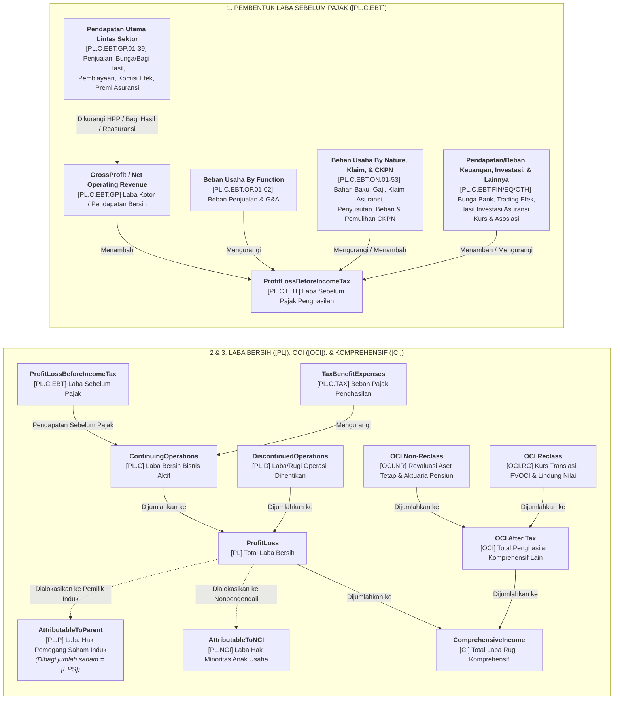

# Kamus Akun Laba Rugi Lintas Sektor (`income_statement`)

Kamus ini mencakup seluruh **189 akun Laporan Laba Rugi dan Penghasilan Komprehensif Lain** dari seluruh *entry point* taksonomi iXBRL Bursa Efek Indonesia (`general`, `financial_and_sharia`, `financing`, `insurance`, `securities`, `property`, `infrastructure`, dan `collective_investment_contract`).

1. **Laba Rugi Periode Berjalan (`[PL]`)**
2. **Penghasilan Komprehensif Lain (`[OCI]`)**
3. **Total Laba Rugi Komprehensif (`[CI]`) & Laba per Saham (`[EPS]`)**
4. **Glosarium Istilah & Rasio Laba Rugi**

## Kode Sektor & Subsektor (IDX-IC & JASICA)

| Kode Sektor | Nama Sektor | Kode & Nama Subsektor |
| :--- | :--- | :--- |
| `A` | **Energy** | `A1` Oil, Gas & Coal · `A2` Alternative Energy |
| `B` | **Basic Materials** | `B1` Basic Materials |
| `C` | **Industrials** | `C1` Industrial Goods · `C2` Industrial Services · `C3` Multi-sector Holdings |
| `D` | **Consumer Non-Cyclicals** | `D1` Food & Staples Retailing · `D2` Food & Beverage · `D3` Tobacco · `D4` Nondurable Household Products |
| `E` | **Consumer Cyclicals** | `E1` Automobiles & Components · `E2` Household Goods · `E3` Leisure Goods · `E4` Apparel & Luxury Goods · `E5` Consumer Services · `E6` Media & Entertainment · `E7` Retailing |
| `F` | **Healthcare** | `F1` Healthcare Equipment & Providers · `F2` Pharmaceuticals & Health Care Research |
| `G` | **Financials** | `G1` Banks · `G2` Financing Service · `G3` Investment Service · `G4` Insurance · `G5` Holding & Investment Companies |
| `H` | **Properties & Real Estate** | `H1` Properties & Real Estate |
| `I` | **Technology** | `I1` Software & IT Services · `I2` Technology Hardware & Equipment |
| `J` | **Infrastructures** | `J1` Transportation Infrastructure · `J2` Heavy Constructions & Civil Engineering · `J3` Telecommunication · `J4` Utilities |
| `K` | **Transportation & Logistic** | `K1` Transportation · `K2` Logistics & Deliveries |
| `1`, `6`, `9` | **Klasifikasi Lama (JASICA)** | `1` Agriculture (`12` Plantation) · `6` Property, Real Estate & Building Construction (`61` Property & Real Estate) · `9` Trade, Services & Investment (`91` Wholesale, `97` Computer & Services, `98` Investment Company) |

## Struktur Hierarki Laba Rugi Lintas Sektor

---

## 1. Laba Rugi Periode Berjalan (`ProfitLoss`)

### 1.1 Akun Utama Laba Rugi

<table width="100%">
  <colgroup>
    <col width="34%" />
    <col width="34%" />
    <col width="32%" />
  </colgroup>
  <thead>
    <tr>
      <th align="left" width="34%">Penjelasan / Variants</th>
      <th align="left" width="34%">Saran Analisis / Sectors</th>
      <th align="left" width="32%">Entry Points / Subsectors</th>
    </tr>
  </thead>
  <tbody>
    <tr>
      <td colspan="3"><code>[PL]</code> <b><code>ProfitLoss</code></b></td>
    </tr>
    <tr>
      <td width="34%" valign="top"><b>Laba (Rugi) Bersih Periode Berjalan</b>: Total laba/rugi bersih konsolidasi setelah pajak dari seluruh operasi (<code>[PL.C]</code> + <code>[PL.D]</code>), yang dialokasikan ke <code>[PL.P]</code> + <code>[PL.NCI]</code>.</td>
      <td width="34%" valign="top">Angka laba bersih konsolidasi. Gunakan <code>[PL.P]</code> (bukan <code>[PL]</code>) saat menghitung <b>PER</b>, <b>EPS</b>, dan <b>ROE</b> bagi pemegang saham emiten induk.</td>
      <td width="32%" valign="top"><b>Entry Points:</b> <code>all_entry_points</code></td>
    </tr>
    <tr>
      <td width="34%" valign="top"><b>Variants:</b> <code>all_variants</code></td>
      <td width="34%" valign="top"><b>Sectors:</b> <code>all_sectors</code></td>
      <td width="32%" valign="top"><b>Subsectors:</b> <code>all_subsectors</code></td>
    </tr>
<tr>
      <td colspan="3">&nbsp;</td>
    </tr>
    <tr>
      <td colspan="3"><code>[PL.P]</code> <b><code>Profit<wbr>Loss<wbr>Attributable<wbr>To<wbr>Parent<wbr>Entity</code></b></td>
    </tr>
    <tr>
      <td width="34%" valign="top"><b>Laba (Rugi) yang Dapat Diatribusikan ke Entitas Induk</b>: Bagian dari <code>[PL]</code> yang murni menjadi hak pemegang saham emiten induk (setelah dikurangi jatah mitra minoritas di anak usaha).</td>
      <td width="34%" valign="top"><b>Angka Laba Bersih paling utama bagi investor saham!</b> Wajib digunakan sebagai pembilang untuk menghitung <b>EPS</b>, <b>PER</b>, <b>ROE</b>, dan <b>Net Profit Margin (NPM)</b>.</td>
      <td width="32%" valign="top"><b>Entry Points:</b> <code>general</code>, <code>property</code></td>
    </tr>
    <tr>
      <td width="34%" valign="top"><b>Variants:</b> <code>all_variants</code></td>
      <td width="34%" valign="top"><b>Sectors:</b> <code>all_sectors</code></td>
      <td width="32%" valign="top"><b>Subsectors:</b> <code>all_subsectors</code></td>
    </tr>
<tr>
      <td colspan="3">&nbsp;</td>
    </tr>
    <tr>
      <td colspan="3"><code>[PL.NCI]</code> <b><code>Profit<wbr>Loss<wbr>Attributable<wbr>To<wbr>Non<wbr>Controlling<wbr>Interests</code></b></td>
    </tr>
    <tr>
      <td width="34%" valign="top"><b>Laba (Rugi) yang Dapat Diatribusikan ke Kepentingan Nonpengendali</b>: Bagian dari <code>[PL]</code> yang menjadi milik pemegang saham minoritas di anak-anak perusahaan.</td>
      <td width="34%" valign="top">Jika porsi <code>[PL.NCI]</code> sangat besar dibanding <code>[PL.P]</code>, berarti mesin pencetak laba utama berada di anak usaha yang tidak dimiliki 100% oleh emiten.</td>
      <td width="32%" valign="top"><b>Entry Points:</b> <code>general</code>, <code>property</code></td>
    </tr>
    <tr>
      <td width="34%" valign="top"><b>Variants:</b> <code>all_variants</code></td>
      <td width="34%" valign="top"><b>Sectors:</b> <code>all_sectors</code></td>
      <td width="32%" valign="top"><b>Subsectors:</b> <code>all_subsectors</code></td>
    </tr>
<tr>
      <td colspan="3">&nbsp;</td>
    </tr>
    <tr>
      <td colspan="3"><code>[PL.C]</code> <b><code>Profit<wbr>Loss<wbr>From<wbr>Continuing<wbr>Operations</code></b></td>
    </tr>
    <tr>
      <td width="34%" valign="top"><b>Laba (Rugi) dari Operasi yang Dilanjutkan</b>: Laba bersih setelah pajak dari bisnis aktif yang terus berjalan (<code>[PL.C.EBT]</code> dikurangi beban pajak <code>[PL.C.TAX]</code>).</td>
      <td width="34%" valign="top">Cerminan performa bisnis inti yang berkelanjutan tanpa distorsi dari unit bisnis yang sudah ditutup/dijual (<code>[PL.D]</code>).</td>
      <td width="32%" valign="top"><b>Entry Points:</b> <code>all_entry_points</code></td>
    </tr>
    <tr>
      <td width="34%" valign="top"><b>Variants:</b> <code>all_variants</code></td>
      <td width="34%" valign="top"><b>Sectors:</b> <code>all_sectors</code></td>
      <td width="32%" valign="top"><b>Subsectors:</b> <code>all_subsectors</code></td>
    </tr>
<tr>
      <td colspan="3">&nbsp;</td>
    </tr>
    <tr>
      <td colspan="3"><code>[PL.C.EBT]</code> <b><code>ProfitLossBeforeIncomeTax</code></b></td>
    </tr>
    <tr>
      <td width="34%" valign="top"><b>Laba (Rugi) Sebelum Pajak Penghasilan (EBT)</b>: Keuntungan perusahaan setelah seluruh pendapatan dan beban operasional maupun non-operasional dihitung, sebelum dipotong PPh Badan (<code>[PL.C.TAX]</code>).</td>
      <td width="34%" valign="top">Gunakan untuk membandingkan profitabilitas murni antar-perusahaan sebelum dipengaruhi perbedaan tarif pajak efektif.</td>
      <td width="32%" valign="top"><b>Entry Points:</b> <code>all_entry_points</code></td>
    </tr>
    <tr>
      <td width="34%" valign="top"><b>Variants:</b> <code>all_variants</code></td>
      <td width="34%" valign="top"><b>Sectors:</b> <code>all_sectors</code></td>
      <td width="32%" valign="top"><b>Subsectors:</b> <code>all_subsectors</code></td>
    </tr>
<tr>
      <td colspan="3">&nbsp;</td>
    </tr>
    <tr>
      <td colspan="3"><code>[PL.C.TAX]</code> <b><code>TaxBenefitExpenses</code></b></td>
    </tr>
    <tr>
      <td width="34%" valign="top"><b>Manfaat (Beban) Pajak Penghasilan</b>: Total pajak penghasilan badan (pajak kini + pajak tangguhan) yang dikenakan atas laba sebelum pajak (<code>[PL.C.EBT]</code>).</td>
      <td width="34%" valign="top">Hitung <b>Effective Tax Rate</b> (<code>[PL.C.TAX]</code> / <code>[PL.C.EBT]</code>). Tarif normal PPh Badan di Indonesia adalah 22% (atau 19% bagi emiten publik yang memenuhi syarat <i>free float</i> &ge; 40%).</td>
      <td width="32%" valign="top"><b>Entry Points:</b> <code>all_entry_points</code></td>
    </tr>
    <tr>
      <td width="34%" valign="top"><b>Variants:</b> <code>all_variants</code></td>
      <td width="34%" valign="top"><b>Sectors:</b> <code>all_sectors</code></td>
      <td width="32%" valign="top"><b>Subsectors:</b> <code>all_subsectors</code></td>
    </tr>
<tr>
      <td colspan="3">&nbsp;</td>
    </tr>
    <tr>
      <td colspan="3"><code>[PL.C.EBT.GP]</code> <b><code>GrossProfit</code></b></td>
    </tr>
    <tr>
      <td width="34%" valign="top"><b>Laba Kotor</b>: Keuntungan langsung dari penjualan barang/jasa setelah dikurangi beban pokok produksi/HPP (<code>[PL.C.EBT.GP.01]</code> &minus; <code>[PL.C.EBT.GP.02]</code>).</td>
      <td width="34%" valign="top">Gunakan untuk menghitung <b>Gross Profit Margin (GPM)</b> (<code>[PL.C.EBT.GP]</code> / <code>[PL.C.EBT.GP.01]</code>). GPM yang tinggi dan stabil menandakan <i>pricing power</i> (kekuatan merek/monopoli) yang kuat.</td>
      <td width="32%" valign="top"><b>Entry Points:</b> <code>general</code>, <code>infrastructure</code>, <code>property</code></td>
    </tr>
    <tr>
      <td width="34%" valign="top"><b>Variants:</b> <code>by_function_after_tax</code>, <code>by_function_before_tax</code></td>
      <td width="34%" valign="top"><b>Sectors:</b> <code>all_sectors</code></td>
      <td width="32%" valign="top"><b>Subsectors:</b> <code>12. Plantation</code>, <code>61. Property And Real Estate</code>, <code>91. Wholesale (Durable & Non-Durable Goods)</code>, <code>97. Computer And Services</code>, <code>98. Investment Company</code>, <code>A1. Oil</code>, <code>Gas & Coal</code>, <code>A2. Alternative Energy</code>, <code>B1. Basic Materials</code>, <code>C1. Industrial Goods</code>, <code>C2. Industrial Services</code>, <code>C3. Multi-sector Holdings</code>, <code>D1. Food & Staples Retailing</code>, <code>D2. Food & Beverage</code>, <code>D3. Tobacco</code>, <code>D4. Nondurable Household Products</code>, <code>E1. Automobiles & Components</code>, <code>E2. Household Goods</code>, <code>E3. Leisure Goods</code>, <code>E4. Apparel & Luxury Goods</code>, <code>E5. Consumer Services</code>, <code>E6. Media & Entertainment</code>, <code>E7. Retailing</code>, <code>F1. Healthcare Equipment & Providers</code>, <code>F2. Pharmaceuticals & Health Care Research</code>, <code>G5. Holding & Investment Companies</code>, <code>H1. Properties & Real Estate</code>, <code>I1. Software & IT Services</code>, <code>I2. Technology Hardware & Equipment</code>, <code>J1. Transportation Infrastructure</code>, <code>J2. Heavy Constructions & Civil Engineering</code>, <code>J3. Telecommunication</code>, <code>J4. Utilities</code>, <code>K1. Transportation</code>, <code>K2. Logistics & Deliveries</code></td>
    </tr>
<tr>
      <td colspan="3">&nbsp;</td>
    </tr>
    <tr>
      <td colspan="3"><code>[PL.D]</code> <b><code>Profit<wbr>Loss<wbr>From<wbr>Discontinued<wbr>Operations</code></b></td>
    </tr>
    <tr>
      <td width="34%" valign="top"><b>Laba (Rugi) dari Operasi yang Dihentikan</b>: Keuntungan atau kerugian bersih (setelah pajak) dari segmen bisnis/anak usaha yang telah dijual atau ditutup pada periode berjalan.</td>
      <td width="34%" valign="top"><b>Keluarkan dari proyeksi laba tahun depan!</b> Laba/rugi ini bersifat satu kali (<i>one-off</i>) dan tidak akan berulang di masa depan.</td>
      <td width="32%" valign="top"><b>Entry Points:</b> <code>all_entry_points</code></td>
    </tr>
    <tr>
      <td width="34%" valign="top"><b>Variants:</b> <code>all_variants</code></td>
      <td width="34%" valign="top"><b>Sectors:</b> <code>A. Energy</code>, <code>B. Basic Materials</code>, <code>C. Industrials</code>, <code>D. Consumer Non-Cyclicals</code>, <code>E. Consumer Cyclicals</code>, <code>F. Healthcare</code>, <code>G. Financials</code>, <code>H. Properties & Real Estate</code>, <code>I. Technology</code>, <code>J. Infrastructures</code>, <code>K. Transportation & Logistic</code></td>
      <td width="32%" valign="top"><b>Subsectors:</b> <code>A1. Oil</code>, <code>Gas & Coal</code>, <code>B1. Basic Materials</code>, <code>C1. Industrial Goods</code>, <code>C3. Multi-sector Holdings</code>, <code>D1. Food & Staples Retailing</code>, <code>D2. Food & Beverage</code>, <code>D4. Nondurable Household Products</code>, <code>E1. Automobiles & Components</code>, <code>E2. Household Goods</code>, <code>E3. Leisure Goods</code>, <code>E4. Apparel & Luxury Goods</code>, <code>E5. Consumer Services</code>, <code>E7. Retailing</code>, <code>F1. Healthcare Equipment & Providers</code>, <code>F2. Pharmaceuticals & Health Care Research</code>, <code>G1. Banks</code>, <code>G4. Insurance</code>, <code>G5. Holding & Investment Companies</code>, <code>H1. Properties & Real Estate</code>, <code>I1. Software & IT Services</code>, <code>J1. Transportation Infrastructure</code>, <code>J2. Heavy Constructions & Civil Engineering</code>, <code>J3. Telecommunication</code>, <code>K1. Transportation</code>, <code>K2. Logistics & Deliveries</code></td>
    </tr>
<tr>
      <td colspan="3">&nbsp;</td>
    </tr>
    <tr>
      <td colspan="3"><code>[PL.C.EBIT]</code> <b><code>ProfitFromOperation</code></b></td>
    </tr>
    <tr>
      <td width="34%" valign="top"><b>Laba (Rugi) Operasional (Perbankan/Keuangan)</b>: Keuntungan dari aktivitas operasional utama perbankan/keuangan setelah dikurangi beban operasional dan beban CKPN, sebelum pendapatan/beban non-operasional (<code>NonOperatingIncome</code> / <code>NonOperatingExpenses</code>).</td>
      <td width="34%" valign="top">Indikator profitabilitas operasional murni bank sebelum dipengaruhi pos non-operasional satu kali. Bandingkan dengan total pendapatan operasional untuk menghitung rasio efisiensi (<b>BOPO</b> / <b>CIR</b>).</td>
      <td width="32%" valign="top"><b>Entry Points:</b> <code>financial_and_sharia</code></td>
    </tr>
    <tr>
      <td width="34%" valign="top"><b>Variants:</b> <code>by_nature_after_tax</code>, <code>by_nature_before_tax</code></td>
      <td width="34%" valign="top"><b>Sectors:</b> <code>G. Financials</code>, <code>H. Properties & Real Estate</code></td>
      <td width="32%" valign="top"><b>Subsectors:</b> <code>G1. Banks</code>, <code>G2. Financing Service</code>, <code>G4. Insurance</code>, <code>G5. Holding & Investment Companies</code>, <code>H1. Properties & Real Estate</code></td>
    </tr>
</tbody>
</table>

### 1.2 Pendapatan Usaha, Bunga/Bagi Hasil, Pembiayaan, Komisi Sekuritas, Premi Asuransi, & Beban Pokok

<table width="100%">
  <colgroup>
    <col width="34%" />
    <col width="34%" />
    <col width="32%" />
  </colgroup>
  <thead>
    <tr>
      <th align="left" width="34%">Penjelasan / Variants</th>
      <th align="left" width="34%">Saran Analisis / Sectors</th>
      <th align="left" width="32%">Entry Points / Subsectors</th>
    </tr>
  </thead>
  <tbody>
    <tr>
      <td colspan="3"><code>[PL.C.EBT.GP.01]</code> <b><code>SalesAndRevenue</code></b></td>
    </tr>
    <tr>
      <td width="34%" valign="top"><b>Pendapatan Usaha / Penjualan Bersih</b>: Total omzet dari penjualan barang atau penyediaan jasa utama perusahaan setelah dikurangi retur dan diskon penjualan.</td>
      <td width="34%" valign="top"><b>Baris paling atas (<i>Top Line</i>)!</b> Bandingkan pertumbuhannya secara tahunan (<b>YoY</b>) dan kuartalan (<b>QoQ</b>), serta cek apakah sejalan dengan arus kas masuk dari pelanggan di Laporan Arus Kas.</td>
      <td width="32%" valign="top"><b>Entry Points:</b> <code>general</code>, <code>infrastructure</code>, <code>property</code></td>
    </tr>
    <tr>
      <td width="34%" valign="top"><b>Variants:</b> <code>all_variants</code></td>
      <td width="34%" valign="top"><b>Sectors:</b> <code>all_sectors</code></td>
      <td width="32%" valign="top"><b>Subsectors:</b> <code>12. Plantation</code>, <code>61. Property And Real Estate</code>, <code>91. Wholesale (Durable & Non-Durable Goods)</code>, <code>97. Computer And Services</code>, <code>98. Investment Company</code>, <code>A1. Oil</code>, <code>Gas & Coal</code>, <code>A2. Alternative Energy</code>, <code>B1. Basic Materials</code>, <code>C1. Industrial Goods</code>, <code>C2. Industrial Services</code>, <code>C3. Multi-sector Holdings</code>, <code>D1. Food & Staples Retailing</code>, <code>D2. Food & Beverage</code>, <code>D3. Tobacco</code>, <code>D4. Nondurable Household Products</code>, <code>E1. Automobiles & Components</code>, <code>E2. Household Goods</code>, <code>E3. Leisure Goods</code>, <code>E4. Apparel & Luxury Goods</code>, <code>E5. Consumer Services</code>, <code>E6. Media & Entertainment</code>, <code>E7. Retailing</code>, <code>F1. Healthcare Equipment & Providers</code>, <code>F2. Pharmaceuticals & Health Care Research</code>, <code>G3. Investment Service</code>, <code>G5. Holding & Investment Companies</code>, <code>H1. Properties & Real Estate</code>, <code>I1. Software & IT Services</code>, <code>I2. Technology Hardware & Equipment</code>, <code>J1. Transportation Infrastructure</code>, <code>J2. Heavy Constructions & Civil Engineering</code>, <code>J3. Telecommunication</code>, <code>J4. Utilities</code>, <code>K1. Transportation</code>, <code>K2. Logistics & Deliveries</code></td>
    </tr>
<tr>
      <td colspan="3">&nbsp;</td>
    </tr>
    <tr>
      <td colspan="3"><code>[PL.C.EBT.GP.02]</code> <b><code>CostOfSalesAndRevenue</code></b></td>
    </tr>
    <tr>
      <td width="34%" valign="top"><b>Beban Pokok Penjualan dan Pendapatan (HPP / COGS)</b>:Seluruh biaya langsung untuk memproduksi barang atau menghasilkan jasa yang terjual (bahan baku, upah buruh pabrik, penyusutan mesin pabrik).</td>
      <td width="34%" valign="top">Jika <code>[PL.C.EBT.GP.02]</code> naik lebih cepat daripada kenaikan omzet <code>[PL.C.EBT.GP.01]</code>, berarti margin kotor perusahaan sedang tergerus kenaikan harga bahan baku.</td>
      <td width="32%" valign="top"><b>Entry Points:</b> <code>general</code>, <code>infrastructure</code>, <code>property</code></td>
    </tr>
    <tr>
      <td width="34%" valign="top"><b>Variants:</b> <code>by_function_after_tax</code>, <code>by_function_before_tax</code></td>
      <td width="34%" valign="top"><b>Sectors:</b> <code>all_sectors</code></td>
      <td width="32%" valign="top"><b>Subsectors:</b> <code>12. Plantation</code>, <code>61. Property And Real Estate</code>, <code>91. Wholesale (Durable & Non-Durable Goods)</code>, <code>97. Computer And Services</code>, <code>A1. Oil</code>, <code>Gas & Coal</code>, <code>A2. Alternative Energy</code>, <code>B1. Basic Materials</code>, <code>C1. Industrial Goods</code>, <code>C2. Industrial Services</code>, <code>C3. Multi-sector Holdings</code>, <code>D1. Food & Staples Retailing</code>, <code>D2. Food & Beverage</code>, <code>D3. Tobacco</code>, <code>D4. Nondurable Household Products</code>, <code>E1. Automobiles & Components</code>, <code>E2. Household Goods</code>, <code>E3. Leisure Goods</code>, <code>E4. Apparel & Luxury Goods</code>, <code>E5. Consumer Services</code>, <code>E6. Media & Entertainment</code>, <code>E7. Retailing</code>, <code>F1. Healthcare Equipment & Providers</code>, <code>F2. Pharmaceuticals & Health Care Research</code>, <code>G5. Holding & Investment Companies</code>, <code>H1. Properties & Real Estate</code>, <code>I1. Software & IT Services</code>, <code>I2. Technology Hardware & Equipment</code>, <code>J1. Transportation Infrastructure</code>, <code>J2. Heavy Constructions & Civil Engineering</code>, <code>J3. Telecommunication</code>, <code>J4. Utilities</code>, <code>K1. Transportation</code>, <code>K2. Logistics & Deliveries</code></td>
    </tr>
<tr>
      <td colspan="3">&nbsp;</td>
    </tr>
    <tr>
      <td colspan="3"><code>[PL.C.EBT.GP.03]</code> <b><code>InterestAndFinanceIncome</code></b></td>
    </tr>
    <tr>
      <td width="34%" valign="top"><b>Pendapatan Bunga dan Keuangan (Multifinance)</b>: Penghasilan bunga dari penyaluran kredit/pembiayaan dan penempatan likuiditas pada perusahaan pembiayaan.</td>
      <td width="34%" valign="top">Komponen pendapatan bunga utama pada perusahaan pembiayaan sebelum dikurangi beban bunga pendanaan (<i>Cost of Fund</i>).</td>
      <td width="32%" valign="top"><b>Entry Points:</b> <code>financing</code></td>
    </tr>
    <tr>
      <td width="34%" valign="top"><b>Variants:</b> <code>by_nature_after_tax</code>, <code>by_nature_before_tax</code></td>
      <td width="34%" valign="top"><b>Sectors:</b> <code>E. Consumer Cyclicals</code>, <code>G. Financials</code>, <code>I. Technology</code></td>
      <td width="32%" valign="top"><b>Subsectors:</b> <code>E6. Media & Entertainment</code>, <code>G2. Financing Service</code>, <code>G5. Holding & Investment Companies</code>, <code>I2. Technology Hardware & Equipment</code></td>
    </tr>
<tr>
      <td colspan="3">&nbsp;</td>
    </tr>
    <tr>
      <td colspan="3"><code>[PL.C.EBT.GP.04]</code> <b><code>Revenue<wbr>From<wbr>Fund<wbr>Management<wbr>As<wbr>Mudharib</code></b></td>
    </tr>
    <tr>
      <td width="34%" valign="top"><b>Pendapatan Pengelolaan Dana oleh Mudharib (Bank Syariah)</b>: Total penghasilan penyaluran pembiayaan syariah (margin <i>Murabahah</i>, bagi hasil <i>Musyarakah/Mudharabah</i>, dan sewa <i>Ijarah</i>) yang dikelola bank syariah sebagai <i>Mudharib</i>.</td>
      <td width="34%" valign="top"><b>Top-line utama Perbankan Syariah!</b> Sebelum dikurangi hak bagi hasil milik deposan Dana Syirkah Temporer (<code>ThirdPartiesShareOnReturnOfTemporarySyirkahFunds</code>).</td>
      <td width="32%" valign="top"><b>Entry Points:</b> <code>financial_and_sharia</code></td>
    </tr>
    <tr>
      <td width="34%" valign="top"><b>Variants:</b> <code>by_nature_after_tax</code>, <code>by_nature_before_tax</code></td>
      <td width="34%" valign="top"><b>Sectors:</b> <code>G. Financials</code></td>
      <td width="32%" valign="top"><b>Subsectors:</b> <code>G1. Banks</code></td>
    </tr>
<tr>
      <td colspan="3">&nbsp;</td>
    </tr>
    <tr>
      <td colspan="3"><code>[PL.C.EBT.GP.05]</code> <b><code>Third<wbr>Parties<wbr>Share<wbr>On<wbr>Return<wbr>Of<wbr>Temporary<wbr>Syirkah<wbr>Funds</code></b></td>
    </tr>
    <tr>
      <td width="34%" valign="top"><b>Hak Pihak Ketiga atas Bagi Hasil Dana Syirkah Temporer</b>: Bagian bagi hasil yang dibayarkan/didistribusikan bank syariah kepada nasabah penyimpan Giro, Tabungan, dan Deposito <i>Mudharabah</i>.</td>
      <td width="34%" valign="top">Setara dengan <b>Beban Bunga DPK</b> pada bank konvensional. Kurangkan angka ini dari <code>RevenueFromFundManagementAsMudharib</code> untuk memperoleh <b>Pendapatan Bagi Hasil Bersih</b> bank syariah.</td>
      <td width="32%" valign="top"><b>Entry Points:</b> <code>financial_and_sharia</code></td>
    </tr>
    <tr>
      <td width="34%" valign="top"><b>Variants:</b> <code>by_nature_after_tax</code>, <code>by_nature_before_tax</code></td>
      <td width="34%" valign="top"><b>Sectors:</b> <code>G. Financials</code></td>
      <td width="32%" valign="top"><b>Subsectors:</b> <code>G1. Banks</code></td>
    </tr>
<tr>
      <td colspan="3">&nbsp;</td>
    </tr>
    <tr>
      <td colspan="3"><code>[PL.C.EBT.GP.06]</code> <b><code>Provisions<wbr>And<wbr>Commissions<wbr>Income<wbr>From<wbr>Transactions<wbr>Other<wbr>Than<wbr>Loan</code></b></td>
    </tr>
    <tr>
      <td width="34%" valign="top"><b>Pendapatan Provisi dan Komisi selain Kredit (<i>Fee-Based Income</i> Bank)</b>: Penghasilan komisi transaksi transfer, administrasi rekening, <i> bancassurance</i>, <i>wealth management</i>, <i>trade finance</i>, dan layanan digital perbankan.</td>
      <td width="34%" valign="top"><b>Sumber laba berbiaya rendah paling berharga bagi bank!</b> Pendapatan ini tidak membutuhkan pencadangan risiko kredit (CKPN) maupun modal ATMR besar.</td>
      <td width="32%" valign="top"><b>Entry Points:</b> <code>financial_and_sharia</code></td>
    </tr>
    <tr>
      <td width="34%" valign="top"><b>Variants:</b> <code>by_nature_after_tax</code>, <code>by_nature_before_tax</code></td>
      <td width="34%" valign="top"><b>Sectors:</b> <code>G. Financials</code></td>
      <td width="32%" valign="top"><b>Subsectors:</b> <code>G1. Banks</code>, <code>G5. Holding & Investment Companies</code></td>
    </tr>
<tr>
      <td colspan="3">&nbsp;</td>
    </tr>
    <tr>
      <td colspan="3"><code>[PL.C.EBT.GP.07]</code> <b><code>IncomeFromConsumerFinancing</code></b></td>
    </tr>
    <tr>
      <td width="34%" valign="top"><b>Pendapatan Pembiayaan Konsumen (Multifinance)</b>: Penghasilan bunga efektif dari cicilan kredit kendaraan bermotor (mobil/motor) dan pembiayaan multiguna konsumen.</td>
      <td width="34%" valign="top"><b>Mesin omzet nomor 1 emiten multifinance ritel!</b> Bandingkan dengan saldo <code>ConsumerFinancingReceivables</code> di Neraca untuk menghitung <i>Effective Yield</i> pembiayaan.</td>
      <td width="32%" valign="top"><b>Entry Points:</b> <code>financing</code></td>
    </tr>
    <tr>
      <td width="34%" valign="top"><b>Variants:</b> <code>by_nature_after_tax</code>, <code>by_nature_before_tax</code></td>
      <td width="34%" valign="top"><b>Sectors:</b> <code>E. Consumer Cyclicals</code>, <code>G. Financials</code>, <code>I. Technology</code></td>
      <td width="32%" valign="top"><b>Subsectors:</b> <code>E6. Media & Entertainment</code>, <code>G2. Financing Service</code>, <code>G5. Holding & Investment Companies</code>, <code>I2. Technology Hardware & Equipment</code></td>
    </tr>
<tr>
      <td colspan="3">&nbsp;</td>
    </tr>
    <tr>
      <td colspan="3"><code>[PL.C.EBT.GP.08]</code> <b><code>RevenueFromConsumerFinancing</code></b></td>
    </tr>
    <tr>
      <td width="34%" valign="top"><b>Pendapatan dari Pembiayaan Konsumen (Perbankan/Konglomerasi Keuangan)</b>: Penghasilan bunga dari lini bisnis pembiayaan konsumen milik bank atau anak usaha multifinance bank.</td>
      <td width="34%" valign="top">Memberikan <i>yield</i> bunga tinggi bagi grup perbankan.</td>
      <td width="32%" valign="top"><b>Entry Points:</b> <code>financial_and_sharia</code></td>
    </tr>
    <tr>
      <td width="34%" valign="top"><b>Variants:</b> <code>by_nature_after_tax</code>, <code>by_nature_before_tax</code></td>
      <td width="34%" valign="top"><b>Sectors:</b> <code>G. Financials</code></td>
      <td width="32%" valign="top"><b>Subsectors:</b> <code>G1. Banks</code></td>
    </tr>
<tr>
      <td colspan="3">&nbsp;</td>
    </tr>
    <tr>
      <td colspan="3"><code>[PL.C.EBT.GP.09]</code> <b><code>IncomeFromFinanceLease</code></b></td>
    </tr>
    <tr>
      <td width="34%" valign="top"><b>Pendapatan Sewa Pembiayaan (<i>Finance Lease</i>)</b>: Penghasilan bunga efektif dari kontrak sewa pembiayaan alat berat, mesin industri, dan armada komersial.</td>
      <td width="34%" valign="top">Sumber pendapatan utama pada perusahaan multifinance yang fokus di sektor alat berat pertambangan, perkebunan, dan konstruksi.</td>
      <td width="32%" valign="top"><b>Entry Points:</b> <code>financing</code></td>
    </tr>
    <tr>
      <td width="34%" valign="top"><b>Variants:</b> <code>by_nature_after_tax</code>, <code>by_nature_before_tax</code></td>
      <td width="34%" valign="top"><b>Sectors:</b> <code>C. Industrials</code>, <code>E. Consumer Cyclicals</code>, <code>G. Financials</code>, <code>I. Technology</code></td>
      <td width="32%" valign="top"><b>Subsectors:</b> <code>C1. Industrial Goods</code>, <code>E6. Media & Entertainment</code>, <code>G2. Financing Service</code>, <code>G5. Holding & Investment Companies</code>, <code>I2. Technology Hardware & Equipment</code></td>
    </tr>
<tr>
      <td colspan="3">&nbsp;</td>
    </tr>
    <tr>
      <td colspan="3"><code>[PL.C.EBT.GP.10]</code> <b><code>RevenueFromFinanceLease</code></b></td>
    </tr>
    <tr>
      <td width="34%" valign="top"><b>Pendapatan dari Sewa Pembiayaan (Konglomerasi Keuangan)</b>: Penghasilan bunga dari penyaluran sewa pembiayaan (<i>finance lease</i>) pada grup jasa keuangan.</td>
      <td width="34%" valign="top">Padanan dari <code>IncomeFromFinanceLease</code> pada taksonomi <code>financial_and_sharia</code>.</td>
      <td width="32%" valign="top"><b>Entry Points:</b> <code>financial_and_sharia</code></td>
    </tr>
    <tr>
      <td width="34%" valign="top"><b>Variants:</b> <code>by_nature_after_tax</code>, <code>by_nature_before_tax</code></td>
      <td width="34%" valign="top"><b>Sectors:</b> <code>G. Financials</code></td>
      <td width="32%" valign="top"><b>Subsectors:</b> <code>G5. Holding & Investment Companies</code></td>
    </tr>
<tr>
      <td colspan="3">&nbsp;</td>
    </tr>
    <tr>
      <td colspan="3"><code>[PL.C.EBT.GP.11]</code> <b><code>IncomeFromOperatingLease</code></b></td>
    </tr>
    <tr>
      <td width="34%" valign="top"><b>Pendapatan Sewa Operasi (<i>Operating Lease</i>)</b>: Penghasilan sewa rutin dari penyewaan kendaraan atau peralatan tanpa opsi beli di akhir kontrak.</td>
      <td width="34%" valign="top">Bandingkan dengan <code>DepreciationOfInvestmentPropertyLeaseAssets...</code> untuk melihat margin bersih bisnis rental/sewa operasi.</td>
      <td width="32%" valign="top"><b>Entry Points:</b> <code>financing</code></td>
    </tr>
    <tr>
      <td width="34%" valign="top"><b>Variants:</b> <code>by_nature_after_tax</code>, <code>by_nature_before_tax</code></td>
      <td width="34%" valign="top"><b>Sectors:</b> <code>G. Financials</code></td>
      <td width="32%" valign="top"><b>Subsectors:</b> <code>G2. Financing Service</code></td>
    </tr>
<tr>
      <td colspan="3">&nbsp;</td>
    </tr>
    <tr>
      <td colspan="3"><code>[PL.C.EBT.GP.12]</code> <b><code>IncomeFromFactoring</code></b></td>
    </tr>
    <tr>
      <td width="34%" valign="top"><b>Pendapatan Anjak Piutang (<i>Factoring</i>)</b>: Penghasilan bunga/diskonto dan provisi dari pembelian atau pembiayaan piutang dagang korporasi.</td>
      <td width="34%" valign="top">Sumber pendapatan pembiayaan modal kerja B2B berjangka pendek.</td>
      <td width="32%" valign="top"><b>Entry Points:</b> <code>financing</code></td>
    </tr>
    <tr>
      <td width="34%" valign="top"><b>Variants:</b> <code>by_nature_after_tax</code>, <code>by_nature_before_tax</code></td>
      <td width="34%" valign="top"><b>Sectors:</b> <code>E. Consumer Cyclicals</code>, <code>G. Financials</code>, <code>I. Technology</code></td>
      <td width="32%" valign="top"><b>Subsectors:</b> <code>E6. Media & Entertainment</code>, <code>G2. Financing Service</code>, <code>G5. Holding & Investment Companies</code>, <code>I2. Technology Hardware & Equipment</code></td>
    </tr>
<tr>
      <td colspan="3">&nbsp;</td>
    </tr>
    <tr>
      <td colspan="3"><code>[PL.C.EBT.GP.13]</code> <b><code>Income<wbr>From<wbr>Murabahah<wbr>And<wbr>Istishna</code></b></td>
    </tr>
    <tr>
      <td width="34%" valign="top"><b>Pendapatan Margin Murabahah dan Istishna (Multifinance)</b>: Penghasilan margin keuntungan dari pembiayaan jual-beli syariah (<i>Murabahah</i>) dan pesanan (<i>Istishna</i>) pada unit usaha syariah multifinance.</td>
      <td width="34%" valign="top">Kontributor utama pendapatan pembiayaan syariah pada perusahaan multifinance.</td>
      <td width="32%" valign="top"><b>Entry Points:</b> <code>financing</code></td>
    </tr>
    <tr>
      <td width="34%" valign="top"><b>Variants:</b> <code>by_nature_after_tax</code>, <code>by_nature_before_tax</code></td>
      <td width="34%" valign="top"><b>Sectors:</b> <code>E. Consumer Cyclicals</code>, <code>G. Financials</code>, <code>I. Technology</code></td>
      <td width="32%" valign="top"><b>Subsectors:</b> <code>E6. Media & Entertainment</code>, <code>G2. Financing Service</code>, <code>I2. Technology Hardware & Equipment</code></td>
    </tr>
<tr>
      <td colspan="3">&nbsp;</td>
    </tr>
    <tr>
      <td colspan="3"><code>[PL.C.EBT.GP.14]</code> <b><code>IncomeFromIjarah</code></b></td>
    </tr>
    <tr>
      <td width="34%" valign="top"><b>Pendapatan Ijarah (Sewa Syariah)</b>: Penghasilan sewa (<i>ujrah</i>) dari penyewaan aset berdasarkan akad syariah <i>Ijarah</i> atau <i>IMBT</i>.</td>
      <td width="34%" valign="top">Pendapatan pembiayaan sewa berbasis syariah.</td>
      <td width="32%" valign="top"><b>Entry Points:</b> <code>financing</code></td>
    </tr>
    <tr>
      <td width="34%" valign="top"><b>Variants:</b> <code>by_nature_after_tax</code>, <code>by_nature_before_tax</code></td>
      <td width="34%" valign="top"><b>Sectors:</b> <code>C. Industrials</code>, <code>G. Financials</code></td>
      <td width="32%" valign="top"><b>Subsectors:</b> <code>C1. Industrial Goods</code>, <code>G2. Financing Service</code></td>
    </tr>
<tr>
      <td colspan="3">&nbsp;</td>
    </tr>
    <tr>
      <td colspan="3"><code>[PL.C.EBT.GP.15]</code> <b><code>IncomeFromRevenueSharing</code></b></td>
    </tr>
    <tr>
      <td width="34%" valign="top"><b>Pendapatan Bagi Hasil (Multifinance Syariah)</b>: Penghasilan bagi hasil dari pembiayaan berakad kemitraan (<i>Musyarakah</i> dan <i>Mudharabah</i>).</td>
      <td width="34%" valign="top">Melengkapi pendapatan margin <i>Murabahah</i> pada unit syariah perusahaan pembiayaan.</td>
      <td width="32%" valign="top"><b>Entry Points:</b> <code>financing</code></td>
    </tr>
    <tr>
      <td width="34%" valign="top"><b>Variants:</b> <code>by_nature_after_tax</code>, <code>by_nature_before_tax</code></td>
      <td width="34%" valign="top"><b>Sectors:</b> <code>E. Consumer Cyclicals</code>, <code>G. Financials</code>, <code>I. Technology</code></td>
      <td width="32%" valign="top"><b>Subsectors:</b> <code>E6. Media & Entertainment</code>, <code>G2. Financing Service</code>, <code>I2. Technology Hardware & Equipment</code></td>
    </tr>
<tr>
      <td colspan="3">&nbsp;</td>
    </tr>
    <tr>
      <td colspan="3"><code>[PL.C.EBT.GP.16]</code> <b><code>Income<wbr>From<wbr>Provisions<wbr>And<wbr>Commissions</code></b></td>
    </tr>
    <tr>
      <td width="34%" valign="top"><b>Pendapatan Provisi dan Komisi (Multifinance)</b>: Penghasilan provisi pencairan kredit baru dan komisi administrasi pembiayaan.</td>
      <td width="34%" valign="top">Tumbuh sejalan dengan volume penyaluran kredit baru (<i>new booking</i>).</td>
      <td width="32%" valign="top"><b>Entry Points:</b> <code>financing</code></td>
    </tr>
    <tr>
      <td width="34%" valign="top"><b>Variants:</b> <code>by_nature_after_tax</code>, <code>by_nature_before_tax</code></td>
      <td width="34%" valign="top"><b>Sectors:</b> <code>G. Financials</code></td>
      <td width="32%" valign="top"><b>Subsectors:</b> <code>G2. Financing Service</code>, <code>G5. Holding & Investment Companies</code></td>
    </tr>
<tr>
      <td colspan="3">&nbsp;</td>
    </tr>
    <tr>
      <td colspan="3"><code>[PL.C.EBT.GP.17]</code> <b><code>AdministrationIncome</code></b></td>
    </tr>
    <tr>
      <td width="34%" valign="top"><b>Pendapatan Administrasi (Multifinance)</b>: Penghasilan dari biaya administrasi kontrak kredit, denda keterlambatan angsuran, dan biaya pelunasan dipercepat.</td>
      <td width="34%" valign="top">Pendapatan operasional berbasis komisi (<i>fee-based</i>) pada perusahaan multifinance.</td>
      <td width="32%" valign="top"><b>Entry Points:</b> <code>financing</code></td>
    </tr>
    <tr>
      <td width="34%" valign="top"><b>Variants:</b> <code>by_nature_after_tax</code>, <code>by_nature_before_tax</code></td>
      <td width="34%" valign="top"><b>Sectors:</b> <code>G. Financials</code></td>
      <td width="32%" valign="top"><b>Subsectors:</b> <code>G2. Financing Service</code>, <code>G5. Holding & Investment Companies</code></td>
    </tr>
<tr>
      <td colspan="3">&nbsp;</td>
    </tr>
    <tr>
      <td colspan="3"><code>[PL.C.EBT.GP.18]</code> <b><code>IncomeFromGuarantee</code></b></td>
    </tr>
    <tr>
      <td width="34%" valign="top"><b>Pendapatan Penjaminan (<i>Guarantee Fee</i>)</b>: Penghasilan imbal jasa penjaminan kredit (<i>ijp</i>) dari aktivitas penjaminan pembiayaan.</td>
      <td width="34%" valign="top">Pendapatan operasional khusus lini bisnis penjaminan kredit.</td>
      <td width="32%" valign="top"><b>Entry Points:</b> <code>financing</code></td>
    </tr>
    <tr>
      <td width="34%" valign="top"><b>Variants:</b> <code>by_nature_after_tax</code>, <code>by_nature_before_tax</code></td>
      <td width="34%" valign="top"><b>Sectors:</b> <code>G. Financials</code></td>
      <td width="32%" valign="top"><b>Subsectors:</b> <code>G5. Holding & Investment Companies</code></td>
    </tr>
<tr>
      <td colspan="3">&nbsp;</td>
    </tr>
    <tr>
      <td colspan="3"><code>[PL.C.EBT.GP.19]</code> <b><code>IncomeFromBrokerageActivity</code></b></td>
    </tr>
    <tr>
      <td width="34%" valign="top"><b>Pendapatan Kegiatan Perantara Pedagang Efek (<i>Brokerage Fee</i>)</b>: Komisi transaksi jual-beli saham dan obligasi yang dipungut perusahaan sekuritas dari nasabah investor.</td>
      <td width="34%" valign="top"><b>Pendapatan inti broker saham!</b> Sangat bergantung pada nilai transaksi harian rata-rata (<b>RNTH</b>) di Bursa Efek Indonesia.</td>
      <td width="32%" valign="top"><b>Entry Points:</b> <code>securities</code></td>
    </tr>
    <tr>
      <td width="34%" valign="top"><b>Variants:</b> <code>by_function_after_tax</code>, <code>by_function_before_tax</code></td>
      <td width="34%" valign="top"><b>Sectors:</b> <code>G. Financials</code></td>
      <td width="32%" valign="top"><b>Subsectors:</b> <code>G3. Investment Service</code></td>
    </tr>
<tr>
      <td colspan="3">&nbsp;</td>
    </tr>
    <tr>
      <td colspan="3"><code>[PL.C.EBT.GP.20]</code> <b><code>Income<wbr>From<wbr>Underwriting<wbr>Activities<wbr>And<wbr>Selling<wbr>Fees</code></b></td>
    </tr>
    <tr>
      <td width="34%" valign="top"><b>Pendapatan Kegiatan Penjaminan Emisi dan Komisi Penjualan Efek</b>: Imbalan jasa (<i>underwriting &amp; selling fee</i>) dari penyelenggaraan IPO saham, <i>rights issue</i>, dan penerbitan obligasi korporasi.</td>
      <td width="34%" valign="top">Sangat menguntungkan saat pasar modal sedang ramai emisi IPO/obligasi (<i>bull market</i>).</td>
      <td width="32%" valign="top"><b>Entry Points:</b> <code>securities</code></td>
    </tr>
    <tr>
      <td width="34%" valign="top"><b>Variants:</b> <code>by_function_after_tax</code>, <code>by_function_before_tax</code></td>
      <td width="34%" valign="top"><b>Sectors:</b> <code>G. Financials</code></td>
      <td width="32%" valign="top"><b>Subsectors:</b> <code>G3. Investment Service</code></td>
    </tr>
<tr>
      <td colspan="3">&nbsp;</td>
    </tr>
    <tr>
      <td colspan="3"><code>[PL.C.EBT.GP.21]</code> <b><code>Revenue<wbr>From<wbr>Underwriting<wbr>Activities<wbr>And<wbr>Selling<wbr>Fees</code></b></td>
    </tr>
    <tr>
      <td width="34%" valign="top"><b>Pendapatan Penjaminan Emisi Efek (Konglomerasi Keuangan)</b>: Penghasilan jasa <i>underwriting</i> IPO/obligasi dari anak usaha sekuritas di dalam grup perbankan.</td>
      <td width="34%" valign="top">Padanan dari <code>IncomeFromUnderwritingActivitiesAndSellingFees</code> pada taksonomi <code>financial_and_sharia</code>.</td>
      <td width="32%" valign="top"><b>Entry Points:</b> <code>financial_and_sharia</code></td>
    </tr>
    <tr>
      <td width="34%" valign="top"><b>Variants:</b> <code>by_nature_after_tax</code>, <code>by_nature_before_tax</code></td>
      <td width="34%" valign="top"><b>Sectors:</b> <code>G. Financials</code></td>
      <td width="32%" valign="top"><b>Subsectors:</b> <code>G1. Banks</code>, <code>G5. Holding & Investment Companies</code></td>
    </tr>
<tr>
      <td colspan="3">&nbsp;</td>
    </tr>
    <tr>
      <td colspan="3"><code>[PL.C.EBT.GP.22]</code> <b><code>Income<wbr>From<wbr>Investment<wbr>Management<wbr>Services</code></b></td>
    </tr>
    <tr>
      <td width="34%" valign="top"><b>Pendapatan Jasa Manajer Investasi (<i>Management Fee</i>)</b>: Imbalan jasa pengelolaan reksadana, kontrak pengelolaan dana (KPD), atau produk investasi pasar modal.</td>
      <td width="34%" valign="top"><b>Pendapatan berulang (<i>recurring income</i>) paling stabil di bisnis sekuritas/MI!</b> Dihitung sebagai persentase tetap (misal 1%&ndash;2% per tahun) dari total dana kelolaan (<b>AUM</b>).</td>
      <td width="32%" valign="top"><b>Entry Points:</b> <code>securities</code></td>
    </tr>
    <tr>
      <td width="34%" valign="top"><b>Variants:</b> <code>by_function_after_tax</code>, <code>by_function_before_tax</code></td>
      <td width="34%" valign="top"><b>Sectors:</b> <code>G. Financials</code></td>
      <td width="32%" valign="top"><b>Subsectors:</b> <code>G3. Investment Service</code></td>
    </tr>
<tr>
      <td colspan="3">&nbsp;</td>
    </tr>
    <tr>
      <td colspan="3"><code>[PL.C.EBT.GP.23]</code> <b><code>Revenue<wbr>From<wbr>Investment<wbr>Management<wbr>Services</code></b></td>
    </tr>
    <tr>
      <td width="34%" valign="top"><b>Pendapatan Jasa Manajer Investasi (Konglomerasi Keuangan)</b>: Penghasilan <i>management fee</i> reksadana dari anak usaha Manajer Investasi milik grup keuangan.</td>
      <td width="34%" valign="top">Padanan dari <code>IncomeFromInvestmentManagementServices</code> pada taksonomi <code>financial_and_sharia</code>.</td>
      <td width="32%" valign="top"><b>Entry Points:</b> <code>financial_and_sharia</code></td>
    </tr>
    <tr>
      <td width="34%" valign="top"><b>Variants:</b> <code>by_nature_after_tax</code>, <code>by_nature_before_tax</code></td>
      <td width="34%" valign="top"><b>Sectors:</b> <code>G. Financials</code></td>
      <td width="32%" valign="top"><b>Subsectors:</b> <code>G5. Holding & Investment Companies</code></td>
    </tr>
<tr>
      <td colspan="3">&nbsp;</td>
    </tr>
    <tr>
      <td colspan="3"><code>[PL.C.EBT.GP.24]</code> <b><code>Income<wbr>From<wbr>Financial<wbr>Advisory<wbr>Services</code></b></td>
    </tr>
    <tr>
      <td width="34%" valign="top"><b>Pendapatan Jasa Penasihat Keuangan (<i>Financial Advisory</i>)</b>: Imbalan jasa konsultasi restrukturisasi utang, merger &amp; akuisisi (M&amp;A), dan pencarian pendanaan korporasi.</td>
      <td width="34%" valign="top">Bisnis bermargin sangat tinggi karena hanya membutuhkan modal keahlian tim <i>investment banking</i>.</td>
      <td width="32%" valign="top"><b>Entry Points:</b> <code>securities</code></td>
    </tr>
    <tr>
      <td width="34%" valign="top"><b>Variants:</b> <code>by_function_after_tax</code>, <code>by_function_before_tax</code></td>
      <td width="34%" valign="top"><b>Sectors:</b> <code>G. Financials</code></td>
      <td width="32%" valign="top"><b>Subsectors:</b> <code>G3. Investment Service</code></td>
    </tr>
<tr>
      <td colspan="3">&nbsp;</td>
    </tr>
    <tr>
      <td colspan="3"><code>[PL.C.EBT.GP.25]</code> <b><code>Income<wbr>From<wbr>Financing<wbr>Transactions</code></b></td>
    </tr>
    <tr>
      <td width="34%" valign="top"><b>Pendapatan Transaksi Pembiayaan Margin (Sekuritas)</b>: Penghasilan bunga dari pemberian fasilitas pinjaman margin (dan <i>reverse repo</i>) kepada nasabah sekuritas untuk membeli saham.</td>
      <td width="34%" valign="top">Sumber pendapatan bunga yang signifikan bagi sekuritas bermodal besar.</td>
      <td width="32%" valign="top"><b>Entry Points:</b> <code>securities</code></td>
    </tr>
    <tr>
      <td width="34%" valign="top"><b>Variants:</b> <code>by_function_after_tax</code>, <code>by_function_before_tax</code></td>
      <td width="34%" valign="top"><b>Sectors:</b> <code>G. Financials</code></td>
      <td width="32%" valign="top"><b>Subsectors:</b> <code>G3. Investment Service</code></td>
    </tr>
<tr>
      <td colspan="3">&nbsp;</td>
    </tr>
    <tr>
      <td colspan="3"><code>[PL.C.EBT.GP.26]</code> <b><code>Income<wbr>From<wbr>Securities<wbr>Administration<wbr>Services</code></b></td>
    </tr>
    <tr>
      <td width="34%" valign="top"><b>Pendapatan Jasa Administrasi Efek dan Kustodian</b>: Penghasilan biaya administrasi rekening efek, penyimpanan kustodian, atau biro administrasi efek.</td>
      <td width="34%" valign="top">Pendapatan jasa pendukung pasar modal.</td>
      <td width="32%" valign="top"><b>Entry Points:</b> <code>securities</code></td>
    </tr>
    <tr>
      <td width="34%" valign="top"><b>Variants:</b> <code>by_function_after_tax</code>, <code>by_function_before_tax</code></td>
      <td width="34%" valign="top"><b>Sectors:</b> <code>G. Financials</code></td>
      <td width="32%" valign="top"><b>Subsectors:</b> <code>G3. Investment Service</code></td>
    </tr>
<tr>
      <td colspan="3">&nbsp;</td>
    </tr>
    <tr>
      <td colspan="3"><code>[PL.C.EBT.GP.27]</code> <b><code>RevenueFromInsurancePremiums</code></b></td>
    </tr>
    <tr>
      <td width="34%" valign="top"><b>Pendapatan Premi Asuransi (Premi Bruto)</b>: Total premi kotor yang berhasil dihimpun perusahaan asuransi dari pemegang polis sebelum dikurangi premi reasuransi.</td>
      <td width="34%" valign="top"><b>Top-line utama perusahaan asuransi (<i>Gross Written Premium</i> / GWP)!</b> Mencerminkan pangsa pasar dan skala bisnis asuransi.</td>
      <td width="32%" valign="top"><b>Entry Points:</b> <code>financial_and_sharia</code>, <code>insurance</code></td>
    </tr>
    <tr>
      <td width="34%" valign="top"><b>Variants:</b> <code>by_nature_after_tax</code>, <code>by_nature_before_tax</code></td>
      <td width="34%" valign="top"><b>Sectors:</b> <code>A. Energy</code>, <code>G. Financials</code></td>
      <td width="32%" valign="top"><b>Subsectors:</b> <code>A1. Oil</code>, <code>Gas & Coal</code>, <code>G1. Banks</code>, <code>G4. Insurance</code>, <code>G5. Holding & Investment Companies</code></td>
    </tr>
<tr>
      <td colspan="3">&nbsp;</td>
    </tr>
    <tr>
      <td colspan="3"><code>[PL.C.EBT.GP.28]</code> <b><code>IncomeFromInsurancePremiums</code></b></td>
    </tr>
    <tr>
      <td width="34%" valign="top"><b>Pendapatan Premi Asuransi (Konglomerasi Pembiayaan)</b>: Penghasilan premi asuransi dari anak usaha asuransi di dalam grup pembiayaan.</td>
      <td width="34%" valign="top">Padanan dari <code>RevenueFromInsurancePremiums</code> pada taksonomi <code>financing</code>.</td>
      <td width="32%" valign="top"><b>Entry Points:</b> <code>financing</code></td>
    </tr>
    <tr>
      <td width="34%" valign="top"><b>Variants:</b> <code>by_nature_after_tax</code>, <code>by_nature_before_tax</code></td>
      <td width="34%" valign="top"><b>Sectors:</b> <code>G. Financials</code></td>
      <td width="32%" valign="top"><b>Subsectors:</b> <code>G2. Financing Service</code>, <code>G5. Holding & Investment Companies</code></td>
    </tr>
<tr>
      <td colspan="3">&nbsp;</td>
    </tr>
    <tr>
      <td colspan="3"><code>[PL.C.EBT.GP.29]</code> <b><code>ReinsurancePremiums</code></b></td>
    </tr>
    <tr>
      <td width="34%" valign="top"><b>Premi Reasuransi (Premi yang Disesikan)</b>: Bagian dari premi bruto yang dibayarkan/dialihkan perusahaan asuransi kepada perusahaan reasuransi untuk membagi risiko pertanggungan.</td>
      <td width="34%" valign="top">Bersifat <b>mengurangi Pendapatan Premi Bruto</b> untuk menghasilkan Pendapatan Premi Neto.</td>
      <td width="32%" valign="top"><b>Entry Points:</b> <code>financial_and_sharia</code>, <code>financing</code>, <code>insurance</code></td>
    </tr>
    <tr>
      <td width="34%" valign="top"><b>Variants:</b> <code>by_nature_after_tax</code>, <code>by_nature_before_tax</code></td>
      <td width="34%" valign="top"><b>Sectors:</b> <code>A. Energy</code>, <code>G. Financials</code></td>
      <td width="32%" valign="top"><b>Subsectors:</b> <code>A1. Oil</code>, <code>Gas & Coal</code>, <code>G4. Insurance</code>, <code>G5. Holding & Investment Companies</code></td>
    </tr>
<tr>
      <td colspan="3">&nbsp;</td>
    </tr>
    <tr>
      <td colspan="3"><code>[PL.C.EBT.GP.30]</code> <b><code>RetrocessionPremiums</code></b></td>
    </tr>
    <tr>
      <td width="34%" valign="top"><b>Premi Retrosesi</b>: Bagian premi yang dialihkan kembali oleh perusahaan reasuransi kepada perusahaan reasuransi lain (retrosesi).</td>
      <td width="34%" valign="top">Pengurang pendapatan premi pada emiten reasuransi.</td>
      <td width="32%" valign="top"><b>Entry Points:</b> <code>financial_and_sharia</code>, <code>financing</code>, <code>insurance</code></td>
    </tr>
    <tr>
      <td width="34%" valign="top"><b>Variants:</b> <code>by_nature_after_tax</code>, <code>by_nature_before_tax</code></td>
      <td width="34%" valign="top"><b>Sectors:</b> <code>G. Financials</code></td>
      <td width="32%" valign="top"><b>Subsectors:</b> <code>G4. Insurance</code></td>
    </tr>
<tr>
      <td colspan="3">&nbsp;</td>
    </tr>
    <tr>
      <td colspan="3"><code>[PL.C.EBT.GP.31]</code> <b><code>Decrease<wbr>Increase<wbr>In<wbr>Unearned<wbr>Premiums</code></b></td>
    </tr>
    <tr>
      <td width="34%" valign="top"><b>Penurunan (Kenaikan) Cadangan Premi yang Belum Merupakan Pendapatan (CAPYBMP)</b>: Penyesuaian akrual atas perubahan saldo cadangan premi yang masa pertanggungannya belum berjalan.</td>
      <td width="34%" valign="top">Jika penjualan polis baru tumbuh pesat, kenaikan CAPYBMP akan memotong premi tahun ini untuk ditabung menjadi pendapatan tahun depan.</td>
      <td width="32%" valign="top"><b>Entry Points:</b> <code>financial_and_sharia</code>, <code>financing</code>, <code>insurance</code></td>
    </tr>
    <tr>
      <td width="34%" valign="top"><b>Variants:</b> <code>by_nature_after_tax</code>, <code>by_nature_before_tax</code></td>
      <td width="34%" valign="top"><b>Sectors:</b> <code>A. Energy</code>, <code>G. Financials</code></td>
      <td width="32%" valign="top"><b>Subsectors:</b> <code>A1. Oil</code>, <code>Gas & Coal</code>, <code>G4. Insurance</code>, <code>G5. Holding & Investment Companies</code></td>
    </tr>
<tr>
      <td colspan="3">&nbsp;</td>
    </tr>
    <tr>
      <td colspan="3"><code>[PL.C.EBT.GP.32]</code> <b><code>Decrease<wbr>Increase<wbr>In<wbr>Premium<wbr>Income<wbr>Ceded<wbr>To<wbr>Reinsurancer</code></b></td>
    </tr>
    <tr>
      <td width="34%" valign="top"><b>Penurunan (Kenaikan) Premi yang Disesikan kepada Reasuradur</b>: Penyesuaian atas porsi cadangan premi belum berjalan yang menjadi tanggungan mitra reasuransi.</td>
      <td width="34%" valign="top">Komponen pembentuk Pendapatan Premi Neto (<i>Net Earned Premium</i>).</td>
      <td width="32%" valign="top"><b>Entry Points:</b> <code>financial_and_sharia</code>, <code>financing</code>, <code>insurance</code></td>
    </tr>
    <tr>
      <td width="34%" valign="top"><b>Variants:</b> <code>by_nature_after_tax</code>, <code>by_nature_before_tax</code></td>
      <td width="34%" valign="top"><b>Sectors:</b> <code>G. Financials</code></td>
      <td width="32%" valign="top"><b>Subsectors:</b> <code>G4. Insurance</code>, <code>G5. Holding & Investment Companies</code></td>
    </tr>
<tr>
      <td colspan="3">&nbsp;</td>
    </tr>
    <tr>
      <td colspan="3"><code>[PL.C.EBT.GP.33]</code> <b><code>CommissionIncome</code></b></td>
    </tr>
    <tr>
      <td width="34%" valign="top"><b>Pendapatan Komisi Reasuransi (Asuransi)</b>: Komisi yang diterima perusahaan asuransi dari perusahaan reasuransi atas pengalihan sebagian premi pertanggungan.</td>
      <td width="34%" valign="top">Mengurangi beban komisi akuisisi bersih yang ditanggung perusahaan asuransi.</td>
      <td width="32%" valign="top"><b>Entry Points:</b> <code>insurance</code></td>
    </tr>
    <tr>
      <td width="34%" valign="top"><b>Variants:</b> <code>by_nature_after_tax</code>, <code>by_nature_before_tax</code></td>
      <td width="34%" valign="top"><b>Sectors:</b> <code>G. Financials</code></td>
      <td width="32%" valign="top"><b>Subsectors:</b> <code>G4. Insurance</code></td>
    </tr>
<tr>
      <td colspan="3">&nbsp;</td>
    </tr>
    <tr>
      <td colspan="3"><code>[PL.C.EBT.GP.34]</code> <b><code>InsuranceCommissionIncome</code></b></td>
    </tr>
    <tr>
      <td width="34%" valign="top"><b>Pendapatan Komisi Asuransi (<i>Bancassurance</i> / Multifinance)</b>: Komisi pemasaran yang diterima bank atau perusahaan multifinance dari maskapai asuransi atas penjualan polis asuransi kepada nasabah kredit.</td>
      <td width="34%" valign="top">Sumber <i>fee-based income</i> yang sangat manis dan bebas risiko klaim bagi bank dan multifinance.</td>
      <td width="32%" valign="top"><b>Entry Points:</b> <code>financial_and_sharia</code>, <code>financing</code></td>
    </tr>
    <tr>
      <td width="34%" valign="top"><b>Variants:</b> <code>by_nature_after_tax</code>, <code>by_nature_before_tax</code></td>
      <td width="34%" valign="top"><b>Sectors:</b> <code>G. Financials</code></td>
      <td width="32%" valign="top"><b>Subsectors:</b> <code>G1. Banks</code>, <code>G2. Financing Service</code>, <code>G5. Holding & Investment Companies</code></td>
    </tr>
<tr>
      <td colspan="3">&nbsp;</td>
    </tr>
    <tr>
      <td colspan="3"><code>[PL.C.EBT.GP.35]</code> <b><code>UjrahReceived</code></b></td>
    </tr>
    <tr>
      <td width="34%" valign="top"><b>Pendapatan Ujrah Diterima (Asuransi Syariah)</b>: Imbalan jasa pengelolaan (<i>ujrah/wakalah fee</i>) yang diterima pengelola asuransi syariah dari kontribusi peserta.</td>
      <td width="34%" valign="top">Sumber pendapatan operasional utama bagi pengelola (operator) asuransi syariah.</td>
      <td width="32%" valign="top"><b>Entry Points:</b> <code>financial_and_sharia</code>, <code>financing</code>, <code>insurance</code></td>
    </tr>
    <tr>
      <td width="34%" valign="top"><b>Variants:</b> <code>by_nature_after_tax</code>, <code>by_nature_before_tax</code></td>
      <td width="34%" valign="top"><b>Sectors:</b> <code>G. Financials</code></td>
      <td width="32%" valign="top"><b>Subsectors:</b> <code>G4. Insurance</code>, <code>G5. Holding & Investment Companies</code></td>
    </tr>
<tr>
      <td colspan="3">&nbsp;</td>
    </tr>
    <tr>
      <td colspan="3"><code>[PL.C.EBT.GP.36]</code> <b><code>OtherUnderwritingIncome</code></b></td>
    </tr>
    <tr>
      <td width="34%" valign="top"><b>Pendapatan Underwriting Lainnya</b>: Penghasilan teknis asuransi lainnya di luar premi pokok dan komisi reasuransi.</td>
      <td width="34%" valign="top">Komponen pelengkap total pendapatan <i>underwriting</i>.</td>
      <td width="32%" valign="top"><b>Entry Points:</b> <code>insurance</code></td>
    </tr>
    <tr>
      <td width="34%" valign="top"><b>Variants:</b> <code>by_nature_after_tax</code>, <code>by_nature_before_tax</code></td>
      <td width="34%" valign="top"><b>Sectors:</b> <code>A. Energy</code>, <code>G. Financials</code></td>
      <td width="32%" valign="top"><b>Subsectors:</b> <code>A1. Oil</code>, <code>Gas & Coal</code>, <code>G4. Insurance</code></td>
    </tr>
<tr>
      <td colspan="3">&nbsp;</td>
    </tr>
    <tr>
      <td colspan="3"><code>[PL.C.EBT.GP.37]</code> <b><code>OtherInsuranceIncome</code></b></td>
    </tr>
    <tr>
      <td width="34%" valign="top"><b>Pendapatan Asuransi Lainnya (Konglomerasi Perbankan)</b>: Penghasilan operasional lainnya dari lini bisnis anak usaha asuransi milik bank.</td>
      <td width="34%" valign="top">Bagian dari pendapatan non-bunga konsolidasi grup bank.</td>
      <td width="32%" valign="top"><b>Entry Points:</b> <code>financial_and_sharia</code></td>
    </tr>
    <tr>
      <td width="34%" valign="top"><b>Variants:</b> <code>by_nature_after_tax</code>, <code>by_nature_before_tax</code></td>
      <td width="34%" valign="top"><b>Sectors:</b> <code>G. Financials</code></td>
      <td width="32%" valign="top"><b>Subsectors:</b> <code>G1. Banks</code></td>
    </tr>
<tr>
      <td colspan="3">&nbsp;</td>
    </tr>
    <tr>
      <td colspan="3"><code>[PL.C.EBT.GP.38]</code> <b><code>CostOfLand</code></b></td>
    </tr>
    <tr>
      <td width="34%" valign="top"><b>Beban Pokok Tanah (Properti)</b>: Harga perolehan lahan matang atas unit rumah, ruko, atau kavling tanah yang telah terjual dan diserahterimakan pada periode berjalan.</td>
      <td width="34%" valign="top">Komponen HPP terbesar pada emiten pengembang kawasan perumahan (<i>township developer</i>) dan kawasan industri.</td>
      <td width="32%" valign="top"><b>Entry Points:</b> <code>property</code></td>
    </tr>
    <tr>
      <td width="34%" valign="top"><b>Variants:</b> <code>by_nature_after_tax</code>, <code>by_nature_before_tax</code></td>
      <td width="34%" valign="top"><b>Sectors:</b> <code>H. Properties & Real Estate</code></td>
      <td width="32%" valign="top"><b>Subsectors:</b> <code>H1. Properties & Real Estate</code></td>
    </tr>
<tr>
      <td colspan="3">&nbsp;</td>
    </tr>
    <tr>
      <td colspan="3"><code>[PL.C.EBT.GP.39]</code> <b><code>Construction<wbr>Engineering<wbr>And<wbr>Procurement<wbr>Expenses</code></b></td>
    </tr>
    <tr>
      <td width="34%" valign="top"><b>Beban Konstruksi, Rekayasa, dan Pengadaan (EPC — Properti)</b>: Biaya langsung pembangunan fisik gedung/infrastruktur dan pengadaan material pada proyek properti.</td>
      <td width="34%" valign="top">Komponen biaya langsung pembangunan proyek yang terjual.</td>
      <td width="32%" valign="top"><b>Entry Points:</b> <code>property</code></td>
    </tr>
    <tr>
      <td width="34%" valign="top"><b>Variants:</b> <code>by_nature_after_tax</code>, <code>by_nature_before_tax</code></td>
      <td width="34%" valign="top"><b>Sectors:</b> <code>H. Properties & Real Estate</code></td>
      <td width="32%" valign="top"><b>Subsectors:</b> <code>H1. Properties & Real Estate</code></td>
    </tr>
</tbody>
</table>

### 1.3 Beban Usaha Berdasarkan Fungsi (`By Function`)

<table width="100%">
  <colgroup>
    <col width="34%" />
    <col width="34%" />
    <col width="32%" />
  </colgroup>
  <thead>
    <tr>
      <th align="left" width="34%">Penjelasan / Variants</th>
      <th align="left" width="34%">Saran Analisis / Sectors</th>
      <th align="left" width="32%">Entry Points / Subsectors</th>
    </tr>
  </thead>
  <tbody>
    <tr>
      <td colspan="3"><code>[PL.C.EBT.OF.01]</code> <b><code>SellingExpenses</code></b></td>
    </tr>
    <tr>
      <td width="34%" valign="top"><b>Beban Penjualan dan Pemasaran</b>: Biaya untuk mendistribusikan dan memasarkan produk ke pelanggan (iklan, promosi, komisi sales, ongkos kirim/logistik penjualan).</td>
      <td width="34%" valign="top">Kenaikan beban iklan/promosi yang sehat harus diikuti oleh kenaikan omzet <code>[PL.C.EBT.GP.01]</code>. Kurangkan <code>[PL.C.EBT.OF.01]</code> dan <code>[PL.C.EBT.OF.02]</code> dari <code>[PL.C.EBT.GP]</code> untuk mendapatkan <b>Operating Profit (EBIT)</b>.</td>
      <td width="32%" valign="top"><b>Entry Points:</b> <code>financial_and_sharia</code>, <code>financing</code>, <code>general</code>, <code>infrastructure</code>, <code>property</code>, <code>securities</code></td>
    </tr>
    <tr>
      <td width="34%" valign="top"><b>Variants:</b> <code>all_variants</code></td>
      <td width="34%" valign="top"><b>Sectors:</b> <code>6. Property</code>, <code>Real Estate And Building Construction</code>, <code>9. Trade</code>, <code>Services & Investment</code>, <code>A. Energy</code>, <code>B. Basic Materials</code>, <code>C. Industrials</code>, <code>D. Consumer Non-Cyclicals</code>, <code>E. Consumer Cyclicals</code>, <code>F. Healthcare</code>, <code>G. Financials</code>, <code>H. Properties & Real Estate</code>, <code>I. Technology</code>, <code>J. Infrastructures</code>, <code>K. Transportation & Logistic</code></td>
      <td width="32%" valign="top"><b>Subsectors:</b> <code>61. Property And Real Estate</code>, <code>97. Computer And Services</code>, <code>98. Investment Company</code>, <code>A1. Oil</code>, <code>Gas & Coal</code>, <code>A2. Alternative Energy</code>, <code>B1. Basic Materials</code>, <code>C1. Industrial Goods</code>, <code>C2. Industrial Services</code>, <code>C3. Multi-sector Holdings</code>, <code>D1. Food & Staples Retailing</code>, <code>D2. Food & Beverage</code>, <code>D3. Tobacco</code>, <code>D4. Nondurable Household Products</code>, <code>E1. Automobiles & Components</code>, <code>E2. Household Goods</code>, <code>E3. Leisure Goods</code>, <code>E4. Apparel & Luxury Goods</code>, <code>E5. Consumer Services</code>, <code>E6. Media & Entertainment</code>, <code>E7. Retailing</code>, <code>F1. Healthcare Equipment & Providers</code>, <code>F2. Pharmaceuticals & Health Care Research</code>, <code>G1. Banks</code>, <code>G2. Financing Service</code>, <code>G3. Investment Service</code>, <code>G4. Insurance</code>, <code>G5. Holding & Investment Companies</code>, <code>H1. Properties & Real Estate</code>, <code>I1. Software & IT Services</code>, <code>I2. Technology Hardware & Equipment</code>, <code>J2. Heavy Constructions & Civil Engineering</code>, <code>J3. Telecommunication</code>, <code>J4. Utilities</code>, <code>K1. Transportation</code>, <code>K2. Logistics & Deliveries</code></td>
    </tr>
<tr>
      <td colspan="3">&nbsp;</td>
    </tr>
    <tr>
      <td colspan="3"><code>[PL.C.EBT.OF.02]</code> <b><code>General<wbr>And<wbr>Administrative<wbr>Expenses</code></b></td>
    </tr>
    <tr>
      <td width="34%" valign="top"><b>Beban Umum dan Administrasi (G&amp;A)</b>: Biaya operasional kantor pusat dan pendukung (gaji direksi &amp; staf back-office, sewa kantor, listrik, jasa konsultan/auditor).</td>
      <td width="34%" valign="top">Biaya ini bersifat relatif tetap (<i>fixed overhead</i>). Waspada jika beban G&amp;A naik tajam saat omzet perusahaan justru sedang turun.</td>
      <td width="32%" valign="top"><b>Entry Points:</b> <code>all_entry_points</code></td>
    </tr>
    <tr>
      <td width="34%" valign="top"><b>Variants:</b> <code>all_variants</code></td>
      <td width="34%" valign="top"><b>Sectors:</b> <code>all_sectors</code></td>
      <td width="32%" valign="top"><b>Subsectors:</b> <code>all_subsectors</code></td>
    </tr>
</tbody>
</table>

### 1.4 Beban Usaha Berdasarkan Sifat (`By Nature`), Beban Klaim Asuransi, & Beban Pencadangan (CKPN)

<table width="100%">
  <colgroup>
    <col width="34%" />
    <col width="34%" />
    <col width="32%" />
  </colgroup>
  <thead>
    <tr>
      <th align="left" width="34%">Penjelasan / Variants</th>
      <th align="left" width="34%">Saran Analisis / Sectors</th>
      <th align="left" width="32%">Entry Points / Subsectors</th>
    </tr>
  </thead>
  <tbody>
    <tr>
      <td colspan="3"><code>[PL.C.EBT.ON.01]</code> <b><code>Program<wbr>And<wbr>Broadcasting<wbr>Expenses</code></b></td>
    </tr>
    <tr>
      <td width="34%" valign="top"><b>Beban Program dan Penyiaran</b>: Biaya produksi acara TV/konten, pembelian lisensi hak siar (film/olahraga), dan transmisi penyiaran.</td>
      <td width="34%" valign="top">Beban pokok utama bagi emiten media &amp; penyiaran televisi (seperti MNCN, SCMA).</td>
      <td width="32%" valign="top"><b>Entry Points:</b> <code>general</code></td>
    </tr>
    <tr>
      <td width="34%" valign="top"><b>Variants:</b> <code>by_nature_after_tax</code>, <code>by_nature_before_tax</code></td>
      <td width="34%" valign="top"><b>Sectors:</b> <code>E. Consumer Cyclicals</code></td>
      <td width="32%" valign="top"><b>Subsectors:</b> <code>E6. Media & Entertainment</code></td>
    </tr>
<tr>
      <td colspan="3">&nbsp;</td>
    </tr>
    <tr>
      <td colspan="3"><code>[PL.C.EBT.ON.02]</code> <b><code>ConstructionExpenses</code></b></td>
    </tr>
    <tr>
      <td width="34%" valign="top"><b>Beban Konstruksi</b>: Biaya langsung pengerjaan proyek konstruksi atau pembangunan infrastruktur.</td>
      <td width="34%" valign="top">Umum pada emiten konstruksi atau operator konsesi jalan tol/infrastruktur yang membukukan beban pembangunan proyek.</td>
      <td width="32%" valign="top"><b>Entry Points:</b> <code>general</code>, <code>infrastructure</code>, <code>property</code></td>
    </tr>
    <tr>
      <td width="34%" valign="top"><b>Variants:</b> <code>by_nature_after_tax</code>, <code>by_nature_before_tax</code></td>
      <td width="34%" valign="top"><b>Sectors:</b> <code>H. Properties & Real Estate</code>, <code>J. Infrastructures</code></td>
      <td width="32%" valign="top"><b>Subsectors:</b> <code>H1. Properties & Real Estate</code>, <code>J2. Heavy Constructions & Civil Engineering</code>, <code>J3. Telecommunication</code></td>
    </tr>
<tr>
      <td colspan="3">&nbsp;</td>
    </tr>
    <tr>
      <td colspan="3"><code>[PL.C.EBT.ON.03]</code> <b><code>Increase<wbr>Decrease<wbr>In<wbr>Inventories<wbr>Of<wbr>Finished<wbr>Goods<wbr>And<wbr>Work<wbr>In<wbr>Progress</code></b></td>
    </tr>
    <tr>
      <td width="34%" valign="top"><b>Perubahan Persediaan Barang Jadi &amp; Barang Dalam Proses</b>: Penyesuaian beban produksi atas selisih stok awal vs stok akhir barang jadi pada format laba rugi berdasarkan sifat (*by nature*).</td>
      <td width="34%" valign="top">Digabungkan dengan pemakaian bahan baku (<code>[PL.C.EBT.ON.12]</code>) untuk mengetahui nilai bahan baku yang benar-benar terjual pada periode berjalan.</td>
      <td width="32%" valign="top"><b>Entry Points:</b> <code>general</code></td>
    </tr>
    <tr>
      <td width="34%" valign="top"><b>Variants:</b> <code>by_nature_after_tax</code>, <code>by_nature_before_tax</code></td>
      <td width="34%" valign="top"><b>Sectors:</b> <code>A. Energy</code>, <code>C. Industrials</code>, <code>D. Consumer Non-Cyclicals</code>, <code>G. Financials</code></td>
      <td width="32%" valign="top"><b>Subsectors:</b> <code>A1. Oil</code>, <code>Gas & Coal</code>, <code>C1. Industrial Goods</code>, <code>D2. Food & Beverage</code>, <code>G5. Holding & Investment Companies</code></td>
    </tr>
<tr>
      <td colspan="3">&nbsp;</td>
    </tr>
    <tr>
      <td colspan="3"><code>[PL.C.EBT.ON.04]</code> <b><code>EmployeeBenefitsExpenses</code></b></td>
    </tr>
    <tr>
      <td width="34%" valign="top"><b>Beban Imbalan Kerja (Gaji &amp; Tunjangan)</b>: Total seluruh biaya gaji, upah, bonus, THR, BPJS, dan pencadangan pesangon seluruh karyawan perusahaan.</td>
      <td width="34%" valign="top">Pada laporan <i>by nature</i>, seluruh gaji karyawan pabrik maupun kantor pusat digabung di satu akun ini. Bandingkan porsinya terhadap <code>[PL.C.EBT.GP.01]</code> untuk mengukur efisiensi SDM.</td>
      <td width="32%" valign="top"><b>Entry Points:</b> <code>general</code>, <code>infrastructure</code>, <code>property</code></td>
    </tr>
    <tr>
      <td width="34%" valign="top"><b>Variants:</b> <code>by_nature_after_tax</code>, <code>by_nature_before_tax</code></td>
      <td width="34%" valign="top"><b>Sectors:</b> <code>A. Energy</code>, <code>C. Industrials</code>, <code>D. Consumer Non-Cyclicals</code>, <code>E. Consumer Cyclicals</code>, <code>G. Financials</code>, <code>H. Properties & Real Estate</code>, <code>I. Technology</code>, <code>J. Infrastructures</code>, <code>K. Transportation & Logistic</code></td>
      <td width="32%" valign="top"><b>Subsectors:</b> <code>A1. Oil</code>, <code>Gas & Coal</code>, <code>C1. Industrial Goods</code>, <code>D2. Food & Beverage</code>, <code>E5. Consumer Services</code>, <code>E6. Media & Entertainment</code>, <code>E7. Retailing</code>, <code>G3. Investment Service</code>, <code>G5. Holding & Investment Companies</code>, <code>H1. Properties & Real Estate</code>, <code>I1. Software & IT Services</code>, <code>J1. Transportation Infrastructure</code>, <code>J2. Heavy Constructions & Civil Engineering</code>, <code>J3. Telecommunication</code>, <code>J4. Utilities</code>, <code>K2. Logistics & Deliveries</code></td>
    </tr>
<tr>
      <td colspan="3">&nbsp;</td>
    </tr>
    <tr>
      <td colspan="3"><code>[PL.C.EBT.ON.05]</code> <b><code>HotelOperationExpenses</code></b></td>
    </tr>
    <tr>
      <td width="34%" valign="top"><b>Beban Operasional Hotel</b>: Biaya langsung pengelolaan kamar hotel, makanan &amp; minuman (F&amp;B), serta fasilitas perhotelan.</td>
      <td width="34%" valign="top">Beban operasional inti pada emiten perhotelan dan pariwisata.</td>
      <td width="32%" valign="top"><b>Entry Points:</b> <code>general</code>, <code>infrastructure</code></td>
    </tr>
    <tr>
      <td width="34%" valign="top"><b>Variants:</b> <code>by_nature_after_tax</code>, <code>by_nature_before_tax</code></td>
      <td width="34%" valign="top"><b>Sectors:</b> <code>E. Consumer Cyclicals</code>, <code>G. Financials</code></td>
      <td width="32%" valign="top"><b>Subsectors:</b> <code>E5. Consumer Services</code>, <code>G5. Holding & Investment Companies</code></td>
    </tr>
<tr>
      <td colspan="3">&nbsp;</td>
    </tr>
    <tr>
      <td colspan="3"><code>[PL.C.EBT.ON.06]</code> <b><code>NetworkOperationExpenses</code></b></td>
    </tr>
    <tr>
      <td width="34%" valign="top"><b>Beban Operasional Jaringan</b>: Biaya pengoperasian menara BTS, sewa frekuensi spektrum, listrik jaringan, dan interkoneksi telekomunikasi.</td>
      <td width="34%" valign="top">Komponen biaya operasional terbesar pada emiten telekomunikasi (seperti TLKM, ISAT, EXCL).</td>
      <td width="32%" valign="top"><b>Entry Points:</b> <code>general</code>, <code>infrastructure</code></td>
    </tr>
    <tr>
      <td width="34%" valign="top"><b>Variants:</b> <code>by_nature_after_tax</code>, <code>by_nature_before_tax</code></td>
      <td width="34%" valign="top"><b>Sectors:</b> <code>C. Industrials</code>, <code>I. Technology</code>, <code>J. Infrastructures</code></td>
      <td width="32%" valign="top"><b>Subsectors:</b> <code>C1. Industrial Goods</code>, <code>I1. Software & IT Services</code>, <code>J3. Telecommunication</code></td>
    </tr>
<tr>
      <td colspan="3">&nbsp;</td>
    </tr>
    <tr>
      <td colspan="3"><code>[PL.C.EBT.ON.07]</code> <b><code>Ticketing<wbr>Sales<wbr>And<wbr>Promotion<wbr>Expenses</code></b></td>
    </tr>
    <tr>
      <td width="34%" valign="top"><b>Beban Penjualan Tiket dan Promosi</b>: Biaya sistem reservasi tiket, komisi agen perjalanan (OTA), dan pemasaran.</td>
      <td width="34%" valign="top">Umum pada emiten maskapai penerbangan, transportasi penumpang, dan pariwisata.</td>
      <td width="32%" valign="top"><b>Entry Points:</b> <code>general</code>, <code>infrastructure</code></td>
    </tr>
    <tr>
      <td width="34%" valign="top"><b>Variants:</b> <code>by_nature_after_tax</code>, <code>by_nature_before_tax</code></td>
      <td width="34%" valign="top"><b>Sectors:</b> <code>A. Energy</code>, <code>C. Industrials</code>, <code>D. Consumer Non-Cyclicals</code>, <code>E. Consumer Cyclicals</code>, <code>I. Technology</code>, <code>J. Infrastructures</code></td>
      <td width="32%" valign="top"><b>Subsectors:</b> <code>A1. Oil</code>, <code>Gas & Coal</code>, <code>C1. Industrial Goods</code>, <code>D2. Food & Beverage</code>, <code>E6. Media & Entertainment</code>, <code>E7. Retailing</code>, <code>I1. Software & IT Services</code>, <code>J2. Heavy Constructions & Civil Engineering</code>, <code>J3. Telecommunication</code></td>
    </tr>
<tr>
      <td colspan="3">&nbsp;</td>
    </tr>
    <tr>
      <td colspan="3"><code>[PL.C.EBT.ON.08]</code> <b><code>Addition<wbr>Reversal<wbr>Of<wbr>Impairment<wbr>Loss<wbr>Recognised<wbr>In<wbr>Profit<wbr>Or<wbr>Loss</code></b></td>
    </tr>
    <tr>
      <td width="34%" valign="top"><b>Penambahan (Pembalikan) Rugi Penurunan Nilai</b>: Beban pencadangan piutang macet (<b>CKPN</b>) atau penurunan nilai aset yang diakui di laba rugi.</td>
      <td width="34%" valign="top">Jika nilainya melonjak tajam, artinya banyak pelanggan gagal bayar atau terjadi penurunan nilai aset operasional.</td>
      <td width="32%" valign="top"><b>Entry Points:</b> <code>general</code>, <code>infrastructure</code>, <code>property</code></td>
    </tr>
    <tr>
      <td width="34%" valign="top"><b>Variants:</b> <code>by_nature_after_tax</code>, <code>by_nature_before_tax</code></td>
      <td width="34%" valign="top"><b>Sectors:</b> <code>A. Energy</code>, <code>D. Consumer Non-Cyclicals</code>, <code>E. Consumer Cyclicals</code>, <code>G. Financials</code>, <code>H. Properties & Real Estate</code>, <code>J. Infrastructures</code></td>
      <td width="32%" valign="top"><b>Subsectors:</b> <code>A1. Oil</code>, <code>Gas & Coal</code>, <code>D2. Food & Beverage</code>, <code>E5. Consumer Services</code>, <code>G5. Holding & Investment Companies</code>, <code>H1. Properties & Real Estate</code>, <code>J1. Transportation Infrastructure</code>, <code>J2. Heavy Constructions & Civil Engineering</code>, <code>J3. Telecommunication</code></td>
    </tr>
<tr>
      <td colspan="3">&nbsp;</td>
    </tr>
    <tr>
      <td colspan="3"><code>[PL.C.EBT.ON.09]</code> <b><code>JointOperationsExpenses</code></b></td>
    </tr>
    <tr>
      <td width="34%" valign="top"><b>Beban Kerjasama Operasi (KSO)</b>: Bagian beban operasional yang ditanggung perusahaan dari proyek patungan/KSO.</td>
      <td width="34%" valign="top">Bandingkan dengan kontribusi pendapatan dari proyek KSO tersebut.</td>
      <td width="32%" valign="top"><b>Entry Points:</b> <code>general</code>, <code>infrastructure</code></td>
    </tr>
    <tr>
      <td width="34%" valign="top"><b>Variants:</b> <code>by_nature_after_tax</code>, <code>by_nature_before_tax</code></td>
      <td width="34%" valign="top"><b>Sectors:</b> <code>B. Basic Materials</code>, <code>G. Financials</code></td>
      <td width="32%" valign="top"><b>Subsectors:</b> <code>B1. Basic Materials</code>, <code>G3. Investment Service</code></td>
    </tr>
<tr>
      <td colspan="3">&nbsp;</td>
    </tr>
    <tr>
      <td colspan="3"><code>[PL.C.EBT.ON.10]</code> <b><code>Transportation<wbr>Operation<wbr>Expenses</code></b></td>
    </tr>
    <tr>
      <td width="34%" valign="top"><b>Beban Operasional Transportasi</b>: Biaya bahan bakar armada (avtur/solar), operasional kapal/pesawat/truk, dan kru transportasi.</td>
      <td width="34%" valign="top">Sangat sensitif terhadap fluktuasi harga minyak mentah dunia dan kurs USD.</td>
      <td width="32%" valign="top"><b>Entry Points:</b> <code>general</code>, <code>infrastructure</code></td>
    </tr>
    <tr>
      <td width="34%" valign="top"><b>Variants:</b> <code>by_nature_after_tax</code>, <code>by_nature_before_tax</code></td>
      <td width="34%" valign="top"><b>Sectors:</b> <code>A. Energy</code>, <code>C. Industrials</code>, <code>D. Consumer Non-Cyclicals</code>, <code>E. Consumer Cyclicals</code>, <code>J. Infrastructures</code>, <code>K. Transportation & Logistic</code></td>
      <td width="32%" valign="top"><b>Subsectors:</b> <code>A1. Oil</code>, <code>Gas & Coal</code>, <code>C1. Industrial Goods</code>, <code>D2. Food & Beverage</code>, <code>E7. Retailing</code>, <code>J3. Telecommunication</code>, <code>K2. Logistics & Deliveries</code></td>
    </tr>
<tr>
      <td colspan="3">&nbsp;</td>
    </tr>
    <tr>
      <td colspan="3"><code>[PL.C.EBT.ON.11]</code> <b><code>Raw<wbr>Materials<wbr>And<wbr>Consumables<wbr>Used</code></b></td>
    </tr>
    <tr>
      <td width="34%" valign="top"><b>Bahan Baku dan Barang Habis Pakai yang Digunakan</b>: Nilai bahan mentah dan suku cadang habis pakai yang dikonsumsi dalam proses produksi/operasional.</td>
      <td width="34%" valign="top">Komponen biaya langsung terbesar pada emiten manufaktur/industri yang menggunakan format laporan <i>by nature</i>.</td>
      <td width="32%" valign="top"><b>Entry Points:</b> <code>general</code></td>
    </tr>
    <tr>
      <td width="34%" valign="top"><b>Variants:</b> <code>by_nature_after_tax</code>, <code>by_nature_before_tax</code></td>
      <td width="34%" valign="top"><b>Sectors:</b> <code>A. Energy</code>, <code>C. Industrials</code>, <code>D. Consumer Non-Cyclicals</code>, <code>E. Consumer Cyclicals</code>, <code>G. Financials</code>, <code>I. Technology</code>, <code>J. Infrastructures</code></td>
      <td width="32%" valign="top"><b>Subsectors:</b> <code>A1. Oil</code>, <code>Gas & Coal</code>, <code>C1. Industrial Goods</code>, <code>D2. Food & Beverage</code>, <code>E5. Consumer Services</code>, <code>E7. Retailing</code>, <code>G5. Holding & Investment Companies</code>, <code>I1. Software & IT Services</code>, <code>J1. Transportation Infrastructure</code></td>
    </tr>
<tr>
      <td colspan="3">&nbsp;</td>
    </tr>
    <tr>
      <td colspan="3"><code>[PL.C.EBT.ON.12]</code> <b><code>ExplorationExpenses</code></b></td>
    </tr>
    <tr>
      <td width="34%" valign="top"><b>Beban Eksplorasi</b>: Biaya pencarian dan survei cadangan tambang/migas baru yang langsung dibebankan ke laba rugi (tidak dikapitalisasi ke neraca).</td>
      <td width="34%" valign="top">Menunjukkan aktivitas pencarian cadangan baru pada emiten pertambangan dan energi.</td>
      <td width="32%" valign="top"><b>Entry Points:</b> <code>general</code>, <code>infrastructure</code></td>
    </tr>
    <tr>
      <td width="34%" valign="top"><b>Variants:</b> <code>by_nature_after_tax</code>, <code>by_nature_before_tax</code></td>
      <td width="34%" valign="top"><b>Sectors:</b> <code>A. Energy</code>, <code>J. Infrastructures</code></td>
      <td width="32%" valign="top"><b>Subsectors:</b> <code>A1. Oil</code>, <code>Gas & Coal</code>, <code>J4. Utilities</code></td>
    </tr>
<tr>
      <td colspan="3">&nbsp;</td>
    </tr>
    <tr>
      <td colspan="3"><code>[PL.C.EBT.ON.13]</code> <b><code>Depreciation<wbr>And<wbr>Amortisation<wbr>Expenses</code></b></td>
    </tr>
    <tr>
      <td width="34%" valign="top"><b>Beban Penyusutan dan Amortisasi</b>: Beban alokasi penurunan nilai aset tetap, aset hak-guna, dan aset takberwujud secara periodik.</td>
      <td width="34%" valign="top"><b>Beban non-kas (<i>non-cash expense</i>)!</b> Tambahkan kembali angka ini ke Laba Usaha (<b>EBIT</b>) untuk menghitung <b>EBITDA</b>.</td>
      <td width="32%" valign="top"><b>Entry Points:</b> <code>general</code>, <code>infrastructure</code>, <code>property</code></td>
    </tr>
    <tr>
      <td width="34%" valign="top"><b>Variants:</b> <code>by_nature_after_tax</code>, <code>by_nature_before_tax</code></td>
      <td width="34%" valign="top"><b>Sectors:</b> <code>A. Energy</code>, <code>C. Industrials</code>, <code>D. Consumer Non-Cyclicals</code>, <code>E. Consumer Cyclicals</code>, <code>F. Healthcare</code>, <code>G. Financials</code>, <code>H. Properties & Real Estate</code>, <code>I. Technology</code>, <code>J. Infrastructures</code>, <code>K. Transportation & Logistic</code></td>
      <td width="32%" valign="top"><b>Subsectors:</b> <code>A1. Oil</code>, <code>Gas & Coal</code>, <code>C1. Industrial Goods</code>, <code>D2. Food & Beverage</code>, <code>E5. Consumer Services</code>, <code>E6. Media & Entertainment</code>, <code>E7. Retailing</code>, <code>F1. Healthcare Equipment & Providers</code>, <code>G3. Investment Service</code>, <code>G5. Holding & Investment Companies</code>, <code>H1. Properties & Real Estate</code>, <code>I1. Software & IT Services</code>, <code>J1. Transportation Infrastructure</code>, <code>J2. Heavy Constructions & Civil Engineering</code>, <code>J3. Telecommunication</code>, <code>J4. Utilities</code>, <code>K2. Logistics & Deliveries</code></td>
    </tr>
<tr>
      <td colspan="3">&nbsp;</td>
    </tr>
    <tr>
      <td colspan="3"><code>[PL.C.EBT.ON.14]</code> <b><code>Maintenance<wbr>And<wbr>Overhaul<wbr>Expenses</code></b></td>
    </tr>
    <tr>
      <td width="34%" valign="top"><b>Beban Pemeliharaan dan Perbaikan Berat (<i>Overhaul</i>)</b>: Biaya perawatan rutin dan servis besar mesin, pesawat, kapal, atau infrastruktur.</td>
      <td width="34%" valign="top">Krusial pada emiten penerbangan, pelayaran, alat berat, dan telekomunikasi.</td>
      <td width="32%" valign="top"><b>Entry Points:</b> <code>general</code>, <code>infrastructure</code></td>
    </tr>
    <tr>
      <td width="34%" valign="top"><b>Variants:</b> <code>by_nature_after_tax</code>, <code>by_nature_before_tax</code></td>
      <td width="34%" valign="top"><b>Sectors:</b> <code>A. Energy</code>, <code>C. Industrials</code>, <code>D. Consumer Non-Cyclicals</code>, <code>E. Consumer Cyclicals</code>, <code>J. Infrastructures</code>, <code>K. Transportation & Logistic</code></td>
      <td width="32%" valign="top"><b>Subsectors:</b> <code>A1. Oil</code>, <code>Gas & Coal</code>, <code>C1. Industrial Goods</code>, <code>D2. Food & Beverage</code>, <code>E7. Retailing</code>, <code>J3. Telecommunication</code>, <code>K2. Logistics & Deliveries</code></td>
    </tr>
<tr>
      <td colspan="3">&nbsp;</td>
    </tr>
    <tr>
      <td colspan="3"><code>[PL.C.EBT.ON.15]</code> <b><code>ClaimExpenses</code></b></td>
    </tr>
    <tr>
      <td width="34%" valign="top"><b>Beban Klaim Bruto (Asuransi)</b>: Total tuntutan ganti rugi klaim asuransi yang dibayarkan dan disetujui kepada pemegang polis selama periode berjalan.</td>
      <td width="34%" valign="top"><b>Komponen biaya terbesar bisnis asuransi!</b> Bandingkan Klaim Neto terhadap Premi Neto untuk menghitung <b>Loss Ratio (Rasio Klaim)</b>.</td>
      <td width="32%" valign="top"><b>Entry Points:</b> <code>financial_and_sharia</code>, <code>financing</code>, <code>insurance</code></td>
    </tr>
    <tr>
      <td width="34%" valign="top"><b>Variants:</b> <code>by_nature_after_tax</code>, <code>by_nature_before_tax</code></td>
      <td width="34%" valign="top"><b>Sectors:</b> <code>A. Energy</code>, <code>G. Financials</code></td>
      <td width="32%" valign="top"><b>Subsectors:</b> <code>A1. Oil</code>, <code>Gas & Coal</code>, <code>G1. Banks</code>, <code>G4. Insurance</code>, <code>G5. Holding & Investment Companies</code></td>
    </tr>
<tr>
      <td colspan="3">&nbsp;</td>
    </tr>
    <tr>
      <td colspan="3"><code>[PL.C.EBT.ON.16]</code> <b><code>ReinsuranceClaims</code></b></td>
    </tr>
    <tr>
      <td width="34%" valign="top"><b>Klaim Reasuransi (Pemulihan Klaim dari Reasuradur)</b>: Bagian dari beban klaim bruto yang diganti/ditanggung oleh perusahaan reasuransi mitra.</td>
      <td width="34%" valign="top"><b>Mengurangi Beban Klaim Bruto!</b> Semakin efektif proteksi reasuransi, semakin terlindung laba asuransi saat terjadi bencana/klaim besar.</td>
      <td width="32%" valign="top"><b>Entry Points:</b> <code>financial_and_sharia</code>, <code>financing</code>, <code>insurance</code></td>
    </tr>
    <tr>
      <td width="34%" valign="top"><b>Variants:</b> <code>by_nature_after_tax</code>, <code>by_nature_before_tax</code></td>
      <td width="34%" valign="top"><b>Sectors:</b> <code>A. Energy</code>, <code>G. Financials</code></td>
      <td width="32%" valign="top"><b>Subsectors:</b> <code>A1. Oil</code>, <code>Gas & Coal</code>, <code>G4. Insurance</code>, <code>G5. Holding & Investment Companies</code></td>
    </tr>
<tr>
      <td colspan="3">&nbsp;</td>
    </tr>
    <tr>
      <td colspan="3"><code>[PL.C.EBT.ON.17]</code> <b><code>RetrocessionClaims</code></b></td>
    </tr>
    <tr>
      <td width="34%" valign="top"><b>Klaim Retrosesi</b>: Bagian beban klaim perusahaan reasuransi yang berhasil ditagihkan kembali kepada mitra retrosesi.</td>
      <td width="34%" valign="top">Pengurang beban klaim bersih pada emiten reasuransi.</td>
      <td width="32%" valign="top"><b>Entry Points:</b> <code>financial_and_sharia</code>, <code>financing</code>, <code>insurance</code></td>
    </tr>
    <tr>
      <td width="34%" valign="top"><b>Variants:</b> <code>by_nature_after_tax</code>, <code>by_nature_before_tax</code></td>
      <td width="34%" valign="top"><b>Sectors:</b> <code>G. Financials</code></td>
      <td width="32%" valign="top"><b>Subsectors:</b> <code>G4. Insurance</code></td>
    </tr>
<tr>
      <td colspan="3">&nbsp;</td>
    </tr>
    <tr>
      <td colspan="3"><code>[PL.C.EBT.ON.18]</code> <b><code>Increase<wbr>Decrease<wbr>In<wbr>Estimated<wbr>Claims<wbr>Liability</code></b></td>
    </tr>
    <tr>
      <td width="34%" valign="top"><b>Kenaikan (Penurunan) Estimasi Liabilitas Klaim</b>: Beban penambahan (atau pembalikan) cadangan klaim dalam proses dan klaim IBNR pada periode berjalan.</td>
      <td width="34%" valign="top">Jika nilainya positif besar, artinya terdapat lonjakan pengajuan klaim baru di akhir periode yang harus dicadangkan.</td>
      <td width="32%" valign="top"><b>Entry Points:</b> <code>financial_and_sharia</code>, <code>financing</code>, <code>insurance</code></td>
    </tr>
    <tr>
      <td width="34%" valign="top"><b>Variants:</b> <code>by_nature_after_tax</code>, <code>by_nature_before_tax</code></td>
      <td width="34%" valign="top"><b>Sectors:</b> <code>A. Energy</code>, <code>G. Financials</code></td>
      <td width="32%" valign="top"><b>Subsectors:</b> <code>A1. Oil</code>, <code>Gas & Coal</code>, <code>G4. Insurance</code>, <code>G5. Holding & Investment Companies</code></td>
    </tr>
<tr>
      <td colspan="3">&nbsp;</td>
    </tr>
    <tr>
      <td colspan="3"><code>[PL.C.EBT.ON.19]</code> <b><code>Increase<wbr>Decrease<wbr>In<wbr>Liability<wbr>For<wbr>Future<wbr>Policy<wbr>Benefit</code></b></td>
    </tr>
    <tr>
      <td width="34%" valign="top"><b>Kenaikan (Penurunan) Liabilitas Manfaat Polis Masa Depan</b>: Beban penyisihan cadangan aktuaria jangka panjang untuk manfaat polis asuransi jiwa/dwiguna.</td>
      <td width="34%" valign="top">Beban cadangan teknis utama pada perusahaan asuransi jiwa.</td>
      <td width="32%" valign="top"><b>Entry Points:</b> <code>financial_and_sharia</code>, <code>financing</code>, <code>insurance</code></td>
    </tr>
    <tr>
      <td width="34%" valign="top"><b>Variants:</b> <code>by_nature_after_tax</code>, <code>by_nature_before_tax</code></td>
      <td width="34%" valign="top"><b>Sectors:</b> <code>G. Financials</code></td>
      <td width="32%" valign="top"><b>Subsectors:</b> <code>G4. Insurance</code>, <code>G5. Holding & Investment Companies</code></td>
    </tr>
<tr>
      <td colspan="3">&nbsp;</td>
    </tr>
    <tr>
      <td colspan="3"><code>[PL.C.EBT.ON.20]</code> <b><code>Increase<wbr>Decrease<wbr>In<wbr>Liabilities<wbr>To<wbr>Policyholder<wbr>In<wbr>Unit<wbr>Linked<wbr>Contracts</code></b></td>
    </tr>
    <tr>
      <td width="34%" valign="top"><b>Kenaikan (Penurunan) Liabilitas kepada Pemegang Polis Unit-Linked</b>: Penyesuaian beban kewajiban polis <i>unit-linked</i> seiring naik/turunnya hasil investasi portofolio <i>unit-linked</i> nasabah.</td>
      <td width="34%" valign="top">Mengimbangi keuntungan/kerugian investasi aset <i>unit-linked</i> yang menjadi hak pemegang polis.</td>
      <td width="32%" valign="top"><b>Entry Points:</b> <code>financial_and_sharia</code>, <code>financing</code>, <code>insurance</code></td>
    </tr>
    <tr>
      <td width="34%" valign="top"><b>Variants:</b> <code>by_nature_after_tax</code>, <code>by_nature_before_tax</code></td>
      <td width="34%" valign="top"><b>Sectors:</b> <code>G. Financials</code></td>
      <td width="32%" valign="top"><b>Subsectors:</b> <code>G4. Insurance</code>, <code>G5. Holding & Investment Companies</code></td>
    </tr>
<tr>
      <td colspan="3">&nbsp;</td>
    </tr>
    <tr>
      <td colspan="3"><code>[PL.C.EBT.ON.21]</code> <b><code>Increase<wbr>Decrease<wbr>In<wbr>Provision<wbr>For<wbr>Losses<wbr>Arising<wbr>From<wbr>Liability<wbr>Adequacy<wbr>Test</code></b></td>
    </tr>
    <tr>
      <td width="34%" valign="top"><b>Kenaikan (Penurunan) Provisi Kekurangan Tes Kecukupan Liabilitas (LAT)</b>: Beban tambahan cadangan aktuaria apabila hasil uji kecukupan liabilitas menunjukkan cadangan premi/polis kurang memadai.</td>
      <td width="34%" valign="top">Sinyal peringatan jika bernilai beban besar (portofolio polis merugi secara aktuaria).</td>
      <td width="32%" valign="top"><b>Entry Points:</b> <code>financial_and_sharia</code>, <code>financing</code>, <code>insurance</code></td>
    </tr>
    <tr>
      <td width="34%" valign="top"><b>Variants:</b> <code>by_nature_after_tax</code>, <code>by_nature_before_tax</code></td>
      <td width="34%" valign="top"><b>Sectors:</b> <code>G. Financials</code></td>
      <td width="32%" valign="top"><b>Subsectors:</b> <code>G4. Insurance</code></td>
    </tr>
<tr>
      <td colspan="3">&nbsp;</td>
    </tr>
    <tr>
      <td colspan="3"><code>[PL.C.EBT.ON.22]</code> <b><code>Increase<wbr>Decrease<wbr>In<wbr>Insurance<wbr>Liabilities<wbr>Ceded<wbr>To<wbr>Reinsurers</code></b></td>
    </tr>
    <tr>
      <td width="34%" valign="top"><b>Kenaikan (Penurunan) Liabilitas Asuransi yang Disesikan ke Reasuradur</b>: Perubahan porsi cadangan klaim/manfaat polis yang menjadi bagian tanggungan perusahaan reasuransi.</td>
      <td width="34%" valign="top">Penyesuaian akrual atas aset reasuransi di Laba Rugi.</td>
      <td width="32%" valign="top"><b>Entry Points:</b> <code>financial_and_sharia</code>, <code>financing</code>, <code>insurance</code></td>
    </tr>
    <tr>
      <td width="34%" valign="top"><b>Variants:</b> <code>by_nature_after_tax</code>, <code>by_nature_before_tax</code></td>
      <td width="34%" valign="top"><b>Sectors:</b> <code>G. Financials</code></td>
      <td width="32%" valign="top"><b>Subsectors:</b> <code>G4. Insurance</code></td>
    </tr>
<tr>
      <td colspan="3">&nbsp;</td>
    </tr>
    <tr>
      <td colspan="3"><code>[PL.C.EBT.ON.23]</code> <b><code>CommissionExpenses</code></b></td>
    </tr>
    <tr>
      <td width="34%" valign="top"><b>Beban Komisi Asuransi</b>: Komisi akuisisi yang dibayarkan perusahaan asuransi kepada agen asuransi, pialang (<i>broker</i>), atau mitra bank (<i>bancassurance</i>) yang berhasil menjual polis.</td>
      <td width="34%" valign="top">Bagian dari biaya akuisisi pelanggan baru asuransi.</td>
      <td width="32%" valign="top"><b>Entry Points:</b> <code>insurance</code></td>
    </tr>
    <tr>
      <td width="34%" valign="top"><b>Variants:</b> <code>by_nature_after_tax</code>, <code>by_nature_before_tax</code></td>
      <td width="34%" valign="top"><b>Sectors:</b> <code>A. Energy</code>, <code>G. Financials</code></td>
      <td width="32%" valign="top"><b>Subsectors:</b> <code>A1. Oil</code>, <code>Gas & Coal</code>, <code>G4. Insurance</code></td>
    </tr>
<tr>
      <td colspan="3">&nbsp;</td>
    </tr>
    <tr>
      <td colspan="3"><code>[PL.C.EBT.ON.24]</code> <b><code>InsuranceCommissionExpenses</code></b></td>
    </tr>
    <tr>
      <td width="34%" valign="top"><b>Beban Komisi Asuransi (Konglomerasi Keuangan)</b>: Beban komisi keagenan/pemasaran polis pada anak usaha asuransi di dalam grup jasa keuangan.</td>
      <td width="34%" valign="top">Padanan dari <code>CommissionExpenses</code> pada taksonomi <code>financial_and_sharia</code> dan <code>financing</code>.</td>
      <td width="32%" valign="top"><b>Entry Points:</b> <code>financial_and_sharia</code>, <code>financing</code></td>
    </tr>
    <tr>
      <td width="34%" valign="top"><b>Variants:</b> <code>by_nature_after_tax</code>, <code>by_nature_before_tax</code></td>
      <td width="34%" valign="top"><b>Sectors:</b> <code>G. Financials</code></td>
      <td width="32%" valign="top"><b>Subsectors:</b> <code>G5. Holding & Investment Companies</code></td>
    </tr>
<tr>
      <td colspan="3">&nbsp;</td>
    </tr>
    <tr>
      <td colspan="3"><code>[PL.C.EBT.ON.25]</code> <b><code>Acquisition<wbr>Costs<wbr>Of<wbr>Insurance<wbr>Contracts</code></b></td>
    </tr>
    <tr>
      <td width="34%" valign="top"><b>Biaya Akuisisi Kontrak Asuransi</b>: Total biaya langsung penutupan polis asuransi baru (komisi agen, biaya pemeriksaan medis tertanggung, dan penerbitan polis).</td>
      <td width="34%" valign="top">Bandingkan dengan Pendapatan Premi Neto untuk mengukur efisiensi akuisisi polis.</td>
      <td width="32%" valign="top"><b>Entry Points:</b> <code>financial_and_sharia</code>, <code>financing</code>, <code>insurance</code></td>
    </tr>
    <tr>
      <td width="34%" valign="top"><b>Variants:</b> <code>by_nature_after_tax</code>, <code>by_nature_before_tax</code></td>
      <td width="34%" valign="top"><b>Sectors:</b> <code>G. Financials</code></td>
      <td width="32%" valign="top"><b>Subsectors:</b> <code>G2. Financing Service</code>, <code>G4. Insurance</code>, <code>G5. Holding & Investment Companies</code></td>
    </tr>
<tr>
      <td colspan="3">&nbsp;</td>
    </tr>
    <tr>
      <td colspan="3"><code>[PL.C.EBT.ON.26]</code> <b><code>UjrahPaid</code></b></td>
    </tr>
    <tr>
      <td width="34%" valign="top"><b>Beban Ujrah Dibayar (Asuransi Syariah)</b>: Imbalan jasa pengelolaan/pemasaran (<i>ujrah</i>) yang dibayarkan dalam operasional asuransi/reasuransi syariah.</td>
      <td width="34%" valign="top">Beban operasional akad syariah pada perusahaan asuransi.</td>
      <td width="32%" valign="top"><b>Entry Points:</b> <code>financial_and_sharia</code>, <code>financing</code>, <code>insurance</code></td>
    </tr>
    <tr>
      <td width="34%" valign="top"><b>Variants:</b> <code>by_nature_after_tax</code>, <code>by_nature_before_tax</code></td>
      <td width="34%" valign="top"><b>Sectors:</b> <code>G. Financials</code></td>
      <td width="32%" valign="top"><b>Subsectors:</b> <code>G4. Insurance</code></td>
    </tr>
<tr>
      <td colspan="3">&nbsp;</td>
    </tr>
    <tr>
      <td colspan="3"><code>[PL.C.EBT.ON.27]</code> <b><code>OtherUnderwritingExpenses</code></b></td>
    </tr>
    <tr>
      <td width="34%" valign="top"><b>Beban Underwriting Lainnya</b>: Biaya teknis pemeriksaan risiko, survei klaim, dan administrasi pertanggungan asuransi lainnya.</td>
      <td width="34%" valign="top">Bagian dari total beban <i>underwriting</i> untuk menghitung <b>Combined Ratio</b> asuransi.</td>
      <td width="32%" valign="top"><b>Entry Points:</b> <code>financing</code>, <code>insurance</code></td>
    </tr>
    <tr>
      <td width="34%" valign="top"><b>Variants:</b> <code>by_nature_after_tax</code>, <code>by_nature_before_tax</code></td>
      <td width="34%" valign="top"><b>Sectors:</b> <code>A. Energy</code>, <code>G. Financials</code></td>
      <td width="32%" valign="top"><b>Subsectors:</b> <code>A1. Oil</code>, <code>Gas & Coal</code>, <code>G4. Insurance</code>, <code>G5. Holding & Investment Companies</code></td>
    </tr>
<tr>
      <td colspan="3">&nbsp;</td>
    </tr>
    <tr>
      <td colspan="3"><code>[PL.C.EBT.ON.28]</code> <b><code>OtherInsuranceExpenses</code></b></td>
    </tr>
    <tr>
      <td width="34%" valign="top"><b>Beban Asuransi Lainnya (Konglomerasi Perbankan)</b>: Beban klaim dan operasional teknis dari anak usaha asuransi milik grup perbankan.</td>
      <td width="34%" valign="top">Beban operasional lini asuransi terintegrasi.</td>
      <td width="32%" valign="top"><b>Entry Points:</b> <code>financial_and_sharia</code></td>
    </tr>
    <tr>
      <td width="34%" valign="top"><b>Variants:</b> <code>by_nature_after_tax</code>, <code>by_nature_before_tax</code></td>
      <td width="34%" valign="top"><b>Sectors:</b> <code>G. Financials</code></td>
      <td width="32%" valign="top"><b>Subsectors:</b> <code>G1. Banks</code></td>
    </tr>
<tr>
      <td colspan="3">&nbsp;</td>
    </tr>
    <tr>
      <td colspan="3"><code>[PL.C.EBT.ON.29]</code> <b><code>Salary<wbr>And<wbr>Employee<wbr>Benefit<wbr>Expenses</code></b></td>
    </tr>
    <tr>
      <td width="34%" valign="top"><b>Beban Gaji dan Tunjangan Karyawan (Multifinance)</b>: Total biaya gaji, bonus, insentif kolektor/marketing, dan imbalan kerja karyawan pada perusahaan pembiayaan.</td>
      <td width="34%" valign="top">Komponen biaya operasional (<i>Opex</i>) terbesar di industri multifinance. Padanan langsung dari <code>EmployeeBenefitsExpenses</code>.</td>
      <td width="32%" valign="top"><b>Entry Points:</b> <code>financing</code></td>
    </tr>
    <tr>
      <td width="34%" valign="top"><b>Variants:</b> <code>by_nature_after_tax</code>, <code>by_nature_before_tax</code></td>
      <td width="34%" valign="top"><b>Sectors:</b> <code>E. Consumer Cyclicals</code>, <code>G. Financials</code>, <code>I. Technology</code></td>
      <td width="32%" valign="top"><b>Subsectors:</b> <code>E6. Media & Entertainment</code>, <code>G2. Financing Service</code>, <code>G5. Holding & Investment Companies</code>, <code>I2. Technology Hardware & Equipment</code></td>
    </tr>
<tr>
      <td colspan="3">&nbsp;</td>
    </tr>
    <tr>
      <td colspan="3"><code>[PL.C.EBT.ON.30]</code> <b><code>Depreciation<wbr>Of<wbr>Investment<wbr>Property<wbr>Lease<wbr>Assets<wbr>Property<wbr>And<wbr>Equipment<wbr>Foreclosed<wbr>Assets<wbr>And<wbr>Ijarah<wbr>Assets</code></b></td>
    </tr>
    <tr>
      <td width="34%" valign="top"><b>Beban Penyusutan Properti Investasi, Aset Sewa, Aset Tetap, AYDA, dan Aset Ijarah</b>: Total beban penyusutan seluruh aset fisik operasional dan aset yang disewakan pada perusahaan pembiayaan.</td>
      <td width="34%" valign="top"><b>Beban non-kas!</b> Padanan langsung dari <code>DepreciationAndAmortisationExpenses</code> untuk taksonomi <code>financing</code>.</td>
      <td width="32%" valign="top"><b>Entry Points:</b> <code>financing</code></td>
    </tr>
    <tr>
      <td width="34%" valign="top"><b>Variants:</b> <code>by_nature_after_tax</code>, <code>by_nature_before_tax</code></td>
      <td width="34%" valign="top"><b>Sectors:</b> <code>E. Consumer Cyclicals</code>, <code>G. Financials</code>, <code>I. Technology</code></td>
      <td width="32%" valign="top"><b>Subsectors:</b> <code>E6. Media & Entertainment</code>, <code>G2. Financing Service</code>, <code>G5. Holding & Investment Companies</code>, <code>I2. Technology Hardware & Equipment</code></td>
    </tr>
<tr>
      <td colspan="3">&nbsp;</td>
    </tr>
    <tr>
      <td colspan="3"><code>[PL.C.EBT.ON.31]</code> <b><code>Rent<wbr>Maintenance<wbr>And<wbr>Improvement<wbr>Expenses</code></b></td>
    </tr>
    <tr>
      <td width="34%" valign="top"><b>Beban Sewa, Pemeliharaan, dan Perbaikan (Perbankan)</b>: Biaya sewa gedung kantor cabang/ATM, pemeliharaan jaringan TI, serta perawatan gedung dan peralatan bank.</td>
      <td width="34%" valign="top">Komponen biaya <i>overhead</i> fisik jaringan perbankan.</td>
      <td width="32%" valign="top"><b>Entry Points:</b> <code>financial_and_sharia</code></td>
    </tr>
    <tr>
      <td width="34%" valign="top"><b>Variants:</b> <code>by_nature_after_tax</code>, <code>by_nature_before_tax</code></td>
      <td width="34%" valign="top"><b>Sectors:</b> <code>G. Financials</code></td>
      <td width="32%" valign="top"><b>Subsectors:</b> <code>G1. Banks</code>, <code>G5. Holding & Investment Companies</code></td>
    </tr>
<tr>
      <td colspan="3">&nbsp;</td>
    </tr>
    <tr>
      <td colspan="3"><code>[PL.C.EBT.ON.32]</code> <b><code>RentalExpenses</code></b></td>
    </tr>
    <tr>
      <td width="34%" valign="top"><b>Beban Sewa (Properti)</b>: Biaya sewa lahan atau ruang operasional pada emiten properti dan perhotelan.</td>
      <td width="34%" valign="top">Beban operasional langsung pengelolaan properti.</td>
      <td width="32%" valign="top"><b>Entry Points:</b> <code>property</code></td>
    </tr>
    <tr>
      <td width="34%" valign="top"><b>Variants:</b> <code>by_nature_after_tax</code>, <code>by_nature_before_tax</code></td>
      <td width="34%" valign="top"><b>Sectors:</b> <code>E. Consumer Cyclicals</code>, <code>H. Properties & Real Estate</code></td>
      <td width="32%" valign="top"><b>Subsectors:</b> <code>E5. Consumer Services</code>, <code>H1. Properties & Real Estate</code></td>
    </tr>
<tr>
      <td colspan="3">&nbsp;</td>
    </tr>
    <tr>
      <td colspan="3"><code>[PL.C.EBT.ON.33]</code> <b><code>Repairs<wbr>And<wbr>Maintenance<wbr>Expenses</code></b></td>
    </tr>
    <tr>
      <td width="34%" valign="top"><b>Beban Perbaikan dan Pemeliharaan (Properti)</b>: Biaya perawatan rutin gedung mal, perkantoran, hotel, dan fasilitas kawasan properti.</td>
      <td width="34%" valign="top">Menjaga kualitas dan tingkat hunian (<i>occupancy rate</i>) aset properti berulang (<i>recurring property</i>).</td>
      <td width="32%" valign="top"><b>Entry Points:</b> <code>property</code></td>
    </tr>
    <tr>
      <td width="34%" valign="top"><b>Variants:</b> <code>by_nature_after_tax</code>, <code>by_nature_before_tax</code></td>
      <td width="34%" valign="top"><b>Sectors:</b> <code>E. Consumer Cyclicals</code>, <code>H. Properties & Real Estate</code></td>
      <td width="32%" valign="top"><b>Subsectors:</b> <code>E5. Consumer Services</code>, <code>H1. Properties & Real Estate</code></td>
    </tr>
<tr>
      <td colspan="3">&nbsp;</td>
    </tr>
    <tr>
      <td colspan="3"><code>[PL.C.EBT.ON.34]</code> <b><code>UtilityExpenses</code></b></td>
    </tr>
    <tr>
      <td width="34%" valign="top"><b>Beban Utilitas / Listrik, Air, dan Gas (Properti)</b>: Biaya pemakaian listrik PLN, air bersih, dan pendingin ruangan (<i>chiller</i>) pada pengelolaan gedung mal, hotel, dan perkantoran.</td>
      <td width="34%" valign="top">Salah satu beban operasional langsung terbesar pada pengelola pusat perbelanjaan (mal) dan hotel.</td>
      <td width="32%" valign="top"><b>Entry Points:</b> <code>property</code></td>
    </tr>
    <tr>
      <td width="34%" valign="top"><b>Variants:</b> <code>by_nature_after_tax</code>, <code>by_nature_before_tax</code></td>
      <td width="34%" valign="top"><b>Sectors:</b> <code>E. Consumer Cyclicals</code>, <code>H. Properties & Real Estate</code></td>
      <td width="32%" valign="top"><b>Subsectors:</b> <code>E5. Consumer Services</code>, <code>H1. Properties & Real Estate</code></td>
    </tr>
<tr>
      <td colspan="3">&nbsp;</td>
    </tr>
    <tr>
      <td colspan="3"><code>[PL.C.EBT.ON.35]</code> <b><code>SecurityExpenses</code></b></td>
    </tr>
    <tr>
      <td width="34%" valign="top"><b>Beban Keamanan (Properti)</b>: Biaya petugas keamanan dan pengamanan lingkungan kawasan properti, mal, dan gedung perkantoran.</td>
      <td width="34%" valign="top">Biaya operasional rutin pengelolaan gedung/kawasan.</td>
      <td width="32%" valign="top"><b>Entry Points:</b> <code>property</code></td>
    </tr>
    <tr>
      <td width="34%" valign="top"><b>Variants:</b> <code>by_nature_after_tax</code>, <code>by_nature_before_tax</code></td>
      <td width="34%" valign="top"><b>Sectors:</b> <code>E. Consumer Cyclicals</code>, <code>H. Properties & Real Estate</code></td>
      <td width="32%" valign="top"><b>Subsectors:</b> <code>E5. Consumer Services</code>, <code>H1. Properties & Real Estate</code></td>
    </tr>
<tr>
      <td colspan="3">&nbsp;</td>
    </tr>
    <tr>
      <td colspan="3"><code>[PL.C.EBT.ON.36]</code> <b><code>HotelExpenses</code></b></td>
    </tr>
    <tr>
      <td width="34%" valign="top"><b>Beban Pokok Perhotelan (Properti)</b>: Biaya operasional langsung unit bisnis hotel milik pengembang properti.</td>
      <td width="34%" valign="top">Padanan dari <code>HotelOperationExpenses</code> pada taksonomi <code>property</code>.</td>
      <td width="32%" valign="top"><b>Entry Points:</b> <code>property</code></td>
    </tr>
    <tr>
      <td width="34%" valign="top"><b>Variants:</b> <code>by_nature_after_tax</code>, <code>by_nature_before_tax</code></td>
      <td width="34%" valign="top"><b>Sectors:</b> <code>E. Consumer Cyclicals</code>, <code>G. Financials</code>, <code>H. Properties & Real Estate</code></td>
      <td width="32%" valign="top"><b>Subsectors:</b> <code>E5. Consumer Services</code>, <code>G5. Holding & Investment Companies</code>, <code>H1. Properties & Real Estate</code></td>
    </tr>
<tr>
      <td colspan="3">&nbsp;</td>
    </tr>
    <tr>
      <td colspan="3"><code>[PL.C.EBT.ON.37]</code> <b><code>InterconnectionExpenses</code></b></td>
    </tr>
    <tr>
      <td width="34%" valign="top"><b>Beban Interkoneksi (Telekomunikasi)</b>: Biaya lintas jaringan yang dibayarkan kepada operator telekomunikasi lain (domestik maupun internasional) saat pelanggan melakukan panggilan/trafik lintas operator.</td>
      <td width="34%" valign="top">Beban operasional langsung pada emiten telekomunikasi (taksonomi <code>infrastructure</code>).</td>
      <td width="32%" valign="top"><b>Entry Points:</b> <code>infrastructure</code></td>
    </tr>
    <tr>
      <td width="34%" valign="top"><b>Variants:</b> <code>all_variants</code></td>
      <td width="34%" valign="top"><b>Sectors:</b> <code>J. Infrastructures</code>, <code>K. Transportation & Logistic</code></td>
      <td width="32%" valign="top"><b>Subsectors:</b> <code>J3. Telecommunication</code>, <code>J4. Utilities</code>, <code>K2. Logistics & Deliveries</code></td>
    </tr>
<tr>
      <td colspan="3">&nbsp;</td>
    </tr>
    <tr>
      <td colspan="3"><code>[PL.C.EBT.ON.38]</code> <b><code>InvestmentManagementExpenses</code></b></td>
    </tr>
    <tr>
      <td width="34%" valign="top"><b>Beban Pengelolaan Investasi (Manajer Investasi — KIK/DIRE)</b>: Imbalan jasa tahunan yang dibayarkan Kontrak Investasi Kolektif (DIRE/Reksa Dana) kepada Manajer Investasi pengelola.</td>
      <td width="34%" valign="top">Biaya operasional utama produk investasi kolektif (KIK).</td>
      <td width="32%" valign="top"><b>Entry Points:</b> <code>all_entry_points</code></td>
    </tr>
    <tr>
      <td width="34%" valign="top"><b>Variants:</b> <code>all_variants</code></td>
      <td width="34%" valign="top"><b>Sectors:</b> <code>all_sectors</code></td>
      <td width="32%" valign="top"><b>Subsectors:</b> <code>all_subsectors</code></td>
    </tr>
<tr>
      <td colspan="3">&nbsp;</td>
    </tr>
    <tr>
      <td colspan="3"><code>[PL.C.EBT.ON.39]</code> <b><code>CustodianExpenses</code></b></td>
    </tr>
    <tr>
      <td width="34%" valign="top"><b>Beban Kustodian (Bank Kustodian — KIK/DIRE)</b>: Imbalan jasa penyimpanan dan pengadministrasian aset yang dibayarkan KIK/DIRE kepada Bank Kustodian.</td>
      <td width="34%" valign="top">Biaya wajib pengadministrasian harta KIK secara independen.</td>
      <td width="32%" valign="top"><b>Entry Points:</b> <code>all_entry_points</code></td>
    </tr>
    <tr>
      <td width="34%" valign="top"><b>Variants:</b> <code>all_variants</code></td>
      <td width="34%" valign="top"><b>Sectors:</b> <code>all_sectors</code></td>
      <td width="32%" valign="top"><b>Subsectors:</b> <code>all_subsectors</code></td>
    </tr>
<tr>
      <td colspan="3">&nbsp;</td>
    </tr>
    <tr>
      <td colspan="3"><code>[PL.C.EBT.ON.40]</code> <b><code>Other<wbr>Fees<wbr>And<wbr>Commissions<wbr>Expenses</code></b></td>
    </tr>
    <tr>
      <td width="34%" valign="top"><b>Beban Provisi dan Komisi Lainnya (Perbankan)</b>: Biaya komisi transaksi jaringan pembayaran (switching ATM/kartu kredit/QRIS) dan provisi layanan yang dibayarkan bank kepada pihak ketiga.</td>
      <td width="34%" valign="top">Pengurang terhadap pendapatan provisi dan komisi bank.</td>
      <td width="32%" valign="top"><b>Entry Points:</b> <code>financial_and_sharia</code></td>
    </tr>
    <tr>
      <td width="34%" valign="top"><b>Variants:</b> <code>by_nature_after_tax</code>, <code>by_nature_before_tax</code></td>
      <td width="34%" valign="top"><b>Sectors:</b> <code>G. Financials</code>, <code>H. Properties & Real Estate</code></td>
      <td width="32%" valign="top"><b>Subsectors:</b> <code>G1. Banks</code>, <code>G5. Holding & Investment Companies</code>, <code>H1. Properties & Real Estate</code></td>
    </tr>
<tr>
      <td colspan="3">&nbsp;</td>
    </tr>
    <tr>
      <td colspan="3"><code>[PL.C.EBT.ON.41]</code> <b><code>Allowances<wbr>For<wbr>Impairment<wbr>Losses<wbr>On<wbr>Earnings<wbr>Assets</code></b></td>
    </tr>
    <tr>
      <td width="34%" valign="top"><b>Beban Penyisihan Kerugian Penurunan Nilai (CKPN) Aset Produktif</b>: Beban pembentukan cadangan kredit/pembiayaan macet (PSAK 71) atas portofolio kredit dan surat berharga bank pada periode berjalan.</td>
      <td width="34%" valign="top"><b>Penentu utama naik-turunnya laba bersih bank (<i>Cost of Credit</i>)!</b> Jika kualitas kredit memburuk (NPL naik), beban CKPN ini akan melonjak dan menggerus laba bersih bank secara drastis.</td>
      <td width="32%" valign="top"><b>Entry Points:</b> <code>financial_and_sharia</code></td>
    </tr>
    <tr>
      <td width="34%" valign="top"><b>Variants:</b> <code>by_nature_after_tax</code>, <code>by_nature_before_tax</code></td>
      <td width="34%" valign="top"><b>Sectors:</b> <code>G. Financials</code>, <code>H. Properties & Real Estate</code></td>
      <td width="32%" valign="top"><b>Subsectors:</b> <code>G1. Banks</code>, <code>G5. Holding & Investment Companies</code>, <code>H1. Properties & Real Estate</code></td>
    </tr>
<tr>
      <td colspan="3">&nbsp;</td>
    </tr>
    <tr>
      <td colspan="3"><code>[PL.C.EBT.ON.42]</code> <b><code>Allowances<wbr>For<wbr>Impairment<wbr>Losses<wbr>On<wbr>Non<wbr>Earnings<wbr>Assets</code></b></td>
    </tr>
    <tr>
      <td width="34%" valign="top"><b>Beban Penyisihan Kerugian Penurunan Nilai Aset Non-Produktif</b>: Beban penurunan nilai atas Agunan yang Diambil Alih (AYDA), properti terbengkalai, atau aset non-produktif bank lainnya.</td>
      <td width="34%" valign="top">Muncul ketika nilai pasar agunan sitaan (AYDA) turun atau belum berhasil terjual.</td>
      <td width="32%" valign="top"><b>Entry Points:</b> <code>financial_and_sharia</code></td>
    </tr>
    <tr>
      <td width="34%" valign="top"><b>Variants:</b> <code>by_nature_after_tax</code>, <code>by_nature_before_tax</code></td>
      <td width="34%" valign="top"><b>Sectors:</b> <code>G. Financials</code></td>
      <td width="32%" valign="top"><b>Subsectors:</b> <code>G1. Banks</code></td>
    </tr>
<tr>
      <td colspan="3">&nbsp;</td>
    </tr>
    <tr>
      <td colspan="3"><code>[PL.C.EBT.ON.43]</code> <b><code>Reversal<wbr>Expense<wbr>Of<wbr>Estimated<wbr>Losses<wbr>On<wbr>Commitments<wbr>And<wbr>Contingencies</code></b></td>
    </tr>
    <tr>
      <td width="34%" valign="top"><b>Pembalikan (Beban) Estimasi Kerugian Komitmen dan Kontinjensi</b>: Beban atau pemulihan cadangan risiko kredit (CKPN) atas fasilitas kredit belum ditarik, garansi bank, dan L/C.</td>
      <td width="34%" valign="top">Bagian dari total beban pencadangan risiko kredit perbankan.</td>
      <td width="32%" valign="top"><b>Entry Points:</b> <code>financial_and_sharia</code></td>
    </tr>
    <tr>
      <td width="34%" valign="top"><b>Variants:</b> <code>by_nature_after_tax</code>, <code>by_nature_before_tax</code></td>
      <td width="34%" valign="top"><b>Sectors:</b> <code>G. Financials</code></td>
      <td width="32%" valign="top"><b>Subsectors:</b> <code>G1. Banks</code></td>
    </tr>
<tr>
      <td colspan="3">&nbsp;</td>
    </tr>
    <tr>
      <td colspan="3"><code>[PL.C.EBT.ON.44]</code> <b><code>ProvisionForImpairmentLosses</code></b></td>
    </tr>
    <tr>
      <td width="34%" valign="top"><b>Beban Penyisihan Kerugian Penurunan Nilai (CKPN Multifinance)</b>: Beban pembentukan cadangan piutang macet atas pembiayaan konsumen, sewa pembiayaan, dan anjak piutang pada periode berjalan.</td>
      <td width="34%" valign="top"><b>Indikator kesehatan portofolio kredit multifinance!</b> Bandingkan dengan total piutang pembiayaan untuk menghitung <b>Cost of Credit (CoC)</b>.</td>
      <td width="32%" valign="top"><b>Entry Points:</b> <code>financing</code></td>
    </tr>
    <tr>
      <td width="34%" valign="top"><b>Variants:</b> <code>by_nature_after_tax</code>, <code>by_nature_before_tax</code></td>
      <td width="34%" valign="top"><b>Sectors:</b> <code>C. Industrials</code>, <code>E. Consumer Cyclicals</code>, <code>G. Financials</code>, <code>I. Technology</code></td>
      <td width="32%" valign="top"><b>Subsectors:</b> <code>C1. Industrial Goods</code>, <code>E6. Media & Entertainment</code>, <code>G2. Financing Service</code>, <code>G5. Holding & Investment Companies</code>, <code>I2. Technology Hardware & Equipment</code></td>
    </tr>
<tr>
      <td colspan="3">&nbsp;</td>
    </tr>
    <tr>
      <td colspan="3"><code>[PL.C.EBT.ON.45]</code> <b><code>RecoveryOfImpairmentLosses</code></b></td>
    </tr>
    <tr>
      <td width="34%" valign="top"><b>Pemulihan Kerugian Penurunan Nilai (Multifinance)</b>: Pembalikan cadangan CKPN menjadi pendapatan karena piutang macet berhasil ditagih kembali atau kualitas kredit nasabah membaik.</td>
      <td width="34%" valign="top">Menambah laba operasional perusahaan pembiayaan.</td>
      <td width="32%" valign="top"><b>Entry Points:</b> <code>financing</code></td>
    </tr>
    <tr>
      <td width="34%" valign="top"><b>Variants:</b> <code>by_nature_after_tax</code>, <code>by_nature_before_tax</code></td>
      <td width="34%" valign="top"><b>Sectors:</b> <code>G. Financials</code></td>
      <td width="32%" valign="top"><b>Subsectors:</b> <code>G2. Financing Service</code></td>
    </tr>
<tr>
      <td colspan="3">&nbsp;</td>
    </tr>
    <tr>
      <td colspan="3"><code>[PL.C.EBT.ON.46]</code> <b><code>Recovery<wbr>Of<wbr>Impairment<wbr>Losses<wbr>Of<wbr>Financial<wbr>Assets</code></b></td>
    </tr>
    <tr>
      <td width="34%" valign="top"><b>Pemulihan Kerugian Penurunan Nilai Aset Keuangan (Perbankan)</b>: Pembalikan beban CKPN aset keuangan (kredit/efek) karena pelunasan kredit bermasalah atau perbaikan kolektibilitas debitur.</td>
      <td width="34%" valign="top">Mengurangi beban CKPN bersih bank pada periode berjalan.</td>
      <td width="32%" valign="top"><b>Entry Points:</b> <code>financial_and_sharia</code></td>
    </tr>
    <tr>
      <td width="34%" valign="top"><b>Variants:</b> <code>by_nature_after_tax</code>, <code>by_nature_before_tax</code></td>
      <td width="34%" valign="top"><b>Sectors:</b> <code>G. Financials</code>, <code>H. Properties & Real Estate</code></td>
      <td width="32%" valign="top"><b>Subsectors:</b> <code>G1. Banks</code>, <code>H1. Properties & Real Estate</code></td>
    </tr>
<tr>
      <td colspan="3">&nbsp;</td>
    </tr>
    <tr>
      <td colspan="3"><code>[PL.C.EBT.ON.47]</code> <b><code>Recovery<wbr>Of<wbr>Impairment<wbr>Losses<wbr>Of<wbr>Financial<wbr>Assets<wbr>Consumer<wbr>Financing<wbr>Receivables</code></b></td>
    </tr>
    <tr>
      <td width="34%" valign="top"><b>Pemulihan CKPN Piutang Pembiayaan Konsumen</b>: Pembalikan cadangan kerugian atas piutang pembiayaan konsumen yang berhasil dipulihkan.</td>
      <td width="34%" valign="top">Mengurangi beban penyisihan piutang pembiayaan konsumen.</td>
      <td width="32%" valign="top"><b>Entry Points:</b> <code>financial_and_sharia</code></td>
    </tr>
    <tr>
      <td width="34%" valign="top"><b>Variants:</b> <code>by_nature_after_tax</code>, <code>by_nature_before_tax</code></td>
      <td width="34%" valign="top"><b>Sectors:</b> <code>G. Financials</code></td>
      <td width="32%" valign="top"><b>Subsectors:</b> <code>G1. Banks</code></td>
    </tr>
<tr>
      <td colspan="3">&nbsp;</td>
    </tr>
    <tr>
      <td colspan="3"><code>[PL.C.EBT.ON.48]</code> <b><code>Recovery<wbr>Of<wbr>Impairment<wbr>Losses<wbr>Of<wbr>Financial<wbr>Assets<wbr>Finance<wbr>Lease</code></b></td>
    </tr>
    <tr>
      <td width="34%" valign="top"><b>Pemulihan CKPN Piutang Sewa Pembiayaan</b>: Pembalikan cadangan kerugian atas piutang <i>finance lease</i> yang berhasil ditagih/direstrukturisasi.</td>
      <td width="34%" valign="top">Mengurangi beban penyisihan sewa pembiayaan.</td>
      <td width="32%" valign="top"><b>Entry Points:</b> <code>financial_and_sharia</code></td>
    </tr>
    <tr>
      <td width="34%" valign="top"><b>Variants:</b> <code>by_nature_after_tax</code>, <code>by_nature_before_tax</code></td>
      <td width="34%" valign="top"><b>Sectors:</b> <code>G. Financials</code></td>
      <td width="32%" valign="top"><b>Subsectors:</b> <code>G1. Banks</code></td>
    </tr>
<tr>
      <td colspan="3">&nbsp;</td>
    </tr>
    <tr>
      <td colspan="3"><code>[PL.C.EBT.ON.49]</code> <b><code>Recovery<wbr>Of<wbr>Impairment<wbr>Losses<wbr>Of<wbr>Nonfinancial<wbr>Assets</code></b></td>
    </tr>
    <tr>
      <td width="34%" valign="top"><b>Pemulihan Kerugian Penurunan Nilai Aset Non-Keuangan</b>: Pembalikan cadangan penurunan nilai atas aset non-keuangan bank.</td>
      <td width="34%" valign="top">Pendapatan pemulihan cadangan non-kredit.</td>
      <td width="32%" valign="top"><b>Entry Points:</b> <code>financial_and_sharia</code></td>
    </tr>
    <tr>
      <td width="34%" valign="top"><b>Variants:</b> <code>by_nature_after_tax</code>, <code>by_nature_before_tax</code></td>
      <td width="34%" valign="top"><b>Sectors:</b> <code>G. Financials</code></td>
      <td width="32%" valign="top"><b>Subsectors:</b> <code>G1. Banks</code></td>
    </tr>
<tr>
      <td colspan="3">&nbsp;</td>
    </tr>
    <tr>
      <td colspan="3"><code>[PL.C.EBT.ON.50]</code> <b><code>Recovery<wbr>Of<wbr>Impairment<wbr>Losses<wbr>Of<wbr>Nonfinancial<wbr>Assets<wbr>Repossessed<wbr>Collaterals</code></b></td>
    </tr>
    <tr>
      <td width="34%" valign="top"><b>Pemulihan Penurunan Nilai Agunan yang Diambil Alih (AYDA)</b>: Pembalikan cadangan kerugian karena agunan sitaan berhasil terjual di atas nilai tercatatnya.</td>
      <td width="34%" valign="top">Menandakan likuidasi aset jaminan kredit macet berjalan baik.</td>
      <td width="32%" valign="top"><b>Entry Points:</b> <code>financial_and_sharia</code></td>
    </tr>
    <tr>
      <td width="34%" valign="top"><b>Variants:</b> <code>by_nature_after_tax</code>, <code>by_nature_before_tax</code></td>
      <td width="34%" valign="top"><b>Sectors:</b> <code>G. Financials</code></td>
      <td width="32%" valign="top"><b>Subsectors:</b> <code>G1. Banks</code></td>
    </tr>
<tr>
      <td colspan="3">&nbsp;</td>
    </tr>
    <tr>
      <td colspan="3"><code>[PL.C.EBT.ON.51]</code> <b><code>Recovery<wbr>Of<wbr>Estimated<wbr>Losses<wbr>Of<wbr>Commitments<wbr>And<wbr>Contingency</code></b></td>
    </tr>
    <tr>
      <td width="34%" valign="top"><b>Pemulihan Estimasi Kerugian Komitmen dan Kontinjensi</b>: Pembalikan cadangan CKPN atas eksposur rekening administratif (garansi bank / L/C / kelonggaran tarik).</td>
      <td width="34%" valign="top">Mengurangi beban pencadangan komitmen dan kontinjensi.</td>
      <td width="32%" valign="top"><b>Entry Points:</b> <code>financial_and_sharia</code></td>
    </tr>
    <tr>
      <td width="34%" valign="top"><b>Variants:</b> <code>by_nature_after_tax</code>, <code>by_nature_before_tax</code></td>
      <td width="34%" valign="top"><b>Sectors:</b> <code>G. Financials</code></td>
      <td width="32%" valign="top"><b>Subsectors:</b> <code>G1. Banks</code></td>
    </tr>
<tr>
      <td colspan="3">&nbsp;</td>
    </tr>
    <tr>
      <td colspan="3"><code>[PL.C.EBT.ON.52]</code> <b><code>Revenue<wbr>From<wbr>Recovery<wbr>Of<wbr>Written<wbr>Off<wbr>Assets</code></b></td>
    </tr>
    <tr>
      <td width="34%" valign="top"><b>Pendapatan Pemulihan Aset yang Telah Dihapusbukukan (<i>Recovery Write-Off</i> Bank)</b>: Uang kas tagihan kredit macet yang masuk kembali dari debitur yang kreditnya sudah pernah dihapus buku (<i>write-off</i>) di tahun-tahun lalu.</td>
      <td width="34%" valign="top"><b>Sumber pendapatan tunai berkualitas tinggi bagi bank!</b> Bank yang konservatif sering melakukan hapus buku cepat lalu menagih agunannya perlahan sebagai <i>recovery income</i>.</td>
      <td width="32%" valign="top"><b>Entry Points:</b> <code>financial_and_sharia</code></td>
    </tr>
    <tr>
      <td width="34%" valign="top"><b>Variants:</b> <code>by_nature_after_tax</code>, <code>by_nature_before_tax</code></td>
      <td width="34%" valign="top"><b>Sectors:</b> <code>G. Financials</code></td>
      <td width="32%" valign="top"><b>Subsectors:</b> <code>G1. Banks</code></td>
    </tr>
<tr>
      <td colspan="3">&nbsp;</td>
    </tr>
    <tr>
      <td colspan="3"><code>[PL.C.EBT.ON.53]</code> <b><code>Income<wbr>From<wbr>Recovery<wbr>Of<wbr>Written<wbr>Off<wbr>Assets</code></b></td>
    </tr>
    <tr>
      <td width="34%" valign="top"><b>Pendapatan Pemulihan Piutang yang Telah Dihapusbukukan (Multifinance)</b>: Hasil penagihan kembali atau penjualan unit tarikan atas piutang nasabah yang sebelumnya telah dihapusbukukan.</td>
      <td width="34%" valign="top">Menunjukkan efektivitas tim <i>collection &amp; recovery</i> perusahaan multifinance.</td>
      <td width="32%" valign="top"><b>Entry Points:</b> <code>financing</code></td>
    </tr>
    <tr>
      <td width="34%" valign="top"><b>Variants:</b> <code>by_nature_after_tax</code>, <code>by_nature_before_tax</code></td>
      <td width="34%" valign="top"><b>Sectors:</b> <code>G. Financials</code></td>
      <td width="32%" valign="top"><b>Subsectors:</b> <code>G2. Financing Service</code></td>
    </tr>
</tbody>
</table>

### 1.5 Pendapatan/Beban Keuangan, Bunga Bank, Hasil Investasi, Entitas Asosiasi, & Non-Operasional

<table width="100%">
  <colgroup>
    <col width="34%" />
    <col width="34%" />
    <col width="32%" />
  </colgroup>
  <thead>
    <tr>
      <th align="left" width="34%">Penjelasan / Variants</th>
      <th align="left" width="34%">Saran Analisis / Sectors</th>
      <th align="left" width="32%">Entry Points / Subsectors</th>
    </tr>
  </thead>
  <tbody>
    <tr>
      <td colspan="3"><code>[PL.C.EBT.FIN.01]</code> <b><code>InterestAndFinanceCosts</code></b></td>
    </tr>
    <tr>
      <td width="34%" valign="top"><b>Beban Bunga dan Keuangan</b>: Biaya bunga pinjaman bank, kupon obligasi, beban bunga sewa pembiayaan, serta biaya provisi/administrasi bank.</td>
      <td width="34%" valign="top">Bandingkan dengan Laba Usaha (<b>EBIT</b>) untuk menghitung <b>Interest Coverage Ratio</b> (<code>EBIT / Beban Bunga</code>). Jika &lt; 1.5&times;, perusahaan berat membayar bunga utangnya.</td>
      <td width="32%" valign="top"><b>Entry Points:</b> <code>financing</code>, <code>general</code>, <code>infrastructure</code>, <code>insurance</code>, <code>property</code></td>
    </tr>
    <tr>
      <td width="34%" valign="top"><b>Variants:</b> <code>all_variants</code></td>
      <td width="34%" valign="top"><b>Sectors:</b> <code>A. Energy</code>, <code>B. Basic Materials</code>, <code>C. Industrials</code>, <code>D. Consumer Non-Cyclicals</code>, <code>E. Consumer Cyclicals</code>, <code>F. Healthcare</code>, <code>G. Financials</code>, <code>H. Properties & Real Estate</code>, <code>I. Technology</code>, <code>J. Infrastructures</code>, <code>K. Transportation & Logistic</code></td>
      <td width="32%" valign="top"><b>Subsectors:</b> <code>A1. Oil</code>, <code>Gas & Coal</code>, <code>A2. Alternative Energy</code>, <code>B1. Basic Materials</code>, <code>C1. Industrial Goods</code>, <code>C2. Industrial Services</code>, <code>C3. Multi-sector Holdings</code>, <code>D1. Food & Staples Retailing</code>, <code>D2. Food & Beverage</code>, <code>D3. Tobacco</code>, <code>D4. Nondurable Household Products</code>, <code>E1. Automobiles & Components</code>, <code>E2. Household Goods</code>, <code>E3. Leisure Goods</code>, <code>E4. Apparel & Luxury Goods</code>, <code>E5. Consumer Services</code>, <code>E6. Media & Entertainment</code>, <code>E7. Retailing</code>, <code>F1. Healthcare Equipment & Providers</code>, <code>F2. Pharmaceuticals & Health Care Research</code>, <code>G2. Financing Service</code>, <code>G4. Insurance</code>, <code>G5. Holding & Investment Companies</code>, <code>H1. Properties & Real Estate</code>, <code>I1. Software & IT Services</code>, <code>I2. Technology Hardware & Equipment</code>, <code>J1. Transportation Infrastructure</code>, <code>J2. Heavy Constructions & Civil Engineering</code>, <code>J3. Telecommunication</code>, <code>J4. Utilities</code>, <code>K1. Transportation</code>, <code>K2. Logistics & Deliveries</code></td>
    </tr>
<tr>
      <td colspan="3">&nbsp;</td>
    </tr>
    <tr>
      <td colspan="3"><code>[PL.C.EBT.FIN.02]</code> <b><code>FinalTaxExpenses</code></b></td>
    </tr>
    <tr>
      <td width="34%" valign="top"><b>Beban Pajak Final</b>: Pajak penghasilan yang bersifat final (dipotong langsung dari omzet/pendapatan bruto, seperti PPh Final sewa properti, jasa konstruksi, atau bunga deposito).</td>
      <td width="34%" valign="top">Disajikan sebelum <code>[PL.C.EBT]</code> pada banyak emiten properti, konstruksi, dan perkapalan karena pajaknya dihitung dari omzet (bukan dari laba bersih).</td>
      <td width="32%" valign="top"><b>Entry Points:</b> <code>general</code>, <code>securities</code></td>
    </tr>
    <tr>
      <td width="34%" valign="top"><b>Variants:</b> <code>all_variants</code></td>
      <td width="34%" valign="top"><b>Sectors:</b> <code>A. Energy</code>, <code>B. Basic Materials</code>, <code>C. Industrials</code>, <code>D. Consumer Non-Cyclicals</code>, <code>E. Consumer Cyclicals</code>, <code>F. Healthcare</code>, <code>G. Financials</code>, <code>H. Properties & Real Estate</code>, <code>I. Technology</code>, <code>J. Infrastructures</code>, <code>K. Transportation & Logistic</code></td>
      <td width="32%" valign="top"><b>Subsectors:</b> <code>A1. Oil</code>, <code>Gas & Coal</code>, <code>B1. Basic Materials</code>, <code>C1. Industrial Goods</code>, <code>C2. Industrial Services</code>, <code>C3. Multi-sector Holdings</code>, <code>D1. Food & Staples Retailing</code>, <code>D2. Food & Beverage</code>, <code>E1. Automobiles & Components</code>, <code>E2. Household Goods</code>, <code>E4. Apparel & Luxury Goods</code>, <code>E5. Consumer Services</code>, <code>E6. Media & Entertainment</code>, <code>E7. Retailing</code>, <code>F1. Healthcare Equipment & Providers</code>, <code>G3. Investment Service</code>, <code>G5. Holding & Investment Companies</code>, <code>H1. Properties & Real Estate</code>, <code>I1. Software & IT Services</code>, <code>I2. Technology Hardware & Equipment</code>, <code>J1. Transportation Infrastructure</code>, <code>J2. Heavy Constructions & Civil Engineering</code>, <code>J3. Telecommunication</code>, <code>K1. Transportation</code>, <code>K2. Logistics & Deliveries</code></td>
    </tr>
<tr>
      <td colspan="3">&nbsp;</td>
    </tr>
    <tr>
      <td colspan="3"><code>[PL.C.EBT.FIN.03]</code> <b><code>FinanceIncome</code></b></td>
    </tr>
    <tr>
      <td width="34%" valign="top"><b>Pendapatan Keuangan</b>: Penghasilan bunga dari saldo giro bank, deposito berjangka, atau investasi surat utang.</td>
      <td width="34%" valign="top">Bandingkan dengan saldo Kas &amp; Deposito di Neraca untuk mengecek kewajaran imbal hasil bunga kas perusahaan.</td>
      <td width="32%" valign="top"><b>Entry Points:</b> <code>general</code>, <code>infrastructure</code>, <code>property</code>, <code>securities</code></td>
    </tr>
    <tr>
      <td width="34%" valign="top"><b>Variants:</b> <code>all_variants</code></td>
      <td width="34%" valign="top"><b>Sectors:</b> <code>all_sectors</code></td>
      <td width="32%" valign="top"><b>Subsectors:</b> <code>12. Plantation</code>, <code>61. Property And Real Estate</code>, <code>98. Investment Company</code>, <code>A1. Oil</code>, <code>Gas & Coal</code>, <code>A2. Alternative Energy</code>, <code>B1. Basic Materials</code>, <code>C1. Industrial Goods</code>, <code>C2. Industrial Services</code>, <code>C3. Multi-sector Holdings</code>, <code>D1. Food & Staples Retailing</code>, <code>D2. Food & Beverage</code>, <code>D3. Tobacco</code>, <code>D4. Nondurable Household Products</code>, <code>E1. Automobiles & Components</code>, <code>E2. Household Goods</code>, <code>E3. Leisure Goods</code>, <code>E4. Apparel & Luxury Goods</code>, <code>E5. Consumer Services</code>, <code>E6. Media & Entertainment</code>, <code>E7. Retailing</code>, <code>F1. Healthcare Equipment & Providers</code>, <code>F2. Pharmaceuticals & Health Care Research</code>, <code>G3. Investment Service</code>, <code>G5. Holding & Investment Companies</code>, <code>H1. Properties & Real Estate</code>, <code>I1. Software & IT Services</code>, <code>I2. Technology Hardware & Equipment</code>, <code>J1. Transportation Infrastructure</code>, <code>J2. Heavy Constructions & Civil Engineering</code>, <code>J3. Telecommunication</code>, <code>J4. Utilities</code>, <code>K1. Transportation</code>, <code>K2. Logistics & Deliveries</code></td>
    </tr>
<tr>
      <td colspan="3">&nbsp;</td>
    </tr>
    <tr>
      <td colspan="3"><code>[PL.C.EBT.FIN.04]</code> <b><code>FinanceCosts</code></b></td>
    </tr>
    <tr>
      <td width="34%" valign="top"><b>Beban Keuangan</b>: Biaya bunga atas pinjaman bank, obligasi, sukuk, dan liabilitas sewa (PSAK 73).</td>
      <td width="34%" valign="top">Digunakan bersama <code>[PL.C.EBT.FIN.03]</code> untuk menghitung beban bunga bersih (<i>Net Finance Cost</i>) dan <b>Interest Coverage Ratio</b>.</td>
      <td width="32%" valign="top"><b>Entry Points:</b> <code>all_entry_points</code></td>
    </tr>
    <tr>
      <td width="34%" valign="top"><b>Variants:</b> <code>all_variants</code></td>
      <td width="34%" valign="top"><b>Sectors:</b> <code>all_sectors</code></td>
      <td width="32%" valign="top"><b>Subsectors:</b> <code>12. Plantation</code>, <code>61. Property And Real Estate</code>, <code>97. Computer And Services</code>, <code>98. Investment Company</code>, <code>A1. Oil</code>, <code>Gas & Coal</code>, <code>A2. Alternative Energy</code>, <code>B1. Basic Materials</code>, <code>C1. Industrial Goods</code>, <code>C2. Industrial Services</code>, <code>C3. Multi-sector Holdings</code>, <code>D1. Food & Staples Retailing</code>, <code>D2. Food & Beverage</code>, <code>D3. Tobacco</code>, <code>D4. Nondurable Household Products</code>, <code>E1. Automobiles & Components</code>, <code>E2. Household Goods</code>, <code>E3. Leisure Goods</code>, <code>E4. Apparel & Luxury Goods</code>, <code>E5. Consumer Services</code>, <code>E6. Media & Entertainment</code>, <code>E7. Retailing</code>, <code>F1. Healthcare Equipment & Providers</code>, <code>F2. Pharmaceuticals & Health Care Research</code>, <code>G2. Financing Service</code>, <code>G3. Investment Service</code>, <code>G5. Holding & Investment Companies</code>, <code>H1. Properties & Real Estate</code>, <code>I1. Software & IT Services</code>, <code>I2. Technology Hardware & Equipment</code>, <code>J1. Transportation Infrastructure</code>, <code>J2. Heavy Constructions & Civil Engineering</code>, <code>J3. Telecommunication</code>, <code>J4. Utilities</code>, <code>K1. Transportation</code>, <code>K2. Logistics & Deliveries</code></td>
    </tr>
<tr>
      <td colspan="3">&nbsp;</td>
    </tr>
    <tr>
      <td colspan="3"><code>[PL.C.EBT.FIN.05]</code> <b><code>InterestIncome</code></b></td>
    </tr>
    <tr>
      <td width="34%" valign="top"><b>Pendapatan Bunga</b>: Penghasilan bunga dari penempatan kas/deposito atau piutang berbunga.</td>
      <td width="34%" valign="top">Komponen pendapatan pasif dari kas perusahaan.</td>
      <td width="32%" valign="top"><b>Entry Points:</b> <code>financial_and_sharia</code>, <code>general</code>, <code>property</code></td>
    </tr>
    <tr>
      <td width="34%" valign="top"><b>Variants:</b> <code>all_variants</code></td>
      <td width="34%" valign="top"><b>Sectors:</b> <code>A. Energy</code>, <code>B. Basic Materials</code>, <code>C. Industrials</code>, <code>D. Consumer Non-Cyclicals</code>, <code>E. Consumer Cyclicals</code>, <code>F. Healthcare</code>, <code>G. Financials</code>, <code>H. Properties & Real Estate</code>, <code>I. Technology</code>, <code>J. Infrastructures</code>, <code>K. Transportation & Logistic</code></td>
      <td width="32%" valign="top"><b>Subsectors:</b> <code>A1. Oil</code>, <code>Gas & Coal</code>, <code>B1. Basic Materials</code>, <code>C1. Industrial Goods</code>, <code>C2. Industrial Services</code>, <code>C3. Multi-sector Holdings</code>, <code>D1. Food & Staples Retailing</code>, <code>D2. Food & Beverage</code>, <code>D3. Tobacco</code>, <code>D4. Nondurable Household Products</code>, <code>E1. Automobiles & Components</code>, <code>E2. Household Goods</code>, <code>E4. Apparel & Luxury Goods</code>, <code>E5. Consumer Services</code>, <code>E6. Media & Entertainment</code>, <code>E7. Retailing</code>, <code>F1. Healthcare Equipment & Providers</code>, <code>F2. Pharmaceuticals & Health Care Research</code>, <code>G1. Banks</code>, <code>G2. Financing Service</code>, <code>G5. Holding & Investment Companies</code>, <code>H1. Properties & Real Estate</code>, <code>I1. Software & IT Services</code>, <code>I2. Technology Hardware & Equipment</code>, <code>J2. Heavy Constructions & Civil Engineering</code>, <code>J3. Telecommunication</code>, <code>K1. Transportation</code>, <code>K2. Logistics & Deliveries</code></td>
    </tr>
<tr>
      <td colspan="3">&nbsp;</td>
    </tr>
    <tr>
      <td colspan="3"><code>[PL.C.EBT.OTH.01]</code> <b><code>OtherGainsLosses</code></b></td>
    </tr>
    <tr>
      <td width="34%" valign="top"><b>Keuntungan (Kerugian) Lain-lain Bersih</b>: Laba/rugi bersih dari transaksi non-operasional (seperti laba/rugi penjualan aset tetap bekas, klaim asuransi, atau penghapusan aset).</td>
      <td width="34%" valign="top"><b>Keluarkan saat menghitung <i>Core Profit</i> (Laba Inti)!</b> Keuntungan di akun ini biasanya tidak berulang di kuartal berikutnya.</td>
      <td width="32%" valign="top"><b>Entry Points:</b> <code>general</code>, <code>infrastructure</code>, <code>property</code>, <code>securities</code></td>
    </tr>
    <tr>
      <td width="34%" valign="top"><b>Variants:</b> <code>all_variants</code></td>
      <td width="34%" valign="top"><b>Sectors:</b> <code>6. Property</code>, <code>Real Estate And Building Construction</code>, <code>9. Trade</code>, <code>Services & Investment</code>, <code>A. Energy</code>, <code>B. Basic Materials</code>, <code>C. Industrials</code>, <code>D. Consumer Non-Cyclicals</code>, <code>E. Consumer Cyclicals</code>, <code>F. Healthcare</code>, <code>G. Financials</code>, <code>H. Properties & Real Estate</code>, <code>I. Technology</code>, <code>J. Infrastructures</code>, <code>K. Transportation & Logistic</code></td>
      <td width="32%" valign="top"><b>Subsectors:</b> <code>61. Property And Real Estate</code>, <code>98. Investment Company</code>, <code>A1. Oil</code>, <code>Gas & Coal</code>, <code>B1. Basic Materials</code>, <code>C1. Industrial Goods</code>, <code>C2. Industrial Services</code>, <code>C3. Multi-sector Holdings</code>, <code>D1. Food & Staples Retailing</code>, <code>D2. Food & Beverage</code>, <code>D3. Tobacco</code>, <code>D4. Nondurable Household Products</code>, <code>E1. Automobiles & Components</code>, <code>E2. Household Goods</code>, <code>E3. Leisure Goods</code>, <code>E4. Apparel & Luxury Goods</code>, <code>E5. Consumer Services</code>, <code>E6. Media & Entertainment</code>, <code>E7. Retailing</code>, <code>F1. Healthcare Equipment & Providers</code>, <code>F2. Pharmaceuticals & Health Care Research</code>, <code>G3. Investment Service</code>, <code>G5. Holding & Investment Companies</code>, <code>H1. Properties & Real Estate</code>, <code>I1. Software & IT Services</code>, <code>I2. Technology Hardware & Equipment</code>, <code>J1. Transportation Infrastructure</code>, <code>J2. Heavy Constructions & Civil Engineering</code>, <code>J3. Telecommunication</code>, <code>J4. Utilities</code>, <code>K1. Transportation</code>, <code>K2. Logistics & Deliveries</code></td>
    </tr>
<tr>
      <td colspan="3">&nbsp;</td>
    </tr>
    <tr>
      <td colspan="3"><code>[PL.C.EBT.OTH.02]</code> <b><code>OtherIncome</code></b></td>
    </tr>
    <tr>
      <td width="34%" valign="top"><b>Pendapatan Lain-lain</b>: Penghasilan di luar bisnis utama perusahaan (misal: penjualan barang bekas/scrap, sewa kantin/ruangan, pendapatan denda).</td>
      <td width="34%" valign="top">Jika laba bersih perusahaan besar hanya karena lonjakan <code>[PL.C.EBT.OTH.02]</code>, kualitas labanya rendah karena bukan berasal dari bisnis utama.</td>
      <td width="32%" valign="top"><b>Entry Points:</b> <code>financing</code>, <code>general</code>, <code>infrastructure</code>, <code>property</code>, <code>securities</code></td>
    </tr>
    <tr>
      <td width="34%" valign="top"><b>Variants:</b> <code>all_variants</code></td>
      <td width="34%" valign="top"><b>Sectors:</b> <code>all_sectors</code></td>
      <td width="32%" valign="top"><b>Subsectors:</b> <code>12. Plantation</code>, <code>61. Property And Real Estate</code>, <code>98. Investment Company</code>, <code>A1. Oil</code>, <code>Gas & Coal</code>, <code>A2. Alternative Energy</code>, <code>B1. Basic Materials</code>, <code>C1. Industrial Goods</code>, <code>C2. Industrial Services</code>, <code>C3. Multi-sector Holdings</code>, <code>D1. Food & Staples Retailing</code>, <code>D2. Food & Beverage</code>, <code>D3. Tobacco</code>, <code>D4. Nondurable Household Products</code>, <code>E1. Automobiles & Components</code>, <code>E2. Household Goods</code>, <code>E3. Leisure Goods</code>, <code>E4. Apparel & Luxury Goods</code>, <code>E5. Consumer Services</code>, <code>E6. Media & Entertainment</code>, <code>E7. Retailing</code>, <code>F1. Healthcare Equipment & Providers</code>, <code>F2. Pharmaceuticals & Health Care Research</code>, <code>G2. Financing Service</code>, <code>G3. Investment Service</code>, <code>G5. Holding & Investment Companies</code>, <code>H1. Properties & Real Estate</code>, <code>I1. Software & IT Services</code>, <code>I2. Technology Hardware & Equipment</code>, <code>J1. Transportation Infrastructure</code>, <code>J2. Heavy Constructions & Civil Engineering</code>, <code>J3. Telecommunication</code>, <code>J4. Utilities</code>, <code>K1. Transportation</code>, <code>K2. Logistics & Deliveries</code></td>
    </tr>
<tr>
      <td colspan="3">&nbsp;</td>
    </tr>
    <tr>
      <td colspan="3"><code>[PL.C.EBT.OTH.03]</code> <b><code>OtherExpenses</code></b></td>
    </tr>
    <tr>
      <td width="34%" valign="top"><b>Beban Lain-lain</b>: Pengeluaran di luar kegiatan operasional utama (misal: denda pajak, sumbangan, rugi pelepasan aset tetap).</td>
      <td width="34%" valign="top">Periksa di CALK jika nilainya tiba-tiba membengkak dan menggerus laba bersih.</td>
      <td width="32%" valign="top"><b>Entry Points:</b> <code>financing</code>, <code>general</code>, <code>infrastructure</code>, <code>property</code>, <code>securities</code></td>
    </tr>
    <tr>
      <td width="34%" valign="top"><b>Variants:</b> <code>all_variants</code></td>
      <td width="34%" valign="top"><b>Sectors:</b> <code>all_sectors</code></td>
      <td width="32%" valign="top"><b>Subsectors:</b> <code>12. Plantation</code>, <code>61. Property And Real Estate</code>, <code>91. Wholesale (Durable & Non-Durable Goods)</code>, <code>97. Computer And Services</code>, <code>98. Investment Company</code>, <code>A1. Oil</code>, <code>Gas & Coal</code>, <code>A2. Alternative Energy</code>, <code>B1. Basic Materials</code>, <code>C1. Industrial Goods</code>, <code>C2. Industrial Services</code>, <code>C3. Multi-sector Holdings</code>, <code>D1. Food & Staples Retailing</code>, <code>D2. Food & Beverage</code>, <code>D3. Tobacco</code>, <code>D4. Nondurable Household Products</code>, <code>E1. Automobiles & Components</code>, <code>E2. Household Goods</code>, <code>E3. Leisure Goods</code>, <code>E4. Apparel & Luxury Goods</code>, <code>E5. Consumer Services</code>, <code>E6. Media & Entertainment</code>, <code>E7. Retailing</code>, <code>F1. Healthcare Equipment & Providers</code>, <code>F2. Pharmaceuticals & Health Care Research</code>, <code>G2. Financing Service</code>, <code>G3. Investment Service</code>, <code>G5. Holding & Investment Companies</code>, <code>H1. Properties & Real Estate</code>, <code>I1. Software & IT Services</code>, <code>I2. Technology Hardware & Equipment</code>, <code>J1. Transportation Infrastructure</code>, <code>J2. Heavy Constructions & Civil Engineering</code>, <code>J3. Telecommunication</code>, <code>J4. Utilities</code>, <code>K1. Transportation</code>, <code>K2. Logistics & Deliveries</code></td>
    </tr>
<tr>
      <td colspan="3">&nbsp;</td>
    </tr>
    <tr>
      <td colspan="3"><code>[PL.C.EBT.FIN.06]</code> <b><code>Gains<wbr>Losses<wbr>On<wbr>Changes<wbr>In<wbr>Foreign<wbr>Exchange<wbr>Rates</code></b></td>
    </tr>
    <tr>
      <td width="34%" valign="top"><b>Keuntungan (Kerugian) Selisih Kurs Mata Uang Asing</b>: Laba/rugi akibat fluktuasi nilai tukar Rupiah terhadap kas, piutang, atau utang dalam mata uang asing (USD, JPY, dll.).</td>
      <td width="34%" valign="top">Sebagian besar bersifat <b>belum terealisasi (<i>unrealized</i>)</b> akibat translasi saldo utang/kas valas di tanggal tutup buku. Pisahkan saat menilai performa operasional murni.</td>
      <td width="32%" valign="top"><b>Entry Points:</b> <code>financial_and_sharia</code>, <code>financing</code>, <code>general</code>, <code>infrastructure</code>, <code>property</code></td>
    </tr>
    <tr>
      <td width="34%" valign="top"><b>Variants:</b> <code>all_variants</code></td>
      <td width="34%" valign="top"><b>Sectors:</b> <code>9. Trade</code>, <code>Services & Investment</code>, <code>A. Energy</code>, <code>B. Basic Materials</code>, <code>C. Industrials</code>, <code>D. Consumer Non-Cyclicals</code>, <code>E. Consumer Cyclicals</code>, <code>F. Healthcare</code>, <code>G. Financials</code>, <code>H. Properties & Real Estate</code>, <code>I. Technology</code>, <code>J. Infrastructures</code>, <code>K. Transportation & Logistic</code></td>
      <td width="32%" valign="top"><b>Subsectors:</b> <code>97. Computer And Services</code>, <code>A1. Oil</code>, <code>Gas & Coal</code>, <code>B1. Basic Materials</code>, <code>C1. Industrial Goods</code>, <code>C2. Industrial Services</code>, <code>C3. Multi-sector Holdings</code>, <code>D1. Food & Staples Retailing</code>, <code>D2. Food & Beverage</code>, <code>D3. Tobacco</code>, <code>D4. Nondurable Household Products</code>, <code>E1. Automobiles & Components</code>, <code>E2. Household Goods</code>, <code>E3. Leisure Goods</code>, <code>E4. Apparel & Luxury Goods</code>, <code>E5. Consumer Services</code>, <code>E6. Media & Entertainment</code>, <code>E7. Retailing</code>, <code>F1. Healthcare Equipment & Providers</code>, <code>F2. Pharmaceuticals & Health Care Research</code>, <code>G1. Banks</code>, <code>G2. Financing Service</code>, <code>G5. Holding & Investment Companies</code>, <code>H1. Properties & Real Estate</code>, <code>I1. Software & IT Services</code>, <code>I2. Technology Hardware & Equipment</code>, <code>J1. Transportation Infrastructure</code>, <code>J2. Heavy Constructions & Civil Engineering</code>, <code>J3. Telecommunication</code>, <code>J4. Utilities</code>, <code>K1. Transportation</code>, <code>K2. Logistics & Deliveries</code></td>
    </tr>
<tr>
      <td colspan="3">&nbsp;</td>
    </tr>
    <tr>
      <td colspan="3"><code>[PL.C.EBT.EQ.01]</code> <b><code>Share<wbr>Of<wbr>Profit<wbr>Loss<wbr>Of<wbr>Joint<wbr>Ventures<wbr>Accounted<wbr>For<wbr>Using<wbr>Equity<wbr>Method</code></b></td>
    </tr>
    <tr>
      <td width="34%" valign="top"><b>Bagian Laba (Rugi) Entitas Ventura Bersama</b>: Porsi keuntungan/kerugian bersih dari perusahaan patungan (<i>Joint Venture</i>) sesuai persentase kepemilikan saham emiten.</td>
      <td width="34%" valign="top">Merupakan laba di atas kertas (akrual metode ekuitas); uang kasnya baru benar-benar masuk ke emiten ketika <i>Joint Venture</i> tersebut membagikan dividen.</td>
      <td width="32%" valign="top"><b>Entry Points:</b> <code>financial_and_sharia</code>, <code>financing</code>, <code>general</code>, <code>infrastructure</code>, <code>property</code></td>
    </tr>
    <tr>
      <td width="34%" valign="top"><b>Variants:</b> <code>all_variants</code></td>
      <td width="34%" valign="top"><b>Sectors:</b> <code>A. Energy</code>, <code>B. Basic Materials</code>, <code>C. Industrials</code>, <code>D. Consumer Non-Cyclicals</code>, <code>E. Consumer Cyclicals</code>, <code>G. Financials</code>, <code>H. Properties & Real Estate</code>, <code>J. Infrastructures</code>, <code>K. Transportation & Logistic</code></td>
      <td width="32%" valign="top"><b>Subsectors:</b> <code>A1. Oil</code>, <code>Gas & Coal</code>, <code>B1. Basic Materials</code>, <code>C1. Industrial Goods</code>, <code>C2. Industrial Services</code>, <code>C3. Multi-sector Holdings</code>, <code>D2. Food & Beverage</code>, <code>D4. Nondurable Household Products</code>, <code>E1. Automobiles & Components</code>, <code>E5. Consumer Services</code>, <code>E7. Retailing</code>, <code>G5. Holding & Investment Companies</code>, <code>H1. Properties & Real Estate</code>, <code>J1. Transportation Infrastructure</code>, <code>J2. Heavy Constructions & Civil Engineering</code>, <code>J3. Telecommunication</code>, <code>J4. Utilities</code>, <code>K1. Transportation</code>, <code>K2. Logistics & Deliveries</code></td>
    </tr>
<tr>
      <td colspan="3">&nbsp;</td>
    </tr>
    <tr>
      <td colspan="3"><code>[PL.C.EBT.FIN.07]</code> <b><code>DividendsIncome</code></b></td>
    </tr>
    <tr>
      <td width="34%" valign="top"><b>Pendapatan Dividen</b>: Dividen tunai yang diterima dari investasi saham minoritas (&lt; 20% kepemilikan) pada perusahaan lain.</td>
      <td width="34%" valign="top">Pendapatan investasi tunai di luar operasional utama.</td>
      <td width="32%" valign="top"><b>Entry Points:</b> <code>financial_and_sharia</code>, <code>financing</code>, <code>general</code>, <code>securities</code></td>
    </tr>
    <tr>
      <td width="34%" valign="top"><b>Variants:</b> <code>all_variants</code></td>
      <td width="34%" valign="top"><b>Sectors:</b> <code>A. Energy</code>, <code>B. Basic Materials</code>, <code>C. Industrials</code>, <code>D. Consumer Non-Cyclicals</code>, <code>E. Consumer Cyclicals</code>, <code>F. Healthcare</code>, <code>G. Financials</code>, <code>H. Properties & Real Estate</code>, <code>I. Technology</code>, <code>J. Infrastructures</code>, <code>K. Transportation & Logistic</code></td>
      <td width="32%" valign="top"><b>Subsectors:</b> <code>A1. Oil</code>, <code>Gas & Coal</code>, <code>B1. Basic Materials</code>, <code>C1. Industrial Goods</code>, <code>C3. Multi-sector Holdings</code>, <code>D2. Food & Beverage</code>, <code>E4. Apparel & Luxury Goods</code>, <code>E5. Consumer Services</code>, <code>E6. Media & Entertainment</code>, <code>E7. Retailing</code>, <code>F2. Pharmaceuticals & Health Care Research</code>, <code>G1. Banks</code>, <code>G3. Investment Service</code>, <code>G5. Holding & Investment Companies</code>, <code>H1. Properties & Real Estate</code>, <code>I1. Software & IT Services</code>, <code>J3. Telecommunication</code>, <code>K1. Transportation</code></td>
    </tr>
<tr>
      <td colspan="3">&nbsp;</td>
    </tr>
    <tr>
      <td colspan="3"><code>[PL.C.EBT.FIN.08]</code> <b><code>Realised<wbr>Gains<wbr>Losses<wbr>On<wbr>Trading<wbr>Of<wbr>Marketable<wbr>Securities</code></b></td>
    </tr>
    <tr>
      <td width="34%" valign="top"><b>Keuntungan (Kerugian) Terealisasi Perdagangan Efek</b>: Laba/rugi nyata dari penjualan portofolio surat berharga (saham/obligasi/reksadana).</td>
      <td width="34%" valign="top">Pendapatan non-operasional yang bersifat fluktuatif mengikuti kondisi pasar modal.</td>
      <td width="32%" valign="top"><b>Entry Points:</b> <code>financial_and_sharia</code>, <code>general</code>, <code>securities</code></td>
    </tr>
    <tr>
      <td width="34%" valign="top"><b>Variants:</b> <code>all_variants</code></td>
      <td width="34%" valign="top"><b>Sectors:</b> <code>A. Energy</code>, <code>B. Basic Materials</code>, <code>E. Consumer Cyclicals</code>, <code>G. Financials</code>, <code>H. Properties & Real Estate</code>, <code>I. Technology</code>, <code>K. Transportation & Logistic</code></td>
      <td width="32%" valign="top"><b>Subsectors:</b> <code>A1. Oil</code>, <code>Gas & Coal</code>, <code>B1. Basic Materials</code>, <code>E4. Apparel & Luxury Goods</code>, <code>G1. Banks</code>, <code>G3. Investment Service</code>, <code>G5. Holding & Investment Companies</code>, <code>H1. Properties & Real Estate</code>, <code>I1. Software & IT Services</code>, <code>K2. Logistics & Deliveries</code></td>
    </tr>
<tr>
      <td colspan="3">&nbsp;</td>
    </tr>
    <tr>
      <td colspan="3"><code>[PL.C.EBT.FIN.09]</code> <b><code>Gains<wbr>Losses<wbr>On<wbr>Derivative<wbr>Financial<wbr>Instruments</code></b></td>
    </tr>
    <tr>
      <td width="34%" valign="top"><b>Keuntungan (Kerugian) Instrumen Keuangan Derivatif</b>: Laba/rugi dari perubahan nilai wajar kontrak lindung nilai (<i>hedging</i> kurs/bunga/komoditas).</td>
      <td width="34%" valign="top">Biasanya berfungsi mengimbangi keuntungan/kerugian selisih kurs (<code>[PL.C.EBT.FIN.06]</code>) atas utang valas perusahaan.</td>
      <td width="32%" valign="top"><b>Entry Points:</b> <code>general</code>, <code>infrastructure</code></td>
    </tr>
    <tr>
      <td width="34%" valign="top"><b>Variants:</b> <code>by_function_after_tax</code>, <code>by_function_before_tax</code></td>
      <td width="34%" valign="top"><b>Sectors:</b> <code>A. Energy</code>, <code>B. Basic Materials</code>, <code>C. Industrials</code>, <code>D. Consumer Non-Cyclicals</code>, <code>E. Consumer Cyclicals</code>, <code>G. Financials</code>, <code>H. Properties & Real Estate</code>, <code>I. Technology</code>, <code>J. Infrastructures</code>, <code>K. Transportation & Logistic</code></td>
      <td width="32%" valign="top"><b>Subsectors:</b> <code>A1. Oil</code>, <code>Gas & Coal</code>, <code>B1. Basic Materials</code>, <code>C1. Industrial Goods</code>, <code>C3. Multi-sector Holdings</code>, <code>D1. Food & Staples Retailing</code>, <code>D2. Food & Beverage</code>, <code>E4. Apparel & Luxury Goods</code>, <code>E5. Consumer Services</code>, <code>E7. Retailing</code>, <code>G5. Holding & Investment Companies</code>, <code>H1. Properties & Real Estate</code>, <code>I1. Software & IT Services</code>, <code>J2. Heavy Constructions & Civil Engineering</code>, <code>J3. Telecommunication</code>, <code>J4. Utilities</code>, <code>K1. Transportation</code>, <code>K2. Logistics & Deliveries</code></td>
    </tr>
<tr>
      <td colspan="3">&nbsp;</td>
    </tr>
    <tr>
      <td colspan="3"><code>[PL.C.EBT.FIN.10]</code> <b><code>InvestmentIncome</code></b></td>
    </tr>
    <tr>
      <td width="34%" valign="top"><b>Pendapatan Investasi</b>: Penghasilan dari portofolio aset investasi perusahaan (sewa properti investasi, kupon obligasi, atau hasil kelolaan dana).</td>
      <td width="34%" valign="top">Pendapatan tambahan dari optimalisasi aset investasi.</td>
      <td width="32%" valign="top"><b>Entry Points:</b> <code>general</code></td>
    </tr>
    <tr>
      <td width="34%" valign="top"><b>Variants:</b> <code>all_variants</code></td>
      <td width="34%" valign="top"><b>Sectors:</b> <code>A. Energy</code>, <code>B. Basic Materials</code>, <code>C. Industrials</code>, <code>D. Consumer Non-Cyclicals</code>, <code>E. Consumer Cyclicals</code>, <code>F. Healthcare</code>, <code>G. Financials</code>, <code>H. Properties & Real Estate</code>, <code>I. Technology</code>, <code>J. Infrastructures</code>, <code>K. Transportation & Logistic</code></td>
      <td width="32%" valign="top"><b>Subsectors:</b> <code>A1. Oil</code>, <code>Gas & Coal</code>, <code>B1. Basic Materials</code>, <code>C1. Industrial Goods</code>, <code>C2. Industrial Services</code>, <code>D1. Food & Staples Retailing</code>, <code>E1. Automobiles & Components</code>, <code>E4. Apparel & Luxury Goods</code>, <code>E5. Consumer Services</code>, <code>E7. Retailing</code>, <code>F1. Healthcare Equipment & Providers</code>, <code>F2. Pharmaceuticals & Health Care Research</code>, <code>G5. Holding & Investment Companies</code>, <code>H1. Properties & Real Estate</code>, <code>I1. Software & IT Services</code>, <code>J4. Utilities</code>, <code>K2. Logistics & Deliveries</code></td>
    </tr>
<tr>
      <td colspan="3">&nbsp;</td>
    </tr>
    <tr>
      <td colspan="3"><code>[PL.C.EBT.FIN.11]</code> <b><code>Gains<wbr>Losses<wbr>On<wbr>Changes<wbr>In<wbr>Fair<wbr>Value<wbr>Of<wbr>Marketable<wbr>Securities</code></b></td>
    </tr>
    <tr>
      <td width="34%" valign="top"><b>Keuntungan (Kerugian) Perubahan Nilai Wajar Efek</b>: Laba/rugi belum terealisasi (<i>unrealized</i>) akibat naik-turunnya harga pasar saham/reksadana (<b>FVTPL</b>) yang dipegang perusahaan.</td>
      <td width="34%" valign="top"><b>Murni laba/rugi di atas kertas!</b> Wajib dikeluarkan saat menghitung laba bersih inti (<i>Core Net Profit</i>).</td>
      <td width="32%" valign="top"><b>Entry Points:</b> <code>financial_and_sharia</code>, <code>general</code>, <code>securities</code></td>
    </tr>
    <tr>
      <td width="34%" valign="top"><b>Variants:</b> <code>all_variants</code></td>
      <td width="34%" valign="top"><b>Sectors:</b> <code>A. Energy</code>, <code>B. Basic Materials</code>, <code>C. Industrials</code>, <code>D. Consumer Non-Cyclicals</code>, <code>E. Consumer Cyclicals</code>, <code>G. Financials</code>, <code>H. Properties & Real Estate</code>, <code>I. Technology</code></td>
      <td width="32%" valign="top"><b>Subsectors:</b> <code>A1. Oil</code>, <code>Gas & Coal</code>, <code>B1. Basic Materials</code>, <code>C1. Industrial Goods</code>, <code>C2. Industrial Services</code>, <code>C3. Multi-sector Holdings</code>, <code>D2. Food & Beverage</code>, <code>E4. Apparel & Luxury Goods</code>, <code>G1. Banks</code>, <code>G3. Investment Service</code>, <code>G5. Holding & Investment Companies</code>, <code>H1. Properties & Real Estate</code>, <code>I1. Software & IT Services</code></td>
    </tr>
<tr>
      <td colspan="3">&nbsp;</td>
    </tr>
    <tr>
      <td colspan="3"><code>[PL.C.EBT.EQ.02]</code> <b><code>Share<wbr>Of<wbr>Profit<wbr>Loss<wbr>Of<wbr>Associates<wbr>Accounted<wbr>For<wbr>Using<wbr>Equity<wbr>Method</code></b></td>
    </tr>
    <tr>
      <td width="34%" valign="top"><b>Bagian Laba (Rugi) Entitas Asosiasi</b>: Porsi laba/rugi bersih dari perusahaan asosiasi (kepemilikan 20%&ndash;50%) yang dicatat dengan metode ekuitas.</td>
      <td width="34%" valign="top">Sangat signifikan pada emiten <i>holding</i> investasi (seperti ASII, SRTG). Cek di Laporan Arus Kas berapa dividen tunai yang benar-benar disetorkan oleh entitas asosiasi tersebut.</td>
      <td width="32%" valign="top"><b>Entry Points:</b> <code>financial_and_sharia</code>, <code>financing</code>, <code>general</code>, <code>infrastructure</code>, <code>property</code></td>
    </tr>
    <tr>
      <td width="34%" valign="top"><b>Variants:</b> <code>all_variants</code></td>
      <td width="34%" valign="top"><b>Sectors:</b> <code>A. Energy</code>, <code>B. Basic Materials</code>, <code>C. Industrials</code>, <code>D. Consumer Non-Cyclicals</code>, <code>E. Consumer Cyclicals</code>, <code>F. Healthcare</code>, <code>G. Financials</code>, <code>H. Properties & Real Estate</code>, <code>I. Technology</code>, <code>J. Infrastructures</code>, <code>K. Transportation & Logistic</code></td>
      <td width="32%" valign="top"><b>Subsectors:</b> <code>A1. Oil</code>, <code>Gas & Coal</code>, <code>B1. Basic Materials</code>, <code>C1. Industrial Goods</code>, <code>C2. Industrial Services</code>, <code>C3. Multi-sector Holdings</code>, <code>D1. Food & Staples Retailing</code>, <code>D2. Food & Beverage</code>, <code>D3. Tobacco</code>, <code>D4. Nondurable Household Products</code>, <code>E1. Automobiles & Components</code>, <code>E2. Household Goods</code>, <code>E3. Leisure Goods</code>, <code>E4. Apparel & Luxury Goods</code>, <code>E5. Consumer Services</code>, <code>E6. Media & Entertainment</code>, <code>E7. Retailing</code>, <code>F1. Healthcare Equipment & Providers</code>, <code>F2. Pharmaceuticals & Health Care Research</code>, <code>G1. Banks</code>, <code>G2. Financing Service</code>, <code>G5. Holding & Investment Companies</code>, <code>H1. Properties & Real Estate</code>, <code>I1. Software & IT Services</code>, <code>I2. Technology Hardware & Equipment</code>, <code>J1. Transportation Infrastructure</code>, <code>J2. Heavy Constructions & Civil Engineering</code>, <code>J3. Telecommunication</code>, <code>J4. Utilities</code>, <code>K1. Transportation</code>, <code>K2. Logistics & Deliveries</code></td>
    </tr>
<tr>
      <td colspan="3">&nbsp;</td>
    </tr>
    <tr>
      <td colspan="3"><code>[PL.C.EBT.FIN.12]</code> <b><code>InterestExpenses</code></b></td>
    </tr>
    <tr>
      <td width="34%" valign="top"><b>Beban Bunga (Perbankan &amp; Multifinance)</b>: Total biaya bunga yang dibayarkan bank kepada nasabah penyimpan DPK (Giro, Tabungan, Deposito) serta bunga atas pinjaman diterima dan obligasi.</td>
      <td width="34%" valign="top"><b>Pengurang langsung terhadap <code>InterestIncome</code> untuk menghitung Pendapatan Bunga Bersih (<i>Net Interest Income</i> / NII)!</b> Semakin tinggi rasio CASA bank, semakin rendah <code>InterestExpenses</code> ini.</td>
      <td width="32%" valign="top"><b>Entry Points:</b> <code>financial_and_sharia</code></td>
    </tr>
    <tr>
      <td width="34%" valign="top"><b>Variants:</b> <code>by_nature_after_tax</code>, <code>by_nature_before_tax</code></td>
      <td width="34%" valign="top"><b>Sectors:</b> <code>G. Financials</code>, <code>H. Properties & Real Estate</code></td>
      <td width="32%" valign="top"><b>Subsectors:</b> <code>G1. Banks</code>, <code>G2. Financing Service</code>, <code>G5. Holding & Investment Companies</code>, <code>H1. Properties & Real Estate</code></td>
    </tr>
<tr>
      <td colspan="3">&nbsp;</td>
    </tr>
    <tr>
      <td colspan="3"><code>[PL.C.EBT.FIN.13]</code> <b><code>RevenueSharingExpenses</code></b></td>
    </tr>
    <tr>
      <td width="34%" valign="top"><b>Beban Bagi Hasil (Multifinance Syariah)</b>: Beban bagi hasil yang dibayarkan kepada bank syariah pemberi pinjaman atau pemegang sukuk.</td>
      <td width="34%" valign="top">Padanan syariah dari beban bunga pendanaan (<i>Cost of Fund</i>).</td>
      <td width="32%" valign="top"><b>Entry Points:</b> <code>financing</code></td>
    </tr>
    <tr>
      <td width="34%" valign="top"><b>Variants:</b> <code>by_nature_after_tax</code>, <code>by_nature_before_tax</code></td>
      <td width="34%" valign="top"><b>Sectors:</b> <code>C. Industrials</code>, <code>G. Financials</code></td>
      <td width="32%" valign="top"><b>Subsectors:</b> <code>C1. Industrial Goods</code>, <code>G2. Financing Service</code>, <code>G5. Holding & Investment Companies</code></td>
    </tr>
<tr>
      <td colspan="3">&nbsp;</td>
    </tr>
    <tr>
      <td colspan="3"><code>[PL.C.EBT.FIN.14]</code> <b><code>InvestmentsIncome</code></b></td>
    </tr>
    <tr>
      <td width="34%" valign="top"><b>Pendapatan Investasi (Perbankan/Konglomerasi Keuangan)</b>: Penghasilan bunga, kupon, dan dividen dari portofolio surat berharga investasi.</td>
      <td width="34%" valign="top">Padanan dari <code>InvestmentIncome</code> pada taksonomi <code>financial_and_sharia</code>.</td>
      <td width="32%" valign="top"><b>Entry Points:</b> <code>financial_and_sharia</code></td>
    </tr>
    <tr>
      <td width="34%" valign="top"><b>Variants:</b> <code>by_nature_after_tax</code>, <code>by_nature_before_tax</code></td>
      <td width="34%" valign="top"><b>Sectors:</b> <code>G. Financials</code></td>
      <td width="32%" valign="top"><b>Subsectors:</b> <code>G1. Banks</code>, <code>G4. Insurance</code>, <code>G5. Holding & Investment Companies</code></td>
    </tr>
<tr>
      <td colspan="3">&nbsp;</td>
    </tr>
    <tr>
      <td colspan="3"><code>[PL.C.EBT.FIN.15]</code> <b><code>NetInvestmentIncome</code></b></td>
    </tr>
    <tr>
      <td width="34%" valign="top"><b>Hasil Investasi Bersih (Asuransi)</b>: Total penghasilan bunga deposito, kupon obligasi, dividen saham, dan sewa properti investasi milik perusahaan asuransi setelah dikurangi biaya pengelolaan investasi.</td>
      <td width="34%" valign="top"><b>Pilar laba kedua perusahaan asuransi selain <i>Underwriting</i>!</b> Hasil investasi yang kuat sering menjadi penyelamat laba bersih asuransi ketika rasio klaim sedang tinggi.</td>
      <td width="32%" valign="top"><b>Entry Points:</b> <code>financial_and_sharia</code>, <code>insurance</code></td>
    </tr>
    <tr>
      <td width="34%" valign="top"><b>Variants:</b> <code>by_nature_after_tax</code>, <code>by_nature_before_tax</code></td>
      <td width="34%" valign="top"><b>Sectors:</b> <code>A. Energy</code>, <code>G. Financials</code></td>
      <td width="32%" valign="top"><b>Subsectors:</b> <code>A1. Oil</code>, <code>Gas & Coal</code>, <code>G1. Banks</code>, <code>G4. Insurance</code>, <code>G5. Holding & Investment Companies</code></td>
    </tr>
<tr>
      <td colspan="3">&nbsp;</td>
    </tr>
    <tr>
      <td colspan="3"><code>[PL.C.EBT.FIN.16]</code> <b><code>Revenue<wbr>From<wbr>Trading<wbr>Transactions</code></b></td>
    </tr>
    <tr>
      <td width="34%" valign="top"><b>Pendapatan Transaksi Perdagangan Tresuri (<i>Trading Income</i> Bank)</b>: Keuntungan bersih aktivitas tresuri perbankan dari perdagangan surat berharga (SBN/obligasi), valuta asing, dan instrumen pasar uang.</td>
      <td width="34%" valign="top">Sangat menguntungkan bagi bank besar saat suku bunga BI turun (harga obligasi negara naik tajam).</td>
      <td width="32%" valign="top"><b>Entry Points:</b> <code>financial_and_sharia</code></td>
    </tr>
    <tr>
      <td width="34%" valign="top"><b>Variants:</b> <code>by_nature_after_tax</code>, <code>by_nature_before_tax</code></td>
      <td width="34%" valign="top"><b>Sectors:</b> <code>G. Financials</code>, <code>H. Properties & Real Estate</code></td>
      <td width="32%" valign="top"><b>Subsectors:</b> <code>G1. Banks</code>, <code>G5. Holding & Investment Companies</code>, <code>H1. Properties & Real Estate</code></td>
    </tr>
<tr>
      <td colspan="3">&nbsp;</td>
    </tr>
    <tr>
      <td colspan="3"><code>[PL.C.EBT.FIN.17]</code> <b><code>Gains<wbr>Losses<wbr>From<wbr>Securities<wbr>Portfolio</code></b></td>
    </tr>
    <tr>
      <td width="34%" valign="top"><b>Keuntungan (Kerugian) Portofolio Efek (KIK / DIRE)</b>: Laba/rugi bersih (terealisasi maupun belum terealisasi) dari perubahan nilai portofolio investasi pada Kontrak Investasi Kolektif.</td>
      <td width="34%" valign="top">Penggerak utama imbal hasil pada produk KIK/DIRE.</td>
      <td width="32%" valign="top"><b>Entry Points:</b> <code>all_entry_points</code></td>
    </tr>
    <tr>
      <td width="34%" valign="top"><b>Variants:</b> <code>all_variants</code></td>
      <td width="34%" valign="top"><b>Sectors:</b> <code>all_sectors</code></td>
      <td width="32%" valign="top"><b>Subsectors:</b> <code>all_subsectors</code></td>
    </tr>
<tr>
      <td colspan="3">&nbsp;</td>
    </tr>
    <tr>
      <td colspan="3"><code>[PL.C.EBT.FIN.18]</code> <b><code>Realised<wbr>Gains<wbr>Losses<wbr>On<wbr>Trading<wbr>Of<wbr>Financial<wbr>Assets</code></b></td>
    </tr>
    <tr>
      <td width="34%" valign="top"><b>Keuntungan (Kerugian) Terealisasi Perdagangan Aset Keuangan</b>: Laba/rugi nyata dari pelepasan/penjualan aset keuangan pada perusahaan pembiayaan/holding keuangan.</td>
      <td width="34%" valign="top">Padanan dari <code>RealisedGainsLossesOnTradingOfMarketableSecurities</code>.</td>
      <td width="32%" valign="top"><b>Entry Points:</b> <code>financing</code></td>
    </tr>
    <tr>
      <td width="34%" valign="top"><b>Variants:</b> <code>by_nature_after_tax</code>, <code>by_nature_before_tax</code></td>
      <td width="34%" valign="top"><b>Sectors:</b> <code>G. Financials</code></td>
      <td width="32%" valign="top"><b>Subsectors:</b> <code>G5. Holding & Investment Companies</code></td>
    </tr>
<tr>
      <td colspan="3">&nbsp;</td>
    </tr>
    <tr>
      <td colspan="3"><code>[PL.C.EBT.FIN.19]</code> <b><code>Unrealised<wbr>Gains<wbr>Losses<wbr>On<wbr>Trading<wbr>Of<wbr>Financial<wbr>Assets</code></b></td>
    </tr>
    <tr>
      <td width="34%" valign="top"><b>Keuntungan (Kerugian) Belum Terealisasi Perdagangan Aset Keuangan</b>: Laba/rugi perubahan harga pasar (<i>mark-to-market</i>) atas aset keuangan <i>trading</i>.</td>
      <td width="34%" valign="top">Bersifat belum terealisasi (di atas kertas).</td>
      <td width="32%" valign="top"><b>Entry Points:</b> <code>financing</code></td>
    </tr>
    <tr>
      <td width="34%" valign="top"><b>Variants:</b> <code>by_nature_after_tax</code>, <code>by_nature_before_tax</code></td>
      <td width="34%" valign="top"><b>Sectors:</b> <code>G. Financials</code></td>
      <td width="32%" valign="top"><b>Subsectors:</b> <code>G2. Financing Service</code>, <code>G5. Holding & Investment Companies</code></td>
    </tr>
<tr>
      <td colspan="3">&nbsp;</td>
    </tr>
    <tr>
      <td colspan="3"><code>[PL.C.EBT.FIN.20]</code> <b><code>Gains<wbr>Losses<wbr>On<wbr>Sale<wbr>Of<wbr>Shares<wbr>Of<wbr>Stock</code></b></td>
    </tr>
    <tr>
      <td width="34%" valign="top"><b>Keuntungan (Kerugian) Penjualan Saham (Asuransi)</b>: Laba/rugi terealisasi dari penjualan portofolio investasi saham oleh perusahaan asuransi.</td>
      <td width="34%" valign="top">Bagian dari hasil investasi portofolio asuransi.</td>
      <td width="32%" valign="top"><b>Entry Points:</b> <code>insurance</code></td>
    </tr>
    <tr>
      <td width="34%" valign="top"><b>Variants:</b> <code>by_nature_after_tax</code>, <code>by_nature_before_tax</code></td>
      <td width="34%" valign="top"><b>Sectors:</b> <code>G. Financials</code></td>
      <td width="32%" valign="top"><b>Subsectors:</b> <code>G4. Insurance</code></td>
    </tr>
<tr>
      <td colspan="3">&nbsp;</td>
    </tr>
    <tr>
      <td colspan="3"><code>[PL.C.EBT.FIN.21]</code> <b><code>Gains<wbr>Losses<wbr>On<wbr>Sale<wbr>Of<wbr>Available<wbr>For<wbr>Sale<wbr>Securities</code></b></td>
    </tr>
    <tr>
      <td width="34%" valign="top"><b>Keuntungan (Kerugian) Penjualan Efek Tersedia untuk Dijual (AFS — Asuransi)</b>: Laba/rugi terealisasi saat perusahaan asuransi menjual obligasi/efek kategori AFS.</td>
      <td width="34%" valign="top">Realisasi keuntungan investasi ke dalam Laba Rugi.</td>
      <td width="32%" valign="top"><b>Entry Points:</b> <code>all_entry_points</code></td>
    </tr>
    <tr>
      <td width="34%" valign="top"><b>Variants:</b> <code>all_variants</code></td>
      <td width="34%" valign="top"><b>Sectors:</b> <code>all_sectors</code></td>
      <td width="32%" valign="top"><b>Subsectors:</b> <code>all_subsectors</code></td>
    </tr>
<tr>
      <td colspan="3">&nbsp;</td>
    </tr>
    <tr>
      <td colspan="3"><code>[PL.C.EBT.FIN.22]</code> <b><code>Gains<wbr>Losses<wbr>On<wbr>Sale<wbr>Of<wbr>Securities<wbr>And<wbr>Mutual<wbr>Funds<wbr>At<wbr>Fair<wbr>Value<wbr>Through<wbr>Profit<wbr>Or<wbr>Loss</code></b></td>
    </tr>
    <tr>
      <td width="34%" valign="top"><b>Keuntungan (Kerugian) Penjualan Efek dan Reksadana (FVTPL — Asuransi)</b>: Laba/rugi terealisasi dari pelepasan surat berharga dan reksadana kategori FVTPL pada perusahaan asuransi.</td>
      <td width="34%" valign="top">Komponen hasil investasi pasar modal pada perusahaan asuransi.</td>
      <td width="32%" valign="top"><b>Entry Points:</b> <code>insurance</code></td>
    </tr>
    <tr>
      <td width="34%" valign="top"><b>Variants:</b> <code>by_nature_after_tax</code>, <code>by_nature_before_tax</code></td>
      <td width="34%" valign="top"><b>Sectors:</b> <code>G. Financials</code></td>
      <td width="32%" valign="top"><b>Subsectors:</b> <code>G4. Insurance</code></td>
    </tr>
<tr>
      <td colspan="3">&nbsp;</td>
    </tr>
    <tr>
      <td colspan="3"><code>[PL.C.EBT.FIN.23]</code> <b><code>Unrealised<wbr>Fair<wbr>Value<wbr>Gains<wbr>Losses<wbr>On<wbr>Securities<wbr>And<wbr>Mutual<wbr>Funds<wbr>At<wbr>Fair<wbr>Value<wbr>Through<wbr>Profit<wbr>Or<wbr>Loss</code></b></td>
    </tr>
    <tr>
      <td width="34%" valign="top"><b>Keuntungan (Kerugian) Belum Terealisasi Perubahan Nilai Wajar Efek &amp; Reksadana (FVTPL — Asuransi)</b>: Fluktuasi nilai pasar portofolio saham/reksadana FVTPL milik perusahaan asuransi yang belum dijual.</td>
      <td width="34%" valign="top">Dapat membuat laba bersih asuransi berfluktuasi tajam mengikuti kondisi IHSG dan pasar obligasi.</td>
      <td width="32%" valign="top"><b>Entry Points:</b> <code>insurance</code></td>
    </tr>
    <tr>
      <td width="34%" valign="top"><b>Variants:</b> <code>by_nature_after_tax</code>, <code>by_nature_before_tax</code></td>
      <td width="34%" valign="top"><b>Sectors:</b> <code>G. Financials</code></td>
      <td width="32%" valign="top"><b>Subsectors:</b> <code>G4. Insurance</code></td>
    </tr>
<tr>
      <td colspan="3">&nbsp;</td>
    </tr>
    <tr>
      <td colspan="3"><code>[PL.C.EBT.FIN.24]</code> <b><code>Realised<wbr>Gains<wbr>Losses<wbr>From<wbr>Derivative<wbr>Instruments</code></b></td>
    </tr>
    <tr>
      <td width="34%" valign="top"><b>Keuntungan (Kerugian) Terealisasi dari Instrumen Derivatif (Perbankan)</b>: Laba/rugi nyata dari penyelesaian kontrak transaksi derivatif valas dan suku bunga pada aktivitas tresuri bank.</td>
      <td width="34%" valign="top">Bagian dari pendapatan tresuri (<i>non-interest income</i>) perbankan.</td>
      <td width="32%" valign="top"><b>Entry Points:</b> <code>financial_and_sharia</code>, <code>financing</code></td>
    </tr>
    <tr>
      <td width="34%" valign="top"><b>Variants:</b> <code>by_nature_after_tax</code>, <code>by_nature_before_tax</code></td>
      <td width="34%" valign="top"><b>Sectors:</b> <code>G. Financials</code>, <code>H. Properties & Real Estate</code></td>
      <td width="32%" valign="top"><b>Subsectors:</b> <code>G1. Banks</code>, <code>G5. Holding & Investment Companies</code>, <code>H1. Properties & Real Estate</code></td>
    </tr>
<tr>
      <td colspan="3">&nbsp;</td>
    </tr>
    <tr>
      <td colspan="3"><code>[PL.C.EBT.FIN.25]</code> <b><code>Gains<wbr>Losses<wbr>On<wbr>Foreign<wbr>Exchange<wbr>Transactions</code></b></td>
    </tr>
    <tr>
      <td width="34%" valign="top"><b>Keuntungan (Kerugian) Transaksi Valuta Asing (Sekuritas)</b>: Laba/rugi selisih kurs mata uang asing pada perusahaan sekuritas.</td>
      <td width="34%" valign="top">Padanan dari <code>GainsLossesOnChangesInForeignExchangeRates</code> pada taksonomi <code>securities</code>.</td>
      <td width="32%" valign="top"><b>Entry Points:</b> <code>securities</code></td>
    </tr>
    <tr>
      <td width="34%" valign="top"><b>Variants:</b> <code>by_function_after_tax</code>, <code>by_function_before_tax</code></td>
      <td width="34%" valign="top"><b>Sectors:</b> <code>G. Financials</code></td>
      <td width="32%" valign="top"><b>Subsectors:</b> <code>G3. Investment Service</code></td>
    </tr>
<tr>
      <td colspan="3">&nbsp;</td>
    </tr>
    <tr>
      <td colspan="3"><code>[PL.C.EBT.OTH.04]</code> <b><code>Gains<wbr>Losses<wbr>On<wbr>Disposal<wbr>Of<wbr>Property<wbr>And<wbr>Equipment</code></b></td>
    </tr>
    <tr>
      <td width="34%" valign="top"><b>Keuntungan (Kerugian) Pelepasan Aset Tetap (Keuangan)</b>: Laba/rugi bersih dari penjualan gedung, kendaraan, atau peralatan kantor bekas yang sudah tidak digunakan.</td>
      <td width="34%" valign="top">Pos satu kali (<i>one-off</i>); keluarkan saat menganalisis laba operasional inti.</td>
      <td width="32%" valign="top"><b>Entry Points:</b> <code>financial_and_sharia</code>, <code>financing</code></td>
    </tr>
    <tr>
      <td width="34%" valign="top"><b>Variants:</b> <code>by_nature_after_tax</code>, <code>by_nature_before_tax</code></td>
      <td width="34%" valign="top"><b>Sectors:</b> <code>G. Financials</code></td>
      <td width="32%" valign="top"><b>Subsectors:</b> <code>G1. Banks</code>, <code>G2. Financing Service</code>, <code>G5. Holding & Investment Companies</code></td>
    </tr>
<tr>
      <td colspan="3">&nbsp;</td>
    </tr>
    <tr>
      <td colspan="3"><code>[PL.C.EBT.OTH.05]</code> <b><code>Gains<wbr>Losses<wbr>On<wbr>Disposal<wbr>Of<wbr>Foreclosed<wbr>Assets</code></b></td>
    </tr>
    <tr>
      <td width="34%" valign="top"><b>Keuntungan (Kerugian) Penjualan Agunan yang Diambil Alih (AYDA)</b>: Selisih lebih/kurang antara harga jual lelang agunan sitaan dibanding nilai tercatat AYDA di neraca bank.</td>
      <td width="34%" valign="top">Menunjukkan apakah bank berhasil mengeksekusi jaminan kredit macet tanpa mengalami kerugian tambahan.</td>
      <td width="32%" valign="top"><b>Entry Points:</b> <code>financial_and_sharia</code>, <code>financing</code></td>
    </tr>
    <tr>
      <td width="34%" valign="top"><b>Variants:</b> <code>by_nature_after_tax</code>, <code>by_nature_before_tax</code></td>
      <td width="34%" valign="top"><b>Sectors:</b> <code>G. Financials</code></td>
      <td width="32%" valign="top"><b>Subsectors:</b> <code>G1. Banks</code></td>
    </tr>
<tr>
      <td colspan="3">&nbsp;</td>
    </tr>
    <tr>
      <td colspan="3"><code>[PL.C.EBT.OTH.06]</code> <b><code>OtherOperatingIncome</code></b></td>
    </tr>
    <tr>
      <td width="34%" valign="top"><b>Pendapatan Operasional Lainnya (Perbankan)</b>: Penghasilan operasional bank di luar bunga, provisi/komisi utama, dan keuntungan <i>trading</i>.</td>
      <td width="34%" valign="top">Bagian dari total pendapatan operasional lainnya perbankan.</td>
      <td width="32%" valign="top"><b>Entry Points:</b> <code>financial_and_sharia</code></td>
    </tr>
    <tr>
      <td width="34%" valign="top"><b>Variants:</b> <code>by_nature_after_tax</code>, <code>by_nature_before_tax</code></td>
      <td width="34%" valign="top"><b>Sectors:</b> <code>G. Financials</code>, <code>H. Properties & Real Estate</code></td>
      <td width="32%" valign="top"><b>Subsectors:</b> <code>G1. Banks</code>, <code>G2. Financing Service</code>, <code>G5. Holding & Investment Companies</code>, <code>H1. Properties & Real Estate</code></td>
    </tr>
<tr>
      <td colspan="3">&nbsp;</td>
    </tr>
    <tr>
      <td colspan="3"><code>[PL.C.EBT.OTH.07]</code> <b><code>OtherOperatingExpenses</code></b></td>
    </tr>
    <tr>
      <td width="34%" valign="top"><b>Beban Operasional Lainnya (Perbankan)</b>: Biaya operasional perbankan di luar beban bunga, beban gaji, beban G&amp;A, dan beban CKPN (misal premi penjaminan LPS).</td>
      <td width="34%" valign="top">Termasuk pembayaran wajib premi penjaminan simpanan ke Lembaga Penjamin Simpanan (<b>LPS</b>).</td>
      <td width="32%" valign="top"><b>Entry Points:</b> <code>financial_and_sharia</code></td>
    </tr>
    <tr>
      <td width="34%" valign="top"><b>Variants:</b> <code>by_nature_after_tax</code>, <code>by_nature_before_tax</code></td>
      <td width="34%" valign="top"><b>Sectors:</b> <code>G. Financials</code>, <code>H. Properties & Real Estate</code></td>
      <td width="32%" valign="top"><b>Subsectors:</b> <code>G1. Banks</code>, <code>G2. Financing Service</code>, <code>G5. Holding & Investment Companies</code>, <code>H1. Properties & Real Estate</code></td>
    </tr>
<tr>
      <td colspan="3">&nbsp;</td>
    </tr>
    <tr>
      <td colspan="3"><code>[PL.C.EBT.OTH.08]</code> <b><code>NonOperatingIncome</code></b></td>
    </tr>
    <tr>
      <td width="34%" valign="top"><b>Pendapatan Non-Operasional (Perbankan)</b>: Penghasilan di luar kegiatan usaha perbankan (misal keuntungan penjualan aset tetap atau sewa gedung eks-cabang).</td>
      <td width="34%" valign="top">Pos non-inti di luar operasional perbankan.</td>
      <td width="32%" valign="top"><b>Entry Points:</b> <code>financial_and_sharia</code></td>
    </tr>
    <tr>
      <td width="34%" valign="top"><b>Variants:</b> <code>by_nature_after_tax</code>, <code>by_nature_before_tax</code></td>
      <td width="34%" valign="top"><b>Sectors:</b> <code>G. Financials</code></td>
      <td width="32%" valign="top"><b>Subsectors:</b> <code>G1. Banks</code>, <code>G2. Financing Service</code>, <code>G4. Insurance</code>, <code>G5. Holding & Investment Companies</code></td>
    </tr>
<tr>
      <td colspan="3">&nbsp;</td>
    </tr>
    <tr>
      <td colspan="3"><code>[PL.C.EBT.OTH.09]</code> <b><code>NonOperatingExpenses</code></b></td>
    </tr>
    <tr>
      <td width="34%" valign="top"><b>Beban Non-Operasional (Perbankan)</b>: Pengeluaran di luar kegiatan usaha utama perbankan (misal denda, sumbangan, atau rugi pelepasan aset tetap).</td>
      <td width="34%" valign="top">Pos beban non-inti di bawah Laba Operasional (<code>ProfitFromOperation</code>).</td>
      <td width="32%" valign="top"><b>Entry Points:</b> <code>financial_and_sharia</code></td>
    </tr>
    <tr>
      <td width="34%" valign="top"><b>Variants:</b> <code>by_nature_after_tax</code>, <code>by_nature_before_tax</code></td>
      <td width="34%" valign="top"><b>Sectors:</b> <code>G. Financials</code></td>
      <td width="32%" valign="top"><b>Subsectors:</b> <code>G1. Banks</code>, <code>G2. Financing Service</code>, <code>G4. Insurance</code>, <code>G5. Holding & Investment Companies</code></td>
    </tr>
<tr>
      <td colspan="3">&nbsp;</td>
    </tr>
    <tr>
      <td colspan="3"><code>[PL.C.EBT.OTH.10]</code> <b><code>OtherGains</code></b></td>
    </tr>
    <tr>
      <td width="34%" valign="top"><b>Keuntungan Lainnya (Multifinance)</b>: Keuntungan insidental/non-utama lainnya pada perusahaan pembiayaan.</td>
      <td width="34%" valign="top">Periksa rinciannya di CALK jika nilainya signifikan.</td>
      <td width="32%" valign="top"><b>Entry Points:</b> <code>financing</code></td>
    </tr>
    <tr>
      <td width="34%" valign="top"><b>Variants:</b> <code>by_nature_after_tax</code>, <code>by_nature_before_tax</code></td>
      <td width="34%" valign="top"><b>Sectors:</b> <code>G. Financials</code></td>
      <td width="32%" valign="top"><b>Subsectors:</b> <code>G2. Financing Service</code></td>
    </tr>
<tr>
      <td colspan="3">&nbsp;</td>
    </tr>
    <tr>
      <td colspan="3"><code>[PL.C.EBT.OTH.11]</code> <b><code>OtherLosses</code></b></td>
    </tr>
    <tr>
      <td width="34%" valign="top"><b>Kerugian Lainnya (Multifinance)</b>: Beban kerugian insidental/non-utama lainnya pada perusahaan pembiayaan.</td>
      <td width="34%" valign="top">Periksa rinciannya di CALK jika nilainya signifikan.</td>
      <td width="32%" valign="top"><b>Entry Points:</b> <code>financing</code></td>
    </tr>
    <tr>
      <td width="34%" valign="top"><b>Variants:</b> <code>by_nature_after_tax</code>, <code>by_nature_before_tax</code></td>
      <td width="34%" valign="top"><b>Sectors:</b> <code>G. Financials</code></td>
      <td width="32%" valign="top"><b>Subsectors:</b> <code>G2. Financing Service</code>, <code>G5. Holding & Investment Companies</code></td>
    </tr>
</tbody>
</table>

---

## 2. Penghasilan Komprehensif Lain (`OtherComprehensiveIncome`)

### 2.1 Akun Utama & Subtotal Penghasilan Komprehensif Lain

<table width="100%">
  <colgroup>
    <col width="34%" />
    <col width="34%" />
    <col width="32%" />
  </colgroup>
  <thead>
    <tr>
      <th align="left" width="34%">Penjelasan / Variants</th>
      <th align="left" width="34%">Saran Analisis / Sectors</th>
      <th align="left" width="32%">Entry Points / Subsectors</th>
    </tr>
  </thead>
  <tbody>
    <tr>
      <td colspan="3"><code>[OCI]</code> <b><code>Other<wbr>Comprehensive<wbr>Income<wbr>After<wbr>Tax</code></b></td>
    </tr>
    <tr>
      <td width="34%" valign="top"><b>Penghasilan Komprehensif Lain Setelah Pajak (Total OCI Bersih)</b>: Total keuntungan/kerugian non-operasional (revaluasi aset, aktuaria, kurs translasi, FVOCI, <i>cash flow hedge</i>) setelah pajak.</td>
      <td width="34%" valign="top">Pada varian <i>After Tax</i> dihitung dari <code>[OCI.NR.AT]</code> + <code>[OCI.RC.AT]</code>; pada varian <i>Before Tax</i> dihitung dari <code>[OCI.BT]</code> &minus; <code>[OCI.TAX]</code>. Langsung menambah/mengurangi Ekuitas di Neraca tanpa lewat Laba Bersih <code>[PL]</code>.</td>
      <td width="32%" valign="top"><b>Entry Points:</b> <code>all_entry_points</code></td>
    </tr>
    <tr>
      <td width="34%" valign="top"><b>Variants:</b> <code>all_variants</code></td>
      <td width="34%" valign="top"><b>Sectors:</b> <code>all_sectors</code></td>
      <td width="32%" valign="top"><b>Subsectors:</b> <code>12. Plantation</code>, <code>61. Property And Real Estate</code>, <code>98. Investment Company</code>, <code>A1. Oil</code>, <code>Gas & Coal</code>, <code>A2. Alternative Energy</code>, <code>B1. Basic Materials</code>, <code>C1. Industrial Goods</code>, <code>C2. Industrial Services</code>, <code>C3. Multi-sector Holdings</code>, <code>D1. Food & Staples Retailing</code>, <code>D2. Food & Beverage</code>, <code>D3. Tobacco</code>, <code>D4. Nondurable Household Products</code>, <code>E1. Automobiles & Components</code>, <code>E2. Household Goods</code>, <code>E3. Leisure Goods</code>, <code>E4. Apparel & Luxury Goods</code>, <code>E5. Consumer Services</code>, <code>E6. Media & Entertainment</code>, <code>E7. Retailing</code>, <code>F1. Healthcare Equipment & Providers</code>, <code>F2. Pharmaceuticals & Health Care Research</code>, <code>G1. Banks</code>, <code>G2. Financing Service</code>, <code>G3. Investment Service</code>, <code>G4. Insurance</code>, <code>G5. Holding & Investment Companies</code>, <code>H1. Properties & Real Estate</code>, <code>I1. Software & IT Services</code>, <code>I2. Technology Hardware & Equipment</code>, <code>J1. Transportation Infrastructure</code>, <code>J2. Heavy Constructions & Civil Engineering</code>, <code>J3. Telecommunication</code>, <code>J4. Utilities</code>, <code>K1. Transportation</code>, <code>K2. Logistics & Deliveries</code></td>
    </tr>
<tr>
      <td colspan="3">&nbsp;</td>
    </tr>
    <tr>
      <td colspan="3"><code>[OCI.BT]</code> <b><code>Other<wbr>Comprehensive<wbr>Income<wbr>Before<wbr>Tax</code></b></td>
    </tr>
    <tr>
      <td width="34%" valign="top"><b>Penghasilan Komprehensif Lain Sebelum Pajak</b>: Subtotal seluruh pos OCI sebelum dikurangi pajak terkait (<code>[OCI.NR.BT]</code> + <code>[OCI.RC.BT]</code>).</td>
      <td width="34%" valign="top">Induk dari seluruh rincian OCI pada varian <i>Before Tax</i> (<code>1321000</code> dan <code>1322000</code>).</td>
      <td width="32%" valign="top"><b>Entry Points:</b> <code>all_entry_points</code></td>
    </tr>
    <tr>
      <td width="34%" valign="top"><b>Variants:</b> <code>by_function_before_tax</code>, <code>by_nature_before_tax</code></td>
      <td width="34%" valign="top"><b>Sectors:</b> <code>A. Energy</code>, <code>B. Basic Materials</code>, <code>C. Industrials</code>, <code>D. Consumer Non-Cyclicals</code>, <code>E. Consumer Cyclicals</code>, <code>F. Healthcare</code>, <code>G. Financials</code>, <code>H. Properties & Real Estate</code>, <code>I. Technology</code>, <code>J. Infrastructures</code>, <code>K. Transportation & Logistic</code></td>
      <td width="32%" valign="top"><b>Subsectors:</b> <code>A1. Oil</code>, <code>Gas & Coal</code>, <code>B1. Basic Materials</code>, <code>C1. Industrial Goods</code>, <code>C2. Industrial Services</code>, <code>C3. Multi-sector Holdings</code>, <code>D1. Food & Staples Retailing</code>, <code>D2. Food & Beverage</code>, <code>D4. Nondurable Household Products</code>, <code>E1. Automobiles & Components</code>, <code>E3. Leisure Goods</code>, <code>E4. Apparel & Luxury Goods</code>, <code>E5. Consumer Services</code>, <code>E6. Media & Entertainment</code>, <code>E7. Retailing</code>, <code>F1. Healthcare Equipment & Providers</code>, <code>F2. Pharmaceuticals & Health Care Research</code>, <code>G1. Banks</code>, <code>G2. Financing Service</code>, <code>G3. Investment Service</code>, <code>G5. Holding & Investment Companies</code>, <code>H1. Properties & Real Estate</code>, <code>I1. Software & IT Services</code>, <code>I2. Technology Hardware & Equipment</code>, <code>J2. Heavy Constructions & Civil Engineering</code>, <code>J3. Telecommunication</code>, <code>J4. Utilities</code>, <code>K1. Transportation</code>, <code>K2. Logistics & Deliveries</code></td>
    </tr>
<tr>
      <td colspan="3">&nbsp;</td>
    </tr>
    <tr>
      <td colspan="3"><code>[OCI.TAX]</code> <b><code>Tax<wbr>On<wbr>Other<wbr>Comprehensive<wbr>Income</code></b></td>
    </tr>
    <tr>
      <td width="34%" valign="top"><b>Pajak Penghasilan Terkait Penghasilan Komprehensif Lain</b>: Beban atau manfaat pajak penghasilan yang dikenakan khusus atas komponen-komponen <code>[OCI.BT]</code>.</td>
      <td width="34%" valign="top">Pengurang terhadap <code>[OCI.BT]</code> untuk menghasilkan nilai bersih <code>[OCI]</code>.</td>
      <td width="32%" valign="top"><b>Entry Points:</b> <code>all_entry_points</code></td>
    </tr>
    <tr>
      <td width="34%" valign="top"><b>Variants:</b> <code>by_function_before_tax</code>, <code>by_nature_before_tax</code></td>
      <td width="34%" valign="top"><b>Sectors:</b> <code>A. Energy</code>, <code>B. Basic Materials</code>, <code>C. Industrials</code>, <code>D. Consumer Non-Cyclicals</code>, <code>E. Consumer Cyclicals</code>, <code>F. Healthcare</code>, <code>G. Financials</code>, <code>H. Properties & Real Estate</code>, <code>I. Technology</code>, <code>J. Infrastructures</code>, <code>K. Transportation & Logistic</code></td>
      <td width="32%" valign="top"><b>Subsectors:</b> <code>A1. Oil</code>, <code>Gas & Coal</code>, <code>B1. Basic Materials</code>, <code>C1. Industrial Goods</code>, <code>C2. Industrial Services</code>, <code>C3. Multi-sector Holdings</code>, <code>D1. Food & Staples Retailing</code>, <code>D2. Food & Beverage</code>, <code>D4. Nondurable Household Products</code>, <code>E1. Automobiles & Components</code>, <code>E3. Leisure Goods</code>, <code>E4. Apparel & Luxury Goods</code>, <code>E5. Consumer Services</code>, <code>E6. Media & Entertainment</code>, <code>E7. Retailing</code>, <code>F1. Healthcare Equipment & Providers</code>, <code>F2. Pharmaceuticals & Health Care Research</code>, <code>G1. Banks</code>, <code>G2. Financing Service</code>, <code>G5. Holding & Investment Companies</code>, <code>H1. Properties & Real Estate</code>, <code>I1. Software & IT Services</code>, <code>I2. Technology Hardware & Equipment</code>, <code>J2. Heavy Constructions & Civil Engineering</code>, <code>J3. Telecommunication</code>, <code>J4. Utilities</code>, <code>K1. Transportation</code>, <code>K2. Logistics & Deliveries</code></td>
    </tr>
<tr>
      <td colspan="3">&nbsp;</td>
    </tr>
    <tr>
      <td colspan="3"><code>[OCI.NR.AT]</code> <b><code>Other<wbr>Comprehensive<wbr>Income<wbr>That<wbr>Will<wbr>Not<wbr>Be<wbr>Reclassified<wbr>To<wbr>Profit<wbr>Or<wbr>Loss<wbr>After<wbr>Tax</code></b></td>
    </tr>
    <tr>
      <td width="34%" valign="top"><b>Subtotal OCI yang Tidak Akan Direklasifikasi ke Laba Rugi (Setelah Pajak)</b>: Jumlah pos OCI permanen setelah diperhitungkan dampak pajaknya.</td>
      <td width="34%" valign="top">Membawahi <code>[OCI.NR.AT.01]</code> s/d <code>[OCI.NR.AT.03]</code> pada varian <i>After Tax</i>.</td>
      <td width="32%" valign="top"><b>Entry Points:</b> <code>all_entry_points</code></td>
    </tr>
    <tr>
      <td width="34%" valign="top"><b>Variants:</b> <code>by_function_after_tax</code>, <code>by_nature_after_tax</code></td>
      <td width="34%" valign="top"><b>Sectors:</b> <code>all_sectors</code></td>
      <td width="32%" valign="top"><b>Subsectors:</b> <code>12. Plantation</code>, <code>61. Property And Real Estate</code>, <code>98. Investment Company</code>, <code>A1. Oil</code>, <code>Gas & Coal</code>, <code>A2. Alternative Energy</code>, <code>B1. Basic Materials</code>, <code>C1. Industrial Goods</code>, <code>C2. Industrial Services</code>, <code>C3. Multi-sector Holdings</code>, <code>D1. Food & Staples Retailing</code>, <code>D2. Food & Beverage</code>, <code>D3. Tobacco</code>, <code>D4. Nondurable Household Products</code>, <code>E1. Automobiles & Components</code>, <code>E2. Household Goods</code>, <code>E3. Leisure Goods</code>, <code>E4. Apparel & Luxury Goods</code>, <code>E5. Consumer Services</code>, <code>E6. Media & Entertainment</code>, <code>E7. Retailing</code>, <code>F1. Healthcare Equipment & Providers</code>, <code>F2. Pharmaceuticals & Health Care Research</code>, <code>G1. Banks</code>, <code>G2. Financing Service</code>, <code>G3. Investment Service</code>, <code>G4. Insurance</code>, <code>G5. Holding & Investment Companies</code>, <code>H1. Properties & Real Estate</code>, <code>I1. Software & IT Services</code>, <code>I2. Technology Hardware & Equipment</code>, <code>J1. Transportation Infrastructure</code>, <code>J2. Heavy Constructions & Civil Engineering</code>, <code>J3. Telecommunication</code>, <code>J4. Utilities</code>, <code>K1. Transportation</code>, <code>K2. Logistics & Deliveries</code></td>
    </tr>
<tr>
      <td colspan="3">&nbsp;</td>
    </tr>
    <tr>
      <td colspan="3"><code>[OCI.RC.AT]</code> <b><code>Other<wbr>Comprehensive<wbr>Income<wbr>That<wbr>May<wbr>Be<wbr>Reclassified<wbr>To<wbr>Profit<wbr>Or<wbr>Loss<wbr>After<wbr>Tax</code></b></td>
    </tr>
    <tr>
      <td width="34%" valign="top"><b>Subtotal OCI yang Akan Direklasifikasi ke Laba Rugi (Setelah Pajak)</b>: Jumlah pos OCI sementara setelah diperhitungkan dampak pajaknya.</td>
      <td width="34%" valign="top">Membawahi <code>[OCI.RC.AT.01]</code> s/d <code>[OCI.RC.AT.13]</code> pada varian <i>After Tax</i>.</td>
      <td width="32%" valign="top"><b>Entry Points:</b> <code>all_entry_points</code></td>
    </tr>
    <tr>
      <td width="34%" valign="top"><b>Variants:</b> <code>by_function_after_tax</code>, <code>by_nature_after_tax</code></td>
      <td width="34%" valign="top"><b>Sectors:</b> <code>6. Property</code>, <code>Real Estate And Building Construction</code>, <code>9. Trade</code>, <code>Services & Investment</code>, <code>A. Energy</code>, <code>B. Basic Materials</code>, <code>C. Industrials</code>, <code>D. Consumer Non-Cyclicals</code>, <code>E. Consumer Cyclicals</code>, <code>F. Healthcare</code>, <code>G. Financials</code>, <code>H. Properties & Real Estate</code>, <code>I. Technology</code>, <code>J. Infrastructures</code>, <code>K. Transportation & Logistic</code></td>
      <td width="32%" valign="top"><b>Subsectors:</b> <code>61. Property And Real Estate</code>, <code>98. Investment Company</code>, <code>A1. Oil</code>, <code>Gas & Coal</code>, <code>B1. Basic Materials</code>, <code>C1. Industrial Goods</code>, <code>C2. Industrial Services</code>, <code>C3. Multi-sector Holdings</code>, <code>D1. Food & Staples Retailing</code>, <code>D2. Food & Beverage</code>, <code>D3. Tobacco</code>, <code>D4. Nondurable Household Products</code>, <code>E1. Automobiles & Components</code>, <code>E2. Household Goods</code>, <code>E4. Apparel & Luxury Goods</code>, <code>E5. Consumer Services</code>, <code>E6. Media & Entertainment</code>, <code>E7. Retailing</code>, <code>F1. Healthcare Equipment & Providers</code>, <code>F2. Pharmaceuticals & Health Care Research</code>, <code>G1. Banks</code>, <code>G2. Financing Service</code>, <code>G3. Investment Service</code>, <code>G4. Insurance</code>, <code>G5. Holding & Investment Companies</code>, <code>H1. Properties & Real Estate</code>, <code>I1. Software & IT Services</code>, <code>I2. Technology Hardware & Equipment</code>, <code>J1. Transportation Infrastructure</code>, <code>J2. Heavy Constructions & Civil Engineering</code>, <code>J3. Telecommunication</code>, <code>J4. Utilities</code>, <code>K1. Transportation</code>, <code>K2. Logistics & Deliveries</code></td>
    </tr>
<tr>
      <td colspan="3">&nbsp;</td>
    </tr>
    <tr>
      <td colspan="3"><code>[OCI.NR.BT]</code> <b><code>Other<wbr>Comprehensive<wbr>Income<wbr>That<wbr>Will<wbr>Not<wbr>Be<wbr>Reclassified<wbr>To<wbr>Profit<wbr>Or<wbr>Loss<wbr>Before<wbr>Tax</code></b></td>
    </tr>
    <tr>
      <td width="34%" valign="top"><b>Subtotal OCI yang Tidak Akan Direklasifikasi ke Laba Rugi (Sebelum Pajak)</b>: Jumlah pos OCI permanen (revaluasi aset tetap &amp; pengukuran kembali pensiun) sebelum pajak.</td>
      <td width="34%" valign="top">Membawahi <code>[OCI.NR.BT.01]</code> s/d <code>[OCI.NR.BT.03]</code>. Keuntungan/kerugian di kelompok ini tidak akan pernah dipindahkan ke Laba Rugi di masa depan.</td>
      <td width="32%" valign="top"><b>Entry Points:</b> <code>all_entry_points</code></td>
    </tr>
    <tr>
      <td width="34%" valign="top"><b>Variants:</b> <code>by_function_before_tax</code>, <code>by_nature_before_tax</code></td>
      <td width="34%" valign="top"><b>Sectors:</b> <code>A. Energy</code>, <code>B. Basic Materials</code>, <code>C. Industrials</code>, <code>D. Consumer Non-Cyclicals</code>, <code>E. Consumer Cyclicals</code>, <code>F. Healthcare</code>, <code>G. Financials</code>, <code>H. Properties & Real Estate</code>, <code>I. Technology</code>, <code>J. Infrastructures</code>, <code>K. Transportation & Logistic</code></td>
      <td width="32%" valign="top"><b>Subsectors:</b> <code>A1. Oil</code>, <code>Gas & Coal</code>, <code>B1. Basic Materials</code>, <code>C1. Industrial Goods</code>, <code>C2. Industrial Services</code>, <code>C3. Multi-sector Holdings</code>, <code>D1. Food & Staples Retailing</code>, <code>D2. Food & Beverage</code>, <code>D4. Nondurable Household Products</code>, <code>E1. Automobiles & Components</code>, <code>E4. Apparel & Luxury Goods</code>, <code>E5. Consumer Services</code>, <code>E6. Media & Entertainment</code>, <code>E7. Retailing</code>, <code>F1. Healthcare Equipment & Providers</code>, <code>F2. Pharmaceuticals & Health Care Research</code>, <code>G1. Banks</code>, <code>G2. Financing Service</code>, <code>G3. Investment Service</code>, <code>G5. Holding & Investment Companies</code>, <code>H1. Properties & Real Estate</code>, <code>I1. Software & IT Services</code>, <code>I2. Technology Hardware & Equipment</code>, <code>J2. Heavy Constructions & Civil Engineering</code>, <code>J3. Telecommunication</code>, <code>J4. Utilities</code>, <code>K1. Transportation</code>, <code>K2. Logistics & Deliveries</code></td>
    </tr>
<tr>
      <td colspan="3">&nbsp;</td>
    </tr>
    <tr>
      <td colspan="3"><code>[OCI.RC.BT]</code> <b><code>Other<wbr>Comprehensive<wbr>Income<wbr>That<wbr>May<wbr>Be<wbr>Reclassified<wbr>To<wbr>Profit<wbr>Or<wbr>Loss<wbr>Before<wbr>Tax</code></b></td>
    </tr>
    <tr>
      <td width="34%" valign="top"><b>Subtotal OCI yang Akan Direklasifikasi ke Laba Rugi (Sebelum Pajak)</b>: Jumlah pos OCI sementara (selisih kurs translasi, FVOCI, <i>cash flow hedge</i>) sebelum pajak.</td>
      <td width="34%" valign="top">Membawahi <code>[OCI.RC.BT.01]</code> s/d <code>[OCI.RC.BT.13]</code>. Nantinya akan direklasifikasi ke Laba Rugi saat investasi/aset terkait dijual atau dicairkan.</td>
      <td width="32%" valign="top"><b>Entry Points:</b> <code>all_entry_points</code></td>
    </tr>
    <tr>
      <td width="34%" valign="top"><b>Variants:</b> <code>by_function_before_tax</code>, <code>by_nature_before_tax</code></td>
      <td width="34%" valign="top"><b>Sectors:</b> <code>A. Energy</code>, <code>B. Basic Materials</code>, <code>C. Industrials</code>, <code>D. Consumer Non-Cyclicals</code>, <code>E. Consumer Cyclicals</code>, <code>F. Healthcare</code>, <code>G. Financials</code>, <code>H. Properties & Real Estate</code>, <code>I. Technology</code>, <code>J. Infrastructures</code>, <code>K. Transportation & Logistic</code></td>
      <td width="32%" valign="top"><b>Subsectors:</b> <code>A1. Oil</code>, <code>Gas & Coal</code>, <code>B1. Basic Materials</code>, <code>C1. Industrial Goods</code>, <code>C2. Industrial Services</code>, <code>C3. Multi-sector Holdings</code>, <code>D2. Food & Beverage</code>, <code>E1. Automobiles & Components</code>, <code>E4. Apparel & Luxury Goods</code>, <code>E5. Consumer Services</code>, <code>E6. Media & Entertainment</code>, <code>E7. Retailing</code>, <code>F1. Healthcare Equipment & Providers</code>, <code>F2. Pharmaceuticals & Health Care Research</code>, <code>G1. Banks</code>, <code>G2. Financing Service</code>, <code>G5. Holding & Investment Companies</code>, <code>H1. Properties & Real Estate</code>, <code>I1. Software & IT Services</code>, <code>I2. Technology Hardware & Equipment</code>, <code>J2. Heavy Constructions & Civil Engineering</code>, <code>J3. Telecommunication</code>, <code>J4. Utilities</code>, <code>K1. Transportation</code>, <code>K2. Logistics & Deliveries</code></td>
    </tr>
</tbody>
</table>

### 2.2 Rincian OCI yang TIDAK Akan Direklasifikasi ke Laba Rugi

<table width="100%">
  <colgroup>
    <col width="34%" />
    <col width="34%" />
    <col width="32%" />
  </colgroup>
  <thead>
    <tr>
      <th align="left" width="34%">Penjelasan / Variants</th>
      <th align="left" width="34%">Saran Analisis / Sectors</th>
      <th align="left" width="32%">Entry Points / Subsectors</th>
    </tr>
  </thead>
  <tbody>
    <tr>
      <td colspan="3"><code>[OCI.NR.BT.01]</code> <b><code>Other<wbr>Comprehensive<wbr>Income<wbr>For<wbr>Remeasurement<wbr>Of<wbr>Defined<wbr>Benefit<wbr>Obligation<wbr>Before<wbr>Tax</code></b></td>
    </tr>
    <tr>
      <td width="34%" valign="top"><b>Pengukuran Kembali Liabilitas Imbalan Pasti (Sebelum Pajak)</b>: Keuntungan/kerugian aktuaria atas perubahan asumsi dana pensiun/pesangon karyawan (sebelum pajak).</td>
      <td width="34%" valign="top">Sub-akun dari <code>[OCI.NR.BT]</code>. Timbul karena perubahan asumsi tingkat bunga diskonto atau harapan hidup karyawan oleh aktuaris.</td>
      <td width="32%" valign="top"><b>Entry Points:</b> <code>all_entry_points</code></td>
    </tr>
    <tr>
      <td width="34%" valign="top"><b>Variants:</b> <code>by_function_before_tax</code>, <code>by_nature_before_tax</code></td>
      <td width="34%" valign="top"><b>Sectors:</b> <code>A. Energy</code>, <code>B. Basic Materials</code>, <code>C. Industrials</code>, <code>D. Consumer Non-Cyclicals</code>, <code>E. Consumer Cyclicals</code>, <code>F. Healthcare</code>, <code>G. Financials</code>, <code>H. Properties & Real Estate</code>, <code>I. Technology</code>, <code>J. Infrastructures</code>, <code>K. Transportation & Logistic</code></td>
      <td width="32%" valign="top"><b>Subsectors:</b> <code>A1. Oil</code>, <code>Gas & Coal</code>, <code>B1. Basic Materials</code>, <code>C1. Industrial Goods</code>, <code>C2. Industrial Services</code>, <code>C3. Multi-sector Holdings</code>, <code>D1. Food & Staples Retailing</code>, <code>D2. Food & Beverage</code>, <code>D4. Nondurable Household Products</code>, <code>E1. Automobiles & Components</code>, <code>E3. Leisure Goods</code>, <code>E4. Apparel & Luxury Goods</code>, <code>E5. Consumer Services</code>, <code>E6. Media & Entertainment</code>, <code>E7. Retailing</code>, <code>F1. Healthcare Equipment & Providers</code>, <code>F2. Pharmaceuticals & Health Care Research</code>, <code>G1. Banks</code>, <code>G2. Financing Service</code>, <code>G3. Investment Service</code>, <code>G5. Holding & Investment Companies</code>, <code>H1. Properties & Real Estate</code>, <code>I1. Software & IT Services</code>, <code>I2. Technology Hardware & Equipment</code>, <code>J2. Heavy Constructions & Civil Engineering</code>, <code>J3. Telecommunication</code>, <code>J4. Utilities</code>, <code>K1. Transportation</code>, <code>K2. Logistics & Deliveries</code></td>
    </tr>
<tr>
      <td colspan="3">&nbsp;</td>
    </tr>
    <tr>
      <td colspan="3"><code>[OCI.NR.BT.02]</code> <b><code>Other<wbr>Adjustments<wbr>To<wbr>Other<wbr>Comprehensive<wbr>Income<wbr>That<wbr>Will<wbr>Not<wbr>Be<wbr>Reclassified<wbr>To<wbr>Profit<wbr>Or<wbr>Loss<wbr>Before<wbr>Tax</code></b></td>
    </tr>
    <tr>
      <td width="34%" valign="top"><b>Penyesuaian Lainnya atas OCI yang Tidak Akan Direklasifikasi (Sebelum Pajak)</b>: Komponen OCI permanen lainnya (seperti perubahan nilai wajar investasi saham strategis FVOCI) sebelum pajak.</td>
      <td width="34%" valign="top">Sub-akun dari <code>[OCI.NR.BT]</code>.</td>
      <td width="32%" valign="top"><b>Entry Points:</b> <code>all_entry_points</code></td>
    </tr>
    <tr>
      <td width="34%" valign="top"><b>Variants:</b> <code>by_function_before_tax</code>, <code>by_nature_before_tax</code></td>
      <td width="34%" valign="top"><b>Sectors:</b> <code>A. Energy</code>, <code>B. Basic Materials</code>, <code>C. Industrials</code>, <code>D. Consumer Non-Cyclicals</code>, <code>E. Consumer Cyclicals</code>, <code>F. Healthcare</code>, <code>G. Financials</code>, <code>H. Properties & Real Estate</code>, <code>I. Technology</code>, <code>J. Infrastructures</code>, <code>K. Transportation & Logistic</code></td>
      <td width="32%" valign="top"><b>Subsectors:</b> <code>A1. Oil</code>, <code>Gas & Coal</code>, <code>B1. Basic Materials</code>, <code>C1. Industrial Goods</code>, <code>C2. Industrial Services</code>, <code>C3. Multi-sector Holdings</code>, <code>D1. Food & Staples Retailing</code>, <code>D2. Food & Beverage</code>, <code>E1. Automobiles & Components</code>, <code>E4. Apparel & Luxury Goods</code>, <code>E5. Consumer Services</code>, <code>E6. Media & Entertainment</code>, <code>E7. Retailing</code>, <code>F1. Healthcare Equipment & Providers</code>, <code>F2. Pharmaceuticals & Health Care Research</code>, <code>G1. Banks</code>, <code>G3. Investment Service</code>, <code>G5. Holding & Investment Companies</code>, <code>H1. Properties & Real Estate</code>, <code>I1. Software & IT Services</code>, <code>J2. Heavy Constructions & Civil Engineering</code>, <code>J3. Telecommunication</code>, <code>J4. Utilities</code>, <code>K1. Transportation</code>, <code>K2. Logistics & Deliveries</code></td>
    </tr>
<tr>
      <td colspan="3">&nbsp;</td>
    </tr>
    <tr>
      <td colspan="3"><code>[OCI.NR.BT.03]</code> <b><code>Other<wbr>Comprehensive<wbr>Income<wbr>For<wbr>Gains<wbr>Losses<wbr>On<wbr>Revaluation<wbr>Of<wbr>Property<wbr>Plant<wbr>And<wbr>Equipment<wbr>Before<wbr>Tax</code></b></td>
    </tr>
    <tr>
      <td width="34%" valign="top"><b>Keuntungan (Kerugian) Revaluasi Aset Tetap (Sebelum Pajak)</b>: Kenaikan/penurunan nilai tanah, gedung, atau mesin akibat penilaian ulang (<i>appraisal</i>) harga pasar wajar (sebelum pajak).</td>
      <td width="34%" valign="top">Sub-akun dari <code>[OCI.NR.BT]</code>. Memperbesar nilai Ekuitas dan Aset Tetap di Neraca tanpa menghasilkan arus kas masuk.</td>
      <td width="32%" valign="top"><b>Entry Points:</b> <code>general</code></td>
    </tr>
    <tr>
      <td width="34%" valign="top"><b>Variants:</b> <code>by_function_before_tax</code>, <code>by_nature_before_tax</code></td>
      <td width="34%" valign="top"><b>Sectors:</b> <code>A. Energy</code>, <code>B. Basic Materials</code>, <code>C. Industrials</code>, <code>D. Consumer Non-Cyclicals</code>, <code>E. Consumer Cyclicals</code>, <code>F. Healthcare</code>, <code>G. Financials</code>, <code>H. Properties & Real Estate</code>, <code>J. Infrastructures</code>, <code>K. Transportation & Logistic</code></td>
      <td width="32%" valign="top"><b>Subsectors:</b> <code>A1. Oil</code>, <code>Gas & Coal</code>, <code>B1. Basic Materials</code>, <code>C1. Industrial Goods</code>, <code>C2. Industrial Services</code>, <code>C3. Multi-sector Holdings</code>, <code>D1. Food & Staples Retailing</code>, <code>D2. Food & Beverage</code>, <code>D4. Nondurable Household Products</code>, <code>E1. Automobiles & Components</code>, <code>E5. Consumer Services</code>, <code>E6. Media & Entertainment</code>, <code>E7. Retailing</code>, <code>F1. Healthcare Equipment & Providers</code>, <code>F2. Pharmaceuticals & Health Care Research</code>, <code>G5. Holding & Investment Companies</code>, <code>H1. Properties & Real Estate</code>, <code>J3. Telecommunication</code>, <code>K1. Transportation</code></td>
    </tr>
<tr>
      <td colspan="3">&nbsp;</td>
    </tr>
    <tr>
      <td colspan="3"><code>[OCI.NR.AT.01]</code> <b><code>Other<wbr>Comprehensive<wbr>Income<wbr>For<wbr>Gains<wbr>Losses<wbr>On<wbr>Revaluation<wbr>Of<wbr>Property<wbr>Plant<wbr>And<wbr>Equipment<wbr>After<wbr>Tax</code></b></td>
    </tr>
    <tr>
      <td width="34%" valign="top"><b>Keuntungan (Kerugian) Revaluasi Aset Tetap (Setelah Pajak)</b>: Surplus/defisit revaluasi aset tetap setelah dikurangi pajak terkait.</td>
      <td width="34%" valign="top">Sub-akun dari <code>[OCI.NR.AT]</code>.</td>
      <td width="32%" valign="top"><b>Entry Points:</b> <code>general</code></td>
    </tr>
    <tr>
      <td width="34%" valign="top"><b>Variants:</b> <code>by_function_after_tax</code>, <code>by_nature_after_tax</code></td>
      <td width="34%" valign="top"><b>Sectors:</b> <code>9. Trade</code>, <code>Services & Investment</code>, <code>A. Energy</code>, <code>B. Basic Materials</code>, <code>C. Industrials</code>, <code>D. Consumer Non-Cyclicals</code>, <code>E. Consumer Cyclicals</code>, <code>F. Healthcare</code>, <code>G. Financials</code>, <code>H. Properties & Real Estate</code>, <code>I. Technology</code>, <code>J. Infrastructures</code>, <code>K. Transportation & Logistic</code></td>
      <td width="32%" valign="top"><b>Subsectors:</b> <code>98. Investment Company</code>, <code>A1. Oil</code>, <code>Gas & Coal</code>, <code>B1. Basic Materials</code>, <code>C1. Industrial Goods</code>, <code>C2. Industrial Services</code>, <code>D1. Food & Staples Retailing</code>, <code>D2. Food & Beverage</code>, <code>D3. Tobacco</code>, <code>D4. Nondurable Household Products</code>, <code>E1. Automobiles & Components</code>, <code>E2. Household Goods</code>, <code>E4. Apparel & Luxury Goods</code>, <code>E5. Consumer Services</code>, <code>E6. Media & Entertainment</code>, <code>E7. Retailing</code>, <code>F1. Healthcare Equipment & Providers</code>, <code>F2. Pharmaceuticals & Health Care Research</code>, <code>G5. Holding & Investment Companies</code>, <code>H1. Properties & Real Estate</code>, <code>I1. Software & IT Services</code>, <code>I2. Technology Hardware & Equipment</code>, <code>J1. Transportation Infrastructure</code>, <code>J4. Utilities</code>, <code>K1. Transportation</code>, <code>K2. Logistics & Deliveries</code></td>
    </tr>
<tr>
      <td colspan="3">&nbsp;</td>
    </tr>
    <tr>
      <td colspan="3"><code>[OCI.NR.AT.02]</code> <b><code>Other<wbr>Comprehensive<wbr>Income<wbr>For<wbr>Remeasurement<wbr>Of<wbr>Defined<wbr>Benefit<wbr>Obligation<wbr>After<wbr>Tax</code></b></td>
    </tr>
    <tr>
      <td width="34%" valign="top"><b>Pengukuran Kembali Liabilitas Imbalan Pasti (Setelah Pajak)</b>: Keuntungan/kerugian aktuaria atas kewajiban pesangon/pensiun karyawan setelah pajak.</td>
      <td width="34%" valign="top">Sub-akun dari <code>[OCI.NR.AT]</code>.</td>
      <td width="32%" valign="top"><b>Entry Points:</b> <code>all_entry_points</code></td>
    </tr>
    <tr>
      <td width="34%" valign="top"><b>Variants:</b> <code>by_function_after_tax</code>, <code>by_nature_after_tax</code></td>
      <td width="34%" valign="top"><b>Sectors:</b> <code>1. Agriculture</code>, <code>6. Property</code>, <code>Real Estate And Building Construction</code>, <code>A. Energy</code>, <code>B. Basic Materials</code>, <code>C. Industrials</code>, <code>D. Consumer Non-Cyclicals</code>, <code>E. Consumer Cyclicals</code>, <code>F. Healthcare</code>, <code>G. Financials</code>, <code>H. Properties & Real Estate</code>, <code>I. Technology</code>, <code>J. Infrastructures</code>, <code>K. Transportation & Logistic</code></td>
      <td width="32%" valign="top"><b>Subsectors:</b> <code>12. Plantation</code>, <code>61. Property And Real Estate</code>, <code>A1. Oil</code>, <code>Gas & Coal</code>, <code>A2. Alternative Energy</code>, <code>B1. Basic Materials</code>, <code>C1. Industrial Goods</code>, <code>C2. Industrial Services</code>, <code>C3. Multi-sector Holdings</code>, <code>D1. Food & Staples Retailing</code>, <code>D2. Food & Beverage</code>, <code>D3. Tobacco</code>, <code>D4. Nondurable Household Products</code>, <code>E1. Automobiles & Components</code>, <code>E2. Household Goods</code>, <code>E3. Leisure Goods</code>, <code>E4. Apparel & Luxury Goods</code>, <code>E5. Consumer Services</code>, <code>E6. Media & Entertainment</code>, <code>E7. Retailing</code>, <code>F1. Healthcare Equipment & Providers</code>, <code>F2. Pharmaceuticals & Health Care Research</code>, <code>G1. Banks</code>, <code>G2. Financing Service</code>, <code>G3. Investment Service</code>, <code>G4. Insurance</code>, <code>G5. Holding & Investment Companies</code>, <code>H1. Properties & Real Estate</code>, <code>I1. Software & IT Services</code>, <code>I2. Technology Hardware & Equipment</code>, <code>J1. Transportation Infrastructure</code>, <code>J2. Heavy Constructions & Civil Engineering</code>, <code>J3. Telecommunication</code>, <code>J4. Utilities</code>, <code>K1. Transportation</code>, <code>K2. Logistics & Deliveries</code></td>
    </tr>
<tr>
      <td colspan="3">&nbsp;</td>
    </tr>
    <tr>
      <td colspan="3"><code>[OCI.NR.AT.03]</code> <b><code>Other<wbr>Adjustments<wbr>To<wbr>Other<wbr>Comprehensive<wbr>Income<wbr>That<wbr>Will<wbr>Not<wbr>Be<wbr>Reclassified<wbr>To<wbr>Profit<wbr>Or<wbr>Loss<wbr>After<wbr>Tax</code></b></td>
    </tr>
    <tr>
      <td width="34%" valign="top"><b>Penyesuaian Lainnya atas OCI yang Tidak Akan Direklasifikasi (Setelah Pajak)</b>: Komponen OCI permanen lainnya setelah pajak.</td>
      <td width="34%" valign="top">Sub-akun dari <code>[OCI.NR.AT]</code>.</td>
      <td width="32%" valign="top"><b>Entry Points:</b> <code>all_entry_points</code></td>
    </tr>
    <tr>
      <td width="34%" valign="top"><b>Variants:</b> <code>by_function_after_tax</code>, <code>by_nature_after_tax</code></td>
      <td width="34%" valign="top"><b>Sectors:</b> <code>6. Property</code>, <code>Real Estate And Building Construction</code>, <code>A. Energy</code>, <code>B. Basic Materials</code>, <code>C. Industrials</code>, <code>D. Consumer Non-Cyclicals</code>, <code>E. Consumer Cyclicals</code>, <code>F. Healthcare</code>, <code>G. Financials</code>, <code>H. Properties & Real Estate</code>, <code>I. Technology</code>, <code>J. Infrastructures</code>, <code>K. Transportation & Logistic</code></td>
      <td width="32%" valign="top"><b>Subsectors:</b> <code>61. Property And Real Estate</code>, <code>A1. Oil</code>, <code>Gas & Coal</code>, <code>A2. Alternative Energy</code>, <code>B1. Basic Materials</code>, <code>C1. Industrial Goods</code>, <code>C2. Industrial Services</code>, <code>C3. Multi-sector Holdings</code>, <code>D1. Food & Staples Retailing</code>, <code>D2. Food & Beverage</code>, <code>D3. Tobacco</code>, <code>D4. Nondurable Household Products</code>, <code>E1. Automobiles & Components</code>, <code>E2. Household Goods</code>, <code>E3. Leisure Goods</code>, <code>E4. Apparel & Luxury Goods</code>, <code>E5. Consumer Services</code>, <code>E6. Media & Entertainment</code>, <code>E7. Retailing</code>, <code>F1. Healthcare Equipment & Providers</code>, <code>F2. Pharmaceuticals & Health Care Research</code>, <code>G1. Banks</code>, <code>G2. Financing Service</code>, <code>G3. Investment Service</code>, <code>G4. Insurance</code>, <code>G5. Holding & Investment Companies</code>, <code>H1. Properties & Real Estate</code>, <code>I1. Software & IT Services</code>, <code>I2. Technology Hardware & Equipment</code>, <code>J1. Transportation Infrastructure</code>, <code>J2. Heavy Constructions & Civil Engineering</code>, <code>J3. Telecommunication</code>, <code>J4. Utilities</code>, <code>K1. Transportation</code>, <code>K2. Logistics & Deliveries</code></td>
    </tr>
<tr>
      <td colspan="3">&nbsp;</td>
    </tr>
    <tr>
      <td colspan="3"><code>[OCI.NR.BT.04]</code> <b><code>Other<wbr>Comprehensive<wbr>Income<wbr>For<wbr>Gains<wbr>Losses<wbr>On<wbr>Revaluation<wbr>Of<wbr>Property<wbr>And<wbr>Equipment<wbr>Before<wbr>Tax</code></b></td>
    </tr>
    <tr>
      <td width="34%" valign="top"><b>Keuntungan (Kerugian) Revaluasi Aset Tetap dan Peralatan (Sebelum Pajak)</b>: Surplus/defisit penilaian ulang harga pasar wajar tanah dan gedung kantor (sebelum pajak) pada sektor keuangan, properti, dan infrastruktur.</td>
      <td width="34%" valign="top">Padanan langsung dari <code>OtherComprehensiveIncomeForGainsLossesOnRevaluationOfPropertyPlantAndEquipmentBeforeTax</code> untuk sektor non-manufaktur.</td>
      <td width="32%" valign="top"><b>Entry Points:</b> <code>financial_and_sharia</code>, <code>financing</code>, <code>infrastructure</code>, <code>insurance</code>, <code>property</code>, <code>securities</code></td>
    </tr>
    <tr>
      <td width="34%" valign="top"><b>Variants:</b> <code>by_function_before_tax</code>, <code>by_nature_before_tax</code></td>
      <td width="34%" valign="top"><b>Sectors:</b> <code>E. Consumer Cyclicals</code>, <code>G. Financials</code>, <code>H. Properties & Real Estate</code>, <code>J. Infrastructures</code></td>
      <td width="32%" valign="top"><b>Subsectors:</b> <code>E5. Consumer Services</code>, <code>G1. Banks</code>, <code>G5. Holding & Investment Companies</code>, <code>H1. Properties & Real Estate</code>, <code>J2. Heavy Constructions & Civil Engineering</code>, <code>J3. Telecommunication</code></td>
    </tr>
<tr>
      <td colspan="3">&nbsp;</td>
    </tr>
    <tr>
      <td colspan="3"><code>[OCI.NR.AT.04]</code> <b><code>Other<wbr>Comprehensive<wbr>Income<wbr>For<wbr>Gains<wbr>Losses<wbr>On<wbr>Revaluation<wbr>Of<wbr>Property<wbr>And<wbr>Equipment<wbr>After<wbr>Tax</code></b></td>
    </tr>
    <tr>
      <td width="34%" valign="top"><b>Keuntungan (Kerugian) Revaluasi Aset Tetap dan Peralatan (Setelah Pajak)</b>: Surplus/defisit revaluasi tanah dan gedung kantor setelah dikurangi pajak terkait.</td>
      <td width="34%" valign="top">Sering dilakukan perbankan/properti untuk mempertebal nilai buku Ekuitas (Modal Tier 1 / CAR) tanpa suntikan kas.</td>
      <td width="32%" valign="top"><b>Entry Points:</b> <code>financial_and_sharia</code>, <code>financing</code>, <code>infrastructure</code>, <code>insurance</code>, <code>property</code>, <code>securities</code></td>
    </tr>
    <tr>
      <td width="34%" valign="top"><b>Variants:</b> <code>by_function_after_tax</code>, <code>by_nature_after_tax</code></td>
      <td width="34%" valign="top"><b>Sectors:</b> <code>6. Property</code>, <code>Real Estate And Building Construction</code>, <code>A. Energy</code>, <code>E. Consumer Cyclicals</code>, <code>G. Financials</code>, <code>H. Properties & Real Estate</code>, <code>J. Infrastructures</code>, <code>K. Transportation & Logistic</code></td>
      <td width="32%" valign="top"><b>Subsectors:</b> <code>61. Property And Real Estate</code>, <code>A1. Oil</code>, <code>Gas & Coal</code>, <code>E5. Consumer Services</code>, <code>G1. Banks</code>, <code>G2. Financing Service</code>, <code>G3. Investment Service</code>, <code>G4. Insurance</code>, <code>G5. Holding & Investment Companies</code>, <code>H1. Properties & Real Estate</code>, <code>J1. Transportation Infrastructure</code>, <code>J2. Heavy Constructions & Civil Engineering</code>, <code>J3. Telecommunication</code>, <code>K1. Transportation</code>, <code>K2. Logistics & Deliveries</code></td>
    </tr>
</tbody>
</table>

### 2.3 Rincian OCI yang AKAN Direklasifikasi ke Laba Rugi

<table width="100%">
  <colgroup>
    <col width="34%" />
    <col width="34%" />
    <col width="32%" />
  </colgroup>
  <thead>
    <tr>
      <th align="left" width="34%">Penjelasan / Variants</th>
      <th align="left" width="34%">Saran Analisis / Sectors</th>
      <th align="left" width="32%">Entry Points / Subsectors</th>
    </tr>
  </thead>
  <tbody>
    <tr>
      <td colspan="3"><code>[OCI.RC.BT.01]</code> <b><code>Unrealised<wbr>Gains<wbr>Losses<wbr>On<wbr>Changes<wbr>In<wbr>Fair<wbr>Value<wbr>Through<wbr>Other<wbr>Comprehensive<wbr>Income<wbr>Financial<wbr>Assets<wbr>Before<wbr>Tax</code></b></td>
    </tr>
    <tr>
      <td width="34%" valign="top"><b>Keuntungan (Kerugian) Belum Terealisasi Aset Keuangan FVOCI (Sebelum Pajak)</b>: Perubahan harga pasar obligasi/surat berharga kategori <b>FVOCI</b> periode berjalan (sebelum pajak).</td>
      <td width="34%" valign="top">Sub-akun dari <code>[OCI.RC.BT]</code>.</td>
      <td width="32%" valign="top"><b>Entry Points:</b> <code>financial_and_sharia</code>, <code>financing</code>, <code>general</code>, <code>insurance</code></td>
    </tr>
    <tr>
      <td width="34%" valign="top"><b>Variants:</b> <code>by_function_before_tax</code>, <code>by_nature_before_tax</code></td>
      <td width="34%" valign="top"><b>Sectors:</b> <code>A. Energy</code>, <code>B. Basic Materials</code>, <code>C. Industrials</code>, <code>D. Consumer Non-Cyclicals</code>, <code>E. Consumer Cyclicals</code>, <code>F. Healthcare</code>, <code>G. Financials</code>, <code>H. Properties & Real Estate</code>, <code>I. Technology</code></td>
      <td width="32%" valign="top"><b>Subsectors:</b> <code>A1. Oil</code>, <code>Gas & Coal</code>, <code>B1. Basic Materials</code>, <code>C1. Industrial Goods</code>, <code>C3. Multi-sector Holdings</code>, <code>D2. Food & Beverage</code>, <code>E5. Consumer Services</code>, <code>E6. Media & Entertainment</code>, <code>E7. Retailing</code>, <code>F2. Pharmaceuticals & Health Care Research</code>, <code>G1. Banks</code>, <code>G5. Holding & Investment Companies</code>, <code>H1. Properties & Real Estate</code>, <code>I1. Software & IT Services</code>, <code>I2. Technology Hardware & Equipment</code></td>
    </tr>
<tr>
      <td colspan="3">&nbsp;</td>
    </tr>
    <tr>
      <td colspan="3"><code>[OCI.RC.BT.02]</code> <b><code>Carrying<wbr>Amount<wbr>Of<wbr>Non<wbr>Financial<wbr>Asset<wbr>Liability<wbr>Whose<wbr>Acquisition<wbr>Or<wbr>Incurrence<wbr>Was<wbr>Hedged<wbr>On<wbr>Highly<wbr>Probable<wbr>Forecast<wbr>Transaction<wbr>Adjusted<wbr>From<wbr>Equity<wbr>Before<wbr>Tax</code></b></td>
    </tr>
    <tr>
      <td width="34%" valign="top"><b>Penyesuaian Nilai Tercatat Aset/Liabilitas Non-Keuangan yang Dilindung Nilai (Sebelum Pajak)</b>: Pemindahan cadangan <i>hedging</i> dari ekuitas ke nilai perolehan aset/liabilitas non-keuangan (sebelum pajak).</td>
      <td width="34%" valign="top">Sub-akun dari <code>[OCI.RC.BT]</code>.</td>
      <td width="32%" valign="top"><b>Entry Points:</b> <code>all_entry_points</code></td>
    </tr>
    <tr>
      <td width="34%" valign="top"><b>Variants:</b> <code>by_function_before_tax</code>, <code>by_nature_before_tax</code></td>
      <td width="34%" valign="top"><b>Sectors:</b> <code>I. Technology</code>, <code>K. Transportation & Logistic</code></td>
      <td width="32%" valign="top"><b>Subsectors:</b> <code>I1. Software & IT Services</code>, <code>K2. Logistics & Deliveries</code></td>
    </tr>
<tr>
      <td colspan="3">&nbsp;</td>
    </tr>
    <tr>
      <td colspan="3"><code>[OCI.RC.BT.03]</code> <b><code>Reclassification<wbr>Adjustments<wbr>On<wbr>Fair<wbr>Value<wbr>Through<wbr>Other<wbr>Comprehensive<wbr>Income<wbr>Financial<wbr>Assets<wbr>Before<wbr>Tax</code></b></td>
    </tr>
    <tr>
      <td width="34%" valign="top"><b>Penyesuaian Reklasifikasi Aset Keuangan FVOCI (Sebelum Pajak)</b>: Pemindahan laba/rugi FVOCI dari Ekuitas ke Laba Rugi karena surat berharganya telah dijual/jatuh tempo (sebelum pajak).</td>
      <td width="34%" valign="top">Sub-akun dari <code>[OCI.RC.BT]</code>; mencegah penghitungan ganda (<i>double counting</i>) saat keuntungan realisasi diakui di Laba Rugi.</td>
      <td width="32%" valign="top"><b>Entry Points:</b> <code>financial_and_sharia</code>, <code>financing</code>, <code>general</code>, <code>insurance</code></td>
    </tr>
    <tr>
      <td width="34%" valign="top"><b>Variants:</b> <code>by_function_before_tax</code>, <code>by_nature_before_tax</code></td>
      <td width="34%" valign="top"><b>Sectors:</b> <code>A. Energy</code>, <code>B. Basic Materials</code>, <code>C. Industrials</code>, <code>G. Financials</code>, <code>H. Properties & Real Estate</code>, <code>I. Technology</code></td>
      <td width="32%" valign="top"><b>Subsectors:</b> <code>A1. Oil</code>, <code>Gas & Coal</code>, <code>B1. Basic Materials</code>, <code>C3. Multi-sector Holdings</code>, <code>G1. Banks</code>, <code>H1. Properties & Real Estate</code>, <code>I2. Technology Hardware & Equipment</code></td>
    </tr>
<tr>
      <td colspan="3">&nbsp;</td>
    </tr>
    <tr>
      <td colspan="3"><code>[OCI.RC.BT.04]</code> <b><code>Unrealised<wbr>Gains<wbr>Losses<wbr>On<wbr>Changes<wbr>In<wbr>Fair<wbr>Value<wbr>Of<wbr>Available<wbr>For<wbr>Sale<wbr>Financial<wbr>Assets<wbr>Before<wbr>Tax</code></b></td>
    </tr>
    <tr>
      <td width="34%" valign="top"><b>Keuntungan (Kerugian) Belum Terealisasi Aset Keuangan AFS (Sebelum Pajak)</b>: Perubahan nilai pasar surat berharga kategori <i>Available-for-Sale</i> (PSAK 55 lama) sebelum pajak.</td>
      <td width="34%" valign="top">Sub-akun dari <code>[OCI.RC.BT]</code> (setara dengan FVOCI pada standar PSAK 71 baru).</td>
      <td width="32%" valign="top"><b>Entry Points:</b> <code>all_entry_points</code></td>
    </tr>
    <tr>
      <td width="34%" valign="top"><b>Variants:</b> <code>all_variants</code></td>
      <td width="34%" valign="top"><b>Sectors:</b> <code>A. Energy</code>, <code>B. Basic Materials</code>, <code>C. Industrials</code>, <code>D. Consumer Non-Cyclicals</code>, <code>E. Consumer Cyclicals</code>, <code>F. Healthcare</code>, <code>G. Financials</code>, <code>H. Properties & Real Estate</code>, <code>I. Technology</code>, <code>J. Infrastructures</code>, <code>K. Transportation & Logistic</code></td>
      <td width="32%" valign="top"><b>Subsectors:</b> <code>A1. Oil</code>, <code>Gas & Coal</code>, <code>B1. Basic Materials</code>, <code>C1. Industrial Goods</code>, <code>C3. Multi-sector Holdings</code>, <code>D2. Food & Beverage</code>, <code>E5. Consumer Services</code>, <code>E7. Retailing</code>, <code>F1. Healthcare Equipment & Providers</code>, <code>F2. Pharmaceuticals & Health Care Research</code>, <code>G1. Banks</code>, <code>G5. Holding & Investment Companies</code>, <code>H1. Properties & Real Estate</code>, <code>I1. Software & IT Services</code>, <code>J2. Heavy Constructions & Civil Engineering</code>, <code>J3. Telecommunication</code>, <code>K2. Logistics & Deliveries</code></td>
    </tr>
<tr>
      <td colspan="3">&nbsp;</td>
    </tr>
    <tr>
      <td colspan="3"><code>[OCI.RC.BT.05]</code> <b><code>Share<wbr>Of<wbr>Other<wbr>Comprehensive<wbr>Income<wbr>Of<wbr>Joint<wbr>Ventures<wbr>Accounted<wbr>For<wbr>Using<wbr>Equity<wbr>Method<wbr>Before<wbr>Tax</code></b></td>
    </tr>
    <tr>
      <td width="34%" valign="top"><b>Bagian OCI Entitas Ventura Bersama (Sebelum Pajak)</b>: Porsi penghasilan komprehensif lain dari perusahaan patungan (<i>Joint Venture</i>) sebelum pajak.</td>
      <td width="34%" valign="top">Sub-akun dari <code>[OCI.RC.BT]</code>.</td>
      <td width="32%" valign="top"><b>Entry Points:</b> <code>all_entry_points</code></td>
    </tr>
    <tr>
      <td width="34%" valign="top"><b>Variants:</b> <code>by_function_before_tax</code>, <code>by_nature_before_tax</code></td>
      <td width="34%" valign="top"><b>Sectors:</b> <code>A. Energy</code>, <code>C. Industrials</code>, <code>D. Consumer Non-Cyclicals</code></td>
      <td width="32%" valign="top"><b>Subsectors:</b> <code>A1. Oil</code>, <code>Gas & Coal</code>, <code>C3. Multi-sector Holdings</code>, <code>D2. Food & Beverage</code></td>
    </tr>
<tr>
      <td colspan="3">&nbsp;</td>
    </tr>
    <tr>
      <td colspan="3"><code>[OCI.RC.BT.06]</code> <b><code>Gains<wbr>Losses<wbr>On<wbr>Hedges<wbr>Of<wbr>Net<wbr>Investments<wbr>In<wbr>Foreign<wbr>Operations<wbr>Before<wbr>Tax</code></b></td>
    </tr>
    <tr>
      <td width="34%" valign="top"><b>Keuntungan (Kerugian) Lindung Nilai Investasi Neto Kegiatan Usaha Luar Negeri (Sebelum Pajak)</b>: Hasil <i>hedging</i> atas eksposur mata uang anak usaha di luar negeri (sebelum pajak).</td>
      <td width="34%" valign="top">Sub-akun dari <code>[OCI.RC.BT]</code>.</td>
      <td width="32%" valign="top"><b>Entry Points:</b> <code>all_entry_points</code></td>
    </tr>
    <tr>
      <td width="34%" valign="top"><b>Variants:</b> <code>by_function_before_tax</code>, <code>by_nature_before_tax</code></td>
      <td width="34%" valign="top"><b>Sectors:</b> <code>E. Consumer Cyclicals</code></td>
      <td width="32%" valign="top"><b>Subsectors:</b> <code>E7. Retailing</code></td>
    </tr>
<tr>
      <td colspan="3">&nbsp;</td>
    </tr>
    <tr>
      <td colspan="3"><code>[OCI.RC.BT.07]</code> <b><code>Share<wbr>Of<wbr>Other<wbr>Comprehensive<wbr>Income<wbr>Of<wbr>Associates<wbr>Accounted<wbr>For<wbr>Using<wbr>Equity<wbr>Method<wbr>Before<wbr>Tax</code></b></td>
    </tr>
    <tr>
      <td width="34%" valign="top"><b>Bagian OCI Entitas Asosiasi (Sebelum Pajak)</b>: Porsi penghasilan komprehensif lain dari perusahaan asosiasi (metode ekuitas) sebelum pajak.</td>
      <td width="34%" valign="top">Sub-akun dari <code>[OCI.RC.BT]</code>.</td>
      <td width="32%" valign="top"><b>Entry Points:</b> <code>all_entry_points</code></td>
    </tr>
    <tr>
      <td width="34%" valign="top"><b>Variants:</b> <code>by_function_before_tax</code>, <code>by_nature_before_tax</code></td>
      <td width="34%" valign="top"><b>Sectors:</b> <code>A. Energy</code>, <code>B. Basic Materials</code>, <code>C. Industrials</code>, <code>D. Consumer Non-Cyclicals</code>, <code>E. Consumer Cyclicals</code>, <code>F. Healthcare</code>, <code>G. Financials</code>, <code>H. Properties & Real Estate</code>, <code>J. Infrastructures</code></td>
      <td width="32%" valign="top"><b>Subsectors:</b> <code>A1. Oil</code>, <code>Gas & Coal</code>, <code>B1. Basic Materials</code>, <code>C1. Industrial Goods</code>, <code>C3. Multi-sector Holdings</code>, <code>D2. Food & Beverage</code>, <code>E4. Apparel & Luxury Goods</code>, <code>E7. Retailing</code>, <code>F1. Healthcare Equipment & Providers</code>, <code>G1. Banks</code>, <code>H1. Properties & Real Estate</code>, <code>J3. Telecommunication</code>, <code>J4. Utilities</code></td>
    </tr>
<tr>
      <td colspan="3">&nbsp;</td>
    </tr>
    <tr>
      <td colspan="3"><code>[OCI.RC.BT.08]</code> <b><code>Other<wbr>Adjustments<wbr>To<wbr>Other<wbr>Comprehensive<wbr>Income<wbr>That<wbr>May<wbr>Be<wbr>Reclassified<wbr>To<wbr>Profit<wbr>Or<wbr>Loss<wbr>Before<wbr>Tax</code></b></td>
    </tr>
    <tr>
      <td width="34%" valign="top"><b>Penyesuaian Lainnya atas OCI yang Akan Direklasifikasi (Sebelum Pajak)</b>: Komponen OCI sementara lainnya sebelum pajak.</td>
      <td width="34%" valign="top">Sub-akun dari <code>[OCI.RC.BT]</code>.</td>
      <td width="32%" valign="top"><b>Entry Points:</b> <code>all_entry_points</code></td>
    </tr>
    <tr>
      <td width="34%" valign="top"><b>Variants:</b> <code>by_function_before_tax</code>, <code>by_nature_before_tax</code></td>
      <td width="34%" valign="top"><b>Sectors:</b> <code>A. Energy</code>, <code>B. Basic Materials</code>, <code>C. Industrials</code>, <code>D. Consumer Non-Cyclicals</code>, <code>E. Consumer Cyclicals</code>, <code>F. Healthcare</code>, <code>G. Financials</code>, <code>H. Properties & Real Estate</code>, <code>I. Technology</code>, <code>J. Infrastructures</code>, <code>K. Transportation & Logistic</code></td>
      <td width="32%" valign="top"><b>Subsectors:</b> <code>A1. Oil</code>, <code>Gas & Coal</code>, <code>B1. Basic Materials</code>, <code>C1. Industrial Goods</code>, <code>C3. Multi-sector Holdings</code>, <code>D2. Food & Beverage</code>, <code>E1. Automobiles & Components</code>, <code>E5. Consumer Services</code>, <code>E7. Retailing</code>, <code>F1. Healthcare Equipment & Providers</code>, <code>G1. Banks</code>, <code>G5. Holding & Investment Companies</code>, <code>H1. Properties & Real Estate</code>, <code>I1. Software & IT Services</code>, <code>J2. Heavy Constructions & Civil Engineering</code>, <code>J3. Telecommunication</code>, <code>K1. Transportation</code>, <code>K2. Logistics & Deliveries</code></td>
    </tr>
<tr>
      <td colspan="3">&nbsp;</td>
    </tr>
    <tr>
      <td colspan="3"><code>[OCI.RC.BT.09]</code> <b><code>Reclassification<wbr>Adjustments<wbr>On<wbr>Exchange<wbr>Differences<wbr>On<wbr>Translation<wbr>Before<wbr>Tax</code></b></td>
    </tr>
    <tr>
      <td width="34%" valign="top"><b>Penyesuaian Reklasifikasi Selisih Kurs Penjabaran Laporan Keuangan (Sebelum Pajak)</b>: Pemindahan cadangan kurs translasi ke Laba Rugi saat anak usaha luar negeri dilepas/dijual (sebelum pajak).</td>
      <td width="34%" valign="top">Sub-akun dari <code>[OCI.RC.BT]</code>.</td>
      <td width="32%" valign="top"><b>Entry Points:</b> <code>all_entry_points</code></td>
    </tr>
    <tr>
      <td width="34%" valign="top"><b>Variants:</b> <code>by_function_before_tax</code>, <code>by_nature_before_tax</code></td>
      <td width="34%" valign="top"><b>Sectors:</b> <code>A. Energy</code>, <code>B. Basic Materials</code>, <code>C. Industrials</code>, <code>E. Consumer Cyclicals</code>, <code>G. Financials</code></td>
      <td width="32%" valign="top"><b>Subsectors:</b> <code>A1. Oil</code>, <code>Gas & Coal</code>, <code>B1. Basic Materials</code>, <code>C1. Industrial Goods</code>, <code>E4. Apparel & Luxury Goods</code>, <code>E6. Media & Entertainment</code>, <code>G5. Holding & Investment Companies</code></td>
    </tr>
<tr>
      <td colspan="3">&nbsp;</td>
    </tr>
    <tr>
      <td colspan="3"><code>[OCI.RC.BT.10]</code> <b><code>Reclassification<wbr>Adjustments<wbr>On<wbr>Available<wbr>For<wbr>Sale<wbr>Financial<wbr>Assets<wbr>Before<wbr>Tax</code></b></td>
    </tr>
    <tr>
      <td width="34%" valign="top"><b>Penyesuaian Reklasifikasi Aset Keuangan AFS (Sebelum Pajak)</b>: Pemindahan cadangan nilai wajar AFS ke Laba Rugi saat efek dijual (sebelum pajak).</td>
      <td width="34%" valign="top">Sub-akun dari <code>[OCI.RC.BT]</code>.</td>
      <td width="32%" valign="top"><b>Entry Points:</b> <code>all_entry_points</code></td>
    </tr>
    <tr>
      <td width="34%" valign="top"><b>Variants:</b> <code>all_variants</code></td>
      <td width="34%" valign="top"><b>Sectors:</b> <code>B. Basic Materials</code>, <code>G. Financials</code>, <code>H. Properties & Real Estate</code></td>
      <td width="32%" valign="top"><b>Subsectors:</b> <code>B1. Basic Materials</code>, <code>G1. Banks</code>, <code>H1. Properties & Real Estate</code></td>
    </tr>
<tr>
      <td colspan="3">&nbsp;</td>
    </tr>
    <tr>
      <td colspan="3"><code>[OCI.RC.BT.11]</code> <b><code>Gains<wbr>Losses<wbr>On<wbr>Cash<wbr>Flow<wbr>Hedges<wbr>Before<wbr>Tax</code></b></td>
    </tr>
    <tr>
      <td width="34%" valign="top"><b>Keuntungan (Kerugian) Lindung Nilai Arus Kas (Sebelum Pajak)</b>: Perubahan nilai wajar kontrak derivatif <i>cash flow hedge</i> yang efektif (sebelum pajak).</td>
      <td width="34%" valign="top">Sub-akun dari <code>[OCI.RC.BT]</code>.</td>
      <td width="32%" valign="top"><b>Entry Points:</b> <code>all_entry_points</code></td>
    </tr>
    <tr>
      <td width="34%" valign="top"><b>Variants:</b> <code>by_function_before_tax</code>, <code>by_nature_before_tax</code></td>
      <td width="34%" valign="top"><b>Sectors:</b> <code>A. Energy</code>, <code>B. Basic Materials</code>, <code>C. Industrials</code>, <code>D. Consumer Non-Cyclicals</code>, <code>E. Consumer Cyclicals</code>, <code>G. Financials</code>, <code>J. Infrastructures</code>, <code>K. Transportation & Logistic</code></td>
      <td width="32%" valign="top"><b>Subsectors:</b> <code>A1. Oil</code>, <code>Gas & Coal</code>, <code>B1. Basic Materials</code>, <code>C1. Industrial Goods</code>, <code>C3. Multi-sector Holdings</code>, <code>D2. Food & Beverage</code>, <code>E5. Consumer Services</code>, <code>E7. Retailing</code>, <code>G1. Banks</code>, <code>G2. Financing Service</code>, <code>J2. Heavy Constructions & Civil Engineering</code>, <code>J3. Telecommunication</code>, <code>K1. Transportation</code></td>
    </tr>
<tr>
      <td colspan="3">&nbsp;</td>
    </tr>
    <tr>
      <td colspan="3"><code>[OCI.RC.BT.12]</code> <b><code>Reclassification<wbr>Adjustments<wbr>On<wbr>Cash<wbr>Flow<wbr>Hedges<wbr>Before<wbr>Tax</code></b></td>
    </tr>
    <tr>
      <td width="34%" valign="top"><b>Penyesuaian Reklasifikasi Lindung Nilai Arus Kas (Sebelum Pajak)</b>: Pemindahan laba/rugi <i>cash flow hedge</i> dari OCI ke Laba Rugi saat transaksi yang dilindung nilai terealisasi (sebelum pajak).</td>
      <td width="34%" valign="top">Sub-akun dari <code>[OCI.RC.BT]</code>.</td>
      <td width="32%" valign="top"><b>Entry Points:</b> <code>all_entry_points</code></td>
    </tr>
    <tr>
      <td width="34%" valign="top"><b>Variants:</b> <code>by_function_before_tax</code>, <code>by_nature_before_tax</code></td>
      <td width="34%" valign="top"><b>Sectors:</b> <code>E. Consumer Cyclicals</code>, <code>J. Infrastructures</code></td>
      <td width="32%" valign="top"><b>Subsectors:</b> <code>E5. Consumer Services</code>, <code>J3. Telecommunication</code></td>
    </tr>
<tr>
      <td colspan="3">&nbsp;</td>
    </tr>
    <tr>
      <td colspan="3"><code>[OCI.RC.AT.01]</code> <b><code>Share<wbr>Of<wbr>Other<wbr>Comprehensive<wbr>Income<wbr>Of<wbr>Associates<wbr>Accounted<wbr>For<wbr>Using<wbr>Equity<wbr>Method<wbr>After<wbr>Tax</code></b></td>
    </tr>
    <tr>
      <td width="34%" valign="top"><b>Bagian OCI Entitas Asosiasi (Setelah Pajak)</b>: Porsi penghasilan komprehensif lain dari perusahaan asosiasi setelah pajak.</td>
      <td width="34%" valign="top">Sub-akun dari <code>[OCI.RC.AT]</code>.</td>
      <td width="32%" valign="top"><b>Entry Points:</b> <code>all_entry_points</code></td>
    </tr>
    <tr>
      <td width="34%" valign="top"><b>Variants:</b> <code>by_function_after_tax</code>, <code>by_nature_after_tax</code></td>
      <td width="34%" valign="top"><b>Sectors:</b> <code>A. Energy</code>, <code>B. Basic Materials</code>, <code>C. Industrials</code>, <code>D. Consumer Non-Cyclicals</code>, <code>E. Consumer Cyclicals</code>, <code>G. Financials</code>, <code>H. Properties & Real Estate</code>, <code>I. Technology</code>, <code>J. Infrastructures</code>, <code>K. Transportation & Logistic</code></td>
      <td width="32%" valign="top"><b>Subsectors:</b> <code>A1. Oil</code>, <code>Gas & Coal</code>, <code>B1. Basic Materials</code>, <code>C3. Multi-sector Holdings</code>, <code>D1. Food & Staples Retailing</code>, <code>D2. Food & Beverage</code>, <code>D4. Nondurable Household Products</code>, <code>E1. Automobiles & Components</code>, <code>E5. Consumer Services</code>, <code>E6. Media & Entertainment</code>, <code>E7. Retailing</code>, <code>G1. Banks</code>, <code>G4. Insurance</code>, <code>G5. Holding & Investment Companies</code>, <code>H1. Properties & Real Estate</code>, <code>I1. Software & IT Services</code>, <code>I2. Technology Hardware & Equipment</code>, <code>J1. Transportation Infrastructure</code>, <code>J2. Heavy Constructions & Civil Engineering</code>, <code>J3. Telecommunication</code>, <code>K1. Transportation</code>, <code>K2. Logistics & Deliveries</code></td>
    </tr>
<tr>
      <td colspan="3">&nbsp;</td>
    </tr>
    <tr>
      <td colspan="3"><code>[OCI.RC.AT.02]</code> <b><code>Unrealised<wbr>Gains<wbr>Losses<wbr>On<wbr>Changes<wbr>In<wbr>Fair<wbr>Value<wbr>Of<wbr>Available<wbr>For<wbr>Sale<wbr>Financial<wbr>Assets<wbr>After<wbr>Tax</code></b></td>
    </tr>
    <tr>
      <td width="34%" valign="top"><b>Keuntungan (Kerugian) Belum Terealisasi Aset Keuangan AFS (Setelah Pajak)</b>: Perubahan nilai wajar efek <i>Available-for-Sale</i> setelah pajak.</td>
      <td width="34%" valign="top">Sub-akun dari <code>[OCI.RC.AT]</code>.</td>
      <td width="32%" valign="top"><b>Entry Points:</b> <code>all_entry_points</code></td>
    </tr>
    <tr>
      <td width="34%" valign="top"><b>Variants:</b> <code>all_variants</code></td>
      <td width="34%" valign="top"><b>Sectors:</b> <code>9. Trade</code>, <code>Services & Investment</code>, <code>A. Energy</code>, <code>B. Basic Materials</code>, <code>C. Industrials</code>, <code>D. Consumer Non-Cyclicals</code>, <code>E. Consumer Cyclicals</code>, <code>F. Healthcare</code>, <code>G. Financials</code>, <code>H. Properties & Real Estate</code>, <code>I. Technology</code>, <code>J. Infrastructures</code>, <code>K. Transportation & Logistic</code></td>
      <td width="32%" valign="top"><b>Subsectors:</b> <code>98. Investment Company</code>, <code>A1. Oil</code>, <code>Gas & Coal</code>, <code>B1. Basic Materials</code>, <code>C1. Industrial Goods</code>, <code>C3. Multi-sector Holdings</code>, <code>D1. Food & Staples Retailing</code>, <code>D2. Food & Beverage</code>, <code>D4. Nondurable Household Products</code>, <code>E1. Automobiles & Components</code>, <code>E2. Household Goods</code>, <code>E4. Apparel & Luxury Goods</code>, <code>E5. Consumer Services</code>, <code>E6. Media & Entertainment</code>, <code>E7. Retailing</code>, <code>F1. Healthcare Equipment & Providers</code>, <code>F2. Pharmaceuticals & Health Care Research</code>, <code>G1. Banks</code>, <code>G2. Financing Service</code>, <code>G3. Investment Service</code>, <code>G4. Insurance</code>, <code>G5. Holding & Investment Companies</code>, <code>H1. Properties & Real Estate</code>, <code>I1. Software & IT Services</code>, <code>J1. Transportation Infrastructure</code>, <code>J3. Telecommunication</code>, <code>J4. Utilities</code>, <code>K1. Transportation</code>, <code>K2. Logistics & Deliveries</code></td>
    </tr>
<tr>
      <td colspan="3">&nbsp;</td>
    </tr>
    <tr>
      <td colspan="3"><code>[OCI.RC.AT.03]</code> <b><code>Unrealised<wbr>Gains<wbr>Losses<wbr>On<wbr>Changes<wbr>In<wbr>Fair<wbr>Value<wbr>Through<wbr>Other<wbr>Comprehensive<wbr>Income<wbr>Financial<wbr>Assets<wbr>After<wbr>Tax</code></b></td>
    </tr>
    <tr>
      <td width="34%" valign="top"><b>Keuntungan (Kerugian) Belum Terealisasi Aset Keuangan FVOCI (Setelah Pajak)</b>: Perubahan nilai pasar surat berharga kategori <b>FVOCI</b> setelah pajak.</td>
      <td width="34%" valign="top">Sub-akun dari <code>[OCI.RC.AT]</code>.</td>
      <td width="32%" valign="top"><b>Entry Points:</b> <code>financial_and_sharia</code>, <code>financing</code>, <code>general</code>, <code>insurance</code></td>
    </tr>
    <tr>
      <td width="34%" valign="top"><b>Variants:</b> <code>by_function_after_tax</code>, <code>by_nature_after_tax</code></td>
      <td width="34%" valign="top"><b>Sectors:</b> <code>A. Energy</code>, <code>B. Basic Materials</code>, <code>C. Industrials</code>, <code>D. Consumer Non-Cyclicals</code>, <code>E. Consumer Cyclicals</code>, <code>F. Healthcare</code>, <code>G. Financials</code>, <code>H. Properties & Real Estate</code>, <code>I. Technology</code>, <code>J. Infrastructures</code>, <code>K. Transportation & Logistic</code></td>
      <td width="32%" valign="top"><b>Subsectors:</b> <code>A1. Oil</code>, <code>Gas & Coal</code>, <code>B1. Basic Materials</code>, <code>C1. Industrial Goods</code>, <code>C3. Multi-sector Holdings</code>, <code>D1. Food & Staples Retailing</code>, <code>D2. Food & Beverage</code>, <code>D3. Tobacco</code>, <code>E1. Automobiles & Components</code>, <code>E4. Apparel & Luxury Goods</code>, <code>E5. Consumer Services</code>, <code>E6. Media & Entertainment</code>, <code>E7. Retailing</code>, <code>F1. Healthcare Equipment & Providers</code>, <code>F2. Pharmaceuticals & Health Care Research</code>, <code>G1. Banks</code>, <code>G2. Financing Service</code>, <code>G4. Insurance</code>, <code>G5. Holding & Investment Companies</code>, <code>H1. Properties & Real Estate</code>, <code>I1. Software & IT Services</code>, <code>J3. Telecommunication</code>, <code>K1. Transportation</code>, <code>K2. Logistics & Deliveries</code></td>
    </tr>
<tr>
      <td colspan="3">&nbsp;</td>
    </tr>
    <tr>
      <td colspan="3"><code>[OCI.RC.AT.04]</code> <b><code>Gains<wbr>Losses<wbr>On<wbr>Exchange<wbr>Differences<wbr>On<wbr>Translation<wbr>After<wbr>Tax</code></b></td>
    </tr>
    <tr>
      <td width="34%" valign="top"><b>Keuntungan (Kerugian) Selisih Kurs Penjabaran Laporan Keuangan (Setelah Pajak)</b>: Selisih kurs translasi laporan keuangan anak usaha bermata uang asing setelah pajak.</td>
      <td width="34%" valign="top">Sub-akun dari <code>[OCI.RC.AT]</code>.</td>
      <td width="32%" valign="top"><b>Entry Points:</b> <code>all_entry_points</code></td>
    </tr>
    <tr>
      <td width="34%" valign="top"><b>Variants:</b> <code>by_function_after_tax</code>, <code>by_nature_after_tax</code></td>
      <td width="34%" valign="top"><b>Sectors:</b> <code>A. Energy</code>, <code>B. Basic Materials</code>, <code>C. Industrials</code>, <code>D. Consumer Non-Cyclicals</code>, <code>E. Consumer Cyclicals</code>, <code>F. Healthcare</code>, <code>G. Financials</code>, <code>H. Properties & Real Estate</code>, <code>I. Technology</code>, <code>J. Infrastructures</code>, <code>K. Transportation & Logistic</code></td>
      <td width="32%" valign="top"><b>Subsectors:</b> <code>A1. Oil</code>, <code>Gas & Coal</code>, <code>B1. Basic Materials</code>, <code>C1. Industrial Goods</code>, <code>C2. Industrial Services</code>, <code>C3. Multi-sector Holdings</code>, <code>D1. Food & Staples Retailing</code>, <code>D2. Food & Beverage</code>, <code>D3. Tobacco</code>, <code>D4. Nondurable Household Products</code>, <code>E1. Automobiles & Components</code>, <code>E2. Household Goods</code>, <code>E4. Apparel & Luxury Goods</code>, <code>E5. Consumer Services</code>, <code>E6. Media & Entertainment</code>, <code>E7. Retailing</code>, <code>F2. Pharmaceuticals & Health Care Research</code>, <code>G1. Banks</code>, <code>G2. Financing Service</code>, <code>G4. Insurance</code>, <code>G5. Holding & Investment Companies</code>, <code>H1. Properties & Real Estate</code>, <code>I1. Software & IT Services</code>, <code>J1. Transportation Infrastructure</code>, <code>J2. Heavy Constructions & Civil Engineering</code>, <code>J3. Telecommunication</code>, <code>J4. Utilities</code>, <code>K2. Logistics & Deliveries</code></td>
    </tr>
<tr>
      <td colspan="3">&nbsp;</td>
    </tr>
    <tr>
      <td colspan="3"><code>[OCI.RC.AT.05]</code> <b><code>Reclassification<wbr>Adjustments<wbr>On<wbr>Cash<wbr>Flow<wbr>Hedges<wbr>After<wbr>Tax</code></b></td>
    </tr>
    <tr>
      <td width="34%" valign="top"><b>Penyesuaian Reklasifikasi Lindung Nilai Arus Kas (Setelah Pajak)</b>: Pemindahan cadangan <i>cash flow hedge</i> ke Laba Rugi setelah pajak.</td>
      <td width="34%" valign="top">Sub-akun dari <code>[OCI.RC.AT]</code>.</td>
      <td width="32%" valign="top"><b>Entry Points:</b> <code>all_entry_points</code></td>
    </tr>
    <tr>
      <td width="34%" valign="top"><b>Variants:</b> <code>by_function_after_tax</code>, <code>by_nature_after_tax</code></td>
      <td width="34%" valign="top"><b>Sectors:</b> <code>A. Energy</code>, <code>B. Basic Materials</code>, <code>D. Consumer Non-Cyclicals</code>, <code>E. Consumer Cyclicals</code>, <code>H. Properties & Real Estate</code>, <code>J. Infrastructures</code></td>
      <td width="32%" valign="top"><b>Subsectors:</b> <code>A1. Oil</code>, <code>Gas & Coal</code>, <code>B1. Basic Materials</code>, <code>D2. Food & Beverage</code>, <code>E4. Apparel & Luxury Goods</code>, <code>H1. Properties & Real Estate</code>, <code>J3. Telecommunication</code></td>
    </tr>
<tr>
      <td colspan="3">&nbsp;</td>
    </tr>
    <tr>
      <td colspan="3"><code>[OCI.RC.AT.06]</code> <b><code>Share<wbr>Of<wbr>Other<wbr>Comprehensive<wbr>Income<wbr>Of<wbr>Joint<wbr>Ventures<wbr>Accounted<wbr>For<wbr>Using<wbr>Equity<wbr>Method<wbr>After<wbr>Tax</code></b></td>
    </tr>
    <tr>
      <td width="34%" valign="top"><b>Bagian OCI Entitas Ventura Bersama (Setelah Pajak)</b>: Porsi penghasilan komprehensif lain dari <i>Joint Venture</i> setelah pajak.</td>
      <td width="34%" valign="top">Sub-akun dari <code>[OCI.RC.AT]</code>.</td>
      <td width="32%" valign="top"><b>Entry Points:</b> <code>all_entry_points</code></td>
    </tr>
    <tr>
      <td width="34%" valign="top"><b>Variants:</b> <code>by_function_after_tax</code>, <code>by_nature_after_tax</code></td>
      <td width="34%" valign="top"><b>Sectors:</b> <code>A. Energy</code>, <code>B. Basic Materials</code>, <code>D. Consumer Non-Cyclicals</code>, <code>E. Consumer Cyclicals</code>, <code>J. Infrastructures</code>, <code>K. Transportation & Logistic</code></td>
      <td width="32%" valign="top"><b>Subsectors:</b> <code>A1. Oil</code>, <code>Gas & Coal</code>, <code>B1. Basic Materials</code>, <code>D2. Food & Beverage</code>, <code>E7. Retailing</code>, <code>J2. Heavy Constructions & Civil Engineering</code>, <code>K2. Logistics & Deliveries</code></td>
    </tr>
<tr>
      <td colspan="3">&nbsp;</td>
    </tr>
    <tr>
      <td colspan="3"><code>[OCI.RC.AT.07]</code> <b><code>Reclassification<wbr>Adjustments<wbr>On<wbr>Fair<wbr>Value<wbr>Through<wbr>Other<wbr>Comprehensive<wbr>Income<wbr>Financial<wbr>Assets<wbr>After<wbr>Tax</code></b></td>
    </tr>
    <tr>
      <td width="34%" valign="top"><b>Penyesuaian Reklasifikasi Aset Keuangan FVOCI (Setelah Pajak)</b>: Pemindahan laba/rugi FVOCI ke Laba Rugi saat efek dijual (setelah pajak).</td>
      <td width="34%" valign="top">Sub-akun dari <code>[OCI.RC.AT]</code>.</td>
      <td width="32%" valign="top"><b>Entry Points:</b> <code>financial_and_sharia</code>, <code>financing</code>, <code>general</code>, <code>insurance</code></td>
    </tr>
    <tr>
      <td width="34%" valign="top"><b>Variants:</b> <code>by_function_after_tax</code>, <code>by_nature_after_tax</code></td>
      <td width="34%" valign="top"><b>Sectors:</b> <code>A. Energy</code>, <code>B. Basic Materials</code>, <code>D. Consumer Non-Cyclicals</code>, <code>E. Consumer Cyclicals</code>, <code>F. Healthcare</code>, <code>G. Financials</code>, <code>I. Technology</code>, <code>J. Infrastructures</code></td>
      <td width="32%" valign="top"><b>Subsectors:</b> <code>A1. Oil</code>, <code>Gas & Coal</code>, <code>B1. Basic Materials</code>, <code>D2. Food & Beverage</code>, <code>E2. Household Goods</code>, <code>E5. Consumer Services</code>, <code>E7. Retailing</code>, <code>F1. Healthcare Equipment & Providers</code>, <code>G1. Banks</code>, <code>G4. Insurance</code>, <code>I1. Software & IT Services</code>, <code>J4. Utilities</code></td>
    </tr>
<tr>
      <td colspan="3">&nbsp;</td>
    </tr>
    <tr>
      <td colspan="3"><code>[OCI.RC.AT.08]</code> <b><code>Reclassification<wbr>Adjustments<wbr>On<wbr>Exchange<wbr>Differences<wbr>On<wbr>Translation<wbr>After<wbr>Tax</code></b></td>
    </tr>
    <tr>
      <td width="34%" valign="top"><b>Penyesuaian Reklasifikasi Selisih Kurs Penjabaran Laporan Keuangan (Setelah Pajak)</b>: Pemindahan cadangan kurs translasi ke Laba Rugi setelah pajak.</td>
      <td width="34%" valign="top">Sub-akun dari <code>[OCI.RC.AT]</code>.</td>
      <td width="32%" valign="top"><b>Entry Points:</b> <code>all_entry_points</code></td>
    </tr>
    <tr>
      <td width="34%" valign="top"><b>Variants:</b> <code>by_function_after_tax</code>, <code>by_nature_after_tax</code></td>
      <td width="34%" valign="top"><b>Sectors:</b> <code>A. Energy</code>, <code>C. Industrials</code>, <code>D. Consumer Non-Cyclicals</code>, <code>G. Financials</code>, <code>I. Technology</code>, <code>J. Infrastructures</code></td>
      <td width="32%" valign="top"><b>Subsectors:</b> <code>A1. Oil</code>, <code>Gas & Coal</code>, <code>C2. Industrial Services</code>, <code>D2. Food & Beverage</code>, <code>D4. Nondurable Household Products</code>, <code>G1. Banks</code>, <code>G4. Insurance</code>, <code>I1. Software & IT Services</code>, <code>J2. Heavy Constructions & Civil Engineering</code>, <code>J4. Utilities</code></td>
    </tr>
<tr>
      <td colspan="3">&nbsp;</td>
    </tr>
    <tr>
      <td colspan="3"><code>[OCI.RC.AT.09]</code> <b><code>Gains<wbr>Losses<wbr>On<wbr>Hedges<wbr>Of<wbr>Net<wbr>Investments<wbr>In<wbr>Foreign<wbr>Operations<wbr>After<wbr>Tax</code></b></td>
    </tr>
    <tr>
      <td width="34%" valign="top"><b>Keuntungan (Kerugian) Lindung Nilai Investasi Neto Kegiatan Usaha Luar Negeri (Setelah Pajak)</b>: Hasil <i>hedging</i> investasi neto luar negeri setelah pajak.</td>
      <td width="34%" valign="top">Sub-akun dari <code>[OCI.RC.AT]</code>.</td>
      <td width="32%" valign="top"><b>Entry Points:</b> <code>all_entry_points</code></td>
    </tr>
    <tr>
      <td width="34%" valign="top"><b>Variants:</b> <code>by_function_after_tax</code>, <code>by_nature_after_tax</code></td>
      <td width="34%" valign="top"><b>Sectors:</b> <code>A. Energy</code>, <code>B. Basic Materials</code>, <code>D. Consumer Non-Cyclicals</code>, <code>J. Infrastructures</code></td>
      <td width="32%" valign="top"><b>Subsectors:</b> <code>A1. Oil</code>, <code>Gas & Coal</code>, <code>B1. Basic Materials</code>, <code>D2. Food & Beverage</code>, <code>J2. Heavy Constructions & Civil Engineering</code></td>
    </tr>
<tr>
      <td colspan="3">&nbsp;</td>
    </tr>
    <tr>
      <td colspan="3"><code>[OCI.RC.AT.10]</code> <b><code>Reclassification<wbr>Adjustments<wbr>On<wbr>Available<wbr>For<wbr>Sale<wbr>Financial<wbr>Assets<wbr>After<wbr>Tax</code></b></td>
    </tr>
    <tr>
      <td width="34%" valign="top"><b>Penyesuaian Reklasifikasi Aset Keuangan AFS (Setelah Pajak)</b>: Pemindahan cadangan nilai wajar AFS ke Laba Rugi saat efek dijual (setelah pajak).</td>
      <td width="34%" valign="top">Sub-akun dari <code>[OCI.RC.AT]</code>.</td>
      <td width="32%" valign="top"><b>Entry Points:</b> <code>all_entry_points</code></td>
    </tr>
    <tr>
      <td width="34%" valign="top"><b>Variants:</b> <code>all_variants</code></td>
      <td width="34%" valign="top"><b>Sectors:</b> <code>A. Energy</code>, <code>B. Basic Materials</code>, <code>E. Consumer Cyclicals</code>, <code>F. Healthcare</code>, <code>G. Financials</code>, <code>H. Properties & Real Estate</code>, <code>I. Technology</code>, <code>J. Infrastructures</code></td>
      <td width="32%" valign="top"><b>Subsectors:</b> <code>A1. Oil</code>, <code>Gas & Coal</code>, <code>B1. Basic Materials</code>, <code>E2. Household Goods</code>, <code>E4. Apparel & Luxury Goods</code>, <code>E5. Consumer Services</code>, <code>F2. Pharmaceuticals & Health Care Research</code>, <code>G1. Banks</code>, <code>G3. Investment Service</code>, <code>G4. Insurance</code>, <code>G5. Holding & Investment Companies</code>, <code>H1. Properties & Real Estate</code>, <code>I1. Software & IT Services</code>, <code>J2. Heavy Constructions & Civil Engineering</code></td>
    </tr>
<tr>
      <td colspan="3">&nbsp;</td>
    </tr>
    <tr>
      <td colspan="3"><code>[OCI.RC.AT.11]</code> <b><code>Carrying<wbr>Amount<wbr>Of<wbr>Non<wbr>Financial<wbr>Asset<wbr>Liability<wbr>Whose<wbr>Acquisition<wbr>Or<wbr>Incurrence<wbr>Was<wbr>Hedged<wbr>On<wbr>Highly<wbr>Probable<wbr>Forecast<wbr>Transaction<wbr>Adjusted<wbr>From<wbr>Equity<wbr>After<wbr>Tax</code></b></td>
    </tr>
    <tr>
      <td width="34%" valign="top"><b>Penyesuaian Nilai Tercatat Aset/Liabilitas Non-Keuangan yang Dilindung Nilai (Setelah Pajak)</b>: Pemindahan cadangan <i>hedging</i> dari ekuitas ke nilai tercatat aset/liabilitas non-keuangan setelah pajak.</td>
      <td width="34%" valign="top">Sub-akun dari <code>[OCI.RC.AT]</code>.</td>
      <td width="32%" valign="top"><b>Entry Points:</b> <code>all_entry_points</code></td>
    </tr>
    <tr>
      <td width="34%" valign="top"><b>Variants:</b> <code>by_function_after_tax</code>, <code>by_nature_after_tax</code></td>
      <td width="34%" valign="top"><b>Sectors:</b> <code>A. Energy</code>, <code>B. Basic Materials</code>, <code>G. Financials</code>, <code>I. Technology</code></td>
      <td width="32%" valign="top"><b>Subsectors:</b> <code>A1. Oil</code>, <code>Gas & Coal</code>, <code>B1. Basic Materials</code>, <code>G5. Holding & Investment Companies</code>, <code>I1. Software & IT Services</code></td>
    </tr>
<tr>
      <td colspan="3">&nbsp;</td>
    </tr>
    <tr>
      <td colspan="3"><code>[OCI.RC.AT.12]</code> <b><code>Other<wbr>Adjustments<wbr>To<wbr>Other<wbr>Comprehensive<wbr>Income<wbr>That<wbr>May<wbr>Be<wbr>Reclassified<wbr>To<wbr>Profit<wbr>Or<wbr>Loss<wbr>After<wbr>Tax</code></b></td>
    </tr>
    <tr>
      <td width="34%" valign="top"><b>Penyesuaian Lainnya atas OCI yang Akan Direklasifikasi (Setelah Pajak)</b>: Komponen OCI sementara lainnya setelah pajak.</td>
      <td width="34%" valign="top">Sub-akun dari <code>[OCI.RC.AT]</code>.</td>
      <td width="32%" valign="top"><b>Entry Points:</b> <code>all_entry_points</code></td>
    </tr>
    <tr>
      <td width="34%" valign="top"><b>Variants:</b> <code>by_function_after_tax</code>, <code>by_nature_after_tax</code></td>
      <td width="34%" valign="top"><b>Sectors:</b> <code>A. Energy</code>, <code>B. Basic Materials</code>, <code>C. Industrials</code>, <code>D. Consumer Non-Cyclicals</code>, <code>E. Consumer Cyclicals</code>, <code>F. Healthcare</code>, <code>G. Financials</code>, <code>H. Properties & Real Estate</code>, <code>I. Technology</code>, <code>J. Infrastructures</code>, <code>K. Transportation & Logistic</code></td>
      <td width="32%" valign="top"><b>Subsectors:</b> <code>A1. Oil</code>, <code>Gas & Coal</code>, <code>B1. Basic Materials</code>, <code>C1. Industrial Goods</code>, <code>C2. Industrial Services</code>, <code>C3. Multi-sector Holdings</code>, <code>D1. Food & Staples Retailing</code>, <code>D2. Food & Beverage</code>, <code>D4. Nondurable Household Products</code>, <code>E1. Automobiles & Components</code>, <code>E2. Household Goods</code>, <code>E4. Apparel & Luxury Goods</code>, <code>E5. Consumer Services</code>, <code>E6. Media & Entertainment</code>, <code>E7. Retailing</code>, <code>F1. Healthcare Equipment & Providers</code>, <code>F2. Pharmaceuticals & Health Care Research</code>, <code>G1. Banks</code>, <code>G2. Financing Service</code>, <code>G3. Investment Service</code>, <code>G4. Insurance</code>, <code>G5. Holding & Investment Companies</code>, <code>H1. Properties & Real Estate</code>, <code>I1. Software & IT Services</code>, <code>I2. Technology Hardware & Equipment</code>, <code>J1. Transportation Infrastructure</code>, <code>J2. Heavy Constructions & Civil Engineering</code>, <code>J3. Telecommunication</code>, <code>J4. Utilities</code>, <code>K2. Logistics & Deliveries</code></td>
    </tr>
<tr>
      <td colspan="3">&nbsp;</td>
    </tr>
    <tr>
      <td colspan="3"><code>[OCI.RC.AT.13]</code> <b><code>Gains<wbr>Losses<wbr>On<wbr>Cash<wbr>Flow<wbr>Hedges<wbr>After<wbr>Tax</code></b></td>
    </tr>
    <tr>
      <td width="34%" valign="top"><b>Keuntungan (Kerugian) Lindung Nilai Arus Kas (Setelah Pajak)</b>: Perubahan nilai wajar efektif instrumen <i>cash flow hedge</i> setelah pajak.</td>
      <td width="34%" valign="top">Sub-akun dari <code>[OCI.RC.AT]</code>.</td>
      <td width="32%" valign="top"><b>Entry Points:</b> <code>all_entry_points</code></td>
    </tr>
    <tr>
      <td width="34%" valign="top"><b>Variants:</b> <code>by_function_after_tax</code>, <code>by_nature_after_tax</code></td>
      <td width="34%" valign="top"><b>Sectors:</b> <code>A. Energy</code>, <code>B. Basic Materials</code>, <code>D. Consumer Non-Cyclicals</code>, <code>E. Consumer Cyclicals</code>, <code>G. Financials</code>, <code>H. Properties & Real Estate</code>, <code>I. Technology</code>, <code>J. Infrastructures</code>, <code>K. Transportation & Logistic</code></td>
      <td width="32%" valign="top"><b>Subsectors:</b> <code>A1. Oil</code>, <code>Gas & Coal</code>, <code>B1. Basic Materials</code>, <code>D2. Food & Beverage</code>, <code>D3. Tobacco</code>, <code>E1. Automobiles & Components</code>, <code>E4. Apparel & Luxury Goods</code>, <code>E6. Media & Entertainment</code>, <code>E7. Retailing</code>, <code>G1. Banks</code>, <code>G2. Financing Service</code>, <code>H1. Properties & Real Estate</code>, <code>I1. Software & IT Services</code>, <code>I2. Technology Hardware & Equipment</code>, <code>J1. Transportation Infrastructure</code>, <code>J3. Telecommunication</code>, <code>J4. Utilities</code>, <code>K1. Transportation</code></td>
    </tr>
<tr>
      <td colspan="3">&nbsp;</td>
    </tr>
    <tr>
      <td colspan="3"><code>[OCI.RC.BT.13]</code> <b><code>Gains<wbr>Losses<wbr>On<wbr>Exchange<wbr>Differences<wbr>On<wbr>Translation<wbr>Before<wbr>Tax</code></b></td>
    </tr>
    <tr>
      <td width="34%" valign="top"><b>Keuntungan (Kerugian) Selisih Kurs Penjabaran Laporan Keuangan (Sebelum Pajak)</b>: Selisih kurs dari konversi laporan keuangan anak usaha yang pembukuannya menggunakan mata uang asing ke Rupiah (sebelum pajak).</td>
      <td width="34%" valign="top">Sub-akun dari <code>[OCI.RC.BT]</code>.</td>
      <td width="32%" valign="top"><b>Entry Points:</b> <code>all_entry_points</code></td>
    </tr>
    <tr>
      <td width="34%" valign="top"><b>Variants:</b> <code>by_function_before_tax</code>, <code>by_nature_before_tax</code></td>
      <td width="34%" valign="top"><b>Sectors:</b> <code>A. Energy</code>, <code>B. Basic Materials</code>, <code>C. Industrials</code>, <code>D. Consumer Non-Cyclicals</code>, <code>E. Consumer Cyclicals</code>, <code>F. Healthcare</code>, <code>G. Financials</code>, <code>H. Properties & Real Estate</code>, <code>I. Technology</code>, <code>J. Infrastructures</code>, <code>K. Transportation & Logistic</code></td>
      <td width="32%" valign="top"><b>Subsectors:</b> <code>A1. Oil</code>, <code>Gas & Coal</code>, <code>B1. Basic Materials</code>, <code>C1. Industrial Goods</code>, <code>C3. Multi-sector Holdings</code>, <code>D2. Food & Beverage</code>, <code>E1. Automobiles & Components</code>, <code>E4. Apparel & Luxury Goods</code>, <code>E5. Consumer Services</code>, <code>E6. Media & Entertainment</code>, <code>E7. Retailing</code>, <code>F2. Pharmaceuticals & Health Care Research</code>, <code>G1. Banks</code>, <code>G5. Holding & Investment Companies</code>, <code>H1. Properties & Real Estate</code>, <code>I1. Software & IT Services</code>, <code>J2. Heavy Constructions & Civil Engineering</code>, <code>J3. Telecommunication</code>, <code>J4. Utilities</code>, <code>K1. Transportation</code>, <code>K2. Logistics & Deliveries</code></td>
    </tr>
</tbody>
</table>

---

## 3. Total Laba Rugi Komprehensif & Laba per Saham (`ComprehensiveIncome` & `EPS`)

### 3.1 Total Laba Rugi Komprehensif & Atribusinya

<table width="100%">
  <colgroup>
    <col width="34%" />
    <col width="34%" />
    <col width="32%" />
  </colgroup>
  <thead>
    <tr>
      <th align="left" width="34%">Penjelasan / Variants</th>
      <th align="left" width="34%">Saran Analisis / Sectors</th>
      <th align="left" width="32%">Entry Points / Subsectors</th>
    </tr>
  </thead>
  <tbody>
    <tr>
      <td colspan="3"><code>[CI]</code> <b><code>ComprehensiveIncome</code></b></td>
    </tr>
    <tr>
      <td width="34%" valign="top"><b>Total Laba (Rugi) Komprehensif Periode Berjalan</b>: Penjumlahan akhir seluruh kinerja perusahaan, yaitu Laba Bersih ditambah Penghasilan Komprehensif Lain (<code>[PL]</code> + <code>[OCI]</code>).</td>
      <td width="34%" valign="top">Mencerminkan total pertambahan kekayaan bersih (Ekuitas) perusahaan dari aktivitas bisnis dan perubahan nilai pasar sebelum dikurangi pembagian dividen.</td>
      <td width="32%" valign="top"><b>Entry Points:</b> <code>all_entry_points</code></td>
    </tr>
    <tr>
      <td width="34%" valign="top"><b>Variants:</b> <code>all_variants</code></td>
      <td width="34%" valign="top"><b>Sectors:</b> <code>all_sectors</code></td>
      <td width="32%" valign="top"><b>Subsectors:</b> <code>all_subsectors</code></td>
    </tr>
<tr>
      <td colspan="3">&nbsp;</td>
    </tr>
    <tr>
      <td colspan="3"><code>[CI.P]</code> <b><code>Comprehensive<wbr>Income<wbr>Attributable<wbr>To<wbr>Parent<wbr>Entity</code></b></td>
    </tr>
    <tr>
      <td width="34%" valign="top"><b>Laba (Rugi) Komprehensif yang Dapat Diatribusikan ke Entitas Induk</b>: Bagian dari <code>[CI]</code> yang menjadi hak pemegang saham emiten induk.</td>
      <td width="34%" valign="top">Menambah langsung nilai buku ekuitas pemilik induk (<code>[E.P]</code> di Neraca).</td>
      <td width="32%" valign="top"><b>Entry Points:</b> <code>general</code>, <code>property</code></td>
    </tr>
    <tr>
      <td width="34%" valign="top"><b>Variants:</b> <code>all_variants</code></td>
      <td width="34%" valign="top"><b>Sectors:</b> <code>all_sectors</code></td>
      <td width="32%" valign="top"><b>Subsectors:</b> <code>all_subsectors</code></td>
    </tr>
<tr>
      <td colspan="3">&nbsp;</td>
    </tr>
    <tr>
      <td colspan="3"><code>[CI.NCI]</code> <b><code>Comprehensive<wbr>Income<wbr>Attributable<wbr>To<wbr>Non<wbr>Controlling<wbr>Interests</code></b></td>
    </tr>
    <tr>
      <td width="34%" valign="top"><b>Laba (Rugi) Komprehensif yang Dapat Diatribusikan ke Kepentingan Nonpengendali</b>: Bagian dari <code>[CI]</code> yang menjadi hak pemegang saham minoritas di anak usaha.</td>
      <td width="34%" valign="top">Menambah langsung saldo <code>[E.NCI]</code> di Neraca.</td>
      <td width="32%" valign="top"><b>Entry Points:</b> <code>general</code>, <code>property</code></td>
    </tr>
    <tr>
      <td width="34%" valign="top"><b>Variants:</b> <code>all_variants</code></td>
      <td width="34%" valign="top"><b>Sectors:</b> <code>all_sectors</code></td>
      <td width="32%" valign="top"><b>Subsectors:</b> <code>all_subsectors</code></td>
    </tr>
</tbody>
</table>

### 3.2 Laba (Rugi) Bersih per Saham (`EPS`)

<table width="100%">
  <colgroup>
    <col width="34%" />
    <col width="34%" />
    <col width="32%" />
  </colgroup>
  <thead>
    <tr>
      <th align="left" width="34%">Penjelasan / Variants</th>
      <th align="left" width="34%">Saran Analisis / Sectors</th>
      <th align="left" width="32%">Entry Points / Subsectors</th>
    </tr>
  </thead>
  <tbody>
    <tr>
      <td colspan="3"><code>[EPS.B.C]</code> <b><code>Basic<wbr>Earnings<wbr>Loss<wbr>Per<wbr>Share<wbr>From<wbr>Continuing<wbr>Operations</code></b></td>
    </tr>
    <tr>
      <td width="34%" valign="top"><b>Laba (Rugi) per Saham Dasar dari Operasi yang Dilanjutkan</b>: Laba bersih entitas induk dari bisnis aktif dibagi rata-rata tertimbang jumlah saham beredar.</td>
      <td width="34%" valign="top">Gunakan angka ini untuk menghitung <b>PER (Price-to-Earnings Ratio)</b> bisnis inti (<code>Harga Saham / [EPS.B.C]</code>).</td>
      <td width="32%" valign="top"><b>Entry Points:</b> <code>general</code>, <code>property</code></td>
    </tr>
    <tr>
      <td width="34%" valign="top"><b>Variants:</b> <code>all_variants</code></td>
      <td width="34%" valign="top"><b>Sectors:</b> <code>all_sectors</code></td>
      <td width="32%" valign="top"><b>Subsectors:</b> <code>all_subsectors</code></td>
    </tr>
<tr>
      <td colspan="3">&nbsp;</td>
    </tr>
    <tr>
      <td colspan="3"><code>[EPS.D.C]</code> <b><code>Diluted<wbr>Earnings<wbr>Loss<wbr>Per<wbr>Share<wbr>From<wbr>Continuing<wbr>Operations</code></b></td>
    </tr>
    <tr>
      <td width="34%" valign="top"><b>Laba (Rugi) per Saham Dilusian dari Operasi yang Dilanjutkan</b>: EPS dari operasi yang dilanjutkan dengan mengasumsikan seluruh opsi saham (ESOP), waran, atau obligasi konversi telah diubah menjadi saham biasa.</td>
      <td width="34%" valign="top">Ukuran EPS paling konservatif karena sudah memperhitungkan potensi terdilusinya kepemilikan pemegang saham.</td>
      <td width="32%" valign="top"><b>Entry Points:</b> <code>general</code>, <code>property</code></td>
    </tr>
    <tr>
      <td width="34%" valign="top"><b>Variants:</b> <code>all_variants</code></td>
      <td width="34%" valign="top"><b>Sectors:</b> <code>all_sectors</code></td>
      <td width="32%" valign="top"><b>Subsectors:</b> <code>12. Plantation</code>, <code>61. Property And Real Estate</code>, <code>98. Investment Company</code>, <code>A1. Oil</code>, <code>Gas & Coal</code>, <code>B1. Basic Materials</code>, <code>C1. Industrial Goods</code>, <code>C2. Industrial Services</code>, <code>C3. Multi-sector Holdings</code>, <code>D1. Food & Staples Retailing</code>, <code>D2. Food & Beverage</code>, <code>D3. Tobacco</code>, <code>D4. Nondurable Household Products</code>, <code>E1. Automobiles & Components</code>, <code>E2. Household Goods</code>, <code>E3. Leisure Goods</code>, <code>E4. Apparel & Luxury Goods</code>, <code>E5. Consumer Services</code>, <code>E6. Media & Entertainment</code>, <code>E7. Retailing</code>, <code>F1. Healthcare Equipment & Providers</code>, <code>F2. Pharmaceuticals & Health Care Research</code>, <code>G1. Banks</code>, <code>G2. Financing Service</code>, <code>G3. Investment Service</code>, <code>G4. Insurance</code>, <code>G5. Holding & Investment Companies</code>, <code>H1. Properties & Real Estate</code>, <code>I1. Software & IT Services</code>, <code>I2. Technology Hardware & Equipment</code>, <code>J1. Transportation Infrastructure</code>, <code>J2. Heavy Constructions & Civil Engineering</code>, <code>J3. Telecommunication</code>, <code>J4. Utilities</code>, <code>K1. Transportation</code>, <code>K2. Logistics & Deliveries</code></td>
    </tr>
<tr>
      <td colspan="3">&nbsp;</td>
    </tr>
    <tr>
      <td colspan="3"><code>[EPS.B.D]</code> <b><code>Basic<wbr>Earnings<wbr>Loss<wbr>Per<wbr>Share<wbr>From<wbr>Discontinued<wbr>Operations</code></b></td>
    </tr>
    <tr>
      <td width="34%" valign="top"><b>Laba (Rugi) per Saham Dasar dari Operasi yang Dihentikan</b>: Bagian EPS dasar yang berasal dari unit bisnis yang telah dijual/dihentikan (<code>[PL.D]</code>).</td>
      <td width="34%" valign="top">Jangan dimasukkan saat menghitung valuasi PER wajar ke depan.</td>
      <td width="32%" valign="top"><b>Entry Points:</b> <code>general</code>, <code>property</code></td>
    </tr>
    <tr>
      <td width="34%" valign="top"><b>Variants:</b> <code>all_variants</code></td>
      <td width="34%" valign="top"><b>Sectors:</b> <code>A. Energy</code>, <code>B. Basic Materials</code>, <code>C. Industrials</code>, <code>D. Consumer Non-Cyclicals</code>, <code>E. Consumer Cyclicals</code>, <code>F. Healthcare</code>, <code>G. Financials</code>, <code>H. Properties & Real Estate</code>, <code>I. Technology</code>, <code>J. Infrastructures</code>, <code>K. Transportation & Logistic</code></td>
      <td width="32%" valign="top"><b>Subsectors:</b> <code>A1. Oil</code>, <code>Gas & Coal</code>, <code>B1. Basic Materials</code>, <code>C3. Multi-sector Holdings</code>, <code>D1. Food & Staples Retailing</code>, <code>D2. Food & Beverage</code>, <code>D4. Nondurable Household Products</code>, <code>E1. Automobiles & Components</code>, <code>E4. Apparel & Luxury Goods</code>, <code>E6. Media & Entertainment</code>, <code>E7. Retailing</code>, <code>F2. Pharmaceuticals & Health Care Research</code>, <code>G1. Banks</code>, <code>G3. Investment Service</code>, <code>G5. Holding & Investment Companies</code>, <code>H1. Properties & Real Estate</code>, <code>I1. Software & IT Services</code>, <code>J1. Transportation Infrastructure</code>, <code>J2. Heavy Constructions & Civil Engineering</code>, <code>J3. Telecommunication</code>, <code>K1. Transportation</code>, <code>K2. Logistics & Deliveries</code></td>
    </tr>
<tr>
      <td colspan="3">&nbsp;</td>
    </tr>
    <tr>
      <td colspan="3"><code>[EPS.D.D]</code> <b><code>Diluted<wbr>Earnings<wbr>Loss<wbr>Per<wbr>Share<wbr>From<wbr>Discontinued<wbr>Operations</code></b></td>
    </tr>
    <tr>
      <td width="34%" valign="top"><b>Laba (Rugi) per Saham Dilusian dari Operasi yang Dihentikan</b>: Bagian EPS dilusian yang berasal dari operasi yang dihentikan.</td>
      <td width="34%" valign="top">Komponen pelengkap pengungkapan EPS atas segmen yang dihentikan.</td>
      <td width="32%" valign="top"><b>Entry Points:</b> <code>general</code>, <code>property</code></td>
    </tr>
    <tr>
      <td width="34%" valign="top"><b>Variants:</b> <code>all_variants</code></td>
      <td width="34%" valign="top"><b>Sectors:</b> <code>A. Energy</code>, <code>B. Basic Materials</code>, <code>C. Industrials</code>, <code>D. Consumer Non-Cyclicals</code>, <code>E. Consumer Cyclicals</code>, <code>G. Financials</code>, <code>H. Properties & Real Estate</code>, <code>I. Technology</code>, <code>J. Infrastructures</code>, <code>K. Transportation & Logistic</code></td>
      <td width="32%" valign="top"><b>Subsectors:</b> <code>A1. Oil</code>, <code>Gas & Coal</code>, <code>B1. Basic Materials</code>, <code>C3. Multi-sector Holdings</code>, <code>D2. Food & Beverage</code>, <code>D4. Nondurable Household Products</code>, <code>E1. Automobiles & Components</code>, <code>E5. Consumer Services</code>, <code>E6. Media & Entertainment</code>, <code>E7. Retailing</code>, <code>G1. Banks</code>, <code>G3. Investment Service</code>, <code>H1. Properties & Real Estate</code>, <code>I1. Software & IT Services</code>, <code>J1. Transportation Infrastructure</code>, <code>J2. Heavy Constructions & Civil Engineering</code>, <code>J3. Telecommunication</code>, <code>K2. Logistics & Deliveries</code></td>
    </tr>
</tbody>
</table>

---

## 4. Glosarium Istilah & Rasio Laba Rugi

| Singkatan / Istilah | Kepanjangan / Padanan | Penjelasan & Kegunaan Analisis |
| :--- | :--- | :--- |
| **By Function vs By Nature** | Metode Penyajian Beban Usaha | **By Function (`1311000` & `1321000`)**: Mengelompokkan beban berdasarkan fungsinya (HPP `[PL.C.EBT.GP.02]`, Beban Penjualan `[PL.C.EBT.OF.01]`, Beban G&A `[PL.C.EBT.OF.02]`) dan menampilkan `GrossProfit` (`[PL.C.EBT.GP]`). **By Nature (`1312000` & `1322000`)**: Merinci langsung sifat biayanya (bahan baku `[PL.C.EBT.ON.11]`, gaji `[PL.C.EBT.ON.04]`, penyusutan `[PL.C.EBT.ON.13]`, dll.) tanpa baris `GrossProfit`. |
| **After Tax vs Before Tax (OCI)** | Metode Penyajian Pajak atas OCI | **After Tax (`1311000` & `1312000`)**: Setiap rincian OCI langsung disajikan bersih setelah dipotong pajak (`...AfterTax`). **Before Tax (`1321000` & `1322000`)**: Setiap rincian OCI disajikan sebelum pajak (`...BeforeTax`), dijumlahkan ke `[OCI.BT]`, lalu dikurangi pajak gabungan `[OCI.TAX]`. |
| **COGS / HPP** | *Cost of Goods Sold* / Harga Pokok Penjualan | Biaya produksi langsung atas barang/jasa yang terjual (`[PL.C.EBT.GP.02]`). |
| **Core Profit** | Laba Inti Operasional | Laba bersih (`[PL.P]`) setelah mengeluarkan pos-pos satu kali (*one-off*) atau belum terealisasi seperti selisih kurs (`[PL.C.EBT.FIN.06]`), perubahan nilai wajar efek FVTPL (`[PL.C.EBT.FIN.11]`), keuntungan pelepasan aset (`[PL.C.EBT.OTH.01]`), dan operasi yang dihentikan (`[PL.D]`). |
| **EBIT** | *Earnings Before Interest and Taxes* (Laba Usaha) | Laba operasional murni sebelum dikurangi beban bunga (`[PL.C.EBT.FIN.04]`) dan beban pajak (`[PL.C.TAX]`). |
| **EBITDA** | *Earnings Before Interest, Taxes, Depreciation, and Amortization* | Laba usaha (`EBIT`) ditambah kembali beban penyusutan & amortisasi (`[PL.C.EBT.ON.13]`). Proksi terbaik untuk melihat kemampuan mesin bisnis menghasilkan kas operasional sebelum pengaruh struktur utang dan pajak. |
| **EBT** | *Earnings Before Taxes* (Laba Sebelum Pajak) | Laba setelah seluruh pendapatan/beban operasional dan keuangan diperhitungkan, sebelum dipotong PPh Badan (`[PL.C.EBT]`). |
| **Effective Tax Rate** | Tarif Pajak Efektif | Persentase beban pajak terhadap laba sebelum pajak ($\texttt{[PL.C.TAX]} \div \texttt{[PL.C.EBT]}$). Normalnya sekitar $22\%$ di Indonesia. |
| **EPS** | *Earnings per Share* (Laba per Saham) | Laba bersih entitas induk untuk setiap 1 lembar saham beredar (`[EPS.B.C]` untuk dasar dan `[EPS.D.C]` untuk dilusian). |
| **GPM** | *Gross Profit Margin* (Margin Laba Kotor) | Persentase laba kotor terhadap omzet ($\texttt{[PL.C.EBT.GP]} \div \texttt{[PL.C.EBT.GP.01]}$). Mengukur kekuatan harga jual dan efisiensi pabrik. |
| **Interest Coverage Ratio** | Rasio Cakupan Bunga | Kemampuan laba operasional membayar bunga utang ($\text{EBIT} \div \texttt{[PL.C.EBT.FIN.04]}$). Idealnya $> 3\times$; jika $< 1.5\times$ berarti lampu kuning risiko gagal bayar bunga. |
| **NPM** | *Net Profit Margin* (Margin Laba Bersih) | Persentase laba bersih pemilik induk terhadap total omzet ($\texttt{[PL.P]} \div \texttt{[PL.C.EBT.GP.01]}$). |
| **OCI** | *Other Comprehensive Income* (Penghasilan Komprehensif Lain) | Keuntungan/kerugian perubahan nilai wajar, kurs translasi, atau aktuaria pensiun (`[OCI]`) yang langsung masuk ke Ekuitas tanpa melalui Laba Bersih (`[PL]`). |
| **OPM** | *Operating Profit Margin* (Margin Laba Usaha) | Persentase laba usaha (`EBIT`) terhadap omzet (`[PL.C.EBT.GP.01]`). |
| **PER** | *Price-to-Earnings Ratio* | Rasio harga saham terhadap laba bersih per saham ($\text{Harga Saham} \div \texttt{[EPS.B.C]}$). Mengukur berapa tahun modal investor kembali dari laba bersih perusahaan. |
| **BOPO / CIR** | Biaya Operasional terhadap Pendapatan Operasional (*Cost-to-Income Ratio*) | Rasio efisiensi operasional perbankan/keuangan. Semakin rendah BOPO/CIR, semakin efisien manajemen bank dalam mencetak laba. |
| **Combined Ratio** | Rasio Gabungan Asuransi (*Loss Ratio + Expense Ratio*) | Indikator profitabilitas teknis (*underwriting*) perusahaan asuransi umum. Jika *Combined Ratio* $< 100\%$, bisnis asuransi sudah mencetak laba teknis bahkan sebelum menghitung hasil investasi. |
| **Cost of Credit (CoC)** | Biaya Kredit (Rasio Beban CKPN terhadap Total Kredit) | Persentase beban penyisihan piutang macet (`AllowancesForImpairmentLossesOnEarningsAssets` atau `ProvisionForImpairmentLosses`) dibagi total kredit/pembiayaan yang disalurkan. |
| **Cost of Fund (CoF)** | Biaya Dana | Tingkat bunga rata-rata yang harus dibayar bank atau multifinance atas seluruh dana pihak ketiga (DPK) dan pinjaman yang diterimanya (`InterestExpenses` $\div$ Total Dana Berbunga). |
| **Fee-Based Income** | Pendapatan Berbasis Komisi & Provisi | Pendapatan non-bunga perbankan (`ProvisionsAndCommissionsIncomeFromTransactionsOtherThanLoan`) dari layanan transaksi, transfer, *wealth management*, dan administrasi. |
| **GWP / NWP** | *Gross Written Premium* / *Net Written Premium* | **GWP**: Premi bruto asuransi (`RevenueFromInsurancePremiums`). **NWP**: Premi bersih setelah dikurangi premi yang dialihkan ke perusahaan reasuransi (`ReinsurancePremiums`). |
| **Loss Ratio** | Rasio Klaim Asuransi | Perbandingan beban klaim bersih (`ClaimExpenses` $-$ `ReinsuranceClaims`) terhadap pendapatan premi bersih yang sudah berjalan (*Net Earned Premium*). |
| **NII** | *Net Interest Income* (Pendapatan Bunga Bersih) | Selisih antara Pendapatan Bunga (`InterestIncome`) dikurangi Beban Bunga (`InterestExpenses`) pada perbankan dan multifinance. |
| **NIM** | *Net Interest Margin* (Margin Bunga Bersih) | Rasio Pendapatan Bunga Bersih (**NII**) dibandingkan dengan rata-rata Aset Produktif (*Earning Assets*) bank. |
| **PPOP** | *Pre-Provision Operating Profit* (Laba Operasional Sebelum Pencadangan) | Laba operasional bank sebelum dikurangi beban pencadangan kredit macet (**CKPN**). Mengukur daya cetak laba murni mesin bisnis bank sebelum dipengaruhi siklus kredit macet. |
| **Recovery Write-Off** | Pemulihan Kredit Hapus Buku | Kas masuk dari penagihan kredit macet yang sudah pernah dihapusbukukan di periode sebelumnya (`RevenueFromRecoveryOfWrittenOffAssets`). |
